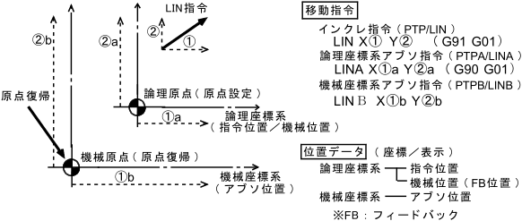

# ECHATROLINK-Ⅲ仕様 FA-M3R専用オープンモーションコントローラ

PLMC-M3EXユーザーズマニュアル

PLMC-M3EXの御購入ありがとうございます。

PLMC-M3EXとFA-M3Rの通信では「間接指定命令」を使っています。従って、FA-M3RのCPUモジュールはF3SP□□-□Sのタイプで使用できます。 FA-M3Rの購入に際しては、ご注意下さい。

ご注意

PLMC-M3EXのデータ書き込み(運転プログラム、パラメータなど)の直後(2秒間)は電源を切断しないでください。パラメータバックアップエラーとなる可能性があります。

基本的な MECHATROLINK-Ⅲ仕様に、対応しています。

MECHATROLINK-Ⅲ各製品との実際の接続可否については、テクノにご確認ください。

お願い

このマニュアルの記載内容について、まちがいや不明な点がありましたら、お手数ですがFAXまたはメールにてテクノへお知らせ下さい。今後さらに改善していきます。

株式会社テクノ

〒358-0011 埼玉県入間市下藤沢1304-5 TEL 04-2964-3677 FAX 04-2964-3322 E-mail mail@open-mc.com

Ｖer. 1.1 2014.8.5

まえがき

PLMC-M3EXをご使用いただきありがとうございます。

PLMC-M3EXはテクノオープンモーションコントローラのメリットを継承した横河電機PLC｢FA-M3R｣専用の MECHATROLINK-Ⅲ仕様のモーションコントローラです。

このマニュアルは、PLMC-M3EXを実際に使用し、機械や周辺電気品(制御盤など)の設計をしていただくために「PLMC-M3EXの導入方法」「PLMC-M3EXのハードウェア」「PLMC-M3EXの機能」「試運転・調整方法」「メンテナンス」について説明しています。

本書以外にも以下のマニュアルや資料がありますので、あわせて御覧下さい。

| □   | PLMC-M3EX ROMSW(ロムスイッチ)設定ソフトマニュアル                  | TB00-0982   |
|-----|----------------------------------------------------|-------------|
| □   | PLMC-M3EX セッティングPC(標準運転)ソフトマニュアル                   | TB00-0981   |
| □   | FA-M3Rサンプルラダープログラム説明書                              | TB00-0987   |
| □   | また、PCソフトを開発される方は、以下の説明書もご覧下さい。通信ライブラリーリファレンスマニュアル | TB00-0983   |
| □   | 送受信データ説明書                                          | TB00-0984   |
| □   | Tコードテキストプログラム変換ライブラリーマニュアル                        | TB00-0985   |
| □   | Gコードテキストプログラム変換ライブラリーマニュアル                        | TB00-0986   |

必要に応じて以下も参照下さい。(正確な文書番号は、各メーカへ直接ご確認お願いします)

- 横河電機FA-M3R関連マニュアル
- 安川電機MECHATROLINK/Σサーボ関連マニュアル

| イーサネットIFモジュール取扱説明書   | イーサネットIFモジュール取扱説明書   | IM36M6H21-01   |
|----------------------|----------------------|----------------|
| パソコンリンクモジュール取扱説明書    | パソコンリンクモジュール取扱説明書    | IM34M6H41-02   |
| 光FAバスモジュール取扱説明書      | 光FAバスモジュール取扱説明書      | IM34M6H45-01   |
| シーケンスCPU説明書          | 命令編                  | IM34M6P12-03   |
| シーケンスCPU説明書          | 機能編                  | IM34M6P13-01   |

Σシリーズ MECHATROLINK-Ⅲ仕様サーボマニュアル

- 目次 -

| Ⅰ 導                                                                                                           | …………………………………………………………………………………………………………………… 入編 A1   |
|---------------------------------------------------------------------------------------------------------------|-------------------------------------------------------|
| ………………………………………………………………………… 1．導入から運転・実稼働までの全体の作業(概要) ………………………………………………………………………………… 2．初期導入作業(購入後の初めての作業)   | A1 A3                                                 |
| ……………………………………………………………………………………………………… 2-1. 員数チェック!                                                          | A3                                                    |
| …………………………………………………………… 2-2. マニュアルをご覧下さい ! (HPからダウンロード)                                                       | A4                                                    |
| ……………………………………………………………………………………………… 2-3. PCソフトインストール                                                         | A4                                                    |
| ……………………………………………………………………………………… 2-4. FA-M3□のモジュールの組立                                                        | A5                                                    |
| ……………………………………………………………………… 2-5. WideField□によるFA-M3□とPCの通信確認                                                  | A5                                                    |
| …………………………………………………………………………………………………… 2-5-1.接続操作例                                                            | A6                                                    |
| ………………………………………… 2-5-1-1. イーサネット接続の操作例(イーサネットモジュール)                                                           | A6                                                    |
| …………………………… 2-5-1-2. イーサネット接続の操作例(ネットワーク搭載型CPUモジュール)                                                          | A6                                                    |
| …………………… 2-5-1-3. RS232接続の操作例(CPUモジュール:プログラミングツール接続ポート)                                                       | A6                                                    |
| …………………………………………………………………………………… 2-5-1-4. USB接続の操作例                                                           | A6                                                    |
| ………………………………………………………………………………………… 2-5-1-5. 通信確認手順                                                            | A6                                                    |
| …………………………………………………………………………………………… 2-6. PLMC-M3EXとPCとの通信                                                     |                                                       |
|                                                                                                               | A7                                                    |
| ……………………………………………………………………… 2-6-1. WideField□による通信設定・確認                                                       | A8                                                    |
| ………………………………………………… 2-6-1-1. PLMC-M3EXとの通信をイーサネットで行う場合                                                        | A8                                                    |
| …………………………………………………………… 2-6-1-2. PLMC-M3EXとの通信をRS232で行う場合                                                     | A9                                                    |
| ………………………………………………………………………………… 2-6-2. イーサネット通信の確認                                                            | A10                                                   |
| …………………………………………………………… 2-6-3. セッティングPCソフト通信設定と通信確認                                                           | A10                                                   |
| ……………………………………………………………………………………… 2-7. ROMSW(ロムスイッチ)の設定                                                       | A12 A13                                               |
| ………………………………………………… 2-8. パラメータ未設定エラー/バックアップメモリエラーの解除 ……………………………………………………………………… 2-8-1. パラメータ初期化／バックアップ       | A14                                                   |
|                                                                                                               | A18                                                   |
| …………………………………………………………………………… 3．1台のPCで複数のPLMC-M3EXを管理する場合                                                     | A18                                                   |
| ……………………………………………………………………………… 3-1. 1台目のPLMC-M3EXのインストール                                                      | A18                                                   |
| ………………………………………………………………………… 3-2. 2台目以降のPLMC-M3EXのインストール                                                      |                                                       |
| ………………………………………………………………………………………… 3-2-1. バージョンの確認                                                            | A18 A18                                               |
| ………………………………………………… 3-2-2. 追加するPLMCが同じソフトウェアバージョンの場合                                                          |                                                       |
| ……………………………………………… 3-2-3. 追加するPLMCが異なるソフトウェアバージョンの場合 …………………………………………………………………………………………………… 4．通信接続の設定／確認      | A18 A19                                               |
| …………………………………………………………………………………………………………… 4-1. 通信設定                                                           | A19                                                   |
| …………………………………………………………………………………………………………… 4-2. 通信確認                                                           | A20                                                   |
| ………………………………………………………………………………………………………… 5．アンインストール ……………………………………………………………………………………………………… 6．PLMC-M3EX/PCの交換 | A20 A21                                               |
| …………………………………………………………………………………………………… 6-1. PLMC-M3EXの交換                                                      | A21                                                   |
| …………………………………………………………………………… 6-1-1. 元のPLMC-M3EXが動作する場合 6-1-2. 元のPLMC-M3EXが動作しない場合                            | A21                                                   |
| …………………………………………………………………………                                                                                  | A22                                                   |
| …………………………………………………………………………………………………………… 6-2. PCの交換                                                          | A22                                                   |
| …………………………………………………………………………………… 6-2-1. 元のPCが動作する場合                                                           | A22                                                   |
| ………………………………………………………………………………… 6-2-2. 元のPCが動作しない場合 ………………………………………………………………………………………………………………… 7．ダミー運転      | A22 A23                                               |
| ……………………………………………………………………………………………………… 7-1. ROMSWの設定                                                         | A23 A24                                               |
| …………………………………………………………………………………… 7-2. セッティングPCソフトを起動                                                          |                                                       |
| ……………………………………………………………………………………………… 7-3. ダミーで運転・操作 7-3-1. 手動操作（ジョグ／インチング）                                    | A24 A25                                               |
| ………………………………………………………………………                                                                                   | A25                                                   |
| …………………………………………………………………………………… 7-3-2. ワンショット位置決め                                                            | A28                                                   |
| …………………………………………………………………………………………… 7-3-3. ホーム位置決め                                                            |                                                       |
| ………………………………………………………………………… 7-3-4. 運転プログラムのダウンロード                                                            | A28                                                   |
| ……………………………………………………………………………… 7-3-5. 自動モードでメモリー運転                                                            | A29                                                   |
| 7-3-6. ティーチング画面でシングルステップ運転                                                                                    |                                                       |
| …………………………………………………………… …………………………………………………………………………………………………… 7-4. 他の画面をみる                                   | A29 A30                                               |

| 7-5. その他の運転の準備                                                                  | ……………………………………………………………………………………………… A30                                  |
|---------------------------------------------------------------------------------|---------------------------------------------------------------------------|
| 7-5-1. アラームの解除                                                                  | …………………………………………………………………………………………… A30                                   |
| 7-5-2. PLMC-M3EX電源オフ → 再度オン                                                   | ……………………………………………………………………… A30                                           |
| 8．モータ単体運転の準備                                                                   | …………………………………………………………………………………………………… A31                                |
| 8-1. 配線準備 8-2.                                                                  | …………………………………………………………………………………………………………… A31                             |
| 組立・配線・配線チェック                                                                    | ……………………………………………………………………………………… A31                                     |
| 8-3. Σサーボアンプの設定                                                                 | …………………………………………………………………………………………… A32                                   |
| 8-4. PLMC-M3EXのROMSWの設定                                                         | ………………………………………………………………………………………… A33                                    |
| 8-5. サーボアンプの設定                                                                  | ……………………………………………………………………………………………… A34                                  |
| …………………………………………………………………………………………………………… 9．モータ単体運転 9-1.                       | A35 A35                                                                   |
| サーボ主電源投入シーケンス 9-2. サーボロックの確認                                                    | …………………………………………………………………………………… ……………………………………………………………………………………………… A35 |
| 9-3. サーボの異常                                                                     | ……………………………………………………………………………………………………… A35                               |
| 9-4. 手動/自動運転                                                                    | ……………………………………………………………………………………………………… A35                               |
| 10．導入編の補足資料                                                                    | ……………………………………………………………………………………………………… A36                               |
| 10-1. 出荷リストサンプル                                                                 | ……………………………………………………………………………………………… A36                                  |
| 10-2. 出荷CDの中身                                                                   | ……………………………………………………………………………………………………… A37                               |
| 10-4. ソフトウェアバージョン                                                               | ………………………………………………………………………………………… A38                                    |
| 10-4-1. ソフトウェアバージョンの付け方                                                         | ……………………………………………………………………… A38                                           |
| 10-4-2.                                                                         | A38                                                                       |
| ソフトウェアバージョンの確認方法                                                                | ……………………………………………………………………                                                |
| …………………………………………………………………………………………………………… ハードウェア編                               | B1                                                                        |
| Ⅱ 1. PLMC-M3EXハードウェア一般仕様                                                        | ………………………………………………………………………………………… B1                                     |
| 2. 外観                                                                           | ………………………………………………………………………………………………………………………… B1                         |
| 3. サーボアンプとの接続 MECHATROLINK-Ⅲ                                                    | ……………………………………………………………………………… B1                                         |
| 4. サーボ周辺接続                                                                      | …………………………………………………………………………………………………………… B1                              |
| ………………………………………………………………………………… 5. フラッシュメモリの書き込み回数制限                            | B2                                                                        |
| 5-1. 高頻度なフラッシュメモリの書き込みの可能性 ………………………………………………………………………………………… 5-2. バックアップデータの種類 | ………………………………………………………………… B2 B2                                           |
| …………………………………………………………………………………………………………………………                                  | D1                                                                        |
| Ⅲ 機能編                                                                           | D1                                                                        |
| ……………………………………………………………………………………………………………………… 1．機能概要 1-1．FA-M3Rのラダー制御による運転・操作   | …………………………………………………………………………… D1                                          |
| 1-1-1．FA-M3□インターフェース概要                                                          | …………………………………………………………………………… D1                                          |
| 1-1-2．入出力による運転(簡単操作)                                                            | ……………………………………………………………………………… D1                                         |
| 1-1-3．ラダー/RTOSソフトからのコマンド運転                                                      | ………………………………………………………………… D2                                              |
| 1-1-4．FA-M3□ライン制御 1-2．PCからの運転・操作(パソコンリンク経由)                                     | ………………………………………………………… D2 ……………………………………………………………………… D3                  |
| 1-2-1．セッテングPCソフトによる運転                                                           | …………………………………………………………………………… D3                                          |
| 1-2-2．専用PCアプリケーションによる運転                                                         | ……………………………………………………………………… D3                                            |
| 1-2-3．ROMSWソフトによるPLMC-M3EXの設定                                                   | ……………………………………………………………………… D4                                            |
| 1-3．PLMC-M3EX 機能リスト                                                             | …………………………………………………………………………………………… D5                                    |
| 1-3-1．PLMC-M3EX本体機能リスト                                                          | ………………………………………………………………………………… D5                                        |
| 1-3-2．機械操作パネル機能リスト                                                              | ………………………………………………………………………………… D7                                        |
| 1-3-3．セッティングPC機能リスト(PC)                                                         | …………………………………………………………………………… D7                                          |
| 1-3-4．通信コマンド機能リスト(PC/ラダー) 基本仕様                                                  | …………………………………………………………………… D8 ………………………………………………………………………………………………        |
| 1-4．PLMC-M3EX                                                                   | D9                                                                        |
| ………………………………………………………………………………………………………………… 2．入出力機能                             | D11                                                                       |
|                                                                                 | …………………………………………………………………………………………… D11                                   |
| 2-1．入力信号の名称と機能 2-1-1．一般入力                                                       | …………………………………………………………………………………………………… D11                                |
| 2-1-2．補助機能入力                                                                    | ……………………………………………………………………………………………… D13                                  |
|                                                                                 | …………………………………………………………………………………………………… D13                                |
| 2-1-3．汎用入力 2-1-4．軸制御関連入力                                                        | …………………………………………………………………………………………… D14                                   |
| 2-1-5．機械操作パネル入力                                                                 | ……………………………………………………………………………………… D14 …………………………………………………………………………        |
| 2-1-6．機械操作パネル入力の補足説明                                                            | D15                                                                       |

| ……………………………………………………………………… 2-1-7．機械操作パネル入力のモード選択                                                                                                         | ……………………………………………………………………… 2-1-7．機械操作パネル入力のモード選択                                                                                                         | ……………………………………………………………………… 2-1-7．機械操作パネル入力のモード選択                                                                                                         | ……………………………………………………………………… 2-1-7．機械操作パネル入力のモード選択                                                                                                         | D17                                               |
|-----------------------------------------------------------------------------------------------------------------------------------------------------------|-----------------------------------------------------------------------------------------------------------------------------------------------------------|-----------------------------------------------------------------------------------------------------------------------------------------------------------|-----------------------------------------------------------------------------------------------------------------------------------------------------------|---------------------------------------------------|
| …………………………………………………………………………………………… 2-2．出力信号の名称と機能                                                                                                        | …………………………………………………………………………………………… 2-2．出力信号の名称と機能                                                                                                        | …………………………………………………………………………………………… 2-2．出力信号の名称と機能                                                                                                        | …………………………………………………………………………………………… 2-2．出力信号の名称と機能                                                                                                        | D18                                               |
| ………………………………………………………………………………………… 2-3．標準入出力チャンネル表                                                                                                        | ………………………………………………………………………………………… 2-3．標準入出力チャンネル表                                                                                                        | ………………………………………………………………………………………… 2-3．標準入出力チャンネル表                                                                                                        | ………………………………………………………………………………………… 2-3．標準入出力チャンネル表                                                                                                        | D20                                               |
| ……………………………………………………………… 2-3-1．入力信号チャンネル（デフォルト設定）                                                                                                         | ……………………………………………………………… 2-3-1．入力信号チャンネル（デフォルト設定）                                                                                                         | ……………………………………………………………… 2-3-1．入力信号チャンネル（デフォルト設定）                                                                                                         | ……………………………………………………………… 2-3-1．入力信号チャンネル（デフォルト設定）                                                                                                         | D20                                               |
| ……………………………………………………… 2-3-2．出力信号のアドレス/bit/名称(デフォルト設定)                                                                                                     | ……………………………………………………… 2-3-2．出力信号のアドレス/bit/名称(デフォルト設定)                                                                                                     | ……………………………………………………… 2-3-2．出力信号のアドレス/bit/名称(デフォルト設定)                                                                                                     | ……………………………………………………… 2-3-2．出力信号のアドレス/bit/名称(デフォルト設定)                                                                                                     | D23                                               |
| …………………………………………………………………………………………… 2-4．標準入出力の割り当て                                                                                                        | …………………………………………………………………………………………… 2-4．標準入出力の割り当て                                                                                                        | …………………………………………………………………………………………… 2-4．標準入出力の割り当て                                                                                                        | …………………………………………………………………………………………… 2-4．標準入出力の割り当て                                                                                                        | D25                                               |
| ………………………………………………………………………………………………………………… 3．動作モード                                                                                                      | ………………………………………………………………………………………………………………… 3．動作モード                                                                                                      | ………………………………………………………………………………………………………………… 3．動作モード                                                                                                      | ………………………………………………………………………………………………………………… 3．動作モード                                                                                                      | D26                                               |
| ……………………………………………………………………………………… 3-1．各動作モードと主な機能                                                                                                        | ……………………………………………………………………………………… 3-1．各動作モードと主な機能                                                                                                        | ……………………………………………………………………………………… 3-1．各動作モードと主な機能                                                                                                        | ……………………………………………………………………………………… 3-1．各動作モードと主な機能                                                                                                        | D26                                               |
| …………………………………………………………………………………………………… 4.FA-M3□インターフェース                                                                                                   | …………………………………………………………………………………………………… 4.FA-M3□インターフェース                                                                                                   | …………………………………………………………………………………………………… 4.FA-M3□インターフェース                                                                                                   | …………………………………………………………………………………………………… 4.FA-M3□インターフェース                                                                                                   | E1 E1                                             |
| ……………………………………………………………………………………………… 4-1．FA-M3□とPLMCの関係 ………………………………………………………………………………………………………… 4-2．入出力リレー                                               | ……………………………………………………………………………………………… 4-1．FA-M3□とPLMCの関係 ………………………………………………………………………………………………………… 4-2．入出力リレー                                               | ……………………………………………………………………………………………… 4-1．FA-M3□とPLMCの関係 ………………………………………………………………………………………………………… 4-2．入出力リレー                                               | ……………………………………………………………………………………………… 4-1．FA-M3□とPLMCの関係 ………………………………………………………………………………………………………… 4-2．入出力リレー                                               | E2                                                |
| …………………………………………………………………………………………… 4-3．特殊モジュールレジスタ                                                                                                       | …………………………………………………………………………………………… 4-3．特殊モジュールレジスタ                                                                                                       | …………………………………………………………………………………………… 4-3．特殊モジュールレジスタ                                                                                                       | …………………………………………………………………………………………… 4-3．特殊モジュールレジスタ                                                                                                       | E2                                                |
| …………………………………………………………………… 4-4．通信データレジスタ領域を使用した通信機能                                                                                                       | …………………………………………………………………… 4-4．通信データレジスタ領域を使用した通信機能                                                                                                       | …………………………………………………………………… 4-4．通信データレジスタ領域を使用した通信機能                                                                                                       | …………………………………………………………………… 4-4．通信データレジスタ領域を使用した通信機能                                                                                                       | E3                                                |
| ……………………………………………………………………………………………… 4-4-1．通信処理の概要                                                                                                        | ……………………………………………………………………………………………… 4-4-1．通信処理の概要                                                                                                        | ……………………………………………………………………………………………… 4-4-1．通信処理の概要                                                                                                        | ……………………………………………………………………………………………… 4-4-1．通信処理の概要                                                                                                        | E3                                                |
| ……………………………………………………………………………… 4-4-2．通信データレジスタ領域詳細                                                                                                        | ……………………………………………………………………………… 4-4-2．通信データレジスタ領域詳細                                                                                                        | ……………………………………………………………………………… 4-4-2．通信データレジスタ領域詳細                                                                                                        | ……………………………………………………………………………… 4-4-2．通信データレジスタ領域詳細                                                                                                        | E3                                                |
| ……………………………………………………………………………………………………… 4-5．サンプルラダー                                                                                                       | ……………………………………………………………………………………………………… 4-5．サンプルラダー                                                                                                       | ……………………………………………………………………………………………………… 4-5．サンプルラダー                                                                                                       | ……………………………………………………………………………………………………… 4-5．サンプルラダー                                                                                                       | E4                                                |
| ………………………………………………………………………………………… 4-5-1．コピーして使う部分                                                                                                        | ………………………………………………………………………………………… 4-5-1．コピーして使う部分                                                                                                        | ………………………………………………………………………………………… 4-5-1．コピーして使う部分                                                                                                        | ………………………………………………………………………………………… 4-5-1．コピーして使う部分                                                                                                        | E4                                                |
| ………………………………………………………………………………… 4-5-2．参考にするサンプルラダー                                                                                                        | ………………………………………………………………………………… 4-5-2．参考にするサンプルラダー                                                                                                        | ………………………………………………………………………………… 4-5-2．参考にするサンプルラダー                                                                                                        | ………………………………………………………………………………… 4-5-2．参考にするサンプルラダー                                                                                                        | E4                                                |
| …………………………………………………………………………………………………… 5.サーボ制御（一般仕様）                                                                                                      | 5-1．座標系                                                                                                                                                   | …………………………………………………………………………………………………… 5.サーボ制御（一般仕様）                                                                                                      | …………………………………………………………………………………………………… 5.サーボ制御（一般仕様）                                                                                                      | E5 ………………………………………………………………………………………………………………… E5 |
| ………………………………………………………………………………………… 5-2．アブソ指令とインクレ指令                                                                                                       | ………………………………………………………………………………………… 5-2．アブソ指令とインクレ指令                                                                                                       | ………………………………………………………………………………………… 5-2．アブソ指令とインクレ指令                                                                                                       | ………………………………………………………………………………………… 5-2．アブソ指令とインクレ指令                                                                                                       | E5 E6                                             |
| ……………………………………………………………………………… 5-3．補間加減速 (指数形/直線形/S字)                                                                                                     | ……………………………………………………………………………… 5-3．補間加減速 (指数形/直線形/S字)                                                                                                     | ……………………………………………………………………………… 5-3．補間加減速 (指数形/直線形/S字)                                                                                                     | ……………………………………………………………………………… 5-3．補間加減速 (指数形/直線形/S字)                                                                                                     |                                                   |
| ………………………………………………………………………………………………………… 5-4．直線形加減速                                                                                                       | ………………………………………………………………………………………………………… 5-4．直線形加減速                                                                                                       | ………………………………………………………………………………………………………… 5-4．直線形加減速                                                                                                       | ………………………………………………………………………………………………………… 5-4．直線形加減速                                                                                                       | E6                                                |
| ……………………………………………………………………………………… 5-5．PTP制御(位置決め) PTP/G00                                                                                                 | 5-6．直線補間                                                                                                                                                  | ……………………………………………………………………………………… 5-5．PTP制御(位置決め) PTP/G00                                                                                                 | ………………………………………………………………………………………                                                                                                                         | E7 LIN/GO1 E7                                     |
| …………………………………………………………………… 5-7．円弧補間 CIRR、CIRL / G02、G03                                                                                                   | …………………………………………………………………… 5-7．円弧補間 CIRR、CIRL / G02、G03                                                                                                   | …………………………………………………………………… 5-7．円弧補間 CIRR、CIRL / G02、G03                                                                                                   | …………………………………………………………………… 5-7．円弧補間 CIRR、CIRL / G02、G03                                                                                                   | E8                                                |
| ………………………………………………………………………………………………… 5-7-1．プリ解析方式                                                                                                        | ………………………………………………………………………………………………… 5-7-1．プリ解析方式                                                                                                        | ………………………………………………………………………………………………… 5-7-1．プリ解析方式                                                                                                        | ………………………………………………………………………………………………… 5-7-1．プリ解析方式                                                                                                        | E8                                                |
| ……………………………………………………………………………………………… 5-7-2．ボード内部方式                                                                                                        | ……………………………………………………………………………………………… 5-7-2．ボード内部方式                                                                                                        | ……………………………………………………………………………………………… 5-7-2．ボード内部方式                                                                                                        | ……………………………………………………………………………………………… 5-7-2．ボード内部方式                                                                                                        | E8                                                |
| ……………………………………………………………………………………………………………… 5-8．手動送り                                                                                                       | ……………………………………………………………………………………………………………… 5-8．手動送り                                                                                                       | ……………………………………………………………………………………………………………… 5-8．手動送り                                                                                                       | ……………………………………………………………………………………………………………… 5-8．手動送り                                                                                                       | E9                                                |
| …………………………………………………………………………………………… 5-8-1．ジョグ(JOG)送り                                                                                                      | …………………………………………………………………………………………… 5-8-1．ジョグ(JOG)送り                                                                                                      | …………………………………………………………………………………………… 5-8-1．ジョグ(JOG)送り                                                                                                      | …………………………………………………………………………………………… 5-8-1．ジョグ(JOG)送り                                                                                                      | E9 E9                                             |
| ……………………………………………………………………………………… 5-8-2．インチング送り(手動)                                                                                                       | ……………………………………………………………………………………… 5-8-2．インチング送り(手動)                                                                                                       | ……………………………………………………………………………………… 5-8-2．インチング送り(手動)                                                                                                       | ……………………………………………………………………………………… 5-8-2．インチング送り(手動)                                                                                                       |                                                   |
| …………………………………………………………………………………………… 5-9．インポジションチェック                                                                                                       | …………………………………………………………………………………………… 5-9．インポジションチェック                                                                                                       | …………………………………………………………………………………………… 5-9．インポジションチェック                                                                                                       | …………………………………………………………………………………………… 5-9．インポジションチェック                                                                                                       | E9                                                |
| ………………………………………………………………………………… 5-10．なめらかな送り制御(パス機能)                                                                                                      | ………………………………………………………………………………… 5-10．なめらかな送り制御(パス機能)                                                                                                      | ………………………………………………………………………………… 5-10．なめらかな送り制御(パス機能)                                                                                                      | ………………………………………………………………………………… 5-10．なめらかな送り制御(パス機能)                                                                                                      | E10                                               |
| …………………………………………………………………………………………… 5-11．シングルステップ動作                                                                                                       | …………………………………………………………………………………………… 5-11．シングルステップ動作                                                                                                       | …………………………………………………………………………………………… 5-11．シングルステップ動作                                                                                                       | …………………………………………………………………………………………… 5-11．シングルステップ動作                                                                                                       | E11                                               |
| ……………………………………………………………………………………………………… 5-12．サイクル運転                                                                                                       | ……………………………………………………………………………………………………… 5-12．サイクル運転                                                                                                       | ……………………………………………………………………………………………………… 5-12．サイクル運転                                                                                                       | ……………………………………………………………………………………………………… 5-12．サイクル運転                                                                                                       | E11 E11                                           |
| ……………………………………………………………………………………………… 5-13．オーバーライド機能                                                                                                       | ……………………………………………………………………………………………… 5-13．オーバーライド機能                                                                                                       | ……………………………………………………………………………………………… 5-13．オーバーライド機能                                                                                                       | ……………………………………………………………………………………………… 5-13．オーバーライド機能                                                                                                       | E12                                               |
| ……………………………………………………………………………………………… 5-14．ストロークリミット …………………………………………………………………………………… 5-15．軸制御に関するその他の機能                                                   | ……………………………………………………………………………………………… 5-14．ストロークリミット …………………………………………………………………………………… 5-15．軸制御に関するその他の機能                                                   | ……………………………………………………………………………………………… 5-14．ストロークリミット …………………………………………………………………………………… 5-15．軸制御に関するその他の機能                                                   | ……………………………………………………………………………………………… 5-14．ストロークリミット …………………………………………………………………………………… 5-15．軸制御に関するその他の機能                                                   | E13                                               |
| ………………………………………………………………………………………… 5-15-1．周回処理(回転軸)                                                                                                       | ………………………………………………………………………………………… 5-15-1．周回処理(回転軸)                                                                                                       | ………………………………………………………………………………………… 5-15-1．周回処理(回転軸)                                                                                                       | ………………………………………………………………………………………… 5-15-1．周回処理(回転軸)                                                                                                       | E13                                               |
| ………………………………………………………………………………… 5-15-2．回転速度指令 SPIN/G120 ………………………………… 5-15-3．ねじ切り機能(同期送り) <オプション> (計画中)                                                   | ………………………………………………………………………………… 5-15-2．回転速度指令 SPIN/G120 ………………………………… 5-15-3．ねじ切り機能(同期送り) <オプション> (計画中)                                                   | ………………………………………………………………………………… 5-15-2．回転速度指令 SPIN/G120 ………………………………… 5-15-3．ねじ切り機能(同期送り) <オプション> (計画中)                                                   | ………………………………………………………………………………… 5-15-2．回転速度指令 SPIN/G120 ………………………………… 5-15-3．ねじ切り機能(同期送り) <オプション> (計画中)                                                   | E13                                               |
| ……………………………………………… 5-15-4．同一指令2軸制御 <オプション> E14                                                                                                            | ……………………………………………… 5-15-4．同一指令2軸制御 <オプション> E14                                                                                                            | ……………………………………………… 5-15-4．同一指令2軸制御 <オプション> E14                                                                                                            | ……………………………………………… 5-15-4．同一指令2軸制御 <オプション> E14                                                                                                            | E14                                               |
|                                                                                                                                                           |                                                                                                                                                           |                                                                                                                                                           |                                                                                                                                                           | E15                                               |
| ……………………………………………… 5-15-5．接線制御軸機能 <オプション>                                                                                                                 | ……………………………………………… 5-15-5．接線制御軸機能 <オプション>                                                                                                                 | ……………………………………………… 5-15-5．接線制御軸機能 <オプション>                                                                                                                 | ……………………………………………… 5-15-5．接線制御軸機能 <オプション>                                                                                                                 |                                                   |
| ……………………………………………… 5-15-6．センサーラッチ機能（スキップ機能） <オプション> E17                                                                                                   | ……………………………………………… 5-15-6．センサーラッチ機能（スキップ機能） <オプション> E17                                                                                                   | ……………………………………………… 5-15-6．センサーラッチ機能（スキップ機能） <オプション> E17                                                                                                   | ……………………………………………… 5-15-6．センサーラッチ機能（スキップ機能） <オプション> E17                                                                                                   |                                                   |
| ………………………………… 5-15-7．コンベア追従送り同調・同期送り <オプション> (計画中) E18 ………………………………………………………………………………… 5-15-8．直径指令 <オプション> E19                                           | ………………………………… 5-15-7．コンベア追従送り同調・同期送り <オプション> (計画中) E18 ………………………………………………………………………………… 5-15-8．直径指令 <オプション> E19                                           | ………………………………… 5-15-7．コンベア追従送り同調・同期送り <オプション> (計画中) E18 ………………………………………………………………………………… 5-15-8．直径指令 <オプション> E19                                           | ………………………………… 5-15-7．コンベア追従送り同調・同期送り <オプション> (計画中) E18 ………………………………………………………………………………… 5-15-8．直径指令 <オプション> E19                                           |                                                   |
| ………………………………… 5-15-9．フレキシブル電子カム制御 <オプション>                                                                                                                 | ………………………………… 5-15-9．フレキシブル電子カム制御 <オプション>                                                                                                                 | ………………………………… 5-15-9．フレキシブル電子カム制御 <オプション>                                                                                                                 | ………………………………… 5-15-9．フレキシブル電子カム制御 <オプション>                                                                                                                 | E20                                               |
|                                                                                                                                                           |                                                                                                                                                           |                                                                                                                                                           |                                                                                                                                                           | E21                                               |
|                                                                                                                                                           | 5-15-10．巻線指令                                                                                                                                              | <オプション>                                                                                                                                                   | (計画中)                                                                                                                                                     |                                                   |
| ……………………………………………… 5-15-11．トルク指令 <オプション>                                                                                                                  | ……………………………………………… 5-15-11．トルク指令 <オプション>                                                                                                                  | ……………………………………………… 5-15-11．トルク指令 <オプション>                                                                                                                  | ……………………………………………… 5-15-11．トルク指令 <オプション>                                                                                                                  | E22                                               |
| ……………………………………………… ………………………………………………………………………………………… 5-16．主軸機能 <オプション>                                                                                   | ……………………………………………… ………………………………………………………………………………………… 5-16．主軸機能 <オプション>                                                                                   | ……………………………………………… ………………………………………………………………………………………… 5-16．主軸機能 <オプション>                                                                                   | ……………………………………………… ………………………………………………………………………………………… 5-16．主軸機能 <オプション>                                                                                   | E23                                               |
| …………………………………………………………………………………………………………… 5-17．補正機能                                                                                                       | …………………………………………………………………………………………………………… 5-17．補正機能                                                                                                       | …………………………………………………………………………………………………………… 5-17．補正機能                                                                                                       | …………………………………………………………………………………………………………… 5-17．補正機能                                                                                                       | E24                                               |
|                                                                                                                                                           |                                                                                                                                                           |                                                                                                                                                           |                                                                                                                                                           | E24                                               |
| ………………………………………………………………………………… 5-17-1．バックラッシュ補正機能                                                                                                        | ………………………………………………………………………………… 5-17-1．バックラッシュ補正機能                                                                                                        | ………………………………………………………………………………… 5-17-1．バックラッシュ補正機能                                                                                                        | ………………………………………………………………………………… 5-17-1．バックラッシュ補正機能                                                                                                        |                                                   |
| 5-17-2．工具長補正機能及び摩耗補正機能 <オプション>                                                                                                                            | 5-17-2．工具長補正機能及び摩耗補正機能 <オプション>                                                                                                                            | 5-17-2．工具長補正機能及び摩耗補正機能 <オプション>                                                                                                                            | 5-17-2．工具長補正機能及び摩耗補正機能 <オプション>                                                                                                                            | E24 E26                                           |
| ……………………………………………… ……………………………………………… 5-17-3．工具径補正機能 <オプション> ……………………………………………… 5-17-4．ピッチエラー補正機能 <オプション> ……………………………………………… 5-17-5．形状補正(高精度輪郭制御) <オプション> | ……………………………………………… ……………………………………………… 5-17-3．工具径補正機能 <オプション> ……………………………………………… 5-17-4．ピッチエラー補正機能 <オプション> ……………………………………………… 5-17-5．形状補正(高精度輪郭制御) <オプション> | ……………………………………………… ……………………………………………… 5-17-3．工具径補正機能 <オプション> ……………………………………………… 5-17-4．ピッチエラー補正機能 <オプション> ……………………………………………… 5-17-5．形状補正(高精度輪郭制御) <オプション> | ……………………………………………… ……………………………………………… 5-17-3．工具径補正機能 <オプション> ……………………………………………… 5-17-4．ピッチエラー補正機能 <オプション> ……………………………………………… 5-17-5．形状補正(高精度輪郭制御) <オプション> | E28 E30                                           |
| ……………………………………………………………………………………… 5-18．ティーチング (開発中)                                                                                                      | ……………………………………………………………………………………… 5-18．ティーチング (開発中)                                                                                                      | ……………………………………………………………………………………… 5-18．ティーチング (開発中)                                                                                                      | ……………………………………………………………………………………… 5-18．ティーチング (開発中)                                                                                                      | E35                                               |
|                                                                                                                                                           |                                                                                                                                                           |                                                                                                                                                           |                                                                                                                                                           | E35                                               |
| ……………………………………………………………………………………………… 5-18-1．ティーチング                                                                                                        | ……………………………………………………………………………………………… 5-18-1．ティーチング                                                                                                        | ……………………………………………………………………………………………… 5-18-1．ティーチング                                                                                                        | ……………………………………………………………………………………………… 5-18-1．ティーチング                                                                                                        |                                                   |
| ………………………………………………………………………………………… 5-18-2．「逆行」動作詳細                                                                                                        | ………………………………………………………………………………………… 5-18-2．「逆行」動作詳細                                                                                                        | ………………………………………………………………………………………… 5-18-2．「逆行」動作詳細                                                                                                        | ………………………………………………………………………………………… 5-18-2．「逆行」動作詳細                                                                                                        | E37                                               |
| ……………………………………………………………………………………                                                                                                                          | ……………………………………………………………………………………                                                                                                                          | ……………………………………………………………………………………                                                                                                                          | ……………………………………………………………………………………                                                                                                                          | E38                                               |
| 5-18-3．「スキップ」動作詳細                                                                                                                                         | 5-18-3．「スキップ」動作詳細                                                                                                                                         | 5-18-3．「スキップ」動作詳細                                                                                                                                         | 5-18-3．「スキップ」動作詳細                                                                                                                                         |                                                   |

| 5-18-4．「挿入」動作詳細                                                                                         | ………………………………………………………………………………………… E38                                   |
|---------------------------------------------------------------------------------------------------------|--------------------------------------------------------------------------|
| ………………………………………………………………………………………… 5-18-5．「置換」動作詳細                                                      | E39                                                                      |
| ………………………………………………………………………………… 5-18-6．「原点シフト」動作詳細                                                      | E41                                                                      |
| 5-18-7．「削除」動作詳細                                                                                         | ………………………………………………………………………………………… E41                                   |
| 5-19．補間前加減速(自動コーナオーバライド)機能 <オプション>                                                                      | ……………………………………………… E42                                                   |
| 5-19-1．補間前加減速(自動コーナオーバライド)のメリット                                                                         | ………………………………………………… E42                                                  |
| 5-19-2．補間前加減速(自動コーナオーバライド)の概要                                                                           | ……………………………………………………… E42                                                |
| 5-19-3．補間前加減速(自動コーナオーバライド)をしているときの速度変化(オーバライド)の様子                                                       | …… E42                                                                   |
| 5-19-4．制限事項など                                                                                           | ……………………………………………………………………………………………… E43                                 |
| 5-19-5．加速度(速度変化量)の算出方法                                                                                  | ………………………………………………………………………… E43                                         |
| 5-19-6．パラメータの設定について                                                                                     | ……………………………………………………………………………… E44                                       |
| ……………………………………………………………………………………………………… 5-19-7．動作例                                                      | E45                                                                      |
| 5-19-8．パラメータの選定例                                                                                        | ……………………………………………………………………………………… E46                                    |
| 5-20．独立位置決め                                                                                             | ……………………………………………………………………………………………………… E47                              |
| 5-21．手動パルサ/ジョイスティック <オプション>                                                                             | ……………………………………………… E49                                                   |
| ……………………………………………………………………………………… 5-21-1．ハードウェアの準備                                                      | E49                                                                      |
| ……………………………………………………………………………………………… 5-21-2．手動送り設定                                                      | E49                                                                      |
| 5-21-3．手パモードの選択                                                                                         | ………………………………………………………………………………………… E49                                   |
| 5-21-4．手動運転の条件                                                                                          | …………………………………………………………………………………………… E49                                  |
| ………………………………………………………………………………………………… 5-21-5．信号の流れ運転プログラムの処理と各種運転方法                                    | E49                                                                      |
| 6.                                                                                                      | …………………………………………………………………………………… F1                                      |
| 6-1．運転プログラムの保存の仕組み                                                                                      | …………………………………………………………………………………… F1 ……………………………………………………………………………………… F2 |
| 6-1-1．運転プログラムの容量                                                                                        |                                                                          |
| 6-1-2．運転プログラムの番号管理                                                                                      | ………………………………………………………………………………… F2                                       |
| …………………………………………………………………………………………… 6-1-3．ポイントテーブル …………………………………………………………………………………………… 6-2．運転プログラムの事例   | F2 F3                                                                    |
| 6-3．自動運転におけるステップ動作                                                                                      | …………………………………………………………………………………… F5                                      |
| ………………………………………………………………………………………………………                                                                 | F5                                                                       |
| 6-3-1．自動運転 6-3-2．シングル運転(順行)                                                                             | ………………………………………………………………………………………… F5                                    |
| 6-3-3．ステップ間停止                                                                                           | ……………………………………………………………………………………………… F5                                  |
| …………………………………………………………………………………………… 6-3-4．ステップ途中停止                                                      | F5                                                                       |
| 6-3-5．逆行(ステップ逆行) （開発中）                                                                                  | ……………………………………………………………………… F5                                           |
| ………………………………………………………………………… 6-4．プリ解析処理(テキスト→バイナリ変換) ………………………………………………………………………………                     |                                                                          |
| 6-5．DNC(Direct NC)方式 <オプション>F7                                                                          | F6                                                                       |
| …………………………………………………………………………………………………… 6-6．単独コマンド運転 …………………………………………………………………………………… 6-7．マルチタスク <オプション> | F8 F9                                                                    |
| 補足資料1. 円弧プリ解析処理(ステップ数／処理時間)                                                                             | ……………………………………………………… F11                                                |
| 補足資料2. プリ解円弧精度と送り速度上限値の関係                                                                               | ………………………………………………………… F11                                               |
| ………………………………………………………………………………………………………… 7.運転プログラム詳細                                                    | F12                                                                      |
| 7-1．テクノコード運転プログラム命令 ………………………………………………………………………………………… 7-1-1．運転プログラム例                                   | ……………………………………………………………………………… F12                                       |
| ………………………………………………………………………………………………… 7-1-2．付加データ                                                       | F13 F14                                                                  |
| 7-1-2-1．付加データアドレス付き数値指定 ……………………………………………………………………………………………                                             | ……………………………………………………………… F14                                             |
| 7-1-2-2．数値指定                                                                                            | F15                                                                      |
| ………………………………………………………………………………………… 7-1-2-3．ラベル指定 …………………………………………………………………………………………                     | F15                                                                      |
| 7-1-3．指令フォーマット                                                                                          | F15                                                                      |
| ……………………………………………………………………………………… 7-1-3-1．指令の表記例 7-1-3-2．「軸単位」と「速度単位」                                   | F15 ……………………………………………………………………… F15                                      |
|                                                                                                         | ……………………………………………………………………… F16                                          |
| 7-1-3-3．「軸範囲」と「速度範囲」                                                                                    |                                                                          |
| 7-1-4．テクノコードプログラムの詳細（Gr1aグループ） 7-1-4-1．PTP : インクレPTP移動指令                                                | …………………………………………………… F17                                                 |
| PTPA : 論理座標上の位置へのPTP移動指令                                                                                |                                                                          |
| PTPB : 機械座標上の位置へのPTP移動指令 7-1-4-2．LIN : インクレ直線補間移動指令                                                     | …………………………………………………… F17                                                 |
| :                                                                                                       |                                                                          |
| LINA                                                                                                    | 論理座標上の位置への直線補間移動指令 …………………………………………… 機械座標上の位置への直線補間移動指令                  |
| LINB :                                                                                                  | F18                                                                      |
| 7-1-4-3．CIRR : インクレ円弧補間(ヘリカル)時計方向回り                                                                     | （CW）                                                                     |
| CIRL : インクレ円弧補間(ヘリカル)反時計方向回り（CCW） CIRRA 論理座標系アブソ円弧補間(ヘリカル)時計方向回り                                        | （CW） ……………………                                                            |
| : CIRLA : 論理座標系アブソ円弧補間(ヘリカル)反時計方向回り（CCW）                                                                | F19                                                                      |

| 7-1-4-4．PTMA :                          | ポイント指定PTP位置決め移動<オプション>           | ポイント指定PTP位置決め移動<オプション>                               | ………………………………………… F22           |
|-----------------------------------------|----------------------------------|------------------------------------------------------|--------------------------------|
| 7-1-4-5．LIMA :                          | ポイント指定直線補間                       | <オプション>                                              | ………………………………………… F22           |
| 7-1-4-6．SLIN :                          | センサラッチ直線補間                       | <オプション>                                              |                                |
| SLINC : 7-1-4-7．AXMV : :                | センサラッチ直線補間(移動停止なし) インクレ独立位置決め    |                                                      | ……………………………………………… F23         |
| AXMVA                                   | 論理座標独立位置決め                       |                                                      |                                |
| AXMVB :                                 | 機械座標独立位置決め                       | …………………………………………………………………                            | F24                            |
| 7-1-4-8．TRQ :                           | トルク指令開始命令                        | ……………………………………………………………………                           | F25                            |
| 7-1-4-9．REEL :                          | 巻線指令                             | <オプション>                                              | ………………………………………… F26           |
| 7-1-4-10．TURN :                         | 接線制御Z軸回転                         | <オプション>                                              | ………………………………………… F27           |
| 7-1-4-11．SPIN :                         | 回転速度指令                           | ……………………………………………………………………………                        | F27                            |
| 7-1-4-12．THSET :                        | 工具長補正                            | <オプション>                                              | ………………………………………… F28           |
| 7-1-4-13．THOFF :                        | 工具長補正停止                          | <オプション>                                              | ………………………………………… F28           |
| 7-1-4-14．TSTART:                        | 別タスクプログラム起動                      | <オプション>                                              | ………………………………………… F29           |
| 7-1-4-15．TSTOP :                        | 別タスクストップ                         | <オプション>                                              | ……………………………………… F29            |
| 7-1-4-16．TRESET:                        | 別タスクリセット                         | <オプション>                                              | ………………………………………… F30           |
| 7-1-4-17．PRG :                          | 別タスクプログラム起動                      | <オプション>                                              | ……………………………………… F30            |
| 7-1-4-18．SVON :                         | 各軸サーボON                          | ……………………………………………………………………………                        | F31                            |
| 7-1-4-19．SVOFF :                        | 各軸サーボOFF                         | …………………………………………………………………………                         | F31                            |
|                                         | 7-1-5．テクノコードプログラム指令の詳細（Gr1bグループ） | ………………………………………………                                   | F32                            |
| 7-1-5-1．CALL :                          | サブルーチンコール                        |                                                      | …………………………………………………………………… F32 |
| 7-1-5-2．JMP                             | ジャンプ指定                           | ……………………………………………………………………………                        | F33                            |
| : 7-1-5-3．マクロ演算                         | : 7-1-5-3．マクロ演算                  | <オプション>                                              | ………………………………………… F34           |
| 7-1-5-4．IF                              | 7-1-5-4．IF                       |                                                      |                                |
| ELSE                                    | ELSE                             |                                                      |                                |
| ENDIF : 条件判断 7-1-5-5．SWITCH             | ENDIF : 条件判断 7-1-5-5．SWITCH      | <オプション>                                              | ………………………………………… F35           |
| CASE ENDSWITCH                          | CASE ENDSWITCH                   |                                                      |                                |
| BREAK                                   | BREAK                            |                                                      |                                |
| : 条件判断                                  | : 条件判断                           |                                                      |                                |
| DEFAULT                                 | DEFAULT                          | ………………………………………… <オプション>                             |                                |
|                                         | 7-1-6．テクノコードプログラム指令の詳細（Gr1cグループ） | ………………………………………………                                   | F36 F37                        |
| 7-1-6-1．AXWT : 7-1-6-2．STNE :           | 独立位置決め完了待ち命令接線制御有効              | …………………………………………………………… <オプション>                      | F37 ………………………………………… F37       |
| 7-1-6-3．STND :                          | 接線制御無効                           | ………………………………………… <オプション>                             | F38                            |
| 7-1-6-4．CSET :                          | 論理座標値設定                          | …………………………………………………………………………                         | F38                            |
| :                                       | プログラム終了                          | …………………………………………………………………………                         |                                |
|                                         |                                  |                                                      | F38                            |
| 7-1-6-5．END 7-1-6-6．INPE :              | INPOS有効モード指定                     | ……………………………………………………………………                           | F39                            |
| 7-1-6-7．INPD :                          | INPOS無効モード<デフォルト>指定              | ……………………………………………………                                 | F39                            |
| 7-1-6-8．TRQD :                          | トルク指令終了命令                        | ……………………………………………………………………                           | F39                            |
|                                         | 7-1-7．テクノコードプログラム指令の詳細（Gr2グループ）  | …………………………………………………                                  | F40                            |
| 7-1-7-1．TIM :                           | ステップ実行時間指定                       | …………………………………………………………………                            | F40                            |
| 7-1-7-2．TM :                            | ステップ実行時間指定                       | ……………………………………………… (RTC周期指定)                         | F40                            |
|                                         | 7-1-8．テクノコードプログラム指令の詳細（Gr3グループ）  | …………………………………………………                                  | F41                            |
| 7-1-8-1．ONR_ :                          | 汎用出力セット処理指定                      | ………………………………………………………………                             | F41                            |
| 7-1-8-2．OFR_ :                          |                                  |                                                      | F41                            |
| 7-1-8-3．E□R_                            | 汎用出力リセット処理指定                     | ……………………………………………………………                              |                                |
| :                                       | 汎用入力処理指定（強制終了）                   |                                                      |                                |
| J□R_ :                                  | 汎用入力処理指定（スキップ）                   |                                                      |                                |
|                                         | 汎用入力処理指定（待ち）                     |                                                      |                                |
| W□R_ :                                  | W□R_ :                           |                                                      |                                |
| S□R_ : 汎用入力処理指定（停止）                     | S□R_ : 汎用入力処理指定（停止）              | ……………………………………………………………                              | F42                            |
| 7-1-9．テクノコードプログラム指令の詳細（Gr4グループ）         | 7-1-9．テクノコードプログラム指令の詳細（Gr4グループ）  | …………………………………………………                                  | F43                            |
| 7-1-9-1．MOUT : Mコード出力                   | 7-1-9-1．MOUT : Mコード出力            | ………………………………………………………………………………                       | F43                            |
|                                         |                                  | …………………………………………………………………                            | F44                            |
| 7-1-9-2．MOUT0/MOUT1: 特殊Ｍコード指令           | 7-1-9-2．MOUT0/MOUT1: 特殊Ｍコード指令    | …………………………………………………… 7-1-10．テクノコードプログラムの詳細（Gr5グループ）  | F45                            |
| 7-1-10-1．DL/DR :                        | 工具径補正                            | <オプション>                                              | ………………………………………… F45           |
| 7-1-10-2．DC :                           | 工具径補正停止                          | <オプション>                                              | ………………………………………… F45 F46       |
| 7-1-11．テクノコードプログラムの詳細（その他） 7-1-11-1．PNO | :プログラム番号                         | …………………………………………………………… ………………………………………………………………………… | F46                            |
| 7-1-11-2．':' :                          | ラベル定義                            | ………………………………………………………………………………                       | F46                            |
| 7-1-11-3．"/*"                           | ･･･ "*/" または "「"                 | ･･･ "」" : コメント                                       | ………………………………… F46              |

|                                                                                                                                                 | ………………………………………………………………………………… 7-1-11-4．"//" :コメント   |                                                                                                                                              | F46                                              |               |     |
|-------------------------------------------------------------------------------------------------------------------------------------------------|-------------------------------------------------------|----------------------------------------------------------------------------------------------------------------------------------------------|--------------------------------------------------|---------------|-----|
| ……………………………………………………………………………………… 7-2．Gコード運転プログラム命令                                                                                             |                                                       |                                                                                                                                              | F47                                              |               |     |
| …………………………………………………………………………… 7-2-1．Gコード運転プログラムの概要                                                                                              |                                                       |                                                                                                                                              | F47                                              |               |     |
| ………………………………………………………………………………… 7-2-1-1．Gコード指令一覧                                                                                               |                                                       |                                                                                                                                              | F47                                              |               |     |
| ………………………………………………………………………………… 7-2-1-2．シーケンス番号(N)                                                                                              |                                                       |                                                                                                                                              | F48                                              |               |     |
| ……………………………………………………………… 7-2-1-3．Gコード運転のプログラム途中再開                                                                                               |                                                       |                                                                                                                                              | F48                                              |               |     |
| ………………………………………………………………………………… 7-2-1-4．Gコードのモーダル                                                                                               |                                                       |                                                                                                                                              | F48 F49                                          |               |     |
| …………………………………………………………………………… 7-2-1-5．Gコードプログラム例                                                                                               |                                                       |                                                                                                                                              | F49                                              |               |     |
| ………………………………………………………………………………………………… 7-2-2．付加データ …………………………………………………………………………………………… 7-2-3．指令の表記方法                                            |                                                       |                                                                                                                                              | F50                                              |               |     |
| ………………………………………………………………………………… 7-2-3-1．指令フォーマット                                                                                                |                                                       |                                                                                                                                              | F50                                              |               |     |
| ……………………………………………………………………………………… 7-2-3-2．指令の表記例                                                                                                |                                                       |                                                                                                                                              | F50                                              |               |     |
| ……………………………………………………………………… 7-2-3-3．「軸単位」と「速度単位」                                                                                                |                                                       |                                                                                                                                              | F51                                              |               |     |
| ……………………………………………………………………… 7-2-3-4．「軸範囲」と「速度範囲」                                                                                                |                                                       |                                                                                                                                              | F51                                              |               |     |
| …………………………………………………………… 7-2-4．Gコードプログラムの詳細（Gr1グループ）                                                                                             |                                                       |                                                                                                                                              | F52                                              |               |     |
| 7-2-4-1．G00 : 位置決めPTP移動（インクレ/論理座標系アブソ） 7-2-4-2．G28 : 機械座標上の位置へのPTP移動指令                                                                          |                                                       |                                                                                                                                              |                                                  |               |     |
| ………………………………… F52 …………………………………………………… F52 …………………………………………… 7-2-4-3．G01 : 直線補間（インクレ/論理座標系アブソ） F53 7-2-4-4．G02 : 時計方向回り(CW)円弧補間 (インクレ/論理座標系アブソ) |                                                       |                                                                                                                                              |                                                  |               |     |
| ……………………… G03 : 反時計方向回り(CCW)円弧補間(インクレ/論理座標系アブソ) F54                                                                                             |                                                       |                                                                                                                                              |                                                  |               |     |
| 7-2-4-5．G31                                                                                                                                     |                                                       |                                                                                                                                              |                                                  |               |     |
|                                                                                                                                                 | :                                                     | …………………………………………………………………… センサラッチ直線補間                                                                                                        | F57                                              |               |     |
| 7-2-4-6．G112                                                                                                                                    | :                                                     |                                                                                                                                              | ………………………………………… F57                             |               |     |
| 7-2-4-7．G110                                                                                                                                    |                                                       | 接線制御Z軸回転 <オプション> …………………………………………                                                                                                            | F58                                              |               |     |
|                                                                                                                                                 | :                                                     | 接線制御有効 <オプション>                                                                                                                               |                                                  |               |     |
| 7-2-4-8．G111                                                                                                                                    | :                                                     | ………………………………………… 接線制御無効 <オプション>                                                                                                              | F58                                              |               |     |
| 7-2-4-9．G120 7-2-4-10．G04                                                                                                                       | 7-2-4-11．G43                                          | ………………………………………… 回転速度指令 <オプション> ………………………………………………………………… ステップ実行時間指定                                                                         | F59 F59 F60 F60                                  | :             | : : |
|                                                                                                                                                 |                                                       | ………………………………………… 工具長補正開始 <オプション> ………………………………………… 工具長補正停止 <オプション>                                                                            |                                                  |               |     |
| 7-2-4-12．G49                                                                                                                                    | :                                                     |                                                                                                                                              |                                                  |               |     |
|                                                                                                                                                 |                                                       | …………………………………………………………………… INPOS有効モード指定                                                                                                      |                                                  |               |     |
|                                                                                                                                                 | :                                                     | INPOS無効モード<デフォルト>指定                                                                                                                          | F61                                              |               |     |
| 7-2-4-13．G61                                                                                                                                    |                                                       |                                                                                                                                              |                                                  |               |     |
| 7-2-4-14．G64                                                                                                                                    | : :                                                   | …………………………………………………… …………………………………………………………………………… 論理座標設定                                                                                    | F61                                              |               |     |
|                                                                                                                                                 | 7-2-4-16．G100 :                                       | ………………………………………… ポイント指定PTP位置決め移動<オプション> …………………………………………………… 独立位置決め(機械座標系アブソ)                                                                | F62                                              |               |     |
| 7-2-4-15．G92                                                                                                                                    | :                                                     | 独立位置決め(インクレ/論理座標系アブソ)                                                                                                                        |                                                  |               |     |
| 7-2-4-17．G101 独立位置決め完了待ち命令                                                                                                                      | 7-2-4-18．G104 :                                       | 別タスクプログラム起動 <オプション> 別タスクストップ <オプション> 別タスクリセット <オプション>                                                                                        | F63 F64 …………………………………………………………… F65              | G128          | :   |
|                                                                                                                                                 | 7-2-4-19．G198                                         | …………………………………………                                                                                                                             | F66                                              |               |     |
|                                                                                                                                                 |                                                       | …………………………………………                                                                                                                             |                                                  |               |     |
|                                                                                                                                                 | :                                                     |                                                                                                                                              | F66                                              |               |     |
| 7-2-4-22．M03                                                                                                                                    | :                                                     | ………………………………………… 主軸正転指令 <オプション>                                                                                                              |                                                  |               |     |
|                                                                                                                                                 | M05 : 7-2-4-23．GOTO :                                 | : …………………………………………………………………… : サブルーチンコール                                                                                                     | F67 F67 F68                                      |               |     |
| 7-2-4-24．M30 7-2-4-25．M98                                                                                                                       |                                                       |                                                                                                                                              | F69                                              |               |     |
| 7-2-4-26．M99                                                                                                                                    |                                                       | …………………………………………………………………… サブプログラム終了                                                                                                         | F69                                              |               |     |
| 7-2-4-27．マクロ演算 7-2-4-28．IF                                                                                                                      |                                                       | : ………………………………………… <オプション>                                                                                                                   |                                                  |               |     |
| 7-2-5-1．M 7-2-5-2．M00/M01:                                                                                                                      |                                                       | …………………………………………                                                                                                                             | F73                                              |               | :   |
| 7-2-5-3．S                                                                                                                                       |                                                       | ……………………………………………………………………… ……………………………………………………………………………… : Sコード出力                                                                          | F74                                              |               |     |
| 7-2-5-4．G41/G42 7-2-5-5．G40                                                                                                                     |                                                       | ………………………………………… : 工具径補正 <オプション> 工具径補正停止 <オプション>                                                                                             | F74                                              |               |     |
|                                                                                                                                                 | :                                                     | ………………………………………… ………………………………………………………………… 論理座標系アブソ指定                                                                                        | F75                                              |               |     |
|                                                                                                                                                 | :                                                     |                                                                                                                                              |                                                  |               |     |
| 7-2-5-7．G91                                                                                                                                     |                                                       |                                                                                                                                              | F75                                              |               | :   |
| 7-2-5-8．G17                                                                                                                                     |                                                       |                                                                                                                                              |                                                  |               | :   |
|                                                                                                                                                 |                                                       | インクレ移動量指定                                                                                                                                    |                                                  |               |     |
|                                                                                                                                                 |                                                       | ……………………………………………………………………                                                                                                                   |                                                  |               |     |
|                                                                                                                                                 |                                                       | 円弧平面指定(XY平面）                                                                                                                                 |                                                  |               |     |
| 円弧平面指定(XZ/ZX平面)                                                                                                                                 | G18                                                   |                                                                                                                                              | ……………………………………………………………… F75 TB00-0980-V11.jtd-8 | G19           | : : |
|                                                                                                                                                 |                                                       | 円弧平面指定(YZ平面)                                                                                                                                 |                                                  |               |     |
|                                                                                                                                                 |                                                       | Mコード出力特殊Mコード指令                                                                                                                              |                                                  |               |     |
|                                                                                                                                                 |                                                       | 主軸停止指令ジャンププログラム終了 : 条件判断 7-2-5．Gコードプログラムの詳細(Gr2グループ)                                                                                       |                                                  |               |     |
|                                                                                                                                                 |                                                       | 主軸逆転指令                                                                                                                                       |                                                  |               |     |
|                                                                                                                                                 |                                                       |                                                                                                                                              | F71 F72                                          |               |     |
| 7-2-5-6．G90                                                                                                                                     |                                                       |                                                                                                                                              |                                                  |               |     |
|                                                                                                                                                 |                                                       | <オプション> <オプション> ………………………………………………………………………………… ………………………………………………………………………… <オプション> ……………………………………………………………… ……………………………………………………………………………… | F66 F70 F71                                      | M04 ENDIF     | :   |
|                                                                                                                                                 |                                                       |                                                                                                                                              | ………………………………………… F67                             |               |     |
| 7-2-4-21．G199                                                                                                                                   |                                                       |                                                                                                                                              |                                                  |               |     |
|                                                                                                                                                 | ELSE                                                  |                                                                                                                                              |                                                  |               |     |
|                                                                                                                                                 | :                                                     |                                                                                                                                              |                                                  |               |     |
|                                                                                                                                                 |                                                       |                                                                                                                                              |                                                  | 7-2-4-20．G197 | :   |

| 7-2-5-9．N                                              | ………………………………………………………………………… : シーケンス番号                                                   |
|--------------------------------------------------------|------------------------------------------------------------------------------------------|
| 7-2-6．Gコードプログラムの詳細(その他)                                |                                                                                          |
| 7-2-6-1．PNO : プログラム番号                                  |                                                                                          |
| 7-2-6-2．"/*" ･･･ "*/" : コメント                           |                                                                                          |
| ………………………………………………………………………………………… 7-3．マクロ機能 <オプション>   |                                                                                          |
| ………………………………………………………………………………………………………… 7-3-1．書式      |                                                                                          |
| 7-3-2．マクロ変数使用可能コード                                     | F78 ……………………………………………………………………………… F79                                                   |
| 7-3-3．レジスタ一覧                                           | ……………………………………………………………………………………………… F80                                                 |
| 7-3-4．グローバルマクロ変数                                       | …………………………………………………… #1000〜 F81                                                          |
| 7-3-5．ラダー共有マクロ変数(W/R)                                  | …………………… #1200〜 (FA-M3□←→PLMC-M3EX) F81                                                  |
| 7-3-6．ラダー共有マクロ変数(R)                                    | ……………………… #1300〜 (FA-M3□←PLMC-M3EX) F81                                                  |
| 7-3-7．ローカルマクロ変数(W/R)                                   | …………………………………… #1400〜 (タスク毎) F82                                                         |
| 7-3-8．各種情報                                             | …………………………………………………… #1500〜 F82                                                          |
| 7-3-8-1．全体情報                                           | …………………………………………………… #1500〜 F82                                                          |
| 7-3-8-2．軸ステータス                                         | …………………………………… #1510〜（タスク毎） F83                                                         |
| 7-3-8-3．タスク情報                                          | …………………………………… #1530〜（タスク毎） F84                                                         |
| 7-3-9．入／出力パターン                                        | …………………………………………………… #1600〜 F85                                                          |
| 7-3-10．サーボパラメータ                                        | …………………………………… #2001〜（タスク毎） F86                                                         |
| 7-3-11．工具長補正テーブル                                       | …………………………………… #3000〜（タスク毎） F90                                                         |
|                                                        | …………………………………… #3100〜（タスク毎） F90                                                         |
| 7-3-13．工具径補正テーブル                                       | …………………………………… #3500〜（タスク毎） F91                                                         |
| 7-3-14．ポジションデータ                                        | …………………………………… #4000〜（タスク毎） F92                                                         |
|                                                        | …………………………………… #5000〜（タスク毎） F93 ……………………………… #5200〜5289 F94                             |
| 7-3-15．センサーラッチポジションデータ 7-3-16．メカトロリンクコマンド発行命令用データ(開発中) |                                                                                          |
| 7-3-17．マクロ変数LONGアクセス                                   | …………………………………………………… #5500〜 F94                                                          |
| 7-3-18．HEX 入力データ                                       | …………………………………………………… #6000〜 F95                                                          |
| 7-3-19．内部データ                                           | ………………………………………………… #7100〜 F96 …………………………………… #7100〜（タスク毎） F96                          |
| 7-3-19-1．軸インタロック                                       |                                                                                          |
| 7-3-19-2．軸ネグレクト                                        | …………………………………… #7200〜（タスク毎） F96                                                         |
| 7-3-19-3．バックラッシュ補正値                                    | …………………………………… #7400〜（タスク毎） F96 …………………………………………………………… F97                             |
| 7-4．運転プログラムフォーマットエラー/実行エラー                            |                                                                                          |
| 7-4-1．「プログラムフォーマットエラー」                                 | …………………………………………………………………… F97                                                           |
| 7-4-2．「プログラムバッファオーバーフロー」                               | ……………………………………………………………… F99 ……………………………………………………………………………… F99                          |
| 7-4-3．「プログラム実行エラー」 7-5．運転プログラム事例                       |                                                                                          |
| 7-5-1．運転プログラム事例1 SWICH/CASEの応用 7-5-2．運転プログラム事例２        | ……………………………………………………………………………………………… F101 …………………………………………………………… F101                   |
|                                                        | …………………………………… F101                                                                      |
|                                                        | マクロ変数で位置指定する搬送動作                                                                         |
| ……………………………………………………………………………………………………………… Ⅳ 試運転・調整編   | …………………………………………………………………………………………… H3 …………………………………………………………………………………………………………… H3      |
| 3. ROMSW(ロムスイッチ)の設定 4. サーボパラメータ                        |                                                                                          |
| 4-1. 送り速度、加減速などのパラメータ                                  | ……………………………………………………………………………… H4 H6                                                     |
| 4-2. ストロークリミットのパラメータ                                   | …………………………………………………………………………………                                                          |
| 4-3. 原点復帰の動作                                           | ……………………………………………………………………………………………………… H6 H7                                            |
| 4-4. 全軸原点復帰の逃げ動作                                       | …………………………………………………………………………………………… …………………………………………………………………………………… H8                  |
| 4-5. 全軸原点復帰シーケンス(順位)                                   | H8                                                                                       |
| 4-6. その他のパラメータ                                         |                                                                                          |
| 5. 操作の練習                                               | ………………………………………………………………………………………………… …………………………………………………………………………………………………………………… H9 H9 |
| 5-1. 配線チェック                                            | …………………………………………………………………………………………………………                                                 |
| 5-2. セッティングPCの起動                                       | ……………………………………………………………………………………………… H9                                                  |
|                                                        | ………………………………………………………………………………… H9                                                       |
| 5-3. PLMC-M3EX本体(FA-M3□)電源オン                           | …………………………………………………………………………………… H10                                                     |
| 5-4. セッティングPCソフトの練習 5-5. PLMC-M3EXのバックアップ情報            | …………………………………………………………………………………… H11                                                     |
| 5-6. バックアップメモリーエラー/パラメータ未設定エラーの解除                      | ……………………………………………… H11                                                                   |
| 5-7. モータを回す                                            | ……………………………………………………………………………………………………… H12                                              |

| ………………………………………………………………………………………… 5-7-1.サーボ電源を入れる                                                           | ………………………………………………………………………………………… 5-7-1.サーボ電源を入れる                                                           | ………………………………………………………………………………………… 5-7-1.サーボ電源を入れる        |
|--------------------------------------------------------------------------------------------------------------|--------------------------------------------------------------------------------------------------------------|-----------------------------------------------------------|
| …………………………………………………………………………………………………………… 5-8. 手動操作                                                          | …………………………………………………………………………………………………………… 5-8. 手動操作                                                          | H12                                                       |
| ……………………………………………………………………………………………… 5-9. その他の基本的操作                                                          | ……………………………………………………………………………………………… 5-9. その他の基本的操作                                                          | H12                                                       |
| ……………………………………………………………………………………………………… サーボ系の制御性能                                                            | ……………………………………………………………………………………………………… サーボ系の制御性能                                                            | H13                                                       |
| ……………………………………………………………………………………………… 6-1. 機械の剛性の重要性                                                          | ……………………………………………………………………………………………… 6-1. 機械の剛性の重要性                                                          | H13                                                       |
| ………………………………………………………………………………………………………… 6-2.制御系の良さ                                                          | ………………………………………………………………………………………………………… 6-2.制御系の良さ                                                          | H13                                                       |
| ……………………………………………………………………………………………… 6-3. サーボ系の3重ループ                                                         | ……………………………………………………………………………………………… 6-3. サーボ系の3重ループ                                                         | H13                                                       |
| ……………………………………………………………………………………… 6-4. PLMC-M3EXとサーボ系の関係                                                     | ……………………………………………………………………………………… 6-4. PLMC-M3EXとサーボ系の関係                                                     | H14                                                       |
|                                                                                                              |                                                                                                              | H14                                                       |
| ……………………………………………………………………………… 6-5. サーボモータ応用時の一般的注意                                                          | ……………………………………………………………………………… 6-5. サーボモータ応用時の一般的注意                                                          | H14                                                       |
| ……………………………………………………………………………………………… 6-5-1. モータの選定                                                           | ……………………………………………………………………………………………… 6-5-1. モータの選定                                                           |                                                           |
| …………………………………………………………………………………… 6-5-2. 速度ループゲイン調整                                                           | …………………………………………………………………………………… 6-5-2. 速度ループゲイン調整                                                           | H14                                                       |
| 6-5-3. ACサーボの単体動作とパラメータ設定                                                                                    | 6-5-3. ACサーボの単体動作とパラメータ設定                                                                                    | ………………………………………………………………… H14                             |
| ………………………………………………………………………………………… 6-5-4. 多軸のゲイン調整                                                           | ………………………………………………………………………………………… 6-5-4. 多軸のゲイン調整                                                           | H14                                                       |
| 6-5-5. 安川電機Σサーボの設定・調整例                                                                                       | 6-5-5. 安川電機Σサーボの設定・調整例                                                                                       | ……………………………………………………………………… H15                           |
| …………………………………………………………………………… 6-5-6. 安川電機ΣⅤの設定・調整例                                                           | …………………………………………………………………………… 6-5-6. 安川電機ΣⅤの設定・調整例                                                           | H16 H17                                                   |
| ……………………………………………………………… 実際の試運転・調整(技術員、機械とりまとめの方へ)                                                           | ……………………………………………………………… 実際の試運転・調整(技術員、機械とりまとめの方へ)                                                           | H19                                                       |
| 7-1. 7-2.                                                                                                    | ……………………………………………………………………………………… 配線チェック(単体試運転) ………………………………………………………………… 制御電源投入(単体試運転/メカ組合せ試運転)             | H19                                                       |
| …………………………………………………………… 7-3. WideField□接続(単体試運転/メカ組合せ試運転)                                                    | …………………………………………………………… 7-3. WideField□接続(単体試運転/メカ組合せ試運転)                                                    | H19                                                       |
| ………………………………………………………… 7-4. セッティングPC接続(単体試運転/メカ組合せ試運転)                                                       | ………………………………………………………… 7-4. セッティングPC接続(単体試運転/メカ組合せ試運転)                                                       | H19                                                       |
| ………………………………………………… 7-5. PLMC-M3EXパラメータ設定(単体試運転/メカ組合せ試運転)                                                    | ………………………………………………… 7-5. PLMC-M3EXパラメータ設定(単体試運転/メカ組合せ試運転)                                                    | H20                                                       |
| ………………………………………………… 7-6. 入力信号&ラダー動作確認(単体試運転/メカ組合せ試運転)                                                        | ………………………………………………… 7-6. 入力信号&ラダー動作確認(単体試運転/メカ組合せ試運転)                                                        | H21                                                       |
| ………………………………………………………… 7-6-1. デバイスモニタ(WideField□)によるチェック                                                     | ………………………………………………………… 7-6-1. デバイスモニタ(WideField□)によるチェック                                                     | H21                                                       |
| ………………………………………………………………… 7-6-2. 信号モニタ(SigmaWin+)によるチェック                                                     | ………………………………………………………………… 7-6-2. 信号モニタ(SigmaWin+)によるチェック                                                     | H21 H21                                                   |
| ………………………………………………………………………………………… 7-6-3. ラダー動作の確認                                                           | ………………………………………………………………………………………… 7-6-3. ラダー動作の確認                                                           | H21                                                       |
| ……………………………………………………… 7-6-4. 入出力モニタ(セッティングPC)によるチェック                                                         | ……………………………………………………… 7-6-4. 入出力モニタ(セッティングPC)によるチェック                                                         | ………………………………………………………………………………… H22                       |
| ………………………………………………………………………………… 7-7. サーボアンプのパラメータ設定                                                          | ………………………………………………………………………………… 7-7. サーボアンプのパラメータ設定                                                          | H22                                                       |
| …………………………………………………………… 7-8. サーボ主電源投入(単体試運転/メカ組合せ試運転)                                                        | …………………………………………………………… 7-8. サーボ主電源投入(単体試運転/メカ組合せ試運転)                                                        | H23                                                       |
|                                                                                                              |                                                                                                              | H23                                                       |
| …………………………………………………………………………………… 7-9. 原点復帰(メカ組合せ試運転)                                                         | …………………………………………………………………………………… 7-9. 原点復帰(メカ組合せ試運転)                                                         |                                                           |
| …………………………………………………… 7-9-1. 《FBラッチ方式(原点信号あり) ±2段原点復帰》                                                        | …………………………………………………… 7-9-1. 《FBラッチ方式(原点信号あり) ±2段原点復帰》                                                        | H24                                                       |
| …………………………………………………… 7-9-2. 《FBラッチ方式(原点信号あり) ±1段原点復帰》                                                        | …………………………………………………… 7-9-2. 《FBラッチ方式(原点信号あり) ±1段原点復帰》                                                        | H25                                                       |
| ……………………………………………………………………… 7-9-3. 《FBラッチ方式(原点信号無し)》                                                         | ……………………………………………………………………… 7-9-3. 《FBラッチ方式(原点信号無し)》                                                         | H25                                                       |
| ……………………………………………………………………… 7-9-4. 《DECサーチ方式 ±2段原点復帰》                                                        | ……………………………………………………………………… 7-9-4. 《DECサーチ方式 ±2段原点復帰》                                                        | H25                                                       |
| 7-9-5. 《DECサーチ方式 ±1段原点復帰》                                                                                    | 7-9-5. 《DECサーチ方式 ±1段原点復帰》                                                                                    | H26                                                       |
| ……………………………………………………………………… ………………………………………………………… 7-9-6. 《FBラッチ(OT信号)》(1段/2段は、同じ動作)                         | ……………………………………………………………………… ………………………………………………………… 7-9-6. 《FBラッチ(OT信号)》(1段/2段は、同じ動作)                         | H26                                                       |
| …………………………………………………………                                                                                       | …………………………………………………………                                                                                       | H26                                                       |
| 7-9-7. 《OTサーチ原点復帰》(1段/2段は、同じ動作)                                                                              | 7-9-7. 《OTサーチ原点復帰》(1段/2段は、同じ動作)                                                                              | H27                                                       |
| …………………………………………………… 7-9-8. 原点復帰未完でOTに到達した場合(原点信号あり) …………………………………………………… 7-9-9. 原点復帰未完でOTに到達した場合(原点信号なし)    | …………………………………………………… 7-9-8. 原点復帰未完でOTに到達した場合(原点信号あり) …………………………………………………… 7-9-9. 原点復帰未完でOTに到達した場合(原点信号なし)    | H27                                                       |
|                                                                                                              |                                                                                                              | H27                                                       |
| ……………………………………………………… 7-9-10. 1段原点復帰でベタドグ(原点信号)のメリット …………………………………………………………………………… 7-9-11. 絶対値エンコーダの軸の設定     | ……………………………………………………… 7-9-10. 1段原点復帰でベタドグ(原点信号)のメリット …………………………………………………………………………… 7-9-11. 絶対値エンコーダの軸の設定     | H28                                                       |
| ………………………………………………………………………… 7-9-12. 同一指令2軸制御での原点復帰                                                          | ………………………………………………………………………… 7-9-12. 同一指令2軸制御での原点復帰                                                          | H29                                                       |
| …………………………………………………………………… 7-10. ソフトリミットの設定(メカ組合せ試運転)                                                        | …………………………………………………………………… 7-10. ソフトリミットの設定(メカ組合せ試運転)                                                        | H30                                                       |
| ……………………………………………………………… 7-11. メモリー運転(単体試運転/メカ組合せ試運転)                                                        | ……………………………………………………………… 7-11. メモリー運転(単体試運転/メカ組合せ試運転)                                                        | H31                                                       |
| …………………………………………………………………………… 7-11-1. サーボ調整用動作プログラム                                                          | …………………………………………………………………………… 7-11-1. サーボ調整用動作プログラム                                                          | H32                                                       |
| ………………………………………………………………………………… 7-11-2. メモリー運転の注意事項                                                          | ………………………………………………………………………………… 7-11-2. メモリー運転の注意事項                                                          | H32                                                       |
| ……………………………………………………………… 7-12.サーボ系の調整(単体試運転/メカ組合せ試運転)                                                        | ……………………………………………………………… 7-12.サーボ系の調整(単体試運転/メカ組合せ試運転)                                                        | I1 I1                                                     |
| ………………………………………………………………… 7-12-1. サーボ応答の確認(メカ組合せ試運転)                                                         | ………………………………………………………………… 7-12-1. サーボ応答の確認(メカ組合せ試運転)                                                         | I2                                                        |
| …………………………………………………………………… 7-12-2. 負荷電流の確認(メカ組合せ試運転)                                                         | …………………………………………………………………… 7-12-2. 負荷電流の確認(メカ組合せ試運転)                                                         | I2                                                        |
| …………………………………………………………… 7-13.パラメータの保存(単体試運転/メカ組合せ試運転) ……………………………………………………………………… 7-14.PCによる精度チェック(メカ組合せ試運転) | …………………………………………………………… 7-13.パラメータの保存(単体試運転/メカ組合せ試運転) ……………………………………………………………………… 7-14.PCによる精度チェック(メカ組合せ試運転) | I3                                                        |
| …………………………………………………………………………………… 7-15.現地でのサーボ立ち上げ手順例                                                         | …………………………………………………………………………………… 7-15.現地でのサーボ立ち上げ手順例                                                         | I4                                                        |
|                                                                                                              |                                                                                                              | I4                                                        |
| ………………………………………………………………………………………… 7-15-1. 全体的な作業項目                                                          | ………………………………………………………………………………………… 7-15-1. 全体的な作業項目                                                          |                                                           |
|                                                                                                              |                                                                                                              | I4                                                        |
| …………………………………………………………………………………… 7-15-2. サーボ関係の動作確認 …………………………………………………………………………………… 7-15-2-1. 一般的な注意点       | …………………………………………………………………………………… 7-15-2. サーボ関係の動作確認 …………………………………………………………………………………… 7-15-2-1. 一般的な注意点       |                                                           |
| ………………………………………………………………………………… 7-15-2-2. 水平軸の動作確認                                                           | ………………………………………………………………………………… 7-15-2-2. 水平軸の動作確認                                                           | I4 I5                                                     |
| 7-15-2-5. 運転プログラムで連続動作 7-15-2-6. サーボ系のゲイン調整                                                                  | 7-15-2-5. 運転プログラムで連続動作 7-15-2-6. サーボ系のゲイン調整                                                                  |                                                           |
|                                                                                                              |                                                                                                              | ……………………………………………………………………… …………………………………………………………………………… |
|                                                                                                              |                                                                                                              | I7                                                        |
|                                                                                                              |                                                                                                              | I7                                                        |
|                                                                                                              |                                                                                                              | I7                                                        |
|                                                                                                              |                                                                                                              | 仮の機械原点の設定                                                 |
| 7-15-2-4.                                                                                                    | 7-15-2-4.                                                                                                    |                                                           |
|                                                                                                              |                                                                                                              | I6                                                        |
|                                                                                                              |                                                                                                              | ……………………………………………………………………………………                          |
| 7-15-2-3. 上下軸のサーボ                                                                                            | 7-15-2-3. 上下軸のサーボ                                                                                            |                                                           |
| ………………………………………………………………………………                                                                               | ………………………………………………………………………………                                                                               | ………………………………………………………………………………                            |

Ⅴ メンテナンス編

………………………………………………………………………………………………………………

J1

| 1.                                 | ………………………………………………………………………………………… 異常時の処理(PLMC-M3EX 本体側) J1 ……………………………………………………………………………………………… 基本動作に関する異常 J1 ……………………………………………………………………………… 1-1-1. PLMC-M3EXの前面LED表示 J2 ……………………………………………………………………… アラーム表示をともなう異常(全体エラー) J3 …………………………………………………………………   |
|------------------------------------|-----------------------------------------------------------------------------------------------------------------------------------------------------------------------------------------------------------------------------------------------------------|
| 1-1.                               |                                                                                                                                                                                                                                                           |
| 1-2.                               |                                                                                                                                                                                                                                                           |
| 1-3. アラーム表示をともなう異常(タスク別エラー)        | J4                                                                                                                                                                                                                                                        |
| 1-4. アラーム表示をともなう異常(各軸エラー)          | ……………………………………………………………………… J4                                                                                                                                                                                                                            |
| 1-5. 動作や操作に伴う異常                    | ……………………………………………………………………………………………… J6                                                                                                                                                                                                                   |
| 1-6. サーボ関連の異常                      | …………………………………………………………………………………………………… J7                                                                                                                                                                                                                 |
| 2. PCソフト側の異常                       | …………………………………………………………………………………………………………… J8                                                                                                                                                                                                              |
| 2-1. 通信処理                          | ……………………………………………………………………………………………………………… J8                                                                                                                                                                                                             |
| 2-2. プログラム変換処理                     | ………………………………………………………………………………………………… J8                                                                                                                                                                                                                  |
| 2-3. アプリケ-ション起動時                   | …………………………………………………………………………………………… J9                                                                                                                                                                                                                    |
| 3. 詳細チェック手順                        | ………………………………………………………………………………………………………… J10                                                                                                                                                                                                              |
| 3-1. 一部の入力が不可の時の調査方法               | ……………………………………………………………………………… J10                                                                                                                                                                                                                        |
| 3-2. 一部の出力が不可の時の調査方法               | ……………………………………………………………………………… J11                                                                                                                                                                                                                        |
| 3-3. サーボ関連異常の調査方法(サーボの単体動作)        | ……………………………………………………………… J12                                                                                                                                                                                                                              |
| 3-4. バックアップエラー時の対処                 | …………………………………………………………………………………… J12                                                                                                                                                                                                                      |
| 4. システムのバージョンアップ                   | …………………………………………………………………………………………… J13                                                                                                                                                                                                                   |
| 4-1. バージョンアップ手順                    | …………………………………………………………………………………………… J13                                                                                                                                                                                                                   |
| 4-1-1.バージョンアップ準備                   | ……………………………………………………………………………………… J13                                                                                                                                                                                                                     |
| 4-1-2.バージョンアップ作業                   | ……………………………………………………………………………………… J13                                                                                                                                                                                                                     |
| 4-2. ファームウェアバージョンアップ（FLASH書き込み）    | ………………………………………………………… J14                                                                                                                                                                                                                                |
| 4-2-1.FLASH書き込みソフト＆必要ファイル          | …………………………………………………………………… J14                                                                                                                                                                                                                            |
| 4-2-2.FLASH書き込みソフトの機能              | ……………………………………………………………………………… J15                                                                                                                                                                                                                        |
| 4-2-3.ファームウェアバージョンアップ（FLASH書き込み）手順 | …………………………………………… J15                                                                                                                                                                                                                                     |
| 4-3. PCソフトバージョンアップ                 | ……………………………………………………………………………………… J17                                                                                                                                                                                                                     |
| 4-3-1.PCソフトバージョンアップ手順改版履歴         | J17 ………………………………………………………………………………………………………………………… K1                                                                                                                                                                                                     |
|                                    | ……………………………………………………………………………                                                                                                                                                                                                                             |

改版時の主な修正箇所には「◆バージョン番号」マークが書いてあります。例）Ver0.1で改版した場合は「◆0.1」となります。

■座標や位置

PLMC-M3EX キーワード集

| キーワード          | 簡単な説明                                                      | 参照   | 項目NO.     |
|----------------|----------------------------------------------------------------|------|-----------|
| アブソ位置          | 機械原点を0とする現在位置。機械座標値                                            | 機能編  | 5-1       |
| 指令位置           | 論理座標での現在位置。                                                    | 機能編  | 5-1       |
| 相対移動量          | 各種移動命令1ステップ毎の移動量。(現在位置-ステップ開始位置)                               | 機能編  | 5-2       |
| アブソ指令          | 目標位置を論理座標系の位置で設定する指令。(移動命令)                                    | 機能編  | 5-2       |
| インクレ指令         | 目標位置を移動量で設定する指令。(移動命令)                                         | 機能編  | 5-2       |
| 機械座標系          | 機械原点を原点とする座標系。                                                 | 機能編  | 5-1       |
| 論理座標系 (指令座標)   | 原点設定した位置を原点とする座標系。                                             | 機能編  | 5-1       |
| ソフトリミットエラー     | アブソ位置がパラメータ(ソフトリミット)に設定した範囲を越えたときに発生するエラー。誤操作でメカ端に衝突するのを防ぎます。 | 機能編  | 5-14      |
| ハードリミットエラー     | OT(オーバートラベル)のリミットスイッチ信号など検出時に発生するエラー。誤操作でメカ端に衝突するのを防ぎます。      | 機能編  | 5-14      |
| 原点設定           | 現在の位置を論理座標の原点に設定すること。                                          | 機能編  | 5-1 7-3-8 |
| 機械原点           | 原点復帰動作が完了した位置。                                                 | 機能編  | 5-1 5-14  |
| 論理原点 (プログラム原点) | 原点設定した位置。又は運転プログラムにて、CSET/G92を実行した結果、論理座標がすべて0になる位置。          | 機能編  | 5-1 7-3-8 |
| FB/FBパルス       | FB:フィードバック。位置検出信号/情報                                           |      |           |

- ■アブソ/インクレで紛らわしい言葉

「アブソ」と「インクレ」は、座標(位置)/移動指令方式/エンコーダの種類として、よく使われる言葉ですが、紛らわしいので整理しておきます。

※1 「機械位置」は、機械座標系でなく、論理座標系です。特にご注意下さい。

| キーワード             | 簡単な説明                           |                                                | 補足     |
|-------------------|-------------------------------------|------------------------------------------------|--------|
| 座標系               | 機械座標系                               | 機械原点を原点とする座標系。                                 | 下の図を参照 |
| 座標系               | 論理座標系                               | 原点設定した位置を原点とする座標系。                             | 下の図を参照 |
| 位置情報              | アブソ位置(機械座標系)                        | 機械原点を0とする現在位置。機械座標値                            | 下の図を参照 |
| 位置情報              | 機械位置(論理座標系)                         | FB情報をもとにした、論理座標系での位置。機械座標系ではありません。 ※1         | 下の図を参照 |
| 位置情報              | 指令位置(論理座標系)                         | 指令情報をもとにした、論理座標系での位置。                          | 下の図を参照 |
| 移動指令              | アブソ指令(G90) (LINA/LINB など)           | 機械座標系/論理座標系を問わず、座標で目標を指定します。                  | 下の図を参照 |
| 移動指令              | インクレ指令(G91) (LINなど)                 | 移動量(増分値)を指定します。                                | 下の図を参照 |
| エンコーダ(PG) (位置検出器) | アブソエンコーダ (アブソPG) インクレエンコーダ (インクレPG) | 電源を切っても座標を記憶している位置検出器。原点復帰が不要になります。通常のエンコーダ。 |        |

- ■座標系と移動指令(アブソ/インクレ)の図

> **図の内容**
>
> - 「機械原点（原点復帰）」: 機械座標系（アブソ位置）の原点。「原点復帰」の矢印がここを指す
> - 「論理原点（原点設定）」: 論理座標系（指令位置／機械位置）の原点。機械原点から ①b、②b 離れた位置
> - 論理原点から ①a、②a 離れた位置が目標。その手前から「LIN指令」の矢印で ①、② 移動する
>
> **移動指令**
> - インクレ指令（PTP/LIN）: LIN X① Y②（G91 G01）
> - 論理座標系アブソ指令（PTPA/LINA）: LINA X①a Y②a（G90 G01）
> - 機械座標系アブソ指令（PTPB/LINB）: LINB X①b Y②b
>
> **位置データ**（座標／表示）
> - 論理座標系: 指令位置、機械位置（FB位置）
> - 機械座標系: アブソ位置
> - ※FB：フィードバック

■軸制御

| キーワード                | 簡単な説明                                                     | 参照   | 項目NO.             |
|----------------------|---------------------------------------------------------------|------|-------------------|
| 論理軸                  | 各タスク内で定義(ROMSW)した軸。X~T(通常の名称)で 9軸。通常の運転は、「タスク番号+論理軸」の指令です。    |      |                   |
| 物理軸                  | 第1軸~第16軸。これらの実際の軸を、ROMSW設定で、各タスクに割り当て(論理軸定義)します。             |      |                   |
| 直線型加減速               | 目標速度まで直線的に加速(減速)します。PTPの移動命令の時の加減速の形態です。(加速度が一定です)           | 機能編  | 5-4               |
| 指数型加減速               | 目標速度まで指数的に加速(減速)します。補間指令(直線、円弧)を行うときの加減速の形態です。               | 機能編  | 5-3               |
| 直線形補間加減速             | 補間指令(直線、円弧)において目標速度まで直線的に加速(減速)します。(時定数が一定です)                | 機能編  | 5-3               |
| 補間前加減速(自動コーナオーバライド) | 補間の連続点で速度変化(加速度)の大きさを予測し、それに応じて自動的に減速/加速します。補間の合成速度全体を調整します。 | 機能編  | 5-19              |
| パス機能                 | 各ステップ間で停止せずに動作をなめらかに連結させる機能。                                  | 機能編  | 5-10              |
| INPOSチェック            | 位置決め到達時にINPOS量(パラメータで設定)の範囲以内に入っているかどうかのチェック                 | 機能編  | 5-9 7-3-15 7-3-16 |
| 周回処理                 | 1回転以上する軸の座標を+360°~-360°で処理する方法。                               | 機能編  | 5-15-1            |
| 回転速度指令               | 定速回転指令、加減速も可能。スピナーやツール軸に使用。                                   | 機能編  | 5-15-2            |
| ネジ切り機能               | 旋盤応用でのネジ切り動作。                                                 | 機能編  | 5-15-3            |
| 同一指令2軸制御             | 1つの指令で、2つのモータを同期制御。                                           | 機能編  | 5-15-4            |
| PGパルス任意分周            | フィードバックされたPGパルスに任意の倍率を乗じて処理する方法。                              | 機能編  | 5-15-?            |
| 接線制御                 | 2軸(X/Y)の軌跡のベクトル(方向)に応じて、Z軸の回転位置(歯先の向き)を自動追従させる機能。            | 機能編  | 5-16-5            |
| センサーラッチ (スキップ機能)     | ΣサーボのEXT1入力がONするとその位置を記憶する機能。                                 | 機能編  | 5-16-6            |
| 同調/同期追従              | 移動するワークに対して、自動的に速度・位置を同調させる機能。                                | 機能編  | 5-16-7            |

■動作指令

| キーワード       | 簡単な説明                                           | 参照項目N                    |
|-------------|-----------------------------------------------------|---------------------------|
| インチング動作     | 一定のパルス量で移動する動作。(1,10,100,1000) 機械を微小に動かしたい時に使います。   | 機能編 5-8                   |
| JOG(ジョグ)動作  | 指定された軸を一定速度で移動する動作。                                 | 機能編 5-8                   |
| オーバーライド     | パラメータや移動命令の速度指令に対する実際の移動速度の割合。一般に1~200%。           | 機能編 5-13                  |
| ワン 1ショットPTP | 目標位置を指定して各軸の位置決めを行う機能。(セッティングPC の手動操作画面にて操作)。       | セッティングPC ソフトマニュアル 5-2-1⑨ |
| ポイント位置決め    | 位置決めポイントの座標をあらかじめ定義しておき、そのポイントの番号を指定して位置決めを行う命令。  | 機能編 7-3-6                 |
| 原点復帰        | 機械原点の復帰を行う動作。                                       | 試・調編 7-9                  |
| ヘリカル補間      | 円弧補間の動きに同期してその円弧平面に含まれない軸で直線補間を行う動作。(螺旋状の軌跡) ラセン | 機能編 7-3-7                 |

■動作モード

| キーワード                 | 簡単な説明                                                | 参照項目N   |
|-----------------------|----------------------------------------------------------|----------|
| OT無視モード (OT:オーバトラベル ) | OT領域から正常領域に復帰する時に指定するPLMC-M3EX の動作モード。 (OT信号でアラームにせずに動作) | 機能編 3-1  |
| 自動運転モード               | 自動運転(メモリー運転、DNC運転)を行う時に指定するPLMC -MⅢの動作モード。               | 機能編 3-1  |
| 手動運転モード               | 手動運転を行う時に指定するPLMC-M3EXの動作モード。                            | 機能編 3-1  |
| セッティングモード             | パラメータの設定を行う時に指定するPLMC-M3EXの動作モード。                       | 機能編 3-1  |

■運転方法

| キーワード                  | 簡単な説明                                                                             | 参照   | 項目NO.      |
|------------------------|---------------------------------------------------------------------------------------|------|------------|
| プリ解析処理                 | プログラムのテキストデータをPLMC-M3EXで扱えるようなバイナリーデータにPCにて変換する処理。(円弧補間指令の場合は、微小な直線指令に展開します。)     | 機能編  | 6-4        |
| DNC運転 (Direct NC)      | 運転プログラムをPLMC-M3EXへダウンロードしながらプログラム運転をおこなうこと。(PCからのDNC/FA-M3R からのDNC)                  | 機能編  | 6-5        |
| マルチタスク機能               | 同時に2つ以上の運転プログラムを実行する機能。                                                               | 機能編  | 6-7        |
| マクロ機能                  | 運転プログラム中の演算及び条件判断をおこなう機能。内部情報を変数として扱うことが可能。                                          | 機能編  | 7-4        |
| 単独コマンド運転               | PCやPLCから1動作毎のコマンド(指令)を出して、PLMC-MⅢExを動作させる運転方法。                                       | 機能編  | 6-6        |
| ステップ                   | 運転プログラムにおける1実行単位。                                                                     | 機能編  | 6-2        |
| ステップ間停止                | ステップの実行を開始する直前で停止している状態。(前ステップの実行完了から現在ステップ未実行)                                      | 機能編  | 6-3-3      |
| ステップ途中停止               | ステップの途中で停止している状態。                                                                     | 機能編  | 6-3-4      |
| シングルステップモード            | 1ステップ実行する毎に停止(ステップ間停止)するモード。1回のスタート入力毎に1ステップづつ実行する。                                  | 機能編  | 6-3-2 5-11 |
| ダイナミックデータローディング (DDL) | あらかじめPCにてPLMC-M3EX用に作成したデータ(運転プログラム、パラメータ、補正データなど)をFA-M3Rから PLMC-M3EXへローディング(転送)する機能 |      |            |

■付加機能

| キーワード         | 簡単な説明                                                                                                           | 参照項目N         |
|---------------|---------------------------------------------------------------------------------------------------------------------|----------------|
| ティーチング機能      | 手動運転(ジョグやインチング)などで目標位置を教示することにより運転プログラムを作成する機能。                                                                    | 機能編 5-1 8      |
| Mコード出力        | シーケンサへコマンドや他の情報を渡すために使用する出力。 FA-M3R(ラダー)側への仮想出力です。                                                                  | 機能編 2-2 7-3-18 |
| ロムスイッチ ROM SW | 制御軸数、指令極性、入出力信号の論理などメカ、システム諸元に合わせて設定するパラメータ。ユーザがROM SW設定ソフトで自由に設定できます。                                            | 試・調編 3         |
| 機械操作パネル       | 一般設備工作機械溶接ロボット専用加工機 (手に持って使う) (制御盤に設置) ※ PLMC-M3EXでは、FA-M3R側に仮想的な機械操作パネルを想定します。PLMC-M3EX から実配線により接続するものではありません。 | 機能編 2-1        |

■補正機能

| キーワード      | 簡単な説明                                             | 参照項目NO.   |
|------------|-------------------------------------------------------|------------|
| 形状補正機能     | サーボ系の遅れによる軌跡のずれを補正する機能。                               | 機能編 5-17-5 |
| ピッチエラー補正機能 | 機械原点を基点として、一定間隔毎に補正量を指令に加えることによりボールネジの誤差を自動的に補正する機能。 | 機能編 5-17-4 |
| バックラッシュ補正  | 機械系の「ガタ」によって移動方向が変わったときに発生する位置の誤差を補正する機能。            | 機能編 5-17-1 |
| 工具長補正      | 工具の長さをオフセットして動作する機能                                   | 機能編 5-17-2 |
| 工具摩耗補正     | 工具歯先の変化分を調整するための機能 (未完成)                              | 機能編 5-17-2 |

■略記

ご注意

| 略            | 記            | 正式名称                         |
|--------------|--------------|---------------------------------|
| 安川株式会社      | 安川株式会社      | 安川電機                            |
| 横河           | 横河           | 横河電機株式会社                        |
| MC           | MC           | PLMC-M3EX、他モーションコントローラも含む       |
| Σ            | Σ            | 安川電機Σサーボシリーズ                    |
| ΣV           | ΣV           | 安川電機Σ-Ⅴサーボ（SGDV）                |
| Σ-Win        | Σ-Win        | SigmaWin+                       |
| MECHATROLINK | MECHATROLINK | MECHATROLINK-Ⅲ、又はMECHATROLINK一般 |

PLMC-M3EXのデータ書き込み（運転プログラム、パラメータなど）の直後（２秒間）は電源を切断しないでください。パラメータバックアップエラーとなる可能性があります。
