# Ⅰ 導入編

改版時の主な修正箇所には「◆バージョン番号」マークが書いてあります。例）Ver0.1で改版した場合は「◆0.1」となります。

PCソフトのインストールから、モータ単体での運転・操作まで、具体的な作業手順をご説明します。サンプルの運転プログラムもありますので、この流れに沿って作業いただければ、日常操作(手動運転・自動運転)

まで自然と体験できます。

初めての方は、必ずこの「導入編」に従って、作業を進めて下さい。

## 1．導入から運転・実稼働までの全体の作業(概要)

PLMC-M3EXご購入から試運転確認までの手順の概要です。

A. 初期導入作業(インストール)

(詳細は、導入編の＜2．初期導入作業＞を参照 )

ご購入直後からとりあえずの通信確認までの作業です。

|   作業項目 | 作業項目         | 目的                 | 注意点・補足情報など                              | 関連資料           | お客様準備        |
|--------|--------------|--------------------|-----------------------------------------|----------------|--------------|
|      1 | 員数確認         | 製品(納品物) の確認        | 出荷リストで内容確認マニュアル準備                      | 出荷リスト          | 本マニュアル (PDF) |
|      2 | PCソフトインストール | ソフト環境つくり           | インストーラ起動 ID 通信設定フォルダーの作り方              | 導入編 TB00-0980A | PC           |
|      3 | 通信確認         | 電源オン PCソフトとの通信を確認 | FA-M3□パソコンリンクの設定通信接続と画面確認 PCインストール完了確認 | 同上横河電機の関連資料  | FA-M3□ PC    |
|      4 | ROMSW設定(初回)  | 最低限の設定             | デフォルト設定でOK                              | 導入編2-7.を参照    |              |
|      5 | パラメータ設定 (初回) | 最低限の設定             | 未設定エラーの解除デフォルト設定のダウンロード                | 導入編2-8.を参照    |              |

B. ダミー運転セッティングPCソフトの練習 (詳細は、導入編の＜7．ダミー運転＞を参照 )

PLMC-M3EXの"仮想アンプ"設定を利用します。モータやサーボアンプを接続せずに標準運転ソフトの練習をします。

セッティングPCソフト(標準運転ソフト)の機能や操作に自然に慣れていただきます。

マニュアルの手順に沿って、操作してください。

|   作業項目 | 作業項目            | 目的       | 注意点・補足情報など                   | 関連資料             | お客様準備      |
|--------|-----------------|----------|------------------------------|------------------|------------|
|      1 | ROMSW設定         | ダミー運転用設定 | 軸割り当て、仮想アンプ機能の設定             | ROMSW設定ソフトマニュアル |            |
|      2 | セッティングPC ソフトの操作 | 一通り慣れる   | セッティングPCソフトの基本操作に慣れる (体験手順) | セッティング PCマニュアル   | 初期導入作業の完了 |
|      3 | プログラム運転         | 自動運転に慣れる | サンプル運転プログラムで運転 (体験手順)        | サンプル運転プログラム     |            |

- 【注】安川電機MECHATROLINK-ⅢΣ-ⅤはΣV又はΣと略記します。またΣ-ⅤのツールソフトSigmaWin+ はΣ-Winと略記します。
- C. モータ単体運転 (詳細は、導入編の＜8．モータ単体運転の準備＞＜9．モータ単体運転＞を参照)

準備として最低限の配線作業(Σサーボの主電源、MECHATROLINK、モータ・エンコーダ)をします。モータ単体で動作(機構を動かさず)させて、機能と操作にさらに慣れていただきます。

ダミー運転と同じことをモータを空運転しながらおこなっていただきます。

|    | 作業項目            | 内容・目的                            | 注意点・補足情報など                            | 関連資料          | お客様準備               |
|----|-----------------|----------------------------------|---------------------------------------|---------------|---------------------|
|  1 | 配線              | Σ主電源・ MECHATROLINK モータ・エンコーダを接続 | 簡単なユニットまとめ部品の手配(購入)                  | Σサーボマニュアル    | サーボ関連周辺部品ユニットまとめ  |
|  2 | 配線部品製作        | 電気品の動作確認                         | モータを単体で回す準備最低限の配線                    | Σサーボマニュアル    | ご自身の図面              |
|  3 | 配線チェック          | 事故が無いように                         | サーボ主電源周りの配線は特に注意                      |               | ご自身の図面              |
|  4 | ROMSW設定(単体運転用) | 機械諸元に応じて                         | 具体的設定事例に沿って軸数や回転方向等の設定詳細はROMSW説明書   | ROMSW説明書      | サーボメーカ取説            |
|  5 | パラメータ設定 (単体試験用) | 機構・サーボ系に応じて設定                   | 機構・サーボ系に応じて設定具体的設定事例詳細はパラメータ説明の項目   | 試運転調整編パラメータ例 | サーボメーカ取説安川Σ-Winソフト |
|  6 | 電源投入モータ単体運転    | 基本動作の確認                          | サーボ動作の確認 9．モータ単体運転(機構駆動無し) の手順で作業を進める | サンプル運転プログラム  |                     |
|  7 | 動作確認            | 基本操作                             | 9．モータ単体運転の手順で作業を進めるモータの動作に慣れる       | サンプル運転プログラム  |                     |
|  8 | 基本機能の確認         | モータ空回りで一通りの動作                   | デモユニット練習ガイドテクノ言語やG言語運転プログラムの練習      |               |                     |

D. 機構を含めた試運転・調整作業 (詳細は、<試運転・調整編>を参照下さい)

|   作業項目 | 作業項目            | 目的                         | 注意点・補足情報など                                    | 関連資料                     | お客様準備          |
|--------|-----------------|----------------------------|-----------------------------------------------|--------------------------|----------------|
|      1 | 機構の準備モータの取り付け | モータ取り付け機構駆動の準備            | 機構側準備センサーなど準備部品手配(機構、電気) 機体配線図              | モータ資料                    | 機構図組み立て図      |
|      2 | 機体配線など          | 機体配線の完了配線チェック             | モータ、センサーなどの実配線配線チェック                         | センサー資料など                | 機体配線図          |
|      3 | 入力信号のチェック      | IO電源オン入力信号の確認             | ラダー設計センサー、スイッチなど動作確認特に非常停止やOTなど             | セッティングP C マニュアルサンプルラダー | IOチャンネル表ラダー設計 |
|      4 | 出力信号のチェック      | 出力回路の確認                    | LED、シリンダ、リレーなど機構やお互いの干渉に注意                   | セッティングP C マニュアルサンプルラダー | IOチャンネル表ラダー設計 |
|      5 | サーボ主電源          | サーボ電源投入                    | 機構を駆動                                         |                          | 主電源回路図         |
|      6 | 軸諸元の再確認         | 軸関連諸元を再確認                 | サーボアンプ接続移動方向、パルスと移動量の比                       | サーボマニュアル                | 軸諸元資料          |
|      7 | 軸動作の確認          | 手動動作                       | 移動方向、移動量を実測ストローク確認、OT調整                      |                          |                |
|      8 | 原点復帰            | 原点の確立                      | 再現性確認、原点ドグ調整                                  |                          |                |
|      9 | ソフトリミット設定      | ソフトリミット                    | 安全性                                           |                          |                |
|     10 | メモリ運転           | 慣らし運転                      | 機構の様子サーボ系の様子なめらかさ異常は無いことの確認最初は低速で、後速度を上げる | サンプル運転プログラム             |                |
|     11 | サーボ系の調整         | 速度ループゲイン位置ループゲイン加減速などの調整 | サーボアンプのゲイン調整サーボメーカ調整ソフト TPC-EXCEL解析真円度リップル | TPC-EXCEL 説明書            |                |

E. システム動作の確認

システムの全体的な動作を確認いただきます。

- ■ PLMC-M3EXの生産用運転プログラムの作成や動作確認。
- ■ PLCのラダープログラムの作成。
- ■ 周辺機器(他のコントローラ)との接続の確認。
- ■ 最適な生産性を実現するための各種設定。

## 2．初期導入作業(購入後の初めての作業)

必ず以下の「2-1.」→「2-9.」の手順で進めて下さい。


尚、お急ぎの時には読み飛ばして頂いても大丈夫な箇所には印を付けています。お急ぎの時は後でゆっくりご参照下さい。

### 2-1. 員数チェック!

- ■ ハード

出荷リストと照合して員数をチェックして下さい。

- ■ ソフト

不明点があれば、すぐにテクノへ問い合わせ下さい。問い合わせ時、出荷リストに記載してあるオーダNO.(TH00〜)を連絡下さい。

(出荷リストをそのままテクノへFAX下さい)

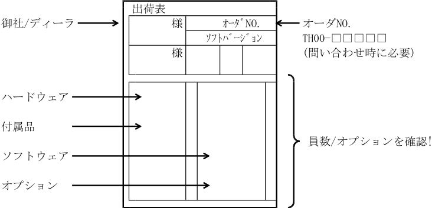

> **図の内容**
>
> 「出荷表」の各欄の説明:
> - 「御社/ディーラ」→ 宛先の欄（様）
> - 「オーダNO.」「ソフトバージョン」の欄 →「オーダNO. TH00-□□□□□（問い合わせ時に必要）」
> - 「ハードウェア」「付属品」「ソフトウェア」「オプション」の各行 →「員数/オプションを確認!」

【重要1】 PLMC-M3EXのシリアルナンバーについて


全てのPLMC-M3EXには、固有のシリアルナンバーが付いています。

以下の場合は対象のPLMC-M3EXのシリアルナンバーをご連絡頂く必要があります。

- ① オプションを追加でご購入頂く場合：追加オプションをPLMC-M3EXに設定する時にチェック
- ② ソフトのバージョンアップを行う場合：PLMC-M3EXのROMソフトを変更(フラッシュ書込)する時にチェック

PCソフトで上記作業を行う場合、ご提供したファイル(オプションファイルやFLASHシステムファイル)のシリアルナンバーとPLMC-M3EXのシリアルナンバーをチェックして、シリアルナンバーが異なる場合は作業を続けられなくなっています。

このため、お客様にて機械とそれに使用しているPLMC-M3EXのシリアルナンバーの対応を管理しておいて下さい。（PLMC-M3EXのシリアルナンバーはセッティングPCソフトのバージョン情報画面で確認できますので、不明な場合はセッティングPCソフトで確認する事も可能です。）

- ※ 特別な場合、シリアナンバーとは別にグループシリアル(GS)で管理することがあります。

その場合、②のバージョンアップについては複数のPLMC-M3EXに対して同一のファイルを使用できます。

【重要2】 PLMC-M3EXのソフトウェアバージョンについて


PLMC-M3EXのソフトウェア(本体ソフト、PCソフト)は、常に出荷時点での最新バージョンが出荷されます。リピート購入される場合、バージョンの違う新旧ソフトウェアの組み合わせによって問題が発生する可能性がありますので、ソフトウェア(CD)とPLMC-M3EXのバージョンを管理して、同一バージョンの組み合わせで使用いただきますようお願いします。

◆1.1

### 2-2. マニュアルをご覧下さい ! (HPからダウンロード)

「どのマニュアルに何が書いてあるか」程度をご確認下さい。導入作業は、「導入編」に沿って作業できます。その他は、必要に応じて見てください。

- ■ 動作・操作の詳しい説明書は、次のマニュアルが有ります。


### 2-3. PCソフトインストール

- ① CDをCD-ROMドライブに挿入して下さい。自動的にプログラム(インストーラー)が起動します。インストーラーが自動的に起動しない場合は、以下の手順でインストーラーを実行して下さい。
- (1) 「スタート」ボタンをクリックしてから「ファイル名を指定して実行」を選択します。
- (2) 「ファイル名を指定して実行」ダイアログで、"<CD-ROMドライブ名>:\setup" と入力します。 (例: d:\setup)
- (3) 「OK」ボタンをクリックするとインストーラーが起動します。
- ② インストールするフォルダを指定して、「OK」ボタンをクリックして下さい。選択したフォルダにファイルがコピーされます。
- 【注1】同じPCで複数のPLMCを管理(ソフトインストール)する場合は、別のフォルダーで管理してください。
- 【注2】2台目以降のインストールについては、「導入編 3.1台のPCで複数のPLMCを管理する場合」を参照下さい。
- ■ ユーザーズマニュアル(導入、ハード、機能)
- ■ セッティングPCマニュアル
- ■ ROMSW(ロムスイッチ)設定マニュアル
- ■ PLMC-M3EXサンプルラダープログラム説明書

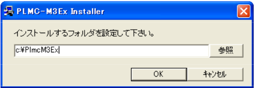

> **図の内容**
>
> ダイアログ「PLMC-M3Ex Installer」。「インストールするフォルダを設定して下さい。」、フォルダ「c:¥PlmcM3Ex」、ボタン: 参照、OK、キャンセル。


### 2-4. FA-M3□のモジュールの組立

詳細は、横河電機の関連資料を参照下さい。本項目と＜2-6-1.FA-M3□とPCの接続＞は、横河電機殿の資料をもとに作業いただきます。以下は、参考としてご覧下さい。

【最低限必要なモジュール】

- (ア) ベースモジュール
- (イ) 電源モジュール
- (ウ) CPUモジュール
- (エ) PLMC-M3EX
- (オ) イーサネットモジュール((ウ)がネットワーク搭載型CPUモジュールか、RS232C接続時なら不要)

<モジュール構成例>

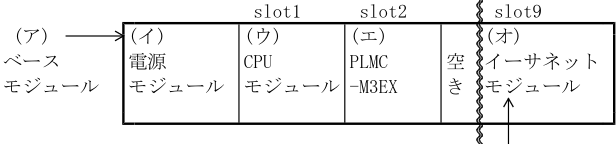

> **図の内容**
>
> (ア) ベースモジュールに、左から slot1 (イ) 電源モジュール、(ウ) CPUモジュール、slot2 (エ) PLMC-M3EX、空き …、slot9 (オ) イーサネットモジュール。

(ウ)がネットワーク搭載型CPUモジュールか、RS232C接続時なら使用しません。

【参考資料】

- 横河マニュアル「IM34M6C11-01 (FA-M3□ハードウェア取扱説明書).pdf」

### 2-5. WideField□によるFA-M3□とPCの通信確認

CPUモジュールとPCが正常に通信可能であることを確認します。 WideField□によるFA-M3□とPCとの接続については、横河電機殿の資料をもとに作業ください。その接続方法は以下の3種類があります。

| 通信方法     | 接続モジュール                                                                                                          | 操作例               |
|----------|------------------------------------------------------------------------------------------------------------------|-------------------|
| イーサネット接続 | イーサネットモジュール CPUモジュール(ネットワーク搭載形)                                                                                  | 2-5-1-1. 2-5-1-2. |
| RS232C接続 | CPUモジュールプログラミングツール接続ポート【注】WideField□は、ネットワーク搭載型CPUモジュールの SIOポート経由の通信をサポートしていません。 (PLMC-M3EXはSIOポートを使って通信可能です。) | 2-5-1-3.          |
| USB      | CPUモジュール(ネットワーク搭載形)                                                                                              | 2-5-1-4.          |

■ PCとFA-M3□の通信

- FA-M3□ツールソフト WideField□

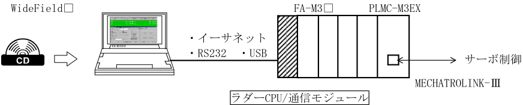

> **図の内容**
>
> CD から WideField□ を PC にインストールし、PC と FA-M3□ を「・イーサネット ・RS232 ・USB」でつなぐ。FA-M3□ の「ラダーCPU/通信モジュール」（斜線）と PLMC-M3EX。PLMC-M3EX から MECHATROLINK-Ⅲ で「サーボ制御」。

#### 2-5-1.接続操作例

各通信方法の接続操作例は、以下を参照下さい。

(以下の接続手順は、WideField□のVerR5.02で以下のモジュールとの接続を想定しています。)

| モジュール       | モジュール             | 形名        |
|-------------|-------------------|-----------|
| CPUモジュール    | ネットワーク搭載型CPUモジュール | F3SP67-6S |
|             | プログラミングツール接続ポート接続 | F3SP53-4S |
| イーサネットモジュール | イーサネットモジュール       | F3LE11-0T |

##### 2-5-1-1. イーサネット接続の操作例(イーサネットモジュール)

- ① イーサネットモジュール側面の設定スイッチを、

PCとFA-M3□がイーサネット接続できるように設定して下さい。

- ② 「WideField□」の「通信設定」画面で"ETHERNET"を選択します。
- ③ 相手先IPアドレスへ①で確認したIPアドレスを設定します。
- ④ 接続確認へ進みます。2-5-1-5. を参照下さい。

##### 2-5-1-2. イーサネット接続の操作例(ネットワーク搭載型CPUモジュール)

- ① 横河電機殿のFA-M3□設定ツール「WideField□」で、PCとFA-M3□をイーサネット接続できるように設定して下さい。

IPアドレスの設定などが必要です。

[参考資料]

- 「シーケンスCPUモジュールはじめて操作マニュアルⅠ:接続編〜PCと接続するには(TI34M6C03-01)」
- 「シーケンスCPUモジュールはじめて操作マニュアルⅢ:IPアドレス設定編(TI34M6C03-03)」
- ② 接続確認へ進みます。2-5-1-5. を参照下さい。

##### 2-5-1-3. RS232接続の操作例(CPUモジュール:プログラミングツール接続ポート)

【注】ネットワーク搭載型CPUモジュールのSIOポートを経由したWideField□の接続はできません。

- ① 「WideField□」の「通信設定」画面で"RS232C"を選択します。
- ② 「接続方法」を"自動認識"にし、「COMポート番号」を設定します。

使用可能なポート番号は、PCの

「コントロールパネル」→「システム」→「ハードウェア」→「デバイスマネージャー」から "ポート"を選択し、確認して下さい。

[参考資料]

- 「IM34M6Q15-01 (WideField□ 説明書).pdf B1.2.3」
- ③ 接続確認へ進みます。2-5-1-5. を参照下さい。

##### 2-5-1-4. USB接続の操作例

- ① 「WideField□」の「通信設定」画面で"USB"を選択します。
- ② 接続確認へ進みます。2-5-1-5. を参照下さい。

##### 2-5-1-5. 通信確認手順

「WideField□」を使用してPCとCPUモジュールが接続出来るか確認します。

- ① 「WideField□」のメニュー「オンライン」→「接続」を選択し、「OK」を押します。
- ② 接続が完了すると、「WideField□」画面左下の「RDY」という文字の周りが緑色に変化します。
- 切断時は、白色です。

### 2-6. PLMC-M3EXとPCとの通信

PLMC-M3EXとの具体的な通信設定手順に入る前に、手順の全体的な流れ、PLMC-M3EXとの通信形態の選択について説明します。具体的な手順については、2-6-1. 以降を参照下さい。

PLMC-M3EXとの通信確立までの全体の流れ

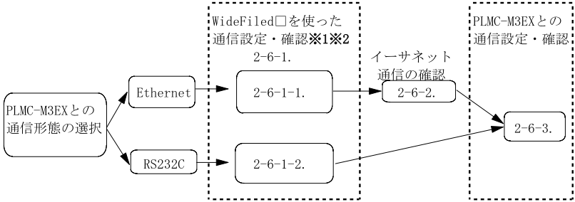

> **図の内容**
>
> 「PLMC-M3EXとの通信形態の選択」から:
> - Ethernet → 2-6-1-1.
> - RS232C → 2-6-1-2.
> （ここまでが「WideField□を使った通信設定・確認※1※2 2-6-1.」）
> - 2-6-1-1. →「イーサネット通信の確認 2-6-2.」→ 2-6-3.
> - 2-6-1-2. → 2-6-3.
> - 2-6-3. は「PLMC-M3EXとの通信設定・確認」

- ※1.WideField□を使った、FA-M3□とPCとの接続については、横河電機殿の資料をもとに作業ください。
- ※2.通信設定・確認した内容は記録して下さい。 2-6-3. の設定時に使用します。

PLMC-M3EXとの通信形態の選択

PLMC-M3EXとPCの通信方法は以下の2種類があります。

通信形態を決定してください。通信形態により以降の作業が変わります。

| PLMC-M3EXとの通信形態   | 接続モジュール                                                                     |
|-------------------|-----------------------------------------------------------------------------|
| イーサネット接続          | イーサネットモジュール CPUモジュール(ネットワーク搭載形)                                             |
| RS232C接続          | CPUモジュール(ﾈｯﾄﾜｰｸ搭載型)(F3SP66/67) SIOポート CPUモジュールプログラミングツール接続ポートパソコンリンクモジュール |

- ■ PCとPLMC-M3EXの通信
- 専用PCソフト
- テクノソフト日常運転・保守 DLLなど


> **図の内容**
>
> CD の絵と右向きの矢印。


> **図の内容**
>
> PC と FA-M3□ を「・イーサネット ・RS232 ・USB」でつなぐ。FA-M3□ の通信モジュール（斜線）を経て PLMC-M3EX と通信する。PLMC-M3EX から MECHATROLINK-Ⅲ で「サーボ制御」。

MECHATROLINK-Ⅲ

#### 2-6-1. WideField□による通信設定・確認

WideField□によるFA-M3□とPCとの接続については、横河電機殿の資料をもとに作業ください。接続操作例は、2-5. を参照。

WideField□での接続を確認できたら、PLMC-M3EXとの通信方法に合わせ以下の内容を確認して下さい。

##### 2-6-1-1. PLMC-M3EXとの通信をイーサネットで行う場合

以下の手順で設定・確認を行って下さい。

- ① コンフィグレーションの設定・確認
- ①-1 「WideField□」のメニュー「オンライン」から「コンフィギュレーション表示」を選択します。
- ①-2 「コンフィギュレーション」画面のタブ「機能削除」の "上位リンクサービス機能を削除する" のチェックを外して下さい。
- ② IPアドレス等の確認
- (ア) イーサネットモジュールを使用する場合(モジュールの設定確認)
- ②-1 モジュール側面の設定スイッチの内容を確認し、記録してください。

| 項目                | 項目       | 内容                   |
|-------------------|----------|----------------------|
| 条件設定スイッチ(SW1)     | データ形式設定  | ポート12289/12291用データ形式 |
| IPアドレス設定スイッチ(SW9) | IPアドレス設定 | イーサネットモジュールのIPアドレス   |

※イーサネットモジュール(LE01-5T)で使用可能なポートは、ポート番号12289のみです。

- (イ) ネットワーク搭載型CPUモジュール使用の場合(プロパティの確認)
- ②-1 「WideField□」のメニュー「オンライン」から「CPUプロパティ表示」を選択します。
- ②-2 「CPUプロパティ」画面の「設定」から「ETHERNET」および「HIGHER-LEVEL_LINK_SERVICE」を選択し、以下の項目を確認し、記録してください。

| 項目                        | 項目             | 内容              |
|---------------------------|----------------|-----------------|
| ETHERNET                  | 自IPアドレスの指定     | CPUモジュールのIPアドレス |
| HIGHER-LEVEL_LINK_SERVICE | ポートAコマンドデータ形式※ | ポート12289用データ形式  |
| HIGHER-LEVEL_LINK_SERVICE | ポートBコマンドデータ形式※ | ポート12291用データ形式  |

※実際に記録するのは、使用するポートのデータ形式のみで良いです。

- ②-3 「CPUプロパティ」画面の「設定」から

「HIGHER-LEVEL_LINK_SERVICE」の以下の項目のPLMC-M3EXとの接続に使用するポートをTCP/IPにしてください。

| 項目                  | 内容             |
|---------------------|----------------|
| 上位リンクサービス／ポートAプロトコル | ポート12289用プロトコル |
| 上位リンクサービス／ポートBプロトコル | ポート12291用プロトコル |

##### 2-6-1-2. PLMC-M3EXとの通信をRS232で行う場合

以下の手順で設定・確認を行って下さい。

- (ア) CPUモジュールに直接接続する場合
- ① コンフィグレーションの設定
- ①-1 「WideField□」のメニュー「オンライン」から「コンフィギュレーション表示」を選択します。
- ①-2 「コンフィギュレーション」画面のタブ「通信設定」の"パソコンリンク機能を使用する"を有効にして下さい。
- ② コンフィグレーションの確認
- ②-1 「WideField□」のメニュー「オンライン」から「コンフィギュレーション表示」を選択します。
- ②-2 「コンフィギュレーション」画面のタブ「通信設定」で以下の項目を確認し、記録してください。
- (イ) パソコンリンクモジュールの場合

| 項目         | 内容           |
|------------|--------------|
| 通信モード      | 通信速度・パリティ有/無 |
| チェックサムの有/無 | チェックサム有/無    |
| 終端文字の有/無   | 終端文字の有/無     |

モジュール側面の設定スイッチ、もしくは内部レジスタの以下の項目を記録してください。

| 項目          | 内容                         |
|-------------|----------------------------|
| 伝送速度設定スイッチ  | 通信速度                       |
| データ形式設定スイッチ | パリティ有/無チェックサム有/無終端文字の有/無 |

PLMC-M3EXでは、データ長とストップビットの設定は、以下のように設定して下さい。

データ長：8bit

ストップビット：１

パリティ：無しまたは偶数

#### 2-6-2. イーサネット通信の確認

以下の条件の両方に該当する場合、

セッティングPCによる接続前に、WideFiled□にてイーサネット通信が正常に行えるかを確認して下さい。

- ■PLMC-M3EXとの通信形態がイーサネット
- ■以上までにイーサネット通信の確認していない場合

FA-M3□とPCとの接続については、横河電機殿の資料をもとに作業ください。

接続操作例については、＜2-5-1-2. イーサネット接続の操作例＞を参照ください。

#### 2-6-3. セッティングPCソフト通信設定と通信確認

- ① 2-6. にてPLMC-M3EXとの通信形態として選択した通信方法で、PCとFA-M3□を接続します。
- ② セッティングPC(PLM3EXDRV.EXE)を起動します。
- ③ "初期設定ファイル"(インストールディレクトリ名)"がありません。デフォルト情報で実行しますか?"と表示されます。 OKを押して下さい。
- ④ "通信ライブラリの初期化エラー"と"通信デバイスが初期化されていません。"のエラーが発生します。これらもOKを押します。
- ⑤ ＜4．通信接続の設定/確認＞を参照し、＜4-1. 通信設定＞と＜4-2. 通信確認＞を行ってください。

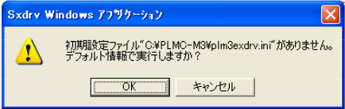

> **図の内容**
>
> ダイアログ「Sxdrv Windows アプリケーション」。警告アイコンと「初期設定ファイル"C:¥PLMC-M3¥plm3exdrv.ini"がありません。デフォルト情報で実行しますか？」、ボタン: OK、キャンセル。

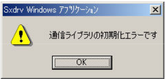

> **図の内容**
>
> ダイアログ「Sxdrv Windows アプリケーション」。警告アイコンと「通信ライブラリの初期化エラーです」、OK ボタン。

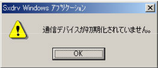

> **図の内容**
>
> ダイアログ「Sxdrv Windows アプリケーション」。警告アイコンと「通信デバイスが初期化されていません。」、OK ボタン。

通信設定画面が表示されますので、2-6-1. で記録した内容を設定します。

| 通信形態   | 記録した項目     | 対応する通信設定画面上の項目     |
|--------|------------|--------------------|
| イーサネット | IPアドレス     | IPアドレス             |
|        | データ形式      | バイナリーモード設定チェックボックス |
| RS232C | 通信モード      | 通信速度・パリティチェック選択    |
|        | チェックサムの有/無 | チェックサム設定チェックボックス   |
|        | 終端文字の有/無   | 終端文字設定チェックボックス     |

各設定の詳細については、セッティングPCマニュアル（TB00-0981）の＜5-4-1. インターフェイス設定＞を参照ください。

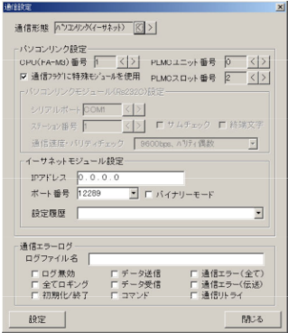

> **図の内容**
>
> 画面「通信設定」。
> - 通信形態: パソコンリンク(イーサネット)
> - パソコンリンク設定: CPU(FA-M3) 番号 1、PLMC ユニット番号 0、PLMC スロット番号 2、「通信フラグに特殊モジュールを使用」にチェック
> - パソコンリンクモジュール(RS232C)設定（灰色）: シリアルポート COM1、ステーション番号、サムチェック、終端文字、通信速度・パリティチェック 9600bps, パリティ偶数
> - イーサネットモジュール設定: IPアドレス 0.0.0.0、ポート番号 12289、バイナリーモード（チェックなし）、設定履歴（空）
> - 通信エラーログ: チェックはすべて未選択
> - ボタン: 設定、閉じる
> 細部は小さくて判読しにくい。

- ⑥ 通信確認後、終了ボタンを押してセッティングPCを終了します。

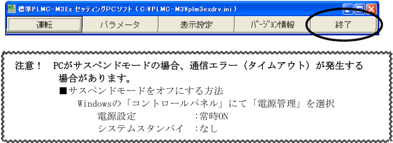

> **図の内容**
>
> ウィンドウ「標準PLMC-M3Ex セッティングPCソフト ( C:¥PLMC-M3¥plm3exdrv.ini )」のメニュー: 運転、パラメータ、表示設定、バージョン情報、終了（丸で囲み）。
> 注意！ PCがサスペンドモードの場合、通信エラー（タイムアウト）が発生する場合があります。■サスペンドモードをオフにする方法 Windowsの「コントロールパネル」にて「電源管理」を選択 電源設定 :常時ON、システムスタンバイ :なし

### 2-7. ROMSW(ロムスイッチ)の設定

- ① ROMSW設定ソフト(PLM3EXSWSET.EXE)を起動します。
- ② 「アップロード」ボタンをクリックします。
- ※ 通信エラーが発生した場合は、プログラムを終了(⑦)して通信設定を見直して下さい。 (＜4．通信接続の設定／確認＞を参照下さい。)
- ③ 「ファイル保存」ボタンをクリックします。

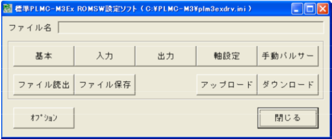

> **図の内容**
>
> ウィンドウ「標準PLMC-M3Ex ROMSW設定ソフト ( C:¥PLMC-M3¥plm3exdrv.ini )」。ファイル名欄と、ボタン: 基本、入力、出力、軸設定、手動パルサー、ファイル読出、ファイル保存、アップロード、ダウンロード、オプション、閉じる。

ファイル選択ダイアログが表示されるので、任意のファイル名を指定して下さい。（④で設定を変更する前に現在の設定をバックアップします。）

- ④ 必要に応じて設定を変更して下さい。

各項目については「PLMC-M3EX ROMSW設定ソフト説明書」を参照下さい。

- ※ 変更内容が未定/不明であれば、後日改めて変更して下さい。
- ※ このあとダミー運転の場合は、ここでは何も変更しません。
- ファイル選択ダイアログが表示されるので、任意のファイル名を指定して下さい。
- ⑤ 「ファイル保存」ボタンをクリックします。 ※ ④で設定を変更していなければ不要です。（設定した内容をバックアップします。）
- ⑥ 「ダウンロード」ボタンをクリックします。
- ※ ④で設定を変更していなければ不要です。
- ※ 通信エラーが発生した場合は、プログラムを終了(⑦)して通信設定を見直して下さい。 (＜4．通信接続の設定／確認＞を参照下さい。)
- ⑦ 「閉じる」ボタンをクリックしてプログラムを終了します。

(「ROMスイッチの内容を設定ファイルに保存しますか?」のメッセージには必ず「はい」を選択して下さい。)

注意! ROMSWデータの変更をした場合には、必ず以下を実行してください。

- ■ ダウンロード(PC→PLMC-M3EX)
- ■ ファイルへ保存
- ■ INIファイル作成(終了時に "ROMSWに反映しますか?" →「はい」)
- ■ PLMC-M3EX の電源をOFF→ONする。

### 2-8. パラメータ未設定エラー/バックアップメモリエラーの解除

新しくPLMC-M3EXモジュールを購入した場合は、必ず"パラメータ未設定エラー"になっています。

- ① セッティングPC(PLM3EXDRV.EXE)を起動すると、運転画面が表示されます (通信エラーが発生したら、＜4．通信接続の設定/確認＞を参照下さい。)
- ② 「エラー情報」をクリックしエラー内容を確認します。 "パラメータ未設定エラー"もしくは"バックアップメモリエラー"が発生している場合は、以下の手順で解除します。

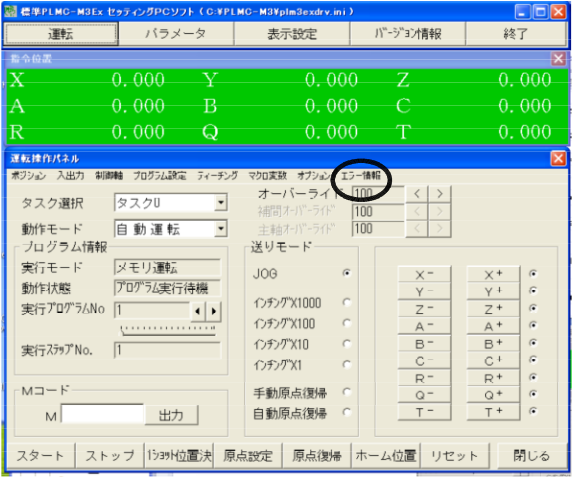

> **図の内容**
>
> 「標準PLMC-M3Ex セッティングPCソフト」の運転画面。位置表示（X、Y、Z、A、B、C、R、Q、T すべて 0.000）。運転操作パネルのタブ「エラー情報」が丸で囲まれている。タスク選択 タスク0、動作モード 自動運転、実行モード メモリ運転、動作状態 プログラム実行待機。

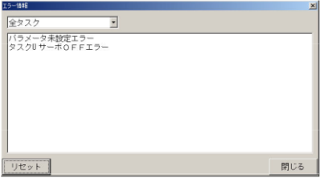

> **図の内容**
>
> 画面「エラー情報」。「全タスク」を選択。表示: 「パラメータ未設定エラー」「タスク0 サーボOFFエラー」。ボタン: リセット、閉じる。

#### 2-8-1. パラメータ初期化／バックアップ

- ① 「パラメータ」ボタンをクリックします。
- ② 「バックアップデータ初期化」ダイアログの全ての初期化ボタンをクリックして下さい。 PLMC-M3EXで保存しているデータを初期化します。
- ③ 「サーボパラメータ」ダイアログを表示します。


> **図の内容**
>
> メニュー: 運転、パラメータ（丸で囲み）、表示設定、バージョン情報、終了。

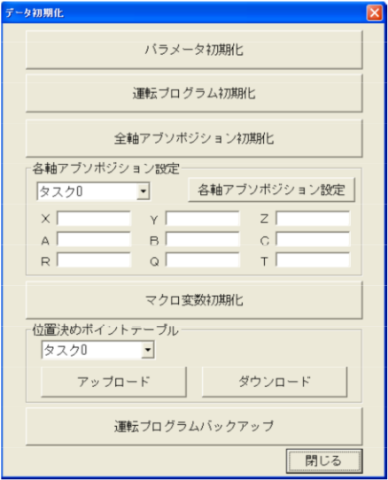

> **図の内容**
>
> 画面「データ初期化」。ボタン: パラメータ初期化、運転プログラム初期化、全軸アブソポジション初期化、各軸アブソポジション設定（タスク0、X・Y・Z・A・B・C・R・Q・T）、マクロ変数初期化、位置決めのポイントテーブル（タスク0、アップロード、ダウンロード）、運転プログラムバックアップ、閉じる。

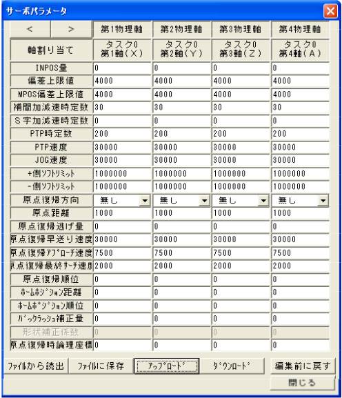

> **図の内容**
>
> 画面「サーボパラメータ」。タスク0 の 第1軸(X)～第4軸(A) の列に、INPOS量、偏差上限値、MPOS偏差上限値、補間加減速時定数、S字加減速時定数、PTP時定数、PTP速度、JOG速度、+側ソフトリミット、−側ソフトリミット、原点復帰方向、原点距離、原点復帰逃げ量、原点復帰早送り速度 などの値が並ぶ。ボタン: ファイルから読出、ファイルに保存、アップロード、ダウンロード、編集前に戻す、閉じる。
> 値は小さくて判読しにくい。

初期導入の場合は、以下の■新規導入の場合④〜⑦の手順で作業してください。既設の場合は、■既設の場合のサーボパラメータダウンロード⑧へ進んでください。

■新規導入の場合

- ④ 「アップロード」ボタンをクリックします。（PLMC-M3EXからデフォルトのパラメータを読み出します。）
- ⑤ 必要に応じて設定を変更して下さい。
- (「ユーザーズマニュアル」「セッティングPCマニュアル」を参照下さい。)
- ※ 変更内容が未定/不明であれば、後日改めて変更して下さい。

ダミー運転・操作では、設定変更しなくても(出荷時のままでも)動作に支障は有りません。

- ⑥ 「ファイルに保存」ボタンをクリックします。ファイル選択ダイアログが表示されるので、任意のファイル名を指定して下さい。（パラメータファイルは、複数台使用する場合を想定し、個体の区別ができるようなファイル名を指定して保存して下さい。）
- ⑦ 「ダウンロード」ボタンをクリックします。
- 初回の保存は仮設定のものです。


後日、正式な試運転・調整の後、改めて保存(パラメータファイルの更新)して下さい。

- サーボパラメータは、今後の更新毎に必ずPC側で保存して下さい。また、上書きしたくない時は異なるファイル名にして下さい。

■既設の場合のサーボパラメータダウンロード

- ⑧ 保存してあったサーボパラメータファイルを「ファイル読み出し」します。内容を変更する必要があれば、変更してください。
- ⑨ そのファイルを「ダウンロード」します。
- ⑩ サーボパラメータを変更した場合は、適宜名称を付けて、「ファイルに保存」して下さい。
- ⑪ 「ピッチエラー補正」や「工具長補正」、「工具径補正」、「補間前加減速(自動コーナオーバライド)」のオプションを購入された場合、③から行った「サーボパラメータ」の設定にならって、それぞれの設定画面から設定して下さい。
- 上記のオプションの内、購入された全てのパラメータを設定することで、「パラメータ未設定エラー」を解除できます。

### 2-9. セッティングPCソフト設定

表示設定から｢通信設定｣｢セッティングPCソフト動作設定｣｢ポジション表示設定｣｢入出力表示設定｣の各々の設定画面で、必要に応じて変更して、｢設定｣して下さい。

各設定の詳細については、セッティングPCマニュアルの＜5-4-1インタフェース設定＞〜＜5-4-3入出力表示設定＞を参照して下さい。

■通信設定

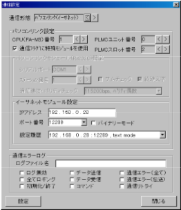

> **図の内容**
>
> 画面「通信設定」。
> - 通信形態: パソコンリンク(イーサネット)
> - パソコンリンク設定: CPU(FA-M3) 番号 1、PLMC ユニット番号 0、PLMC スロット番号 2、「通信フラグに特殊モジュールを使用」にチェック
> - パソコンリンクモジュール(RS232C)設定（灰色）
> - イーサネットモジュール設定: IPアドレス 192.168.0.20、ポート番号 12289、バイナリーモード（チェックなし）、設定履歴 192.168.0.20 : 12289 , text mode
> - 通信エラーログ: チェックはすべて未選択
> - ボタン: 設定、閉じる

■セッティングPC動作設定画面

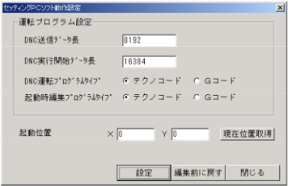

> **図の内容**
>
> 画面「セッティングPCソフト動作設定」。
> - 運転プログラム設定: DNC送信データ長 8192、DNC実行開始データ長 16384、DNC運転プログラムタイプ（テクノコード / Gコード）、起動時編集プログラムタイプ（テクノコード / Gコード）
> - 起動位置: X 0、Y 0、「現在位置取得」ボタン
> - ボタン: 設定、編集前に戻す、閉じる

■ポジション表示設定

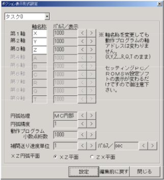

> **図の内容**
>
> 画面「ポジション表示形式設定」。タスク0。第1軸～第9軸の軸名称（X、Y、Z、A、B、C、R、Q、T）とパルス/表示単位（すべて 1000。第4軸以降は灰色）。円弧処理 MC内部、円弧精度 1、動作プログラム小数点桁数 1000、補間送り速度単位 1 パルス/sec、XZ円弧平面（XZ平面 / ZX平面）。
> 注記: 軸名称を変更しても動作プログラムの軸アドレスは変わりません。(X,Y,Z…R,Q,T のまま) セッティングPC/ROMSW設定ソフトの表示が変わるだけですので御注意下さい。

通信設定以外は、用途に応じて設定して下さい。

(ここで必ず行う必要はありません｡後でも結構です｡) 2-5.からここまでの手順を順番に行っていれば、通信設定は設定済みです。

まだ設定していない場合は、2-5.からの手順を行ってください。

軸名称や小数点の位置を変えることができます。

例左右 □□□□.□□ (小数2ケタ)

上下 □□□□.□□□□(小数4ケタ)

前後 □□□□.□□

※軸名称は漢字2文字まで可能です。

■入出力表示設定

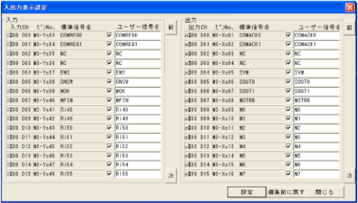

> **図の内容**
>
> 画面「入出力表示設定」。左が入力（入力CH、ピンNo.、標準信号名、ユーザー信号名）、右が出力。
> - 入力 I000 D00～D15: COMRED0、COMRED1、NC、NC、EMS、ONSW、MOK、MFIN、RI40～RI55（と読める）。ピンNo. は M3-Ys33～
> - 出力 O000 D00～D15: COMACK0、COMACK1、NC、NC、SVM、DOUT0、DOUT1、MSTRB、M1～M7（と読める）。ピンNo. は M3-Xs01～
> - 各行にチェックボックス。ボタン: 設定、編集前に戻す、閉じる
> 細部は小さくて判読しにくい。

入出力名称を変更できます。

使用していない入/出力の表示を削除できます。


> **図の内容**
>
> 「設定」をクリックをしないと反映されません。「設定」のクリックによって、INIファイル内の情報が更新されます。

以上で初期導入作業は終了です！

## 3．1台のPCで複数のPLMC-M3EXを管理する場合

1台のPCで複数のPLMC-M3EXを管理する場合は、各PLMC毎にフォルダを分け、以下の手順でインストールします。追加するPLMC-M3EXのソフトウェアバージョンによって、手順が異なります。

### 3-1. 1台目のPLMC-M3EXのインストール

「2．初期導入作業(購入後の初めての作業)」を参照し、1台目のPLMC-M3EXをインストールして下さい。

### 3-2. 2台目以降のPLMC-M3EXのインストール

- 【注】同じPCで複数のPLMCを管理(ソフトインストール)する場合は、別のフォルダーで管理してください。

#### 3-2-1. バージョンの確認

インストール済みのPLMC-M3EXのバージョンと追加するPLMC-M3EXのバージョンにより、以降の手順が異なります。

（インストール済みのPLMC-M3EXのバージョンは「10-4-2.ソフトウェアバージョンの確認方法」で確認する事ができます。）

- インストール済みのPLMC-M3EXのバージョン＝追加するPLMC-M3EXのバージョン「3-2-2.追加するPLMCが同じソフトウェアバージョンの場合」の手順を行って下さい。
- インストール済みのPLMC-M3EXのバージョン ≠ 追加するPLMC-M3EXのバージョン「3-2-3.追加するPLMCが異なるソフトウェアバージョンの場合」の手順を行って下さい。

#### 3-2-2. 追加するPLMCが同じソフトウェアバージョンの場合

- 2-6-3.〜2-8.相当の設定と確認をいたします。
- ① INIファイルのコピー既存のPLMCのINIファイルを、追加するPLMCのフォルダにコピーして下さい。 (これにより、2-9.のポジション表示や入出力表示の設定がコピーできます。)
- ② ＜2-6-3. セッティングPCソフト通信設定＞の作業
- ③ ＜2-7. ROMSWの設定＞の作業
- ④ ＜2-8. パラメータ未設定エラー/バックアップメモリエラーの解除＞の作業
- 以上で初期作業は完了です。

#### 3-2-3. 追加するPLMCが異なるソフトウェアバージョンの場合

通常の初期作業と同じで、2-6-3.〜2-9.の設定と確認をいたします。

- ① ＜2-6-3. セッティングPCソフト通信設定＞の作業
- ② ＜2-7. ROMSWの設定＞の作業
- ③ ＜2-8. パラメータ未設定エラー/バックアップメモリエラーの解除＞の作業
- ④ ＜2-9. セッティングPCの設定＞の作業
- 以上で初期作業は完了です。

## 4．通信接続の設定／確認

### 4-1. 通信設定

セッティングPC(PLM3EXDRV.EXE)の設定で接続方法を変更することができます。

- ① セッティングPC(PLM3EXDRV.EXE)を起動(※)して、「表示設定」ボタンをクリックします。
- ※ 通信設定があっていない場合、通信異常になってしまいます。
- ② 「通信設定」ダイアログにて通信の設定を行って下さい。
- ③ 「設定」ボタンをクリックして下さい。


> **図の内容**
>
> ウィンドウ「標準PLMC-M3Ex セッティングPCソフト ( C:¥PLMC-M3¥plm3exdrv.ini )」のメニュー: 運転、パラメータ、表示設定（丸で囲み）、バージョン情報、終了。

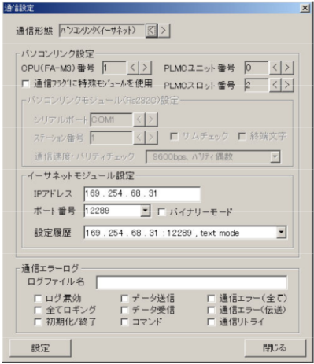

> **図の内容**
>
> 画面「通信設定」。
> - 通信形態: パソコンリンク(イーサネット)
> - パソコンリンク設定: CPU(FA-M3) 番号 1、PLMC ユニット番号 0、PLMC スロット番号 2、「通信フラグに特殊モジュールを使用」はチェックなし
> - パソコンリンクモジュール(RS232C)設定（灰色）: シリアルポート COM1、ステーション番号 1、サムチェック、終端文字、通信速度・パリティチェック 9600bps, パリティ偶数
> - イーサネットモジュール設定: IPアドレス 169.254.68.31、ポート番号 12289、バイナリーモード（チェックなし）、設定履歴 169.254.68.31 : 12289 , text mode
> - 通信エラーログ: ログファイル名（空）、チェックはすべて未選択
> - ボタン: 設定、閉じる


設定をしないと反映されません。

- 設定によって、INIファイル内の情報が更新されます。
- 【注1】設定の詳細については、セッティングPCマニュアル(TB00-0981)の＜5-4-1. インターフェイス設定＞を参照ください。
- 【注2】IPアドレスの設定については、FA-M3□のマニュアル「シーケンスCPUモジュール(ネットワーク搭載形)はじめて操作マニュアル」(文書TI34M6C03) などを参照してください。


### 4-2. 通信確認

- ① セッティングPC(PLM3EXDRV.EXE)を起動します。

(既に起動している場合は「運転」ボタンをクリックします。)


> **図の内容**
>
> メニュー: 運転（丸で囲み）、パラメータ、表示設定、バージョン情報、終了。

- ② 正しく接続できていれば、以下のような運転画面がでます。

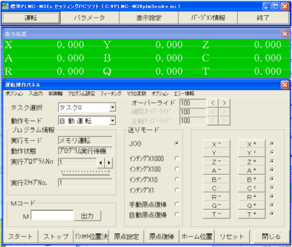

> **図の内容**
>
> 「標準PLMC-M3Ex セッティングPCソフト」の運転画面。位置表示（X、Y、Z、A、B、C、R、Q、T すべて 0.000）、運転操作パネル（タスク選択 タスク0、動作モード 自動運転、実行モード メモリ運転、動作状態 プログラム実行待機、オーバーライド 100、送りモード JOG・インチングX1000～X1・手動原点復帰・自動原点復帰、軸キー X-/X+ ～ T-/T+、ボタン: スタート、ストップ、1ショット位置決め、原点設定、原点復帰、ホーム位置、リセット、閉じる）。

③ 接続不良の時

TO(タイムアウトエラー)や画面が出ない場合。

- ■イーサネット接続では
- IPアドレスが接続するモジュールとあっていない。
- CPU番号、ユニット番号、スロット番号があっていない。
- バイナリモードの有効/無効があっていない。
- 接続ケーブルの不良

■RS232C接続では

- シリアルポート選択が合っていない。
- PCの設定(Windowsの環境)COM1/COM2...COM16が使用できない状態
- 接続ケーブルの不良

メンテナンス編「2.PCソフト側の異常」を参照下さい。

## 5．アンインストール

インストールしたフォルダ内の全てのファイルと、作成したショートカットを削除して下さい。（システムフォルダーやレジストリには変更を加えていません。）

## 6．PLMC-M3EX/PCの交換

### 6-1. PLMC-M3EXの交換

#### 6-1-1. 元のPLMC-M3EXが動作する場合

- (1) 元のPLMC-M3EXから全ての保存データ(ROMSW設定／各種パラメータ／動作プログラム等)をファイルに保存します。
- (2) 全軸を機械原点へ移動します。（絶対値エンコーダ設定軸がある場合 *1）
- (3) 電源をOFFして新しいPLMC-M3EXに差し替えた後、再度電源をONします。
- (4) (1) で保存したデータの内、ROMSW設定だけを新しいPLMC-M3EXにダウンロードします。 ※ ROMSW設定をダウンロードする際には、
5. 「オプションスイッチ設定又はシリアル番号が接続先のモーションコントローラの設定と異なるため、ダウンロードできません。

接続先のモーションコントローラからオプションスイッチ設定／シリアル番号をコピーして再度ダウンロードしますか？」

とメッセージダイアログが表示されますので、「OK」をクリックして下さい。

（元のPLMC-M3EXと新しいPLMC-M3EXのシリアル番号が異なるので、このメッセージが表示されます。「OK」を選択する事で、ROMSW設定に保存されているシリアル番号を新しいPLMC-M3EXのシリアル番号に変更してダウンロードします。）

ROMSW設定以外のデータはシリアル番号管理していないので、本メッセージは表示されません。

- (5) 電源をOFF→ONします。
- (6) (1) で保存したデータの内、ROMSW設定以外の全てのデータを新しいPLMC-M3EXにダウンロードします。
- (7) 座標再設定を行います。

（絶対値エンコーダ設定軸がある場合 *1）

- この時、絶対値エンコーダ設定軸はソフトリミットエラーになっている場合がありますが、それ
- ① リセットを行いサーボオンします。以外のエラーが発生していない事をご確認下さい。
- ② セッティングPCのバックアップデータ初期化画面にて、「全軸アブソポジション初期化」を行います。
- ③ リセットを行いソフトリミットエラーを解除します。（①でソフトリミットエラーが発生していなければ不要です。）
- ④ 絶対値エンコーダ設定軸全軸を機械原点へ移動します。

[注意]

- 機械原点の判断基準はメカ／使い方により変わります。
- メカ設計者の方にご確認下さい。

尚、この座標再設定の際の再現性の為にも、絶対値エンコーダ設定軸でも原点復帰を行えるような機械構成／設定を行っておく事をお勧め致します。

- 上記(2) の手順で機械原点へ移動していますが、その後電源OFF（サーボOFF）しているため、厳密な機械原点からずれてしまっています。

（機械の構造により変わりますが、一般的に数パルス〜数10パルス程ずれます。）

そのため、(2) の手順の後に動かしていない場合でも、機械原点の調整が必要です。

- ⑤ セッティングPCのバックアップデータ初期化画面にて、「全軸アブソポジション初期化」を行います。
- (8) 電源をOFF→ONします。
- *1 絶対値エンコーダ設定軸（ROMSW設定）がない場合は不要な手順です。

絶対値エンコーダ設定軸では、サーボアンプが記憶している絶対位置座標とPLMC-M3EXの座標のオフセットを記憶しています。このオフセットを新しいPLMC-M3EXに再設定するための手順です。

#### 6-1-2. 元のPLMC-M3EXが動作しない場合

各種データ(ROMSW設定／各種パラメータ／動作プログラム等)や機械原点を元のPLMC-M3EXと同じ設定になるように設定して下さい。

- ※ もし各種データ設定時のバックアップがPCに残っていたら、そのファイルを使用する事により、設定を復元して下さい。
- このような場合の為にもデータ変更時は、PC側にも保存しておく事を強くお勧め致します。
- ※ 絶対値エンコーダ使用時(ROMSW設定)は、機械原点の設定も忘れずに行って下さい。

JOG/インチング等で機械原点の位置へ移動した後、セッティングPCのバックアップデータ初期化画面にて、「全軸アブソポジション初期化」を行って、機械原点の設定を行って下さい。

### 6-2. PCの交換

#### 6-2-1. 元のPCが動作する場合

- (1) 元のPCから新しいPCへ、PCソフトをインストールしたフォルダ(デフォルトでは"c:\PlmcM3EX")を丸ごとコピーして下さい。(サブフォルダも含めてコピーして下さい。)
- (2) 必要に応じて、元のPCからPCソフトをインストールしたフォルダ内の全てのファイルを削除して下さ
3. い。
4. ※ 当社PCソフトはシステムフォルダーやレジストリには変更を加えていません。そのため、フォルダを丸ごとコピーするだけで環境の移行が可能です。
5. 尚、PCソフトの設定を新しいPCへ引き継ぐだけでしたら、以下の手順でも可能です。
6. ① 「2-3. PCソフトインストール」を参照し、PCソフトを新しいPCへ新規インストールして下さい。
7. ② 元のPCからPCソフトをインストールしたフォルダ(デフォルトでは"c:\PlmcM3EX")から、設定ファイル(*.ini)をコピーして、新しいPCでインストールしたフォルダに貼り付けして下さい。

#### 6-2-2. 元のPCが動作しない場合

- (1) 「2-3. PCソフトインストール」を参照し、PCソフトを新しいPCへ新規インストールして下さい。
- (2) 「2-6.PLMC-M3EXとPCとの通信」を参照し、通信設定を行ってください。
- (3) 「2-9.セッティングPCソフト設定」を参照し、通信設定を行ってください。 ※ 特に「セッティングPC動作設定画面」「ポジション表示設定画面」の設定は、元のPCと同じ設定になるようにして下さい。異なる設定にすると、一見正常動作しているようでも、動作プログラム実行時に想定外の動作をしてしまう場合があります。ご注意下さい。

## 7．ダミー運転

ここまでの段階で以下の初期導入作業が完了しました。

- ■ PCソフトインストール「セッティングPCソフト」「ROMSW設定ソフト」
- ■ FA-M3□準備
- ■ WideField□接続
- ■ パソコンリンク接続
- ■ PLMC-M3EXとPCのとりあえずの接続(パソコンリンク:RS232/イーサネット)
- ■ ROMSWの設定 (デフォルト)
- ■ サーボパラメータ等の設定 (デフォルト)
- ■ パラメータ未設定エラー/バックアップメモリエラー解除

この状態で、セッティングPCソフト(標準運転ソフト)で手動運転・自動運転を体験してください。サーボを接続せずに、シミュレーションモードでダミー運転ができます。


### 7-1. ROMSWの設定

「2-7.ROMSW(ロムスイッチ)の設定」を参照して下記の操作を行ってください。

(ア)

ROMSW設定ソフト(Plm3exswset.exe)を起動

- (イ) 「アップロード」ボタンを押します。
- (ウ) 「軸設定」画面
- ① 「有効物理軸選択」で、第1軸〜第4軸のチェックボックスを有効にします。
- ② 「各軸設定」内の「軸割り当て」と「仮想アンプ」は、以下のように設定します。
- ③ "軸割り当て"と"仮想アンプ"以外の設定は変更せずに、「設定」ボタンを押して下さい。
- (エ) 「ダウンロード」
- ① ROMSW設定ソフトの「ダウンロード」ボタンを押します。

| 物理軸   | タスク   | 論理軸   | 論理軸    | 仮想アンプ   |
|-------|-------|-------|--------|---------|
| 第1軸   | タスク0  | 論理軸   | 第1軸(X) | 有効      |
| 第2軸   | タスク0  | 論理軸   | 第2軸(Y) | 有効      |
| 第3軸   | タスク0  | 論理軸   | 第3軸(Z) | 有効      |
| 第4軸   | タスク0  | 論理軸   | 第4軸(A) | 有効      |

↓

- ② ダウンロード完了したら、「閉じる」ボタンをおす。 ↓
- ③ "内容を設定ファイルに反映しますか？"と聞かれるので「はい」を選択し、ROMSW設定ソフトを終了します。

[参考資料]

「テクノユーザーズマニュアル導入編(TB00-0980A)＜2-7.ROMSWの設定＞」

- (オ) FA-M3□の電源をOFF→ONします。

以上で、ROMSWの設定が有効になります。

のマークの箇所は、はお急ぎの時は、この部分は読み飛ばしてください。後で、ゆっくり理解して戴きたい箇所です。

### 7-2. セッティングPCソフトを起動


plm3exdrv.exe を起動

セッティングPC画面で位置情報がゼロ表示になることを確認してください。これは、PCとPLMC-M3EXの通信が正常に確立していることを意味します。ゼロ表示にならない場合は、通信エラーが考えられます。導入編＜2-6.FA-M3□とPCの通信設定＞からの手順を再度参照ください。

### 7-3. ダミーで運転・操作

操作は、すべて以下の運転画面でおこないます。

入力信号状態などによりアラームが発生（エラー情報有り）する場合は、<7-5-1. アラームの解除> を参照下さい。

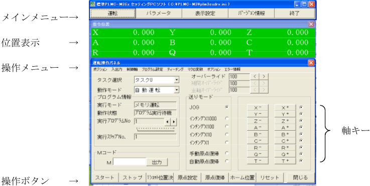

> **図の内容**
>
> 運転画面の各部の名前: 「メインメニュー」、「位置表示」、「操作メニュー」、「軸キー」（右側の X-/X+ などのボタン）、「操作ボタン」（下部のボタン列）。

#### 7-3-1. 手動操作（ジョグ／インチング）

ジョグは、軸キーを押し続けている間、サーボパラメータの「JOG速度」で動きます。ダミー運転では、サーボはありませんので、動くのはPC画面の座標(位置表示)だけです。インチングは、指定のインチング量を軸キーを押す毎に動きます。特に、微小送りで位置調整するときに便利です。動作モードを「手動運転」とし、送りモード選択して軸キーを押すことで動作します。

途中、「原点設定ボタン」を押すことで、そのときの位置を座標原点とします。したがって、位置表示がゼロになります。

【運転画面にて】この表の「設定/選択/操作」の項目にならって順番に操作してください。

| 画面/項目   | 設定/選択/操作           | 動作/結果 (表示確認)       | 補足              |
|---------|--------------------|--------------------|------------------|
| 動作モード   | 手動運転               |                    |                  |
| 送りモード   | JOG                |                    |                  |
| (軸キー)   | X+                 | X座標が+方向に変化         | X軸が+方向にジョグ移動     |
| (軸キー)   | X-                 | X座標が-方向に変化         | X軸が-方向にジョグ移動     |
| (軸キー)   | Y+                 | Y座標が+方向に変化         | Y軸が+方向にジョグ移動     |
| (軸キー)   | Y-                 | Y座標が-方向に変化         | Y軸が-方向にジョグ移動     |
| (軸キー)   | 同様にZ,Aでも確認してください   | 同様にZ,Aでも確認してください   |                  |
| (操作ボタン) | 原点設定               | 座標がゼロになります         | 論理座標設定です。        |
| 送りモード   | インチング ×1000        |                    | 1000p単位のインチングモード |
| (軸キー)   | X+                 | X座標が+に1000変化       | X軸が+1000p移動      |
| (軸キー)   | X-                 | X座標が-に1000変化       | X軸が-1000p移動      |
| (軸キー)   | 同様にY,Z,Aでも確認してください | 同様にY,Z,Aでも確認してください |                  |
| 送りモード   | インチング ×100         |                    | 100p単位のインチングモード  |
| (軸キー)   | X+                 | X座標が+に100変化        | X軸が+100p移動       |
| (軸キー)   | X-                 | X座標が-に100変化        | X軸が-100p移動       |
| (軸キー)   | 同様にY,Z,Aでも確認してください | 同様にY,Z,Aでも確認してください |                  |
| 送りモード   | インチング ×10          |                    | 10p単位のインチングモード   |
| (軸キー)   | X+                 | X座標が+に10変化         | X軸が+10p移動        |
| (軸キー)   | X-                 | X座標が-に10変化         | X軸が-10p移動        |
| (軸キー)   | 同様にY,Z,Aでも確認してください | 同様にY,Z,Aでも確認してください |                  |
| 送りモード   | インチング×1            |                    | 1p単位のインチングモード    |
| (軸キー)   | X+                 | X座標が+に1変化          | X軸が+1p移動         |
| (軸キー)   | X-                 | X座標が-に1変化          | X軸が-1p移動         |
| (軸キー)   | 同様にY,Z,Aでも確認してください | 同様にY,Z,Aでも確認してください |                  |

#### 7-3-2. ワンショット位置決め

位置決めや補間動作で軸を指定量(あるいは目標位置)へ移動させる機能です。操作ボタンの「1ショット位置決」ボタンを押すと以下の画面がでます。 1ショット位置決め画面

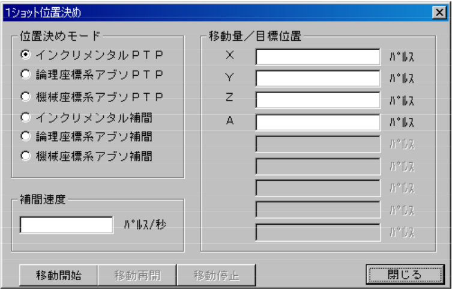

> **図の内容**
>
> 画面「1ショット位置決め」。
> - 位置決めのモード: インクリメンタルPTP（選択）、論理座標系アブソPTP、機械座標系アブソPTP、インクリメンタル補間、論理座標系アブソ補間、機械座標系アブソ補間
> - 移動量/目標位置: X、Y、Z、A（単位 パルス）、ほかの軸は灰色
> - 補間速度: パルス/秒
> - ボタン: 移動開始、移動再開、移動停止、閉じる

(1) インクリメンタルPTP(位置決め)の操作

一連の操作の中では、途中停止/再開、オーバライドも操作します。

【1ショット位置決め画面にて】「設定/選択/操作」の項目にならって順番に操作してください。

| 画面/項目                      | 設定/選択/操作                            | 動作/結果 (確認)                 | 補足                        |
|----------------------------|-------------------------------------|----------------------------|----------------------------|
| 位置決めモード                    | インクリメンタルPTP                        |                            |                            |
| 移動量                        | X:1000 Y:1000 Z:1000 A:1000         |                            |                            |
|                            | 移動開始                                | 各軸座標が+1000変化します。          | 全軸1000p分の移動                |
| 同様に適当な値を設定して、位置決めをしてみてください | 同様に適当な値を設定して、位置決めをしてみてください          | 同様に適当な値を設定して、位置決めをしてみてください | 同様に適当な値を設定して、位置決めをしてみてください |
| 移動量                        | X:100000 Y:100000 Z:100000 A:100000 |                            | 移動量が大きいので位置決め完了まで時間がか     |
|                            | 移動開始                                | 各軸座標が変化します                 | かります                       |
| (移動中に)                     | 移動停止                                | 座標変化がとまります                 | 途中停止しました                   |
|                            | 移動再開                                | 座標変化が再開します                 | 移動再開です                     |
| 位置決め完了するまで、停止/再開は、何度も可能です  | 位置決め完了するまで、停止/再開は、何度も可能です           | 位置決め完了するまで、停止/再開は、何度も可能です  | 位置決め完了するまで、停止/再開は、何度も可能です  |
| (移動中に) (運転画面で) オーバライド      | < で小さい値に変更                         | 座標変化が遅くなります                | 移動速度がオーバライド比率で減少          |
| (移動中に) (運転画面で) オーバライド      | > で大きな値に変更                         | 座標変化が早くなります                | 移動速度がオーバライド比率で増加          |

途中で座標をゼロセットしたいときは、操作ボタンの「原点設定」を押してください。

補足説明

インクリメンタル:移動指令量です。現在位置に加算して移動します。

アブソ

:目標座標(目標位置)を指令します。(移動量 = 目標位置 - 現在位置)

PTP

:位置決め各軸がサーボパラメータの「PTP」速度で移動します。

補間

論理座標

機械座標

補間のように多軸同期にはなりません。

:この場合は、直線補間です。補間速度を指定した複数軸の合成速度として、多軸が同期して動きます。したがって、目標位置の到着が同時です。

:通常は、この座標系で位置を管理します。原点設定するとその位置が、論理座標系の原点になります

:本来は、フィードバックパルスを積算した座標です。アブソ位置のことです。ただし、ダミー運転では、FBなしなので指令パルスの積算となります。いずれにしても、原点設定で、座標系のセットアップはしません。


詳細は、以下を参照ください。

ただ、ここでは基本操作を体験するのが目的です。詳細なご理解は、後からでもかまいません。 PLMC-M3EXユーザーズマニュアル KEYWORDS

PLMC-M3EXユーザーズマニュアル機能編

(2)論理座標系でのPTPや補間

【1ショット位置決め画面にて】「設定/選択/操作の項目」にならって順番に操作してください。

| 画面/項目   | 設定/選択/操作                                    | 動作/結果 (確認)                                  | 補足                              |
|---------|---------------------------------------------|---------------------------------------------|----------------------------------|
| 位置決めモード | 論理座標系アブソ PTP                                |                                             |                                  |
| 目標位置    | 目標位置を指定します。                                 | 目標位置を指定します。                                 |                                  |
|         | 移動開始                                        | 目標位置まで動きます                                  |                                  |
| 位置決めモード | インクリメンタル補間                                 |                                             |                                  |
| 移動量     | 移動量を適宜                                      |                                             |                                  |
| 補間速度    | 30000                                       |                                             |                                  |
|         | 移動開始                                        | 補間速度で指定の移動量動きます                            | 同じ移動量でも補間速度を変えると到達時間が反比例で変わります |
|         | 補間速度を1000pps(低速)〜100000pps など変えてトライしてみてください | 補間速度を1000pps(低速)〜100000pps など変えてトライしてみてください | 同じ移動量でも補間速度を変えると到達時間が反比例で変わります |
| 位置決めモード | 論理座標系アブソ補間                                 |                                             |                                  |
| 目標位置    | 目標位置を指定します。                                 | 目標位置を指定します。                                 |                                  |
| 補間速度    | 30000                                       |                                             |                                  |
|         | 移動開始                                        | 補間速度で指定の移動量動きます                            | 同じ移動量でも補間速度を変えると到達時間が反比例で変わります |
|         | 補間速度を1000pps(低速)〜100000pps など変えてトライしてみてください | 補間速度を1000pps(低速)〜100000pps など変えてトライしてみてください | 同じ移動量でも補間速度を変えると到達時間が反比例で変わります |

※ pps は pulse/sec です。

#### 7-3-3. ホーム位置決め

ホーム位置(パラメータ)は、出荷時に(0,0,0,0,0,0)になってます。

どこからでも機械座標がホーム位置(この場合ゼロの位置)になるまで戻ります。

| 画面/項目   | 設定/選択/操作   | 動作/結果（確認）     | 補足            |
|---------|------------|----------------|----------------|
| 運転画面    | ホーム位置      | 座標が変化して、ゼロになる | どの位置にいても原点に戻る |

座標が大きくずれていると、ホーム位置決めに時間がかかります。停止は、いつでも有効です。

#### 7-3-4. 運転プログラムのダウンロード

PTP命令のサンプル運転プログラム"L_PTP.TXT"(テクノ言語)をファイル選択して、PLMC-M3EXのブロック番号0にタスク0用プログラムとしてダウンロードします。

操作メニューから「プログラム設定」を押します。

プログラム設定画面

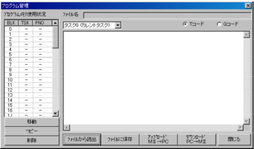

> **図の内容**
>
> 画面「プログラム管理」。左にプログラムメモリ使用状況（BLK、TSK、PNO。すべて --）、ファイル名（空）、「タスク0(カレントタスク)」、Tコード（選択）/ Gコード、プログラムの編集欄（空）。ボタン: 移動、コピー、削除、ファイルから読出、ファイルに保存、アップロード MⅢ→PC、ダウンロード PC→MⅢ、閉じる。

【プログラム管理画面にて】「設定/選択/操作の項目」の順番に操作してください。

| 画面/項目               | 設定/選択/操作                  | 動作/結果 (確認)                      | 補足                                   |
|---------------------|---------------------------|---------------------------------|---------------------------------------|
| プログラム設定画面           | ファイルから読出                  | ファイル選択ダイアログが表示されます             |                                       |
| L_PTP.TXTを選択してください。 | L_PTP.TXTを選択してください。       | L_PTP.TXTを選択してください。             | PTP運転サンプル (プログラム先頭でプログラム番号をPNO10と指定) |
| プログラム設定画面           | Tコード                      |                                 |                                       |
|                     | タスク0                      |                                 |                                       |
| ダウンロード先BLK 番号       | プログラムメモリ使用状況リストでBLK0 を選択 | BLK0の行が反転表示                     |                                       |
|                     | ダウンロード                    | PLMC-M3EXのBLK0にPNO.10 としてローディング |                                       |

ローディングが完了しない場合

通信エラーエラーメッセージがあるはずです。 →＜4．通信接続の設定/確認＞タスク0にPNO10の運転プログラムが既に存在 →PNOに別の番号を設定して下さい。

又は、既存のPNO10へ別のPNOを設定して下さい。

#### 7-3-5. 自動モードでメモリー運転

ダウンロードしたPno10(L_PTP.TXT)を運転します。

L_PTP.TXTのXY軌跡の様子

```c
    PNO10;
/****************************/
/* L_PTP.TXT */
/****************************/
```

PTP X40000 Y20000;

PTP X40000 Y-20000;

PTP X-40000 Y-20000;

PTP X-40000 Y20000;

END;

<X/Y軸の合成軌跡>

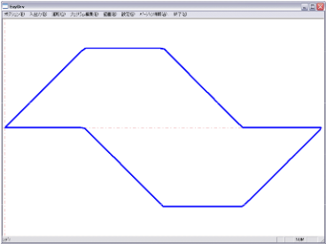

> **図の内容**
>
> 軌跡表示ウィンドウ。青い線で、左端から右上へ上がり、水平に進み、右端へ下がる台形と、左端から右下へ下がり、水平に進み、右端へ上がる台形が描かれ、全体で六角形の軌跡になっている。

【運転画面にて】「設定/選択/操作の項目」の順番に操作してください。

| 画面/項目     | 設定/選択/操作   | 動作/結果（確認）      | 補足   |
|-----------|------------|-----------------|-------|
| タスク選択     | タスク0       |                 |       |
| 動作モード     | 自動運転       |                 |       |
| 実行プログラムNO | 10         |                 |       |
| 実行ステップNO  | 1          |                 |       |
|           | 原点設定       | 座標をゼロにする        |       |
|           | スタート       | 運転開始。座標が変化。     |       |
|           | (停止)       | 運転途中ならそこで停止     |       |
|           | スタート       | 再開終了していたら、最初から |       |
|           | (リセット)     | 運転途中で強制終了します    |       |

運転途中でオーバライドを変更し、速度が遅くなったり、早くなったりするのを確認してください。

#### 7-3-6. ティーチング画面でシングルステップ運転

プログラムティーチング画面でシングルステップ運転をします。

シングルステップでは、運転プログラムの1ステップ(1行)毎に、一度停止して、

スタートボタンを押す毎に1ステップずつ実行します。作成した運転プログラムの動作確認に便利です。

【運転画面にて】「設定/選択/操作の項目」の順番に操作してください。

| 画面/項目      | 設定/選択/操作   | 動作/結果 (確認)    | 補足   |
|------------|------------|---------------|-------|
| タスク選択      | タスク0       |               |       |
| 動作モード      | 自動運転       |               |       |
| 実行プログラムNO  | 10         |               |       |
| (実行ステップNO) | 1          |               |       |
|            | 原点設定       | [座標をゼロにする]を表示 |       |
| 操作メニュー     | ティーチング     | ティーチング画面になる   |       |

【ティーチング画面にて】「設定/選択/操作の項目」の順番に操作してください。

| 画面/項目    | 設定/選択/操作   | 動作/結果 (確認)     | 補足   |
|----------|------------|----------------|-------|
| ティーチング画面 | シングル       | (シングル運転モードになる) |       |
|          | 実行         | 1ステップを実行して停止   |       |
|          | 実行         | 次のステップを実行      |       |
|          | 以下、繰り返し    | 以下、繰り返し        |       |

以上でダミー運転は終了です !

余力がある方は、セッティングPCのすべての画面を覗いて見てください。


### 7-4. 他の画面をみる

パラメータ画面パラメータを眺めてください。

サーボパラメータの説明は、試運転・調整編＜4. サーボパラメータ＞を参照ください。表示設定画面

バージョン表示テクノへの連絡時などのため確認しておいてください。

### 7-5. その他の運転の準備

#### 7-5-1. アラームの解除

入力論理がデフォルトとは違う設定の場合や、ラダーでONしていると未接続でエラーとなる場合があります。

- OT、タスク毎の外部アラーム、非常停止などの入力で発生している可能性があります。
- ROMSWソフトの入力論理がB接でオープンの場合
- → ROMSWソフトで入力論理を一度全部A接にする必要があります。
- 詳細は、ROMSW設定マニュアルを参照下さい。

「ROMSW設定ソフト」立ち上げ

I/O論理でB接論理(OT、非常停止、SALM)をA接にしてください。設定後は、必ずバックアップファイルに保存してください。

- ラダーでONしている場合
- → ラダーロジックを変更して下さい。

#### 7-5-2. PLMC-M3EX電源オフ → 再度オン

ROMSWを修正したときは、必ずPLMC-M3EX(FA-M3□)をオフ/オンして下さい。

## 8．モータ単体運転の準備

準備として最低限の配線作業をしていただきます。

モータ単体で動作(機構を動かさず)させて、機能と操作にさらに慣れていただきます。

安心して、PLMC-M3EXを使っていただけるまでの作業です。

ダミー運転と同じことをモータを空運転しながらおこなっていただきます。

各モータに合わせて、サーボアンプやPLMC-M3EXのパラメータ設定が必要です。送り速度なども実回転速度に応じて運転していただく必要があります。

以降の説明は、以下のような構成を仮定し説明しています。

(モータが4軸より少ない場合は、適宜読み替えて作業を進めて下さい。)

| 局アドレス   | 物理軸   | タスク   | 論理軸   | 論理軸    |
|---------|-------|-------|-------|--------|
| 03H     | 第1軸   | タスク0  | 論理軸   | 第1軸(X) |
| 04H     | 第2軸   | タスク0  | 論理軸   | 第2軸(Y) |
| 05H     | 第3軸   | タスク0  | 論理軸   | 第3軸(Z) |
| 06H     | 第4軸   | タスク0  | 論理軸   | 第4軸(A) |

- 【注】使用するサーボの取説や調整ソフトは、必ず準備してください。

### 8-1. 配線準備

FA-M3□以外では、サーボ主電源、MECHATROLINK、モータ、エンコーダの配線が必要です。

サーボ主電源は、ΣサーボにAC100vや200vを直接接続してもかまいません。

正式には、ラダーの出力制御で主電源のON/OFF制御をします。

使用するサーボのマニュアルを十分にご確認下さい。配線ミスで思わぬ事故になる場合もあります。また、アースは必ず接地して下さい。

### 8-2. 組立・配線・配線チェック

正式には、制御ユニット（板金ボックスやシャーシなど）にまとめてください。

仮の配置でも、板（シャーシ）などの上に固定し、アース配線をしっかりするなど、最低限の安全策を取ってください。

実験机の上にバラバラに配置するのは、作業性の悪さ、アースの不備などから事故の元になります。

配線箇所は、必ずすべてテスターチェックなどをしてください。

### 8-3. Σサーボアンプの設定

(ア) 局アドレスの設定

各Σアンプの正面にあるロータリスイッチS1とS2で、各軸のサーボアンプに2桁の局アドレスを設定してください。

モータ単体運転では、1軸目のモータから順番に03H〜04Hを設定して下さい。

設定可能範囲は、「03H〜EFH」です。局アドレスが、重複しないように注意して下さい。

使用する軸に、「03H、04H、05H・・・」と順番に設定すると、＜8-4. ROMSW設定ソフトの設定＞を行うときに分かりやすいと思います。

ΣⅤのアドレス設定部

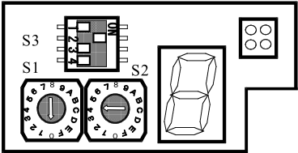

> **図の内容**
>
> サーボアンプ前面の絵。ロータリースイッチ S1、S2（0〜F）、DIP スイッチ S3（1〜4、ON）、7 セグメント表示 1 桁、端子。

(イ) ディップスイッチS3の設定

ディップスイッチS3でMECHATROLINK-Ⅲ通信のデータ量を設定して下さい。

| スイッチ番号   | 機能           | スィッチ設定   | スィッチ設定   |       | 出荷時        |
|----------|---------------|----------|----------|-------|------------|
| スイッチ番号   | 機能           | 1        | 2        |       | 出荷時        |
| 1、2      | 伝送バイト数の設定     | OFF      | OFF      | 16バイト | 1:OFF 2:ON |
| 1、2      | 伝送バイト数の設定     | ON       | OFF      | 32    | 1:OFF 2:ON |
| 1、2      | 伝送バイト数の設定     | OFF      | ON       | 48    | 1:OFF 2:ON |
| 3        | システム予約 (変更不可) | ON       | ON       | 設定不可  |            |
| 4        | システム予約 (変更不可) |          |          |       |            |

- (ウ) メカトロリンクケーブルとターミネータを接続します。

[参考資料]

安川電機「Σ-Ⅴシリーズユーザーズマニュアル設計・保守編 MECHATROLINK-Ⅲ通信指令形/回転形 (SIJP S800000 46E) 4.1 MECHATROLINK-Ⅲ通信仕様の設定」

### 8-4. PLMC-M3EXのROMSWの設定

- (ア) ROMSW設定ソフト(Plm3exswset.exe)を起動
- (イ)「アップロード」ボタンを押します。
- (ウ)「基本」画面の腨MECHATROLINK通信設定腨

以下の設定後は、必ず「設定」ボタンを押して下さい。

| 100Mbps(MECHATROLINKⅢ)   | 有効(設定変更不可)   |
|--------------------------|--------------|
| C2マスタ有効                  | 有効(デフォルト)    |
| サブコマンド有効 (伝送バイト数48バイト)   | 有効(デフォルト)    |
| 通信異常許容回数                 | 0回(デフォルト)    |

詳細は、「ROMSW設定ソフトマニュアル(TB00-0982)4-1基本パラメータ」を参照して下さい。

(エ) 「軸設定」画面

詳細は、「ROMSW設定ソフトマニュアル(TB00-0982)＜4-4. 軸設定パラメータ＞」を参照して下さい。

- (1)「有効物理軸選択」で、使用する軸のチェックボックスを有効にします。
- (2)「各軸設定」で、使用する物理軸の設定を行います。各物理軸に以下の項目の設定を行って下さい。
- (オ) PLMC-M3EXへ「ダウンロード」して設定を有効にします。
- (1) ROMSW設定ソフトの「ダウンロード」ボタンを押します。

| ① - ②   | 局アドレス - 軸割り当て   | 物理軸第1軸 03H 第2軸 04H 第3軸 05H                                                                                                          | 局アドレス                                                                                                                                | 有効軸に対し、＜8-3. Σサーボアンプの設定＞の"(ア)腨で設定した局アドレスと、「タスク」、「論理軸」を設定します - タスク                                                                   | 有効軸に対し、＜8-3. Σサーボアンプの設定＞の"(ア)腨で設定した局アドレスと、「タスク」、「論理軸」を設定します                                                                         | 有効軸に対し、＜8-3. Σサーボアンプの設定＞の"(ア)腨で設定した局アドレスと、「タスク」、「論理軸」を設定します - 論理軸                                                                   |
|---------|-----------------|--------------------------------------------------------------------------------------------------------------------------------------|--------------------------------------------------------------------------------------------------------------------------------------|--------------------------------------------------------------------------------------------------------------------------------------|--------------------------------------------------------------------------------------------------------------------------------------|--------------------------------------------------------------------------------------------------------------------------------------|
| ②       | 軸割り当て           |                                                                                                                                      |                                                                                                                                      |                                                                                                                                      | タスク0                                                                                                                                 | 論理軸第1軸(X)                                                                                                                           |
| ②       | 軸割り当て           |                                                                                                                                      |                                                                                                                                      |                                                                                                                                      | タスク0                                                                                                                                 | 論理軸第2軸(Y)                                                                                                                           |
| ②       | 軸割り当て           |                                                                                                                                      |                                                                                                                                      |                                                                                                                                      | タスク0                                                                                                                                 | 論理軸第3軸(Z)                                                                                                                           |
| ②       | 軸割り当て           |                                                                                                                                      | 第4軸                                                                                                                                  | 06H                                                                                                                                  | タスク0 論理軸                                                                                                                             | 第4軸(A)                                                                                                                               |
| ③       | 仮想アンプ           | 全ての軸でチェックを無効にして下さいデフォルトでチェック無効ですが、ダミー運転時チェックを有効にした軸があります                                                                           | 全ての軸でチェックを無効にして下さいデフォルトでチェック無効ですが、ダミー運転時チェックを有効にした軸があります                                                                           | 全ての軸でチェックを無効にして下さいデフォルトでチェック無効ですが、ダミー運転時チェックを有効にした軸があります                                                                           | 全ての軸でチェックを無効にして下さいデフォルトでチェック無効ですが、ダミー運転時チェックを有効にした軸があります                                                                           | 全ての軸でチェックを無効にして下さいデフォルトでチェック無効ですが、ダミー運転時チェックを有効にした軸があります                                                                           |
| ④       | メカ機構１回転パルス数     | 0を設定します(デフォルト)                                                                                                                       | 0を設定します(デフォルト)                                                                                                                       | 0を設定します(デフォルト)                                                                                                                       | 0を設定します(デフォルト)                                                                                                                       | 0を設定します(デフォルト)                                                                                                                       |
| ⑤       | マルチターンリミット      | 0を設定します(デフォルト)                                                                                                                       | 0を設定します(デフォルト)                                                                                                                       | 0を設定します(デフォルト)                                                                                                                       | 0を設定します(デフォルト)                                                                                                                       | 0を設定します(デフォルト)                                                                                                                       |
| ⑥       | 絶対値エンコーダ        | チェックを無効にして下さい。(デフォルト) 絶対値エンコーダを使用している場合：モータ単体運転ではインクリメンタルエンコーダとして使用します. この設定に合わせて、 ΣサーボのPn0002の2桁目を1に設定して下さいサーボアンプの設定については8-5. を参照 | チェックを無効にして下さい。(デフォルト) 絶対値エンコーダを使用している場合：モータ単体運転ではインクリメンタルエンコーダとして使用します. この設定に合わせて、 ΣサーボのPn0002の2桁目を1に設定して下さいサーボアンプの設定については8-5. を参照 | チェックを無効にして下さい。(デフォルト) 絶対値エンコーダを使用している場合：モータ単体運転ではインクリメンタルエンコーダとして使用します. この設定に合わせて、 ΣサーボのPn0002の2桁目を1に設定して下さいサーボアンプの設定については8-5. を参照 | チェックを無効にして下さい。(デフォルト) 絶対値エンコーダを使用している場合：モータ単体運転ではインクリメンタルエンコーダとして使用します. この設定に合わせて、 ΣサーボのPn0002の2桁目を1に設定して下さいサーボアンプの設定については8-5. を参照 | チェックを無効にして下さい。(デフォルト) 絶対値エンコーダを使用している場合：モータ単体運転ではインクリメンタルエンコーダとして使用します. この設定に合わせて、 ΣサーボのPn0002の2桁目を1に設定して下さいサーボアンプの設定については8-5. を参照 |
| ⑦       | ソフトリミット         | チェックを有効にして下さい(デフォルト)                                                                                                                 | チェックを有効にして下さい(デフォルト)                                                                                                                 | チェックを有効にして下さい(デフォルト)                                                                                                                 | チェックを有効にして下さい(デフォルト)                                                                                                                 | チェックを有効にして下さい(デフォルト)                                                                                                                 |
| ⑧       | 直径指令            | チェックを無効にして下さい(デフォルト)                                                                                                                 | チェックを無効にして下さい(デフォルト)                                                                                                                 | チェックを無効にして下さい(デフォルト)                                                                                                                 | チェックを無効にして下さい(デフォルト)                                                                                                                 | チェックを無効にして下さい(デフォルト)                                                                                                                 |
| ⑨       | 工具長補正           | チェックを無効にして下さい(デフォルト)                                                                                                                 | チェックを無効にして下さい(デフォルト)                                                                                                                 | チェックを無効にして下さい(デフォルト)                                                                                                                 | チェックを無効にして下さい(デフォルト)                                                                                                                 | チェックを無効にして下さい(デフォルト)                                                                                                                 |
| ⑩       | 摩耗補正            | チェックを無効にして下さい(デフォルト、設定変更不可)                                                                                                          | チェックを無効にして下さい(デフォルト、設定変更不可)                                                                                                          | チェックを無効にして下さい(デフォルト、設定変更不可)                                                                                                          | チェックを無効にして下さい(デフォルト、設定変更不可)                                                                                                          | チェックを無効にして下さい(デフォルト、設定変更不可)                                                                                                          |
| ⑪       | 主軸              | チェックを無効にして下さい(デフォルト)                                                                                                                 | チェックを無効にして下さい(デフォルト)                                                                                                                 | チェックを無効にして下さい(デフォルト)                                                                                                                 | チェックを無効にして下さい(デフォルト)                                                                                                                 | チェックを無効にして下さい(デフォルト)                                                                                                                 |
| ⑫       | 電子ギヤ            | どちらも"0"を設定して下さい                                                                                                                      | どちらも"0"を設定して下さい                                                                                                                      | どちらも"0"を設定して下さい                                                                                                                      | どちらも"0"を設定して下さい                                                                                                                      | どちらも"0"を設定して下さい                                                                                                                      |
| ⑬       | 原点復帰方式          | FBラッチ原点復帰(原点信号検出)を設定して下さい(デフォルト)                                                                                                     | FBラッチ原点復帰(原点信号検出)を設定して下さい(デフォルト)                                                                                                     | FBラッチ原点復帰(原点信号検出)を設定して下さい(デフォルト)                                                                                                     | FBラッチ原点復帰(原点信号検出)を設定して下さい(デフォルト)                                                                                                     | FBラッチ原点復帰(原点信号検出)を設定して下さい(デフォルト)                                                                                                     |
| ⑭       |                 | C(Z)相ラッチを設定して下さい(デフォルト)                                                                                                              | C(Z)相ラッチを設定して下さい(デフォルト)                                                                                                              | C(Z)相ラッチを設定して下さい(デフォルト)                                                                                                              | C(Z)相ラッチを設定して下さい(デフォルト)                                                                                                              | C(Z)相ラッチを設定して下さい(デフォルト)                                                                                                              |
| ⑮       | 原点復帰FBラッチ信号     |                                                                                                                                      |                                                                                                                                      |                                                                                                                                      |                                                                                                                                      |                                                                                                                                      |
| ⑯       | 同期軸             | チェックを無効にして下さい(デフォルト) チェックを無効にして下さい(デフォルト)                                                                                            | チェックを無効にして下さい(デフォルト) チェックを無効にして下さい(デフォルト)                                                                                            | チェックを無効にして下さい(デフォルト) チェックを無効にして下さい(デフォルト)                                                                                            | チェックを無効にして下さい(デフォルト) チェックを無効にして下さい(デフォルト)                                                                                            | チェックを無効にして下さい(デフォルト) チェックを無効にして下さい(デフォルト)                                                                                            |
|         | 接線制御軸           |                                                                                                                                      |                                                                                                                                      |                                                                                                                                      |                                                                                                                                      |                                                                                                                                      |
| ⑰       | 工具径補正           | 未選択を設定して下さい(デフォルト)                                                                                                                   | 未選択を設定して下さい(デフォルト)                                                                                                                   | 未選択を設定して下さい(デフォルト)                                                                                                                   | 未選択を設定して下さい(デフォルト)                                                                                                                   | 未選択を設定して下さい(デフォルト)                                                                                                                   |

(3) 設定後は、必ず「設定」ボタンを押して下さい。

↓

- (2) ダウンロード完了したら、「閉じる」ボタンを押します。

↓

- (3) "内容を設定ファイルに反映しますか?"と聞かれるので、「はい」を選択し、ROMSW設定ソフトを終了してください。

### 8-5. サーボアンプの設定

サーボアンプの設定の詳細については、以下の例を参考にΣサーボの説明書をご確認ください。

年間サポートを契約されている方

作成された接続図や配置図などをテクノにファックスかメールいただければ、PLMC-M3EXやサーボアンプ

の周辺接続を確認させていただきます。こちらから改善のご提案などさせていただくこともあります。

また、サーボの設定についてもご相談いただければ、判る範囲ですが、ご支援します。

■安川電機 ΣVシリーズ設定例（一般に設定するパラメータ）

| 項目                    | ΣV SGDV   | ΣV SGDV   | 単位       | 説明                                       | 空運転時設定            |
|-----------------------|-----------|-----------|----------|------------------------------------------|-------------------|
| 制御方式                  | Pn000.0桁  | 0/1       |          | 回転方向 0:CCW 1:CW                          | 0:CCW(デフォルト)      |
| 絶対値エンコーダ (アブソエンコーダのみ) | Pn002.2桁  | 0/1       |          | 0:アブソPGとして使う 1:インクレメントPGとして使う            | 1:インクレメント PGとして使う |
| OT時の停止方法              | Pn001.2桁  | 0/1       |          | 0:OT時DB停止後フリーラン 1:非常停止時トルクで停止しその後サーボロック | ※3                |
| 速度ループゲイン              | Pn100     | 適宜        | 0.1hz    | 40→上限値を探す数百hz                           | 400(デフォルト)        |
| 速度ループ積分時定数            | Pn101     | 適宜        | 0.01msec | (20msec) (20〜5msec)                      | 2000(デフォルト)       |
| 位置ループゲイン              | Pn102     | 適宜        | 0.1r/s   | 上限値を探す 50〜150r/s 補間する軸は統一                | 400(デフォルト)        |
| 慣性モーメント比              | Pn103     | 適宜        | %        | 計算値をもとに設定                                | 100(デフォルト)        |
| 電子ギヤ比 (分子)            | Pn20E     | 適宜        | Pn20E    | 適宜設定                                     | ※1                |
| (分母)                  | Pn210     | 適宜        | Pn210    |                                          |                   |
| 正転トルク制限               | Pn402     |           | %        | 試運転などでトルク制限?                             | 50%               |
| 逆転トルク制限               | Pn403     |           | %        | 50%程度? (通常800%)                          | 50%               |
| P-OT入力使わない           | Pn50A.3桁  | 適宜        |          | M3入力/OTなし:8 ※2                           | 8:P-OT無し          |
| N-OT入力使わない           | Pn50B.0桁  | 適宜        | 入力割付     | OTをΣ接続 :適宜                               | 8:N-OT無し          |
| 原点LS(DEC)             | Pn511.0桁  | 適宜        | 入力割付     | M3入力/ΣのDECを使う ※2                         | 3(デフォルト)          |
| 外部ラッチ(EXT1)           | Pn511.1桁  |           |          | 入力割付(通常不要)                               | 4(デフォルト)          |

上記は、ΣV(MECHATROLINK-Ⅲ)を使用するときに一般に設定するパラメータです。実際の設定は、安川電機の説明書にしたがってください。

※1 計算例仮定モータ1回転:360000[pulse] エンコーダ:20bit(1048576[pulse/rev])

Pn20E

エンコーダ分解能

=

1048576

Pn210 モータ軸1回転指令パルス数 360000 =

- ※2 OTやDECは、Σサーボに接続する方法を推奨します。 FA-M3□の入力に配線し、ラダー経由でPLMC-M3EXの入力割付から入力することも可能です。モータ単体運転では、とりあえずOTやDECの配線なしで行うのが簡単です。

※3 OT時の詳細はTB00-0980Eの5-14.ストロークリミットを参照してください。

### 8-6. PLMC-M3EXのサーボパラメータの設定例

モータ単体とはいえ、多少の設定が必要です。セッティングPCのパラメータ画面で設定します。また、機構を駆動する場合には、さらに速度や加減速の見直しが必要です。

30ｋ→360k(1rps) ※ モータ1回転で360000パルスの時

| サーボパラメータ   | 空運転時設定         |
|------------|----------------|
| PTP時定数     | 適宜             |
| PTP速度      | 30ｋ→360k(1rps) |
| JOG速度      | 適宜             |
| 補間時定数      | 適宜             |
| 原点復帰方向     | 無し→適宜 ※1       |

- ※1 モータ単体でも原点復帰を試したい場合は、原点復帰方向を適宜設定します。

## 9．モータ単体運転

モータは、単体で空回りしますが、急に回転すると自分の慣性で転がったりします。必ず、モータ自身も仮固定してください。

### 9-1. サーボ主電源投入シーケンス

- (1) ダーでサーボ主電源を投入(リレーシーケンス)

PLMC-M3EXの電源を入れると、一定のシーケンスの後で、サーボアラーム以外のアラーム要因が無ければ、 PLMC-M3EXのSVM出力をONします。ラダー制御で外部リレーを制御して、サーボ主電源を投入します。また、各軸のサーボアンプに対し、SVONコマンドを発行し、サーボオンします。

(ROMSWの設定によっては、自動的にSVONコマンドを発行しないので、運転画面でリセット操作して、サーボオンさせます。)

- (2) 直接のAC入力でサーボ主電源投入する場合

PLMC-M3EXが正常に動作して、かつサーボアラーム以外のアラーム要因が無いことを確認して、Σサーボの AC主電源を入れます。

その後で、運転画面からリセット操作して、サーボオンにしてください。

### 9-2. サーボロックの確認

サーボが正常にサーボオンしたら、モータのシャフトがサーボロックされます。

手で回しても動きません。位置ループ制御が正常であることが確認できます。

モータのシャフトが簡単に手で回せる状態は、サーボオフの状態です。

### 9-3. サーボの異常

サーボ主電源を投入し、サーボオンしたときにモータが暴走したり異常な動作をする場合は、サーボアンプかサーボモータ(エンコーダも含む)、あるいはそれらの配線の不良の可能性があります。

また、主電源が投入されていて、PLMC-M3EXからSVONコマンドを発行したにもかかわらず、サーボロックしないのは異常です。

Σ-Winソフトやオペレーションパネルで内部状態のモニタリングやモータ単独運転ができますので、サーボメーカの説明書にしたがって、調べてください。

### 9-4. 手動/自動運転

ダミー運転と同じ手順でモータ空運転をおこなっていただきます。

ただし以下を再確認してください。

サーボアンプのパラメータ設定＜8-5.サーボアンプの設定＞

PLMC-M3EXの設定

＜8-4.PLMC-M3EXのROMSWの設定＞

＜8-6.PLMC-M3EXのサーボパラメータの設定＞

## 10．導入編の補足資料

### 10-1. 出荷リストサンプル

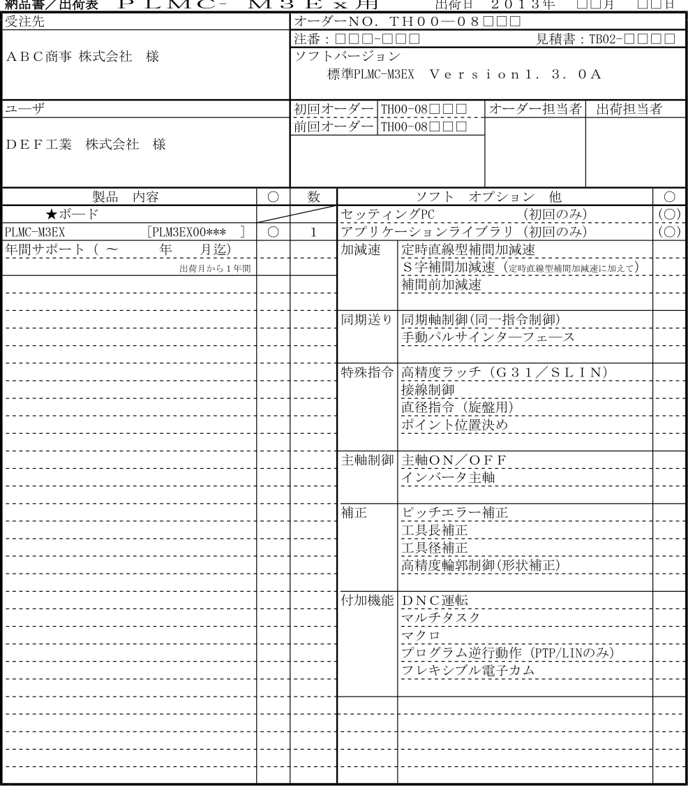

> **図の内容**
>
> 出荷リスト（納品書／出荷表 PLMC-M3Ex用）のサンプル。受注先「ＡＢＣ商事 株式会社 様」、ユーザ「ＤＥＦ工業 株式会社 様」、オーダーNO. ＴＨ００－０８□□□、ソフトバージョン「標準PLMC-M3EX Version1.3.0A」と読める。製品内容（PLMC-M3EX、年間サポート）と、ソフト オプション（セッティングPC、アプリケーションライブラリ、加減速、同期送り、特殊指令、主軸制御、補正、付加機能）の一覧。
> 細部は小さくて判読しにくい。

### 10-2. 出荷CDの中身

出荷CD内のソフトウエアの一覧を、以下に示します。

| ├ AUTORUN.INF              | 自動起動用情報ファイル                                                                            |
|----------------------------|----------------------------------------------------------------------------------------|
| ├ Setup.ini                | インストール用情報ファイル                                                                          |
| ├ setup.exe                | インストール用実行ファイル                                                                          |
| ├ PlmcM3EX                 |                                                                                        |
| ├ devlp                    | アプリケーション開発用ファイル                                                                        |
| ├ flash                    | Flash書き込み用ソフトとFlashファイル                                                                |
| ├ G_CALL.txt               | Gコード版サブルーチン呼び出し(M98)命令サンプル運転プログラム                                                      |
| ├ G_CIR.txt                | Gコード版円弧補間命令(G91 G02/G03)サンプル運転プログラム                                                    |
| ├ G_CSET.txt               | Gコード版論理座標系設定命令(G92)サンプル運転プログラム                                                         |
| ├ G_INPD.txt               | Gコード版ｲﾝﾎﾟｼﾞｼｮﾝﾁｪｯｸ無効/無効命令(G61/G64)サンプル運転プログラム                                          |
| ├ G_LIN.txt                | Gコード版直線補間命令(G91 G01)サンプル運転プログラム                                                        |
| ├ G_PTMA.txt               | Gコード版ポイント位置決め命令(G100)サンプル運転プログラム                                                       |
| ├ G_PTP.txt                | Gコード版早送り命令(G91 G00)サンプル運転プログラム                                                         |
| ├ G_PTPA.txt               | Gコード版アブソ早送り命令(G90 G00)サンプル運転プログラム                                                      |
| ├ G_SPIN.txt               | Gコード版無限回転軸速度命令(G120)サンプル運転プログラム                                                        |
| ├ L_CALL.txt               | Tコード版サブルーチン呼び出し(CALL)命令サンプル運転プログラム                                                     |
| ├ L_CIR.txt                | Tコード版円弧補間命令(CIRR/CIRL)サンプル運転プログラム                                                      |
| ├ L_CIR10.txt              | Tコード円弧補間命令(CIRL)の円弧中心指定/円弧半径指定サンプル運転プログラム                                              |
| ├ L_CSET.txt               | Tコード版論理座標系設定命令(CSET)サンプル運転プログラム                                                        |
| ├ L_DI.txt                 | Tコード版入力判断命令サンプル運転プログラム                                                                 |
| ├ L_DNC.txt                | Tコード版サンプルDNC運転プログラム                                                                    |
| ├ L_DO.txt                 | Tコード版出力制御命令サンプル運転プログラム                                                                 |
| ├ L_INPD.txt               | Tコード版ｲﾝﾎﾟｼﾞｼｮﾝﾁｪｯｸ無効/無効命令(INPE/INPD)サンプル運転プログラム                                        |
| ├ L_LIMA.txt               | Tコード版ポイント直線補間命令(LIMA)サンプル運転プログラム                                                       |
| ├ L_LIMA2.txt              | Tコード版ポイント直線補間命令(LIMA)サンプル運転プログラム２                                                      |
| ├ L_LIN.txt                | Tコード版直線補間命令(LIN)サンプル運転プログラム                                                            |
| ├ L_MicroMove.txt          | １ステップ＝１．１制御周期の微小移動運転プログラム                                                              |
| ├ L_PTMA.txt               | Tコード版ポイント位置決め命令(PTMA)サンプル運転プログラム                                                       |
| ├ L_PTP.txt                | Tコード版早送り命令(PTP)サンプル運転プログラム                                                             |
| ├ L_PTPA.txt               | Tコード版アブソ早送り命令(PTPA)サンプル運転プログラム                                                         |
| ├ L_SPIN.txt               | Tコード版無限回転軸速度命令(SPIN)サンプル運転プログラム                                                        |
| ├ L_Square.txt             | 四角形軌跡サンプル運転プログラム                                                                       |
| ├ L_SWITCH.txt             | Tコード版スイッチ命令(SWITCH)サンプル運転プログラム                                                         |
| ├ Plm3excomnt.dll          | 通信ライブラリ                                                                                |
| ├ Plm3exgcnv.dll           | Gコード変換ライブラリ                                                                            |
| ├ Plm3extcnv.dll           | Tコード変換ライブラリ                                                                            |
| ├ Plm3exdrv.exe            | セッティングPCソフト                                                                            |
| ├ Plm3exFdl.exe            | Flash書き込みソフト                                                                           |
| ├ Plm3exswset.exe          | ROMSW設定ソフト                                                                             |
| ├ L_pnt_clr.pnt            | ポイント直線補間命令(LIMA)サンプル運転                                                                 |
| ├ L_pnt_t0.pnt             | 位置決めポイントテーブルクリア用データサンプル                                                                |
| ├ L_pnt_t1.pnt             | 位置決めポイントテーブルデータサンプル(L_LIMA2.txt)                                                       |
| ├ L_pnt_t2.pnt             | 位置決めポイントテーブルデータサンプル(L_LIMA2.txt)                                                       |
| ├ L_pnt_t3.pnt             | 位置決めポイントテーブルデータサンプル(L_LIMA2.txt)                                                       |
| ├ L_pnt_t4.pnt             | 位置決めポイントテーブルデータサンプル(L_LIMA2.txt)                                                       |
| ├ L_pnt_t5.pnt             | 位置決めポイントテーブルデータサンプル(L_LIMA2.txt)                                                       |
| ├ L_pnt_t6.pnt             | 位置決めポイントテーブルデータサンプル(L_LIMA2.txt)                                                       |
| ├ L_pnt_t7.pnt             | 位置決めポイントテーブルデータサンプル(L_LIMA2.txt) 位置決めポイントテーブルデータサンプル(G_PTMA.txt/L_PTMA.txt/L_LIMA.txt) |
| ├ L_PTMA.pnt └ Version.sys | バージョン情報ファイル                                                                            |

### 10-3. サンプル運転プログラム

テクノ言語やG言語の運転プログラム＜10-2. CDの中身＞の*.txtファイルです。

ダミー運転やモータ単体運転でも使います。

サンプル運転プログラムの一部は「サンプル運転プログラム説明書（TB04-0422）」に詳細説明があります。ご参照下さい。

（テクノHPの「マニュアルダウンロード」ページから取得できます。）

### 10-4. ソフトウェアバージョン

#### 10-4-1. ソフトウェアバージョンの付け方

バージョン番号の付け方は以下の通りです。

Ver1.3.0A

◆1.1

英字部分：PC側のソフトだけを変更した時に A→B→...→Z と上がって行きます。*1

数字部分：PLMC-M3EXのファームウェア(ROMソフト)のバージョンです。

- *1 ファームウェアのバージョンアップ時には、PC側ソフトを変更していなくても英字部分は A に戻ります。
- 例）元バージョンが「Ver1.0.0B」だとして、バージョンアップの内容により、以下のようにバージョンが変わります。
- 1) ファームウェアとPC側ソフトの両方をバージョンアップ → 「Ver1.1.0A」
- 2) ファームウェアだけバージョンアップ
- → 「Ver1.1.0A」
- 3) PC側ソフトだけバージョンアップ → 「Ver1.0.0C」

#### 10-4-2. ソフトウェアバージョンの確認方法

- ① セッティングPC(PLM3EXDRV.EXE)を起動します。
- ② 「バージョン情報」ボタンを押します。
- ③ 表示されるバージョン情報ダイアログの以下の部分がバージョン番号です。


> **図の内容**
>
> メニュー: 運転、パラメータ、表示設定、バージョン情報（丸で囲み）、終了。

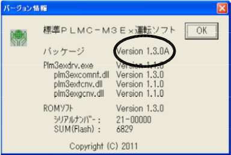

> **図の内容**
>
> ダイアログ「バージョン情報」。標準ＰＬＭＣ－Ｍ３Ｅｘ運転ソフト。
> - パッケージ: Version 1.3.0A（丸で囲み）
> - Plm3exdrv.exe Version 1.1.0（丸に重なって読みにくい）、plm3excomnt.dll Version 1.3.0、plm3extcnv.dll Version 1.1.0、plm3exgcnv.dll Version 1.1.0
> - ROMソフト Version 1.3.0、シリアルナンバー: 21-00000、SUM(Flash): 6829
> - Copyright (C) 2011
