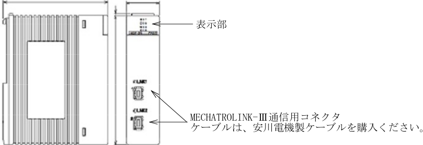

# Ⅱ ハードウェア編

改版時の主な修正箇所には「◆バージョン番号」マークが書いてあります。例）Ver0.1で改版した場合は「◆0.1」となります。

## 1. PLMC-M3EXハードウェア一般仕様

ハードウェア仕様については、海外規格(CEマーク、ROHSなど)を含めて横河電機製F3NC96と同等です。

ハード仕様詳細については、横河電機殿マニュアルを参照ください。

消費電流:5V 530mA

## 2. 外観

> **図の内容**
>
> PLMC-M3Ex モジュールの側面と正面の外形図。
> - 正面の上部に「表示部」（LED）
> - 正面の下部に「MECHATROLINK-Ⅲ通信用コネクタ」が 2 つ（CN1、CN2）。「ケーブルは、安川電機製ケーブルを購入ください。」
> 寸法の数値は図から切れていて判読できず。

## 3. サーボアンプとの接続 MECHATROLINK-Ⅲ

安川電機 MECHATROLINK-Ⅲ仕様です。ケーブルは、安川電機製MECHATROLINK-Ⅲ通信ケーブル(両端コネクタ付き)を別途ご購入ください。

## 4. サーボ周辺接続

推奨

- (1) 非常停止は、FA-M3Rに入力すると共に、リレー回路でサーボ主電源をオフさせてください。
- (2) 各軸オーバトラベル(±OT)や原点信号(DEC)は、Σサーボに入力してください。但し、オーバトラベル(±OT)や原点信号(DEC)は、FAM3のIOモジュールに入力する方法もあります。

ラダー制御

サーボ主電源を制御してください。非常停止、PLMC-M3EX側の異常(ERROR出力)などの要因でサーボ主電源をオフさせてください。

## 5. フラッシュメモリの書き込み回数制限

PLMC-M3EX内部データのバックアップは、フラッシュメモリにおこないます。フラッシュメモリは、ハード的に書き込み回数の制限(10万回)があります。例 50回(1日あたり) × 200日 × 10年 = 100000回日常的な高頻度の書き込みは、制限していただく必要があります。

### 5-1. 高頻度なフラッシュメモリの書き込みの可能性

- ① データ保存や書き換えをPCアプリやラダーから日常的におこなう場合。
- (運転ﾌﾟﾛｸﾞﾗﾑの書込みは、移動・コピー・削除なども含みます。)
- ② 運転プログラムのバックアップ方法を「自動バックアップ」としている場合。 (ROMSWの基本パラメタで選択できます。)

### 5-2. バックアップデータの種類

PLMCがバックアップするデータは以下の通りです。また、(.□□□)は、関連のファイルの拡張子です。

- ① ROMSW(.rom)
- ② サーボパラメータ(.prm)
- ③ ピッチエラー補正パラメータ(.pit)
- ④ 補間前加減速(自動コーナオーバライド)パラメータ(.aco)
- ⑤ 工具径補正パラメータ(*.tod)
- ⑥ 工具長補正パラメータ(*.tol)
- ⑦ 摩耗補正パラメータ(開発中)
- ⑧ 絶対位置オフセット(Σ側座標とPLMC-M3EX内アブソ位置とのオフセット) (アブソエンコーダ使用時のみ)
- ⑨ 運転プログラム(方式によってバックアップする/しない)
- ※ バックアップデータの詳細については、「ROMSW設定ソフト説明書(TB00-0982)」 <1-1.PLMC-M3EXで記憶している情報>を参照下さい。
