# Ⅲ 機能編

改版時の主な修正箇所には「◆バージョン番号」マークが書いてあります。例）Ver0.1で改版した場合は「◆0.1」となります。

## 1．機能概要

### 1-1．FA-M3Rのラダー制御による運転・操作

1-1-1．FA-M3□インターフェース概要

FA-M3□

PLMC-M3EX

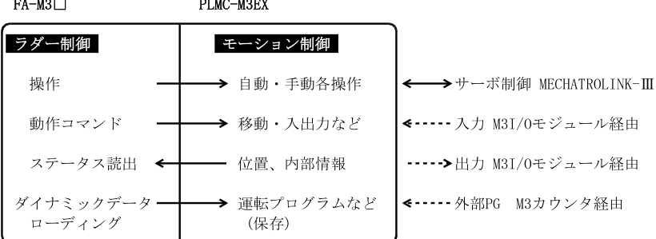

> **図の内容**
>
> 「FA-M3□」の【ラダー制御】と「PLMC-M3EX」の【モーション制御】の対応:
> - 操作 → 自動・手動各種操作
> - 動作コマンド → 移動・入出力など
> - ステータス読出 ← 位置、内部情報
> - ダイナミックデータローディング ⇄ 運転プログラムなど（保存）
> PLMC-M3EX の外側: サーボ制御 MECHATROLINK-Ⅲ、入力 M3I/Oモジュール経由、出力 M3I/Oモジュール経由、外部PG M3カウンタ経由。

PLMC-M3EXは自立的なモーション制御をおこないます。運転プログラムやパラメータなどは基本的に PLMC-M3EXで保管します。

FA-M3□は、PLMC-M3EXに対して以下のような指令や監視が可能です。

操作

動作コマンドその他

自動運転モードでの起動・停止、プログラム選択、オーバライドなど手動運転モードでの各軸ジョグ、インチングなど位置決め、直線/円弧補間、出力のON/OFF、その他

ステータス読出各軸位置、アラーム情報、内部ステータス、入出力情報などの読出しダイナミックデータ FA-M3□のCFやメモリーに保管しているPLMC-M3EX用の運転プログラムやローディングパラメータをFA-M3□からPLMC-M3EXへローディングします。(DNC運転も可能) PLMC-M3EX内のマクロ変数の読み/書き

#### 1-1-2．入出力による運転(簡単操作)

FA-M3□から入出力リレーによる操作

PLMC-M3EXの標準入/出力は、全てFA-M3□側の入/出力チャンネルに割り付けることができます。このPLMC-M3EXの入/出力を操作して、運転できます。

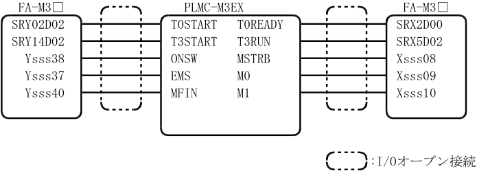

> **図の内容**
>
> 左の「FA-M3□」の出力（SRY02D02、SRY14D02、Ysss38、Ysss37、Ysss40）が、I/Oオープン接続（破線）で「PLMC-M3EX」の入力 T0START、T3START、ONSW、EMS、MFIN につながる。
> PLMC-M3EX の出力 T0READY、T3RUN、MSTRB、M0、M1 が、I/Oオープン接続で右の「FA-M3□」の入力 SRX2D00、SRX5D02、Xsss08、Xsss09、Xsss10 につながる。
> 凡例: 破線の箱「I/Oオープン接続」。

#### 1-1-3．ラダー/RTOSソフトからのコマンド運転

PLCのラダーやRTOSソフトからPLMC-M3EXのあらゆる運転が可能です。

データ送信 PLMC-M3EXで保存する運転プログラム、パラメータ、変数などをラダーから設定できます。

データ受信 PLMC-M3EX内部のステータス、状態、アラーム内容、位置情報、変数などすべての

内部情報を読み出せます。

動作コマンド運転、操作、移動指令などあらゆる指示が可能です。

特殊モジュール PLMC-M3EXのメモリ(レジスタ)を直接に書込み/読み出しできます。レジスタ拡張入出力、手動パルサカウンタ、ジョイスティックAD値、共有マクロ変数、ステータスデータなど。

#### 1-1-4．FA-M3□ライン制御

I/Oオープン PLMC-M3EX NO.1 1台のFA-M3□の管理下で複数のPLMC-M3EXが動作します。ライン上の各ステーションをPLMC-M3EXが制御して、 FA-M3□は全体を統括管理します。

各ステーションはロボットのような緻密でインテリジェントな制御が可能です。

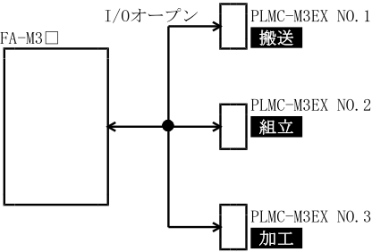

> **図の内容**
>
> 1 台の「FA-M3□」から「I/Oオープン」で、「PLMC-M3EX NO.1 搬送」「PLMC-M3EX NO.2 組立」「PLMC-M3EX NO.3 加工」の 3 台を制御する。

- ■ PLMC-M3EXは自立したモーションコントローラなのでFA-M3□に負担はありません。
- ■ 搬送・組立・加工・検査などあらゆる用途に対応します。
- ■ ダイナミックデータローディングによりラインやワークの変更に対して、運転プログラムやデータを瞬時に変更できます。
- ■ FA-M3□では各PLMC-M3EXのステータスを常時監視できます。
- ■ PLMC-M3EXの入/出力をラダー経由で接続して待ち合わせやインターロックが可能です。

### 1-2．PCからの運転・操作(パソコンリンク経由)

FA-M3□のパソコンリンク機能を利用して、PCからPLMC-M3EXをダイレクト運転・操作することができます。

- ■ 専用PCソフト(ユーザ開発可能/DLL応用)

・テクノソフトウェア

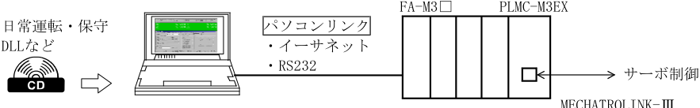

> **図の内容**
>
> 「日常運転・保守 DLLなど」（CD）の PC から、「パソコンリンク（・イーサネット ・RS232）」で「FA-M3□」につながり、FA-M3□ の中の「PLMC-M3EX」から「サーボ制御 MECHATROLINK-Ⅲ」へ。

RS232C接続

CPUモジュールプログラミングツール接続ポート

イーサネット接続

パソコンリンクモジュール

イーサネットモジュール

【注】パソコンリンク及び通信仕様の詳細は、横河電機の関連資料を参照ください。

#### 1-2-1．セッテングPCソフトによる運転

セッテングPCソフト(テクノ標準ソフト)により自動運転、手動運転の全てが可能です。また、FA-M3□のラダーは不要です。

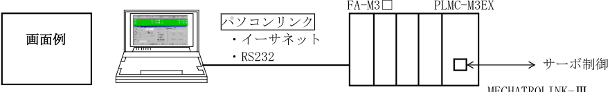

> **図の内容**
>
> 「画面例」: PC から「パソコンリンク（・イーサネット ・RS232）」で FA-M3□ の PLMC-M3EX につながり、「サーボ制御 MECHATROLINK-Ⅲ」へ。

#### 1-2-2．専用PCアプリケーションによる運転

「アプリケーションライブラリー」は、パソコンを応用して、オリジナルNCを製作していただくためのソフトウェアです。

CAD/CAM、データベース、LAN、生産管理などのソフトウェアと自由に組合せができます。

オープンシステム NC(PLMC-M3EX)の内部的な動作や状態を指令、監視することができます。

簡単

V.C や V.B から簡単に使えます。NCの特別な知識は不要です。

リアルタイム

I/O､位置､各種ステータス､各種動作の指令や監視が常時可能です。

MECHATROLINK-Ⅲ

MECHATROLINK-Ⅲ

パソコン

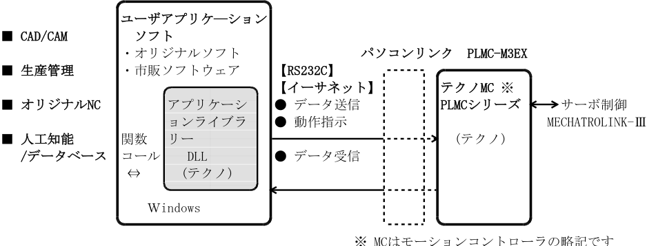

> **図の内容**
>
> - 左の用途: ■CAD/CAM、■生産管理、■オリジナルNC、■人工知能/データベース
> - Windows の「ユーザアプリケーションソフト（・オリジナルソフト ・市販ソフトウェア）」が「関数コール」で「アプリケーションライブラリー DLL（テクノ）」を呼ぶ
> - ライブラリから【RS232C】【イーサネット】の「パソコンリンク」（破線）を経て「PLMC-M3EX」の「テクノMC ※ PLMCシリーズ（テクノ）」へ。やりとりは「データ送信」「動作指示」と「データ受信」
> - PLMC から「サーボ制御 MECHATROLINK-Ⅲ」へ
> - 「※ MCはモーションコントローラの略記です」

【アプリケーションライブラリーコマンド/機能例】

| 機能分類   | 機能          | 機能分類   | 機能          |
|--------|--------------|--------|--------------|
| データ送信  | サーボパラメータ設定   | 動作指示   | バックアップデータ初期化 |
| データ送信  | オプションパラメータ設定 | 動作指示   | 動作モード設定      |
| データ送信  | 動作プログラム書込    | 動作指示   | 軸移動停止        |
| データ受信  | サーボパラメータ読出   | 動作指示   | 軸移動再開        |
| データ受信  | オプションパラメータ読出 | 動作指示   | JOG移動        |
| データ受信  | 動作プログラム読出    | 動作指示   | 原点復帰         |
| データ受信  | ポジションステータス読出 | 動作指示   | PTP位置決め      |
| データ受信  | 入出力状態読出      | 動作指示   | 補間指令         |
| データ受信  | 動作モード読出      | 動作指示   | リセット         |
| データ受信  | 指令位置読出       | 動作指示   | 原点設定         |
| データ受信  | ステータスフラグ読出   | 動作指示   | 汎用出力直接制御     |
| データ受信  | アラームフラグ読出    | 動作指示   | サーボ電源ON/OFF  |
| データ受信  | 送りオーバライド設定読出 | 動作指示   | プログラム実行開始    |
|        |              | 動作指示   | 実行プログラム選択    |
|        |              | 動作指示   | 送り速度オーバライド変更 |
|        |              | 動作指示   | 全軸原点復帰開始     |

※ 詳細は、「送受信データ説明書」(TB00-0984)を参照ください。

【パソコン接続方法】

FA-M3□パソコンリンク機能

RS232C / イーサネット

【対応 O.S】

Windows-XP / Vista / 7

#### 1-2-3．ROMSWソフトによるPLMC-M3EXの設定

PLMC-M3EXの各種設定は、ROMSW(ロムスイッチ)設定ソフトで行います。詳細は、「ROMSW設定ソフトマニュアル」(TB00-0982)を参照下さい。

【システム構成】

### 1-3．PLMC-M3EX 機能リスト

各機能を以下のように分類して記述します。

B:標準

O:オプション

S:専用化

開:開発中

PLC:FA-M3□操作 PC:パソコン操作

#### 1-3-1．PLMC-M3EX本体機能リスト

軸制御

| 第1〜16軸制御   | 軸数選択 (9軸/タスク)           | B   |
|------------|-------------------------|-----|
| 回転軸制御      | SPIN 回転軸速度指令            | B   |
| 同一指令2軸制御   | 1つの指令で2軸動作(第1/第4)       | O   |
| INPOS      | インポジションチェック             | B   |
| 接線制御       | 第1,2軸の合成方向に同期して第3軸を制御する | O   |
| 直径/半径指令    | 旋盤系のX軸指令                | O   |
| 回転軸周回処理    | 1回転したら座標を0に戻す           | B   |

加減速制御

| 直線加減速         | PTP､ジョグ送りの加減速   | B   |
|---------------|-----------------|-----|
| 指数形補間加減速      | 補間送りの加減速        | B   |
| 直線形補間加減速      | 補間送りの加減速        | O   |
| S字補間加減速       | 補間送りの加減速        | O   |
| 補間前加減速        | 軌跡発生より手前の加減速    | O   |
| (自動コーナオーバライド) |                 |     |

自動送り(運転プログラム、PC/PLC コマンド)

| 位置決め(INC)PTP   | 1軸〜9軸位置決め命令         | B   |
|----------------|----------------------|-----|
| 位置決め(ABS)PTPA  | 1軸〜9軸位置決め命令・絶対値指令   | B   |
| 直線補間(INC)LIN   | 1軸〜9軸同時9軸インクレ      | B   |
| 直線補間(ABS)LINA  | 1軸〜9軸同時9軸絶対値       | B   |
| 円弧補間(I,J)      | 任意2軸                 | B   |
| 円弧補間(R)        | 任意2軸                 | B   |
| ヘリカル補間         | 2軸+残りの1軸(プリ解/ボード内)   | B   |
| パス機能           | ブロック間停止 0 (コンタリング)   | B   |
| ポイント位置決PTMA    | パレタイザ用(ポイントテーブル)     | O   |
| ポイント直線補間LIMA   | ポイントテーブルの直線補間        | O   |
| 位置決め(ABS)PTPB  | 機械座標系の位置を指令          | B   |
| 自動原点復帰         | 電源投入時に自動的に原点復帰順序指定可能 | B   |

主軸制御

| 主軸 ON/OFF 主軸インバータ   | ON/OFF, CW/CCW O 主軸インバータ開   |
|---------------------|------------------------------|

補正制御

| B.L 補正   | バックラッシュ補正         | B   |
|----------|-------------------|-----|
| P.E 補正   | ピッチエラー補正          | O   |
| 工具長補正    | Z軸(第3軸)方向のオフセット   | O   |
| 工具摩耗補正   | 同オフセットの変化量        | 開   |
| 工具径補正    | 工具径の補正            | O   |
| 形状補正     | 高精度輪郭制御、位置ループ遅れ補正 | O   |

PC通信応用(パソコンリンク経由)

| セッティングPC アプリケーションライブラリー   | RS232C /イーサネット B RS232C /イーサネット B   |
|---------------------------|-------------------------------------|

FA-M3□通信(ラダーからの制御)

| コマンド運転    | 全ての移動・動作命令               | B/PLC   |
|-----------|--------------------------|---------|
| ステータス読出   | 位置、内部情報の読み出し             | B/PLC   |
| 入出力操作     | FA-M3□からPLMC-M3EXの入出力を操作 | B/PLC   |
| 機械パネル操作   | 自動/手動における各種操作            | B/PLC   |
| ダイナミックデータ | FA-M3□から運転プログラム          | B/PLC   |
| ローディング    | ・パラメータ・補正データなどのローディング    |         |

座標系

| 原点設定論理座標/アブソ座標   | 論理座標系のセット   | B/PC B   |
|-------------------|-------------|----------|

運転プログラム

| メモリ運転      | 64ブロック (58ステップ/ブロック)   | B    |
|------------|------------------------|------|
| サブプロ       | サブルーチンプログラム            | B    |
| 回数指定CALL   | サブプロの回数指定のCALL         | B    |
| DNC運転      | イーサネットラダー制御           | O/PC |
| マルチタスク     | 8タスク並列動作               | O    |
| マクロ        | 変数､四則演算､条件判断           | O    |
| フレキシブル電子カム | テーブル方式 (切換可)           | 開    |

保護機能

| 疑似アブソソフトリミットハードリミットサーボ主電源制御   | 電源断時の位置を記憶 OT入力(Σサーボ)   | B B B B   |
|----------------------------------|-------------------------|-----------|

共通入力信号 FA-M3□経由

| 非常停止 ONSW MOK MFIN   |
|----------------------|
| 汎用入力(Ri0〜63)         |

タスク毎入力信号 FA-M3□経由

| リセット停止起動外部アラーム原点設定オプショナルストップ MP有効各種モード選択(9) 手パ倍率(4) 手パ軸選択(4) JOG軸選択(8) 全体オーバライド(8) 補間オーバライド(8)   |
|--------------------------------------------------------------------------------------------------------|
| 実行P番号(16)                                                                                              |

※数字はbit数

共通出力信号 FA-M3□経由

| SVM(サーボ主電源)主軸出力0/1 MSTRB   |
|----------------------------|
| M0〜M7 汎用出力(Ro00〜63)        |

タスク毎出力信号 FA-M3□経由

| READY ALARM RUN PAUSE     |
|---------------------------|
| INPOS PRDY M00停止中 MODE0〜2 |

#### 1-3-2．機械操作パネル機能リスト

機械操作パネルイメージ入力 (タスク毎)機能リスト(FA-M3□ラダー経由 ) 詳細は、<2-1-5.機械操作パネル入力>(TB00-0980D)を参照下さい。

| 分類      | 機能名称                                                                                         | 内                                                                            | 容                                      |    |
|----------|-------------------------------------------------------------------------------------------------|------------------------------------------------------------------------------|----------------------------------------|----|
| 機械操作パネル | MP_HSEL0〜3 MP_INCH0〜3 MP_OVR0〜7 MP_COVR0〜7 MP_MDAUTO〜 MP_ENABLE T□CRCLR MP_AXSEL0〜7 MP_PSEL0〜15 | 手パ軸選択手パ倍率オーバーライド補間オーバライド動作モード(9種) パネル有効/無効原点設定軸動作 (Bit/code仕様) プログラム選択 | (Bit/code仕様) (Bit/code仕様) (Bit/code仕様) | B  |

#### 1-3-3．セッティングPC機能リスト(PC)

セッティングPC(パソコンリンク経由 )の機能リスト(代表的な機能)です。

詳細は、「セッティングPCマニュアル」(TB00-0981)を参照下さい。

| 分類         | 機能名称                                                                                     | 内容                                                                                                                     | PC                    |
|-------------|---------------------------------------------------------------------------------------------|-------------------------------------------------------------------------------------------------------------------------|-----------------------|
| モニタリング     | 各軸位置表示ステータス表示入/出力モニタ                                                                      | 指令位置､機械位置､アブソ位置､偏差量､相対移動量アラーム、その他ステータス入/出力信号のモニタ機能(I/O表示) 入/出力信号の強制制御                                                | B B B                 |
| 操作          | ジョグインチング原点復帰(各軸) 原点復帰(全軸) Mコード出力 P選択スタート／ストップリスタート機能トレーストレース（逆行) パソコンティーチング 1ショット位置決め | 手動送り(各軸) ×1､×10､ ×100､ ×1000 パルス送り手動 Mコード出力プログラム選択起動/停止指令 S点設定(プログラム途中からのスタート) 連続・シングル逆行ｼングル同上の逆行動作位置決め/直線補間の単独指令 | B B B B B B B S 開開開 |
| 編集運転プログラム | ※1 ※2                                                                                       | プログラム編集時模擬実行プログラム編集時のティ-チング動作による入力テクノコード／Gコード                                                                         | B B                   |
|             | プログラム編集パラメータ編集バックアップ初期化ポイントデータ編集 G92 G54関係の処理 DNC PE補正データ工具長補正データ工具径補正データ軸単位系変換       | 表形式編集 PLMC-M3EX内メモリーのクリアーポイントデータワーク座標系設定(1つ) ワーク座標系関連(複数) DNC運転指令/検出単位換算                                             | B B 開 B S O O O O S   |

※1 テキストプログラム(テクノ/Gコード)は、汎用エディタで編集可能です。

※2 ポイントデータは、汎用エディタで編集可能です。

#### 1-3-4．通信コマンド機能リスト(PC/ラダー)

PC運転(アプリケーションライブラリ/パソコンリンク経由)とラダー運転の機能リスト(代表例)です。詳細は、「送受信データ説明書」(TB00-0984)を参照ください。

| 機能分類   | 機能                  |                  | LIB/FA-M3□   |
|--------|----------------------|------------------|--------------|
|        | サーボパラメータ書込           | サーボパラメータ書込       | B            |
|        | オプションパラメータ書込         | オプションパラメータ書込     | O            |
| データ送信  | 動作プログラム書込            | 動作プログラム書込        | B            |
|        | DNCデータ書込             | DNCデータ書込         | O            |
|        | ピッチエラー補正用パラメータ書込     | ピッチエラー補正用パラメータ書込 | O            |
|        | 工具長補正データ書込           | 工具長補正データ書込       | O            |
|        | 工具径補正データ書込           | 工具径補正データ書込       | O            |
|        | サーボパラメータ読出           | サーボパラメータ読出       | B            |
|        | オプションパラメータ読出         | オプションパラメータ読出     | O            |
|        | 動作プログラム読出            | 動作プログラム読出        | B            |
|        | ポジション・ステータス読出        | ポジション・ステータス読出    | B            |
|        | 入出力状態読出              | 入出力状態読出          | B            |
| データ受信  | 動作モード読出              | 動作モード読出          | B            |
|        | 指令位置読出               | 指令位置読出           | B            |
|        | ステータスフラグ読出           | ステータスフラグ読出       | B            |
|        | アラームフラグ読出            | アラームフラグ読出        | B            |
|        | オーバーライド読出            | オーバーライド読出        | B            |
|        | プログラム実行情報読出          | プログラム実行情報読出      | B            |
|        | DNCバッファ情報読出          | DNCバッファ情報読出      | O            |
|        | ピッチエラー補正用パラメータ読出     | ピッチエラー補正用パラメータ読出 | O            |
|        | センサーラッチ位置情報読出        | センサーラッチ位置情報読出    | B            |
|        | 工具長補正データ読出           | 工具長補正データ読出       | O            |
|        | 工具径補正データ読出           | 工具径補正データ読出       | O            |
|        | 送りオーバーライド %読出        | 送りオーバーライド %読出    | B            |
|        | TPCロギング情報読出          | TPCロギング情報読出      | B            |
|        | TPCロギングデータ読出         | TPCロギングデータ読出     | B            |
|        | プログラム1ステップデータ読出      | プログラム1ステップデータ読出  | B            |
|        | バックアップデータ初期化         | バックアップデータ初期化     | B            |
|        | 動作モード設定              | 動作モード設定          | B            |
|        | 軸移動停止                | 軸移動停止            | B            |
|        | 軸移動再開                | 軸移動再開            | B            |
|        | JOG移動                | JOG移動            | B            |
|        | 原点復帰                 | 原点復帰             | B            |
| 動作指示   | インクレPTP位置決め          | インクレPTP位置決め      | B            |
|        | アブソPTP位置決め           | アブソPTP位置決め       | B            |
|        | インクレ補間位置決め           | インクレ補間位置決め       | B            |
|        | アブソ補間位置決め            | アブソ補間位置決め        | B            |
|        | リセット                 | リセット             | B            |
|        | 原点設定                 | 原点設定             | B            |
|        | 汎用出力直接制御             | 汎用出力直接制御         | B            |
|        | サーボ電源ON              | サーボ電源ON          | B            |
|        | サーボ電源OFF             | サーボ電源OFF         | B            |
|        | プログラム実行開始            | プログラム実行開始        | B            |
|        | プログラム実行停止            | プログラム実行停止        | B            |
|        | 実行プログラム選択            | 実行プログラム選択        | B            |
|        | 送りオーバーライド変更          | 送りオーバーライド変更      | B            |
|        | 全軸原点復帰開始             | 全軸原点復帰開始         | B            |
|        | 高速センサーラッチインクレ補間位置決め | <OP>             | O            |
|        | 高速センサーラッチアブソ補間位置決め  | <OP>             | O            |
|        | 汎用入力一括強制制御           | 汎用入力一括強制制御       | B            |
|        | 汎用出力一括強制制御           | 汎用出力一括強制制御       | B            |
|        | 汎用入出力強制制御            | 汎用入出力強制制御        | B            |
|        | 送りオーバーライド %変更        | 送りオーバーライド %変更    | B            |

| TPCデータ選択          | B      |
|-------------------|--------|
| TPCデータロギング ON/OFF | B      |
| 主軸回転ON/OFF        | <OP> O |
| 回転軸回転動作指令         | B      |
| Z軸接線制御ON/OFF      | <OP> O |
| シングルステップモード設定     | B      |
| ティーチング設定          | 開      |
| プログラムステップ挿入       | 開      |
| プログラムステップ置換       | 開      |
| プログラムステップ削除       | 開      |

アプリケーションライブラリーオプション WindwsXP / VISTA / 7

| オプション機能                        | 機               | 能                            |
|--------------------------------|-----------------|------------------------------|
| アプリケーションライブラリー PLM3EXCOMNT.DLL |                 | PLMC-M3EXとの通信で使用             |
| テクノコード変換ライブラリー PLM3EXTCNV.DLL  | テクノコードテキスト変換処理 | テクノコード仕様テキストプログラムの変換/逆変換で使用 |
| Gコード変換ライブラリー PLM3EXGCNV.DLL    | Gコードテキスト変換処理   | Gコード仕様テキストプログラムの変換/逆変換で使用   |

これらのオプションライブラリーは、アプリケーションライブラリーにより「オリジナルNC」をユーザ開発する時のみ関係します。セッティングPCによる応用では、関係ありません。

### 1-4．PLMC-M3EX 基本仕様

PLMC-M3EXの基本仕様を整理します。

〈OP）:オプション

| 分類       | 項目                      | 仕様                                              |
|----------|-------------------------|-------------------------------------------------|
| FA-M3□関連 | PLMC-M3EX並列 I/Oオープン接続   | 最大 8モジュール並列運転可能 ※1 32点/32点 8KB                 |
| 基本仕様     | 座標値                     | ±1000000000                                     |
| 基本仕様     | 速度                      | 1pps〜1Gpps                                      |
| 基本仕様     | 実行タスク                   | 最大8本 〈OP）                                       |
| 基本仕様     | 制御周期 MECHATROLINK-Ⅲ通信周期 | 0.5msec/6軸 1msec/14軸 1.5msec/16軸 2msec/16軸      |
| 基本仕様     | 軸数                      | 最大16軸 (論理軸は、9軸/タスク) (仮想軸も含む)                    |
| 基本仕様     | 座標系                     | 機械座標系、論理座標系                                     |
| 基本仕様     | オーバライド                  | 0〜200%                                          |
| 基本仕様     | 同時補間                    | 9軸/タスク                                          |
| 基本仕様     | 最小連続補間                  | 制御周期時間(0.5msec〜)                                |
| 基本仕様     | センサーラッチ遅れ時間             | ΣサーボEXTラッチ(遅れ無し) 〈OP）※2                         |
| 加減速      | 加減速(補間後の各軸)             | 指数型加減速直線型補間加減速 〈OP） S字加減速 〈OP）                 |
| 加減速      | 補間前加減速 (自動コーナオーバライド)    | 判定6段階                                           |
| 運転プログラム | 運転プログラム                 | 64ブロック 1ブロック :58ステップ 1プログラム :1〜32ブロック           |
| 運転プログラム | テクノ言語 G言語               | <7.動作プログラム詳細>(TB00-0980F)を参照下さい。               |
| 運転プログラム | タイマー命令                  | TIM 0.1〜2147483.6 0.1秒単位 TM 1〜2147483648 制御周期単位 |
| 運転プログラム | CALL命令                  | 最大20ネスト同一プログラム内のみ                              |
| 運転プログラム | 独立位置決め                  | 通信コマンド :9軸(非同期で重なり) 運転プログラム :4軸(非同期で重なり)        |

|                     | 同時入力判別 - 同時出力           | 同一命令内 4入力 - 同一命令内 4出力 (Ro□□命令) 16bit(マクロ変数方式)                                                                             |
|---------------------|-------------------------|---------------------------------------------------------------------------------------------------------------------------|
| 入出力                 | 論理入力点数                  | タスク毎一般:11/タスク汎用:64                                                                                                       |
|                     | 機械パネル入力                 | 67点×8タスク                                                                                                                  |
|                     | 軸関連I/O                  | 入力:(±OT、DEC)×16 Σ/(M3)                                                                                                    |
|                     | 論理出力点数                  | タスク毎一般:10/タスク汎用:64 共通:SVM、SOUT1/2                                                                                        |
|                     | Mコード                    | 出力:8点 +MSTRB 入力:MFIN、MOK                                                                                                  |
|                     | M3入力リレー                 | 32点割付選択                                                                                                                  |
|                     | M3出力リレー                 | 32点割付選択                                                                                                                  |
| 補助データ               | ポイントテーブル〈OP)            | 400点/タスク ×8                                                                                                               |
|                     | ピッチエラー補正〈OP)            | 4000点/全指定軸間隔1000〜1000000p 補正値:±127(×1〜×10)                                                                               |
|                     | 工具長補正 〈OP)              | ±1000000000 20点 ×8タスク                                                                                                     |
|                     | 工具径補正 〈OP)              | ±1000000000 20点 ×8タスク                                                                                                     |
|                     | DNCの速度 〈OP)             | パソコンリンク:イーサネット5〜8msec(目安)                                                                                                 |
|                     | 連続可能な最短ステップ             | DLL :制御周期単位                                                                                                               |
| マクロ機能               | 演算                      | × ÷ + - 剰余 AND OR XOR シフトL/R 大小比較                                                                                         |
| 〈OP）                | 値                       | 整数 32bit/16bit                                                                                                            |
|                     | グローバル変数                 | 200w                                                                                                                      |
|                     | ローカル変数                  | 100W×8タスク                                                                                                                 |
|                     | ラダー共有                   | 書き込み:100W 読み出し:100W                                                                                                       |
|                     | その他の変数                  | ステータス入力ポート36 出力ポート6 サーボパラメータ、工具長補正、ポジション、 HEX入力、軸インターロック、軸ネグレクト                                                          |
| FA-M3□ 特殊モジュールレジスタ | 特殊モジュールレジスタ             | 通信データレジスタ :704W 拡張入力レジスタ :10W 拡張出力レジスタ :4W 手パ、ジョイスティックAD :4W ラダー共有マクロ(R):100W(50LW) ラダー共有マクロ(W):100W(50LW) ステータスデータ :310W |
| サーボ                 | INPOS                   | 0〜1Gp G:ギガ 10の9乗                                                                                                          |
| パラメータ               | 偏差上限値                   | 1〜1Gp                                                                                                                     |
|                     | MPOS偏差上限                | 1〜1Gp                                                                                                                     |
|                     | 補間加減速指数                | 0〜1000msec                                                                                                                |
|                     | 直線型 S字時定数               | 0〜2000msec ※3 0〜1000msec ※3                                                                                               |
|                     | PTP時定数                  | 0〜32767msec                                                                                                               |
|                     | PTP速度                   | 最小値〜1Gpps ※4                                                                                                              |
|                     | JOG速度                   | 最小値〜1Gpps ※4                                                                                                              |
|                     | ±ソフトリミット                | 1000〜1Gp                                                                                                                  |
|                     | 原点距離原点復帰早送り速度          | -1Gp〜+1Gp 最小値〜1Gpps ※4                                                                                                    |
|                     | 原点復帰アプローチ速度原点復帰最終サーチ速度 | 最小値〜1Gpps ※4                                                                                                              |
|                     |                         | 最小値〜1Gpps ※4                                                                                                              |
|                     | バックラッシュ補正量接線制御上限速度     | 0〜3000p 最小値〜1Gpps ※4                                                                                                      |
|                     | インチング                   | ×1、×10,×100,×1000                                                                                                         |
| 手動操作                |                         |                                                                                                                           |
| セッティング              | POS表示桁数                 | 全9桁小数以下:0〜5桁(設定可)                                                                                                        |
| PC                  | POS軸名称                  | 英/漢字 1〜2文字 9軸表示/画面 2座標(指令/FB)×4096点                                                                                       |
|                     | TPCロギングデータ              |                                                                                                                           |

- ※1 他のモジュールとの取り合いもあります。その分は、制限になります。
- ※2 詳細は、安川電機Σサーボの仕様で決まります。
- ※3 直線型補間加減速の時定数:0〜2000×RTC(msec) S字加減速の時定数 :0〜1000×RTC(msec)
- ※4 最小値は制御周期の設定で変わります 1000 / RTC(msec)

※ pps は pulse/sec です。

## 2．入出力機能

- ※ PLMC-M3EX内部には、標準入出力が論理定義されています。

論理定義された標準入出力を、FA-M3□のラダーから使うことができます。

出荷時には、デフォルトの入出力割り当てを行っておりますので、特に必要なければそのまま御使用いただけます。

以下の入力や出力の状態は、標準運転ソフト「セッティングPC」でモニタリングや設定ができます。

詳細は、「セッティングPCユーザーズマニュアル」を参照ください。

### 2-1．入力信号の名称と機能

信号名の頭にT□が付く入力は、タスク毎にあります。タスク毎の信号は、他のタスクへは影響しません。 □はマルチタスクのタスク番号(0〜7)を示します。

T□が付かない入力は、共通の入力でタスクの区別はありません。

【エッジ】: 信号がOFFからONに変わったときに作用します。

【レベル】: 信号のON/OFFの状態に応じて、作用します。

【実行条件】や【検出条件】:「・印」の各行は、AND条件です。

同一行内の「/ 印」については、各々がOR条件です。

#### 2-1-1．一般入力

| 標準信号名称                | 機能説明                                                                                                                                                                                         |
|-----------------------|-------------------------------------------------------------------------------------------------------------------------------------------------------------------------------------------------|
| T□RESET (リセット) 【エッジ】  | 【実行条件】・常時【動作結果】・アラームの解除と自動運転/軸移動などの動作を中断します。・Gコード仕様では、自動運転は途中終了状態となります。・テクノコード仕様では、自動運転は通常の終了状態となります。・サーボオフ状態でアラーム要因が全て解除されている場合は、サーボオンします。                                              |
| T□STOP (ストップ) 【エッジ】   | 【実行条件】・サーボON状態【動作結果】・以下の状態であれば動作を一時停止します。(再開可) 自動運転中、主軸動作中、独立位置決め軸動作中、通信コマンドによる移動中・原点復帰中は、原点復帰を中断します。(再開不可)                                                                                |
| T□CRCLR (原点設定) 【エッジ】  | 【実行条件】・サーボON状態・動作モードが手動運転モード/自動運転モード/DNC運転モード・動作プログラム未実行又はティーチング中又はＭ０停止中・移動中の軸がない・手動パルサー選択無効(手動モード) ・各種シーケンス完了【動作結果】・現在位置を論理座標系原点とします。                                                   |
| T□REWND (リワインド) 【エッジ】 | 【有効条件】・ROMSWで「Gコード途中再開」を選択【実行条件】・選択中動作プログラムがGコード仕様【動作結果】・自動運転の途中終了状態をクリアします。途中終了状態は、自動運転をリセットで中断したとき、またはアラームで異常終了したときになります。途中終了状態で、自動運転の起動を行うと、前回中断したステップの直前のシーケンスNO.付のステップから実行を開始します。 |
| EMS                   | 【実行条件】                                                                                                                                                                                          |

| (非常停止) 【レベル】                      | ・常時【動作結果】・非常停止アラームになります。・サーボOFF ・自動運転/軸移動などの動作を中断します。                                                                                                                                                                                                                            |
|-----------------------------------|-------------------------------------------------------------------------------------------------------------------------------------------------------------------------------------------------------------------------------------------------------------------------------------|
| T□RETURN (原点復帰) 【レベル】             | ・各種シーケンス中断します。【実行条件】・サーボON状態・アラーム無し・動作モードが手動運転モード/自動運転モード/DNC運転モード・プログラム実行待機状態・手動パルサ無効・移動中の軸がない・各種シーケンス完了状態【動作結果】・全軸の原点復帰動作を開始します。                                                                                                                                        |
| T□START (スタート) 【エッジ】              | 【実行条件】 A.自動/DNCモードの場合・サーボON状態・アラーム無し・移動中の軸がない・各種シーケンス完了・ティーチング中でない・プログラム実行待機状態(開始時)/停止中(再開時) B.手動モードで原点復帰モードの場合・サーボON状態・アラーム無し・手動パルサ無効・移動中の軸がない・各種シーケンス完了状態・プログラム実行待機状態【動作結果】 A.自動/DNCモードの場合自動運転の起動を行います。自動運転が停止中の場合は、運転の再開を行います。 B.手動モードで原点復帰モードの場合                 |
| T□VCAMSON                         | 全軸の原点復帰動作を開始します。電子カムサイクル(繰り返し)入力 <開発中>                                                                                                                                                                                                                                             |
| ONSW (オンスイッチ) ON :【エッジ】 OFF:【レベル】 | 【有効条件】・ROMSWでONSWを選択した場合【実行条件】・OFFは、常時・ONは、アラーム無し・サーボオフ【動作結果】 ON :サーボオフ状態であれば、サーボ電源オン (但し、サーボOFFエラー発生時はサーボOFFします。) サーボOFFエラーは、非常停止/サーボアラーム/サーボ電源OFF/外部アラームA /メカトロリンク全体通信エラー/メカトロリンク各軸通信エラー /メカトロリンク多重コマンドエラー/インバータアラーム /インバータサーボOFF/ROMSWでOT時サーボOFFを選択した場合のOT OFF :サーボ電源オフ |

| T□EXTALMA(外部アラームA) (サーボオフ) 【レベル】         | 【実行条件】・常時【動作結果】・サーボオフして、外部アラーム状態Aとなります。 (軸動作不可)                                          |
|-------------------------------------------|---------------------------------------------------------------------------------------------|
| T□EXTALMB(外部アラームB) (緊急停止) 【レベル】          | 【実行条件】・常時【動作結果】・緊急停止して、外部アラーム状態Bとなります。 (軸動作不可)                                           |
| T□EXTALMC(外部アラームC) (通常停止) 【レベル】中断は【エッジ】 | 【実行条件】・常時【動作結果】・補間は減速停止、PTP/JOGは緊急停止して、外部アラーム状態Cとなります。ただし、外部アラームC中でも、再度スタートやジョグは、可能です。 |

#### 2-1-2．補助機能入力

| 信号名称                       | 機能説明                                                                                                                                                                                                                          |
|----------------------------|-------------------------------------------------------------------------------------------------------------------------------------------------------------------------------------------------------------------------------|
| MFIN (Mコード読取完了) 【エッジ】      | 【説明】・外部機器よりPLMC-M3EXコントローラへ、補助機能(Mコード)の実行完了を通知します。詳細は、<7-3-18.Mコード出力>(TB00-0980F)を参照して下さい。【実行条件】・MSTRB出力のON中(Mコードシーケンス中) 【動作結果】・MSTRB出力をオフし、Mコードシーケンスが終了します。                                                            |
| MOK (Mコード正常終了) 【レベル】       | 【説明】・補助機能(Mコード出力)にて、外部機器よりMFINを受け取った時、この信号をチェックして、Mコードが正常に完了したかを判別します。詳細は、<7-3-18.Mコード出力>(TB00-0980F)を参照して下さい。【有効条件】・ROMSWでMOK入力を選択した場合【動作結果】・MFINのON時、MOKがOFFの場合はMコード実行エラーになります。 (更に、プログラム実行中の場合はプログラム実行エラーにもなります。) |
| T□MOPT (オプショナルストップ) 【レベル】 | 【有効条件】・ROMSWで｢M00/M01停止｣を選択【実行条件】・M00/M01コード実行時にチェックします。【動作結果】・ON中は、M01命令で停止します。                                                                                                                                         |

#### 2-1-3．汎用入力

| 信号名称                  | 機能説明                                                                                                                                                                                                       |
|-----------------------|------------------------------------------------------------------------------------------------------------------------------------------------------------------------------------------------------------|
| Ri0〜Ri63 (汎用入力) 【レベル】 | 動作プログラムの中で、条件判別に使用します。 W WAIT 処理待ち S STOP 途中停止 J スキップスキップ動作 E EXIT 強制終了詳細は、<7-3-19.汎用入出力処理指定>(TB00-0980F)を参照して下さい。また、以下のマクロ変数でも読み込み可能です。・<7-4-8.入/出力パターン>(TB00-0980F) ・<7-4-17.HEX入力データ> (TB00-0980F) |

#### 2-1-4．軸制御関連入力

以下の信号は、基本的にΣサーボに接続してしていただきます。

I/O割付をおこなうとFA-M3□の入力モジュールに入力することも可能ですが、ラダーの介在が必要です。

| 信号名称                         | 機能説明                                                                                 |
|------------------------------|--------------------------------------------------------------------------------------|
| OTP01〜16 (+方向オーバトラベル) 【レベル】 | 【検出条件】・常時【動作結果】・ON中は、+方向のオーバトラベルアラームが発生します。 ROMSWでOT時サーボOFFを選択した場合、サーボOFFエラーになります |
| OTM01〜16 (-方向オーバトラベ)ル【レベル】 | 【実行条件】・常時【動作結果】・ON中は、-方向のオーバトラベルアラームが発生します。 ROMSWでOT時サーボOFFを選択した場合、サーボOFFエラーになります |
| DEC01〜16 (原点信号) 【レベル】        | 【検出条件】・原点復帰シーケンス中【動作結果】・原点復帰方法により、減速や原点サーチ動作に入ります。                                |

#### 2-1-5．機械操作パネル入力

機械パネル入力は、タスク毎にあります。以下で説明する機械パネル入力の説明(条件や動作)は、全てタスク内の事になります。

| T□MP_HSEL 0〜3 (手パ軸選択)                                                                                            | 軸コードと選択軸との対応はROMSW設定ソフトにて設定しま                                                                                                                                    | MPHSEL3 OFF                                                                                                                                                        | MPHSEL2                                                                                                                                                            | MPHSEL1 OFF                                                                                                                                                        | MPHSEL0 OFF                                                                                                                                                        | 軸コード 0                                                                                                                                                             |
|------------------------------------------------------------------------------------------------------------------|--------------------------------------------------------------------------------------------------------------------------------------------------------------------|--------------------------------------------------------------------------------------------------------------------------------------------------------------------|--------------------------------------------------------------------------------------------------------------------------------------------------------------------|--------------------------------------------------------------------------------------------------------------------------------------------------------------------|--------------------------------------------------------------------------------------------------------------------------------------------------------------------|--------------------------------------------------------------------------------------------------------------------------------------------------------------------|
| T□MP_INCH 0〜3 (手パ倍率/ インチング送り量)                                                                                  | す。 ON 手動パルサモード倍率                                                                                                                                                  | 〜                                                                                                                                                                  | OFF (4bitコード) ON ×1000                                                                                                                                             | 〜 ON ×100                                                                                                                                                          | ON ×10                                                                                                                                                             | 〜 15 ×1                                                                                                                                                            |
| T□MP_INCH 0〜3 (手パ倍率/ インチング送り量)                                                                                  | MPINCH3 MPINCH2 MPINCH1 MPINCH0                                                                                                                                    | MPINCH3 MPINCH2 MPINCH1 MPINCH0                                                                                                                                    | MPINCH3 MPINCH2 MPINCH1 MPINCH0                                                                                                                                    | MPINCH3 MPINCH2 MPINCH1 MPINCH0                                                                                                                                    | MPINCH3 MPINCH2 MPINCH1 MPINCH0                                                                                                                                    | MPINCH3 MPINCH2 MPINCH1 MPINCH0                                                                                                                                    |
| T□MP_OVR 0〜7 (全体/PTPオーバライド)                                                                                      | インチングモードパルス 1000 100 10 1 【Bit仕様】 MPOVR7〜MPOVR0:200%,175%,〜,25%(25%ステップ) 全ビットOFF時は無効。(PCからの指定が有効) 【Code仕様】8ビットバイナリーデータで0〜200%を選択。有効範囲外の時はPCによる選択が有効。             | インチングモードパルス 1000 100 10 1 【Bit仕様】 MPOVR7〜MPOVR0:200%,175%,〜,25%(25%ステップ) 全ビットOFF時は無効。(PCからの指定が有効) 【Code仕様】8ビットバイナリーデータで0〜200%を選択。有効範囲外の時はPCによる選択が有効。             | インチングモードパルス 1000 100 10 1 【Bit仕様】 MPOVR7〜MPOVR0:200%,175%,〜,25%(25%ステップ) 全ビットOFF時は無効。(PCからの指定が有効) 【Code仕様】8ビットバイナリーデータで0〜200%を選択。有効範囲外の時はPCによる選択が有効。             | インチングモードパルス 1000 100 10 1 【Bit仕様】 MPOVR7〜MPOVR0:200%,175%,〜,25%(25%ステップ) 全ビットOFF時は無効。(PCからの指定が有効) 【Code仕様】8ビットバイナリーデータで0〜200%を選択。有効範囲外の時はPCによる選択が有効。             | インチングモードパルス 1000 100 10 1 【Bit仕様】 MPOVR7〜MPOVR0:200%,175%,〜,25%(25%ステップ) 全ビットOFF時は無効。(PCからの指定が有効) 【Code仕様】8ビットバイナリーデータで0〜200%を選択。有効範囲外の時はPCによる選択が有効。             | インチングモードパルス 1000 100 10 1 【Bit仕様】 MPOVR7〜MPOVR0:200%,175%,〜,25%(25%ステップ) 全ビットOFF時は無効。(PCからの指定が有効) 【Code仕様】8ビットバイナリーデータで0〜200%を選択。有効範囲外の時はPCによる選択が有効。             |
| T□MP_COVR 0〜7 (補間オーバラド)                                                                                          | 共通オーバライドのときは、全体。3種で区別する場合は、PTP/JOG 【Bit仕様】 MP_COVR7〜MP_COVR0:200%,175%,〜,25%(25%ステップ) 全ビットOFF時は無効。(PCからの指定が有効) 【Code仕様】8ビットバイナリーデータで0〜200%を選択。有効範囲外の時はPCによる選択が有効。 | 共通オーバライドのときは、全体。3種で区別する場合は、PTP/JOG 【Bit仕様】 MP_COVR7〜MP_COVR0:200%,175%,〜,25%(25%ステップ) 全ビットOFF時は無効。(PCからの指定が有効) 【Code仕様】8ビットバイナリーデータで0〜200%を選択。有効範囲外の時はPCによる選択が有効。 | 共通オーバライドのときは、全体。3種で区別する場合は、PTP/JOG 【Bit仕様】 MP_COVR7〜MP_COVR0:200%,175%,〜,25%(25%ステップ) 全ビットOFF時は無効。(PCからの指定が有効) 【Code仕様】8ビットバイナリーデータで0〜200%を選択。有効範囲外の時はPCによる選択が有効。 | 共通オーバライドのときは、全体。3種で区別する場合は、PTP/JOG 【Bit仕様】 MP_COVR7〜MP_COVR0:200%,175%,〜,25%(25%ステップ) 全ビットOFF時は無効。(PCからの指定が有効) 【Code仕様】8ビットバイナリーデータで0〜200%を選択。有効範囲外の時はPCによる選択が有効。 | 共通オーバライドのときは、全体。3種で区別する場合は、PTP/JOG 【Bit仕様】 MP_COVR7〜MP_COVR0:200%,175%,〜,25%(25%ステップ) 全ビットOFF時は無効。(PCからの指定が有効) 【Code仕様】8ビットバイナリーデータで0〜200%を選択。有効範囲外の時はPCによる選択が有効。 | 共通オーバライドのときは、全体。3種で区別する場合は、PTP/JOG 【Bit仕様】 MP_COVR7〜MP_COVR0:200%,175%,〜,25%(25%ステップ) 全ビットOFF時は無効。(PCからの指定が有効) 【Code仕様】8ビットバイナリーデータで0〜200%を選択。有効範囲外の時はPCによる選択が有効。 |
| T□MP_SOVR 0〜7 (主軸オーバラド)                                                                                          | 【Bit仕様】 MP_SOVR7〜MP_SOVR0:200%,175%,〜,25%(25%ステップ) 全ビットOFF時は無効。(PCからの指定が有効) 【Code仕様】8ビットバイナリーデータで0〜200%を選択。有効範囲外の時はPCによる選択が有効。                                    | 【Bit仕様】 MP_SOVR7〜MP_SOVR0:200%,175%,〜,25%(25%ステップ) 全ビットOFF時は無効。(PCからの指定が有効) 【Code仕様】8ビットバイナリーデータで0〜200%を選択。有効範囲外の時はPCによる選択が有効。                                    | 【Bit仕様】 MP_SOVR7〜MP_SOVR0:200%,175%,〜,25%(25%ステップ) 全ビットOFF時は無効。(PCからの指定が有効) 【Code仕様】8ビットバイナリーデータで0〜200%を選択。有効範囲外の時はPCによる選択が有効。                                    | 【Bit仕様】 MP_SOVR7〜MP_SOVR0:200%,175%,〜,25%(25%ステップ) 全ビットOFF時は無効。(PCからの指定が有効) 【Code仕様】8ビットバイナリーデータで0〜200%を選択。有効範囲外の時はPCによる選択が有効。                                    | 【Bit仕様】 MP_SOVR7〜MP_SOVR0:200%,175%,〜,25%(25%ステップ) 全ビットOFF時は無効。(PCからの指定が有効) 【Code仕様】8ビットバイナリーデータで0〜200%を選択。有効範囲外の時はPCによる選択が有効。                                    | 【Bit仕様】 MP_SOVR7〜MP_SOVR0:200%,175%,〜,25%(25%ステップ) 全ビットOFF時は無効。(PCからの指定が有効) 【Code仕様】8ビットバイナリーデータで0〜200%を選択。有効範囲外の時はPCによる選択が有効。                                    |
| T□MP_MDSET T□MP_MDAUTO T□MP_MDDNC T□MP_MDSNGL T□MP_MDZRN T□MP_MDJOG T□MP_MDINCH T□MP_MDHNDL T□MP_MDOTDIS (モード選択) | セッティングモード連続運転モード ※原点復帰モード時は以下の動作が DNCモード可能です。シングルステップモード STRTSW入力 :全軸自動原点復帰原点復帰モード軸動作入力(MPAXSEL):各軸手動原点復帰 JOGモード (方向によってはジョグ) ※1 インチングモード手動パルサモード OT無視モード    | セッティングモード連続運転モード ※原点復帰モード時は以下の動作が DNCモード可能です。シングルステップモード STRTSW入力 :全軸自動原点復帰原点復帰モード軸動作入力(MPAXSEL):各軸手動原点復帰 JOGモード (方向によってはジョグ) ※1 インチングモード手動パルサモード OT無視モード    | セッティングモード連続運転モード ※原点復帰モード時は以下の動作が DNCモード可能です。シングルステップモード STRTSW入力 :全軸自動原点復帰原点復帰モード軸動作入力(MPAXSEL):各軸手動原点復帰 JOGモード (方向によってはジョグ) ※1 インチングモード手動パルサモード OT無視モード    | セッティングモード連続運転モード ※原点復帰モード時は以下の動作が DNCモード可能です。シングルステップモード STRTSW入力 :全軸自動原点復帰原点復帰モード軸動作入力(MPAXSEL):各軸手動原点復帰 JOGモード (方向によってはジョグ) ※1 インチングモード手動パルサモード OT無視モード    | セッティングモード連続運転モード ※原点復帰モード時は以下の動作が DNCモード可能です。シングルステップモード STRTSW入力 :全軸自動原点復帰原点復帰モード軸動作入力(MPAXSEL):各軸手動原点復帰 JOGモード (方向によってはジョグ) ※1 インチングモード手動パルサモード OT無視モード    | セッティングモード連続運転モード ※原点復帰モード時は以下の動作が DNCモード可能です。シングルステップモード STRTSW入力 :全軸自動原点復帰原点復帰モード軸動作入力(MPAXSEL):各軸手動原点復帰 JOGモード (方向によってはジョグ) ※1 インチングモード手動パルサモード OT無視モード    |
| T□MP_ENABLE(パネル有効)                                                                                               | この入力がONの時のみ、この表の機械操作パネル関連が有効となります。                                                                                                                                 | この入力がONの時のみ、この表の機械操作パネル関連が有効となります。                                                                                                                                 | この入力がONの時のみ、この表の機械操作パネル関連が有効となります。                                                                                                                                 | この入力がONの時のみ、この表の機械操作パネル関連が有効となります。                                                                                                                                 | この入力がONの時のみ、この表の機械操作パネル関連が有効となります。                                                                                                                                 | この入力がONの時のみ、この表の機械操作パネル関連が有効となります。                                                                                                                                 |
| T□MP_TEACH (ティーチング) <開発中>                                                                                        | 自動モードかつ運転プログラムがステップ間で一時停止中の場合、 ONでティーチングモード、OFFでティーチング解除                                                                                                           | 自動モードかつ運転プログラムがステップ間で一時停止中の場合、 ONでティーチングモード、OFFでティーチング解除                                                                                                           | 自動モードかつ運転プログラムがステップ間で一時停止中の場合、 ONでティーチングモード、OFFでティーチング解除                                                                                                           | 自動モードかつ運転プログラムがステップ間で一時停止中の場合、 ONでティーチングモード、OFFでティーチング解除                                                                                                           | 自動モードかつ運転プログラムがステップ間で一時停止中の場合、 ONでティーチングモード、OFFでティーチング解除                                                                                                           | 自動モードかつ運転プログラムがステップ間で一時停止中の場合、 ONでティーチングモード、OFFでティーチング解除                                                                                                           |

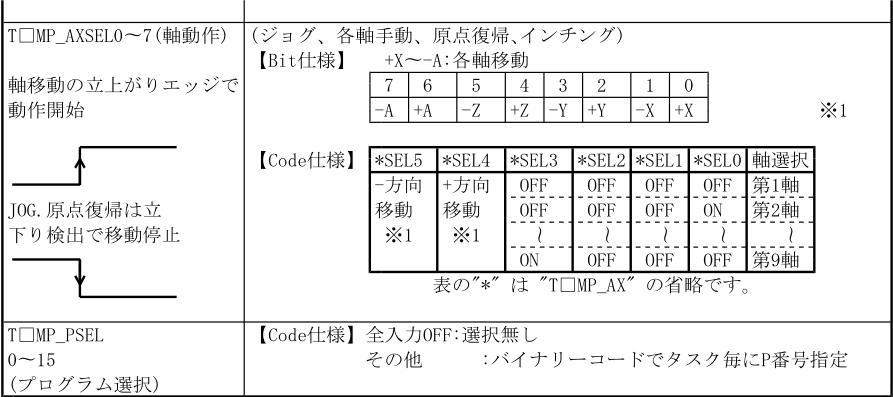

> **図の内容**
>
> - T□MP_AXSEL0～7（軸動作）: 軸移動の立ち上がりエッジで動作開始（ジョグ、各軸手動、原点復帰、インチング）。JOG、原点復帰は立ち下がり検出で移動停止
>   - 【Bit仕様】+X～-A: 各軸移動。ビット 7～0 が -A、+A、-Z、+Z、-Y、+Y、-X、+X ※1
>   - 【Code仕様】*SEL5～*SEL0 の組み合わせで「-方向移動」「+方向移動」と軸選択（第1軸～第9軸）。表の「*」は「T□MP_AX」の省略です
> - T□MP_PSEL 0～15（プログラム選択）: 【Code仕様】全入力OFF:選択無し、その他:バイナリーコードでタスク毎にP番号指定
> 表の細部は小さくて判読できない箇所がある。

- 【Bit仕様】と【Code仕様】は､ROMSW設定ソフトにて各チャンネル毎に設定
- Bit仕様で複数Bitが同時にONのときは、無効(無視)
- 上記信号は、全て【レベル】入力です。

■「機械操作パネル有効T□MP_ENABLE」信号の意味

モード選択/オーバーライド選択等、機械パネル以外の操作(PC操作)でも変更できる選択では、

機械パネルの選択が最優先されます。そのため、機械パネル以外の操作では変更できなくなります。動作モードを変更できないと、PCからパラメータのダウンロードをできなくなってしまいます。

(セッティングモードに変更できないため)

これを防ぐために「機械操作パネル有効」信号はON/OFFできるようにして下さい。

■【オーバライド】の種類

ROMSW設定ソフトで「共通オーバライド」と「3種別オーバライド」を選択出来ます。

「共通オーバライド」 : T□MP_OVR0〜7が送り速度、主軸回転速度すべて共通の指定。

「3種別オーバライド」 : PTP、補間、主軸の各々のオーバライド設定が可能です。

- ※1■【各軸手動原点復帰】の軸移動方向

MPZRN(原点復帰)モードでMP_AXSELで軸方向を指定した場合、+/-の移動方向によって動作が変わります。サーボパラメータの「原点復帰方法」で示す方向と比較して、

- 同方向の場合:手動原点復帰動作
- 逆方向の場合:ジョグ動作
- となります。

#### 2-1-6．機械操作パネル入力の補足説明

- (1) T□MP_HSEL0〜3(手動パルサ軸選択)

【検出条件】

パネル有効

ROMSWで手動パルサオプション有効

T□MPHNDLがON

手動(手動パルサ)OT無視(手動パルサ)

サーボON状態

移動中の軸が無い

各種シーケンス完

プログラム実行待機、又はシングルモード時、又は一時停止時

手動モード/OT無視モード/自動モードのM0停止中

【動作結果】

手動パルサで移動する軸を選択します。軸コードと物理軸の対応は、ROMSW設定です。

【注意】

本入力が有効な時に、通信コマンドで手動パルサを有効にするとコマンド実行エラーになります。

- (2) T□MP_INCH0〜3(手パ倍率/インチング送り量)

【検出条件】

パネル有効

【動作結果】

手パ倍率またはインチング送り量を設定します。

【注意】

本入力が有効な時に、通信コマンドから手パ倍率を変更するとコマンド実行エラーになります。

- (3) T□MP_OVR0〜7(全体/PTPオーバライド)

【検出条件】

パネル有効

【動作結果】

オーバライドを設定します。ROMSWの設定で「全体/PTPのみ」を選択できます。

【注意】

本入力が有効な時に、通信コマンドから変更するとコマンド実行エラーになります。

- (4) T□MP_COVR0〜7(補間オーバライド)

【検出条件】

パネル有効

【動作結果】

補間オーバライドを設定します。

【注意】

本入力が有効な時に、通信コマンドから変更するとコマンド実行エラーになります。

- (5) T□MP_MDSET〜T□MP_MDOTDIS(モード選択)

【検出条件】

パネル有効

「2-1-7．.機械操作パネル入力のモード選択」の組み合わせプログラム実行待機状態(プログラム運転中でない状態) 動作中の軸が無く

各種シーケンス完了

ただし、DNCモードへの切換時は、DNCオプションが有効

【動作結果】

モード選択入力変化時、それ以前のパネル操作で動作中(JOG、インチング、原点復帰)の軸は停止します。その後、上記検出条件を判定し、モードが切り替わります。

【注意】

本入力が有効な時に、通信コマンドから変更するとコマンド実行エラーになります。

- (6) T□MP_ENABLE(パネル有効)

【検出条件】

常時

【動作結果】

機械パネルIFの各入力信号が有効になります。

- (7) T□MP_AXSEL0〜7( 軸動作)

【検出条件】

パネル有効

サーボON状態

セッティングモードでなく

プログラム実行待機(プログラム運転中でない)/ティーチング中/M0停止中手動パルサ無効

原点復帰が実行中でない

ホーム移動が実行中でない

【動作結果】

手動(原点復帰)モードの場合は

原点復帰方向であれば、原点復帰動作

原点復帰方向と逆方向でソフトリミットやOT方向でなければ、JOG動作

手動モード(原点復帰以外)/OT無視/ティーチング中/M0停止中の場合は

ソフトリミットやOT方向でなければ

手動(JOG)であればインチング動作

手動(インチング)であればインチング動作

- (8) T□MP_PSEL0〜15(プログラム選択)

【検出条件】

パネル有効

プログラム実行待機状態(プログラム運転中でない)

【動作結果】

選択中のプログラム番号が変わります。

本入力が有効な時に、通信コマンドから変更するとコマンド実行エラーになります。

#### 2-1-7．機械操作パネル入力のモード選択

無印:オフ

|           | モード選択 - MDSET   | モード選択 - MDAUTO   | モード選択 - MDDNC   | モード選択 - MDSNGL   | モード選択 - MDZRN   | モード選択 - MDJOG   | モード選択 - MDINCH   | モード選択 - MDHNDL   | モード選択 - MDOTDIS   |
|-----------|-----------------|------------------|-----------------|------------------|-----------------|-----------------|------------------|------------------|-------------------|
| セッティング    | ON              |                  |                 |                  |                 |                 |                  |                  |                   |
| 自動(連続運転)  |                 | ON               |                 |                  |                 |                 |                  |                  |                   |
| 自動(シングル)  |                 | ON               |                 | ON               |                 |                 |                  |                  |                   |
| DNC(連続運転) |                 |                  | ON              |                  |                 |                 |                  |                  |                   |
| DNC(シングル) |                 |                  | ON              | ON               |                 |                 |                  |                  |                   |
| 手動(原点復帰)  |                 |                  |                 |                  | ON              |                 |                  |                  |                   |
| 手動(JOG)   |                 |                  |                 |                  |                 | ON              |                  |                  |                   |
| 手動(インチング) |                 |                  |                 |                  |                 |                 | ON               |                  |                   |
| 手動(手パ)    |                 |                  |                 |                  |                 |                 |                  | ON               |                   |
| OT無視(JOG) |                 |                  |                 |                  |                 | ON              |                  |                  | ON                |
| OT無視(手パ)  |                 |                  |                 |                  |                 |                 |                  | ON               | ON                |

- ※ 上記パターン以外(全入力OFFも含む)や機械パネル有効信号がOFFの時は、通信コマンド(PC/ラダー) のモード選択が有効です。

### 2-2．出力信号の名称と機能

信号名の頭にT□が付く出力は、タスク毎にあります。 T□が付かない出力は、共通の出力でタスクの区別はありません。 □は0〜7で、マルチタスク番号を示します。

【一般出力】

| 信号名称                 | 機能説明                                                                                                                                                                                                                                                      |
|----------------------|-----------------------------------------------------------------------------------------------------------------------------------------------------------------------------------------------------------------------------------------------------------|
| SVM (サーボ主電源制御)       | 【説明】・サーボの主電源制御用出力です。【ONする条件】 A.「システム起動時サーボオン」設定(ROMSW)の場合 (起動時+リセットON)・アラーム無し B.「ONSW有効設定」(ROMSW)の場合 (ONSWがON+リセットON)・アラーム無し C.「その他一般の場合」リセットON・アラーム無し +:OR条件・:AND条件リセットON:リセット入力+コマンド【OFFする条件】 A.「ONSW有効設定」(ROMSW)の場合 ONSWがOFF+アラーム発生 B.「その他一般の場合」 |
| T□READY (コントローラレディ) | アラーム発生【説明】・正常状態を示します。【ONする条件】・正常状態(アラームなし)                                                                                                                                                                                                            |
| T□RUN (プログラム運転中)     | 【説明】・軸移動中(位置停止も含む)、各種シーケンス中を示します。【ONする条件】・プログラム運転の実行中(もしくは一時停止中) 又は移動コマンドによる軸移動中(もしくは一時停止中) 又は各種シーケンス中軸移動中(一時停止中を含む)                                                                                                                                   |
| T□ALARM (アラーム)       | 【ONする条件】・アラームが発生。【OFFする条件】・アラーム要因を解除して、リセット                                                                                                                                                                                                            |
| T□INPOS (位置決完了)      | 【説明】・位置決め完了を示します。【ONする条件】全軸が以下の条件となったとき ■INPOS値(パラメータ)が設定してある軸・軌跡発生処理の残出力移動量がINPOS幅以下。・「偏差 + 加減速溜まり」がINPOS幅以下。 ■INPOS値がゼロ設定の軸:軌跡発生完了                                                                                                                 |
| T□PAUSE (途中停止中)      | 【説明】・自動運転が一時停止中であることを示します。【ONする条件】・シングル実行中で移動完了かつMコード中でない。又はプログラム運転の一時停止中又は、汎用入力処理のSTOPもしくはWAIT中                                                                                                                                                     |
| T□PRDY (プログラム起動可)    | 【説明】・自動運転の開始条件が全て整った事を示します。【ONする条件】・アラームなし                                                                                                                                                                                                             |

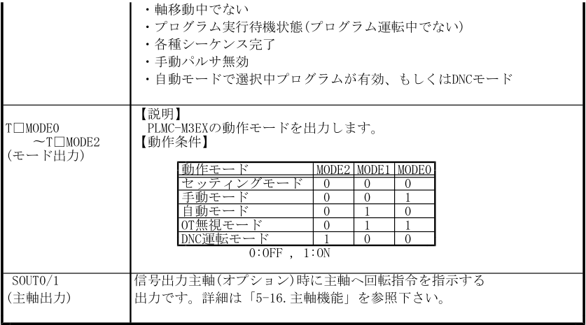

> **図の内容**
>
> - 上の欄（条件の続き）: ・軸移動中でない ・プログラム実行待機状態（プログラム運転中でない） ・各種シーケンス完了 ・手動パルサ無効 ・自動モードで選択中プログラムが有効、もしくはDNCモード
> - T□MODE0～T□MODE2（モード出力）: 【説明】PLMC-M3EXの動作モードを出力します。【動作条件】の表:
>
> | 動作モード | MODE2 | MODE1 | MODE0 |
> |---|---|---|---|
> | セッティングモード | 0 | 0 | 0 |
> | 手動モード | 0 | 0 | 1 |
> | 自動モード | 0 | 1 | 0 |
> | OT無視モード | 0 | 1 | 1 |
> | DNC運転モード | 1 | 0 | 0 |
>
> （0:OFF、1:ON）
> - SOUT0/1（主軸出力）: 信号出力主軸（オプション）時に主軸へ回転指令を指示する出力です。詳細は「5-16. 主軸機能」を参照下さい。

【補助機能出力】

| 信号名称             | 機能説明                                                                                                                                                  |
|------------------|-------------------------------------------------------------------------------------------------------------------------------------------------------|
| M0〜M7 (Mコード出力)   | 【説明】・PLMCコントローラから外部機器へ補助機能の実行を指示する際の機能コード(Mコード)を出力します。機能コードはM0〜M7の8点の出力信号を使用して、8ビットバイナリーデータ形式で出力します。【動作条件】・Mコード実行時にMSTRBと同時にON。次のMコード実行まで状態保持。 |
| MSTRB (Mストローブ)   | 【説明】現在出力されているMコードが、有効であることを示します。【ONする条件】 Mコードシーケンス開始して、MFINのOFF確認後【OFFする条件】 Mコード実行中以外 MFIN受け取り時リセット (プログラムステップスキップ)(ティーチングモード未完成)                 |
| T□MZSTP (M00停止中) | 【説明】 M00/01停止中である事を示します。【ONする条件】運転プログラムにM00指定がある。またはM01指定があり、オプショナルストップ入力がON 【OFFする条件】プログラム再開/リセット/アラーム発生                                         |

【汎用出力】

| 信号名称     | 機能説明                                 |
|----------|--------------------------------------|
| Ro0〜Ro63 | 汎用出力命令(ONR/OFR命令)で使用できる出力信号です。       |
| (汎用出力)   | 汎用出力信号のON/OFFは、動作プログラムや通信コマンドで指令します。 |

### 2-3．標準入出力チャンネル表

以降の表では、入出力画面等で使用するアドレス/ビットと、FA-M3□の入出力リレー/拡張入出力の対応を表しています。

「接点アドレス」の(Ysss□□/Xsss□□)と記述されている部分が、FA-M3□のリレーに割り当てられています。

- ※ sssはPLMC-M3EXが装着されているFA-M3□のスロット番号を表しています。

拡張出力SRY□□/拡張入力SRX□□はFA-M3□でレジスタとして扱われている信号名称です。

以降の表は、デフォルト(出荷時)の入出力チャンネル割り当てです。信号名と信号の配置はユーザー設定が可能です。

信号の配置(機能選択) :ROMSW設定ソフトで変更可。

信号名(ユーザー信号名):セッティングPCで変更可。

FA-M3□の入出力リレーと拡張入出力については、以下を参照して下さい。

- <4-2.入出力リレー>(TB00-0980E)
- <4-3.特殊モジュールレジスタ>(TB00-0980E)

#### 2-3-1．入力信号チャンネル（デフォルト設定）

| ｱﾄﾞﾚｽ          | bit   | 接点アドレス        |              | 標準信号名   | 入力論理   | 補足       |
|----------------|-------|---------------|--------------|---------|--------|----------|
| 全タスク共通 I#0000 | D00   | FA-M3□ 出力     | Ysss33       | COMREQ0 | A      | 通信専用     |
| 全タスク共通 I#0000 | D01   | FA-M3□ 出力     | Ysss34       | COMREQ1 | A      | 通信専用     |
| 全タスク共通 I#0000 | D02   | FA-M3□ 出力     | Ysss35       | NC      | A      |          |
| 全タスク共通 I#0000 | D03   | FA-M3□ 出力     | Ysss36       | NC      | A      |          |
| 全タスク共通 I#0000 | D04   | FA-M3□ 出力     | Ysss37       | EMS     | A      | 非常停止     |
| 全タスク共通 I#0000 | D05   | FA-M3□ 出力     | Ysss38       | ONSW    | A      | オンスイッチ   |
| 全タスク共通 I#0000 | D06   | FA-M3□ 出力     | Ysss39       | MOK     | A      | Mコード正常終了 |
| 全タスク共通 I#0000 | D07   | FA-M3□ 出力     | Ysss40       | MFIN    | A      | Mコード読込完了 |
| 全タスク共通 I#0000 | D08   | FA-M3□ 出力     | Ysss41       | Ri48    | A      | 汎用入力     |
| 全タスク共通 I#0000 | D09   | リレー           | Ysss42       | Ri49    | A      | 〃        |
| 全タスク共通 I#0000 | D10   | FA-M3□ 出力     | Ysss43       | Ri50    | A      | 〃        |
| 全タスク共通 I#0000 | D11   | FA-M3□ 出力     | Ysss44       | Ri51    | A      | 〃        |
| 全タスク共通 I#0000 | D12   | FA-M3□ 出力     | Ysss45       | Ri52    | A      | 〃        |
| 全タスク共通 I#0000 | D13   | FA-M3□ 出力     | Ysss46       | Ri53    | A      | 〃        |
| 全タスク共通 I#0000 | D14   | FA-M3□ 出力     | Ysss47       | Ri54    | A      | 〃        |
| 全タスク共通 I#0000 | D15   | FA-M3□ 出力     | Ysss48       | Ri55    | A      | 〃        |
| 全タスク共通 I#0001 | D00   | FA-M3□ 出力リレー | Ysss49       | Ri00    | A      | 汎用入力     |
| 全タスク共通 I#0001 | D01   | FA-M3□ 出力リレー | Ysss50       | Ri01    | A      | 〃        |
| 全タスク共通 I#0001 | D02   | FA-M3□ 出力リレー | Ysss51       | Ri02    | A      | 〃        |
| 全タスク共通 I#0001 | D03   | FA-M3□ 出力リレー | Ysss52       | Ri03    | A      | 〃        |
| 全タスク共通 I#0001 | D04   | FA-M3□ 出力リレー | Ysss53       | Ri04    | A      | 〃        |
| 全タスク共通 I#0001 | D05   | FA-M3□ 出力リレー | Ysss54       | Ri05    | A      | 〃        |
| 全タスク共通 I#0001 | D06   | FA-M3□ 出力リレー | Ysss55       | Ri06    | A      | 〃        |
| 全タスク共通 I#0001 | D07   | FA-M3□ 出力リレー | Ysss56       | Ri07    | A      | 〃        |
| 全タスク共通 I#0001 | D08   | FA-M3□ 出力リレー | Ysss57       | Ri08    | A      | 〃        |
| 全タスク共通 I#0001 | D09   | FA-M3□ 出力リレー | Ysss58       | Ri09    | A      | 〃        |
| 全タスク共通 I#0001 | D10   | FA-M3□ 出力リレー | Ysss59       | Ri10    | A      | 〃        |
| 全タスク共通 I#0001 | D11   | FA-M3□ 出力リレー | Ysss60       | Ri11    | A      | 〃        |
| 全タスク共通 I#0001 | D12   | FA-M3□ 出力リレー | Ysss61       | Ri12    | A      | 〃        |
| 全タスク共通 I#0001 | D13   | FA-M3□ 出力リレー | Ysss62       | Ri13    | A      | 〃        |
| 全タスク共通 I#0001 | D14   | FA-M3□ 出力リレー | Ysss63       | Ri14    | A      | 〃        |
| 全タスク共通 I#0001 | D15   | FA-M3□ 出力リレー | Ysss64       | Ri15    | A      | 〃        |
| 全タスク共通        | D00   |               | FA-M3□ 拡張出力 | Ri16    | A      | 汎用入力     |
| 全タスク共通        | D01   |               | FA-M3□ 拡張出力 | Ri17    | A      | 〃        |
| 全タスク共通        | D02   |               |              | Ri18    | A      | 〃        |
| 全タスク共通        | D03   |               |              | Ri19    | A      | 〃        |
| 全タスク共通        | D04   |               |              | Ri20    | A      | 〃        |
| 全タスク共通        | D05   |               |              | Ri21    | A      | 〃        |

| I#0002   | D06   | FA-M3□ 出力リレー   | SRY00   | Ri22   | A   | 〃   |
|----------|-------|-----------------|---------|--------|-----|-----|
| I#0002   | D07   | FA-M3□ 出力リレー   | SRY00   | Ri23   | A   | 〃   |
| I#0002   | D08   | FA-M3□ 出力リレー   | SRY00   | Ri24   | A   | 〃   |
| I#0002   | D09   | FA-M3□ 出力リレー   | SRY00   | Ri25   | A   | 〃   |
| I#0002   | D10   | FA-M3□ 出力リレー   | SRY00   | Ri26   | A   | 〃   |
| I#0002   | D11   | FA-M3□ 出力リレー   | SRY00   | Ri27   | A   | 〃   |
| I#0002   | D12   | FA-M3□ 出力リレー   | SRY00   | Ri28   | A   | 〃   |
| I#0002   | D13   | FA-M3□ 出力リレー   | SRY00   | Ri29   | A   | 〃   |
| I#0002   | D14   | FA-M3□ 出力リレー   | SRY00   | Ri30   | A   | 〃   |
| I#0002   | D15   | FA-M3□ 出力リレー   | SRY00   | Ri31   | A   | 〃   |

| ｱﾄﾞﾚｽ         | bit   |                | 接点アドレス       | 標準信号名       | 入力論理   | 補足              |
|---------------|-------|----------------|--------------|-------------|--------|-----------------|
| 全タスク共通       | D00   | FA-M3□         | FA-M3□ 拡張    | Ri32        | A      | 汎用入力            |
| 全タスク共通       | D01   | FA-M3□         | FA-M3□ 拡張    | Ri33        | A      | 〃               |
| 全タスク共通       | D02   | FA-M3□         | FA-M3□ 拡張    | Ri34        | A      | 〃               |
| 全タスク共通       | D03   | FA-M3□         | FA-M3□ 拡張    | Ri35        | A      | 〃               |
| 全タスク共通       | D04   | FA-M3□         | 出力           | Ri36        | A      | 〃               |
| 全タスク共通       | D05   | FA-M3□         | FA-M3□ 拡張    | Ri37        | A      | 〃               |
| 全タスク共通       | D06   | FA-M3□         | FA-M3□ 拡張    | Ri38        | A      | 〃               |
| I#0003        | D07   | 出力リレー         | SRY01        | Ri39        | A      | 〃               |
| I#0003        | D08   | 出力リレー         | SRY01        | Ri40        | A      | 〃               |
| I#0003        | D09   | 出力リレー         | SRY01        | Ri41        | A      | 〃               |
| I#0003        | D10   | 出力リレー         | SRY01        | Ri42        | A      | 〃               |
| I#0003        | D11   | 出力リレー         | SRY01        | Ri43        | A      | 〃               |
| I#0003        | D12   | 出力リレー         | SRY01        | Ri44        | A      | 〃               |
| I#0003        | D13   | 出力リレー         | SRY01        | Ri45        | A      | 〃               |
| I#0003        | D14   | 出力リレー         | SRY01        | Ri46        | A      | 〃               |
| I#0003        | D15   | 出力リレー         | SRY01        | Ri47        | A      | 〃               |
| タスク毎         | D00   | FA-M3□ 特殊レジスタ | FA-M3□ 拡張出力 | T□RESET     | A      | リセット            |
| タスク毎         | D01   | FA-M3□ 特殊レジスタ | FA-M3□ 拡張出力 | T□STOP      | A      | 停止              |
| タスク毎         | D02   | FA-M3□ 特殊レジスタ | FA-M3□ 拡張出力 | T□START     | A      | 起動              |
| タスク毎         | D03   | FA-M3□ 特殊レジスタ | FA-M3□ 拡張出力 | T□EXTALMB   | A      | 外部アラームB         |
| タスク毎         | D04   | FA-M3□ 特殊レジスタ | FA-M3□ 拡張出力 | T□CRCLR     | A      | 原点設定            |
| タスク毎         | D05   | FA-M3□ 特殊レジスタ | FA-M3□ 拡張出力 | T□OPT       | A      | オプショナルストップ      |
| タスク毎         | D06   | FA-M3□ 特殊レジスタ | FA-M3□ 拡張出力 | T□P_ENABLE  | A      | MP:機械パネル有効      |
| I#0004        | D07   | FA-M3□ 特殊レジスタ | SRY02        | T□P_MDSET   | A      | MP:セッティングモード    |
| I#0008        | D08   | FA-M3□ 特殊レジスタ | SRY06        | T□P_MDAUTO  | A      | MP:自動運転モード      |
| I#0012        | D09   | FA-M3□ 特殊レジスタ | SRY10        | T□P_MDDNC   | A      | MP:DNC運転モード     |
| I#0016        | D10   | FA-M3□ 特殊レジスタ | SRY14        | T□P_MDSNGL  | A      | MP:シングルステップ     |
| I#0020        | D11   | FA-M3□ 特殊レジスタ | SRY18        | T□P_MDZRN   | A      | MP:原点復帰ﾓｰﾄﾞ     |
| I#0024        | D12   | FA-M3□ 特殊レジスタ | SRY22        | T□P_MDJOG   | A      | MP:JOGモード       |
| I#0028        | D13   | FA-M3□ 特殊レジスタ | SRY26        | T□P_MDINCH  | A      | MP:インチングモード     |
| I#0032        | D14   | FA-M3□ 特殊レジスタ | SRY30        | T□P_MDHNDL  | A      | MP:手パモード        |
| I#0032        | D15   | FA-M3□ 特殊レジスタ | SRY30        | T□P_MDOTDIS | A      | MP:OT無視モード      |
| タスク毎         | D00   |                |              | T□P_INCH0   | A      | MP:手パ/インチング倍率選択 |
| タスク毎         | D01   |                |              | T□P_INCH1   | A      | 〃               |
| タスク毎         | D02   |                | FA-M3□ 拡張出力 | T□P_INCH2   | A      | 〃               |
| タスク毎         | D03   |                | FA-M3□ 拡張出力 | T□P_INCH3   | A      | 〃               |
| タスク毎         | D04   |                | FA-M3□ 拡張出力 | T□P_HSEL0   | A      | MP:手パ軸選択        |
| タスク毎         | D05   |                | FA-M3□       | T□P_HSEL1   | A      | 〃               |
| タスク毎         | D06   |                | 特殊           | T□P_HSEL2   | A      | 〃               |
| I#0005 I#0009 | D07   |                | レジスタ SRY03   | T□P_HSEL3   | A      | 〃               |
|               | D08   |                | SRY07        | T□P_AXSEL0  | A      | MP:JOG/インチング軸選択 |
| I#0013        | D09   |                | SRY11        | T□P_AXSEL1  | A      | 〃               |
| I#0017        | D10   |                | SRY15        | T□P_AXSEL2  | A      | 〃               |
| I#0021        | D11   |                | SRY19        | T□P_AXSEL3  | A      | 〃               |
| I#0025        | D12   |                | SRY23        | T□P_AXSEL4  | A      | 〃               |
| I#0029        | D13   |                | SRY27        | T□P_AXSEL5  | A      | 〃               |
| I#0033        | D14   |                | SRY31        | T□P_AXSEL6  | A      | 〃               |
|               | D15   |                |              | T□P_AXSEL7  | A      | 〃               |

入力論理 A=そのbitが"1"でアクティブ(正論理) B=そのbitが"0"でアクティブ(負論理)

| ｱﾄﾞﾚｽ         | bit   | 接点アドレス         |              | 標準信号名      | 入力論理   | 補足           |
|---------------|-------|----------------|--------------|------------|--------|--------------|
| タスク毎         | D00   | FA-M3□ 特殊レジスタ | FA-M3□ 拡張出力 | T□P_OVR0   | A      | MP:全体オーバーライド |
| タスク毎         | D01   | FA-M3□ 特殊レジスタ | FA-M3□ 拡張出力 | T□P_OVR1   | A      | 〃            |
| タスク毎         | D02   | FA-M3□ 特殊レジスタ | FA-M3□ 拡張出力 | T□P_OVR2   | A      | 〃            |
| タスク毎         | D03   | FA-M3□ 特殊レジスタ | FA-M3□ 拡張出力 | T□P_OVR3   | A      | 〃            |
| タスク毎         | D04   | FA-M3□ 特殊レジスタ | FA-M3□ 拡張出力 | T□P_OVR4   | A      | 〃            |
| タスク毎         | D05   | FA-M3□ 特殊レジスタ | FA-M3□ 拡張出力 | T□P_OVR5   | A      | 〃            |
| タスク毎         | D06   | FA-M3□ 特殊レジスタ | FA-M3□ 拡張出力 | T□P_OVR6   | A      | 〃            |
| I#0006 I#0010 | D07   | FA-M3□ 特殊レジスタ | SRY04        | T□P_OVR7   | A      | 〃            |
|               | D08   | FA-M3□ 特殊レジスタ | SRY08        | T□P_COVR0  | A      | MP:補間オーバーライド |
| I#0014        | D09   | FA-M3□ 特殊レジスタ | SRY12        | T□P_COVR1  | A      | 〃            |
| I#0018        | D10   | FA-M3□ 特殊レジスタ | SRY16        | T□P_COVR2  | A      | 〃            |
| I#0022        | D11   | FA-M3□ 特殊レジスタ | SRY20        | T□P_COVR3  | A      | 〃            |
| I#0026        | D12   | FA-M3□ 特殊レジスタ | SRY24        | T□P_COVR4  | A      | 〃            |
| I#0030        | D13   | FA-M3□ 特殊レジスタ | SRY28        | T□P_COVR5  | A      | 〃            |
| I#0034        | D14   | FA-M3□ 特殊レジスタ | SRY32        | T□P_COVR6  | A      | 〃            |
| I#0034        | D15   | FA-M3□ 特殊レジスタ | SRY32        | T□P_COVR7  | A      | 〃            |
| タスク毎         | D00   | FA-M3□ 特殊      |              | T□P_PSEL00 | A      | MP:実行プログラム番号 |
| タスク毎         | D01   | FA-M3□ 特殊      |              | T□P_PSEL01 | A      | 〃            |
| タスク毎         | D02   | FA-M3□ 特殊      | FA-M3□ 拡張出力 | T□P_PSEL02 | A      | 〃            |
| タスク毎         | D03   | FA-M3□ 特殊      | FA-M3□ 拡張出力 | T□P_PSEL03 | A      | 〃            |
| タスク毎         | D04   | FA-M3□ 特殊      | FA-M3□ 拡張出力 | T□P_PSEL04 | A      | 〃            |
| タスク毎         | D05   | FA-M3□ 特殊      | FA-M3□ 拡張出力 | T□P_PSEL05 | A      | 〃            |
| タスク毎         | D06   | FA-M3□ 特殊      | FA-M3□ 拡張出力 | T□P_PSEL06 | A      | 〃            |
| I#0007 I#0011 | D07   | レジスタ           | SRY05 SRY09  | T□P_PSEL07 | A      | 〃            |
|               | D08   | FA-M3□ 特殊      | SRY05 SRY09  | T□P_PSEL08 | A      | 〃            |
| I#0015        | D09   | FA-M3□ 特殊      | SRY13        | T□P_PSEL09 | A      | 〃            |
| I#0019        | D10   | FA-M3□ 特殊      | SRY17        | T□P_PSEL10 | A      | 〃            |
| I#0023        | D11   | FA-M3□ 特殊      | SRY21        | T□P_PSEL11 | A      | 〃            |
| I#0027        | D12   | FA-M3□ 特殊      | SRY25        | T□P_PSEL12 | A      | 〃            |
| I#0031        | D13   | FA-M3□ 特殊      | SRY29        | T□P_PSEL13 | A      | 〃            |
| I#0035        | D14   | FA-M3□ 特殊      | SRY33        | T□P_PSEL14 | A      | 〃            |
| I#0035        | D15   | FA-M3□ 特殊      | SRY33        | T□P_PSEL15 | A      | 〃            |

FA-M3□拡張出力SR□については、「PLMC-M3EXユーザーズマニュアル」<Ⅲ 機能編 4-3.特殊モジュールレジスタ> (TB00-0980E)を参照ください。

※ 標準信号名で先頭に"T□"が付く信号はタスク0〜タスク7までの各タスク別の信号になっています。

- 信号の説明での"T□"の □ はタスク番号0から7まで8本の信号を表します。

信号の対応例

I#0033 D14

I#0022 D10

: SRY31 D14

: T7P_AXSEL6

: JOG/インチング軸選択

: SRY20 D10

: T4P_COVR2

: 補間オーバライド

I#0015 D11

: SRY12 D11

: T2P_PSEL11

: 実行プログラム番号

#### 2-3-2．出力信号のアドレス/bit/名称(デフォルト設定)

| ｱﾄﾞﾚｽ          | bit   | 接点アドレス    |        | 標準信号名   | 出力論理   | 補足     |
|----------------|-------|-----------|--------|---------|--------|--------|
| 全タスク共通 O#0000 | D00   | FA-M3□    | Xsss01 | COMACK0 | ON     | 通信制御   |
| 全タスク共通 O#0000 | D01   | FA-M3□    | Xsss02 | COMACK1 | ON     |        |
| 全タスク共通 O#0000 | D02   | FA-M3□    | Xsss03 | NC      | ON     |        |
| 全タスク共通 O#0000 | D03   | FA-M3□    | Xsss04 | NC      | ON     |        |
| 全タスク共通 O#0000 | D04   | FA-M3□    | Xsss05 | SVM     | ON     | サーボ主電源 |
| 全タスク共通 O#0000 | D05   | FA-M3□    | Xsss06 | SOUT0   | ON     | 主軸出力0  |
| 全タスク共通 O#0000 | D06   | FA-M3□    | Xsss07 | SOUT1   | ON     | 主軸出力1  |
| 全タスク共通 O#0000 | D07   | FA-M3□    | Xsss08 | MSTRB   | ON     | MSTRB  |
| 全タスク共通 O#0000 | D08   | 入力        | Xsss09 | M0      | ON     | Mコード出力 |
| 全タスク共通 O#0000 | D09   | リレー       | Xsss10 | M1      | ON     | 〃      |
| 全タスク共通 O#0000 | D10   | FA-M3□    | Xsss11 | M2      | ON     | 〃      |
| 全タスク共通 O#0000 | D11   | FA-M3□    | Xsss12 | M3      | ON     | 〃      |
| 全タスク共通 O#0000 | D12   | FA-M3□    | Xsss13 | M4      | ON     | 〃      |
| 全タスク共通 O#0000 | D13   | FA-M3□    | Xsss14 | M5      | ON     | 〃      |
| 全タスク共通 O#0000 | D14   | FA-M3□    | Xsss15 | M6      | ON     | 〃      |
| 全タスク共通 O#0000 | D15   | FA-M3□    | Xsss16 | M7      | ON     | 〃      |
| 全タスク共通        | D00   | FA-M3□ 入力 | Xsss17 | Ro00    | ON     | 汎用出力   |
| 全タスク共通        | D01   | FA-M3□ 入力 | Xsss18 | Ro01    | ON     | 〃      |
| 全タスク共通        | D02   | FA-M3□ 入力 | Xsss19 | Ro02    | ON     | 〃      |
| 全タスク共通        | D03   | FA-M3□ 入力 | Xsss20 | Ro03    | ON     | 〃      |
| 全タスク共通        | D04   | FA-M3□ 入力 | Xsss21 | Ro04    | ON     | 〃      |
| 全タスク共通        | D05   | FA-M3□ 入力 | Xsss22 | Ro05    | ON     | 〃      |
| 全タスク共通        | D06   | FA-M3□ 入力 | Xsss23 | Ro06    | ON     | 〃      |
| O#0001         | D07   |           | Xsss24 | Ro07    | ON     | 〃      |
| O#0001         | D08   |           | Xsss25 | Ro08    | ON     | 〃      |
| O#0001         | D09   | リレー       | Xsss26 | Ro09    | ON     | 〃      |
| O#0001         | D10   |           | Xsss27 | Ro10    | ON     | 〃      |
| O#0001         | D11   |           | Xsss28 | Ro11    | ON     | 〃      |
| O#0001         | D12   |           | Xsss29 | Ro12    | ON     | 〃      |
| O#0001         | D13   |           | Xsss30 | Ro13    | ON     | 〃      |
| O#0001         | D14   |           | Xsss31 | Ro14    | ON     | 〃      |
| O#0001         | D15   |           | Xsss32 | Ro15    | ON     | 〃      |
| 全タスク共通        | D00   | FA-M3□    |        | Ro16    | ON     | 汎用出力   |
| 全タスク共通        | D01   | FA-M3□    |        | Ro17    | ON     | 〃      |
| 全タスク共通        | D02   | FA-M3□    | FA-M3□ | Ro18    | ON     | 〃      |
| 全タスク共通        | D03   | FA-M3□    | 拡張     | Ro19    | ON     | 〃      |
| 全タスク共通        | D04   | FA-M3□    | 入力     | Ro20    | ON     | 〃      |
| 全タスク共通        | D05   | FA-M3□    |        | Ro21    | ON     | 〃      |
| 全タスク共通        | D06   | FA-M3□    |        | Ro22    | ON     | 〃      |
| O#0002         | D07   | 特殊レジスタ   | SRX0   | Ro23    | ON     | 〃      |
| O#0002         | D08   | 特殊レジスタ   |        | Ro24    | ON     | 〃      |
| O#0002         | D09   | 特殊レジスタ   |        | Ro25    | ON     | 〃      |
| O#0002         | D10   | 特殊レジスタ   |        | Ro26    | ON     | 〃      |
| O#0002         | D11   | 特殊レジスタ   |        | Ro27    | ON     | 〃      |
| O#0002         | D12   | 特殊レジスタ   |        | Ro28    | ON     | 〃      |
| O#0002         | D13   | 特殊レジスタ   |        | Ro29    | ON     | 〃      |
| O#0002         | D14   | 特殊レジスタ   |        | Ro30    | ON     | 〃      |
| O#0002         | D15   | 特殊レジスタ   |        | Ro31    | ON     | 〃      |

次ページへつづく

| ｱﾄﾞﾚｽ                                            | bit   | 接点アドレス         |                     | 標準信号名   | 出力論理   | 補足        |
|--------------------------------------------------|-------|----------------|---------------------|---------|--------|-----------|
| 全タスク共通 O#0003                                   | D00   | FA-M3□ 特殊レジスタ | FA-M3□ 拡張入力        | Ro32    | ON     | 汎用出力      |
| 全タスク共通 O#0003                                   | D01   | FA-M3□ 特殊レジスタ | FA-M3□ 拡張入力        | Ro33    | ON     | 〃         |
| 全タスク共通 O#0003                                   | D02   | FA-M3□ 特殊レジスタ | FA-M3□ 拡張入力        | Ro34    | ON     | 〃         |
| 全タスク共通 O#0003                                   | D03   | FA-M3□ 特殊レジスタ | FA-M3□ 拡張入力        | Ro35    | ON     | 〃         |
| 全タスク共通 O#0003                                   | D04   | FA-M3□ 特殊レジスタ | FA-M3□ 拡張入力        | Ro36    | ON     | 〃         |
| 全タスク共通 O#0003                                   | D05   | FA-M3□ 特殊レジスタ | FA-M3□ 拡張入力        | Ro37    | ON     | 〃         |
| 全タスク共通 O#0003                                   | D06   | FA-M3□ 特殊レジスタ | FA-M3□ 拡張入力        | Ro38    | ON     | 〃         |
| 全タスク共通 O#0003                                   | D07   | FA-M3□ 特殊レジスタ | SRX1                | Ro39    | ON     | 〃         |
| 全タスク共通 O#0003                                   | D08   | FA-M3□ 特殊レジスタ | SRX1                | Ro40    | ON     | 〃         |
| 全タスク共通 O#0003                                   | D09   | FA-M3□ 特殊レジスタ | SRX1                | Ro41    | ON     | 〃         |
| 全タスク共通 O#0003                                   | D10   | FA-M3□ 特殊レジスタ | SRX1                | Ro42    | ON     | 〃         |
| 全タスク共通 O#0003                                   | D11   | FA-M3□ 特殊レジスタ | SRX1                | Ro43    | ON     | 〃         |
| 全タスク共通 O#0003                                   | D12   | FA-M3□ 特殊レジスタ | SRX1                | Ro44    | ON     | 〃         |
| 全タスク共通 O#0003                                   | D13   | FA-M3□ 特殊レジスタ | SRX1                | Ro45    | ON     | 〃         |
| 全タスク共通 O#0003                                   | D14   | FA-M3□ 特殊レジスタ | SRX1                | Ro46    | ON     | 〃         |
| 全タスク共通 O#0003                                   | D15   | FA-M3□ 特殊レジスタ | SRX1                | Ro47    | ON     | 〃         |
| タスク毎                                            | D00   | FA-M3□ 特殊レジスタ | FA-M3□ 拡張入力        | T□READY | ON     | READY     |
| タスク毎                                            | D01   | FA-M3□ 特殊レジスタ | FA-M3□ 拡張入力        | T□ALARM | ON     | アラーム発生中   |
| タスク毎                                            | D02   | FA-M3□ 特殊レジスタ | FA-M3□ 拡張入力        | T□RUN   | ON     | 運転中       |
| タスク毎                                            | D03   | FA-M3□ 特殊レジスタ | FA-M3□ 拡張入力        | T□PAUSE | ON     | 途中停止中     |
| タスク毎                                            | D04   | FA-M3□ 特殊レジスタ | FA-M3□ 拡張入力        | T□NPOS  | ON     | インポジション   |
| タスク毎                                            | D05   | FA-M3□ 特殊レジスタ | FA-M3□ 拡張入力        | T□RDY   | ON     | P起動可      |
| タスク毎                                            | D06   | FA-M3□ 特殊レジスタ | FA-M3□ 拡張入力        | T□ZSTP  | ON     | M00/01停止中 |
| タスク毎                                            | D07   | FA-M3□ 特殊レジスタ | FA-M3□ 拡張入力        | T□ODE0  | ON     | 動作モード     |
| O#0004 O#0005 O#0006 O#0007 O#0008 O#0009 O#0010 | D08   | FA-M3□ 特殊レジスタ | SRX2 SRX3 SRX4 SRX5 | T□ODE1  | ON     | 〃         |
| O#0004 O#0005 O#0006 O#0007 O#0008 O#0009 O#0010 | D09   | FA-M3□ 特殊レジスタ | SRX2 SRX3 SRX4 SRX5 | T□ODE2  | ON     | 〃         |
| O#0004 O#0005 O#0006 O#0007 O#0008 O#0009 O#0010 | D10   | FA-M3□ 特殊レジスタ | SRX2 SRX3 SRX4 SRX5 | NC      | ON     |           |
|                                                  | D11   | FA-M3□ 特殊レジスタ | SRX6                | NC      | ON     |           |
|                                                  | D12   | SRX7           | SRX6                | NC      | ON     |           |
|                                                  | D13   | SRX8           | SRX6                | NC      | ON     |           |
| O#0011                                           | D14   | FA-M3□ 特殊レジスタ | SRX9                | NC      | ON     |           |
| O#0011                                           | D15   | FA-M3□ 特殊レジスタ | SRX9                | NC      | ON     |           |

出力論理 ON = そのbitが"1"でアクティブ(正論理) OFF = そのbitが"0"でアクティブ(負論理)

FA-M3□拡張入力SRX0〜8については、「PLMC-M3EXユーザーズマニュアル」<Ⅲ 機能編 4-3.特殊モジュールレジスタ> (TB00-0980E)を参照ください。

- ※ 標準信号名で先頭に"T□"が付く信号はタスク0〜タスク7までの各タスク別の信号になっています。信号の説明での"T□"の □ はタスク番号0から7まで8本の信号を表します。

### 2-4．標準入出力の割り当て

2-1．及び、2-2．で説明した標準入出力を使用する際は、使用する標準入出力を、M3ラダーの接点アドレスに割り当てて使用します。割り当ての設定はROMSW設定ソフトにて行います。

詳細は、「ROMSW設定ソフト」<4-2.入力信号の設定>、<4-3.出力信号の設定>(TB00-0982)を参照して下さい。

入力信号設定画面

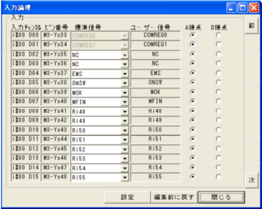

> **図の内容**
>
> 「入力論理」画面。入力チャンネル、ピン番号、標準信号名、ユーザー信号名、A接点/B接点。表示されている例: I#00 D00 COMREQ0、D01 COMREQ1、D02 NC、D03 NC、D04 EMS、D05 ONSW、D06 MOK、D07 MFIN、D08～D15 Ri48～Ri55（すべて A接点）。ボタン: 前、次、設定、編集前に戻す、閉じる。
> ピン番号などの細部は小さくて判読しにくい。

出力信号設定画面

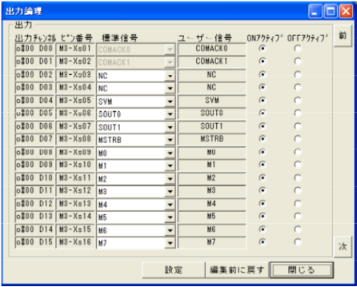

> **図の内容**
>
> 「出力論理」画面。出力チャンネル、ピン番号、標準信号名、ユーザー信号名、ONｱｸﾃｨﾌﾞ/OFFｱｸﾃｨﾌﾞ。表示されている例: O#00 D00 COMACK0、D01 COMACK1、D02 NC、D03 NC、D04 SVM、D05 SOUT0、D06 SOUT1、D07 MSTRB、D08～D15 M0～M7（すべて ONｱｸﾃｨﾌﾞ）。ボタン: 前、次、設定、編集前に戻す、閉じる。

同一の標準入出力を複数のアドレスに割り当てることはできません。標準入出力が重複して割り当てられている場合、設定ボタンを押したときに以下の画面が表示されますので、割り当てを変更してください。

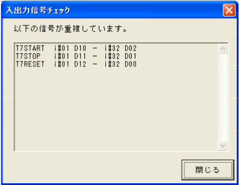

> **図の内容**
>
> ダイアログ「入出力信号チェック」。「以下の信号が重複しています。」
> ```
> T7START  i#01 D10 － i#32 D02
> T7STOP   i#01 D11 － i#32 D01
> T7RESET  i#01 D12 － i#32 D00
> ```
> 「閉じる」ボタン。

入出力ピンに割り当てられていない入出力は常に以下のような状態となります。

入力･･････ A接/B接に関わらず、常にOFF(インアクティブ)です。

出力･･････どのピンにも出力されません。

内部的には、ON/OFF動作しています。(運転プログラムで利用可)

出荷時(ROMSW初期化時)、入出力ピン割り当ては、テクノ標準割り当てになります。

## 3．動作モード

PLMC-M3EXシリーズには以下のような動作モード(内部の動作状態)があります。

### 3-1．各動作モードと主な機能

| モード名称       | モードの特徴                                                                               | 使用目的                                         | 通信コマンドで選択 (PC/FA-M3□)                                  | 機械パネルでの主な操作                                                          |
|-------------|--------------------------------------------------------------------------------------|----------------------------------------------|--------------------------------------------------------|-----------------------------------------------------------------------|
| 自動運転モード    | 運転プログラムを実行することにより、機械の自動運転を行うモードです。                                                | 通常運転ティーチングによるプログラム変更 ※電源投入直後は自動運転モードです。 | ・プログラム運転スタート/ストップ (メモリー運転、DNC運転) ・ティーチング操作・シングルステップ | ・プログラム運転スタート/ストップ (メモリー運転、 DNC運転) ・シングルステップ・プログラム選択・ティーチング操作・リセット |
| 自動運転モード    | 運転プログラムを実行することにより、機械の自動運転を行うモードです。                                                | 通常運転ティーチングによるプログラム変更 ※電源投入直後は自動運転モードです。 | ※以下自動・手動ともに可能・プログラム選択・全軸原点復帰・原点復帰                  | ・プログラム運転スタート/ストップ (メモリー運転、 DNC運転) ・シングルステップ・プログラム選択・ティーチング操作・リセット |
| 手動運転モード    | オペレータが直接指示を行うことにより機械の運転を行うモードです。                                                  | ・試運転・調整・段どり                                 | ・JOG送り・インチング送り                                        | ・JOG送り・インチング送り・原点復帰・全軸原点復帰・リセット                                   |
| セッティングモード | 各種パラメータの読み出し/設定を行うモードです。本モードでは全ての運転操作がインタロックされます｡ ※ パラメータの読み出しは全てのモードで可能。    | パラメータ変更初期化                                  | ・リセット・リセット・バックアップメモリ初期化・パラメ-タ読出し・書込み              |                                                                       |
| OT無視モード    | ハードOTエラーからの復旧作業を行うモードです。本モードでは、ハードOTエラーの状態でもサーボ ONが出来ます。ジョグ移動はOTとは逆方向にのみ可能です。 | ・OT領域からの復旧操作                                | ・ジョグ送り・リセット                                           | ・ジョグ送り・リセット                                                          |
