## 4.FA-M3□インターフェース

### 4-1．FA-M3□とPLMCの関係

FA-M3□のラダーやRTOSソフトとPLMCは、X/Yリレーや特殊モジュールレジスタを経由して、すべての情報をやりとりします。

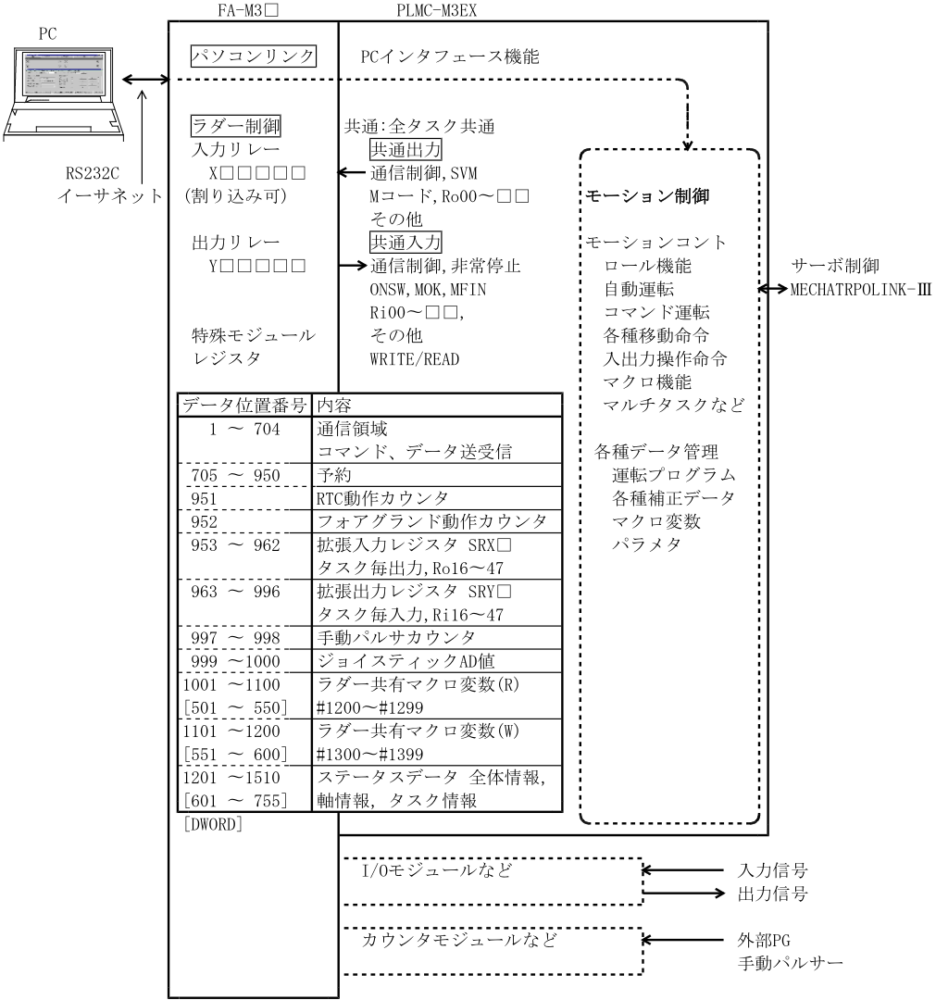

> **図の内容**
>
> - **PC** ←→（RS232C / イーサネット）→ FA-M3□ の「パソコンリンク」→ PLMC-M3EX の「PCインタフェース機能」→「モーション制御」
> - FA-M3□ の「ラダー制御」:
>   - 入力リレー X□□□□□（割り込み可）← PLMC の「共通出力」（共通:全タスク共通）: 通信制御, SVM、Mコード, Ro00～□□、その他
>   - 出力リレー Y□□□□□ → PLMC の「共通入力」: 通信制御, 非常停止、ONSW, MOK, MFIN、Ri00～□□、その他
>   - 特殊モジュールレジスタ ←→ WRITE/READ
> - PLMC-M3EX の「モーション制御」: モーションコントロール機能（自動運転、コマンド運転、各種移動命令、入出力操作命令、マクロ機能、マルチタスクなど）、各種データ管理（運転プログラム、各種補正データ、マクロ変数、パラメタ）。サーボ制御は MECHATRPOLINK-Ⅲ（図の表記のまま）
> - 特殊モジュールレジスタのデータ位置番号:
>
>   | データ位置番号 | 内容 |
>   |---|---|
>   | 1 ～ 704 | 通信領域 コマンド、データ送受信 |
>   | 705 ～ 950 | 予約 |
>   | 951 | RTC動作カウンタ |
>   | 952 | フォアグランド動作カウンタ |
>   | 953 ～ 962 | 拡張入力レジスタ SRX□ タスク毎出力, Ro16～47 |
>   | 963 ～ 996 | 拡張出力レジスタ SRY□ タスク毎入力, Ri16～47 |
>   | 997 ～ 998 | 手動パルサカウンタ |
>   | 999 ～1000 | ジョイスティックAD値 |
>   | 1001 ～1100 [501 ～ 550] | ラダー共有マクロ変数(R) #1200～#1299 |
>   | 1101 ～1200 [551 ～ 600] | ラダー共有マクロ変数(W) #1300～#1399 |
>   | 1201 ～1510 [601 ～ 755] | ステータスデータ 全体情報, 軸情報, タスク情報 |
>
>   ［ ］は [DWORD] 単位の番号。
> - そのほか: 「I/Oモジュールなど」← 入力信号、→ 出力信号。「カウンタモジュールなど」← 外部PG、手動パルサー

※ □は名称又数値を表します。

入出力レジスタの内容は、I/O割り付けによって可変です。

### 4-2．入出力リレー

PLMC-M3EXでは入力リレー32点(X□□□01〜X□□□32)、出力リレー32点 (Y□□□33〜Y□□□64)を使用できます。(□□□はスロット番号を表します。)

※入力リレーは<PLMC-M3EX出力→FA-M3□入力>、出力リレーは<FA-M3□出力→PLMC-M3EX入力>です。

- (1). 入力リレーX□□□□のチェック(LD命令)

PLMC-M3EX側の共通出力をリアルタイムに反映し、ラダーから判別可能です。

- (2). 出力リレーY□□□□の操作(OUT命令) PLMC-M3EXの共通入力に対して、リアルタイムに操作できます。

但し、PLMC-M3EX側の設定で各標準入力の有効/無効の選択が可能です。

- (3). 入出力信号の割り当て(ROMSW設定)

X□□□03〜X□□□32、Y□□□35〜Y□□□64のリレーは、PLMC-M3EXのROMSW設定にて、任意の信号 (機能)を割り当てることが可能です。

お客様の使用目的に合わせて割り当ててください。

割り当て対象の信号については「PLMC-M3EXユーザーズマニュアル」<2.入出力機能>(TB00-0980D)を参照して下さい。

X□□□01/02(COMACK:通信ACK)、Y□□□33/34(COMREQ:通信要求)は、FA-M3□とPLMC-M3EXでデータの

- (4). 割り当て変更不可の通信制御信号授受を行うときのハンドシェイクに使用します。

その為、お客様にて割り当てを変更することは出来ません。

- (5). デフォルト割り当て

デフォルトで割り当てられている信号については「PLMC-M3EXユーザーズマニュアル」

<Ⅲ 機能編 2-3.標準入出力チャンネル表>( TB00-0980D)を参照下さい。

### 4-3．特殊モジュールレジスタ

特殊モジュールレジスタは、FA-M3□のREAD/WRITE命令で読み出し/書き込みを行えます。 PLMC-M3EXとFA-M3□の「通信データレジスタ領域(データ1〜704)」や直接に読み出し/書き込みが可能な

「固定データ領域」があります。（以下の表ではPLMC-M3EXをPLMCと略記します）

| データ位置番号                  | 名称                                      | 内容                                                                                                                                 |
|--------------------------|------------------------------------------|-------------------------------------------------------------------------------------------------------------------------------------|
| 1 〜 704                  | 通信データレジスタ領域 (通信領域&予約領域)                  | コマンド、データの送受信を通信手段でおこないます。運転指令、各種コマンド、運転プログラム、各種補正値、パラメータ、マクロ変数など。                                                                 |
| 705 〜 950                | 予約                                       |                                                                                                                                     |
| 951                      | RTC動作カウンタ                                | 制御周期毎にカウントアップします。                                                                                                                   |
| 952                      | フォアグランド動作カウンタ                            | 制御周期処理以外の処理(入出力の一部や通信処理)の周期毎にカウントアップします。 ※制御周期処理で余った時間を使用するため、RTC動作カウンタとは異なり、カウントアップの時間は不定です。                                     |
| 953 〜 962                | 拡張入力レジスタ ※1 (PLMC→FA-M3□出力レジスタ)          | Ro16〜47、タスク毎出力(T□READY,T□ALARM,T□RUN,T□P AUSE,動作モード,その他)                                                                            |
| 963 〜 996                | 拡張出力レジスタ ※1 (FA-M3□→PLMC出力レジスタ)          | Ri16〜47、タスク毎入力(T□RSTSW,T□STOPSW,T□STARTS W,動作モード指定,手パ軸/倍率,手動軸, オーバライド,実行P番号,その他)                                                    |
| 997 〜 998                | 手動パルサカウンタ1/2 (外部PGカウンタ1/2)               | M3Rのカウンタモジュールデータをラダー経由でMⅢの手動パルサ/外部PGデータとして書き込めます。16bit×2ch                                                                         |
| 999 〜 1000               | ジョイスティックAD1/2                            | ラダー経由でジョイスティックAD値として書き込めます。 16bit×2ch                                                                                               |
| 1001 〜 1100              | ラダー共有マクロ変数(R)                            | #1200 〜 #1299:100W (WORD アクセス)                                                                                                      |
| [501〜550] ※2             | 直接読み出し(PLMC→FA-M3□) 一般レジスタラダー共有マクロ変数(W) | #5700 〜 #5799:100W (LONG アクセス) #1300 〜 #1399:100W (WORD アクセス)                                                                       |
| 1101 〜 1200              |                                          |                                                                                                                                     |
| [551〜600] ※2             | 直接書き込み(FA-M3□→PLMC) 一般レジスタ               | #5800 〜 #5899:100W (LONG アクセス) 全体情報 :全体ステータス、全体アラーム物理軸情報:各種座標、軸ステータス／アラーム等タスク情報：タスクステータス／アラーム、P実行情報等詳細は「送受信データ説明書」<4-1-6.ステータスデー |
| 1201 〜 1510 [601〜755] ※2 | ステータスデータ                                 | タ読出>(TB00-0984)を参照下さい。                                                                                                             |

- ※1 拡張入出力レジスタのbit割付は、ROMSWで可能です。上記は、デフォルト設定の場合です。

(上表の□はタスク番号、0〜7のタスク番号を表します。)

※2 DWORDのデータが含まれている領域は"READ L"命令で読み出して下さい。

"READ"命令で読み出すと、上位WORDと下位WORDでデータの不整合が起こる可能性があります。

- このようなデータには上表の"データ位置番号"欄の [ ] 内に"READ L"命令で指定するデータ位置番号を示しています。

("READ L"命令でのデータ位置番号/データ数はDWORD単位になります。)

### 4-4．通信データレジスタ領域を使用した通信機能

#### 4-4-1．通信処理の概要

PLMC-M3EXの機能には動作コマンドやデータなどがたくさんあります。

FA-M3□ラダーとPLMC-M3EX(以降PLMC)のデータ/コマンドの授受には通信制御リレー(Y□□□33/34 :

COMREQ0/1、X□□□01/02:COMACK0/1)/特殊レジスタ(READ/WRITE)を使用した通信を行うことができます。

(□□□はFA-M3□のスロット番号を表します。)

通信の詳細については弊社提供のサンプルラダープログラムを参照下さい。

サンプルラダーの一部は、そのままコピーして使用いただきます。また、使用するコマンドに応じて、

サンプルを参考にご自身で作成していただく部分もあります。

#### 4-4-2．通信データレジスタ領域詳細

次ページにつづく

|   データ位置番号 | データ位置番号   | R/W   | データ名称        | 内容                                                                                                                                                                                                                                                                                                                           |
|------------|------------|-------|--------------|-------------------------------------------------------------------------------------------------------------------------------------------------------------------------------------------------------------------------------------------------------------------------------------------------------------------------------|
|          1 | w          | R     | 通信パケット最大サイズ | 「通信データ」領域のサイズです。システム/バージョンによって変わります。 FA-M3□のラダーでは、起動時にこの領域を読み出して「通信データ」領域の大きさを判断します。                                                                                                                                                                                                                                        |
|         21 | w          | W     | 通信種別         | 通信内容を指定します。 1:データ書込 2:データ読込 3:動作指示                                                                                                                                                                                                                                                                                            |
|         22 | w          | W     | 通信データタイプ     | 通信を行うデータ/コマンドの詳細を設定します。「通信種別」で指定した値により指定できる値が変わります。「送受信データ説明書」(TB00-0984)の各項目の"データタイプ"を参照して下さい。                                                                                                                                                                                                                            |
|         23 | w          | W     | タスク指定        |                                                                                                                                                                                                                                                                                                                               |
|         25 | L          | W     | 通信パラメータ      | データ書込/読込時のパラメータを示します「送受信データ説明書」(TB00-0984)の各項目の"パラメータ"を参照して下さい。                                                                                                                                                                                                                                                             |
|         27 | L          | W     | 全書込データサイズ    | WORD単位でデータのサイズを示します。全書込データサイズ:全体のデータサイズを示します合計データサイズ:今までに送ったデータのサイズを示します。今回データサイズ:今回「通信データ」へ設定したデータのサイズを示します。 (「通信データ」のサイズより大きいデータの書込/読込時には、複数回に分けてデータを送ります。このとき、データをどこまで書込/読込したかを管理するために 3種類のデータサイズを使用します。) □□書込データサイズには、データ書込/動作指示の時は、書き込むデータ/動作指示コマンドのデータサイズを設定して下さい。データ読込の時は、0を設定して下さい。 □□読込データサイズには、PLMCが書き込みます。 |
|         29 | L          | W     | 合計書込データサイズ   | WORD単位でデータのサイズを示します。全書込データサイズ:全体のデータサイズを示します合計データサイズ:今までに送ったデータのサイズを示します。今回データサイズ:今回「通信データ」へ設定したデータのサイズを示します。 (「通信データ」のサイズより大きいデータの書込/読込時には、複数回に分けてデータを送ります。このとき、データをどこまで書込/読込したかを管理するために 3種類のデータサイズを使用します。) □□書込データサイズには、データ書込/動作指示の時は、書き込むデータ/動作指示コマンドのデータサイズを設定して下さい。データ読込の時は、0を設定して下さい。 □□読込データサイズには、PLMCが書き込みます。 |
|         31 | w          | W     | 今回書込データサイズ   | WORD単位でデータのサイズを示します。全書込データサイズ:全体のデータサイズを示します合計データサイズ:今までに送ったデータのサイズを示します。今回データサイズ:今回「通信データ」へ設定したデータのサイズを示します。 (「通信データ」のサイズより大きいデータの書込/読込時には、複数回に分けてデータを送ります。このとき、データをどこまで書込/読込したかを管理するために 3種類のデータサイズを使用します。) □□書込データサイズには、データ書込/動作指示の時は、書き込むデータ/動作指示コマンドのデータサイズを設定して下さい。データ読込の時は、0を設定して下さい。 □□読込データサイズには、PLMCが書き込みます。 |
|         33 | L          | R     | 全読込データサイズ    | WORD単位でデータのサイズを示します。全書込データサイズ:全体のデータサイズを示します合計データサイズ:今までに送ったデータのサイズを示します。今回データサイズ:今回「通信データ」へ設定したデータのサイズを示します。 (「通信データ」のサイズより大きいデータの書込/読込時には、複数回に分けてデータを送ります。このとき、データをどこまで書込/読込したかを管理するために 3種類のデータサイズを使用します。) □□書込データサイズには、データ書込/動作指示の時は、書き込むデータ/動作指示コマンドのデータサイズを設定して下さい。データ読込の時は、0を設定して下さい。 □□読込データサイズには、PLMCが書き込みます。 |
|         35 | L          | R     | 合計読込データサイズ   | WORD単位でデータのサイズを示します。全書込データサイズ:全体のデータサイズを示します合計データサイズ:今までに送ったデータのサイズを示します。今回データサイズ:今回「通信データ」へ設定したデータのサイズを示します。 (「通信データ」のサイズより大きいデータの書込/読込時には、複数回に分けてデータを送ります。このとき、データをどこまで書込/読込したかを管理するために 3種類のデータサイズを使用します。) □□書込データサイズには、データ書込/動作指示の時は、書き込むデータ/動作指示コマンドのデータサイズを設定して下さい。データ読込の時は、0を設定して下さい。 □□読込データサイズには、PLMCが書き込みます。 |
|         37 | w          | R     | 今回読込データサイズ   | 「送受信データ説明書」(TB00-0984)の各項目の<<データフォーマット>>の"データサイズ"が"全書込データサイズ"に対応しています。 (※ 上の□□は"全"/"合計"/"今回"を意味します。)                                                                                                                                                                                                                        |

w:ワード L:ロングワード R:読み出し可能 W:書き込み可能

|   データ位置番号 | データ位置番号   | R/W   | データ名称     | 内容                                                                                                                |
|------------|------------|-------|-----------|--------------------------------------------------------------------------------------------------------------------|
|         38 | w          | R     | 通信結果ステータス | 通信の実行結果を示します。 0:正常終了 2:パラメータエラー 7:読み出しデータが存在しない 8:データ書き込み不可状態 9:通信シーケンスエラー 10:プログラム受信中断 11:プログラムバッファフル 12:コマンド実行不可 |
|         41 | w          | R/W   | 通信データ     | 書込/読込するデータの格納領域です。領域のサイズは「通信パケット最大サイズ」を確認して下さい。「送受信データ説明書」 (TB00-0984)の各項目の"データフォーマット"を参照して下さい。                  |

### 4-5．サンプルラダー

ラダー設計時には、テクノの提供するサンプルラダー(出荷時のCD内の devlp\Ladder\SmplLadd)を必ず利用してください。

サンプルラダーの詳細は、「PLMC-MⅡEX対応サンプルラダー説明書」(TB00-0917)、「サンプルラダー補足説明書」(TB00-0884)を参照下さい。

- 【注】PLMC-M3EXでのExLadderとのインターフェースは PLMC-MⅡEx と同一です。TB00-0917 の中に出てくる参照文章番号TB090*はTB098*と読み替えて参照してください。

#### 4-5-1．コピーして使う部分

サンプルラダーの"COMMAIN"ブロック内「通信メイン処理」は、通信処理の基本部分になります。コピーしてそのまま使用して下さい。

#### 4-5-2．参考にするサンプルラダー

実際に運用するラダーは、お客様に作成いただきます。ただし、サンプルラダーに参考となる処理がありますので、それを元に改造してください。

以下のようなサンプルを準備しています。

| 項番号         | 名称:説明書の項目名/サンプルラダーのコメント           |
|-------------|-----------------------------------|
| 4.ラダー処理(1)  | 入出力モジュール「WD64-3F」からの入力→PLMCへの出力処理 |
| 4.ラダー処理(2)  | PLMCからの入力→入出力モジュール「WD64-3F」への出力処理 |
| 4.ラダー処理(3)  | 機械パネルIFデータ設定                      |
| 4.ラダー処理(4)  | Mコード処理                            |
| 4.ラダー処理(5)  | 割り込み処理                            |
| 4.ラダー処理(6)  | PTP移動コマンド                         |
| 4.ラダー処理(7)  | 独立位置決めコマンド                        |
| 4.ラダー処理(8)  | マクロ変数データ書き込み                      |
| 4.ラダー処理(9)  | ダイナミックデータローディング(動作プログラム書込)        |
| 4.ラダー処理(10) | DNCプログラム送信                        |
| 4.ラダー処理(11) | 位置決めポイントテーブル送信                    |
| 4.ラダー処理(12) | 動作プログラム読み出し                       |
| 4.ラダー処理(13) | DNCバッファ状態受信                       |
| 4.ラダー処理(14) | マクロ変数受信                           |
| 4.ラダー処理(15) | 位置決めポイントテーブル受信                    |
| 4.ラダー処理(16) | データリフレッシュ                         |
| 4.ラダー処理(17) | 固定データ領域READ/WRITE                 |

項番号:サンプルラダー説明書(TB00-0917)の項番号です。 ※ サンプルラダーは、タスク0にのみ対応します。

## 5.サーボ制御（一般仕様）

### 5-1．座標系

PLMC-M3EXでは、基本的に2種類の座標系を管理しています。

【機械座標系】

原点復帰位置を原点とします。ソフトリミットチェックなどはこの座標系でおこないます。

PTPB/LINB命令は、この座標系でのアブソ指令です。

【論理座標系】

原点設定(入力又は操作)をした位置を、原点とします。 PTPB/LINBを除く全ての移動命令、動作プログラムは論理座標系での命令です。

原点復帰の完了時の論理座標系の設定方法は、以下から選択できます。

- 「論理原点 = 機械原点」とする方式
- 原点復帰前の「論理原点と機械原点のオフセット」を保持する方式
- 機械原点をサーボパラメータで指定した論理座標とする方式

詳細は、「ROMSW設定ソフトマニュアル」<4-1.基本パラメタ>(TB00-0982)を参照してください。

### 5-2．アブソ指令とインクレ指令

移動命令の目標位置の指令方法には、「アブソ指令」と「インクレ指令」があります。

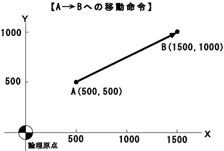

> **図の内容**
>
> 論理原点を原点とする X-Y 座標。A(500, 500) から B(1500, 1000) への矢印。

■相対移動量

命令1ステップ毎の移動量です。

上記の命令の例では、A点からの移動量となります。

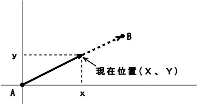

> **図の内容**
>
> A から現在位置 (X、Y) を経て B へ。x、y は A からの移動量。

- ■アブソ指令の表記 PTPA X1500 Y1000 目標位置を指令します。
- ■インクレ指令の表記 PTP X1000 Y500 移動量を指令します。
- (X、Y)は、論理原点からの距離 (論理座標)
- (x、y)は、A点からの距離 (相対移動量)

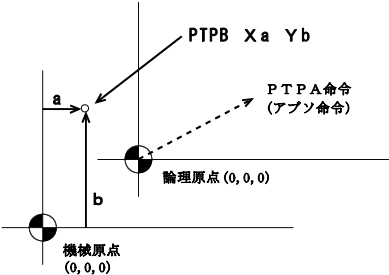

> **図の内容**
>
> 機械原点 (0, 0, 0) と論理原点 (0, 0, 0)。「PTPB Xa Yb」は機械原点からの a、b の位置へ、「PTPA命令（アブソ命令）」は論理原点基準の位置へ移動する。

### 5-3．補間加減速 (指数形/直線形/S字)

補間指令(直線補間や円弧補間)に対しては、各軸に加減速制御(スムージング)がかかります。加減速時定数は、サーボパラメータの「補間加減速時定数」で指定します。スムージングが不要の場合、「補間加減速時定数」を0として下さい。

※ 以降速度単位の pulse/sec を pps と表します。

軸速度の様子

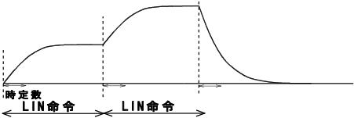

> **図の内容**
>
> LIN命令が 2 つ続くときの軸速度。各 LIN命令の速度変化が、指数関数の曲線（時定数）で行われる。

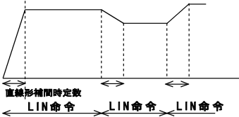

> **図の内容**
>
> LIN命令が 3 つ続くときの軸速度。各速度変化が一定の時間（直線形補間時定数）の直線で行われる。

【S 加減速】＜オプション＞

補間加減速( 指数形／直線形) をさらにスムージングします。直線形補間加減速と組み合わせて使用します。速度の変化点でTs(ms) の平均化( フィルタリング) をします。

Ts はサーボパラメータで設定します。

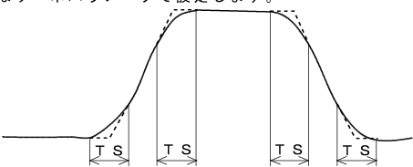

> **図の内容**
>
> 台形の速度（点線）の角を、速度の変化点ごとに Ｔs の区間で丸めた曲線（実線）。

### 5-4．直線形加減速

PTPの移動指令の際には、直線形加減速制御をおこないます。

制御は各軸独立におこないます。PTP時定数(サーボパラメタ)は、ROMSWの選択により、以下のTとPTpTのいずれかを設定します。

詳細は、<Ⅳ 試運転調整編 4-1.送り速度、加減速などのパラメタ>(TB00-0980H)を参照下さい。

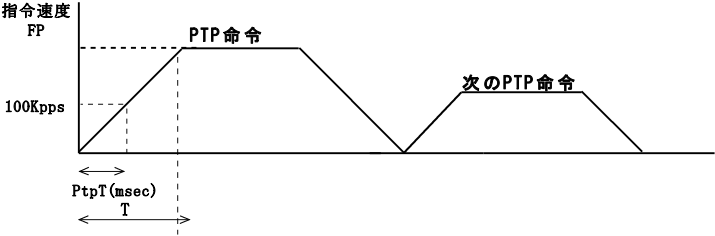

> **図の内容**
>
> 縦軸 指令速度 FP、横軸 時間。PTP命令の台形と、次のPTP命令の台形。100Kpps に達するまでの時間が PtpT(msec)、FP に達するまでの時間が T。

T :加減速時間・・・ 0からPTP速度に到達するまでの時間

PTpT:PTP加減速時定数・・・ 0から100Kppsに到達するまでの時間

Ts : S字加減速時定数 (ms)

### 5-5．PTP制御(位置決め) PTP/G00

目標位置へ向かって、各軸独立に直線加減速制御により位置決めします。各軸の速度は、セッティングPC「サーボパラメータ」画面の「PTP速度」で指定します。加減速については、＜5-4．直線形加減速＞を参照して下さい。

各軸独立ですので、各軸の目標到達時間には、差が出ます。

PTP X1,Y1 の例

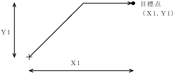

> **図の内容**
>
> 始点から目標点 (X1, Y1) へ。X1 と Y1 の移動量。始めは斜め 45° に進み、移動量の少ない Y 軸が先に到着したあと X 軸だけが進む軌跡。

### 5-6．直線補間 LIN/GO1

1軸〜9軸同時の直線補間です。目標点への到達は全軸が同時です。速度指令は、直線補間命令で指定された全軸の合成速度です。下の図は、指数型の加減速の時の速度です。

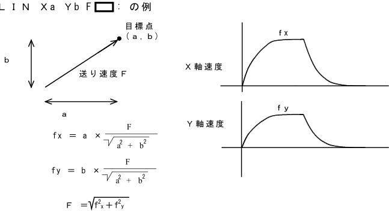

> **図の内容**
>
> 目標点 (a, b) へ送り速度 F で直線補間。各軸の速度:
> - fx = a × F ／ √(a² + b²)
> - fy = b × F ／ √(a² + b²)
> - F = √(fx² + fy²)
> 右に X軸速度（fx）と Y軸速度（fy）の時間変化。

上記図の場合、Y軸は移動量が少ないため、 PTP速度に達する前に減速が始まっています。

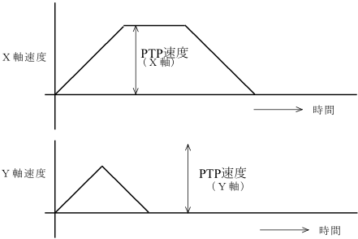

> **図の内容**
>
> X軸速度は台形で PTP速度（X軸）に達し、Y軸速度は移動量が少ないため三角形で、PTP速度（Y軸）に届かない。横軸 時間。

### 5-7．円弧補間

CIRR、CIRL / G02、G03

2軸の円弧補間です。

円弧の指定には次の3つの方式可能です。

- ① 目標位置と中心座標値を設定します。
- ② 目標位置と半径を設定します。
- ③ 目標位置と円弧の途中通過点を設定します。

1周円以上の円弧動作を行う場合は、円弧補間命令を連続的に使用することで実現できます。

また、多回転の円運動を行う必要が有るとは指定した円弧を含んだ円を指定回数回る多回転円弧指令機能もあります。(多回転機能はプリ解析方式には対応していません)

速度指定Fは、円弧処理方式により以下のようになります。

プリ解析方式 : ヘリカル軸も含めた接線速度(3軸の合成速度)

ボード内部方式 : 円弧2軸の合成速度(ヘリカル軸はこれに同期)

各円弧処理方式はセッティングPCの「ポジション表示形式設定画面」で選択できます。

各円弧処理方式については以下に記述します。

- ※ 基本的にボード内部方式を使用して下さい。

(プリ解析方式は旧機種との互換性のための機能です。)

#### 5-7-1．プリ解析方式

円弧を微小直線に展開するため実ステップ長が増えます。

詳細は、<6-4.プリ解析処理(テキスト→バイナリ変換)>(TB00-0980F)を参照して下さい。

プリ解析方式の場合、連続した円弧命令を行うと、円弧の切り換わり時に速度が変動する場合があるのでご注意下さい。

- この方式では、アブソ指令(CIRRA/CIRLA)は使えません。

速度指令Fは、ヘリカル軸も含めた接線速度(3軸の合成速度)です。

#### 5-7-2．ボード内部方式

ボード内部で円弧解析を行う機能です。

速度指令Fは、円弧2軸の合成速度です。ヘリカル軸はこれに同期します。

### 5-8．手動送り

#### 5-8-1．ジョグ(JOG)送り

指定された方向へ軸を移動します。

速度は、セッティングPC「サーボパラメータ」画面の"JOG速度"(単位[pps])で設定します。加減速については、＜5-4．直線形加減速＞を参照して下さい。

#### 5-8-2．インチング送り(手動)

指定された軸を一定のパルス量だけ送ります。

各軸の速度は、セッティングPC「サーボパラメータ」画面の「PTP速度」で指定します。加減速については、＜5-4．直線形加減速＞を参照して下さい。

| 倍率   | 送り量     |
|-------|-----------|
| ×1    | 1パルス送り    |
| ×10   | 10パルス送り   |
| ×100  | 100パルス送り  |
| ×1000 | 1000パルス送り |

### 5-9．インポジションチェック

【概要】

以下の場合に、インポジションとなります。

INPOS量 ≧ ACCたまり + ER

- ER(偏差) = CR(指令位置) - PR(機械位置)
- ACCたまり = 補間加減速処理でのたまりパルス
- INPOS量は、セッティングPCの「サーボパラメータ」画面の「INPOS量」で設定します。

【INPOS量の設定の目安】

(1). 考え方

- a. 連続位置決めの時に、きっちり停止して次に移動したい場合・・・小さめの値
- b. 連続位置決めのタクトを高めたい。

完全に止まらないで、次の移動を始めたい場合。・・・大きめの値

(2). 設定値の目安

停止時に偏差値があるかどうかをセッティングPCの「偏差量」画面で確認ください。 ACサーボによっては、停止時に数パルスの偏差が発生しています。

これをアンプ側でゼロにできれば良いのですが、解消できない場合もあります。 INPOS量の値は、停止時の偏差量の2倍以上の値にしてください。

【インポジションチェック動作比較表】

※1 補間

| 実行ステップ次ステップ   | 実行ステップ次ステップ   | インポジションチェック無効         | インポジションチェック有効（デフォルト）   |
|----------------|----------------|-----------------------|------------------------|
| 補間以外           | 補間以外           |                       |                        |
| 補間             | 補間以外           | インポジションチェック無し         | インポジションチェック有り          |
| 補間以外           | 補間             |                       |                        |
| 補間             | 補間             | つなぎ(補間命令をなめらかに連続させる。) | つなぎ(補間命令をなめらかに連続させる。)  |

補間：LIN命令、円弧命令

補間以外：PTP命令、TIM命令、マクロ変数演算等

※1の動作で停止させたい場合は、補間命令の間にドウェル(G04又はTIM/TM)を入れてください。

インポジションチェック有りインポジションチェック無しつなぎ

位置決め完了(インポジション) 軌跡発生終了後、ただちに次速度変動が起きないを待ってから､次ステップをステップを実行します。ように補正します。実行します。

F(速度)

ステップN ステップN+1 ステップN ステップN+1

①軌跡発生完了、②次命令開始、③INPOS待ち

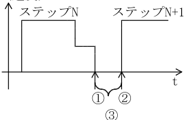

> **図の内容**
>
> ステップN からステップN+1 への速度。① 軌跡発生完了、② 次命令開始。①と②の間が ③ INPOS待ち。

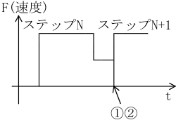

> **図の内容**
>
> ステップN からステップN+1 への F(速度)。①② が同じ時刻（INPOS待ちなし）。

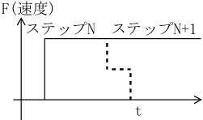

> **図の内容**
>
> ステップN の速度が下がる途中（点線）でステップN+1 が始まる。

※ インポジションチェックは、ステップとステップの間(次ステップを実行する前)にチェックを行います。

### 5-10．なめらかな送り制御(パス機能)

各ステップ(ブロック)の実行の間で、停止時間が有りません。 NCのブロック間停止ゼロ(パス機能)に当たります。このパス機能により微小連続送りでのなめらかな輪郭制御が実現できます。以下のような軌跡を、指定された接線速度でなめらかに送ります。

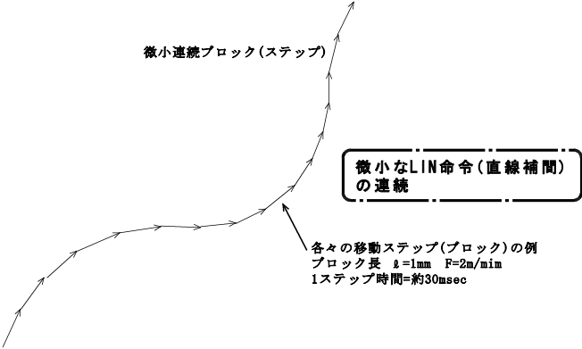

> **図の内容**
>
> 曲線を細かい矢印でつないだ軌跡。「微小連続ブロック(ステップ)」「微小なLIN命令(直線補間)の連続」。各々の移動ステップ(ブロック)の例: ブロック長 ℓ=1mm、F=2m/min、1ステップ時間=約30msec。

### 5-11．シングルステップ動作

シングルステップモードでは運転プログラムの各ステップ毎に停止し、スタート信号により1ステップづつ進行します。

運転プログラムのセッティングやメンテナンス時に、動作確認のために使用します。

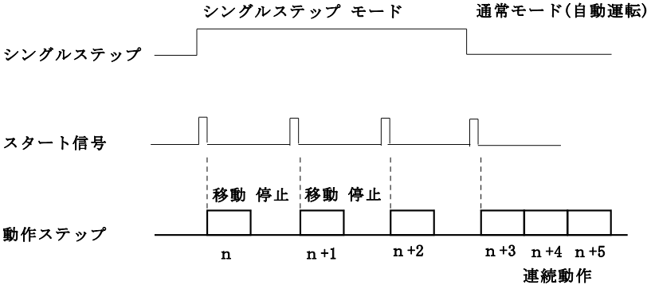

> **図の内容**
>
> シングルステップ: シングルステップ モードの間は ON、通常モード(自動運転) で OFF。スタート信号のパルスごとに、動作ステップ n、n+1、n+2 を 1 つずつ実行（移動 → 停止）。通常モードでは n+3、n+4、n+5 を連続動作。

### 5-12．サイクル運転

サイクル運転モードでは運転プログラムの繰り返し実行を行います。 PLMC-M3EXコントローラは、運転プログラムのENDステップ実行時、サイクル運転モードの場合自動的に運転プログラムの先頭から再実行を行います。繰り返し実行中に、サイクル運転モードをOFFにすると、その回の最後まで実行した後、プログラム実行終了します。

サイクル運転モードのON/OFFは、通信コマンドでおこないます。

プログラム終了時サイクルここではプログラム再開しない。運転モードなのでプログラム再開

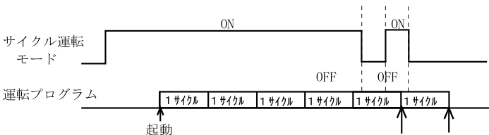

> **図の内容**
>
> サイクル運転モードが ON の間、起動で運転プログラムが 1サイクルずつ繰り返す。OFF にするとその回のサイクルの終わりで止まる。

サイクル運転モードで、繰り返し実行する運転プログラムの先頭と最後のステップが補間移動の場合でも、最後のステップと先頭ステップのつなぎ処理は行いません。 ENDステップでは、1制御周期とインポジションチェック有効時の時間は、停止します。

### 5-13．オーバーライド機能

送り速度を 0%〜200%の比率で、動作中に変更できます。セッティングやメンテナンスでも使用します。

(機械操作パネルでは、25%刻みか1%刻みかを選択出来ます。)

### 5-14．ストロークリミット

機械の動作範囲外への移動を禁止するために、二重の安全対策を実施しています。

指定位置がこの領域を越えるとPLMC-M3EXは「ソフトリミットエラー」に

ソフトウェアストロークリミットソフトウェアにより、動作可能な範囲を規定します。 (ソフトOT) なり移動を中断します。

この時の減速方法は、動作により異なります。

- 補間動作・・・減速停止します。
- 補間動作以外・即停止します。

(PTP/JOG/原点復帰等)

サーボ主電源は落ちません。そのまま手動操作(JOG)にてもどせます。 (戻した後、リセットにてソフトリミットエラーを解除して下さい。)

ハードウェアストロークリミットマシンエンドに配置したLS信号をΣサーボへ入力(ハードOT)します。 (ハードOT) 一般はb接論理で入力し､これがOFFするとサーボは緊急停止します。 PLMCは、Σのステータスとして、OT発生を認識しアラームとなります。その結果、設定によっては、サーボ主電源を落とします。通常の使用状態では必ずソフトOTにより停止しますので、ハードOTが作動する可能性はほとんどありません。

ハードOTの処理

| OT時サーボOFF ※1 (ROMSW設定ｿﾌﾄの設定)   | 動作         | 復旧                                           |
|--------------------------------|-------------|-----------------------------------------------|
| する                             | 即停止後にサーボオフ | OT無視モードにして、リセット(サーボオン) ジョグでもどして、リセット。(アラーム解除) |
| しない                            | 即停止のみ       | そのままジョグでもどして、リセット(アラーム解除)                     |

※1 詳細は、「ROMSW設定ソフトマニュアル」<4-1.基本パラメタ>(TB00-0982)を参照して下さい。

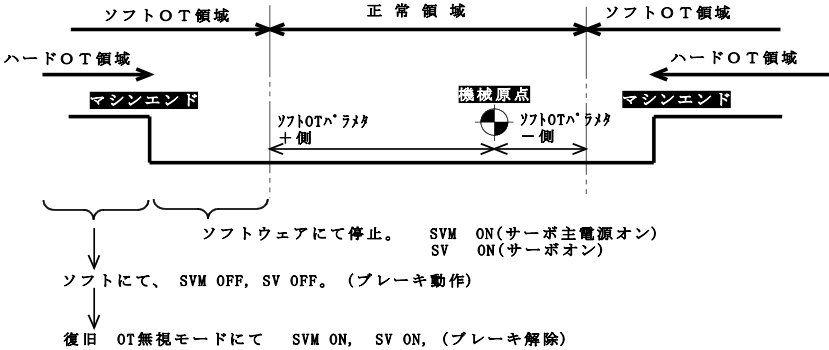

> **図の内容**
>
> - 左から: ハードOT領域（マシンエンド）、ソフトOT領域、正常領域、ソフトOT領域、ハードOT領域（マシンエンド）
> - 正常領域の両端が「ソフトOTパラメタ +側」と「ソフトOTパラメタ −側」。その間に機械原点
> - ソフトOT領域: ソフトウェアにて停止。SVM ON（サーボ主電源オン）、SV ON（サーボオン）
> - ハードOT領域: ソフトにて、SVM OFF、SV OFF。（ブレーキ動作）
> - 復旧: OT無視モードにて SVM ON、SV ON。（ブレーキ解除）

ソフトOTのパラメタは、マシン原点を基準に、+側と-側の各々に対して設定します。ソフトOTのパラメタ(ソフトリミット)については、

<Ⅳ 試運転・調整編 4-2.ストロークリミットのパラメタ>(TB00-0980H)を参照して下さい。

- 【注】マシンエンドにおける、メカニカルストッパーは必ず設置して下さい。

高速動作している状態では、どのようなOT方式にしても、相当量の惰走距離は発生します。

ハードOT時の処理は安全性と復帰の操作性が絡み、サーボパラメータも含め充分な検討が必要です。以下にOTから復帰するときの状態を示します。

サーボパラメーPn001:□□0□ DB停止またはフリーラン

Pn001:□□1□ 非常停止時トルクで停止し、その後サーボロック

| OT状態    | PLMC-M3EX 状態/操作   | Pn001:□□0□      | Pn001:□□1□   |
|---------|-------------------|-----------------|--------------|
| OT入力ON  | サーボOFF            | モータフリー          | モータフリー       |
| OT入力ON中 | OT無視モードでサーボON     | モータフリー          | サーボロック       |
| OT入力ON中 | OT無視モードでJOG移動     | サーボロックし JOG移動 ※ | JOG移動        |
| OT入力ON中 | JOG移動停止(サーボらーON中) | 移動停止後モータフリー    | サーボロック       |
| OT入力OFF | サーボON中            | サーボロック          | サーボロック       |

※JOG停止でモータフリーになるので、指令位置と機械位置がずれます。

### 5-15．軸制御に関するその他の機能

#### 5-15-1．周回処理(回転軸)

無限回転軸では、1周で同じ所にもどるので、座標値を1周内の値にもどす必要があります。座標値は以下の範囲となります。

-(メカ機構1回転パルス数) < 座標値 < メカ機構1回転パルス数

ROMSW設定ソフトでPG分周値やギア比などを全てを考慮した上での、「メカ機構1回転パルス数」を設定します。(0以外の値を設定した場合のみ、その値で各座標値の周回処理を実行)リジットタップやねじ切りオプション機能使用時の主軸及び、実回転数ステータスが必要な主軸に対しては必ず設定します。

#### 5-15-2．回転速度指令 SPIN/G120

定速回転を指令する命令です。無限回転軸(ROMSW設定)に対して有効です。回転数(RPM)は、機械軸での回転数です。

(ROMSW設定ソフトで「メカ機構1回転パルス数」の設定が必要です。)

命令コード「SPIN」/「G120」につづいて、回転軸を指定します。軸指定には回転速度を0.1RPM単位で指定します。さらに「OVR1」を付加する事により、回転動作にオーバライドがかかります。

指定しない場合は、オーバライドはかかりません。（G120では、OVR1機能は有りません。）

【テクノコード】

SPIN Z1000;

SPIN Z1000 OVR1;

SPIN Z0;

100rpmでの定速回転(オーバライドは無効) 100rpmでの定速回転(オーバライドは有効) 定速回転の停止

【Gコード】

G120 Z1000;

Gコードでは、OVR1は対応していません。

定速回転動作の開始/停止時には、PTP時定数による直線加減速がかかります。移動中の軸に、回転指令をおこなうと「プログラム実行エラー」となります。また、回転動作中の軸に対しては、他の動作指令は「プログラム実行エラー」となります。回転動作停止後は、再び他の移動命令(位置決め)が可能となります。回転動作の実行中に再度回転指令を行い、回転速度を変更する事は可能です。

尚、回転動作の開始(または停止)指令時は、指令回転数への到達(または停止)を待たずに、次のステップが実行されるので、必要に応じてドウェル(タイマー)命令等を使用して下さい。

０°

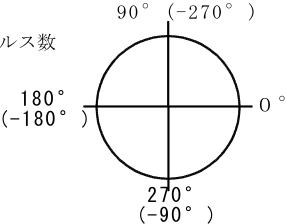

> **図の内容**
>
> 円の右が 0°、上が 90°(−270°)、左が 180°(−180°)、下が 270°(−90°)。左上に「…ルス数」（パルス数と思われる、左が切れている）。

#### 5-15-3．ねじ切り機能(同期送り)

<オプション> (計画中)

位置ループ制御型主軸(第5軸)のフィードバックデータから、X/Y軸の送り量を計算して同期指令する事により、ねじ切り動作を行います。

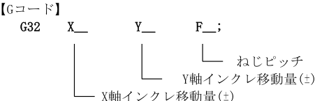

> **図の内容**
>
> 【Gコード】G32 X＿ Y＿ F＿;
> - X＿: X軸インクレ移動量(±)
> - Y＿: Y軸インクレ移動量(±)
> - F＿: ねじピッチ

- XYどちらか一方の指令で平行ねじ、両方の指令でテーパーねじとなります。
- XY両軸動作の場合、ピッチ計算の基準軸は、移動量が大きい方の軸となります。
- ねじピッチFは、主軸1回転あたりの基準軸の移動量を指定します。
- G32命令の実行時は、あらかじめ主軸の回転動作が実行されているものとします。主軸停止状態でG32が指令された場合は、プログラムエラーとなります。
- X軸,Y軸の移動は、主軸のフィードバックに対する、比例分配制御によって行います。

また、動作開始のタイミングを、主軸のC(Z)相位置を基準にする事により、繰り返し時の切り込み位置を一定とします。ただしG32命令が連続する場合、2回目以降では主軸のC(Z)相検出はせずに前ブロックに継続して動作します。

- 同じねじ切りに対して、切り込み量を変えて繰り返しねじ切り動作を行う場合、その途中で主軸回転数 (S値)を変更してはいけません。
- ねじ切り動作中、一時停止は無効となります。
- 【注】フィードバック情報は、「メカトロリンク経由」と「ラダー経由」の二つの方式があります。

#### 5-15-4．同一指令2軸制御

<オプション>

選択した第n軸が第m軸の同期軸(従軸)として動作します。m軸に対する全ての動作指令 (プログラム指令、動作コマンド、手動操作)に対して、n軸がm軸と同期して動作します。通常は、平行軸などで使用します。

- ■選択 n軸:同期軸(従軸) ROMSW「軸設定」で「同期軸(従軸)」をチェック m軸:マスター軸 ROMSW「軸設定」で「基準軸」で選択

原点復帰の完了で、お互いの2軸が正確に平行になります。その後は、手動/自動ともに常に一緒に動きます。お互いのC(Z)相位置にずれがあっても、サーボパラメタの原点距離でそのように調整します。

<同一指令2軸の原点復帰>

原点復帰方式の選択では、FBラッチ(C(Z)相/EXT)の原点復帰方式を推奨します。

原点サーチやOTサーチでは、再現性に誤差が生じる可能性があります。

原点復帰動作時、C(Z)相信号については個々のモーターより検出しますので、サーボパラメータの"原点距離"は別々に設定してください。(試運転時要注意!)

尚、モーターを機械に組みつける際には、軸の回転位置(C(Z)相位置)をできるだけ合わせておく事をお勧めします。また、原点信号は通常、別々の信号を使用しますが、平行軸では一つのセンサー出力を2軸の Σサーボに並列接続する方法も現実的です。

<Ⅳ 試運転・調整編 7-9-12.同一指令2軸での原点復帰>(TB00-0980H)も参照下さい。

<2軸の誤差の問題>

電源投入後から原点復帰が完了するまでは、同一指令2軸(平行軸)はお互いに多少のズレを持ってます。原点復帰動作をスムースにおこなうためには、機構に応じて以下をご注意下さい。

<2軸の機構連結が強い場合>

2軸の連結が強い場合は、お互いの誤差も少ないですが、誤差があると平行性が崩れて、異常摩擦が発生する危険性もあります。このような応用では、各軸の原点やC(Z)相を一致させておく方が無難です。また、アプローチ速度や原点復帰速度も低めが安全です。

理想的な条件では、電源投入時も平行が保たれており、原点復帰動作中や原点復帰の完了時も正確に平行を保ちます。

<2軸の機構連結が弱い場合>

お互いの軸の機構干渉が少ない場合は、お互いの原点やC(Z)相がずれていても、ほとんど問題はありません。

#### 5-15-5．接線制御軸機能

<オプション>

生地や板のカッティングの場合、軌跡の方向に常に歯先を向ける必要があります。

本機能により無限回転軸であるm軸(選択)が、k/l軸(選択)の合成移動方向に、自動的に回転動作します。

- ■選択 m軸:接線制御軸 ROMSW設定ソフト「軸設定」で「接線制御軸」をチェック

(ROMSW設定ソフト「メカ機構1回転パルス数」の設定も必要)

k軸:基準軸1 ROMSW設定ソフト「軸設定」で「接線制御軸」の「基準軸1」で選択

l軸:基準軸2 ROMSW設定ソフト「軸設定」で「接線制御軸」の「基準軸2」で選択

運転プログラム(テクノコード/Gコード)で使う方法と通信コマンドで使用する方法があります。

- (1). 接線制御用指令コード
- ※1 モーダルな命令です。(システム起動時は無効です。) 有効/無効の変更はプログラム終了後も継続します。
- (2). 運転プログラム例
- ※2 TURN命令(G112)の前には、ドウエル(G04)を入れることを推奨します。
- ※3 サーボ系の遅れを考慮して、Wait(P指定)を入れることができます。
- ※4 TURN命令でm軸の移動位置を算出するため、TURN(G112)命令の直後にk/l軸の移動命令が必須となります。TURN(G112)命令の次にk/l軸関連の以下の命令がない場合は、プログラム実行エラーとなります。
- PTP/G91G00
- LIN/G91G01
- CIRR/G91G02(プリ解円弧)
- CIRL/G91G03(プリ解円弧)
- SLIN/G91G31

- G111/STND
- G100/STNE

接線制御無効 ※1

接線制御有効 ※1

- G112(P＿)/TURN(TIM＿)

m軸回転命令 P＿(TIM＿)は、回転後の待ち時間(秒)

- ＿のデータは 0.1〜2147483.6秒

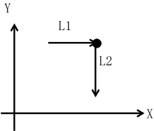

> **図の内容**
>
> X-Y 座標。L1（右向き）のあと L2（下向き）へ曲がる経路。

```c
    G01 X1000 ;
    G04 P1.0 ; →位置決め完了待ちのWait ※2
    G112 P0.1 ; →TURN命令 ※3
    G01 Y-1000; ※4
```

TURN命令の直後に上記命令を指定できない場合は、TURN命令にk/lを付加することにより接線を指定することができます。この機能によりTURN命令の直後に移動命令以外の命令を指定することもできます。

- ※5 m軸はサーボモータを使用下さい。パルスモータの場合、動作がなめらかでない場合があります。

(3). LIN命令(X/Y)に対するZ軸(3軸)の動作

LIN命令(G01)のX、Yのベクトル方向へZ軸(第3軸)を回転させます。

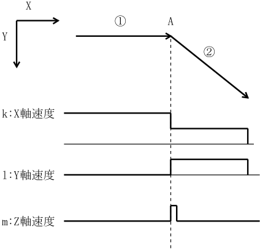

> **図の内容**
>
> X は右、Y は下の向き。① 右へ移動して A で ② 右下へ向きを変える。k: X軸速度は A で下がり、l: Y軸速度は A から始まり、m: Z軸速度は A で向きを変えるためのパルス状の動き。

- (4). ジョグ送り(手動送り)の時にも接線制御します。
- 例) +X キー

↓

Z軸 +X方向へ回転 X軸手動送り

- (5). 接線制御の有効(G110/STNE)/無効(G111/STND)
- G110/(STNE)の指令で接線制御有効(モーダル)となり、それ以降のk/l移動に対してm軸を自動追従させます。
- G111/(STND)の指令で接線制御を解除します。

(6). TURN命令 (G112)

直角に折れ曲がるようなカドの部分では、TURN命令を使います。

L1
  
A G01 X(L1);
  
G04 P＿;
  
L2 G112 (P＿);
  
G01 Y(L2)

k/l軌跡がなめらかに変化する軌跡であれば、上記機能は不要です。

(7). 関連するサーボパラメタ

m軸のサーボパラメタが特殊な意味になります。

| m軸サーボパラメタ (表示上の名称)   | サーボパラメタ名称 (正式名称)   | 意味                           |
|----------------------|--------------------|-------------------------------|
| +方向ソフトリミット           | 接線制御上限速度           | 接線制御によるm軸回転速度α、上限値(pps)       |
| -方向ソフトリミット           | 接線制御基準位置           | kl平面にて+k方向へ動く時のm軸のアブソ位置(パルス) |

Z軸は、A点で「接線制御上限速度」 (サーボパラメタ)で回転します。

一般には位置ループの特性により速度の変化やZ軸の回転速度の変化は曲線になります。

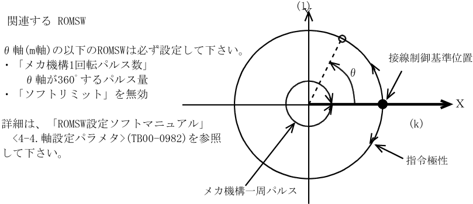

> **図の内容**
>
> 関連する ROMSW: θ軸 (m軸) の以下のROMSWは必ず設定して下さい。
> - 「メカ機構1回転パルス数」θ軸が360°するパルス量
> - 「ソフトリミット」を無効
> 詳細は、「ROMSW設定ソフトマニュアル」<4-4.軸設定パラメタ>(TB00-0982)を参照して下さい。
> 右の図: X 軸を基準に角度 θ、「接線制御基準位置」、「(k)」、「指令極性」、「メカ機構一周パルス」。

- (9). 通信コマンドにおける使用方法

＜通信コマンド＞

Z軸接線制御ON/OFFコマンド"REQ_TLINE"を使用します。本コマンドにより、接線制御のON/OFFが切り換えられます。デフォルトは接線制御OFFとなっています。

ステータスデータ読出(DAT_STATUS)で得られる、"タスクステータス"にて、接線制御ON/OFFの状態を取得出来ます。

詳細は、「PLMC-M3EX 送受信データ説明書」<4-2-26.Z軸接線制御ON/OFFコマンド>、 <4-1-6.ステータスデータ読出>(TB00-0984)を参照して下さい。

#### 5-15-6．センサーラッチ機能（スキップ機能） <オプション>

本機能は特殊な直線補間を実行します。センサーラッチ信号(ΣサーボのEXT1)が ONすると、その時点での機械位置とアブソ座標系を制御軸数分メモリーにセットします。

動作としては、以下の2通りが選択可能です。

- 同信号入力のONにより移動指令の残りを中止して次のステップへ進みます。(スキップ機能)
- スキップせず最後まで移動します。

センサーラッチ位置情報は、通信コマンドによって読み出す事ができます。

通信コマンドの詳細は、「PLMC-M3EX 送受信データ説明書」<4-1-10.センサーラッチ位置データ読出>、 <4-2-20.高速センサーラッチインクレ補間位置決めコマンド>、<4-2-21.高速センサーラッチアブソ補間位置決めコマンド>(TB00-0984)を参照して下さい。

- 【注】ラッチ動作をさせない軸でも同一タスク内の軸には全て、センサーラッチ信号の配線が必要です。

<運転プログラムコード>

|         | テクノコード   | Gコード   |
|---------|----------|--------|
| スキップ    | SLIN     | G31    |
| スキップしない | SLINC    |        |

Gコードでは、スキップしない動作はできません。

基本的な動作方式及び制約事項は、テクノコードの"SLIN"は従来の"LIN"に、Gコードの"G31"は従来の"G01"に等価です。(ただしG31はノンモーダル指令となります。)

- 【注】ラッチ信号のOFF→ONのエッジで動作します。SLIN実行の始めからONしているとラッチしません。

#### 5-15-7．コンベア追従送り同調・同期送り <オプション> (計画中)

ベルトコンベア上などを移動するワークに対して、同調・同期制御が有効です。

同調送り(TUN) ベルトコンベア上のワークに対して、位置と速度を合わせます。同期追従送り(DLIN) ベルトコンベア上のワークに対して、同じ速度で動きます。

```c
    TUN X(lm) Y(LM);
```

無限回転軸であるY軸を、あらかじめSPIN命令により、回転動作させておきます。

TUN命令により、両軸の論理座標系機械位置が指定した(lm,LM)に到達する様に、Y軸のフィードバックに同調してX軸を動作させます。指定点を通過した時点で分配完了となり、次のステップへ進みます。尚、TUN命令を開始する時点で、既にX軸の座標が指定位置を越えていた場合、プログラムエラーとなります。

また、Y軸の座標が指定位置を越えていた場合は、Y軸が周回処理によって一度ラウンドアップした後、再度到達する指定位置をYの目標点として動作します。

DLIN X(lb) TIM＿ ONR＿ /OFR＿;

無限回転軸であるY軸を、あらかじめSPIN命令により、回転動作させておきます。

DLIN命令によりTIMで指定された時間だけ、Y軸のフィードバックに同期してX軸を移動させます。この間に論理座標系のX軸機械位置が、指定した座標値(lb)に

到達してしまったた場合は、プログラムエラーとなります。

また、同時に標準のONR/OFR命令による汎用出力信号制御を実行できます。

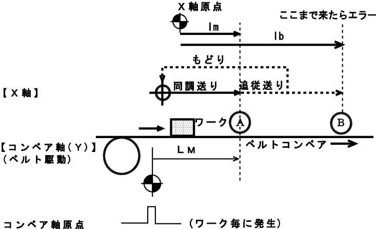

> **図の内容**
>
> - 【X軸】X軸原点から Im の位置で「同調送り」を開始し、「追従送り」で ワーク A → B を追う。Ib は「ここまで来たらエラー」の距離。終了後に「もどり」
> - 【コンベア軸(Y)】(ベルト駆動): ベルトコンベア上のワーク。LM はコンベア軸原点からの距離
> - コンベア軸原点の信号はワーク毎に発生

コンベア軸は、ワーク毎に原点パルスを出して下さい。一般には、回転軸座標として、コンベア軸の座標をワーク毎にセットアップします。

A点 : 同調を完了させるべき目標位置。(LM)

ここまでにX軸は加速して位置・速度を合わせます。

**使用例**

<プログラム例>

X軸のもどり位置でシリンダを上/下。(R00出力:シリンダ ON/OFF) 追従区間でシリンダを上/下させます。

P01入力ONで終了。

PTPA X0

; X軸ホーム位置へ

SPIN Y600 OVR1

; ベルトコンベア起動(直線形加減速)

〜

ONR00 TIM0.1

; シリンダ下降(0.1秒)

TIM0.1

; 0.1秒

0FR00 TIM0.1

; シリンダ上昇(0.1秒)

TUN X(lm) Y(LM)

; 同調

DLIN X(POSB) ONR00 TIM0.1 ; 同期追従シリンダ下降

DLIN X(POSB)

TIM0.1 ; 同期追従 0.1秒

DLIN X(POSB) OFR00 TIM0.1 ; 同期追従シリンダ上昇

PTPA X0

; X軸もどり

SPIN Y0 JNR01

; R01入力 ONの時コンベア停止

ER01

; R01入力 ONの時強制終了

END (サイクル運転)

; サイクル運転(エンドレス)

#### 5-15-8．直径指令 <オプション>

旋盤等の機械で、X軸(切れ込み軸)の指令値をワークの直径値で与えるものです。運転プログラム内の数値だけが直径指令として扱われます。

ワンショットPTPやサーボパラメータは半径値として扱われます。

また、現在位置表示画面の指令位置は直径指令値として表示され。

アブソ位置、機械位置、偏差量は半径指令値として表示されます。

例:X軸を直径指令とし、運転プログラム中で以下のような記述をした場合

PTP X100;

指令位置には100と表示され、アブソ位置、機械位置、(偏差量)には50と表示されます。ワンショットPTPでX軸に100と命令したときは、指令位置には200と表示され、アブソ位置、機械位置、 (偏差量)には100と表示されます。

#### 5-15-9．フレキシブル電子カム制御 <オプション> (計画中)

マスター軸の角度を基準として、複数軸を同期させるものです。

マスター軸は「コントローラ内の仮想軸」で指定された速度で定速回転します。

各軸の動作の指定は、マスター軸の任意の角度(ただし2度ステップ)での各軸の位置を指定したテーブルにて行います。

テーブルは動作開始時、連続回転時、動作終了時を分けて定義できます。

(動作開始テーブル、動作終了テーブルは必須ではありません)

また連続回転時のテーブルは4パターン定義でき、動作中に各種条件により切り換えることができます。

本機能は、軸動作を行う別タスクと同時に使用することはできません。

パターン作成は、作成用のエクセルソフトで行い、最終的にTコードで作ります。

作成したTコードはセッティングPC等からダウンロードし実行します。

カム曲線(動作タイミングチャート)①

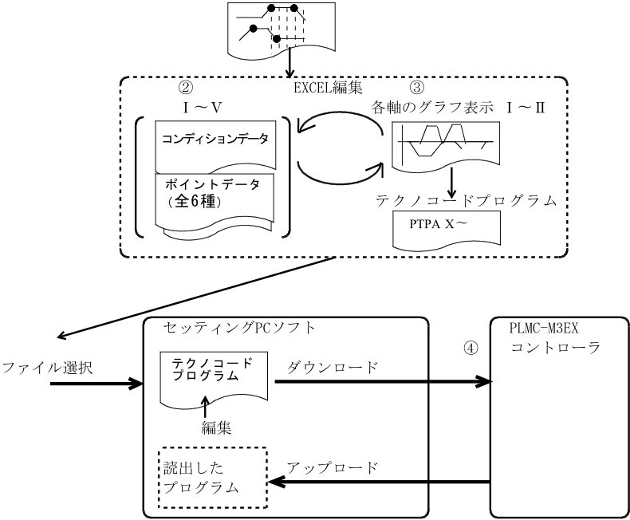

> **図の内容**
>
> ① EXCEL編集（② I～V のコンディションデータ・ポイントデータ（全6種）、③ 各軸のグラフ表示 I～II）→ テクノコードプログラム（PTPA X～）。セッティングPCソフトでファイル選択・編集し、④ PLMC-M3EX コントローラへダウンロード。コントローラから読出したプログラムをアップロード。

詳細は「PLMC40フレキシブル電子カム制御(TB04-1238)」を参照下さい。

#### 5-15-10．巻線指令

<オプション>

フライヤー式、ボビン式等の巻線機を容易に制御できる巻線指令機能があります。

巻き取り主軸はA軸固定で、主軸に同期して移動するトラバース軸は他の任意の1軸を使用することができます。

全体の巻回数、1巻当たりのトラバース軸の移動量(ピッチ幅)、巻き取り主軸の回転速度、コイル巻き終わり時のトラバースの位置を指定することができます。

巻線指令

REEL {X＿ Y＿ Z＿ B＿ C＿ R＿ Q＿ T＿} P＿ RN＿ S＿ RE＿ ;

- ＿･･･数値指定(即値/マクロ変数)を示します。

A軸を主軸として、その他{X_ Y_ Z_ B_ C_ R_ Q_ T_}の任意の1軸をトラバース軸とし、往復幅を

- {X＿ Y＿ Z＿ B＿ C＿ R＿ Q＿ T＿}:トラバース移動量の指定指定します。(いずれか1軸のみ指定) トラバース幅が+の場合、最初に+方向に移動して、往復運動を行います。 -の場合、最初に-方向に移動して、往復運動を行います。
- P:ピッチ幅

主軸一回転当たりのトラバース軸の移動量を指定します(pulse/rev)。

- RN:総巻数

主軸の回転回数を指定します。

総巻数指定が+の場合は正回転で巻き取り、-指定の場合は逆回転で巻き取ります。

- S:巻き取り速度

主軸の回転速度を指定します(rpm)。

- RE:巻き取り終了方向指定

巻き終わりのトラバースの位置の指定です。

終了位置を、トラバース始端方向かトラバース終端方向かの指定です。

指定が無いときは同一ピッチで指定回数巻き終わった時点で自然停止します。

※ 詳細はTB04-0936「巻線オプション仕様書」を参照ください。

#### 5-15-11．トルク指令

<オプション>

プレス、成型、ねじ締め、ドアの締め切りなど位置の制御でなく推力(トルク)制御が必要になることが有ります。

本機能によりトルク指令による制御が可能です。

トルク指令開始命令

TRQ (X＿ Y＿ Z＿ ... T＿ ) {FX＿ FY＿ FZ＿ ... FT＿};

- 軸指定 : X＿ Y＿ Z＿ ... T＿

軸毎のトルク指令を1%単位で指定します。

マクロ変数指定が可能です。

(指定した軸のみ変更します。指定していない軸は変更しません。1行最大4軸までです。) 設定範囲は、-モータ最大トルク〜 +モータ最大トルク(ROMSW設定ソフトで設定)です。

範囲外の値を設定するとプログラム実行エラーになります。

- 速度制限指定 : FX_ FY_ FZ_ ... FT_ 軸毎の速度制限を1rpm 単位で指定します。マクロ変数指定が可能です。

設定範囲は、1 〜モータ最大速度(ROMSW設定ソフトで設定)です。

範囲外の値を設定するとプログラム実行エラーになります。

軸指定と速度制限は同じ軸に対して行って下さい。異なる軸に対して行った場合は、フォーマットエラーになります。

トルク指令終了命令

TRQD (X＿ Y＿ Z＿ ... T＿ );

トルク指令を終了して、位置指令に戻す軸を指定します。

数値指定は不要です。

(指定した軸のみ変更します。指定していない軸は変更しません。)

トルク指令終了命令の他に、エラー発生時、プログラムの終了やリセット時、電源OFF→ONにより位置制御モードに戻ります。

動作の詳細

- 任意の指定された軸をトルク制御モードに変更します。 (Σアンプに対してトルクコマンドを発行します。) Σアンプはトルク制御モードになり、指令したトルクを出力します。次のトルク指令が発行されるまで、前回指令トルクを出力し続けます。
- トルク指令終了コマンドでトルク指令を終了し位置指令に戻ります。
- ※ 速度制限機能を有効にするために、Σアンプのユーザ定数Pn002の1桁目を"1"に設定する必要があります。
- ※ トルク指令中の軸はサーボがトルクモードになっていますので、位置指令の実行できません。

### 5-16．主軸機能 <オプション>

主軸機能は、指令された一定速度でサーボモータやインダクションモータを回転してワーク軸やツール軸として使用するものです。

| 方式                       | 内容・特徴                | ハード              | 指令方式 - Gコード                | 指令方式 - Tコード   |
|---------------------------|----------------------|------------------|-------------------------------|------------------|
| 2ビット出力信号制御方式 (主軸 ON/OFF) | I/O 信号のみアナログI/F不要。 | 汎用出力 SOUT0 SOUT1 | S0 停止 S1 速度 1 S2 速度 2 S3 速度 3 |                  |

- ※ Gコードプログラムの主軸回転速度指令として、Sコードが有効となります。

書式は、Sに続けて0〜3のコードを指定します。【例】S1;

(信号方式の場合、S0〜S3の指定となります。)

実際の主軸動作は、M03(正転)/M04(逆転)/M05(停止)の各命令により実行されます。

尚、主軸回転の開始(または停止)指令時は、指令回転数への到達(または停止)を待たずに、次のステップが実行されるので、必要に応じてドウェル命令等を使用して下さい。

2ビット出力信号方式

通信コマンドREQ_SPREVSETの発行または、運転プログラムのM03/M04とS0〜S3により専用信号(2ビット)の出力制御を行います。

M03(04)出力後に、S1→S2→S3などと指令することで主軸の速度を変えられます。

通信コマンドREQ_SPCMND(パラメータ=0)の発行時または、運転プログラムのM05指令時は、S0相当の出力となります。ただし、S1〜S3の選択はモーダル情報として記憶されていますので、再度M03/M04を指令した時は記憶していたS□に対応する出力を行います。

| Gコードプログラム - Mコード   | Gコードプログラム - Sコード   | 通信コマンド - REQ_SPCMND   | 通信コマンド - REQ_SPREVSET   | SOUT1   | SOUT0   | 主軸動作指定   |
|--------------------|--------------------|-----------------------|-------------------------|---------|---------|----------|
| M05                | S0                 | パラメタ=0                | パラメタ=0                  | OFF     | OFF     | 停止       |
| M03/M04            | S1                 | パラメタ=                 | パラメタ=1                  | OFF     | ON      | 速度1      |
| M03:正転             | S2                 | 1:正転                  | パラメタ=2                  | ON      | OFF     | 速度2      |
| M04:逆転             | S3                 | 2:逆転                  | パラメタ=3                  | ON      | ON      | 速度3      |

通信コマンドの詳細は、「PLMC-M3EX 送受信データ説明書」

<4-2-27.主軸回転ON/OFFコマンド>、<4-2-28.主軸回転数設定コマンド>(TB00-0984)を参照して下さい。

### 5-17．補正機能

#### 5-17-1．バックラッシュ補正機能

機械系に、いわゆる「ガタ」(不感帯)がある場合には、サーボパラメータの「バックラッシュ補正量」に「ガタ」に相等するパルス量を設定して下さい。

【バックラッシュ補正の概念図】

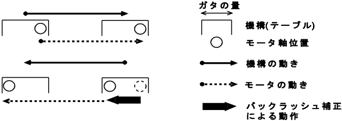

> **図の内容**
>
> 凡例: ガタの量、機構(テーブル)、モータ軸位置、機構の動き（実線の矢印）、モータの動き（点線の矢印）、バックラッシュ補正による動作（太い矢印）。移動方向が反転するときに、モータをガタの量だけ余分に動かして機構の位置を合わせる。

バックラッシュ補正は、軸の移動方向が変わるたびに、その方向へ加わります。

<最初のバックラッシュ補正>

原点復帰の完了後に、「原点復帰中の最後に原点に向かって動いた方向と逆の方向」に動いた時に、バックラッシュ補正がかかります。

原点復帰未完もしくは原点復帰無効の軸は、補正無効です。

【注意】絶対値エンコーダを使用した軸にはバックラッシュ補正は使用しないでください。

#### 5-17-2．工具長補正機能及び摩耗補正機能 <オプション>

指令コード

G43 H□□;/ THSET□□;

補正テーブル番号

工具長補正及び摩耗補正を実行します。

すでに補正がかかった状態で、新たな補正番号が指令された場合、現在の補正量と新たな補正量の差分で補正がかかり、常に最後に指令された補正番号の補正がかかった状態になります。

指令コード

G49;/ THOFF;

工具長補正及び摩耗補正をキャンセルします。

補正テーブル

| T No.   |      工具長補正量 | 工具長補正量   |     工具長補正量 |       摩耗補正量 | 摩耗補正量   |      摩耗補正量 |
|---------|-------------|----------|------------|-------------|---------|------------|
| 0       | -1000000000 | 〜        | 1000000000 | -1000000000 | 〜       | 1000000000 |
| ・       |             | ・        |            |             | ・       |            |
| ・       |             | ・        |            |             | ・       |            |
| ・       |             | ・        |            |             | ・       |            |
| 19      | -1000000000 | 〜        | 1000000000 | -1000000000 | 〜       | 1000000000 |

指定する補正テーブル番号は工具長補正と摩耗補正で共通となりますので、ご注意下さい。

■工具長補正

指定された補正テーブル番号の工具長補正量を現在の論理座標値に加算します。

軸の移動は行いません。

工具補正が指定された状態で、原点復帰動作を行うと、動作完了時に論理座標値が再セットアップされます。

本補正を実行した後の最初の移動命令は必ずアブソ指令にして下さい。

工具長補正有効軸の選択は、ROMSW設定ソフトの「軸設定」画面で有効軸を選択します。

■摩耗補正 <未完成>

指定された補正テーブル番号の摩耗補正量の分だけ、軸の移動を行います。ただし、論理座標系をシフトする事により移動前と移動後で論理座標値は変化しません。

原点復帰動作を実行した場合、摩耗補正は自動的にキャンセルされます。

注記

摩耗補正は未完成です。現在、対応しておりません。

工具長補正/摩耗補正の運転プログラム例この例では、Z軸に対しROMSW設定ソフトの"工具長補正"を有効にしています。

```c
    ① G90 G00 X0 Z0;
    ② G91 G01 X1000 Z1000 F1000;
    ③ G43 H0;
    ④ G90 G00 X2000 Z1000;
    ⑤ G43 H1;
    ⑥ G90 G00 X3000 Z1000;
    ⑦ G49 ;
```

例1

|   HNO. |   工具長補正 |   摩耗補正 |
|--------|---------|--------|
|      0 |    2000 |      0 |
|      1 |   -1000 |      0 |

| 動作 - ステップ   |   論理座標 - X |   論理座標 - Z |   アブソ座標(メカ) - X |   アブソ座標(メカ) - Z |
|-------------|------------|------------|-----------------|-----------------|
| ①           |          0 |          0 |               0 |               0 |
| ②           |       1000 |       1000 |            1000 |            1000 |
| ③           |       1000 |       3000 |            1000 |            1000 |
| ④           |       2000 |       1000 |            2000 |           -1000 |
| ⑤           |       2000 |      -2000 |            2000 |           -1000 |
| ⑥           |       3000 |       1000 |            3000 |            2000 |
| ⑦           |       3000 |       2000 |            3000 |            2000 |

例2

|   HNO. |   工具長補正 |   摩耗補正 |
|--------|---------|--------|
|      0 |       0 |    500 |
|      1 |       0 |   -500 |

|    |   論理座標 - X |   論理座標 - Z |   アブソ座標(メカ) - X |   アブソ座標(メカ) - Z |
|----|------------|------------|-----------------|-----------------|
| ①  |          0 |          0 |               0 |               0 |
| ②  |       1000 |       1000 |            1000 |            1000 |
| ③  |       1000 |       1000 |            1000 |            1500 |
| ④  |       2000 |       1000 |            2000 |            1500 |
| ⑤  |       2000 |       1000 |            2000 |             500 |
| ⑥  |       3000 |       1000 |            3000 |             500 |
| ⑦  |       3000 |       1000 |            3000 |            1000 |

【注意】

工具長補正/摩耗補正と同時に汎用入力制御を設定した場合でも、論理座標のセットアップには入力制御はききません。(座標のセットアップは即時行われます。)

座標のセットアップを行った後に汎用入力制御(Exit、スキップ、Wait、Stop)による処理を行います。

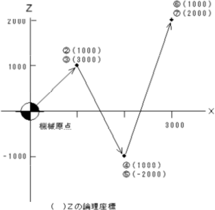

> **図の内容**
>
> Z の論理座標（( )は Z の論理座標）。機械原点から ②(1000) ③(3000)、④(1000) ⑤(−2000)、⑥(1000) ⑦(2000) へ移動する軌跡。

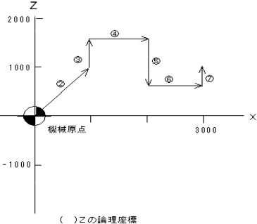

> **図の内容**
>
> 同じ動作の補正後の軌跡。②→③→④→⑤→⑥→⑦ と、Z 方向の移動が段状になる。

#### 5-17-3．工具径補正機能

詳細については、「SLM4000 径補正仕様(TB04-2176)」を参照ください。

大変申し訳ありませんが、PLMC-M3EX用の仕様書が未完成の為、こちらの仕様書をご参照下さい。

- ※ 上記仕様書は他システム(SLM4000)用の仕様書です。 PLMC-M3EXの仕様と基本的に同じです。

(1).径補正指令コード

■ Gコード(G40、G41、G42)

【Gコード例】

G41 (G01) D＿ X＿ Y＿

;左側補正

〜

G42 D＿ X＿ Y＿

;右側補正

〜

G40

;径補正キャンセル

| G40   | 径補正キャンセル          |
|-------|-------------------|
| G41   | 径補正左側            |
| G42   | 径補正右側            |
| D     | 工具径補正テーブルNO.(２ケタ) |

- a). Dの値はモーダルです。 (省略可、プログラムモーダル※)
- b). Dの指定範囲は0〜19です。
- c). 工具径補正テーブルの補正量(+値)は、あらかじめセットしておきます。
- d). 径補正は、ROMSW設定で選択されたX/Y平面にておこないます。(2次元)
- e). G40、G41、G42は、単独でも、またG00、G01と組み合わせても使用できます。
- f). 円弧指令ではアドレスDの値は第4軸中心指定です。径補正値の設定はできません。モーダルでの設定となります。
- ※ 一回のプログラム実行の中でモーダルです。前回のプログラム実行で指令したDの値は引き継ぎません。プログラム起動時は、デフォルト値(D00)になります。

■ テクノコード(DC、DL、DR)

【テクノコード例】

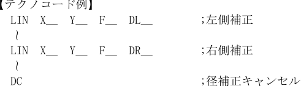

> **図の内容**
>
> ```
> LIN  X__  Y__  F__  DL__   ;左側補正
>  ～
> LIN  X__  Y__  F__  DR__   ;右側補正
>  ～
> DC                          ;径補正キャンセル
> ```

| DC   | 径補正キャンセル                |
|------|-------------------------|
| DL   | 径補正左側+工具径補正テーブルNO.(2ケタ) |
| DR   | 径補正右側+工具径補正テーブルNO.(2ケタ) |

- a). DL/DRで工具径補正テーブルNO.を指定します。 (DL/DR指令時は必ず工具番号を指定してください。)
- b). DL/DRの指定範囲は0〜19です。
- c). 工具径補正テーブルの補正量(+値)は、あらかじめセットしておきます。
- d). 径補正は、X/Y平面にておこないます。(2次元)
- e). DC、DL、DRは、単独でも、またPTP(A)、LIN(A)と組み合わせても使用できます。円弧指令との同時使用はできません。

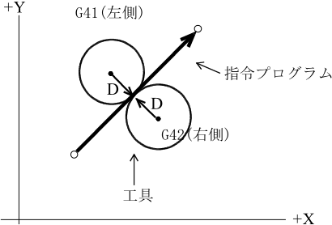

> **図の内容**
>
> 「指令プログラム」の直線に対し、工具（半径 D）が G41（左側）または G42（右側）にずれた位置を通る。

(2).使用上の条件

- a). 径補正を有効とする区間では、以下の命令は使えません。
- ① 移動指令や径補正D値に対するマクロ変数指定。
- ② マクロなどによる条件判断や分岐
- ③ JR指定
- ④ センサーラッチ（G31）
- ⑤ X/Y軸の論理座標設定指令（G92､CSET）
- ⑥ X/Y軸の回転軸回転指令（G120､SPIN）
- ⑦ X/Yのどちらかとその他の軸の円弧指令。
- ⑧ X/Yのどちらかがヘリカル円弧のヘリカル軸。
- ※ X/Y軸が指定されていない円弧指令/ヘリカル円弧指令、及び X/Y軸両方が円弧軸に指定されている円弧指令/ヘリカル円弧指令は実行出来ます。
- b). 径補正を有効とする区間では、ティーチングは行えません。
- c). 指令位置、及び機械位置は、径補正後の座標値となります。
- d). 径補正モード(右／左／無効)の変更後、または工具径変更後の最初のX/Y軸移動は必ず、PTP位置決め指令、または直線補間指令で行って下さい。

（X/Y軸以外の軸の円弧補間指令は可能です。）

- e). 径補正を行うには、ROMSW設定により前もって径補正の対象軸を設定して下さい。

（タスク毎に設定が必要です。）

対象軸を設定していないタスクで径補正開始(右側/左側)命令を実行すると、プログラム実行エラーになります。

※ 現状では径補正対象軸はX/Y軸固定です。

（ROMSW設定では、必ず「横軸＝論理軸第1軸(X軸)／縦軸＝論理軸第2軸(Y軸)」に設定して下さい。）

#### 5-17-4．ピッチエラー補正機能

各軸毎に機械原点を基点とした、一定間隔の区間毎の補正データを、パラメータに記憶させ、そのデータに従って、ボールネジの誤差を自動的に補正する機能です。この機能は原点復帰の完了後、有効になります。原点復帰未完もしくは原点復帰無効のインクレ軸は補正無効です。無限回転軸に設定した軸には、ピッチエラー補正は無効です。

【基本仕様】

| 補正軸     | 全制御軸中の任意の指定軸        |
|---------|---------------------|
| 補正点の数   | 全軸で4000点Max.        |
| 補正の基点   | 機械原点                |
| 補正の間隔   | 1000〜1000000パルス     |
| データ設定方式 | アブソリュート(機械原点からの補正量) |
| 補正量     | 0〜±127パルス           |
| 補正倍率    | ×10Max.             |

【注意事項】

- (1). 最大補正量は、基点に対して±1270パルスとなります。
- (2). 使用するサーボの応答性やサーボ調整により異なりますが、隣合う補正量の差が大きすぎると、急激な動作となる場合があります。
- (3). 総補正点数が4000点以内であれば、軸毎の点数配分は任意です。
- (4). ピッチエラー補正を無効とする場合は、パラメータの補正倍率に、0を設定して下さい。
- (5). 補正量(補正量×補正倍率)が補正間隔以上の場合、ダウンロード時にパラメータエラーとなります。
- (6). 補正有効の状態でパラメータを変更した場合、ダウンロード後すぐに値を反映します。 (値によっては、急激な動作となる場合があります。)

【パラメータ】

|    | 項目          | 設定値                |
|----|--------------|----------------------|
| 各  | 補正倍率補正間隔    | 0〜10 1000〜1000000パルス |
| 各  | 補正データ先頭番号    | 0〜3999               |
| 軸  | -側補正区間数      |                      |
| 各  |              | 0〜4000               |
| 各  | +側補正区間数      | 0〜4000               |
| 共  | 補正データ        | 0〜±127パルス            |
| 通  | No.0〜No.3999 |                      |

【設定例】

下図の様なX軸の補正を設定する例を示します。

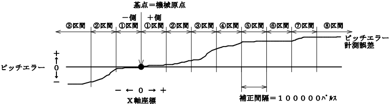

> **図の内容**
>
> 基点＝機械原点。X軸座標の − 側に ③区間～①区間、+ 側に ①区間～⑧区間。各区間の補正間隔＝100000パルス。ピッチエラー計測誤差の階段状のグラフ。

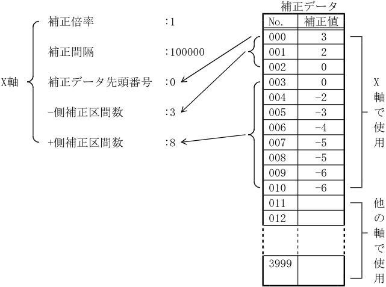

> **図の内容**
>
> X軸: 補正倍率 :1、補正間隔 :100000、補正データ先頭番号 :0、−側補正区間数 :3、+側補正区間数 :8。
> 補正データ（No. → 補正値）: 000 → 3、001 → 2、002 → 0、003 → 0、004 → −2、005 → −3、006 → −4、007 → −5、008 → −5、009 → −6、010 → −6（ここまで X軸で使用）、011～3999 は他の軸で使用。

#### 5-17-5．形状補正(高精度輪郭制御) <オプション>

高速・高精度な輪郭制御を要求するマシンでは、形状補正による軌跡精度の向上が有効です。これにより、サーボ系の遅れによる軌跡誤差を最小限に抑えることが可能となります。

(1). 形状補正機能の概要

- a. コーナ部の内回りを少くする
- b. 円弧の縮みをなくす

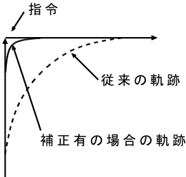

> **図の内容**
>
> 直角のコーナーで、「指令」の軌跡に対して「従来の軌跡」（点線）は大きく内側を回り、「補正有の場合の軌跡」は指令に近い。

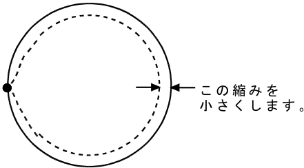

> **図の内容**
>
> 円弧の指令（実線）と実軌跡（点線）。「この縮みを小さくします。」

(2). 形状補正の効果

サーボ系を1次遅れ系とみなして、その遅れ分を補償します。その結果、指令どおりの実軌跡となります。

速度ベクトルの変化がなめらかな場合には、最大限の効果が出ます。従って、速度変化が大きい場合は、「プリ解加減速」を利用するか「運転プログラムの各ステップ(ブロ

ック)を細分化して、速度Fがゆるやかに変化する」ようにして下さい。

(3). 形状補正機能の制限事項

速度が急に変化する動きでは、充分な効果が上がらない場合もあります。また、理想的なサーボ系(1次系)と現実のサーボ系の差(機械系、速度ループ特性)から、効果の程度が変わることがあります。

(4). 使用方法 <オプション>

サーボパラメタの「形状補正係数」を設定して下さい。

形状補正係数:位置ループゲイン(Kp)の1.5倍〜5倍

|   例 KP | 形状補正係数   |
|--------|----------|
|     40 | 60〜200   |

0の時は制御なし。

初め5倍の値を設定して、すこしづつ小さくして下さい。(軌跡を確認しながら)1倍以下は、使用不可。

(5). 任意曲線における高精度輪郭制御の実例

【運転プログラム】

微小直線補間連続ブロック LIN X292 Y316 F50000; (全432ブロック)

【共通動作条件】

位置ループゲインKp=30 (XY軸共通)

形状補正なし

- 指数型加減速処理:有効 (時定数=30msec)
- プリ解加減速機能:未使用
- 形状補正制御 :無効

形状補正あり

- 指数型加減速処理:無効
- プリ解加減速機能:使用 (加減速時間=100msec)
- 形状補正機能 :有効 (形状補正係数=60)

LIN X339 Y367 F50000; LIN X339 Y367 F50000; LIN X359 Y347 F50000; LIN X386 Y318 F50000; LIN X410 Y286 F50000; LIN X432 Y252 F50000; LIN X451 Y216 F50000; LIN X467 Y179 F50000; LIN X480 Y141 F50000; LIN X85 Y21 F50000; LIN X240 Y220 F50000;

LIN X-250 Y-433 F50000; LIN X-232 Y-443 F50000; LIN X-213 Y-452 F50000; LIN X-195 Y-461 F50000; LIN X-175 Y-468 F50000; LIN X-155 Y-475 F50000; LIN X-135 Y-482 F50000; LIN X-116 Y-486 F50000; LIN X-95 Y-491 F50000; LIN X-74 Y-494 F50000; LIN X-42 Y-372 F50000;

END;

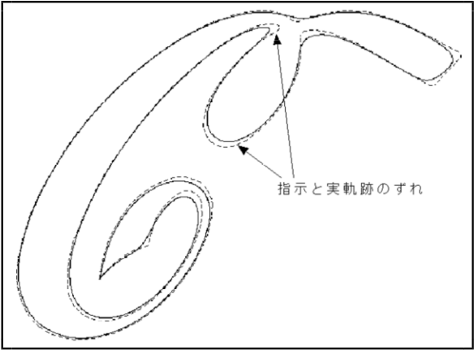

> **図の内容**
>
> 複雑な曲線の指令と実軌跡。「指示と実軌跡のずれ」が見える。

（指令軌跡／実軌跡）

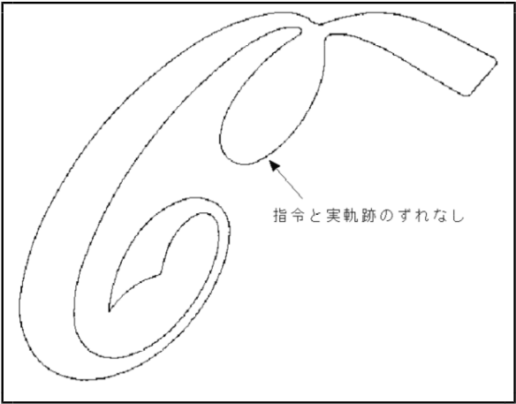

> **図の内容**
>
> 同じ曲線の指令と実軌跡。「指令と実軌跡のずれなし」。

(6). 円弧における高精度輪郭制御の実例

プリ解加減速と形状補正を利用して、高精度輪郭制御を実現しました。

⑨ プリ解析による加減速発生

通常、NCの内部処理では軌跡発生処理のあと、速度変化や機械のショックをやわらげるために各軸の指令に対して加減速をかけます。この加減速による遅れ要素と位置ループ系による偏差量が加わって、実際の軌跡が、コーナーの内側を回るなどの、大きな形状誤差が発生します。ただし、加減速処理を行わないと、指令の速度変化にサーボ系が追従できないという別の問題が生じます。そこで補間後の加減速処理を使用しないでも充分に追従できるようにプリ解析処理において加減速区間微小ブロックを発生させて、補間前加減速(自動コーナオーバライド)をおこないます。

【円弧動作での各軸の速度・通常】

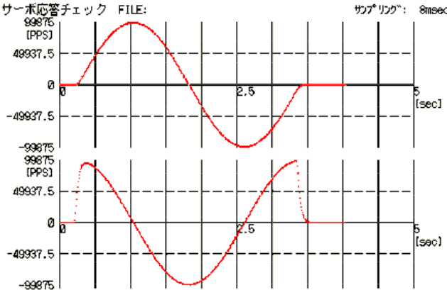

> **図の内容**
>
> 「サーボ応答チェック」画面（サンプリング 8msec）。上が X軸、下が Y軸の速度 [PPS]（±99875、±49937.5 の目盛、横軸 0～5 [sec]）。正弦波状の速度で、始まりと終わりに角がある。

【動作での各軸の速度・プリ解加減速】

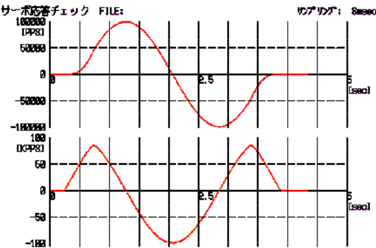

> **図の内容**
>
> 「サーボ応答チェック」画面（サンプリング 8msec）。上の速度（±100000 [PPS]）、下（±100 [KPPS] と読める）。始まりと終わりがなめらかな正弦波状の速度。

プリ解加減速無し

補間時定数=30ms Kp=30 R=50000p F=100Kpps でのサーボ応答 (≒速度指令)

プリ解加減速有り

補間前加減速(自動コーナオーバライド) 補間時定数=0

Kp=30 R=50000p F=100Kpps でのサーボ応答 (≒速度指令)

⑩ 形状補正の効果

プリ解加減速をおこなっても、位置ループ系による偏差量分の遅れのため、高速送り(位置偏差大)では軌跡誤差が顕著となります。これを0に近づける為に、コントローラ内でフィードフォワード的な補償制御をおこなうことで、位置偏差を小さくします。

当社モーションアナライザでの真円精度解析の例を示します。プリ解加減速と形状補正によって、円弧の縮小はゼロになっています。

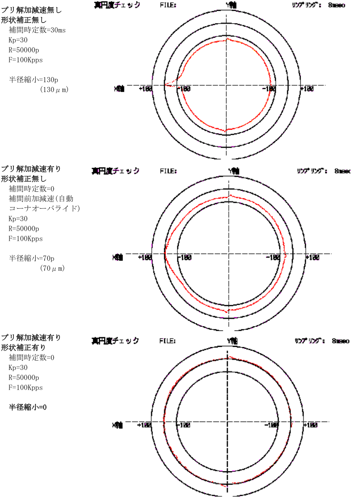

> **図の内容**
>
> 当社モーションアナライザでの真円精度解析の例。3 つの条件ごとに、円の指令（黒）と実軌跡（赤）を拡大した図と、条件の文字。
> 条件の文字は小さくて判読できず。

(7). プリ解加減速(プリ解析における加減速ステップの発生) <オプション>

① プリ解加減速の意味

プリ解加減速は、直線補間や円弧補間に対してスタート区間(加速区間)と停止区間(減速区間)のステップを発生させるものです。

- a. 各軸の指令速度の変化を少なくして、形状補正の効果を最大限にします。

文字

- b. 補間後の各軸の加減速をなくしても、オーバショートや振動がおきないようにします。

② プリ解加減速の使用上の注意

加速/減速を設定するブロック(ステップ)は必ず「プリ解加減速区間(時間)」よりも時間的に長いことが必要です。

【元の指令】

従って、加速/減速指令をするブロック(ステップ)では、以下を確認して下さい。ブロック処理時間(L/F) ≧ プリ解加減速区間(時間)

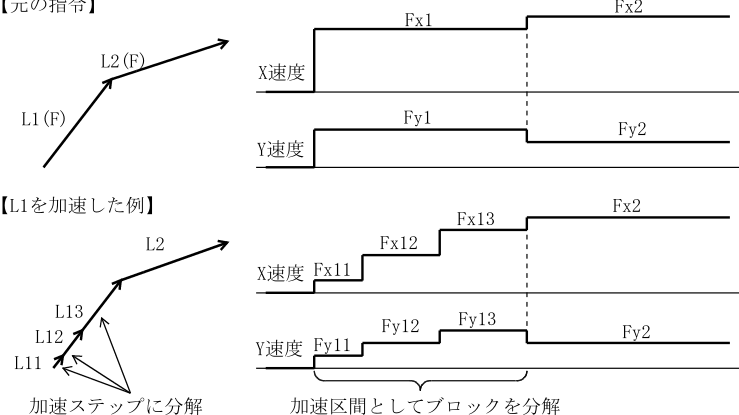

> **図の内容**
>
> - 【元の指令】L1 (F) のあと L2 (F)。X速度は Fx1 → Fx2、Y速度は Fy1 → Fy2 に段で変わる
> - 【L1を加速した例】L1 を L11、L12、L13 の加速ステップに分解。X速度は Fx11 → Fx12 → Fx13 → Fx2、Y速度は Fy11 → Fy12 → Fy13 → Fy2。「加速区間としてブロックを分解」

③ 微小ブロックの処理

2項の条件式を満たさない微小な(短い)ブロックの場合は、CAD/CAMによるブロックの発生において、あらかじめ接線速度を加速/減速させることを推奨します。

この処理については、必須ではありませんが、高精度輪郭制御を効果的にするためには、必要です。

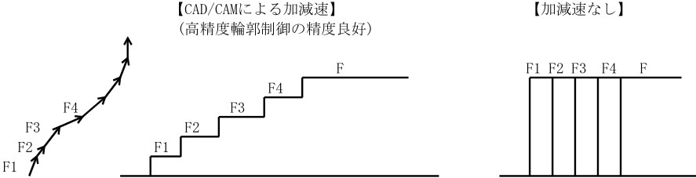

> **図の内容**
>
> - 【CAD/CAMによる加減速】(高精度輪郭制御の精度良好): F1、F2、F3、F4 と速度が段階的に上がり F に達する
> - 【加減速なし】F1～F4 のブロックが同じ速度 F

### 5-18．ティーチング (開発中)

#### 5-18-1．ティーチング

モーションコントローラ内に記憶している動作プログラムに対してティーチング (挿入/置換/削除等)を行い、動作プログラムの変更を行うことが出来ます。ティーチングでは記憶している動作プログラムを直接変更するので、次回のプログラム実行でもティーチングした内容が反映されています。尚、ティーチングした動作プログラムはPCでアップロードして保管(管理)して下さい。 (故障時などに復旧できるようにするため) セッティングPCのティーチング画面を元にティーチング関連の動作を説明します。

ティーチング画面で使用している通信コマンドは、全てアプリケーション開発ライブラリで公開しているので、お客様も同等の画面を作成する事が出来ます。

参考までに、以下の表にセッティングPCの操作とそれに対応する通信コマンドを併記します。

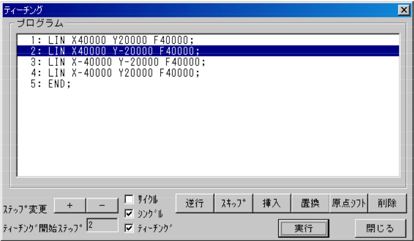

> **図の内容**
>
> 画面「ティーチング」。プログラム:
> ```
> 1: LIN X40000 Y20000 F40000;
> 2: LIN X40000 Y-20000 F40000;   （選択中）
> 3: LIN X-40000 Y-20000 F40000;
> 4: LIN X-40000 Y20000 F40000;
> 5: END;
> ```
> ステップ変更（+、−）、ティーチング開始ステップ 2、チェック: サイクル、シングル（チェック）、ティーチング（チェック）。ボタン: 逆行、ステップ、挿入、置換、原点シフト、削除、実行、閉じる。

| セッティングPC表示 [通信コマンド]                       | 内容                                                                                                             |
|-------------------------------------------|-----------------------------------------------------------------------------------------------------------------|
| プログラム表示 [DAT_ONEBLOCK]                    | 現在選択されているプログラムの内容を表示しています。モーションコントローラ内で記憶しているプログラム情報を元に逆変換を行って表示しているため、実際にダウンロードしたプログラムとは見た目が異なっている可能性があります。 |
| 現在(強調表示) ステップ [DAT_STATUS] [DAT_TEACHSTS] | 現在実行中/実行予定のステップ又は、ティーチング対象のステップを強調表示しています。 (ティーチング中にステップ変更「+」「-」を行うと、このステップが前後します。)                          |
| ティーチング開始ステップ [DAT_TEACHSTS]              | ティーチングを開始したステップを表示しています。                                                                                        |

| セッティングPC操作 [通信コマンド]                 | 動作                                                                                                                                                        | 基本的条件                                              |
|-------------------------------------|------------------------------------------------------------------------------------------------------------------------------------------------------------|----------------------------------------------------|
| サイクル [ REQ_CYCLE ]                  | サイクル運転モードの設定/解除サイクル運転モードの時は、プログラムが終了したら自動的に最初から再開します。 (ティーチング操作では使用しません。)                                                                                | 常に実行可                                              |
| シングル [ REQ_SINGLE ]                 | シングルステップモードの設定/解除シングルステップモードの時は、「実行」を押す毎に1 ステップづつ実行します。 1ステップ実行して停止すると、「ステップ間停止」状態になっています。ほとんどのティーチング操作では「ステップ間停止」状態である必要があります。                         | 常に実行可                                              |
| ティーチング [ REQ_TEACH ] ※1             | ティーチングモードに設定します。ステップ間停止中のみ可能です。ステップ間停止にするには、シングルステップモードで実行するか、M00/M01停止を使用する必要があります。ティーチングモードを解除します。ティーチング移動を行っている場合は、「逆行」操作で、ティーチング開始位置まで戻る必要があります。 | ･ティーチングモードでない･ステップ間停止中･ティーチングモード中･ティーチング移動未実行 |
| ティーチングステップ変更 +/- [REQ_STEPCHG ] ※1 | ティーチング対象のステップを変更します。ステップを変更した後、ティーチング開始ステップ以外でティーチングモードを解除して再開すると、変更前と後の間のステップを実行しないで再開する事になります。注意して下さい。                                               | ･ティーチングモード中                                        |

※1 : 開発中です。

| セッティングPC操作 [通信コマンド]    | 動作                                                                                                                                              | 基本的条件                                               |
|------------------------|--------------------------------------------------------------------------------------------------------------------------------------------------|-----------------------------------------------------|
| 逆行 [ REQ_PRGREV ] ※1   | ティーチング開始位置への移動(戻り) 直前のステップの逆行。<オプション>                                                                                                            | ･ティーチングモード中･ティーチングモードでない･ステップ間停止中･PTP/LINステップのみ |
| スキップ ※1 [REQ_STEPSKIP] | 現在ステップをスキップして、次ステップに実行ステップを移します。移動中のステップは中断します。                                                                                                 | ･ﾃｨｰﾁﾝｸﾞﾓｰﾄﾞでない･停止中                                |
| 挿入 [ REQ_PRGINS ] ※1   | 表示されているステップ番号以降の既存ステップが繰り下げられ、ティーチング移動した分の新たなPTP指令ステップが、表示されているステップ番号として登録されます。                                                               | ･ティーチングモード中･ティーチング開始ステップ                          |
| 置換 [ REQ_PRGALT ] ※1   | 表示されているステップの移動量が、ティーチングした移動量にさし変わります。この時、指定コードは元のステップより継承され、アブソ移動指令であった場合は、移動先の座標値が入ることになります。また、PTMAコードの場合も同様に、指定されているポイント番号の座標データに差し変わります。 | ･ティーチングモード中･移動命令のステップ                              |
| 原点シフト※1 [REQ_ZRNSHIFT] | ティーチング移動先の論理座標がティーチング開始時の論理座標と同じになるように、論理原点をシフトします。                                                                                            | ･ティーチングモード中                                         |
| 削除 [ REQ_PRGDEL ] ※1   | 表示されているステップ番号のステップが削除され、それ以降の既存ステップが繰り上げられます。                                                                                                   | ･ティーチングモードでない･ステップ間停止中                            |
| 実行 [REQ_PROGSTRT]      | プログラム運転の開始/再開を行います。                                                                                                                              | ･ティーチングモードでない･プログラム未実行/ 停止中                       |

#### 5-18-2．「逆行」動作詳細

- (1). ティーチング開始位置への移動(戻り)

ティーチングで移動した分をキャンセルするPTP移動を行い、ティーチング開始位置へ戻ります。既にティーチング開始位置にいる場合は何もしません。

- ① A点にてステップ間停止 (現在ステップ表示はn)
- ② 「ティーチング」ティーチングモード設定
- ③ 各軸JOG、インチングなどを使って移動
- ④ 「逆行」 A点にPTP動作で戻る。
- ⑤ 「ティーチング」ティーチングモード解除
- (2). 直前のステップの逆行をします。<オプション>

ステップn-1

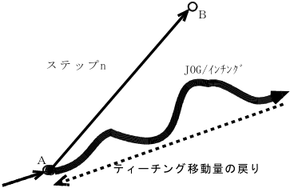

> **図の内容**
>
> A からステップn で B へ向かう途中で JOG/インチングで移動したあと、「ティーチング移動量の戻り」で A へ戻る。

直前のステップを逆に移動して実行前の位置へ戻ります。

- ※ この動作はインクレ移動(PTP/LIN)のステップのみ可能です。
- ① B点にてステップ間停止 (現在ステップ表示はn)
- ② 「逆行」

A点へ逆移動します。 (現在ステップ表示はn-1)

ステップn-2

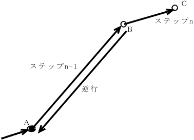

> **図の内容**
>
> A → B（ステップn-1）→ C（ステップn）。B から「逆行」で A へ戻る。

#### 5-18-3．「スキップ」動作詳細

現在ステップをスキップして、次ステップに実行を移します。移動中のステップは中断します。

- ① A'点にて停止 (現在ステップ表示はn)
- ② 「スキップ」移動を中断して、次ステップに実行が移ります。 (現在ステップ表示はn+1)
- ③ 「実行」

次の移動命令がPTP/LIN(インクレ)の時は、 C′へ、PTPA(アブソ)の時は、Cへ移動

#### 5-18-4．「挿入」動作詳細

ステップn-1

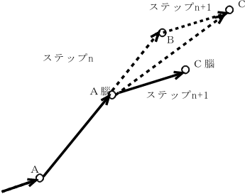

> **図の内容**
>
> A → ステップn → B → ステップn+1 → C。JOG で A 脇へ移動したあと、挿入により A脇 → B脇 → C脇（ステップn+1）と点線で示す経路。

現在ステップ(ティーチング対象のステップ)以降の既存ステップが繰り下げられ、ティーチング移動した分の新たなPTP指令ステップを、現在ステップに記憶(挿入)します。

- ① A点にてステップ間停止 (現在ステップ表示はn)
- ② 「ティーチング」ティーチングモードに入る。
- ③ 各軸JOG、オーバライドなどを使って D点へ移動。

ステップnにD点までのPTP命令が

- ④ 「挿入」挿入されます。

(現在ステップ表示はn+1に変る)

- ⑤ 「ティーチング」ティーチングモード解除
- ⑥ 「実行」次の移動命令(もとのステップn)がPTP/LIN(インクレ)の時は、B′へPTPA(アブソ)の時は、Bへ移動

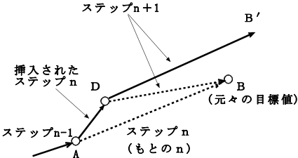

> **図の内容**
>
> A（ステップn-1）から D への「挿入されたステップn」、D から B′ へのステップn+1。もとのステップn は A から B（元々の目標値）。

Ｃ

#### 5-18-5．「置換」動作詳細

現在ステップ(ティーチング対象のステップ)の移動量が、ティーチングした移動量にさし変わります。この時、指定コードは元の命令より継承され、アブソ移動指令であった場合は、移動先の座標値が入ることになります。また、PTMAコードの場合も同様に、指定されているポイント番号の座標データが移動先の座標に差し変わります。

- (1). 現在ステップ(次ステップ)の置換
- ※ 現在ステップが移動命令(PTP/PTPA/PTPB/LIN/LINA/LINB/PTMA)の時のみ可能な操作です。ただし、PTMAのポイント指定をマクロ変数で指定していた場合は実行できません。

又、移動量/移動座標指定がマクロ変数指定だった場合は、マクロ変数指定が解除されます。 (数値指定になります)

- ① A点にてステップ間停止 (現在ステップ表示はn)
- ② 「ティーチング」ティーチングモード設定
- ③ 各軸JOG、インチングなどを使って B′へ移動
- ④ 「置換」ステップnをステップn'に置換して、

現在ステップ表示が n +1に変る。

- ⑤ 「ティーチング」ティーチングモード解除
- ⑥ 「実行」
- n +1ステップから実行を再開します。

(移動命令がPTP/LIN(インクレ)の時は、C'へ、PTPA(アブソ)の時はCへ移動)

ステップn-1

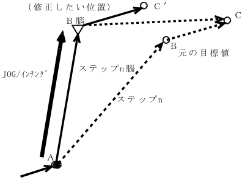

> **図の内容**
>
> A から B（元の目標値）へのステップn を、JOG/インチングで B 脇（修正したい位置）へ移動して置き換える。次は C′ または C へ。

- (2). 直前に実行したステップの置換(目標位置のオフセット)
- ※ ティーチングを開始したステップの直前のステップで、インクレ移動命令(PTP/LIN)の時のみ可能な操作です。

(アブソ命令の場合は、次項の「任意のステップの置換」の処理になります。) ただし、移動量指定にマクロ変数を指定していて、その軸を移動させた場合は、実行出来ません。

- ① B点にてステップ間停止 (現在ステップ表示はn)
- ② 「ティーチング」ティーチングモードに入る。
- ③ ティーチングステップ「-」現在ステップ(ティーチングステップ)を戻します。
- ④ 各軸JOG、インチングなどを使って B′へ移動
- ⑤ 「置換」ステップn-1をステップn-1'に置換して、現在ステップ表示が n に変る。
- ⑥ 「ティーチング」ティーチングモード解除
- ⑦ 「実行」

ステップnから実行を再開します。

(移動命令がPTP/LIN(インクレ)の時はC'へ、アブソ命令の時はCへ移動)

(3). 任意のステップの置換(アブソ命令のみ)

- ※ アブソ命令[PTPA/PTPB/LINA/LINB/PTMA]のステップに対してのみ可能な操作です。ただし、PTMAのポイント指定をマクロ変数で指定していた場合は実行できません。又、移動座標指定がマクロ指定だった場合は、マクロ指定が解除されます。(数値指定になります)
- ① 任意のステップでステップ間停止
- ② 「ティーチング」ティーチングモードに入る。
- ③ ティーチングステップ「+」/「-」キーにより、現在ステップを変更
- ④ 「置換」ティーチングステップの目標座標を現在の座標に置換します。
- ⑤ 「ティーチング」

ティーチングモード解除

ステップn-2

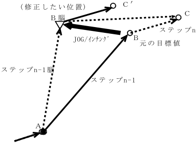

> **図の内容**
>
> A から B（元の目標値）へのステップn-1 を、JOG/インチングで B 脇（修正したい位置）へ置き換える。次のステップn は C′ または C へ。

#### 5-18-6．「原点シフト」動作詳細

ティーチング移動先の論理座標がティーチング開始時の論理座標と同じになるように、論理原点をシフトします。

- ① A点にてステップ間停止 (現在ステップ表示はn)
- ② 「ティーチング」ティーチングモード設定
- ③ 各軸JOG、インチングなどを使って A′へ移動
- ④ 「座標シフト」 A'点の座標がA点の座標と同じになるように論理原点をシフトします。
- ⑤ 「ティーチング」ティーチングモード解除
- ⑥ 「実行」

ステップnから実行を再開します。

#### 5-18-7．「削除」動作詳細

表示されているステップ番号のステップが削除され、それ以降の既存ステップが繰り上げられます。

- ① A点にてステップ間停止 (現在ステップ表示はn)
- ② 「削除」

ステップnが削除されて、n+1以降のステップが1つづつ前にシフトします。

- ③ 「実行」時は、C′へPTPA(アブソ)の時は、

次の移動命令がPTP/LIN(インクレ)の Cへ移動。

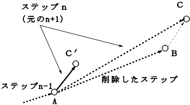

> **図の内容**
>
> A（ステップn-1）から B への「削除したステップ」を削除すると、次の移動命令がPTP/LIN(インクレ)の場合は C′ へ、元の n+1 であるステップn は C へ移動する。

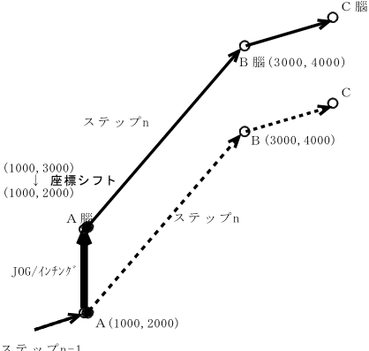

> **図の内容**
>
> A(1000, 2000) から JOG/インチングで A脇へ。(1000, 3000) → (1000, 2000) に座標シフト。ステップn で B脇(3000, 4000) → C脇、または B(3000, 4000) → C。

ステップn-1

### 5-19．補間前加減速(自動コーナオーバライド)機能 <オプション>

#### 5-19-1．補間前加減速(自動コーナオーバライド)のメリット

- (1). コーナ内回りの軌跡誤差の最小化
- (2). 加速度(速度変化量)を自動判別して、必要に応じて加速度(速度変化量)を制限すべく自動的に減速。
- (3). 判定や減速度合いは、PLMC-M3EXの自動計算ですので、運転プログラム作成者が個別に計算する必要はありません。
- (4). 判定基準や補間前加減速時(自動コーナオーバライド)定数はあらかじめ自由に設定できます。
- (5). 判定区分は6段階で、かなり自由度がありますので、機構に応じて最適な設定が可能です。

#### 5-19-2．補間前加減速(自動コーナオーバライド)の概要

直線補間や円弧補間の連続点での加速度(速度変化量)を自動計算し、その大きさによって、適切な速度に減速/加速します。たとえば、2m/秒速度の直線から、0.5m/秒の円弧に進入するときに、直線補間の最後に減速してから、円弧に進入します。

PLMC-M3Ezの内部処理を簡単に説明します。

軌跡発生(補間)の前に全体速度を加減速する機能を追加致します。

これによって、従来の(各軸)加減速の時定数を10msecのように小さくしても各軸のモータに対して、急激な加減速が発生しないようになります。


> **図の内容**
>
> 「加速度判定&補間前加減速（自動コーナオーバーライド）今回追加」→「軌跡発生 直線補間 円弧補間など」→「従来の各軸加減速(例:10msec)」の 加減速 → X軸指令、加減速 → Y軸指令。

補間命令のつなぎ目で、加速度(速度変化量)をチェックし、大きいときは、その補間の減速と次の補間の加速をおこないます。

(1). 加速度判定

補間時に、加速度(速度変化量)を計算し、その大きさを判定します。

(2). 補間前加減速

(自動コーナオーバライド) 加速度判定の結果、補間のつなぎの部分で、設定された減速と加速をいた

します。

#### 5-19-3．補間前加減速(自動コーナオーバライド)をしているときの速度変化(オーバライド)の様子


> **図の内容**
>
> 補間1、補間2、補間3 の速度。補間の境目 ①、② で速度が最小オーバーライドまで下がる。補間前加減速(自動コーナオーバーライド)時定数で加減速する。

①

②

- ①補間前加減速(自動コーナオーバライド)を必要とする補間連続点(速度変化がそれなりに大きい連続点) オーバーライド指定なので、ステップで指令速度が違う場合は速度変動が発生します。
- ②補間が連続しない点(ドウェルなど)
- この判定を6段階に分類し、その程度に応じて、送り速度全体を減速します。

#### 5-19-4．制限事項など

- (1). 判定値や時定数は、設計値である程度既定できますが、本来の最適値は、実際のサーボ系や機構系で再確認する必要があります。
- (2). 以下のような微小補間の場合は、減速が間に合わない場合があります。

例 ①直線補間 L1 F1 ;

②直線補間 L2 F2 ;(微小補間)

F1とF2の変化が小さいと①は減速せずに②へ移行します。この時、②の移動量が小さい微小補間の場合は、減速が間に合わず、急停止する事になります。

運転プログラムの作成時にご注意下さい。

- (3). サーボ系の位置ループ制御の影響による内回りは、発生します。ただし、これはかなり小さい値です。また、サーボのフィードフォワード制御などで、改善も期待できます。
- (4). 補間命令の間に IF, #＿, TIM などの補間命令以外の命令がある場合は、そのステップを速度0とみなして加速度判定します。その結果、減速/加速を行います。

#### 5-19-5．加速度(速度変化量)の算出方法

補間命令の場合は以下の様に、つなぎ目の加速度(速度変化量)を算出します。

加速度VA = V2 - V1


> **図の内容**
>
> V1 から V2 へ向きが変わる。速度変化量 VA = V2 − V1（点線の矢印）。

- = (F2X-F1X) 2 + (F2Y-F1Y) 2 ・・・(F2A-F1A) 2

VA:加速度(速度変化量)

- V1:実行するステップの補間移動ベクトル

(円弧の場合は、始点の接線ベクトル)

V2:次ステップの補間移動のベクトル

(円弧の場合は、終点の接線ベクトル)

F1X・・F1A:V1の各軸速度

F2X・・F2A:V2の各軸速度

以下の組み合わせで、補間命令の加速時/減速時の速度変化量VAを算出します。

加速時 : 前ステップと実行ステップ

減速時 : 実行ステップと次ステップ

- 前ステップが補間でない場合 :前ステップのベクトルを0としてVAを計算します。※
- 次ステップが補間でない場合 :次ステップのベクトルを0としてVAを計算します。※

- ※補間でないステップのベクトルは0として計算するため、実行ステップの速度そのものが加速度(速度変化量)となります。

#### 5-19-6．パラメータの設定について

セッティングPCの以下の画面で、関連のパラメタを設定します。


> **図の内容**
>
> 画面「補間前加減速パラメータ」。タスク0。補間前加減速時定数 330 msec（0:補間前加減速無効）。最小オーバーライド設定（加速度 [pls/sec2] → 最小オーバーライド [%]）:
>
> | 加速度 | 最小オーバーライド |
> |---|---|
> | 0 ～ 500000 | 100 |
> | 500000 ～ 700000 | 80 |
> | 700000 ～ 1000000 | 70 |
> | 1000000 ～ 1200000 | 40 |
> | 1200000 ～ 1500000 | 20 |
> | 1500000 ～ 2000000 | 10 |
> | 2000000 ～ 2500000 | 5 |
>
> ※加速度は絶対値を設定して下さい。ボタン: ファイル読出、ファイル保存、アップロード、ダウンロード、編集前に戻す、閉じる。

ファイル保存

ファイル読出

設定したデータを拡張子 .acoのファイルとして保存します。

保存した設定データを読み出して、設定します。

アップロード

PLMC-M3EXから現在の設定値を読み出します。

ダウンロード

PLMC-M3EXへこの画面の設定を書き込みます。

補間前加減速(自動コーナオーバライド)時定数

設定範囲 : 0msec〜16383msec(0msecを設定すると、補間前加減速機能

(単位[msec]) は無効になります。)

補間前加減速(自動コーナオーバライド)が0%〜100%に変化するまでの時間です。 (加速と減速の傾き(時間)は同じです。)

※ 傾き一定になるように変化させるので、実際の加減速時間は、その時の目標オーバーライドによって変わります。

加速度(速度変化量)設定範囲 : 0pps〜2000000000pps 最小オーバーライド設定範囲:1%〜100% 加速度(速度変化量)とそのときの最小オーバーライド(目標オーバーライド)

の関係のテーブルを設定します。


> **図の内容**
>
> オーバーライド(%) が 100% から 0% まで、補間前加減速(自動コーナーオーバーライド)時定数で階段状に下がり、最小オーバーライドで止まる。

減速時は、最小オーバーライド(目標オーバーライド)にかかわらず、0%まで減速できる所から減速を開始します。(最小オーバーライドまで減速した後は、最小オーバーライドの速度で動作します。) そのため、移動の終点付近では一定速になります。

(減速を開始してからの時間は、補間前加減速(自動コーナオーバライド)時定数より短くなります。)

最小オーバライド設定

#### 5-19-7．動作例

セッティングPCの「補間前加減速(自動コーナオーバライド)パラメータ」画面で以下の設定をした時の動作例を記述します。

- 補間前加減速(自動コーナオーバライド)時定数 : 330msec

- 最小オーバライド

|   加速度(速度変化量[pulse/sec]) - (表示のみ) - 0 | 加速度(速度変化量[pulse/sec]) - 設定値 - 〜 500000   |   最小オーバライド - (無効:100%) |
|--------------------------------------|------------------------------------------|------------------------|
|                               500000 | 〜 700000                                 |                     80 |
|                               700000 | 〜1000000                                 |                     70 |
|                              1000000 | 〜1200000                                 |                     40 |
|                              1200000 | 〜1500000                                 |                     20 |
|                              1500000 | 〜2000000                                 |                     10 |
|                              2000000 | 〜2500000                                 |                      5 |

以下の<例1>〜<例3>は、全て同じ速度(F指定)で直線補間→円弧補間動作を実行した例です。速度は同じですが、直線補間→円弧補間の加速度(速度変化量)が違うため、選択される最小オーバーライドが異なります。

- <例1>右図の軌跡の運転プログラム
- ① LIN X500000 F1000000;
- ② CIRR X500000 Y500000 I500000 J0 F1000000;
- ③ END;
- ①と②の加速度(速度変化量):1414213 = (0-1000000) 2 + (1000000-0) 2
- ②と③の加速度(速度変化量):1000000 = (1000000) 2 + (0) 2
- <例2>右図の軌跡の運転プログラム
- ① LIN X500000 F1000000;
- ② CIRR X500000 Y-500000 I0 J-500000 F1000000;
- ③ END;
- ①と②の加速度(速度変化量):0 = (1000000-1000000) 2 + (0-0) 2
- ②と③の加速度(速度変化量):1000000 = (1000000) 2 + (0) 2


> **図の内容**
>
> V1（右向き）から V2（上向き）へ曲がる。


> **図の内容**
>
> 合成速度 [pps]。① と ② の境目で最小OVR20% まで下がり、② の終わりで最小OVR40%。横軸 時間。


> **図の内容**
>
> V1（右向き）から V2（下向き）へ曲がる。


> **図の内容**
>
> 合成速度 [pps]。① と ② の境目は最小OVR100%（速度が下がらない）、② の終わりで最小OVR40%。

- <例3>右図の軌跡の運転プログラム
- ① LIN X500000 F1000000;
- ② CIRR PXY X707107 Y0 CR500000 F1000000;
- ③ END;

①と②の加速度(速度変化量):707017 = (1000000-707107) 2 + (0-707107) 2

②と③の加速度(速度変化量):1000000 = (1000000) 2 + (0) 2


> **図の内容**
>
> 合成速度 [pps]。① と ② の境目で最小OVR80% まで下がり、② の終わりで最小OVR40%。

#### 5-19-8．パラメータの選定例

実運転時の最高速度 : 6m/分 = 100000P/秒 (1p=1μm) 仮に 6m/分の速度で急加速や急停止をおこなうときの加速/減速時間を0.04秒とします。

加速度(速度変化量) 100000pps - 0pps = 100000pps

設定例

補間前加減速(自動コーナオーバライド)時定数T 40msec 最小オーバライド

| 加速度(速度変化量[pps])   | 加速度(速度変化量[pps])   |           |
|-------------------|-------------------|-----------|
| (表示のみ)            | 設定値               | 最小オーバライド  |
| 0                 | 〜 20000           | (無効:100%) |
| 20000             | 〜 36000           | 84        |
| 36000             | 〜 52000           | 67        |
| 52000             | 〜 68000           | 50        |
| 68000             | 〜 84000           | 34        |
| 84000             | 〜100000           | 17        |
| 100000            | 〜150000           | 1         |

実際の確認

逆に問題なければ、補間前加減速(自動コーナオーバライド)を30msecや20msecとして、限界を探しま

- ① 補間前加減速(自動コーナオーバライド)時定数T:40msecの確認 6m/分(100000P/秒)で直角に曲がる部分で、軌跡形状を確認下さい。まだ、うねりがあれば、50〜60msecなどにして再度トライしてください。す。
- ② その状態で、他の軌跡部を確認して、必要であれば加速度(速度変化量)の区分けや最小オーバライドを変更してください。

【注意事項】

- 注1 通常の補間加減速も多少設定する事を推奨します。

定時直線型補間加減速:5msec〜数十msec

ただし、この数値に比例して、軌跡の内回りが発生します。

- 注2 補間前加減速(自動コーナオーバライド)を必要以上に使用すると以下の問題もあり得ます。
- ① 自由曲線などのコーナ部(微小な直線補間の連続)で不自然な減速/加速が発生しがたがたした動きになってしまう。
- ② 全体のタクトが下がる。減速と加速が入る分だけ、移動時間が遅くなるため。


> **図の内容**
>
> V1（右向き）から V2（右上向き）へ緩やかに曲がる。

### 5-20．独立位置決め

メカトロリンクの位置決め命令を使用することにより、PLMC-M3EXの移動/プログラム実行とは別(非同期)に移動を行えます。

PCアプリやラダーからの通信コマンド、動作プログラムの命令から指令することができます。

通信コマンドについては、「送受信データ説明書」<4-2-56.独立位置決めコマンド>(TB00-0984)を参照下さい。

【基本仕様】

- 手動/自動モードで、移動していない軸に対してコマンド発行が可能です。
- タスクを指定し、指定したタスクの軸(論理軸)に対し目標位置と速度を指定します。 (インクレ指令の場合は移動量、各座標系のアブソの場合は目標位置を指定。)
- 通信コマンドでは最大9軸、動作プログラムからは最大４軸まで同時指定可能です。 (指定したタスク内の論理軸から選択します。)
- 独立位置決め中の軸に対して、再度、独立位置決めを指令することにより、目標位置や速度が変更可能です。

(インクレ指令を独立位置決め移動中の軸に対して発行した場合、

"新たな目標位置 = 現在位置 + 新たな指令値"となります。)

【エラー】

- コマンド実行条件が成立している時のみ実行可能です。条件が成立していない場合は、以下の通りです。通信コマンド；通信エラー（E$CMDNOT：現在実行できません）
- 独立移動再開時、オーバライドが0%の場合は再開コマンドが通信エラー（E$CMDNOT）になります。プログラム実行エラーにはなりません。

動作プログラム：プログラム実行エラー＆プログラム実行中断

【停止・再開】

- 独立位置決めの停止はREQ_PROGSTOPコマンド、又はSTOPSW入力で行います。（プログラム実行中の場合は、プログラムも停止します。又、独立位置決め以外の移動を行っていた場合は、その移動も停止します。）
- 再開時はREQ_RESTARTコマンド又は、REQ_PROGSTARTコマンド／STARTSW入力にて再開します。 REQ_PROGSTARTコマンド/STARTSW入力にて再開：プログラム実行も開始/再開します。ただし、

新規に動作プログラムの起動を行う場合は、独立位置決めは停止中であっても再開しません。

(停止時に独立位置決め以外の移動も停止していた場合は、独立位置決め以外の移動も再開します。）

REQ_RESTARTコマンドにて再開：運転プログラムは開始/再開しません。

- 独立位置決め移動中、内部では各軸の最後に指令された指令値を保持しています。再開時は、保存していた値を指令値として動作します。
- (リセットやエラー、独立位置決めの完了にて保持データをクリアします。)
- 独立位置決めコマンド停止中の軸へ、運転プログラムから独立位置決め命令を指令した場合、プログラ
- ムから指定された目標位置・速度で独立位置決めを開始します。 (独立位置決め命令軸がプログラム停止で止まっている時に、独立位置決めコマンドを発行した場合も同様です。)
- 独立位置決め停止中の軸に対して、補間命令やPTP命令等、独立位置決め以外の移動命令を発行できます。この場合、独立位置決めはキャンセルし、発行された命令の動作を行います。

【ステータス】

- STATUS構造体の各軸ステータス（STATUS.ax[].AxStatus）へ独立位置決め中ステータスと独立位置決め停止中ステータスを追加します。

詳細は、「送受信データ説明書」<4-1-6.ステータスデータ読出>(TB00-0984)を参照下さい。

![5-20 STATUS.ax[].AxStatus の独立位置決めのビット](TB00-0980E/images/image_000061_202fcc70c7cc185236564f62455f0a1cf60aa1b084e45f8c0f12a65cd2b642e2.png)

> **図の内容**
>
> STATUS.ax[].AxStatus : 各物理軸(0～15)ステータス情報。16 ビット（MSB ～ LSB）のうち:
> - D4: 独立位置決め中
> - D5: 独立位置決め停止中
> ほかのビットは「:」で省略。

：

- 独立位置決めの完了は、独立位置決め中ステータスにて確認可能です。
- 独立位置決め動作が停止すると独立位置決め停止中がONします。この時、独立位置決め中ステータスはONのままとなります。

独立位置決めステータス一覧

|                                 | 独立位置決め中 (0x10)   | 独立位置決め停止中 (0x20)   |
|---------------------------------|------------------|--------------------|
| 独立位置決め発行                        | OFF→ON           | OFF                |
| 独立位置決め停止                        | ON               | OFF→ON             |
| 独立位置決め移動完了                      | ON→OFF           | OFF                |
| 独立位置決め中のリセット                    | ON→OFF           | OFF                |
| 独立位置決め停止中のリセット                  | ON→OFF           | ON→OFF             |
| 独立位置決め中のエラー発生                   | ON→OFF           | ON→OFF             |
| 独立位置決め停止中のエラー発生                 | ON→OFF           | ON→OFF             |
| 独立位置決め中の軸へ独立位置決めを再度発行          | ON               | OFF                |
| 独立位置決め停止中の軸へ (独立位置決め以外の)移動命令を発行 | ON→OFF           | ON→OFF             |

【その他】

- オーバーライドは、コマンド発行時又は再開時の値とします。

(移動中のオーバーライド変更は反映されません。)

- 加減速については、ΣサーボのPn80A〜80Fを使用します。別途Σ-win等から設定して下さい。加減速の形はS字加減速とします。
- 独立位置決め中は、モード変更できません.(停止中や移動完了後はモード変更可)

### 5-21．手動パルサ/ジョイスティック <オプション>

手動パルサー（手パと略記します）やジョイスティックにより任意の軸を手動で動かすことができます。

#### 5-21-1．ハードウェアの準備

手パからのパルス信号やジョイスティックからのアナログ電圧指令信号はFA-M3□を経由して読み込みます。

手パを使用するときは、FA-M3□にパルスをカウントする機能を持つ特殊モジュールを付加する必要があります。

ジョイスティックを使用するときは、FA-M3□に電圧指令信号を読み取るあA/D変換器のモジュールを付加する必要があります。

#### 5-21-2．手動送り設定

- ROMSW設定の「オプション」で"手パ/ジョイスティック"がチェックされていることを確認してください。
- ROMSW設定の「手動パルサー」を選択して次の設定を行ってください。
- 手パ/ジョイスティック使用数
- 手動パルサー信号の極性
- ジョイスティック電気条件(最大値、最小値、不感帯)
- 手動パルサーやジョイスティックで動かす各軸の最大速度、加減速時定数
- 手パ/ジョイスティック「軸選択設定」で選択信号を設定してください。

「ROMSW設定ソフト」(TB00-0982)を参照ください。

#### 5-21-3．手パモードの選択

手パモードは機械パネルスイッチの信号による切り替えと、通信コマンドによる切り替えが可能です。

#### 5-21-4．手動運転の条件

手動パルサーやジョイスティックで運転できるのは次の条件のときです。

| 条件                 | 機械パネル   | 通信   |
|--------------------|---------|------|
| 機械操作パネルI/Fが有効      | 必要      | 不要   |
| 手パ/ジョイスティックが有効     | 必要      | 不要   |
| 手動パルス倍率信号、軸選択信号が有効 | 必要      | 不要   |
| 軸停止中               | 必要      | 必要   |
| アラーム無し             | 必要      | 必要   |

#### 5-21-5．信号の流れ


> **図の内容**
>
> 構成: 手動パルサー →「パルスカウンタ」、ジョイスティック →「A/D」。それぞれ「ラダー経由」で PLMC-M3Ex へ渡る。
