## 6. 運転プログラムの処理と各種運転方法

### 6-1．運転プログラムの保存の仕組み

PLMC-M3EXの運転プログラムはPC(パソコン)にて作成し、PC内でテキスト→バイナリ変換を行い、PLMC-M3EX へダウンロードします。また、アップロードして、読み出すこともできます。

<運転プログラムダウンロード例>

以下のセッティングPC「プログラム管理画面」は、以下をダウンロードした状態です。

- P10 をBLOCK0にタスク0用としてダウンロード。 (59〜116ステップのプログラムなので2BLK使用)
- P1 をBLOCK5にタスク0用としてダウンロード。 (58ステップ以下なので1BLK使用)
- P1 をBLOCK6にタスク6用としてダウンロード。（58ステップ以下なので1BLK使用）

タスクが異なれば同じプログラム番号が使用できます。

- P100 をBLOCK7にタスク0用としてダウンロード。

（117〜174ステップのプログラムなのでBLK9まで使用）

ブロック番号タスク番号プログラム番号

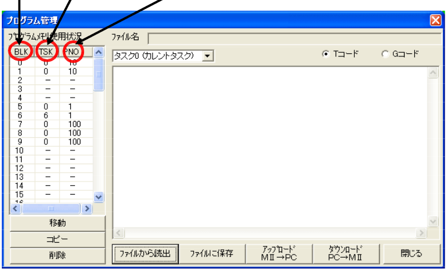

> **図の内容**
>
> 画面「プログラム管理」。プログラムメモリ使用状況の列見出し BLK、TSK、PNO が赤丸で囲まれ、矢印で指されている。BLK 0・1 は TSK 0・PNO 10、BLK 5・6 は TSK 0・6、PNO 1、BLK 7～9 は TSK 0・PNO 100、ほかは --（と読める）。ボタン: 移動、コピー、削除、ファイルから読出、ファイルに保存、アップロード MⅢ→PC、ダウンロード PC→MⅢ、閉じる。

画面の詳細は、「セッティングPCマニュアル」<5-2-5.プログラム管理画面>(TB00-0981)を参照して下さい。

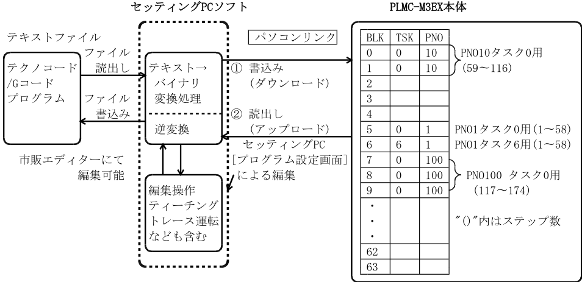

> **図の内容**
>
> - 「テキストファイル」（テクノコード/Gコードプログラム。市販エディターにて編集可能）を、セッティングPCソフトで ファイル読出し・ファイル書込み
> - セッティングPCソフト内: 「テキスト→バイナリ変換処理」と「逆変換」、「編集操作、ティーチング、トレース運転なども含む」
> - 「パソコンリンク」で PLMC-M3EX本体へ ① 書込み（ダウンロード）、② 読出し（アップロード）。セッティングPC［プログラム設定画面］による編集
> - PLMC-M3EX本体のブロック表（BLK、TSK、PNO）: BLK 0・1 = TSK 0・PNO 10「PNO10タスク0用 (59～116)」、BLK 5 = TSK 0・PNO 1「PNO1タスク0用 (1～58)」、BLK 6 = TSK 6・PNO 1「PNO1タスク6用 (1～58)」、BLK 7～9 = TSK 0・PNO 100「PNO100 タスク0用 (117～174)」。BLK は 0～63。"( )"内はステップ数

重要 FA-M3□ラダーからのダイナミックデータローディング


PCで作成したデータ(運転プログラム、パラメータなど)をFA-M3□に転送(CF又は通信)し保存しておき、その後でFA-M3□からI/Oオープンを経由してPLMC-M3EXへローディングすることもできます。

#### 6-1-1．運転プログラムの容量

運転プログラムの容量制限は、トータルで64ブロック（最大3720ステップ分）仮に、すべての運転プログラムが58ステップ以内であれば、64本の運転プログラムを記憶可能。 ※1 本あたりの最大プログラム容量は32ブロック（1860ステップ）です。

#### 6-1-2．運転プログラムの番号管理

PLMC-M3EXでは、運転プログラムをブロック番号、タスク番号、プログラム番号で管理しています。 1つの運転プログラムのステップ数に応じて複数の連続ブロックを使用できます。

運転プログラムのダウンロード時に、どのブロックを使用するか選択します。

(1) ブロック番号

運転プログラムをPLMC-M3EXに格納する場所(エリア/メモリ領域)です。

運転プログラムはブロック単位で管理し、1つの運転プログラムで複数の連続ブロックを使用可能です。ブロックは全てのタスク共通で最大64ブロックです。

1ブロックあたり58ステップのプログラムを格納する事ができ、58ステップ以上のプログラムをダウンロードする場合は、指定したブロック以降のブロックに順に格納されます。ただし、

1プログラムで使用できる最大ブロック数は32ブロックです。

(運転プログラム毎に任意の数のブロックを使用できます。SLM4000、PLMC-40のように最大の運転プログラムに合わせてプログラム領域を選択する必要はありません。)

- ※ ブロック番号は、プログラム管理(アップロード/ダウンロード/移動/削除/コピー)時のみ使用します。通常(プログラム実行時等)はタスク番号とプログラム番号で指定します。

(2) タスク番号

運転プログラムを実行できるタスクを選択します。指定されたタスク以外で実行する事はできません。

タスクはそれぞれ並列(非同期)に動作させる事ができます。

(3) プログラム番号

運転プログラムの先頭で「PNO__;」命令を使用して設定します。

ダウンロードしてある運転プログラムを、ラダーやPCソフトから選択して実行するために使用します。

同タスク内で同じプログラム番号のプログラムをダウンロードする事はできません。

(別タスクであれば同じプログラム番号でもダウンロードする事ができます。)

実行するプログラムは同タスクで1プログラムのみです。(同タスクで並列に実行できません。)

#### 6-1-3．ポイントテーブル

ポイントテーブルは、ポイント位置決め命令とポイント補間命令で使用します。

16w /ポイント × 400ポイント/タスク × 8タスクの容量があります。

ポイントテーブルは、SDRAM上なのでバックアップされません。

上位側で保存しておき、電源投入後にPLMC-M3EXに書き込みが必要です。

ポイントテーブルの詳細は「6-7-1(13)ポイントテーブル」、「7-3-4ポイント位置決め移動」、「7-3-5ポイント直線補間」を参照してください。

### 6-2．運転プログラムの事例

運転プログラムは、ユーザ殿にて作成していただくもので、文字形式という意味で「テキストプログラム」とも呼びます。

(1) 運転プログラム例・1

プログラム運転では、ステップの各軸の移動と、入/出力の制御を同時に制御できます。

軸の移動と出力信号の様子を示します。

- ① LIN X3000 Y2000 F1000 ONR0 OFR1
- ② PTP X3000 Y2000 WNR0 OFR0 ONR1

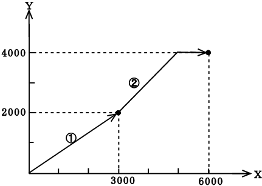

> **図の内容**
>
> X-Y 座標。① (0,0) から (3000, 2000) へ、② (3000, 2000) から (6000, 4000) へ。

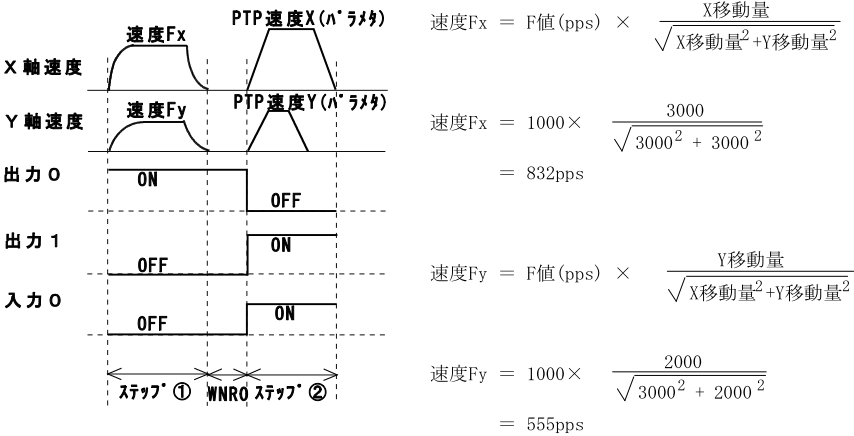

> **図の内容**
>
> - X軸速度: 速度Fx、PTP速度X(パラメタ)。Y軸速度: 速度Fy、PTP速度Y(パラメタ)
> - 出力0: ステップ① の間 ON、そのあと OFF。出力1: OFF からステップ② で ON。入力0: WNR0 で OFF → ON を待つ
> - 速度Fx = F値(pps) × X移動量 ／ √(X移動量² + Y移動量²) = 1000 × 3000 ／ √(3000² + 3000²) = 832pps
> - 速度Fy = F値(pps) × Y移動量 ／ √(X移動量² + Y移動量²) = 1000 × 2000 ／ √(3000² + 2000²) = 555pps

WNR0= R0入力がONするまで待つ

- ※ 本マニュアルでは速度単位 [パルス/秒] を [pps] と記述します。

[Kpps] = [1000パルス/秒]単位、 [Gpps] = [1000000パルス/秒]単位です。

(2) 運転プログラム例・2

テップNO. 各ステップ

- 1 PTPA X0 Y0；

どの位置にいても論理座標の(0,0)へ移動

- 2 PTPA X1000 Y500 WR01 ONR01；入力01が ONの間停止
- 3 TIM0.5；
- 4 CALL SUB1 JNR02；
- 5 PTPA X1500 Y1000 TIM1.0；
- 6 OFR05 OFR01；

OFFしたら、出力01をONして(1000,500)へ移動 0.5秒停止

入力02＝ONなら、SUB1をCALL。入力02=0FFなら何もせず次へ (1500,1000)へ移動し、トータル１秒となるまで停止

出力 05,01を OFF

- 7 END；

運転プログラム終了

:SUB1

サブルーチン名称ラベル(ｽﾃｯﾌﾟNO.は付きません)

- 8 CIRR X0

Y0 I100 J0 F1000；円弧動作(ﾌﾟﾘ解析処理により複数ｽﾃｯﾌﾟに分割されます)

n※1 END；

サブルーチンEND

※１円弧精度によりステップNO.は変わります。

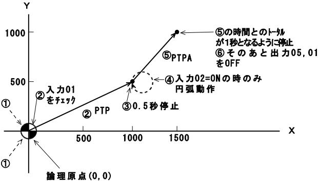

> **図の内容**
>
> 論理原点(0, 0) から: ① 論理原点、② 入力01 をチェックして PTP で (1000, 500) 付近へ、③ 0.5秒停止、④ 入力02=ONの時のみ 円弧動作、⑤ PTPA、⑤の時間とのトータルが1秒となるように停止、⑥ そのあと出力05, 01 をOFF。

1行の動作をステップと呼びます。

PLMC-M3EX内部では各行に、ステップNO.がつけられます。(プログラム編集時には付けません)

(3) 運転プログラム例・3

巻線機の「からげ動作」や組立・実装における「はめ込み動作」など、緻密で、なめらか、かつ高速な動作を要求される場合があります。

このような場合は、各軸の移動(速度)のタイミングチャートを作成して、プログラミングする方法を推奨します。

補間時定数の設定により、速度変化部分の丸み具合は変わります。

PTP X L1 LIN X L2 Y L4 F LIN X L3 Y L5 F パス動作によりステップ間は LIN Y L6 F なめらかに連続

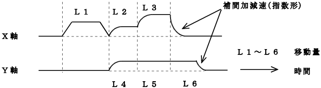

> **図の内容**
>
> X軸の速度 L1、L2、L3 と Y軸の速度 L4、L5、L6。補間加減速(指数形)で、各ステップの間で速度が止まらずにつながる。L1～L6 は移動量。横軸 時間。

### 6-3．自動運転におけるステップ動作

#### 6-3-1．自動運転

PLMC-M3EX内には、複数の運転プログラムを保存できます。

自動運転モードにおいて、運転プログラムのNO.を指定して起動することで、その運転プログラムの各ステップを順番に実行していきます。

- 停止の条件 a. 通常の停止

運転プログラム終了リセット入力

- b. 途中停止(再開可) ストップ入力
- c. ステップ間停止シングルでシングルステップモードにすると 1ステップ実行した所で停止します。 d. 強制終了汎用入力条件で、EXITが成立したとき。 ER□□ ENR□□
- e. アラーム停止

アラームが発生した時(停止＆サーボオフ)

#### 6-3-2．シングル運転(順行)

「自動運転モード」でシングルステップモードの時に、スタート入力するたびに、1ステップづつ実行します。

停止の条件は、連続運転と同様です。

#### 6-3-3．ステップ間停止

シングル運転で、1ステップを完了して停止している状態です。

逆行操作やティーチング操作は、ステップ間停止の時に可能です。

#### 6-3-4．ステップ途中停止

そのステップの途中で停止している状態です。

停止操作では、一般的にステップ途中停止になります。

#### 6-3-5．逆行(ステップ逆行) （開発中）

移動命令(PTP,LIN)に対しては、逆行動作が可能です。(他の命令ではできません)

※ □□は信号名称を表します。

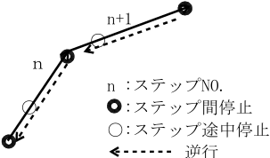

> **図の内容**
>
> n（ステップNO.）から n+1 へ進む経路。● : ステップ間停止、○ : ステップ途中停止、点線の矢印 : 逆行。

### 6-4．プリ解析処理(テキスト→バイナリ変換)

｢テクノコード｣｢Gコード｣とも運転プログラムは、PC側(PC通信ライブラリー)にて解析をおこない、中間言語レベルの特殊コードとなってPLMC-M3EXへローディングされます。

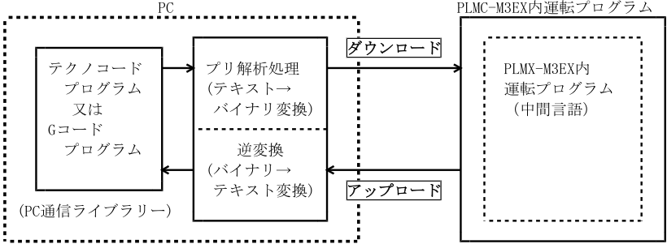

> **図の内容**
>
> PC（PC通信ライブラリー）の「テクノコードプログラム又はGコードプログラム」→「プリ解析処理（テキスト→バイナリ変換）」→ ダウンロード →「PLMC-M3EX内運転プログラム（中間言語）」。逆方向は アップロード →「逆変換（バイナリ→テキスト変換）」。

【プリ解析処理の機能と特徴】

- a. フォーマットエラーのチェック PLMC-M3EXへローディングする前に、運転プログラムの文法上のミスを発見します。

b. 中間言語(バイナリーコード) PLMC-M3EXの標準的なフォーマットに変換されます。

- への展開
- これにより、テクノコード/Gコード/他のコード各々の表現形式の違いは吸収されて、統一されます。
- c. プリ解加減速（開発中）直線補間や円弧補間に対して、加減速の指定ができます。
- d. 円弧補間の直線分解
- 円弧指令を、微少な直線指令の連続に展開します。
- e. 特殊指令への対応 (専用化対応)
- 円弧精度を指定することにより、分割の度合いが異なります。
- ※ 基本的に「プリ解析方式」(円弧補間の直線分解)を使用せず、

「ボード内部方式」を使用して下さい。 (プリ解析方式は旧機種との互換性のための機能です。) 詳細は、「セッティングPCマニュアル」<5-4-2.ポジション表示形式設定画面>(TB00-0981)の"円弧処理"を参照して下さい。

直線補間や円弧補間以外の指令方式に対しても、

比較的柔軟に対応できます。

f. PLMC-M3EX内部処理の負荷軽減 PLMC-M3EX内で処理しやすい形式に変換します。

【プリ解円弧補間の問題点】

プリ解析は、「プリ解円弧によるステップ数の増大」という問題点を持っています。詳細は、補足資料１を参照下さい。

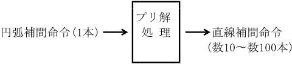

> **図の内容**
>
> 円弧補間命令(1本) →「プリ解処理」→ 直線補間命令（数10～数100本）

【解決する手段】

- a. 円弧精度を荒くする。

(1, 10, 100)

b. 円弧命令の使用を制限する。 PLMC-M3EXの運転プログラムステップ数に応じて使用する。

- c. DNC運転方式にする。

DNC方式では、メモリー容量の制限はありません。

- d. 内部円弧にする。

非常に有効な手段です。

PLMC-M3EX内で解析/実行します。

プリ解による直線補間への展開はありません。

欠点メモリー容量による制限

ローディング時間の増大

### 6-5．DNC(Direct NC)方式 <オプション>

DNC方式では、PC側で処理された運転プログラムをPLMC-M3EXへ転送しながら、

実動作をおこなう方式です。またセッティングPC上で現在実行しているプログラムのステップ番号を表示することができます。

PLMC-M3EX 内バッファーメモリー 64KB

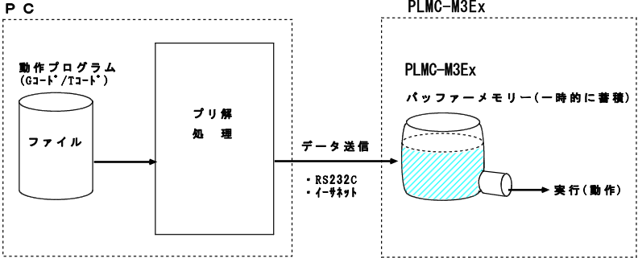

> **図の内容**
>
> PC の「動作プログラム（Gコード/Tコード）」ファイル →「プリ解処理」→ データ送信（・RS232C ・イーサネット）→ PLMC-M3Ex の「バッファーメモリー（一時的に蓄積）」→ 実行(動作)。

重要 FA-M3□ラダーからのダイナミックデータローディング

PCで作成したデータ(運転プログラム、パラメータなど)を FA-M3□に転送(CF又は通信)し保存しておき、その後で FA-M3□からI/Oオープンを経由してPLMC-M3EXへローディングすることもできます。この方法により、DNC運転も可能です。

【DNC方式の特徴】

- a. 運転プログラムのトータルのステップ数に制限はありません。
- b. PLMC-M3EX内のバッファーメモリーに蓄積しながら運転することにより、データ通信が瞬間的に止まったり、遅くなっても問題ありません。
- c. プリ解析、データ通信、実動作が同時進行することで、解析→実行までの待ち時間を最短にできます。
- d. 特にバス接続による超高速DNCは、金型や光学系の連続微小ブロック加工に最適です。

【DNC方式の注意点】

- a. DNCでは、以下の命令は使用出来ません。
2. ・サブルーチンコール命令(CALL)
3. ・ジャンプ命令(JMP)
4. ・分岐命令(IF、SWITCH)
5. ・ポイント位置決め(PTMA、LIMA)
- b. スタンドアロンのPLMC-M3EXにおいても、PCが常時必要となります。
- c. RS232C方式では、送信時間の影響から連続微小ステップの処理時間(ブロック処理時間)が 40〜50msec以上/ステップに制限されます。

PC環境、パソコンリンク使用状況、 FA-M3□のCPU形式などの条件に依りますが、4msec以上/ステップの

- 【イーサーネットによるDNCのパフォーマンス】連続補間を実現しています。

### 6-6．単独コマンド運転

PC側アプリケーション(パソコンリンク)や FA-M3□ラダーから、位置決め/補間命令/入出力命令などの単独コマンドを発行して動作させます。

画像処理と組み合わせたアライメント装置や、インプロセス計測による移動指令の修正などをおこなうシステムに有効な方法です。

単独コマンドとメモリ-運転やDNC運転を組み合わせれば、ユーザアプリにおいて、スケジュール機能が実現できます。

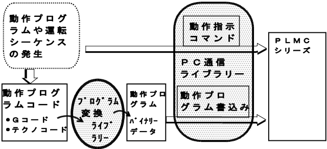

> **図の内容**
>
> - 「動作プログラムや運転シーケンスの発生」→「動作指示コマンド」→「PC通信ライブラリー」→「PLMCシリーズ」
> - 「動作プログラムコード（・Gコード ・テクノコード）」→「プログラム変換ライブラリー」→「動作プログラムバイナリーデータ」→「動作プログラム書込み」→ PLMCシリーズ


当社提供のライブラリーソフト

【PC通信ライブラリーの使用例】

［ユーザソフト］

［PLMC-M3EX］

- ●プログラム運転データ送信
- ■ 運転プログラム書込みプログラムNO.を指定して保存 DAT_PROGRAM
- 動作指示(コマンド) ■ 実行プログラム選択プログラムNO.を選択 REQ_PROGSLCT
- ■ プログラム実行開始運転スタート REQ_PROGSTRT
- ●コマンド運転動作指示(コマンド) ■ 原点復帰
- 原点復帰動作を実行
- REQ_ALLZRN
- ■ PTP位置決め位置決め動作(1軸〜9軸) REQ_PTPSTART


■ 補間指令

直線補間動作(1軸〜9軸)

- REQ_LINSTART ■ 出力直接制御指定された出力信号のON/OFF」 REQ_OUTPUT

※ コマンドは、通常「タスク指定」をします。


- ■ ポジションステータス読出し DAT_STATUS


各軸位置(指令、機械)、

その他内部ステータス

- ■ 入出力状態読出し DAT_IODATA 現在の全入出力信号のON/OFF情報


各コマンドの詳細は、「PLMC-M3EX 送受信データ説明書」(TB00-0984)を参照して下さい。

●状態監視

### 6-7．マルチタスク <オプション>

#### 6-7-1．マルチタスクの概要

PLMC-M3EXのマルチタスクは、最大8タスクが並列に対等に存在し、動作します。

SLM4000、PLMC40では、マスター/スレーブ/バックグランド/アラーム/リセット/EXIT など、各々の意味合いが異なるタスクです。

PLMC-M3EXとPLMC-MⅡEXは、その他のオープンモーションコントローラ(MC)とは、マルチタスクの基本的な考え方が異なりますのでご注意下さい。

(1) 最大8タスク

同時8タスクまで並列動作が可能です。上位（FA-M3□/PC）からそれぞれ起動できます。

(2) 物理軸

全タスクで最大16軸です。ROMSW設定ソフトにて、使用する物理軸を選択します。

詳細は、「ROMSW設定ソフトマニュアル」<4-4.軸設定パラメータ>(TB00-0982)を参照して下さい。

(3) 論理軸

タスク内では、最大9軸使用できます。

軸の論理アドレス名は、X, Y, Z, A, B, C, R, Q, T軸です。

各タスクの論理軸の選択(物理軸との関係)は、ROMSW設定ソフトで設定します。

同一の物理軸を複数のタスクで使用することはできません。

物理軸は、必ずいずれか1つのタスクに割り付ける必要があります。

詳細は、「ROMSW設定ソフトマニュアル」<4-4.軸設定パラメータ>(TB00-0982)を参照して下さい。

(4) 運転プログラム

テクノ言語やG言語で記述します。シングルタスク仕様とマルチタスク仕様で特別な差はありません。運転プログラムのダウンロード時に「タスク番号」と「P（プログラム）番号」を指定します。また、起動時も「タスク番号」と「P（プログラム）番号」を指定します。

詳細は、「PLMC-M3EX セッティングPCマニュアル」<5-2-5.プログラム管理画面>(TB00-0981)を参照ください。

(5) 運転プログラムの容量

運転プログラムの容量は、トータルで64ブロック（最大3720ステップ分）です。仮に、すべての運転プログラムが58ステップ以内であれば、64本の運転プログラムを記憶できます。

1本あたりの最大プログラム容量は32ブロック（1860ステップ）です。

(6) 運転プログラムの番号管理（P番号）

各運転プログラムには、論理的なプログラム番号を指定します。（一種の名称：P番号で指定）詳細は、<Ⅲ 機能編 6-1-2.運転プログラムの番号管理>(TB00-0980F)を参照下さい。

(7) タスク毎入力

以下の入力は、タスク毎にあります。

- ■運転プログラム起動 ■停止 ■リセット ■原点設定 ■原点復帰 ■オプショナルストップ
- ■外部アラーム入力A〜C ■リワインド ■電子カムサイクル(開発中)
- ■機械操作パネルの各入力（手動操作、オーバライドなど）

詳細は、<Ⅲ 機能編 2.入出力機能>(TB00-0980D)を参照下さい。

(8) タスク毎処理

タスク毎の入力は、タスク単位での処理になります。つまり、タスク停止入力で運転を停止させても、他のタスクは無関係に運転を続けます。アラームなども各々です。

(9) アラーム時の処理

タスク毎に停止と復旧が可能です。

補間動作は、補間加減速がかかって、減速停止します。位置決めは、即停止となります。タスク毎の停止のときは、他のタスクはそのまま運転可能です。

全タスクを停止したい場合は、ラダーからすべてのタスク毎アラーム入力をONさせてください。

(10) タスク毎の動作

動作モード(自動/手動など)もタスク毎です。

セッティングPC、機械パネルIFからの操作などもタスク毎です。

タスク毎のシングルステップ、オーバライド、ティーチングも可能です。

(11) セッティングPCソフト

画面や操作は、タスク毎です。従ってポジション表示なども9軸表示です。詳細は、「セッティングPCマニュアル」(TB00-0981)を参照して下さい。

(12) 通信コマンド運転

共通とタスク指定のコマンドがあります。

詳細は、「PLMC-M3EX 送受信データ説明書」(TB00-0984)を参照して下さい。

(13) ポイントテーブル(ポイント位置決め)

ポイントテーブルは、ポイント位置決め命令(PTMA)とポイント補間命令(LIMA)で使用します。タスク内に1組(共通) 400ポイント/タスク ×8組

ポイントテーブル変更コマンド(1ポイントずつの読み出し、変更)があります。

ポイントテーブルの一括読み出し/書き込みも可能です。

16w(1ポイント)×400ポイント×8タスク

- ※ ポイントテーブルは、SDRAM上なのでバックアップされません。

上位側で保存しておき、電源投入後にPLMC-M3EXに書き込みが必要です。

(14) マクロ変数

グローバルマクロ変数：全タスクで共通に使用する変数。

（100w）

ローカルマクロ変数：タスク毎にローカルに使用できる変数。（100w×8タスク）

ラダー共有マクロ変数：上位（FA-M3）から直接読み書きできる変数。（読込100w、書込100w）

詳細は、<Ⅲ 機能編 7-4.マクロ機能>(TB00-0980F)を参照して下さい。

(15) その他のタスク毎のデータ

サーボパラメータ

工具長補正テーブル

工具長補正値

工具径補正テーブル

ポジションデータ

センサーラッチポジションデータ(論理座標系/機械座標系)

軸インターロック

軸ネグレクト

詳細は、<Ⅲ 機能編 7-4-2.レジスタ一覧>(TB00-0980F)を参照して下さい。

補足資料1. 円弧プリ解析処理(ステップ数／処理時間)

・ステップ数(変換後の直線ステップ数)。

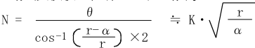

> **図の内容**
>
> N ＝ θ ／ (cos⁻¹((r − α) ／ r) × 2) ≒ K・√(r ／ α)

θ: 円弧の移動角度[rad]

r : 円弧の半径 [pulse]

α: 円弧の精度 [pulse]

・ステップ数の概算手法

r ｒ=10000、 α=10 の時 N=72 (１円周の時) α Nはrのルートに比例し、αのルートに反比例する

rが半分(1/2)の時、N=72 × = 51 αが5倍の時、 N=72 × = 33 1 2 1 5

・実際の変換とその所要時間

|    ｒ α | ｒ α   | 2 パルス    | 5 パルス    | 10 パルス   |
|--------|-------|----------|----------|----------|
|  10000 | ステップ数 | 159      | 101      | 72       |
|  10000 | 処理時間  | 0.79msec | 0.54msec | 0.39msec |
|  50000 | ステップ数 | 353      | 224      | 159      |
|  50000 | 処理時間  | 1.60msec | 1.04msec | 0.78msec |
| 100000 | ステップ数 | 498      | 316      | 224      |
| 100000 | 処理時間  | 2.25msec | 1.42msec | 1.04msec |

θ= 360゜ (１周円)

処理時間 (msec)

・PC-AT AMD DURON/ 1GHZA

- ※ 上記は一周円の場合なので、半円ではこの半分、1/4円では1/4 となります。

補足資料2. プリ解円弧精度と送り速度上限値の関係

円弧補間において、その半径とプリ解円弧精度の指定によって送り速度の上限値が決まります。（次式）

送り速度上限値[pps] = 2 × r × sin cos -1 × r-α r 1000 RTC

r :円弧の半径[pulse]

α :円弧の精度[pulse]

RTC :制御周期 [msec]

プリ解円弧精度と半径による飽和速度[Kpps]の関係表-1

（制御周期8msec時）

|   円弧精度 |   半径 - 1000 |   半径 - 2000 |   半径 - 5000 |   半径 - 10000 |   半径 - 20000 |
|---------|--------------|--------------|--------------|---------------|---------------|
|       1 |         11.2 |         15.8 |         25.0 |          35.4 |          50.0 |
|       2 |         15.8 |         22.4 |         35.4 |          50.0 |          70.7 |
|       3 |         19.4 |         27.4 |         43.3 |          61.2 |          86.6 |
|       4 |         22.3 |         31.6 |         50.0 |          70.7 |         100.0 |
|       5 |         25.0 |         35.3 |         55.9 |          79.0 |         111.8 |
|       6 |         27.3 |         38.7 |         61.2 |          86.6 |         122.5 |
|       7 |         29.5 |         41.8 |         66.1 |          93.5 |         132.3 |
|       8 |         31.6 |         44.7 |         70.7 |         100.0 |         141.4 |
|       9 |         33.5 |         47.4 |         75.0 |         106.0 |         150.0 |
|      10 |         35.3 |         49.9 |         79.0 |         111.8 |         158.1 |

プリ解円弧精度と半径による飽和速度[Kpps]の関係表-2 （制御周期8msec時）

|   円弧 - 精度 |   半径 - 1000 |   半径 - 2000 |   半径 - 5000 |   半径 - 10000 |   半径 - 20000 |
|-----------|--------------|--------------|--------------|---------------|---------------|
|        10 |         35.3 |         49.9 |         79.0 |         111.8 |         158.1 |
|        20 |         49.7 |         70.5 |        111.7 |         158.0 |         223.6 |
|        30 |         60.8 |         86.3 |        136.7 |         193.5 |         273.8 |
|        40 |         70.0 |         99.5 |        157.8 |         223.4 |         316.1 |
|        50 |         78.1 |        111.1 |        176.3 |         249.7 |         353.3 |
|        60 |         85.3 |        121.6 |        193.1 |         273.5 |         387.0 |
|        70 |         91.9 |        131.1 |        208.4 |         295.3 |         418.0 |
|        80 |         98.0 |        140.0 |        222.7 |         315.6 |         446.8 |
|        90 |        103.7 |        148.3 |        236.1 |         334.7 |         473.8 |
|       100 |        109.0 |        156.1 |        248.7 |         352.7 |         499.4 |

## 7.運転プログラム詳細

運転プログラムはテクノコードとGコードの2種類のコードに対応しています。「7-1」でテクノコードの説明、「7-2」でGコードを説明します。

### 7-1．テクノコード運転プログラム命令

テクノコード指令一覧

| 指令グループ   | 指令          | 名称                     | 付加データ                                                           | 章番号       |                     |
|-----------|-------------|------------------------|-----------------------------------------------------------------|-----------|---------------------|
| a ア       | PTP         | インクレ位置決め               | 軸指定(インクレ量)、OVR:オーバーライド                                          |           | 7-1-4-1．            |
| Gr1 a ア   | PTPA        | 論理座標系アブソ位置決め          | 軸指定(論理座標)、 OVR:オーバーライド                                          |           | 7-1-4-1．            |
| a ア       | PTPB        | 機械座標系アブソ位置決め          | 軸指定(機械座標)、 OVR:オーバーライド                                          |           | 7-1-4-1．            |
| a ア       | LIN         | インクレ直線補間               | 軸指定(ｲﾝｸﾚ量)、 F:送り速度                                              |           | 7-1-4-2．            |
| a ア       | LINA        | 論理座標系アブソ直線補間          | 軸指定(論理座標)、F:送り速度                                                |           | 7-1-4-2．            |
| a ア       | LINB        | 機械座標系アブソ直線補間          | 軸指定(機械座標)、F:送り速度                                                |           | 7-1-4-2．            |
| a ア       | CIRR        | インクレ円弧補間（CW:右回り）      | 軸指定(ｲﾝｸﾚ量)：2軸〜3軸指定します中心指定：中心座標を指定した2軸で円弧補間                     |           | 7-1-4-3．            |
| a ア       | CIRL        | インクレ円弧補間（CCW:左回り）     | 半径指定：平面指定した2軸で円弧補間 3点指定：通過点を指定した2軸で円弧補間 3軸目を指定すると円弧に同期し移動（ヘリカル) |           | 7-1-4-3．            |
| a ア       | CIRRA ※1    | 論理座標系アブソ円弧補間（CW:右回り） | 軸指定(アブソ量)：2軸〜3軸指定します。中心指定：中心座標を指定した2軸で円弧補間                     |           | 7-1-4-3．            |
| a ア       | CIRLA ※1    | 論理座標系アブソ円弧補間（CCW:左回り） | 半径指定：平面指定した2軸で円弧補間 3点指定：通過点を指定した2軸で円弧補間                         |           | 7-1-4-3．            |
| a ア       | PTMA        | ポイント位置決め               | 3軸目を指定すると円弧に同期し移動（ヘリカル) P:ポイント番号 OVR：オーバーライド                    | 〈OP〉      | 7-1-4-4．            |
| a ア       | LIMA        | ポイント直線補間               | P:ポイント番号、F:送り速度                                                 | 〈OP〉      | 7-1-4-5．            |
| a ア       | SLIN        | センサーラッチ直線補間 (スキップ有り)   | 軸指令(ｲﾝｸﾚ量)、F:送り速度                                               | 〈OP〉      | 7-1-4-6．            |
| a ア       | SLINC       | センサーラッチ直線補間 (スキップ無し)   | 軸指令(ｲﾝｸﾚ量)、F:送り速度                                               | 〈OP〉      | 7-1-4-6．            |
| a ア       | AXMV        | インクレ独立位置決め             | 軸指定（インクレ量）F:送り速度                                                |           | 7-1-4-7．            |
| a ア       | AXMVA       | 論理座標独立位置決め             | 軸指定（論理座標） F:送り速度                                                |           | 7-1-4-7．            |
| a ア       | AXMVB       | 機械座標独立位置決め             | 軸指定（機械座標） F:送り速度                                                |           | 7-1-4-7．            |
| c         | AXWT        | 独立位置決め完了待ち             | 軸指定：軸アドレス、またはマクロ変数軸アドレスの場合スペースで区切って指定しますマクロ変数の場合、軸フラグで指定      |           | 7-1-6-1．            |
| a ア       | TRQ         | トルク制御開始                | サーボにトルク値を指令                                                     | 〈OP〉      | 7-1-4-8．            |
| c         | TRQD        | トルク制御終了                | サーボを位置モードに戻す                                                    | 〈OP〉      | 7-1-6-8．            |
| a ア       | REEL        | 巻線命令                   | 巻線動作の専用命令。詳細は"7-3-7"                                            | 参照〈OP〉    | 7-1-4-9．            |
| a イ       | TURN        | 接線制御                   | 接線制御用刃先回転。詳細は"5-15-5"参照〈OP〉                                     |           | 7-1-4-10．           |
| a イ       | SPIN        | 無限回軸軸回転動作              | 軸指定(回転数：0.1rpm)                                                 |           | 7-1-4-11．           |
| a イ a イ   | THSET THOFF | 工具長補正有効工具長補正キャンセル     | 補正テーブル番号                                                        | 〈OP〉※2    | 7-1-4-12． 7-1-4-13． |
| a イ       | TRESET      | 別タスクリセット               | タスク番号                                                           | 〈OP〉      | 7-1-4-16．           |
| a イ       | TSTART      | 別タスクプログラム起動            |                                                                 | 〈OP〉※2    |                     |
| a イ       | TSTOP       | 別タスク停止                 | タスク番号、Pプログラム番号タスク番号                                            | 〈OP〉 〈OP〉 | 7-1-4-14． 7-1-4-15． |
|           | SVON        | 各軸サーボON                | 軸指定：軸アドレスをスペースで区切って指定                                           |           | 7-1-4-18．           |
| a イ a イ   | SVOFF       | 各軸サーボOFF               | 軸指定：軸アドレスをスペースで区切って指定                                           |           | 7-1-4-19．           |
| a イ       | PRB         | 別タスクプログラム起動            | T:タスク番号、P:プログラム番号                                               | 〈OP〉      | 7-1-4-17．           |
|           |             |                        | ラベル、L:回数                                                        |           |                     |
| b ア       | CALL        | サブルーチンコール              |                                                                 |           | 7-1-5-1．            |
| b ア       | JMP         | ジャンプ                   | ラベル                                                             |           | 7-1-5-2．            |
|           |             |                        |                                                                 | 〈OP〉      |                     |
| b ア b ア   | IF ELSE     | 条件判断 ※3                | 計算文                                                             |           | 7-1-5-4． 7-1-5-4．   |
| b ア       | ENDIF       | ※3                     |                                                                 |           | 7-1-5-4．            |
| b ア       | SWITCH      | SWITCH命令(条件分岐)         | 計算式                                                             | 〈OP〉      | 7-1-5-5．            |
| b ア       | CASE        |                        | 分岐条件                                                            |           | 7-1-5-5．            |
| b ア       | ENDSWIT     |                        |                                                                 |           | 7-1-5-5．            |
|           | CH          |                        |                                                                 |           |                     |
|           | BREAK       |                        |                                                                 |           | 7-1-5-5．            |
| b ア       |             |                        |                                                                 |           | 7-1-5-5．            |

〈OP〉：オプション

| b ア    | DEFAULT           |             |                                                                                        |                   |
|--------|-------------------|-------------|----------------------------------------------------------------------------------------|-------------------|
| STNE   | #1000=0 等         | マクロ演算       | 計算文                                                                                    | 7-1-5-3．          |
| c      |                   | 接線制御有効      | 詳細は"5-15-5."を参照。 〈OP〉                                                                  | 7-1-6-2．          |
| c STND |                   | 接線制御無効      | 詳細は"5-15-5."を参照。 〈OP〉                                                                  | 7-1-6-3．          |
| c CSET |                   | 論理座標セットアップ  | 軸指定(論理座標)                                                                              | 7-1-6-4．          |
| c      | END               | プログラム終了     | -                                                                                      | 7-1-6-5．          |
| c      | INPE              | インポズチェック有効  | 詳細は"5-9."を参照。                                                                          | 7-1-6-6．          |
| c      | INPD              | インポズチェック無効  | 詳細は"5-9."を参照。                                                                          | 7-1-6-7．          |
| Gr2    | TIM TM            | タイマー        | 数値:0.1秒単位数値:RTC周期単位                                                                   | 7-1-7-1． 7-1-7-2． |
| Gr3    | ONT               | 汎用出力ON      | 数値(0〜63):出力BIT指定                                                                       | 7-1-8-1．          |
|        | OFR               | 汎用出力OFF     | 数値(0〜63):出力BIT指定                                                                       | 7-1-8-2．          |
|        | □□R なし /N E､J､W､S | 汎用入力制御      | 数値(0〜63):入力BIT指定 E:EXIT (強制終了) J:スキップ (ステップ途中終了による飛はし) W:ウェイト (待ち) S:ストップ (停止) N:負論理指定 | 7-1-8-3．          |
| Gr4    | MOUT              | Mコード出力      | 数値(0〜255)                                                                              | 7-1-9-1．          |
| Gr5    | DC                | 径補正キャンセル    | - 〈OP〉                                                                                 | 7-1-10-2．         |
|        | DL                | 径補正方向指定(左側) | 径補正テーブル番号(0〜19) 〈OP〉                                                                   | 7-1-10-1．         |
|        | DR                | 径補正方向指定(右側) | 径補正テーブル番号(0〜19) 〈OP〉                                                                   | 7-1-10-1．         |
| -      | PNO               | プログラム番号     | 数値(1〜32767)プログラムの先頭で指定して下さい。                                                          | 7-1-11-1．         |
| -      | :                 | ラベル定義       | 最大13文字の文字列                                                                             | 7-1-11-2．         |
| -      | /*･･･*/           | コメント        | "/*" + 文字列 + "*/"                                                                      | 7-1-11-3．         |

- グループ1〜5(Gr1〜5)の命令は、1ステップ(1行)内で複数の指定が可能です。(単独での指定も可能です)ただし、同一グループの命令を複数指定する事はできません。

※ グループ3(Gr3)のみ、最大4つまで指定可能です。

- グループ2/3の命令を指定した場合は、同一ステップで指定したグループ１の命令に応じて動作が変わります。
- ○グループ1(Gr1)指定なし

指定通り実行

- ○グループ1(Gr1)指定あり

a：指定通り実行(グループ2(Gr2)/グループ3(Gr3)を実行)

ア：グループ2(Gr2)/グループ3(Gr3)の命令がグループ1(Gr1)命令よりも先に実行

イ：グループ1命令がグループ2(Gr2)/グループ3(Gr3)の命令よりも先に実行

b：グループ2(Gr2)の"TIM/TM"、グループ3(Gr3)の"ER/ENR、SR/SNR"命令を無視

c：全て無視(グループ2(Gr2)/グループ3(Gr3)を無視)

- グループ4はPTP(A/B)、LIN(A/B)と同じステップで指定可能です。
- ※１プリ解円弧方式では不可。
- ※２座標の補正は、汎用入力にかかわらず、必ず実行されます。汎用入力制御は摩耗補正時の軸移動にだけききます。

- ※３「IF」命令のTRUEを実行した場合：「ENDIF」命令と同時指定のグループ2(Gr2)/3(Gr3)命令は無視「IF」命令のFALSEを実行した場合：「ELSE」命令と同時指定のグループ2(Gr2)/3(Gr3)命令は無視

#### 7-1-1．運転プログラム例

PNO1;

PTPA X0 Y0 Z0 A0 TIM0.5 WR01 ONR02 ONR12 OFR14;

CALL SUBPROC;

TIM1.0;

PTPA X100 Y100 Z100 A100 TIM0.5 JR15 WR00 ONR02 OFR10;

CALL SUBPROC;

TIM1.0;

CIRR X400 Y0 Z100 I200 J0 F1000;

END;

:SUBPROC

PTP X100 Y-100 Z100 A-100; PTP X-100 Y100 Z-100 A100 TIM0.5;

LIN X1500 Y2000 Z2500 A3000 F1000; END;

運転プログラムのサンプルを別資料で紹介します。

「サンプル運転プログラム説明書」(TB04-0422)を参照して下さい。この資料は、テクノHPの会員コーナからダウンロードできます。

#### 7-1-2．付加データ

付加データには、以下の3種類があります。

##### 7-1-2-1．付加データアドレス付き数値指定

付加データアドレス付き数値指定は、1つの指令に対して、複数の付加データが必要な指令に対して使用されます。

```c
    アドレス 内容 説明
    X 第1軸移動量・移動位置指定
    Y 第2軸移動量・移動位置指定 PLMC-M3EXが制御する軸に対する、
    Z 第3軸移動量・移動位置指定 移動量・移動位置の指定です。
    A 第4軸移動量・移動位置指定 使用例 PTPA X30000 B-2500 Q600;
    B 第5軸移動量・移動位置指定 LIN X255 B-500 Q200 F3000;
    C 第6軸移動量・移動位置指定
    R 第7軸移動量・移動位置指定
    Q 第8軸移動量・移動位置指定
    T 第9軸移動量・移動位置指定
    I 第1軸円弧中心座標指定
    J 第2軸円弧中心座標指定 円弧補間指令での中心位置指定です。
    K 第3軸円弧中心座標指定 （現在位置からのインクレ量）
    D 第4軸円弧中心座標指定 使用例 CIRR Y2000 Z0 J1000 K0 F2500;
    E 第5軸円弧中心座標指定
    H 第6軸円弧中心座標指定
    Y 第7軸円弧中心座標指定
    V 第8軸円弧中心座標指定
    W 第9軸円弧中心座標指定
    TX 第1軸円弧通過点座標指定
    TY 第2軸円弧通過点座標指定 円弧補間指令での円弧の通過位置指定です。
    TZ 第3軸円弧通過点座標指定 （終点座標指定似合わせたインクレ/アブソ指定に
    TA 第4軸円弧通過点座標指定 なります）
    TB 第5軸円弧通過点座標指定 使用例 CIRLA R5000 Q0 TR2500 TQ-3000 F1500;
    TC 第6軸円弧通過点座標指定
    TR 第7軸円弧通過点座標指定
    TQ 第8軸円弧通過点座標指定
    TT 第9軸円弧通過点座標指定
    OVR オーバーライド指定 サーボパラメータ「PTP速度」に対するオーバーライド
    を指定します。
    F 速度指定 補間移動時の速度を指定します。
    P ポイント番号 PTMA/LIMAで使用するポイントの番号を指定します。
    T□START/G198のプログラム番号 起動するプログラム番号を指定します。
    T PRGのタスク番号 どのタスクのプログラムを起動するか指定します。
    FL プリ解加減速時の目標速度 減速時の目標速度を指定します。 開発中
    L 回数指定 繰り返し回数を指定します。
    CR 円弧半径指定 円弧補間指令での円弧半径指定です。
    使用例 CIRL PRQ R-2000 Q300 R-1500 Z150 F800;
    PＸＹ 円弧補間平面指定 半径指定の円弧補間指令での円弧補間をおこなう軸の
    指定です。
    Ｘ = 円弧の第１軸(横軸) Ｙ = 円弧の第２軸(縦軸)
```

※ □はタスク番号 0〜7 を表します。

##### 7-1-2-2．数値指定

数値指定は、TIM指令のように、指令と付加データが1:1であるような指令に対して使用されます。

##### 7-1-2-3．ラベル指定

ラベル指定は、CALL指令にて使用されるもので、プログラム中に設定されているラベル文字列を指定するものです。

ラベルは、プログラムステップに対応するものとして、設定する事ができるもので、最大13文字の文字列です。

#### 7-1-3．指令フォーマット

Gr1指令コード付加データ１付加データ２・・・・

・・・ Gr2指令コード Gr3指令コード Gr4指令コード Gr5指令コード；

セミコロン(3BH)

- 各項目はスペースコードまたはタブコードで分離してください。
- 付加データは命令コードの後に付けてください。
- 行の最後は";"（セミコロンコード）を付けてください。
- 次の行への移行はラインフィードコード（= ニューラインコード）(= '0x0a')で判別します。

フォーマットの詳細や、サンプル運転プログラムは、

「サンプル運転プログラム説明書」(TB04-0422)を参照して下さい。テクノHPの会員コーナからダウンロードできます。

##### 7-1-3-1．指令の表記例

インクレPTP移動指令の例で説明します。

PTP (X＿ Y＿ Z＿ A＿ B＿ C＿ R＿ Q＿ T＿)[OVR＿];

↑

↑

指令コードアドレスと付加データ

- ( ) この中から1つ以上を選択する必要があります。

- [ ] { } この中から1つだけ選択する必要があります。

- [ ] 省略できます。＿指令値です。(即値ですが、マクロ変数が可能な指令値もあります。)

以降の詳細説明でも( ){ }[ ]_ は同様です。

付加データと次の軸アドレスの間には、スペースコードが必要です。

##### 7-1-3-2．「軸単位」と「速度単位」

(1)軸単位 (以降の詳細説明でも"軸単位"と記述します)

各軸の移動量や移動位置を指定する単位です。

- ■小数点なしの表記:パルス単位です。
- ■小数点つきの表記:セッティングPCの「ポジション表示形式設定」の各軸の「パルス/表示」の設定で以下のようになります。

スペース(20H)又はタブ(08H)

|   パルス/表示 |   1パルスの小数点つき表記 |
|----------|----------------|
|        1 |              1 |
|       10 |            0.1 |
|      100 |           0.01 |
|     1000 |          0.001 |
|    10000 |         0.0001 |
|   100000 |        0.00001 |

例えば、X軸のパルス/表示に1000と指定して、指令でX1.0と指定すると「X1000」と認識されます。

(2)速度単位 (以降の詳細説明でも"速度単位"と記述します)

速度指定「F」の単位は、セッティングPCの「ポジション表示形式設定」の「補間送り速度単位」で設定します。

F1=(1,10,100,1000,10000)P/(秒/分)

選択

選択

|   補間送り速度単位 | F1 の意味     | パルス/ の選択        |
|------------|------------|-----------------|
|          1 | 1=1P       | パルス/秒とパルス/分の選択 |
|         10 | 0.1=1P     | パルス/秒とパルス/分の選択 |
|        100 | 0.01=1P    | パルス/秒とパルス/分の選択 |
|       1000 | 0.001=1P   | パルス/秒とパルス/分の選択 |
|      10000 | 0.0001=1P  | パルス/秒とパルス/分の選択 |
|     100000 | 0.00001=1P | パルス/秒とパルス/分の選択 |

- 例 1P = 1μm のシステムで速度単位を mm/secとする場合補間送り速度単位 = 1000 パルス/秒を選択

F1 = 1000/秒 (1000p/秒 = 1mm/秒)

- 1P = 0.1μm のシステムで速度単位を mm/分とする場合補間送り速度単位 = 10000 パルス/分を選択 F1 = 10000/分 (10000p/分 = 1mm/分)

##### 7-1-3-3．「軸範囲」と「速度範囲」

(1)軸範囲

軸の移動量や位置で指定できる数値の範囲です。±1000000000(パルス)の範囲です。以降の説明でも"軸範囲"と記述します。

(2)速度範囲

指定できる速度の範囲です。1pps〜1Gppsです。以降の説明でも"速度範囲"と記述します。

7-1-4-1．PTP : インクレPTP移動指令

PTPA : 論理座標上の位置へのPTP移動指令

PTPB : 機械座標上の位置へのPTP移動指令

【書式】

PTP (X＿ Y＿ Z＿ A＿ B＿ C＿ R＿ Q＿ T＿)[OVR＿];

PTPA (X＿ Y＿ Z＿ A＿ B＿ C＿ R＿ Q＿ T＿)[OVR＿];

PTPB (X＿ Y＿ Z＿ A＿ B＿ C＿ R＿ Q＿ T＿)[OVR＿];

| アドレス   | 内容          | 内容        | 範囲    |   省略時 | 単位   |
|--------|-------------|-----------|-------|-------|------|
| X      | X軸の移動量/目標位置 | ※マクロ変数指定可 | 軸範囲   |       | 軸単位  |
| Y      | Y軸の移動量/目標位置 | ※マクロ変数指定可 | 軸範囲   |       | 軸単位  |
| Z      | Z軸の移動量/目標位置 | ※マクロ変数指定可 | 軸範囲   |       | 軸単位  |
| A      | A軸の移動量/目標位置 | ※マクロ変数指定可 | 軸範囲   |       | 軸単位  |
| ・      | ・           |           | 軸範囲   |       | 軸単位  |
| ・      | ・           |           | 軸範囲   |       | 軸単位  |
| T      | T軸の移動量/目標位置 | ※マクロ変数指定可 | 軸範囲   |       | 軸単位  |
| OVR    | オーバライド値     |           | 1〜200 |   100 | %    |

【グループ】

Gr1a

【機能】

目標位置に向かって位置決めします。

早送り速度、加減速はサーボパラメータにより、各軸独立に設定します。

オーバライド［OVR］指令は省略できます。省略されたときは100%が指令されたものとします。

※操作パネルやPCコマンドによるオーバライド指定は、さらにこれに乗じます。

PTP : 現在位置からの移動量を指定します。

PTPA : 論理座標上の目標位置を指定します。

PTPB : 機械座標上の目標位置を指定します。

動作詳細については、以下を参照して下さい。

- <5-5.PTP制御(位置決め)>(TB00-0980E)
- 「サンプル運転プログラム説明書」<2.インクレ位置決め命令>(TB04-0422)
- 「サンプル運転プログラム説明書」<3.アブソ位置決め命令>(TB04-0422)

【記述例】

PTP X100 Z-10 OVR150;

PTPB A10000 Q-2000;

7-1-4-2．LIN : インクレ直線補間移動指令

LINA : 論理座標上の位置への直線補間移動指令

LINB : 機械座標上の位置への直線補間移動指令

【書式】

LIN (X＿ Y＿ Z＿ A＿ B＿ C＿ R＿ Q＿ T＿) [F＿];

LINA (X＿ Y＿ Z＿ A＿ B＿ C＿ R＿ Q＿ T＿) [F＿];

LINB (X＿ Y＿ Z＿ A＿ B＿ C＿ R＿ Q＿ T＿) [F＿];

| アドレス   | 内容          | 内容        | 範囲   | 省略時単位     |
|--------|-------------|-----------|------|------------|
| X      | X軸の移動量/目標位置 | ※マクロ変数指定可 | 軸範囲  | 軸単位        |
| Y      | Y軸の移動量/目標位置 | ※マクロ変数指定可 | 軸範囲  | 軸単位        |
| Z      | Z軸の移動量/目標位置 | ※マクロ変数指定可 | 軸範囲  | 軸単位        |
| A      | A軸の移動量/目標位置 | ※マクロ変数指定可 | 軸範囲  | 軸単位        |
| ・      | ・           |           | 軸範囲  | 軸単位        |
| ・      | ・           |           | 軸範囲  | 軸単位        |
| T      | T軸の移動量/目標位置 | ※マクロ変数指定可 | 軸範囲  | 軸単位        |
| F      | 補間移動速度      | ※マクロ変数指定可 | 速度範囲 | モーダル値速度単位 |

【グループ】

Gr1a

【機能】

目標位置に向かって直線補間で移動します。補間速度(F)の設定範囲は1〜100000000です。単位は、[pulse/sec]、[mm/min]などが指定可能です。詳細は、「セッティングPCマニュアル」 <5-4-2. ポジション表示形式設定画面>(TB00-0981)を参照して下さい。

補間速度は移動軸すべての合成速度です。

LIN : インクレ直線補間

LINA : 論理座標系アブソ直線補間

LINB : 機械座標系アブソ直線補間

【記述例】

LIN X100 Y-1000 F1500; LINA X100 Y-1000 F1500;

動作詳細については、以下を参照して下さい。

- <5-6.直線補間>(TB00-0980E)
- 「サンプル運転プログラム説明書」<1.インクレ直線補間命令>(TB04-0422)

7-1-4-3．CIRR : インクレ円弧補間(ヘリカル)時計方向回り（CW）

CIRL : インクレ円弧補間(ヘリカル)反時計方向回り（CCW）

CIRRA : 論理座標系アブソ円弧補間(ヘリカル)時計方向回り（CW）

CIRLA : 論理座標系アブソ円弧補間(ヘリカル)反時計方向回り（CCW）

円弧指令には半径指定する半径指定方式と中心座標を指定する中心指定方式と通過点指定の3点指定方式の3種類の命令形が有ります。

【書式】

【書式】
  
半径指定方式円弧の半径と終点を指定（半径指定では円弧平面指定が必要です）
  
CIRR
  
CIRL P□□ (X＿ Y＿ Z＿ A＿ B＿ C＿ R＿ Q＿ T＿)
  
CIRRA CR＿ [L＿]F＿;
  
CIRLA
  
中心指定方式円弧の中心と終点を指定
  
CIRR
  
CIRL (X＿ Y＿ Z＿ A＿ B＿ C＿ R＿ Q＿ T＿)
  
CIRRA {I＿ J＿ K＿ D＿ E＿ H＿ U＿ V＿ W＿} [L＿] F＿ ;
  
CIRLA
  
3点指定方式円弧の通過点と終点を指定
  
CIRR
  
CIRL (X＿ Y＿ Z＿ A＿ B＿ C＿ R＿ Q＿ T＿)
  
CIRRA {TX＿ TY＿ TZ＿ TA＿ TB＿ TC＿ TR＿ TQ＿ TT＿} [L＿] F＿ ;
  
CIRLA

| アドレス   | 内容                                                                                         |                                                                                            | 範囲     | 省略時     | 単位   |
|--------|--------------------------------------------------------------------------------------------|--------------------------------------------------------------------------------------------|--------|---------|------|
| X      | X軸の移動量/目標位置                                                                                | ※マクロ変数指定可                                                                                  |        |         |      |
| Y      | Y軸の移動量/目標位置                                                                                | ※マクロ変数指定可                                                                                  | 軸範囲    | -       | 軸単位  |
| Z      | Z軸の移動量/目標位置                                                                                | ※マクロ変数指定可                                                                                  | 軸範囲    | -       | 軸単位  |
| ・      | ・                                                                                          |                                                                                            | 軸範囲    | -       | 軸単位  |
| ・      | ・                                                                                          |                                                                                            | 軸範囲    | -       | 軸単位  |
| T      | T軸の移動量/目標位置                                                                                | ※マクロ変数指定可                                                                                  | 軸範囲    | -       | 軸単位  |
| L      | 多回転指令                                                                                      | ※マクロ変数指定可                                                                                  | 1〜5000 | L1      | 回転数  |
| F      | 補間移動速度                                                                                     | ※マクロ変数指定可                                                                                  | 速度範囲   | [モーダル値] | 速度単位 |
| P□□    | 円弧平面指定 P□□ 円弧の第1軸(横軸) 円弧の第2軸(縦軸) ※「第1軸の論理軸番号」<「第2軸の論理軸番号」としてください。ただし、XZ平面のみ例外でXZ/ZXのどちらも | 円弧平面指定 P□□ 円弧の第1軸(横軸) 円弧の第2軸(縦軸) ※「第1軸の論理軸番号」<「第2軸の論理軸番号」としてください。ただし、XZ平面のみ例外でXZ/ZXのどちらも | -      | ×       | -    |
| CR     | 指定可能です。円弧半径指定                                                                             | ※マクロ変数指定可                                                                                  | 軸範囲    |         | 軸単位  |
| I      | X軸中心座標                                                                                     | ※マクロ変数指定可                                                                                  | 軸範囲    |         |      |
| J      | Y軸中心座標                                                                                     | ※マクロ変数指定可                                                                                  | 軸範囲    | -       | 軸単位  |
| K      | Z軸中心座標                                                                                     | ※マクロ変数指定可                                                                                  | 軸範囲    |         |      |
| D      | A軸中心座標                                                                                     | ※マクロ変数指定可                                                                                  | 軸範囲    |         |      |
| E      | B軸中心座標                                                                                     | ※マクロ変数指定可                                                                                  | 軸範囲    |         |      |
| H      | C軸中心座標                                                                                     | ※マクロ変数指定可                                                                                  | 軸範囲    |         |      |
| U      | R軸中心座標                                                                                     | ※マクロ変数指定可                                                                                  | 軸範囲    |         |      |
| V      | Q軸中心座標                                                                                     | ※マクロ変数指定可                                                                                  | 軸範囲    |         |      |
| W      | T軸中心座標                                                                                     | ※マクロ変数指定可                                                                                  | 軸範囲    |         |      |
| TX     | Z軸の通過点座標                                                                                   | ※マクロ変数指定可                                                                                  | 軸範囲    |         |      |
| TY     | A軸の通過点座標                                                                                   | ※マクロ変数指定可                                                                                  | 軸範囲    |         |      |
| ・      | ・                                                                                          |                                                                                            | 軸範囲    |         |      |
| ・      | ・                                                                                          |                                                                                            | 軸範囲    |         |      |
| TT     | T軸の通過点座標                                                                                   | ※マクロ変数指定可                                                                                  | 軸範囲    |         |      |

中心：円弧開始点からのインクレ量で記述してください。

通過点：インクレ指令ではインクレ値で、アブソ指令ではアブソ値で記述してください。

【グループ】

Gr1a

【機能】

- 2軸の円弧補間です。

円弧の2軸に加えて1軸を指定するとヘリカルになります。 ※ ヘリカルでの第3軸の移動は、円弧の全移動量に同期します。

- 円弧処理には「ボード内部方式」と「プリ解析方式」の1つの方式があります。セッティングPCの「ポジション表示形式設定画面」で選択できます。各方式については<5-7.円弧補間>(TB00-0980E)を参照して下さい。
- 補間速度（F）は合成速度です。。

ただし、ヘリカルの場合は、円弧処理方式により、合成速度の意味が変わります。

ボード内部方式：円弧2軸の合成速度です。ヘリカル軸はこれに同期します。

プリ解析方式：ヘリカル軸も含めた3軸の合成速度です。

- 多回転指令（L）で多回転円弧ができます。（L-1）回転した後、終点まで円弧動作します。 ※ 多回転指令は、ボード内部方式でのみ使用できます。

旋盤の「直径指令」

旋盤の「直径指令」の軸で、移動量／目標位置／通過点を指定するときは「直径値」です。ただし、円弧指令の半径／中心は、常に「半径値」です。

※「直径値／半径値」：旋盤での指定方式です。円弧の直径／半径とは別の意味です。

詳細は、〈5-15-8 直径指令〉（TB00-0980E）を参照ください。

**○ 半径指定**

移動量/目標位置(X...T)、補間速度（F）、多回転指定（L）の他に以下の指定を行います。

- 円弧半径：CR で円弧の半径を指定します。
- 円弧平面：P□□で円弧平面を指定します。

- ※ 半径指定では1周円動作はできません。1周円は、中心指定／3点指定で記述下さい。

(例)

- ① CIRR PXZ X550 Z-100 CR320 (A1000) F1000;
- ② CIRR PXZ X550 Z-100 CR-320(A1000) F1000;

(A1000)を記述するとヘリカル動作します。

半径指定は円弧の半径を直接CRで指定し、以下のように設定できます。

CR>0のとき、円弧角180°以下の円弧

・・・・・右図の①

CR<0のとき、円弧角180°以上の円弧

・・・・・右図の②

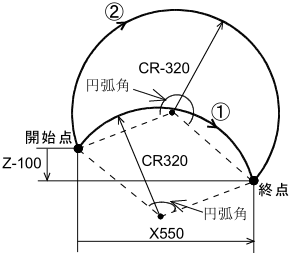

> **図の内容**
>
> 開始点から終点へ（X550、Z-100）。CR320 は円弧角 180° 未満の円弧 ①、CR-320 は円弧角 180° 以上の円弧 ②。

**○ 中心指定**

移動量/目標位置(X...T)、補間速度（F）、多回転指定（L）の他に以下の指定を行います。

- 中心：円弧開始点からの距離で指定します。

X軸〜T軸に対応する中心指定は「I、J、K、D、E、H、U、V、W」です。

円弧中心は必ず2軸分指定ください。

円弧中心指定の軸以外で移動量が指定された軸は、円弧補間と同期して移動します。ヘリカル動作です。

CIRR X700 Y-100 I300 J-400 (Z1000) F1000; CIRRA R700 T-100 U300 W-400 (Z1000) F1000;

(Z1000)を記述するとヘリカル動作します。

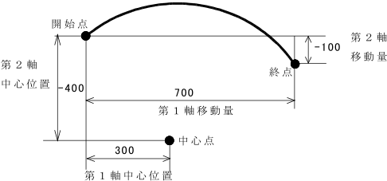

> **図の内容**
>
> 開始点から終点へ。第１軸移動量 700、第２軸移動量 −100。中心点は 第１軸中心位置 300、第２軸中心位置 −400。

詳細は、以下を参照して下さい。

「サンプル運転プログラム説明書」<4.インクレ円弧補間命令>(TB04-0422)

**○ 3点（通過点）指定**

移動量/目標位置(X〜T)、補間速度（F）、多回転指定（L）の他に以下の指定を行います。

- 通過点：X軸〜T軸に対応する通過点指定は「TX、TY、TZ、TA〜TQ、TT」です。通過点は必ず2軸分指定ください。

(例）

CIRR X700 Y-100 TX300 TY120 (Z1000) F1000; CIRRA R700 T-100 RX300 TT120 (Z1000) F1000;

- (Z1000)を記述するとはヘリカル動作します。


> **図の内容**
>
> 開始点から通過点を経て終点へ。第１軸通過点位置 300、第２軸通過点位置 120、第１軸移動量 700、第２軸移動量 −100。

(例)

##### 7-1-4-4．PTMA : ポイント指定PTP位置決め移動<オプション>

【書式】

PTMA P＿ OVR＿ ;

| アドレス   | 内容      | 内容        | 範囲    | 省略時   | 単位   |
|--------|---------|-----------|-------|-------|------|
| P      | ポイント番号  | ※マクロ変数指定可 | 1〜400 | ×     | 番号   |
| OVR    | オーバライド量 |           | 1〜200 | 100   | %    |

【グループ】

Gr1a

【機能】

ポイントテーブルは、複数のポイント座標値のデータテーブルです。

ポイント番号は、ポイントテーブル内の特定のポイントを指定します。

PTMAは、指定のポイントの座標値を目標位置として位置決めする指令です。

PTMAでは、ポイント番号PとオーバーライドOVR(比率)を指定します。

PTP速度(サーボパラメータ)×OVRが実際の速度になります。

OVR指定がない時は100%が指定されたものとして動作します。

存在しないポイントを指定した場合はプログラム実行エラーとなります。

ポイントテーブルは、セッティングPC/通信コマンドで設定できます。詳細は以下を参照して下さい。

- 「PLMC-M3EX セッティングPCマニュアル」<5-3-5-2.ポイント位置決めテーブル> (TB00-0981)
- 「送受信データ説明書」<4-1-27.ポイントテーブル書込/読出>(TB00-0984)

【記述例】

PTMA P1 OVR20;

PTMA P#1000;

動作詳細については、以下を参照して下さい。

- 「サンプル運転プログラム説明書」<9.ポイント指定位置決め命令>(TB04-0422)

##### 7-1-4-5．LIMA : ポイント指定直線補間 <オプション>

【書式】

LIMA P＿ F＿ ;

| アドレス   | 内容     | 内容        | 範囲    | 省略時   | 単位   |
|--------|--------|-----------|-------|-------|------|
| P      | ポイント番号 | ※マクロ変数指定可 | 1〜400 | ×     | 番号   |
| F      | 補間速度   | ※マクロ変数指定可 | 速度範囲  | モーダル値 | 速度単位 |

【グループ】

Gr1a

【機能】

ポイントテーブルは、PTMAと共有です。

指定のポイントの座標値を目標位置として直線補間で移動します

LIMAでは、ポイント番号Pと、補間速度Fを指定します。

F値はモーダルなので省略可能です。

存在しないポイントを指定した場合はプログラム実行エラーとなります。

【記述例】

LIMA P10 F1500;

LIMA P#1000 F#5520;

7-1-4-6．SLIN : センサラッチ直線補間 <オプション>

SLINC : センサラッチ直線補間(移動停止なし)

【書式】

SLIN (X＿ Y＿ Z＿ A＿ B＿ C＿ R＿ Q＿ T＿) [F＿]; SLINC (X＿ Y＿ Z＿ A＿ B＿ C＿ R＿ Q＿ T＿) [F＿];

| アドレス   | 内容          | 内容        | 範囲   | 省略時単位     |
|--------|-------------|-----------|------|------------|
| X      | X軸の移動量/目標位置 | ※マクロ変数指定可 | 軸範囲  | 軸単位        |
| Y      | Y軸の移動量/目標位置 | ※マクロ変数指定可 | 軸範囲  | 軸単位        |
| Z      | Z軸の移動量/目標位置 | ※マクロ変数指定可 | 軸範囲  | 軸単位        |
| A      | A軸の移動量/目標位置 | ※マクロ変数指定可 | 軸範囲  | 軸単位        |
| ・      | ・           |           | 軸範囲  | 軸単位        |
| ・      | ・           |           | 軸範囲  | 軸単位        |
| T      | T軸の移動量/目標位置 | ※マクロ変数指定可 | 軸範囲  | 軸単位        |
| F      | 補間速度        | ※マクロ変数指定可 | 速度範囲 | モーダル値速度単位 |

【グループ】

Gr1a

【機能】

目標位置に向かって直線補間動作します。移動中にセンサラッチ信号がONすると、その位置を記憶して移動を停止し次ステップへスキップします。(SLINCでは、停止しません。)

動作詳細は、<5-15-6.センサーラッチ機能(スキップ機能)>(TB00-0980E)を参照して下さい。

SLIN : センサーラッチ直線補間(ラッチで移動停止)

SLINC : センサーラッチ直線補間(移動停止無し) センサラッチ信号ONでラッチ位置の記憶をしますが、移動は指令位置まで続行します。

【記述例】

SLIN X1000 Y2000 F1000;

SLINC X1000 Y2000 F1000;

7-1-4-7．AXMV : インクレ独立位置決め

AXMVA : 論理座標独立位置決め

AXMVB : 機械座標独立位置決め

【書式】

AXMV AXMVA (X＿ Y＿ Z＿ A＿ B＿ C＿ R＿ Q＿ T＿){FX＿ FY＿ FZ＿ FA＿ FB＿ FC＿ FR＿ FQ＿ FT＿};

AXMVB

| アドレス   | 内容          | 内容        | 範囲   | 省略時   | 単位   |
|--------|-------------|-----------|------|-------|------|
| X      | X軸の移動量/目標位置 | ※マクロ変数指定可 | 軸範囲  |       | 軸単位  |
| Y      | Y軸の移動量/目標位置 | ※マクロ変数指定可 | 軸範囲  |       | 軸単位  |
| Z      | Z軸の移動量/目標位置 | ※マクロ変数指定可 | 軸範囲  |       | 軸単位  |
| A      | A軸の移動量/目標位置 | ※マクロ変数指定可 | 軸範囲  |       | 軸単位  |
| ・・    | ・・         | ・・       | 軸範囲  |       | 軸単位  |
| T      | T軸の移動量/目標位置 | ※マクロ変数指定可 | 軸範囲  |       | 軸単位  |
| FX     | X軸補間速度      | ※マクロ変数指定可 | 速度範囲 | ×     | 速度単位 |
| FY     | Y軸補間速度      | ※マクロ変数指定可 | 速度範囲 | ×     | 速度単位 |
| FZ     | Z軸補間速度      | ※マクロ変数指定可 | 速度範囲 | ×     | 速度単位 |
| FA     | A軸補間速度      | ※マクロ変数指定可 | 速度範囲 | ×     | 速度単位 |
| ・・    | ・・         | ・・       | 速度範囲 | ×     | 速度単位 |
| FT     | T軸補間速度      | ※マクロ変数指定可 | 速度範囲 | ×     | 速度単位 |

【グループ】

Gr1a

【機能】

独立位置決めは、位置決め開始の指令です。

運転プログラムの場合、指定の軸の位置決めを開始し、その次の制御周期では、つぎのステップを実行します。

また、PCやラダーのコマンドの場合は、開始直後に別の移動指令(他の軸)を発行できます。

- 本命令のステップでは、指令された軸の移動開始のみを行います。
- 指令軸数が同時に4軸を超えた場合や、移動指定軸と速度指定軸の対応が合わない場合は、フォーマットエラーになります。

動作詳細、通信コマンドについては、以下を参照して下さい。

- <5-20.独立位置決め>(TB00-0980E)
- 「送受信データ説明書」<4-2-56.独立位置決めコマンド>(TB00-0984)

AXMV : インクレ独立位置決め

AXMVA : 論理座標系アブソ独立位置決め

AXMVB : 機械座標系アブソ独立位置決め

【記述例】

AXMV X10000 Y-52000 FX#1099 FY5000;

AXMVB X10000 Y-52000 FX#1099 FY5000;

(最大4軸)

##### 7-1-4-8．TRQ : トルク指令開始命令

【書式】

TRQ (X＿ Y＿ Z＿ A＿ ... Q＿ T＿) {FX＿ FY＿ FZ＿ FA＿ ... FQ＿ FT＿};

| アドレス   | 内容          | 内容        | 範囲                                                | 省略時   | 単位   |
|--------|-------------|-----------|---------------------------------------------------|-------|------|
| X      | X軸のトルク指令値   | ※マクロ変数指定可 | -モータ最大トルク〜 +モータ最大トルク (ROMSW設定による) 1rpm 〜最大速度 |       | %    |
| Y      | Y軸のトルク指令値   | ※マクロ変数指定可 | -モータ最大トルク〜 +モータ最大トルク (ROMSW設定による) 1rpm 〜最大速度 |       | %    |
| Z      | Z軸のトルク指令値   | ※マクロ変数指定可 | -モータ最大トルク〜 +モータ最大トルク (ROMSW設定による) 1rpm 〜最大速度 |       | %    |
| A      | A軸のトルク指令値   | ※マクロ変数指定可 | -モータ最大トルク〜 +モータ最大トルク (ROMSW設定による) 1rpm 〜最大速度 |       | %    |
| ・      | ・           | ・         | -モータ最大トルク〜 +モータ最大トルク (ROMSW設定による) 1rpm 〜最大速度 |       | %    |
| ・ T    | ・ T軸のトルク指令値 | ※マクロ変数指定可 | -モータ最大トルク〜 +モータ最大トルク (ROMSW設定による) 1rpm 〜最大速度 |       | %    |
| FX     | X軸速度制限値     | ※マクロ変数指定可 | (ROMSW設定による)                                     |       |      |
| FY     | Y軸速度制限値     | ※マクロ変数指定可 | (ROMSW設定による)                                     | ×     | rpm  |
| FZ     | Z軸速度制限値     | ※マクロ変数指定可 | (ROMSW設定による)                                     |       |      |
| FA     | A軸速度制限値     | ※マクロ変数指定可 | (ROMSW設定による)                                     |       |      |
| ・      | ・           |           | (ROMSW設定による)                                     |       |      |
| ・      | ・           |           | (ROMSW設定による)                                     |       |      |
| FT     | T軸速度制限値     | ※マクロ変数指定可 | (ROMSW設定による)                                     |       |      |

・トルク指令値

軸毎のトルク指令を１％単位で指定します。

マクロ変数指定が可能です。

（指定した軸のみ変更します。指定していない軸は変更しません。）

設定範囲は、-モータ最大トルク〜+モータ最大トルク(ROMSW設定ソフトで設定)です。

範囲外の値を設定するとプログラム実行エラーになります。

- 速度制限指定

軸毎の速度制限を1rpm単位で指定します。

マクロ変数指定が可能です。

設定範囲は、1〜モータ最大速度(ROMSW設定ソフトで設定)です。

範囲外の値を設定するとプログラム実行エラーになります。

軸指定と速度制限は同じ軸に対して行って下さい。異なる軸に対して行った場合は、フォーマットエラーになります。

- ※ 1行の命令では最大4軸までの指令ができます。

【グループ】

Gr1a

【機能】

- 任意の軸をトルク制御モードに変更します。（Σアンプに対してトルクコマンドを発行します。） Σアンプはトルク制御モードになり、指令したトルクを出力します。
- 次のトルク指令が発行されるまで、前回指令トルクを出力し続けます。
- トルク指令終了コマンドの他に、エラー発生時、プログラムの終了やリセット時、電源OFF→ONにより位置制御モードに戻ります。
- ステータスデータの各軸ステータス（STATUS.ax[n].AxStatus）に D08:トルク制御中フラグを追加します。トルク制御中はこのフラグがONします。

【注意事項】

- トルク指令(トルク制御モード)と位置制御(通常モード)の切り替えには数RTC必要です。又、INPOS有効(INPE)の時は、トルク指令開始/終了命令実行前にINPOS待ちも行います。
- 速度制限機能を有効にするために、Σアンプのユーザ定数Pn002の1桁目を"1"に設定する必要が有ります。詳細は<5-**.トルク指令>(TB00-0980E)を参照ください。

【記述例】

TRQ X15 Y#1003 Q50 T0 FX100 FY800 FQ#1028 FT1000;

##### 7-1-4-9．REEL : 巻線指令

【書式】

REEL {X＿ Y＿ Z＿ B＿ C＿ R＿ Q＿ T＿} P＿ RN＿ S＿ [RE＿];

| アドレス   | 内容          | 内容        | 範囲            | 省略時   | 単位       |
|--------|-------------|-----------|---------------|-------|----------|
| X      | X軸のトラバース移動量 | ※マクロ変数指定可 |               |       |          |
| Y      | Y軸のトラバース移動量 | ※マクロ変数指定可 | 軸範囲           |       | 軸単位      |
| Z      | Z軸のトラバース移動量 | ※マクロ変数指定可 |               |       |          |
| B      | B軸のトラバース移動量 | ※マクロ変数指定可 |               |       |          |
| C      | C軸のトラバース移動量 | ※マクロ変数指定可 |               |       |          |
| R      | R軸のトラバース移動量 | ※マクロ変数指定可 |               |       |          |
| Q      | Q軸のトラバース移動量 | ※マクロ変数指定可 |               |       |          |
| T      | T軸のトラバース移動量 | ※マクロ変数指定可 |               |       |          |
| P      | ピッチ幅        | ※マクロ変数指定可 | 0〜10000000.00 | ×     | 1/100パルス |
| RN     | 総巻数         | ※マクロ変数指定可 | ±21474836.47  | ×     | 1/100回巻  |
| S      | 主軸回転速度      | ※マクロ変数指定可 | 0〜320000      | ×     | rpm      |
| RE     | 巻き終わり方向     | ※マクロ変数指定可 | 0/1/2         | 0     |          |

【グループ】

Gr1a

【機能】

REEL指令は、巻線動作の指令です。

主軸(A軸)は、PTP時定数(サーボパラメータ)で加速後、定速回転(Sの指定値)し、減速してRN分を回転します。主軸回転速度には、オーバライドがかかります。

トラバース軸(A軸以外)は、主軸回転と同期して、主軸1回転あたりピッチ幅(P)を移動し、トラバース幅(移動量)で折り返して往復します。

- A軸が主軸です。
- 主軸回転速度(S)は、定速時の主軸の回転速度です。(正の整数)
- 主軸速度には、PTP時定数(サーボパラメータ)による加減速がかかります。
- 総巻数(RN)は主軸の回転回数を指定してください。(符号付き整数)
- トラバース軸は、X、Y、Z、B、C、R、Q、Tの何れかの1軸を指定してください。
- トラバース移動量が+の場合 : 最初に+方向に移動します。
- トラバース移動量が-の場合 : 最初に-方向に移動します。
- トラバース移動量が0の場合 : 往復運動せずに主軸のみ回転します。
- ピッチ幅(P)は主軸1回転あたりのトラバース移動量で常に正数です。

総巻数が+の場合 : 主軸は+方向に回転

総巻数が-の場合 : 主軸は-方向に回転

総巻数が0の場合 : REEL命令は無効(NOP命令と同じ)

ピッチ幅は、小数2桁まで指定できます。

例 P51.25

(4巻で205パルス)

- 巻き終わり方向(RE)で巻き終わり方法を指定できます。

0:自然終了(デフォルト)

1:トラバース始端で終了

2:トラバース終端で終了

##### 7-1-4-10．TURN : 接線制御Z軸回転

<オプション>

【書式】

TURN (X＿ Y＿ Z＿ A＿ B＿ C＿ R＿ Q＿ T＿) [TIM＿ ];

| アドレス   | 内容     | 範囲           |   省略時 | 単位     |
|--------|--------|--------------|-------|--------|
| X      | X軸の移動量 | 軸範囲          |       | 軸単位    |
| Y      | Y軸の移動量 | 軸範囲          |       | 軸単位    |
| Z      | Z軸の移動量 | 軸範囲          |       | 軸単位    |
| A      | A軸の移動量 | 軸範囲          |       | 軸単位    |
| ・      | ・      | 軸範囲          |       | 軸単位    |
| ・      | ・      | 軸範囲          |       | 軸単位    |
| T      | T軸の移動量 | 軸範囲          |       | 軸単位    |
| TIM    | 待ち時間   | 0.1〜999999.9 |     0 | 0.1sec |

【グループ】

Gr1a

【機能】

接線制御用の命令です。

2軸の移動量で接線方向(回転軸の角度)を指定します。実際の移動はしません。

TURN指令の次ステップに接線方向を規定する移動指令がある場合、TURN指令での移動量を省略できます。待ち時間[TIM]は回転軸の回転後の待ち時間です。

待ち時間[TIM]は省略できます。このときは回転のみで待ち時間"0"になります。

TURN命令ではマクロ変数は使用できません。

TURN命令を使用するときはこの前に接線制御有効命令(STNE)が必要です。

詳細は、<5-15-5.接線制御機能>(TB00-0980E)を参照下さい。

##### 7-1-4-11．SPIN : 回転速度指令

【書式】

SPIN (X＿ Y＿ Z＿ A＿ B＿ C＿ R＿ Q＿ T＿);

| アドレス   | 内容     | 内容        | 範囲     | 省略時   | 単位     |
|--------|--------|-----------|--------|-------|--------|
| X      | X軸回転速度 | ※マクロ変数指定可 | 回転速度範囲 | ×     | 0.1rpm |
| Y      | Y軸回転速度 | ※マクロ変数指定可 | 回転速度範囲 | ×     | 0.1rpm |
| Z      | Z軸回転速度 | ※マクロ変数指定可 | 回転速度範囲 | ×     | 0.1rpm |
| A      | A軸回転速度 | ※マクロ変数指定可 | 回転速度範囲 | ×     | 0.1rpm |
| ・      | ・      |           | 回転速度範囲 | ×     | 0.1rpm |
| ・      | ・      |           | 回転速度範囲 | ×     | 0.1rpm |
| T      | T軸回転速度 | ※マクロ変数指定可 | 回転速度範囲 | ×     | 0.1rpm |

【グループ】

Gr1a

【機能】

定速回転を指令する命令です。無限回転軸に対して使用できます。 ROMSW設定ソフトの"メカ機構1回転パルス数"の設定が必要です。

詳細は、<5-15-2.回転速度指令>(TB00-0980E)を参照下さい。

##### 7-1-4-12．THSET : 工具長補正

<オプション>

【書式】

THSET_ ;

| アドレス   | 内容          | 範囲    | 省略時   | 単位   |
|--------|-------------|-------|-------|------|
| THSET  | 工具長補正テーブル番号 | 0〜399 | ×     | 番号   |

【グループ】

Gr1a

【機能】

工具長補正を実行します。

工具長補正はモーダル指令です。

詳細は、<5-17-2.工具長補正機能及び摩耗補正機能>(TB00-0980E)を参照下さい。

##### 7-1-4-13．THOFF : 工具長補正停止

<オプション>

【書式】

THOFF ;

【グループ】

Gr1a

【機能】

工具長補正をキャンセルします。

##### 7-1-4-14．TSTART: 別タスクプログラム起動 <オプション>

【書式】

TSTART＿ P＿ ;

| アドレス   | 内容        | 内容        | 範囲      | 省略時   | 単位   |
|--------|-----------|-----------|---------|-------|------|
| TSTART | タスク番号     | ※マクロ変数指定可 | 0〜7     | ×     |      |
| P      | 運転プログラム番号 | ※マクロ変数指定可 | 1〜32767 | ×     |      |

【グループ】

Gr1a

【機能】

指定したタスクとプログラム番号のプログラムを起動します。

既に起動しているプログラムにTSTARTを実行すると、実行エラーになります。

【記述例】

TSTART2 P10;

タスク2のプログラム番号10を起動します。

##### 7-1-4-15．TSTOP : 別タスクストップ

<オプション>

【書式】

TSTOP＿ ;

| アドレス   | 内容    | 範囲            | 省略時   | 単位   |
|--------|-------|---------------|-------|------|
| TSTOP  | タスク番号 | ※マクロ変数指定可 0〜7 | ×     |      |

【グループ】

Gr1a

【機能】

指定したタスクの動作を停止します。

運転プログラム実行 :プログラム停止

その他軸動作(JOG等) :移動停止

【記述例】

TSTOP2 ;

タスク2の軸移動を停止します。

##### 7-1-4-16．TRESET: 別タスクリセット

<オプション>

【書式】

TRESET＿ ;

| アドレス   | 内容    | 範囲            | 省略時   | 単位   |
|--------|-------|---------------|-------|------|
| TRESET | タスク番号 | ※マクロ変数指定可 0〜7 | ×     |      |

【グループ】

Gr1a

【機能】

指定したタスクにリセットをかけます。運転プログラムや、軸の移動を中断します。

また、PLMC-M3EXのアラームをリセットします。

【記述例】

TRESET7;

タスク7にリセットをかけます。

##### 7-1-4-17．PRG : 別タスクプログラム起動 <オプション>

【書式】

TSTART＿ P＿ ;

| アドレス   | 内容        | 内容        | 範囲      | 省略時   | 単位   |
|--------|-----------|-----------|---------|-------|------|
| PRG    | 運転プログラム番号 | ※マクロ変数指定可 | 1〜32767 | ×     |      |
| T      | タスク番号     | ※マクロ変数指定可 | 0〜7     | タスク1  |      |

【グループ】

Gr1a

【機能】

指定したタスクとプログラム番号のプログラムを起動します。

"7-1-4-14．"TSTRATと同様の機能です。旧バージョンとの互換性のための命令なのでなるべく「TSTART」をご使用下さい。

「PRG」命令をPLMC-M3EXへダウンロードし、その後アップロードすると「PRG」命令は、「TSTART」命令になります。

<例> PRG1 T5; → ダウンロード → アップロード → TSTART5 P1;

【記述例】

TSTART2 P10;

タスク2のプログラム番号10を起動します。

##### 7-1-4-18．SVON : 各軸サーボON

【書式】

SVON (□ □ □ □ □ □ □ □ □);

| 記号   | 内容                      | 範囲   | 省略時   | 単位   |
|------|-------------------------|------|-------|------|
| □    | 軸アドレス X Y Z A B C R Q T | 軸名称  | -     |      |

【グループ】

Gr1a

【機能】

指定した軸をサーボONします。インターロックの解除もおこないます。

サーボエラーなど、サーボONできない状態の時には"SVON"を指令してもサーボONできません。

【記述例】

SVON X Y B T;

X軸、Y軸、B軸、T軸のサーボをONにし、インターロックを解除します。

##### 7-1-4-19．SVOFF : 各軸サーボOFF

【書式】

SVOFF (□ □ □ □ □ □ □ □ □);

| 記号   | 内容                      | 範囲   | 省略時   | 単位   |
|------|-------------------------|------|-------|------|
| □    | 軸アドレス X Y Z A B C R Q T | 軸名称  | -     |      |

【グループ】

Gr1a

【機能】

指定した軸をサーボOFFします。

"SVOFF"を実行すると指定された軸はサーボOFFし、インターロックになります。

【記述例】

SVOFF A C R;

A軸、C軸、R軸のサーボをOFFにし、インターロックの状態にします。

##### 7-1-5-1．CALL : サブルーチンコール

【書式】

CALL LABEL [L＿] ;

| アドレス   | 内容           | 範囲      | 省略時   | 単位   |
|--------|--------------|---------|-------|------|
| LABEL  | サブルーチンラベル    |         | ×     | 文字列  |
| L      | 読み出し実行繰り返し回数 | 1〜50000 | 1     | 回数   |

【グループ】

Gr1b

【機能】

運転プログラム内のサブルーチンを呼び出します。繰り返し回数(L)を指定するとその回数分呼び出します。

- ラベルは13文字以下の文字列です。英文字/数値が使用できます。
- ネスティングは、最大20回です。
- メインプログラムは必ずプログラムの先頭に記述して下さい。
- サブルーチンの先頭には必ずラベルが必要です。
- メインプログラム・各サブルーチンの最後には必ず腧END"指令を設定して下さい。

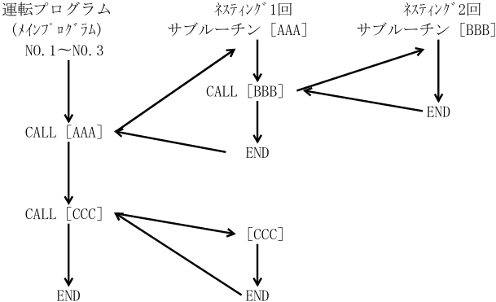

> **図の内容**
>
> 運転プログラム(メインプログラム) NO.1～NO.3 から CALL [AAA] → サブルーチン [AAA]（ネスティング1回）→ CALL [BBB] → サブルーチン [BBB]（ネスティング2回）→ END で戻る。メインから CALL [CCC] → [CCC] → END で戻り、メインの END。

AAA/BBB/CCC：ラベルの例

動作詳細については、以下を参照して下さい。

- 「サンプル運転プログラム説明書」<5.サブルーチンコール>(TB04-0422)

【記述例】

CALL LABEL L10;
  
END;
  
:LABEL
  
PTP X1000;
  
END;

「LABEL」〜「END」までを10回呼び出し。

このステップで、9回はCALLステップに戻ります。 10回目は、CALLの次のステップに進行します。

※ サブルーチンは、運転プログラム内に記述します。

##### 7-1-5-2．JMP : ジャンプ指定

【書式】

JMP LABEL ;

| アドレス   | 内容             | 範囲   | 省略時   | 単位   |
|--------|----------------|------|-------|------|
| LABEL  | ジャンプ先のステップのラベル |      | ×     | 文字列  |

【グループ】

Gr1b

【機能】

指定したラベルのステップへ運転プログラムが進行します。

ラベルは13文字以下の文字列です。英文字/数値が使用できます。

【記述例】

JMP LABEL;

END;

:LABEL

```c
    PTP X1000;
    END;
```

「LABEL」のステップに進行します。このステップには戻りません。

このENDでプログラム実行終了になります。ジャンプ元には戻りません。

##### 7-1-5-3．マクロ演算

<オプション>

【書式】

変数△=△{変数|即値}[△演算子△{変数|即値}];

- {|} ･･･ '|'で区切られた内の、どれか1つを選択
- []

･･･省略可能

△ ･･･ 1つ以上の空白、又はタブ(必須です)

変数･･･レジスタ指定

即値･･･ 500、-1などの数値

演算子･･･ + (加算)

- (減算)
* (乗算)
- / (除算)
- % (剰余)
- & (AND)
- | (OR)
- ^ (XOR)
- <<(左シフト)
- >>(右シフト)

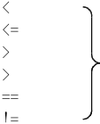

> **図の内容**
>
> `<`、`<=`、`>`、`>`、`==`、`!=` を括弧でまとめた図（右側の説明は図に含まれていない）。

!=

&&(論理のAND)

- ||(論理のOR)

条件が真ならば1

=

ならば0

偽

- ! (論理の反転)

【グループ】 Gr1b

【機能】

各指令の付加データで「※マクロ変数指定可」の表記があるものは、即値の他にマクロ変数でも記述できます。

また、マクロ変数や即値に対して、上記の演算も可能です。

※ 変数、即値には符号(+、-)とビット反転(~)を付加することができます。

【運転プログラム例】

SLIN X20000 F2000;

#1031 = #5000 + 500;

```c
/* ラッチ位置（#5000）より500パルス分だけ先 */
/* ラッチ位置より先500パルス先に移動 */
```

LINA X#1031 F200;

詳細は、以下を参照下さい。

- 「サンプル運転プログラム説明書」<12.マクロ機能> (TB04-0422)
- 「ユーザーズマニュアル機能編」 <7-4.マクロ機能> (TB00-0900F)

7-1-5-4．IF

ELSE

ENDIF : 条件判断

【書式】

- 条件判別

IF △ {変数|即値}[△演算子△{変数|即値}];

(1)

ELSE;

(2)

ENDIF;

"IF"の後に条件の式を書きます。

- (1):条件式の結果が0以外の場合の処理を記述
- (2):条件式の結果が0の場合の処理を記述

"ELSE"と(2)の処理は必要なければ、省略できます。

- {|} ･･･ '|'で区切られた内の、どれか1つを選択

[]

･･･省略可能

△ ･･･ 1つ以上の空白、又はタブ(必須です)

変数･･･レジスタ指定

即値･･･ 500、-1などの数値

- ※ 演算子については「7-1-5-3．マクロ演算」を参照ください。
- ※ IFのネスティング数には制限はありません。

【グループ】

Gr1b

【機能】

マクロ変数を使用して、運転プログラム中で条件判断を行うことができます。

演算結果だけでなく、マクロ変数経由でステータスや入出力状態などの内部情報での分岐も行えます。

【運転プログラム例】

- ① IF #1000 < #1001;
- ② PTP X1000;
- ③ TIM1.0;
- ④ PTP X100;
- ⑤ ENDIF;
- ⑥ PTPA X1000;
- ⑦ END;

実行順序

- #1000が"0"、#1001が"1"の時 ① → ② → ③ → ④ → ⑤ → ⑥ → ⑦
- #1000が"1"、#1001が"0"の時 ① → ⑥ → ⑦

7-1-5-5．SWITCH

```c
    CASE
    ENDSWITCH
    BREAK
```

DEFAULT : 条件判断

<オプション>

【書式】

SWITCH △{変数|即値}[△演算子△{変数|即値}];

CASE △ 即値;

:

省略可能

:

BREAK;

CASE △ 即値;

:

:

:

:

DEFAULT;

:

:

```c
    BREAK;
    ENDSWITCH;
```

BREAK;

※ 書式の記号、演算子については「7-1-5-3．マクロ演算」を参照ください。

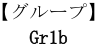

> **図の内容**
>
> 【グループ】Gr1b

【グループ】 Gr1b

【機能】

マクロ変数を使用して、運転プログラム中で条件判断を行うことができます。

演算結果だけでなく、マクロ変数経由でステータスや入出力状態などの内部情報での分岐も行えます。

SWITCHの後に条件の式を書きます。

各CASEの値とSWITCHの条件の式が一致する処理を実行します。

BREAKでSWITCHの処理から抜けます。

全てのCASEと一致しなかった場合は、DEFAULTの処理を実行します。

- ※ SWITCHのネスティング数には制限はありません。

【運転プログラム例】

テクノコード

- ① SWITCH #1000;
- ② CASE 0;
- ③ PTPA X0;
- ④ BREAK;
- ⑤ CASE 1;
- ⑥ PTPA X10000;
- ⑦ BREAK;
- ⑧ CASE 2;
- ⑨ PTPA X20000;
- ⑩ BREAK; 実行順序
- ⑪ CASE 3; ・#1000が0の時 ① → ② → ③ → ④ → ⑱
- ⑫ PTPA X30000;

・#1000が1の時

① → ⑤ → ⑥ → ⑦ → ⑱

- ⑬
- BREAK; ・#1000が2の時 ① → ⑧ → ⑨ → ⑩ → ⑱
- ⑭ DEFAULT;

・#1000が3の時

① → ⑪ → ⑫ → ⑬ → ⑱

- ⑮ #1000 = #1000; ・#1000が0〜3以外の時 ① → ⑭ → ⑮ → ⑯ → ⑱
- ⑯ BREAK;
- ⑰ ENDSWITCH; ※上記例の番号のステップでは、実行に1制御周期かかります。

- ⑱ END;

##### 7-1-6-1．AXWT : 独立位置決め完了待ち命令

【書式】

AXWT (□ □ □ □ □ □ □ □ □);

AXWT #＿ ;

| 記号   | 内容                      | 範囲   | 省略時   | 単位   |
|------|-------------------------|------|-------|------|
| □    | 軸アドレス X Y Z A B C R Q T | 軸名称  | -     |      |
| #    | マクロ変数番号                 |      | -     | ビット  |

【グループ】

Gr1c

【機能】

- 指定した全ての軸が独立位置決めを完了するまで次のステップ実行を待ちます。
- 軸は軸名称またはマクロ変数で指定します。

名称のときはX、Y〜Q、Tの中の任意の軸で複数軸指定できます。

マクロ変数で指定するときはマクロ変数の数値のビット対応の軸指定になります。

マクロ変数値のD0〜D8のみ評価します。他bitは無関係です。

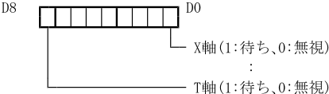

> **図の内容**
>
> D8 ～ D0 の 9 ビット。D0: X軸（1:待ち、0:無視）… D8: T軸（1:待ち、0:無視）。

- 軸の途中停止は、移動完了ではありません。
- 独立位置決め完了待ちの状態で、あらたにPC/FAM3から独立位置決め指令をされた場合でも、指定の軸の位置決め完了を待ちます。
- 指定軸の独立位置決め以外の移動は、待ちません。

【記述例】

AXMV X10000 B20000 FX1000 FB1200;

AXWT X;

AXMV Y10000 FY5000;

AXWT Y B;

ここでX軸の位置決め完了を待つので次ステップへは進まない。

Y軸B軸ともに位置決め完了するのを待つ

##### 7-1-6-2．STNE : 接線制御有効

<オプション>

【書式】

STNE ;

【グループ】

Gr1c

【機能】

接線制御を有効にする命令です。

詳細は、<5-15-5.接線制御機能>(TB00-0980E)を参照下さい。

##### 7-1-6-3．STND : 接線制御無効

<オプション>

【書式】

STND ;

【グループ】

Gr1c

【機能】

接線制御を無効にする命令です。

詳細は、<5-15-5.接線制御機能>(TB00-0980E)を参照下さい。

##### 7-1-6-4．CSET : 論理座標値設定

【書式】

CSET (X＿ Y＿ Z＿ A＿ B＿ C＿ R＿ Q＿ T＿);

| アドレス   | 内容    | 内容        | 範囲   | 省略時   | 単位   |
|--------|-------|-----------|------|-------|------|
| X      | X軸座標値 | ※マクロ変数指定可 | 軸範囲  | -     | 軸単位  |
| Y      | Y軸座標値 | ※マクロ変数指定可 | 軸範囲  | -     | 軸単位  |
| Z      | Z軸座標値 | ※マクロ変数指定可 | 軸範囲  | -     | 軸単位  |
| A      | A軸座標値 | ※マクロ変数指定可 | 軸範囲  | -     | 軸単位  |
| B      | B軸座標値 | ※マクロ変数指定可 | 軸範囲  | -     | 軸単位  |
| C      | C軸座標値 | ※マクロ変数指定可 | 軸範囲  | -     | 軸単位  |
| R      | R軸座標値 | ※マクロ変数指定可 | 軸範囲  | -     | 軸単位  |
| Q      | Q軸座標値 | ※マクロ変数指定可 | 軸範囲  | -     | 軸単位  |
| T      | T軸座標値 | ※マクロ変数指定可 | 軸範囲  | -     | 軸単位  |

【グループ】

Gr1c

【機能】

現在の論理座標系アブソ位置を指定された値に変更（論理座標系のセットアップ）します。指定された軸のみ座標変更します。

【記述例】

CSET X0 Y0 Z100;

XとY軸の現在位置を論理座表系の0としています。

動作詳細については、以下を参照して下さい。

- 「サンプル運転プログラム説明書」<8.論理座標設定命令>(TB04-0422)

##### 7-1-6-5．END : プログラム終了

【書式】

END ;

【グループ】

Gr1c

【機能】

運転プログラムの終わり、またはサブプログラムの終了を指定します。

##### 7-1-6-6．INPE : INPOS有効モード指定

【書式】

INPE ;

【グループ】

Gr1c

【機能】

インポジションチェックを有効にします。INPEのあとINPDが指令されるまでは、インポジションチェック有効です。

但し、サーボパラメータにてインポジションチェック無効(INPOS量;"0")としている軸は、INPEが指定されても無視します。

動作詳細については、以下を参照して下さい。

- <5-9.インポジションチェック>(TB00-0980E)
- 「サンプル運転プログラム説明書」<11.INPOS有効/無効>(TB04-0422)

##### 7-1-6-7．INPD : INPOS無効モード<デフォルト>指定

【書式】

INPD ;

【グループ】

Gr1c

【機能】

インポジションチェックを無効にします。INPDが指令されると、以後INPEが指令されるまでの各ステップは、インポジションチェック無効(パスモード)にて次のステップへ進みます。

動作詳細については、以下を参照して下さい。

- <5-9.インポジションチェック>(TB00-0980E)
- 「サンプル運転プログラム説明書」<11.INPOS有効/無効>(TB04-0422)

##### 7-1-6-8．TRQD : トルク指令終了命令

【書式】

TRQD (X Y Z ... T ) ;

【グループ】

Gr1c

【機能】

トルク指令を終了して、位置指令に戻す軸を指定します。数値指定は不要です。

（指定した軸のみ変更します。指定していない軸は変更しません。）

【記述例】

TRQD X Y Z A B C R Q T;

全軸のトルク制御を解除し位置指令に戻します。

##### 7-1-7-1．TIM : ステップ実行時間指定

【書式】

TIM＿ ;

| アドレス   | 内容      | 範囲           | 省略時   | 単位   |
|--------|---------|--------------|-------|------|
| TIM    | 遅延時間(秒) | 0.1〜214783.6 | ×     | sec  |

【グループ】

Gr2

【機能】

- ■移動指令と併用しない場合

時間待ちの指令です。指定の時間だけ、次のステップへの進行を遅らせます。

- ■移動指令と併用する場合

TIMで指定した時間が、軸移動時間を越えている場合、移動完了後にその差分の時間だけ、次のステップへの進行を停止します。

ステップ時間 = 軸移動時間 + 差分の停止時間

軸移動時間 : 移動に要する時間(移動距離 ÷送り速度)

ステップ時間 : 1ステップの所用時間

TIMで指定した時間(但し、ステップ時間 > 軸移動時間の場合)

差分の停止時間: TIMによって発生した停止時間

【記述例】

TIM150.0; 150秒待ち ※TIM0.0はフォーマットエラーになります。

##### 7-1-7-2．TM : ステップ実行時間指定 (RTC周期指定)

【書式】

TM＿;

| アドレス   | 内容            | 範囲          | 省略時   | 単位      |
|--------|---------------|-------------|-------|---------|
| TM     | 遅延時間(RTCサイクル) | 1〜214783647 | ×     | RTC周期指定 |

【グループ】

Gr2

【機能】

機能は、TIMと同様ですが、時間指定の単位が制御周期(RTC)です。

【例】 TM125; ・・・ RTC周期が4msの場合、この指令は0.5秒待ちに相当します。

- ※ プログラムアップロード時にTIM指令に変換されます。

その際、指定値は以下の式で変換され、端数は切り捨てられますので、御注意下さい。

TIM指定値 = TM指定値 × RTC周期 ÷ 100

RTC周期が2msの場合、

TM1250; → TIM2;

TM12; → TIM0;

#### 7-1-8．テクノコードプログラム指令の詳細（Gr3グループ）

##### 7-1-8-1．ONR_ : 汎用出力セット処理指定

【書式】

ONR＿ ;

| アドレス   | 内容     | 範囲   | 省略時   | 単位   |
|--------|--------|------|-------|------|
| ONR    | 出力信号番号 | 0〜63 | ×     | 番号   |

【グループ】

Gr3

【機能】

汎用出力信号を１点単位で指定してONします。

【M出力の順序】

移動指令と同一行での汎用出力命令ではステップの始め(移動命令のときは移動開始時)出力します。

【記述例】

PTP X1000 ONR05 OFR01;

X軸移動開始と同時に出力信号05をONにし、出力信号01をOFFにします。

※ 1ステップ内で、汎用入力処理と汎用出力処理は合わせて同時に4点までの指定が可能です。

##### 7-1-8-2．OFR_ : 汎用出力リセット処理指定

【書式】

OFR＿ ;

| アドレス   | 内容     | 範囲   | 省略時   | 単位   |
|--------|--------|------|-------|------|
| OFR    | 出力信号番号 | 0〜63 | ×     | 番号   |

【グループ】

Gr3

【機能】

汎用出力信号を１点単位で指定してOFFします。

【M出力の順序】

移動指令と同一行での汎用出力命令ではステップの始め(移動命令のときは移動開始時)出力します。

7-1-8-3．E□R_ : 汎用入力処理指定（強制終了）

J□R_ : 汎用入力処理指定（スキップ）

W□R_ : 汎用入力処理指定（待ち）

S□R_ : 汎用入力処理指定（停止）

【書式】


> **図の内容**
>
> `□□R__` の各部分を引き出し線で示した図（説明の文字は図に含まれていない）。

- (n)制御ビット指定 : 0〜63
- (l)正論理･負論理指定 : なし/N
- (k) 処理内容指定 : E、J、W、S

| アドレス   | 内容      | 範囲      | 省略時   | 単位   |
|--------|---------|---------|-------|------|
| k      | 処理内容    | E/J/W/S | ×     | 記号   |
| l      | 信号論理    | なし/N    | 正論理   | 記号   |
| n      | 信号ビット番号 | 0〜34    | ×     | 番号   |

【グループ】

Gr3

【機能】

| 処理名称   | 機能          | 内容                                                                                   | 表記事例   | 優先順位   |
|--------|-------------|--------------------------------------------------------------------------------------|--------|--------|
| Exit   | プログラム強制終了  | この信号がアクティブになると強制的に運転プログラムを完了して、停止します                                                | ER00   | 第1     |
| Jump   | スキップ        | この信号がアクティブになるとそのステップの動作を中断し、次のステップへ進行します。スキップ時の動作は、スキップしたステップの次ステップの指令形式によって変わります | JNR01  | 第2     |
| Wait   | ステップ実行開始待ち | 各動作ステップの先頭でこの入力をチェックします。アクティブであれば停止します。そのステップが一端開始されるとその後はWAITのチェックはしません           | WR02   | 第3     |
| Stop   | 一時停止        | この信号がアクティブな間、動作を停止します。ステップの実行中いつもチェックします。したがって、STOP条件のON/OFFでステップ動作が停止/再開します     | SNR03  | 第3     |

- ※ 同一ステップでW.S.J.Eが同時に指定され、各々の入力条件が成立した時の優先順位は、以下の通りです。

第1優先 Exit E指定の入力が1つでも成立すれば、他の条件にかかわらず強制終了します。

第2優先 Jump 第1優先が成立していない状態では、J指定が1つでも成立すれば、スキップします。

第3優先 Wait 第1・第2優先が成立していない状態では、W又はSの1つでもStop成立すれば、それに従います。

※ 1ステップ内で、汎用入力処理と汎用出力処理は合わせて同時に4点までの指定が可能です。

【記述例】

PTP B37500 WNR00 JR10 ONR12 OFR14;

入力信号00がOFFの間は待ち、入力信号がONになったら出力信号12をON、14をOFFにしてB軸の移動を開始します。

途中入力信号10がONになったら移動は中断して次のステップにスキップします。

##### 7-1-9-1．MOUT : Mコード出力

【書式】

MOUT＿ ;

| アドレス   | 内容      | 範囲    | 省略時   | 単位   |
|--------|---------|-------|-------|------|
| MOUT   | 出力信号コード | 0〜255 | ×     | コード  |

【グループ】

Gr4

【機能】

指定したMコード(8ビットバイナリ出力信号)を出力します。 FAM3や外部回路へステータスや情報を出力します。データ(M0〜M7)とストローブ信号を出力します。移動指令と同一行でのMOUT指令では移動を完了した後にMOUT出力します。

例

LIN X＿ Y＿ M□□; 直線補間が完了した後でM□□出力 □□はM信号のコードです。

【Mコード出力シーケンス】

出力信号(PLMC-MⅡEx→外部回路)

- Mコード(M0〜M7) 0から255まで(M0〜M7の8ビット)のバイナリーデータで出力します。

・MSTRB

Mコードの出力完了を知らせる信号です。

※外部回路では、MSTRBの立ち上がり(図のA)でMコードを読み込んでください。

入力信号(外部回路→PLMC-M3EX)

・MFIN

外部回路がMコードを読み取ったことを通知する信号です。

PLMCは、MFIN立ち上がりでMSTRBをOFFし、そのステップを終了します。

・MOK入力

外部論理回路が受け取ったMコードを正常に処理したときONさせてください。 PLMCでは、外部回路の正常/異常完了を判断できます。 (MOKの使用の有無は、ROMSWで選択できます)

【信号タイミング】

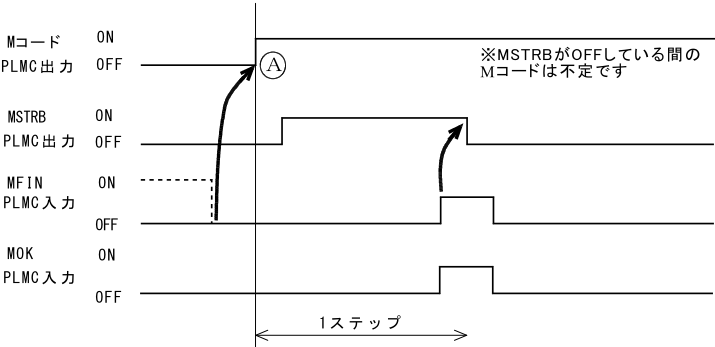

> **図の内容**
>
> - Mコード PLMC出力: OFF → ON（Ⓐ）
> - MSTRB PLMC出力: Mコード出力後に ON、MFIN が ON になると OFF
> - MFIN PLMC入力: MSTRB を受けて ON
> - MOK PLMC入力: ON のパルス
> - ※MSTRBがOFFしている間のMコードは不定です。下に「1ステップ」の範囲。

##### 7-1-9-2．MOUT0/MOUT1: 特殊Ｍコード指令

【書式】

MOUT0 ; または MOUT1 ;

【グループ】

Gr4

【機能】

特殊なMコードです。

これらの指令を使うためには、基本ROMSWにて、「M00/M01停止機能」を有効にする必要があります。

MOUT0指令プログラム実行を停止します。

MOUT1指令オプショナルストップ入力("T□MOPT")ONの時、運転プログラムを停止します。

- MOUT0/MOUT1指令は、GコードのM00/M01と同等です。
- 「M00/M01停止機能」有効の場合、MOUT0/MOUT1指令時にMコードは出力しません。

基本パラメータで、「M00/M01停止中出力」を有効にすると、M00又はM01停止中にM00停止中出力 ("T□MZSTP")をONします。

入力信号"T□MOPT"/"MOK"や出力信号"T□MZSTP"の詳細は、以下を参照して下さい。

- ユーザーズマニュアル機能編<2｡入出力機能>(TB00-0980D)
- 「ROMSW設定ソフト」<4-1.基本パラメータ>(TB0-0982)

※ □はタスク番号0〜7 を表します。

##### 7-1-10-1．DL/DR : 工具径補正

<オプション>

【書式】

DL＿;

DR＿;

| アドレス   | 内容          | 範囲   | 省略時   | 単位   |
|--------|-------------|------|-------|------|
| DL     | 工具径補正テーブル番号 | 0〜19 | ×     | 番号   |
| DR     | 工具径補正テーブル番号 | 0〜19 | ×     | 番号   |

【グループ】

Gr5

【機能】

X(横軸)/Y(縦軸)平面上の軌跡に対して工具径補正を行います。

工具径補正は独立の命令でモーダル指令です。

"PTP□"、"LIN□"命令の同一行に付加することもできます。

DL : 軌跡の進行方向に対し、左側を工具が通る (ワークは右側)ときの補正指令です。

DR : 軌跡の進行方向に対し、右側を工具が通るときの補正指令です。

＋Ｙ

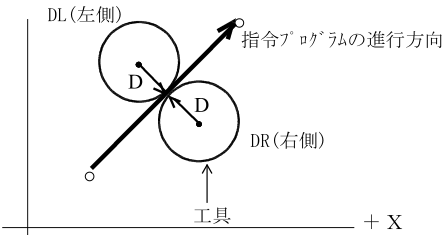

> **図の内容**
>
> 「指令プログラムの進行方向」の直線に対し、工具（半径 D）が DL(左側) または DR(右側) にずれた位置を通る。

※ □はインクレ命令 : なし

論理アブソ座標: A が入ります。

機械アブソ座標: B

横軸/縦軸は、ROMSWの軸設定パラメータの「工具径補正横/縦軸選択」で対象とする2軸を選択できます。詳細は、<5-17-3.工具径補正機能>(TB00-0980E)を参照下さい。

##### 7-1-10-2．DC : 工具径補正停止

<オプション>

【書式】

DC ;

【グループ】 Gr5

【機能】

工具径補正を停止します。

##### 7-1-11-1．PNO :プログラム番号

【書式】

PNO＿;

| アドレス   | 内容      | 範囲      | 省略時   | 単位   |
|--------|---------|---------|-------|------|
| PNO    | プログラム番号 | 1〜32767 | ×     | 数字   |

【グループ】その他

【機能】

運転プログラムの先頭で「PNO__;」と記述して下さい。運転プログラム選択で指定するプログラム番号です。

同タスク内で同じプログラム番号のプログラムをダウンロードする事はできません。

##### 7-1-11-2．':' : ラベル定義

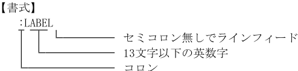

> **図の内容**
>
> 【書式】`:LABEL` — 「:」はコロン、「LABEL」は 13文字以下の英数字、セミコロン無しでラインフィード。

【グループ】その他

##### 7-1-11-3．"/*" ･･･ "*/" または "「" ･･･ "」" : コメント

【グループ】その他

【機能】

任意の文字列を"/*"と"*/"で囲む、又は"「"と"」"で囲む事により、運転プログラムテキストにコメントを記述することが可能です。

DNC運転プログラムでは、複数行にまたがるコメントはエラーになります。

##### 7-1-11-4．"//" :コメント

【グループ】その他

【機能】

任意の文字列の前に"//"を置く事により、その行の以降の文字列を運転プログラムテキストにコメントとして記述することが可能です。

コロン

### 7-2．Gコード運転プログラム命令

7-2-1．Gコード運転プログラムの概要

##### 7-2-1-1．Gコード指令一覧

(1)Gコード

| グループ    | Gコード                      | モーダル        | 対応するテクノコード        | 動作                                                                  | 章番号                                 |
|---------|---------------------------|-------------|--------------------|---------------------------------------------------------------------|-------------------------------------|
| Gr2     | G91 G90                   | モーダル        | - -                | インクレ指定論理座標系アブソ指定                                                   | 7-2-5-6． 7-2-5-7．                   |
| Gr1     | (G91)G00 (G90)G00         | 非モーダル       | PTP PTPA           | インクレ位置決め論理座標系アブソ位置決め機械座標系アブソ位置決め                                  | 7-2-4-1． 7-2-4-1． 7-2-4-2．          |
| Gr1     | G28 (G91)G01 (G90)G01     | モーダル        | PTPB LIN LINA      | インクレ直線補間論理座標系アブソ直線補間                                               | 7-2-4-3． 7-2-4-3．                   |
| Gr1     | G31                       | 非モーダル       | SLIN               | ｲﾝｸﾚｾﾝｻｰﾗｯﾁ補間 <OP>7-2-4-5．                                          | ｲﾝｸﾚｾﾝｻｰﾗｯﾁ補間 <OP>7-2-4-5．          |
| Gr1     | (G91)G02 (G90)G02         | モーダル        | CIRR CIRRA         | ｲﾝｸﾚ円弧補間CW 中心指定､半径指定(CR) 論理座標系アブソ円弧補間CW                             | 7-2-4-4． 7-2-4-4．                   |
| Gr2     | (G91)G03 (G90)G03 G17 G18 | モーダル        | CIRL CIRLA PXY PYZ | インクレ円弧補間CCW 論理座標系アブソ円弧補間CCW XY平面指定 YZ平面指定                           | 7-2-4-4． 7-2-4-4． 7-2-5-8． 7-2-5-8． |
|         | G19                       |             | PZX                | ZX/XZ平面指定（選択）                                                       | 7-2-5-8．                            |
| Gr1     | G04 G40                   | 非モーダル       | TIM/TM DC          | ドウェル 7-2-4-10．径補正キャンセル                                             | <OP>7-2-5-5．                        |
| Gr2 Gr1 | G41 G42 G43 G49           | モーダルモーダル   | DL DR THSET        | 径補正方向指定(左側) 径補正方向指定(右側) 工具長補正開始 <OP>7-2-4-11 工具長補正キャンセル <OP>7-2-4-1 | <OP>7-2-5-4． <OP>7-2-5-4．．         |
| Gr1     | G61                       | モーダル        | THOFF INPE         | インポズチェック有効インポズチェック無効                                               | 2． 7-2-4-13．                        |
|         | G64                       | 非モーダル       | INPD CSET          | 論理座標設定                                                              | 7-2-4-14． 7-2-4-15．                 |
| Gr1 Gr1 | G92 G100                  | 非モーダル       | PTMA               | ポイント位置決め                                                            | <OP>7-2-4-16 ．                      |
| Gr1     | G91 G101 G90 G101 G104    | 非モーダル非モーダル | AXMV AXMVA AXWT    | インクレ独立位置決め論理座標系アブソ独立位置決め独立位置決め完了待ち                                | 7-2-4-17． 7-2-4-17． 7-2-4-18．       |
| Gr1     | G128                      |             | AXMVB              | 機械座標系アブソ独立位置決め                                                      | 7-2-4-17．                           |
| Gr1     | G110 G111                 | モーダル        | STNE STND          | 接線制御有効 <OP>7-2-4-7．接線制御キャンセル <OP>7-2-4-8．                          |                                     |
| Gr1     | G112                      | 非モーダル       | TURN               | 接線制御                                                                | <OP>7-2-4-6．                        |
| Gr1     | G120                      | 非モーダル       | SPIN               | 無限回転軸回転動作                                                           | 7-2-4-9．                            |
| Gr1     | G197                      | 非モーダル       | TSTOP              | 別タスク停止                                                              | <OP>7-2-4-20 ．．                    |
| Gr1     | G198                      | 非モーダル       | TSTART             | 別タスクプログラム起動                                                         | <OP>7-2-4-19 ．                      |
| Gr1     | G199                      |             | TRESET             | 別タスクリセット                                                            |                                     |
|         |                           | 非モーダル       |                    | <OP>7-2-4-21                                                        |                                     |

(2) 補助コード

| グループ   | Gコード   | テクノコード   | 動作           | 章番号               |
|--------|--------|----------|--------------|-------------------|
| Gr2    | M**    | MOUT**   | Ｍコード出力       | 7-2-5-1．          |
| Gr2    | M00    | MOUT00   | プログラムストップ    | 7-2-5-1． 7-2-5-1． |
| Gr2    | M01    | MOUT01   | オプショナルストップ   |                   |
| Gr1    | M03    | -        | 主軸正転         | <OP>7-2-4-2 2．    |
| Gr1    | M04    | -        | 主軸逆転         | <OP>7-2-4-22 ．    |
| Gr1    | M05    | -        | 主軸停止         | <OP>7-2-4-2 2．    |
| Gr1    | M30    | END      | プログラム運転終了    | 7-2-4-24．         |
| Gr1    | M98    | CALL     | サブプログラム呼出 ※1 | 7-2-4-25．         |
| Gr1    | M99    | END      | サブプログラム終了    | 7-2-4-26．         |
| Gr2    | S      | -        | 主軸回転速度設定     | <OP>7-2-5-3．      |

(3) その他

| グループ   | Gコード      |      | テクノコード   | 動作                | 章番号       |
|--------|-----------|------|----------|-------------------|-----------|
| Gr1    | マクロ命令     | <OP> | マクロ命令    | 四則演算、内部データ読出/書込   | 7-2-4-27． |
| Gr1    | IF        |      | IF       | 条件判断 <OP>7-2-4-28 | ．         |
| Gr1    | ELSE      |      | ELSE     |                   |           |
| Gr1    | ENDIF     |      | ENDIF    |                   |           |
| Gr1    | GOTO      |      | JMP      | ジャンプ              | 7-2-4-23． |
| Gr2    | N         |      |          | シーケンス番号           | 7-2-5-9．  |
| -      | PNO       |      | PNO      | プログラム番号指定         | 7-2-6-1．  |
| -      | /* --- */ |      |          | /* コメント(文字列) */   | 7-2-6-2．  |

##### 7-2-1-2．シーケンス番号(N)

シーケンス番号は、ステップの前に"N"+ 任意の番号(最大4桁)で記述できます。

シーケンス番号の指定範囲は、0〜9999(10進数)です。

シーケンス番号は任意の番号を設定可能です。

【シーケンス番号の目的】

- (1)サブルーチンのラベルサブルーチンの呼び出し(M98)では、シーケンス番号を指定します。
- (2)GOTO指令の飛び先
- (3)プログラム途中再開の再開ポイントの指定
- (4)運転プログラムの読みやすさのためのラベル

シーケンス番号は、通常は各々を異なる番号にしますが、同一番号を複数のステップに設定もできます。ただ、上記の(1)(2)として有効なのは、運転プログラムの先頭に近いもののみです。

##### 7-2-1-3．Gコード運転のプログラム途中再開

Gコード運転では、リセットやエラーによる中断後に、途中再開が可能です。

Gコード運転中に、実行したステップにシーケンス番号がある場合、PLMCは、これを記憶します。

中断後の起動では、直近に記憶したシーケンス番号のステップから再開します。

記憶したシーケンス番号は、次の操作や動作でクリアされます。

- リワインド操作
- プログラム終了(M30)
- 別プログラムの起動
- 同一プログラムへのダウンロード(上書)
- バックアップメモリ初期化

中断後に同一運転プログラムの先頭から実行する場合は、リワインド操作を行って下さい。リワインド入力については、<2-1-1.一般入力>(TB00-0900D)を参照して下さい。

##### 7-2-1-4．Gコードのモーダル

Gコード指令には、モーダルと非モーダルの種別があります。

モーダル : 一度指令すると次のステップ以降では、その指令の記述を省略できます。

その指令の内容を継続します。

7-2-1-1 の表で「モーダル」の表記で示します。

非モーダル: 次のステップにその内容を引き継ぎません。

複数のステップに連続する場合でも、各ステップで記述が必要です。

##### 7-2-1-5．Gコードプログラム例

PNO1;

N10 G90 G00 X0 Y0 Z0 A0 M11;

M98 P20 L2;

※1

G04 P1.0;

G90 G00 X10.0 Y10.0 Z10.0 A10.0 M12;

M98 P20;

G04 P1.0;

G91 G02 X40.0 Y0 Z10.0 I20.0 J0 F100;

M30;

N20 G91 G00 X10.0 Y-10.0 Z10.0 A-10.0; ※2

G00 X-10.0 Y10.0 Z-10.0 A10.0;

G04 P0.5

G01 X150.0 Y200.0 Z250.0 F200;

M99;

- ※1 メインプログラムはサブルーチンで指令したモーダルGコードを引き継ぎません。サブルーチンからリターンしたときは、CALL前のモーダルになります。

※2 サブルーチンの先頭では、Gコードモーダルは不定となります。従って、サブルーチンではモーダルGコードを設定し直して下さい。

運転プログラムのサンプルを別資料で紹介します。

「サンプル運転プログラム説明書」(TB04-0422)を参照して下さい。テクノHPの会員コーナからダウンロードできます。

#### 7-2-2．付加データ

Gコードの付加データは、「アドレス+即値/マクロ変数」の形式です。各アドレスを簡単に紹介します。

```c
    アドレス 内容 説明
    X 第1軸移動量・移動位置
    Y 第2軸移動量・移動位置 移動量 :移動開始点からのインクレ量
    Z 第3軸移動量・移動位置 移動位置 :論理/機械座標系での位置
    A 第4軸移動量・移動位置
    B 第5軸移動量・移動位置 使用例 G90 G00 X30000 B-2500 Q600;
    C 第6軸移動量・移動位置 G91 G01 X255 B-500 Q200 F3000;
    R 第7軸移動量・移動位置
    Q 第8軸移動量・移動位置
    T 第9軸移動量・移動位置
    I 第1軸円弧中心
    J 第2軸円弧中心 円弧開始点からの中心位置(インクレ量)
    K 第3軸円弧中心
    D 第4軸円弧中心 使用例 G91 G02 Y2000 Z0 J1000 K0 F2500;
    E 第5軸円弧中心
    H 第6軸円弧中心
    U 第7軸円弧中心
    V 第8軸円弧中心
    W 第9軸円弧中心
    TX 第1軸円弧通過点
    TY 第2軸円弧通過点 円弧指令での通過位置
    TZ 第3軸円弧通過点
    TA 第4軸円弧通過点 インクレの円弧指令では、インクレ値。
    TB 第5軸円弧通過点 アブソの円弧補間では、アブソ値。
    TC 第6軸円弧通過点
    TR 第7軸円弧通過点 使用例 G90 G03 R5000 Q0 TR2500 TQ-3000 F1500;
```

| TQ   | 第8軸円弧通過点              |                                                            |
|------|-----------------------|------------------------------------------------------------|
| TT   | 第9軸円弧通過点              |                                                            |
| CR   | 円弧半径指定                | 円弧補間指令での円弧半径指定です。使用例 G90 G03 G17 X-2000 Y300 R-1500 F800; |
| F    | 速度指定                  | 移動する全軸の合成速度。                                               |
| P    | ポイント番号プリ解加減速 G04時間指定 | PTMA/LIMAで使用するポイントの番号プリ解加減速の種類開発中 G04命令の時間を指定します。        |
| P    | G98シーケンス番号指定          | G98命令のシーケンス番号(N□□□)を指定します。                                 |
| P    | G198のプログラム番号          | 起動するプログラム番号を指定します。                                         |
| T    | G198のタスク番号            | どのタスクのプログラムを起動するか指定します。                                    |
| L    | 回数指定                  | 繰り返し回数                                                     |
| H    | 工具番号                  | 工具長補正のときの工具番号                                              |
| D    | 工具番号                  | 工具径補正のときの工具番号                                              |

#### 7-2-3．指令の表記方法

7-2-3-1．指令フォーマット

スペース(20H)又はタブ(08H)

シーケンス番号 Gr1指令コード付加データ1 付加データ2・・・ Gr2指令コード;

セミコロン(3BH)

- 通常は、各項目間にスペースコード/タブコードを入れます。ただし、省略も可能です。
- 付加データは指令コードの後に付けてください。
- ステップの最後は";"（セミコロンコード）を付けてください。
- ラインフィードコード(= ニューラインコード)(= '0x0a')も必要です。

##### 7-2-3-2．指令の表記例

直線補間指令の例です。

(G91)G01 (X＿ Y＿ Z＿ A＿ B＿ C＿ R＿ Q＿ T＿)[F＿]; ↑ ↑ 指令コードアドレスと付加データ

- [ ] ( ) この中から1つ以上を選択する必要があります。

- [ ] { } この中から1つだけ選択する必要があります。

- [ ] [ ] 省略できます。

- [ ] ＿即値/マクロ変数です。

以降の説明でも( ){ }[ ]_ は同様です。

軸アドレスの付加データが数値で、次の軸アドレスがアルファベットの場合、間のスペースコードを省略できます。

##### 7-2-3-3．「軸単位」と「速度単位」

- （1）軸単位

各軸の移動量や移動位置を指定する単位です。

- ■小数点なしの表記：パルス単位です。
- ■小数点つきの表記：セッティングPCの「ポジション表示形式設定」の各軸の「パルス/表示」の設定で以下のようになります。

|   パルス/表示 |   1パルスの小数点つき表記 |
|----------|----------------|
|        1 |              1 |
|       10 |            0.1 |
|      100 |           0.01 |
|     1000 |          0.001 |
|    10000 |         0.0001 |
|   100000 |        0.00001 |

例えば、X軸のパルス/表示に1000と指定して、指令でX1.0と指定すると「X1000」と認識されます。

- (2)速度単位

速度指定「F」の単位は、セッティングPCの「.ポジション表示形式設定」の「補間送り速度単位」で設定します。

F1=(1,10,100,1000,10000)P/(秒/分) 選択選択

|   補間送り速度単位 | F1 の意味     | パルス/ の選択        |
|------------|------------|-----------------|
|          1 | 1=1P       | パルス/秒とパルス/分の選択 |
|         10 | 0.1=1P     | パルス/秒とパルス/分の選択 |
|        100 | 0.01=1P    | パルス/秒とパルス/分の選択 |
|       1000 | 0.001=1P   | パルス/秒とパルス/分の選択 |
|      10000 | 0.0001=1P  | パルス/秒とパルス/分の選択 |
|     100000 | 0.00001=1P | パルス/秒とパルス/分の選択 |

- 例 1P = 1μm のシステムで速度単位を mm/secとする場合補間送り速度単位 = 1000 パルス/秒を選択 F1 = 1000/秒 (1000p/秒 = 1mm/秒)
- 1P = 0.1μm のシステムで速度単位を mm/分とする場合補間送り速度単位 = 10000 パルス/分を選択 F1 = 10000/分 (10000p/分 = 1mm/分)

##### 7-2-3-4．「軸範囲」と「速度範囲」

(1)軸範囲

軸の移動量や位置で指定できる数値の範囲です。±1000000000(パルス)の範囲です。以降の説明でも"軸範囲"と記述します。

(2)速度範囲

指定できる速度の範囲です。1pps〜1Gppsです。以降の説明でも"速度範囲"と記述します。

##### 7-2-4-1．G00 : 位置決めPTP移動（インクレ/論理座標系アブソ）

【書式】

- (G01) G00 (X＿ Y＿ Z＿ A＿ B＿ C＿ R＿ Q＿ T＿);
- (G00) G00 (X＿ Y＿ Z＿ A＿ B＿ C＿ R＿ Q＿ T＿);

| アドレス   | 内容          | 内容        | 範囲   | 省略時   | 単位   |
|--------|-------------|-----------|------|-------|------|
| X      | X軸の移動量/目標位置 | ※マクロ変数指定可 | 軸範囲  |       | 軸単位  |
| Y      | Y軸の移動量/目標位置 | ※マクロ変数指定可 | 軸範囲  |       | 軸単位  |
| Z      | Z軸の移動量/目標位置 | ※マクロ変数指定可 | 軸範囲  |       | 軸単位  |
| A      | A軸の移動量/目標位置 | ※マクロ変数指定可 | 軸範囲  |       | 軸単位  |
| ・      | ・           |           | 軸範囲  |       | 軸単位  |
| ・      | ・           |           | 軸範囲  |       | 軸単位  |
| T      | T軸の移動量/目標位置 | ※マクロ変数指定可 | 軸範囲  |       | 軸単位  |

【グループ】

Gr1

【機能】

インクレ指定(G91)のときは現在位置からの移動量、アブソ指定(G90)のときは論理座標の座標位置まで移動します。

【記述例】

G91 G00

G90 G00

```c
    X100
    A10000
```

Z-10;

Q-2000;

##### 7-2-4-2．G28 : 機械座標上の位置へのPTP移動指令

【書式】

G28 (X＿ Y＿ Z＿ A＿ B＿ C＿ R＿ Q＿ T＿);

| アドレス   | 内容          | 内容        | 範囲   | 省略時   | 単位   |
|--------|-------------|-----------|------|-------|------|
| X      | X軸の移動量/目標位置 | ※マクロ変数指定可 | 軸範囲  |       | 軸単位  |
| Y      | Y軸の移動量/目標位置 | ※マクロ変数指定可 | 軸範囲  |       | 軸単位  |
| Z      | Z軸の移動量/目標位置 | ※マクロ変数指定可 | 軸範囲  |       | 軸単位  |
| A      | A軸の移動量/目標位置 | ※マクロ変数指定可 | 軸範囲  |       | 軸単位  |
| ・      | ・           |           | 軸範囲  |       | 軸単位  |
| ・      | ・           |           | 軸範囲  |       | 軸単位  |
| T      | T軸の移動量/目標位置 | ※マクロ変数指定可 | 軸範囲  |       | 軸単位  |

【グループ】

Gr1

【機能】

機械座標の指定目標まで位置決めします。

##### 7-2-4-3．G01 : 直線補間（インクレ/論理座標系アブソ）

【書式】

- G01 (X＿ Y＿ Z＿ A＿ B＿ C＿ R＿ Q＿ T＿)[F＿];
- G00 (X＿ Y＿ Z＿ A＿ B＿ C＿ R＿ Q＿ T＿)[F＿];

| アドレス   | 内容          | 内容        | 範囲   | 省略時単位     |
|--------|-------------|-----------|------|------------|
| X      | X軸の移動量/目標位置 | ※マクロ変数指定可 | 軸範囲  | 軸単位        |
| Y      | Y軸の移動量/目標位置 | ※マクロ変数指定可 | 軸範囲  | 軸単位        |
| Z      | Z軸の移動量/目標位置 | ※マクロ変数指定可 | 軸範囲  | 軸単位        |
| A      | A軸の移動量/目標位置 | ※マクロ変数指定可 | 軸範囲  | 軸単位        |
| ・      | ・           |           | 軸範囲  | 軸単位        |
| ・      | ・           |           | 軸範囲  | 軸単位        |
| T      | T軸の移動量/目標位置 | ※マクロ変数指定可 | 軸範囲  | 軸単位        |
| F      | 補間速度        | ※マクロ変数指定可 | 速度範囲 | モーダル値速度単位 |

【グループ】

Gr1

【機能】

インクレ指令(G91)のときは現在位置からの移動量、アブソ指令(G90)のときは論理座標の目標位置まで直線補間で動きます。

補間速度は移動軸すべての合成速度です。

Fを省略したときは現在のモーダル値になります。

詳しくは、「4-6直線補間」を参照してください。

##### 7-2-4-4．G02 : 時計方向回り(CW)円弧補間 (インクレ/論理座標系アブソ) G03 : 反時計方向回り(CCW)円弧補間(インクレ/論理座標系アブソ)

円弧指令には、3種類の書式があります。

【書式】

○ 半径指定

円弧の半径と終点を指定（半径指定では円弧平面指定が必要です）

(G91)G02

(G91)G03

(G17/18/19) (X＿ Y＿ Z＿ A＿ B＿ C＿ R＿ Q＿ T＿)

(G90)G02

CR_ [L_]F_;

(G90)G03

○ 中心指定円弧の中心と終点を指定 (G91)G02 (G91)G03 (X＿ Y＿ Z＿ A＿ B＿ C＿ R＿ Q＿ T＿); (G90)G02 {I＿ J＿ K＿ D＿ E＿ H＿ U＿ V＿ W＿} [L＿] F＿ ; (G90)G03

(X＿ Y＿ Z＿ A＿ B＿ C＿ R＿ Q＿ T＿) {TX＿ TY＿ TZ＿ TA＿ TB＿ TC＿ TR＿ TQ＿ TT＿} [L＿] F＿ ;

- ３点（通過点）指定円弧の通過点と終点を指定 (G91)G02 (G91)G03 (G90)G02 (G90)G03
- ※1 G19のXZ/ZXの選択は、セッティングPCの「ポジション表示形式設定」で行ってください。
- ※2 中心位置は、円弧開始点からのインクレ値です。
- ※3 通過点は、インクレ指令ではインクレ値、アブソ指令ではアブソ値です。

| アドレス   | 内容              | 内容        | 範囲        | 省略時     | 単位   |
|--------|-----------------|-----------|-----------|---------|------|
| X      | X軸の移動量/目標位置     | ※マクロ変数指定可 |           |         |      |
| Y      | Y軸の移動量/目標位置     | ※マクロ変数指定可 | 軸範囲       | -       | 軸単位  |
| Z      | Z軸の移動量/目標位置     | ※マクロ変数指定可 | 軸範囲       | -       | 軸単位  |
| ・      | ・               |           | 軸範囲       | -       | 軸単位  |
| ・      | ・               |           | 軸範囲       | -       | 軸単位  |
| T      | T軸の移動量/目標位置     | ※マクロ変数指定可 | 軸範囲       | -       | 軸単位  |
| L      | 多回転指令           | ※マクロ変数指定可 | 1 〜 5000  | L1      | 回転数  |
| F      | 補間移動速度          | ※マクロ変数指定可 | 速度範囲      | [モーダル値] | 速度単位 |
| G17    | 円弧平面指定(XY平面)    |           | -         | モーダル値   | -    |
| G18    | 円弧平面指定(YZ平面)    |           | -         | モーダル値   | -    |
| G19    | 円弧平面指定(XZ/ZX平面) | 選択可 ※1    | -         | モーダル値   | -    |
| CR     | 円弧半径指定          | ※マクロ変数指定可 | 軸範囲       |         | 軸単位  |
| I      | X軸中心位置 ※2       | ※マクロ変数指定可 |           |         |      |
| J      | Y軸中心位置          | ※マクロ変数指定可 | 軸範囲       | -       | 軸単位  |
| K      | Z軸中心位置          | ※マクロ変数指定可 |           |         |      |
| D      | A軸中心位置          | ※マクロ変数指定可 |           |         |      |
| E      | B軸中心位置          | ※マクロ変数指定可 |           |         |      |
| H      | C軸中心位置          |           | ※マクロ変数指定可 |         |      |
| U      | R軸中心位置          | ※マクロ変数指定可 |           |         |      |
| V      | Q軸中心位置          | ※マクロ変数指定可 |           |         |      |
| W      | T軸中心位置          | ※マクロ変数指定可 |           |         |      |
| TX     | Z軸の通過点位置 ※3     | ※マクロ変数指定可 |           |         |      |
| TY     | A軸の通過点位置        |           | ※マクロ変数指定可 |         |      |
| TZ     | Z軸の通過点位置        | ※マクロ変数指定可 |           |         |      |
| ・      | ・               |           |           |         |      |
| ・      | ・               |           |           |         |      |
| TT     | T軸の通過点位置        | ※マクロ変数指定可 |           |         |      |

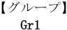

> **図の内容**
>
> 【グループ】Gr1

【機能】

- 2軸の円弧補間です。

円弧の2軸に加えて1軸を指定するとヘリカルになります。 ※ ヘリカルでの第3軸の移動は、円弧の全移動量に同期します。

- 円弧処理には「ボード内部方式」と「プリ解析方式」の2つの方式があります。セッティングPCの「ポジション表示形式設定画面」で選択できます。各方式については<5-7.円弧補間>(TB00-0900E)を参照して下さい。
- 補間速度(F)は合成速度です。
- 多回転データ(L)で多回転円弧ができます。(L-1)回転した後、終点まで円弧動作します。 ※ 多回転データは、ボード内部方式でのみ使用できます。

ただし、ヘリカルの場合は、円弧処理方式により、合成速度の意味が変わります。

ボード内部方式 : 円弧2軸の合成速度です。ヘリカル軸はこれに同期します。

プリ解析方式 : ヘリカル軸も含めた3軸の合成速度です。

旋盤の「直径指令」

旋盤の「直径指令」の軸で、移動量/目標位置/通過点を指定するときは「直径値」です。ただし、円弧指令の半径/中心は、常に「半径値」です。

※「直径値/半径値」:旋盤での指定方式です。円弧の直径/半径とは別の意味です。

- 詳細は、〈5-15-8 直径指令〉(TB00-0900E)を参照ください。

**○ 半径指定**

移動量/目標位置(X...T)、補間速度(F)、多回転指定(L)の他に以下の指定を行います。

- 円弧半径 :CR で円弧の半径を指定します。
- 円弧平面 :P□□で円弧平面を指定します。 (□は軸アドレス)
- ※ 半径指定では1周円動作はできません。1周円は、中心指定/3点指定で記述下さい。

(例)

- ① (G91)G18 G02 X550 Z-100 CR320 (A1000) F1000;
- ② (G91)G18 G02 X550 Z-100 CR-320(A1000) F1000;

(A1000)はヘリカル動作です。(記述しないと通常円弧です)

半径指定は円弧の半径を直接CRで指定し、以下のように設定できます。

CR>0のとき、円弧角180°以下の円弧

・・・・・右図の①

CR<0のとき、円弧角180°以上の円弧・・・・・右図の②


> **図の内容**
>
> 開始点から終点へ（X550、Z-100）。CR320 は円弧角 180° 未満の円弧 ①、CR-320 は円弧角 180° 以上の円弧 ②。

**○ 中心指定**

移動量/目標位置(X...T)、補間速度(F)、多回転指定(L)の他に以下の指定を行います。

- 中心 :円弧開始点からの距離で指定します。

X軸〜T軸に対応する中心指定は「I、J、K、D、E、H、U、V、W」です。

円弧中心は必ず2軸分指定ください。

円弧中心指定の軸以外で移動量が指定された軸は、円弧補間と同期して移動します。ヘリカル動作です。

(G91)G02 X700 Y-100 I300 J-400 (Z1000) F1000; (G90)G02 R700 T-100 U300 W-400 (Z1000) F1000;

(Z1000)を記述するとヘリカル動作します。

(例)

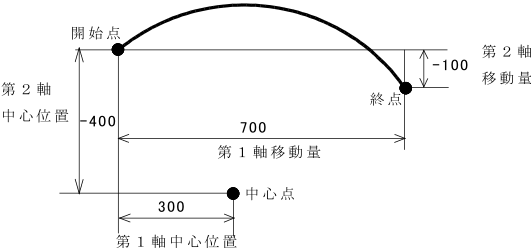

> **図の内容**
>
> 開始点から終点へ。第１軸移動量 700、第２軸移動量 −100。中心点は 第１軸中心位置 300、第２軸中心位置 −400。

**○ 3点(通過点)指定**

移動量/目標位置(X...T)、補間速度(F)、多回転指定(L)の他に以下の指定を行います。

- 通過点 :X軸〜T軸に対応する通過点指定は「TX、TY、TZ、TA〜TQ、TT」です。通過点は必ず2軸分指定ください。

(例)

(G91)G02 X700 Y-100 TX300 TY120 (Z1000) F1000; (G91)G02 R700 T-100 RX300 TT120 (Z1000) F1000;

(Z1000)を記述するとヘリカル動作します。

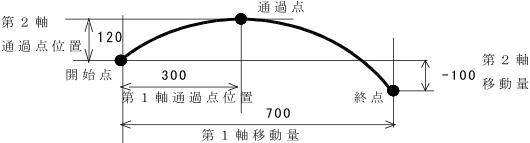

> **図の内容**
>
> 開始点から通過点を経て終点へ。第１軸通過点位置 300、第２軸通過点位置 120、第１軸移動量 700、第２軸移動量 −100。

##### 7-2-4-5．G31 : センサラッチ直線補間

【書式】

G31 (X＿ Y＿ Z＿ A＿ B＿ C＿ R＿ Q＿ T＿) [F＿];

| アドレス   | 内容          | 内容        | 範囲   | 省略時単位     |
|--------|-------------|-----------|------|------------|
| X      | X軸の移動量/目標座標 | ※マクロ変数指定可 | 軸範囲  | 軸単位        |
| Y      | Y軸の移動量/目標座標 | ※マクロ変数指定可 | 軸範囲  | 軸単位        |
| Z      | Z軸の移動量/目標座標 | ※マクロ変数指定可 | 軸範囲  | 軸単位        |
| A      | A軸の移動量/目標座標 | ※マクロ変数指定可 | 軸範囲  | 軸単位        |
| ・・    | ・・         |           | 軸範囲  | 軸単位        |
| T      | T軸の移動量/目標座標 | ※マクロ変数指定可 | 軸範囲  | 軸単位        |
| F      | 補間移動速度      | ※マクロ変数指定可 | 速度範囲 | モーダル値速度単位 |

【グループ】

Gr1

【機能】

目標位置に向かって直線補間動作します。動作中にセンサラッチ信号(SENCE_I)がONすると、その時の位置を記憶して停止します。

詳細は、<5-15-6.センサーラッチ機能(スキップ機能)>(TB00-0900E)を参照して下さい。

【記述例】

G31 X1000 Y2000 F1000;

##### 7-2-4-6．G112 : 接線制御Z軸回転

<オプション>

【書式】

G112 (X＿ Y＿ Z＿ A＿ B＿ C＿ R＿ Q＿ T＿) [P＿ ];

| アドレス   | 内容           | 範囲           |   省略時 | 単位     |
|--------|--------------|--------------|-------|--------|
| X      | X軸の移動量（接線方向） | 軸範囲          |       | 軸単位    |
| Y      | Y軸の移動量（接線方向） | 軸範囲          |       | 軸単位    |
| Z      | Z軸の移動量（接線方向） | 軸範囲          |       | 軸単位    |
| A      | A軸の移動量（接線方向） | 軸範囲          |       | 軸単位    |
| ・      | ・            | 軸範囲          |       | 軸単位    |
| ・      | ・            | 軸範囲          |       | 軸単位    |
| T      | T軸の移動量（接線方向） | 軸範囲          |       | 軸単位    |
| P      | 待ち時間         | 0.1〜999999.9 |     0 | 0.1sec |

【グループ】

Gr1

【機能】

接線制御用の命令です。

- 2軸の移動量で接線方向（回転軸の角度）を指定します。実際の移動はしません。
- G112指令の次ステップに接線方向を規定する移動指令がある場合、G112指令での移動量を省略できます。
- 待ち時間[P]は回転軸の回転後の待ち時間です。
- 待ち時間[P]は省略できます。このときは回転のみで待ち時間"0"になります。
- G112命令ではマクロ変数は使用できません。
- G112命令を使用するときはこの前に接線制御有効命令(G110)が必要です。

詳細は、<5-15-5.接線制御機能>(TB00-0980E)を参照下さい。

##### 7-2-4-7．G110 : 接線制御有効

<オプション>

【書式】

G110 ;

【グループ】 Gr1

【機能】

接線制御を有効にします。

※ 接線制御の詳細については<5-15-5 接線制御>(TB00-0980E)を参照してください。

##### 7-2-4-8．G111 : 接線制御無効

<オプション>

【書式】

G111 ;

【グループ】 Gr1

【機能】

接線制御を無効にします。

##### 7-2-4-9．G120 : 回転速度指令

【書式】

G120 (X＿ Y＿ Z＿ A＿ B＿ C＿ R＿ Q＿ T＿);

| アドレス   | 内容     | 内容        | 範囲     | 省略時   | 単位     |
|--------|--------|-----------|--------|-------|--------|
| X      | X軸回転速度 | ※マクロ変数指定可 | 回転速度範囲 | ×     | 0.1rpm |
| Y      | Y軸回転速度 | ※マクロ変数指定可 | 回転速度範囲 | ×     | 0.1rpm |
| Z      | Z軸回転速度 | ※マクロ変数指定可 | 回転速度範囲 | ×     | 0.1rpm |
| A      | A軸回転速度 | ※マクロ変数指定可 | 回転速度範囲 | ×     | 0.1rpm |
| ・      | ・      |           | 回転速度範囲 | ×     | 0.1rpm |
| ・      | ・      |           | 回転速度範囲 | ×     | 0.1rpm |
| T      | T軸回転速度 | ※マクロ変数指定可 | 回転速度範囲 | ×     | 0.1rpm |

【グループ】

Gr1

【機能】

定速回転の指令です。無限回転軸に対して使用できます。 PTP時定数(サーボパラメータ)で加速/減速します。

ROMSW設定ソフトの"メカ機構1回転パルス数"の設定が必要です。

詳細は、<5-15-2.回転速度指令>(TB00-0980E)を参照下さい。

##### 7-2-4-10．G04 : ステップ実行時間指定

【書式】

G04 P＿ ;

| アドレス   | 内容             | 範囲           | 省略時   | 単位   |
|--------|----------------|--------------|-------|------|
| P      | 待ち時間 ※マクロ変数指定可 | 1.0〜999999.9 | ×     | sec  |

【グループ】

Gr1

【機能】

各ステップの所用時間を指定します。

通常は、指定する必要がありません。この場合、移動距離 ÷送り速度でそのステップ時間となります。

ステップ時間 = 軸移動時間

時間を指定して、その設定値が軸移動時間を越えている場合、移動完了後にその差分の時間だけ、次のステップへの進行を停止します。

ステップ時間 = 軸移動時間 + 差分の停止時間

P指令の設定範囲は1.0〜999999.9で、単位は1秒です。 G04は、他のGコードと同時には使えません。

【記述例】

G04 P1.0; (1秒待ち)

##### 7-2-4-11．G43 : 工具長補正開始

<オプション>

【書式】

G43 H＿ ;

| アドレス   | 内容          | 範囲    | 省略時   | 単位   |
|--------|-------------|-------|-------|------|
| H      | 工具長補正テーブル番号 | 0〜399 | ×     | 番号   |

【グループ】

Gr1

【機能】

- 工具長補正を実行します。
- 工具長補正はモーダル指令です。
- 工具長補正の対象の軸は、ROMSWで選択できます。
- 詳細は、<5-17-2.工具長補正機能及び摩耗補正機能>(TB00-0980E)を参照下さい。

##### 7-2-4-12．G49 : 工具長補正停止

<オプション>

【書式】

G49 ;

【グループ】

Gr1

【機能】

工具長補正をキャンセルします。

##### 7-2-4-13．G61 : INPOS有効モード指定

【書式】

G61 ;

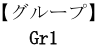

> **図の内容**
>
> 【グループ】Gr1

【機能】

インポジションチェック有効となります。

但し、サーボパラメータにてインポジションチェック無効(INPOS量=0)としている場合は、インポジションチェックを有効にします。G61を指令すると、以後G64を指令するまで、INPEが指定されても無視します。

動作詳細については、以下を参照して下さい。

- <5-9.インポジションチェック>(TB00-0980E)
- 「サンプル運転プログラム説明書」<11.INPOS有効/無効>(TB04-0422)

##### 7-2-4-14．G64 : INPOS無効モード<デフォルト>指定

【書式】

G64 ;

【グループ】

Gr1

【機能】

インポジションチェックを無効にします。G64を指令すると、以後G61が指令するまでのインポジションチェック無効(パスモード)となります。

詳細については、以下を参照して下さい。

- <5-9.インポジションチェック>(TB00-0980E)
- 「サンプル運転プログラム説明書」<11.INPOS有効/無効>(TB04-0422)

##### 7-2-4-15．G92 : 論理座標設定

【書式】

G92 (X＿ Y＿ Z＿ A＿ B＿ C＿ R＿ Q＿ T＿);

| アドレス   | 内容    | 内容        | 範囲   | 省略時   | 単位   |
|--------|-------|-----------|------|-------|------|
| X      | X軸座標値 | ※マクロ変数指定可 | 軸範囲  | -     | 軸単位  |
| Y      | Y軸座標値 | ※マクロ変数指定可 | 軸範囲  | -     | 軸単位  |
| Z      | Z軸座標値 | ※マクロ変数指定可 | 軸範囲  | -     | 軸単位  |
| A      | A軸座標値 | ※マクロ変数指定可 | 軸範囲  | -     | 軸単位  |
| ・      | ・     |           | 軸範囲  | -     | 軸単位  |
| ・      | ・     |           | 軸範囲  | -     | 軸単位  |
| T      | T軸座標値 | ※マクロ変数指定可 | 軸範囲  | -     | 軸単位  |

【グループ】

Gr1

【機能】

現在の論理座標系の位置を指定された値に変更します。（論理座標系のセットアップ）指定軸のみ座標変更します。

【記述例】

- G92 X0 Y0 Z100;

現在の論理座標値を(X=0 Y=0 Z=100)とします。

動作詳細については、以下を参照して下さい。

- 「サンプル運転プログラム説明書」<8.論理座標設定命令>(TB04-0422)

##### 7-2-4-16．G100 : ポイント指定PTP位置決め移動<オプション>

【書式】

G100 P＿;

| アドレス   | 内容     | 内容        | 範囲   | 省略時   | 単位   |
|--------|--------|-----------|------|-------|------|
| P      | ポイント番号 | ※マクロ変数指定可 | ※1   | ×     | 番号   |

【グループ】

Gr1

【機能】

ポイントテーブルは、複数のポイント座標値のデータテーブルです。

ポイント番号は、ポイントテーブル内の特定のポイントを指定します。

G100では、ポイント番号Pを指定します。

G100は、指定のポイントの座標値を目標位置として位置決めする指令です。

存在しないポイントを指定した場合はプログラム実行エラーとなります。

ポイントテーブルは、セッティングPC/通信コマンドで設定できます。

詳細は以下を参照して下さい。

- 「PLMC-M3EX セッティングPCマニュアル」<5-3-5-2.ポイント位置決めテーブル>(TB00-0981)
- 「送受信データ説明書」<4-1-27.ポイントテーブル書込/読出>(TB00-0984)

【記述例】

G100 P1 ;

G100 P#1000;

動作詳細については、以下を参照して下さい。

- 「サンプル運転プログラム説明書」<9.ポイント指定位置決め命令>(TB04-0422)

##### 7-2-4-17．G101 : 独立位置決め(インクレ/論理座標系アブソ)

G128 : 独立位置決め(機械座標系アブソ)

【書式】

(G91) G101 (X＿ Y＿ Z＿ A＿ B＿ C＿ R＿ Q＿ T＿) (G90) G101 {FX＿ FY＿ FZ＿ FA＿ FB＿ FC＿ FR＿ FQ＿ FT＿}; G128

| アドレス   | 内容          | 内容        | 範囲   | 省略時   | 単位   |
|--------|-------------|-----------|------|-------|------|
| X      | X軸の移動量/目標位置 | ※マクロ変数指定可 | 軸範囲  |       | 軸単位  |
| Y      | Y軸の移動量/目標位置 | ※マクロ変数指定可 | 軸範囲  |       | 軸単位  |
| Z      | Z軸の移動量/目標位置 | ※マクロ変数指定可 | 軸範囲  |       | 軸単位  |
| A      | A軸の移動量/目標位置 | ※マクロ変数指定可 | 軸範囲  |       | 軸単位  |
| ・      | ・           |           | 軸範囲  |       | 軸単位  |
| ・      | ・           |           | 軸範囲  |       | 軸単位  |
| T      | T軸の移動量/目標位置 | ※マクロ変数指定可 | 軸範囲  |       | 軸単位  |
| FX     | X軸補間速度      | ※マクロ変数指定可 | 速度範囲 | ×     | 速度単位 |
| FY     | Y軸補間速度      | ※マクロ変数指定可 | 速度範囲 | ×     | 速度単位 |
| FZ     | Z軸補間速度      | ※マクロ変数指定可 | 速度範囲 | ×     | 速度単位 |
| FA     | A軸補間速度      | ※マクロ変数指定可 | 速度範囲 | ×     | 速度単位 |
| ・      | ・           |           | 速度範囲 | ×     | 速度単位 |
| ・      | ・           |           | 速度範囲 | ×     | 速度単位 |
| FT     | T軸補間速度      | ※マクロ変数指定可 | 速度範囲 | ×     | 速度単位 |

【グループ】

Gr1

【機能】

独立位置決めは、位置決め開始の指令です。

運転プログラムの場合、指定の軸の位置決めを開始し、その次の制御周期では、つぎの命令を実行します。また、PCやラダーのコマンドの場合は、開始直後に別の移動指令(他の軸)を発行できます。

- 本命令のステップでは、指令された軸の移動開始のみを行います。
- 指令軸数が同時に4軸を超えた場合や、移動指定軸と速度指定軸の対応が合わない場合は、フォーマットエラーになります。

動作詳細、通信コマンドについては、以下を参照して下さい。

- <5-20.独立位置決め>(TB00-0980E)
- 「送受信データ説明書」<4-2-56.独立位置決めコマンド>(TB00-0984)

(G91) G101 : インクレ直線補間

(G90) G101 : 論理座標系アブソ直線補間

G128 : 機械座標系アブソ直線補間

【記述例】

(G91) G101 X10000 Y-52000 FX#8000 FY5000;

(G90) G101 X#5510 Y-#5512 FX#5520 FY#5522;

※ 1命令で最大4軸までしか指定できません。

##### 7-2-4-18．G104 : 独立位置決め完了待ち命令

【書式】

G104 (□ □ □ □ □ □ □ □ □);

G104 #＿ ;

| 記号   | 内容                      | 範囲    | 省略時   | 単位   |
|------|-------------------------|-------|-------|------|
| □    | 軸アドレス X Y Z A B C R Q T | 軸名称   | -     |      |
| #    | マクロ変数番号                 | マクロ番号 | -     | ビット  |

【グループ】

Gr1

【機能】

- 指定した全ての軸が独立位置決めを完了するまで次のステップ実行を待ちます。

軸は軸名称またはマクロ変数で指定します。

名称のときはX、Y〜Q、Tの中の任意の軸で複数軸指定できます。

マクロ変数で指定するときはマクロ変数の数値のビット対応の軸指定になります。

マクロ変数値のD0〜D8のみ評価します。他bitは無関係です。


> **図の内容**
>
> D8 ～ D0 の 9 ビット。D0: X軸（1:待ち、0:無視）… D8: T軸（1:待ち、0:無視）。

- 軸の途中停止は、移動完了ではありません。
- 独立位置決め完了待ちの状態で、あらたにPC/FAM3から独立位置決め指令をされた場合でも、指定の軸の位置決め完了を待ちます。
- 指定軸の独立位置決め以外の移動は、待ちません。

【記述例】

(G91)G101 X10000 B20000 FX1000 FB1200;

G104 X;

G101 Y10000 FY5000;

G104 Y B;

ここでX軸の位置決め完了を待つので次ステップへは進まない。

Y軸B軸ともに位置決め完了するのを待つ

##### 7-2-4-19．G198 : 別タスクプログラム起動 <オプション>

【書式】

G198 T＿ P＿ ;

| アドレス   | 内容        | 内容        | 範囲      | 省略時   | 単位   |
|--------|-----------|-----------|---------|-------|------|
| T      | タスク番号     | ※マクロ変数指定可 | 0〜7     | ×     |      |
| P      | 運転プログラム番号 | ※マクロ変数指定可 | 1〜32767 | ×     |      |

【グループ】

Gr1

【機能】

指定したタスクと指定したプログラム番号のプログラムを起動します。

既に起動しているプログラムにG198を実行すると、実行エラーになります。

【記述例】

G198 T2 P10;

/* タスク2のプログラム番号10を起動します。 */

##### 7-2-4-20．G197 : 別タスクストップ

<オプション>

【書式】

G197 T＿;

| アドレス   | 内容    | 範囲            | 省略時   | 単位   |
|--------|-------|---------------|-------|------|
| T      | タスク番号 | ※マクロ変数指定可 0〜7 | ×     |      |

【グループ】

Gr1

【機能】

指定したタスクの動作を停止します。

運転プログラム実行 :プログラム停止

その他軸動作(JOG等)

:移動停止

【記述例】

G197 T2 ;

/* タスク2の軸移動を停止します。 */

##### 7-2-4-21．G199 : 別タスクリセット

<オプション>

【書式】

G199 T＿;

| アドレス   | 内容    | 範囲            | 省略時   | 単位   |
|--------|-------|---------------|-------|------|
| T      | タスク番号 | ※マクロ変数指定可 0〜7 | ×     |      |

【グループ】

Gr1

【機能】

指定したタスクをリセットします。

運転プログラムや、1ショット位置決めで移動している軸の移動を中断します。また、PLMC-M3EXのアラームをリセットします。

【記述例】

G199 T7;

/* タスク7にリセットをかけます。 */

7-2-4-22．M03 : 主軸正転指令

M04 : 主軸逆転指令

<オプション>

<オプション>

M05 : 主軸停止指令

<オプション>

【書式】

```c
    M03 ;
    M04 ;
    M05 ;
```

【グループ】 Gr1

【機能】

主軸の正転、逆転、停止指令です。

特殊Mコードなので、7-2-5-1のMコードは出力しません。

動作詳細、通信コマンドについては、以下を参照して下さい。

・<5-16主軸機能>(TB00-0980E)

##### 7-2-4-23．GOTO : ジャンプ

【書式】

GOTO P＿;

【機能】

Pでジャンプ先のシーケンス番号を指定します。指定したシーケンス番号のステップへ運転プログラムが進行します。

【記述例】

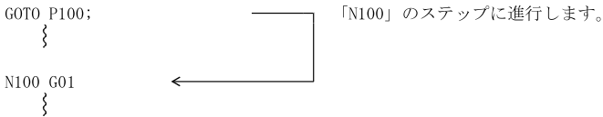

> **図の内容**
>
> `GOTO P100;` から「N100」のステップに進行します。`N100 G01` へ矢印。

##### 7-2-4-24．M30 : プログラム終了

【書式】

M30 ;

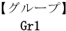

> **図の内容**
>
> 【グループ】Gr1

【グループ】 Gr1

【機能】

運転プログラムの終了を表します。

メインプログラムの最後には"M30"を記述してください。

##### 7-2-4-25．M98 : サブルーチンコール

【書式】

M98 P＿ L＿;

| アドレス   | 内容           | 範囲                | 省略時   | 単位   |
|--------|--------------|-------------------|-------|------|
| P      | シーケンス番号      | 0〜9999            | ×     | 番号   |
| L      | 読み出し実行繰り返し回数 | ※マクロ変数指定可 1〜50000 | 1     | 回数   |

【グループ】

Gr1

【機能】

運転プログラム内のサブルーチンを呼び出します。

繰り返し回数(L)を指定するとその回数分呼び出します。

- サブルーチン先頭には必ずシーケンス番号を付けてください。
- ネスティングは、最大20回です。
- メインプログラムは必ずプログラムの先頭に記述して下さい。
- 各サブルーチンの最後には必ず腧M99"を指令して下さい。
- サブルーチンは同一プログラム内に記述します。

【記述例】

M98 P0100 L10;

M30;

N0100 G91 G00 X1000;

M99;

シーケンス番号「N0100」〜「M99」までを10回呼び出し。

「M99」はサブルーチンの終了です。

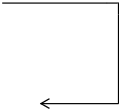

※ ネスティング

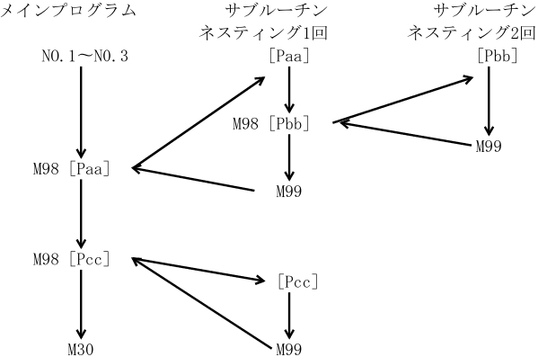

> **図の内容**
>
> メインプログラム NO.1～NO.3 から M98 [Paa] → サブルーチン [Paa]（ネスティング1回）→ M98 [Pbb] → サブルーチン [Pbb]（ネスティング2回）→ M99 で戻る。メインから M98 [Pcc] → [Pcc] → M99 で戻り、メインの M30。

##### 7-2-4-26．M99 : サブプログラム終了

【書式】

M99 ;

【グループ】 Gr1

【機能】

サブプログラムの終了を表します。

サブプログラムの最後に"M99"を付けてください。

##### 7-2-4-27．マクロ演算

<オプション>

【書式】

変数△=△{変数|即値}[△演算子△{変数|即値}];

- {|}
- []

･･･ '|'で区切られた内の、どれか1つを選択

･･･省略可能

△ ･･･ 1つ以上の空白、又はタブ(必須です)

変数･･･レジスタ指定

即値･･･ 500、-1などの数値

演算子･･･ + (加算)

- (減算)
* (乗算)
- / (除算)
- % (剰余)
- & (AND)
- | (OR)
- ^ (XOR)
- <<(左シフト)
- >>(右シフト)

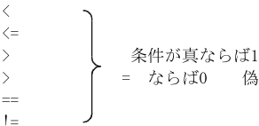

> **図の内容**
>
> `<`、`<=`、`>`、`>`、`==`、`!=` は、条件が真ならば 1、偽ならば 0。

!=

&&(論理のAND)

- ||(論理のOR)
- ! (論理の反転)

【グループ】

Gr1

【機能】

各指令の付加データで「※マクロ変数指定可」の表記があるものは、即値の他にマクロ変数でも記述できます。

また、マクロ変数や即値に対して、上記の演算も可能です。

※ 変数、即値には符号(+、-)とビット反転(~)を付加することができます。

【運転プログラム例】

G91 G31 X20000 F2000;

#1031 = #5000 + 500;

G90 G01 X#1031 F200;

```c
/* ラッチ位置（#5000）より500パルス先の位置 */
/* ラッチ位置より500パルス先の位置に移動 */
```

7-2-4-28．IF

ELSE

ENDIF : 条件判断

<オプション>

【書式】

- 条件判別

- IF △ {変数|即値}[△演算子△{変数|即値}];

(1)

ELSE;

(2)

ENDIF;

"IF"の後に条件の式を書きます。

- (1):条件式の結果が0以外の場合の処理を記述
- (2):条件式の結果が0の場合の処理を記述

"ELSE"と(2)の処理は必要なければ、省略できます。

- {|} ･･･ '|'で区切られた内の、どれか1つを選択

[]

･･･省略可能

△ ･･･ 1つ以上の空白、又はタブ(必須です)

変数･･･レジスタ指定

即値･･･ 500、-1などの数値

- ※ 演算子については「7-2-4-27．マクロ演算」を参照ください。
- ※ IFのネスティング数には制限はありません。

【グループ】

Gr1

【機能】

マクロ変数を使用して、運転プログラム中で条件判断を行うことができます。演算結果だけでなく、マクロ変数経由でステータスや入出力状態などの内部情報での分岐も行えます。

【運転プログラム例】

【運転プログラム例】

- ① IF #1000 < #1001;
- ② G91 G00 X1000;
- ③ G04 P1.0;
- ④ G00 X100;
- ⑤ ENDIF;
- ⑥ G90 G00 X1000;
- ⑦ M30;

実行順序

- #1000が0、#1001が1の時

① → ② → ③ → ④ → ⑤ → ⑥ → ⑦

- #1000が1、#1001が0の時

① → ⑥ → ⑦

##### 7-2-5-1．M : Mコード出力

【書式】

M＿ ;

| アドレス   | 内容      | 範囲    | 省略時   | 単位   |
|--------|---------|-------|-------|------|
| M      | 出力信号コード | 0〜255 | ×     | コード  |

【グループ】

Gr2

【機能】

指定したMコード(8ビットバイナリ出力信号)を出力します。

FA-M3□や外部回路へステータスや情報を出力します。

データ(M〜M7)とストローブ信号を出力します。

移動指令と同一行でのM指令では移動を完了した後にMコード出力します。

例

G01 X＿ Y＿ M＿; 直線補間が完了した後でM＿出力

【Mコード信号】

出力信号(PLMC-M3EX →外部回路)

- Mコード(M0〜M7) 0から255まで(M0〜M7の8ビット)のバイナリーデータで出力します。

・MSTRB

Mコードの出力完了を知らせる信号です。

※外部回路では、MSTRBの立ち上がり(図のA)でMコードを読み込んでください。入力信号(外部回路→PLMC-M3EX)

・MFIN

外部回路がMコードを読み取ったことを通知する信号です。

PLMCは、MFIN立ち上がりでMSTRBをOFFし、そのステップを終了します。

・MOK入力

外部論理回路が受け取ったMコードを正常に処理したときONさせてください。 PLMCでは、外部回路の正常/異常完了を判断できます。

(MOKの使用の有無は、ROMSWで選択できます)

【信号タイミング】

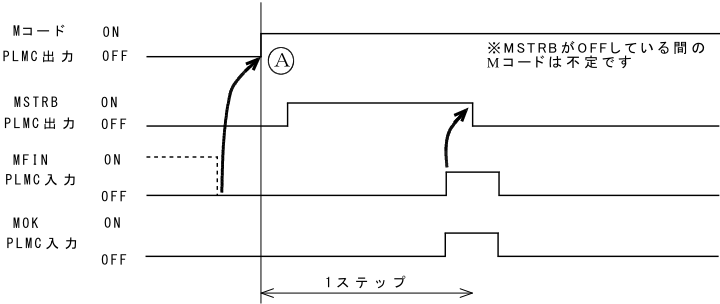

> **図の内容**
>
> 7-1-9-1 と同じ図。Mコード PLMC出力（Ⓐ）、MSTRB PLMC出力、MFIN PLMC入力、MOK PLMC入力のタイミング。※MSTRBがOFFしている間のMコードは不定です。下に「1ステップ」の範囲。

【特殊なＭコード】

以下のMコードは、特殊Mコードですので、Mコード出力をいたしません。

- M00/M01 基本パラメータ M00/M01停止
- M03,M04,M05 主軸制御
- M30,M98,M99 プログラム終了、サブルーチン呼び出し、サブルーチン終了

##### 7-2-5-2．M00/M01: 特殊Mコード指令

【書式】

M00; または M01 ;

【グループ】

Gr2

【機能】

特殊なMコードです。

これらの指令を使うためには、基本パラメータにて、「M00/M01停止機能」を有効にする必要があります。 M00指令プログラム実行を停止します。

M01指令オプショナルストップ入力("T□MOPT")ONの時、運転プログラムを停止します。

- 「M00/M01停止機能」有効の場合、M00/M01指令時にMコードは出力しません。
- 基本ROMSWで、「M00/M01停止中出力」を有効にすると、M00又はM01停止中にM00停止中出力 ("T□MZSTP")をONします。 (□はタスク番号0〜7を表します。)

入力信号"T□MOPT"/"MOK"や出力信号"T□MZSTP"の詳細は、以下を参照して下さい。

- ユーザーズマニュアル機能編<2 入出力機能>(TB00-0900D)
- 「ROMSW設定ソフト」<4-1.基本パラメータ>(TB0-0902)

##### 7-2-5-3．S : Sコード出力

【書式】

S＿ ;

| アドレス   | 内容     | 範囲      | 省略時   | 単位   |
|--------|--------|---------|-------|------|
| S      | 主軸速度指令 | 0/1/2/3 | ×     | コード  |

【グループ】

Gr2

【機能】

下の表のように、SOUT1とSOUT0の2つの出力信号をON/OFFします。これによって、一般には主軸速度の高/中/低/停止を切り替えます。

S命令は、モーダル情報です。(一端指令すると記憶しています)

実際の出力は、M03(正転)/M04(逆転)/M05(停止)の各指令により実行されます。

また、M03(04)出力後に、S1→S2→S3などと指令することで主軸の速度を変えられます。

(本機能では、M03とM04の指令の動作は同じです。)

S0 : 主軸停止

S1 : 主軸第1速度

S2 : 主軸第2速度

S3 : 主軸第3速度

主軸回転の開始（加速）や停止（減速）には、指定の速度到達までに遅れ時間が生じます。

ただ、この指令は、遅延を待たずにすぐに次のステップに進行します。遅延の待ちが必要であれば、次のステップでドウェル指令をして下さい。

|           |           |           |         |         |
|-----------|-----------|-----------|---------|---------|
| 主軸速度指令    | M03/04実行時 | M03/04実行時 | M05実行時  | M05実行時  |
| S命令(モーダル) | SOUT1出力   | SOUT0出力   | SOUT1出力 | SOUT0出力 |
| 0:S0      | OFF       | OFF       | OFF     | OFF     |
| 1:S1      | OFF       | ON        | OFF     | OFF     |
| 2:S2      | ON        | OFF       | OFF     | OFF     |
| 3:S3      | ON        | ON        | OFF     | OFF     |

【Mコードとの関係】

基本パラメータで「主軸指令Mコード出力」有効のときには、M0□実行時にそのMコードも出力します。 (□は3、4又は5を表します。)

Mコード出力時はMFIN待ちを行います。MFINが返るまで、新たなコマンドの発行は出来ません。

動作詳細、通信コマンドについては、以下を参照して下さい。

- <5-16主軸機能>(TB00-0980E)

##### 7-2-5-4．G41/G42 : 工具径補正

<オプション>

【書式】

G41 D＿ ;

G42 D＿ ;

| アドレス   | 内容          | 範囲   | 省略時   | 単位   |
|--------|-------------|------|-------|------|
| D      | 工具径補正テーブル番号 | 0〜19 | ×     | 番号   |

【グループ】

Gr2

【機能】

| G40   | 径補正キャンセル           |
|-------|--------------------|
| G41   | 径補正左側             |
| G42   | 径補正右側             |
| D     | 工具径補正テーブルNO.(0〜19) |

X、Y平面上の移動制御で工具径補正を行います。工具径補正は独立の命令でモーダル指令です。

"G00"、"G01"命令の同一行に付加することもできます。

G41: 軌跡の進行方向に対し、左側を工具が通るときの補正指令です。

G42: 軌跡の進行方向に対し、右側を工具が通るときの補正指令です。

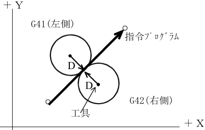

> **図の内容**
>
> 「指令プログラム」の直線に対し、工具（半径 D）が G41(左側) または G42(右側) にずれた位置を通る。

「4-18-3 工具径補正機能」を参照下さい。

※ 詳細は「TB04-2176 SLM径補正機能」を参照してください。

##### 7-2-5-5．G40 : 工具径補正停止

<オプション>

【書式】

G40 ;

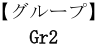

> **図の内容**
>
> 【グループ】Gr2

【機能】

工具径補正を停止します。

##### 7-2-5-6．G90 : 論理座標系アブソ指定

【書式】

G90 ;

【グループ】

Gr2

【機能】

G90指令後、G00〜G03などの目標位置は、アブソ座標を指定して下さい。

##### 7-2-5-7．G91 : インクレ移動量指定

【書式】

G90 ;

【グループ】

Gr2

【機能】

G91指令後、G00〜G03などの移動指令後は、増分値(インクレ量)となります。

7-2-5-8．G17 : 円弧平面指定(XY平面）

G18 : 円弧平面指定(YZ平面)

G19 : 円弧平面指定(XZ/ZX平面)

【書式】

```c
    G17;
    G18;
    G19;
```

【グループ】

Gr2

【機能】

半径指定の円弧の平面を設定します。(モーダル値)

※ G19 で XZ平面／ZX平面のどちらの平面指定になるかは、セッティングPCの「ポジション表示形式設定」画面で設定して下さい。

詳細は円弧命令(G02/G03)の説明を参照下さい。

##### 7-2-5-9．N : シーケンス番号

【書式】

N＿

| アドレス   | 内容      | 範囲     | 省略時   | 単位   |
|--------|---------|--------|-------|------|
| N      | シーケンス番号 | 0〜9999 | ×     | 数字   |

【グループ】

Gr2

【機能】

シーケンス番号は、ステップの前に"N"+任意の番号(最大4桁)で記述できます。

シーケンス番号の指定範囲は、0〜9999(10進数)です。

シーケンス番号は任意の番号を設定可能です。

【シーケンス番号の目的】

- (1)サブルーチンのラベル

サブルーチンの呼び出し(M98)では、シーケンス番号を指定します。

- (2)GOTO指令の飛び先
- (3)プログラム途中再開の再開ポイントの指定
- (4)運転プログラムの読みやすさのためのラベル

シーケンス番号は、通常は各々を異なる番号にしますが、同一番号を複数のステップに設定もできます。ただ、上記の(1)(2)として有効なのは、運転プログラムの先頭に近いもののみです。

##### 7-2-6-1．PNO : プログラム番号

【書式】

PNO＿;

| アドレス   | 内容      | 範囲      | 省略時   | 単位   |
|--------|---------|---------|-------|------|
| PNO    | プログラム番号 | 1〜32767 | ×     | 数字   |

【グループ】

その他

【機能】

運転プログラムの先頭で「PNO__;」と設定して下さい。運転プログラムを、ラダーやPCソフトから選択する時の番号です。同タスク内で同じプログラム番号の設定はできません。 (別タスクであれば同じプログラム番号でもダウンロードできます。)

##### 7-2-6-2．"/*" ･･･ "*/" : コメント

【グループ】

その他

【機能】

任意の文字列を"/*"と"*/"で囲む事により、運転プログラムテキストにコメントを記述することが可能です。

DNC運転プログラムでは、複数行にまたがるコメントはできません。

### 7-3．マクロ機能 <オプション>

運転プログラム中で演算や条件判断を行う機能です。

PLMCの各種状態や外部からの入力により、運転プログラムの動作を変更できます。

#### 7-3-1．書式

- 変数△=△{変数|即値}[△演算子△{変数|即値}];
- IF △ {変数|即値}[△演算子△{変数|即値}];
- (1)
- ELSE;

(2)

ENDIF;

式の値が真の時(1)の句を実行、偽の時(2)のステップを実行。 ELSE句は省略可能です。

- {|}

[]

- ･･･ '|'で区切られた内の、どれか1つを選択

･･･省略可能

△ ･･･ 1つ以上の空白、又はタブ(必須です)

変数･･･レジスタ指定

即値･･･ 500、-1などの数値

演算子･･･ + (加算)

- (減算)
* (乗算)
- / (除算)
- % (剰余)
- & (AND)
- | (OR) ^ (XOR)
- <<(左シフト)
- >>(右シフト)

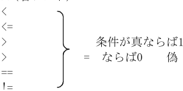

> **図の内容**
>
> `<`、`<=`、`>`、`>`、`==`、`!=` は、条件が真ならば 1、偽ならば 0。

&&(論理のAND)

- ||(論理のOR)
- ! (論理の反転)

ご注意

変数、即値、演算子の各々の間には、△空白(またはタブ)が必要です。

#### 7-3-2．マクロ変数使用可能コード

以下の表に記述してある命令は、マクロ変数が使用できます。各命令の機能については、<7.運転プログラム詳細>を参照して下さい。

```c
    テクノコード Gコード 指定 記述方法例
    PTP (G91)G00 移動量 PTP X#1000;
    PTPA (G90)G00 座標 G91 G00 X#1000;
    PTPB G28 座標
    LIN (G91)G01 移動量/補間速度 LIN X#1000 F#1001;
    LINA (G90)G01 座標/補間速度 G91 G01 X#1000 F#1001;
    LINB 座標/補間速度
    CIRR (G91)G02 移動量/補間速度
    中心/半径 CIRR X#1000 Y#1001 I#1002 J#1003 F#1004;
    CIRL (G91)G03 移動量/補間速度 CIRR PXY X#1000 Y#1001 CR#1002 F#1004;
    中心/半径
    CIRRA (G90)G02 座標/補間速度 G91 G02 X#1000 Y#1001 I#1002 J#1003 F#1004;
    中心/半径 G91 G02 G17 X#1000 Y#1001 CR#1002 F#1004;
    CIRLA (G90)G03 座標/補間速度
    中心/半径
    PTMA G100 ポイント指定 PTMA P#1000;
    G100 P#1000;
    LIMA ポイント指定/補 LIMA P#1000 F#1001
    間速度
    SLIN G31 移動量/補間速度 SLIN X#1000 F#1001;
    G31 X#1000 F#1001;
    SLINC 移動量/補間速度 SLINC X#1000 F#1001
    AXMV (G91)G101 移動量/速度
    AXMVA (G90)G101 座標/速度 AXMV X#1000 FX#1001;
    AXMVB G128 座標/速度 G91 G101 X#1000 FX#1001;
    AXWT G104 軸フラグ AXWT #1000;
    G104 #1000;
    SPIN G120 回転数 SPIN A#1000;
    G120 A#1000;
    TRESET G199 タスク番号 TRESET#1000;
    G199 T#1000;
    TSTART G198 タスク番号 TSTART#1000 P#1001;
    プログラム番号 G198 T#1000 P#1001;
    TSTOP G197 タスク番号 TSTOP#1000;
    G197 T#1000;
    CALL M98 繰り返し回数 CALL LABEL L#1000;
    P0100 M98 L#1000;
    CSET G92 座標 CSET X#1000;
    G92 X#1000;
    TIM G04 時間指定 ※１ TIM#1000;
    G04 P#1000;
    TM 制御周期回数指定 TM#1000;
    MOUT Mコード指定 MOUT#1000;
    PRG タスク番号 PRG#1000 T#1001;
    プログラム番号
```

- ※１ "TIM"命令にマクロ変数を使用した場合は、内部で"TM"命令として実行されます。 (例)

マクロ変数を使用しない場合： TIM1.0; /* 1秒の待ち */

マクロ変数を使用した場合： #1000 = 500;

0

TIM#1000; /* TM500として実行するので */

/* 500制御周期の待ち(制御周期2msecなら1秒) */

#### 7-3-3．レジスタ一覧

W：ワード L：ロングワード

タスク毎：マクロ変数の書き込み／読み出しでは、タスク番号指定が必要

グローバル（全タスク共通）：共通に1種類

| 変数番号                                                                                                              | 名称                                                                                                                                                                                                                                                                                                                  | 形式                                                                                                                                                           | 補足                       |
|-------------------------------------------------------------------------------------------------------------------|---------------------------------------------------------------------------------------------------------------------------------------------------------------------------------------------------------------------------------------------------------------------------------------------------------------------|--------------------------------------------------------------------------------------------------------------------------------------------------------------|--------------------------|
| #1000 〜 #1199                                                                                                     | グローバルマクロ変数                                                                                                                                                                                                                                                                                                          | W                                                                                                                                                            | グローバル変数 (全タスク共通)         |
| #1200 〜 #1299                                                                                                     | ラダー共有マクロ変数(R) 書き込みはFA-M3□←PLMC-M3EX限定                                                                                                                                                                                                                                                                               | W                                                                                                                                                            | データ位置番号1001〜1100 グローバル変数 |
| #1300 〜 #1399                                                                                                     | ラダー共有マクロ変数(W) 書き込みはFA-M3□→PLMC-M3EX限定                                                                                                                                                                                                                                                                               | W                                                                                                                                                            | データ位置番号1101〜1200 グローバル変数 |
| #1400 〜 #1499                                                                                                     | ローカルマクロ変数                                                                                                                                                                                                                                                                                                           | タスク毎の変数                                                                                                                                                      | W                        |
| #1500 #1501 #1510 〜 #1518 #1520 〜 #1528 #1530 #1531 #1532 #1533 #1534 #1535 #1536 #1600 〜 #1640 〜 #2000 〜 #3000 〜 | STATUS.mc.Status STATUS.mc.Alarm STATUS.ax[0-8].AxStatus STATUS.ax[0-8].AxAlarm STATUS.task[].TaskStatus STATUS.task[].TaskAlarm STATUS.task[].Override STATUS.task[].COverride STATUS.task[].SOverride STATUS.task[].ProgramNo STATUS.task[].StepNo #1635 入力ポート0〜35 #1651 出力ポート0〜11 #2899 サーボパラメータ #3019 工具長補正テーブル | 全体ステータス W 全体アラーム W 軸ステータス W タスク毎の論理軸のみ軸アラーム W タスクステータス L タスク毎タスクアラーム W 送りオーバライド W 補間オーバライド W 主軸オーバライド W 実行プログラム番号 W 実行ステップ番号 W W 全タスク共通 W L/W タスク毎の論理軸のみ L | グローバル(全タスク共通)            |
| #6001 〜 #6016                                                                                                     |                                                                                                                                                                                                                                                                                                                     | W                                                                                                                                                            |                          |
| #3100 〜 #3108 #3500 〜 #3519 #4000 〜 #4899 #5000 〜 #5008 #5100 〜 #5108 #5500 〜                                     | 工具長補正値工具径補正テーブルポジション(指令位置、機械位置、偏差量、他) センサーラッチポジション(PR) センサーラッチポジション(AR) マクロ変数 #1000〜#1499                                                                                                                                                                                                                         | L                                                                                                                                                            | LONGアクセス ※1              |
| #5999                                                                                                             |                                                                                                                                                                                                                                                                                                                     |                                                                                                                                                              |                          |
|                                                                                                                   | HEX入力                                                                                                                                                                                                                                                                                                               | HEX入力                                                                                                                                                        | タスク毎                     |
| #7100 〜 #7108                                                                                                     |                                                                                                                                                                                                                                                                                                                     |                                                                                                                                                              |                          |
| #7200 〜                                                                                                           |                                                                                                                                                                                                                                                                                                                     |                                                                                                                                                              |                          |
| #7400 〜                                                                                                           | バックラッシュ補正値                                                                                                                                                                                                                                                                                                          | バックラッシュ補正値                                                                                                                                                   |                          |
|                                                                                                                   |                                                                                                                                                                                                                                                                                                                     |                                                                                                                                                              | タスク毎                     |
| #7408                                                                                                             |                                                                                                                                                                                                                                                                                                                     |                                                                                                                                                              |                          |
|                                                                                                                   |                                                                                                                                                                                                                                                                                                                     |                                                                                                                                                              | L                        |
|                                                                                                                   | 軸ネグレクト                                                                                                                                                                                                                                                                                                              | 軸ネグレクト                                                                                                                                                       | W                        |
| #7208                                                                                                             |                                                                                                                                                                                                                                                                                                                     |                                                                                                                                                              |                          |
|                                                                                                                   |                                                                                                                                                                                                                                                                                                                     |                                                                                                                                                              | タスク毎                     |
|                                                                                                                   |                                                                                                                                                                                                                                                                                                                     |                                                                                                                                                              | W                        |
|                                                                                                                   | 軸インターロック                                                                                                                                                                                                                                                                                                            |                                                                                                                                                              |                          |

- ※1 #5500 〜 #5999（L）は、 #1000〜#1499（W）を2W単位で読み/書きするためのアドレスです。

例：#5500＝#1000，#1001 #5501＝#1001，#1002

また、ラダー共有マクロ領域は、偶数アドレスで使用してください。奇数アドレスで使用すると、

ラダーからのREAD/WRITE時に上位ワード／下位ワードが不整合となる場合があります。

- 【注1】マクロ変数の読み出しは、全て可能です。
- 【注2】マクロ変数の書き込みは、属性が"R/W"の変数のみ可能です。
- 【注3】サーボパラメータ/工具長補正パラメータをマクロ変数書き込みで値を変更した場合、一時的なワークメモリのみ変更し、同パラメータのバックアップメモリの数値は変更しません。また、PLMCは電源OFF→ONで、バックアップメモリから同パラメータを読み出します。そのため、書き込んだ後の電源OFF→ONで元の値(バックアップメモリの値)に戻ります。

バックアップメモリーのパラメータを変更するには、セッティングPCソフト/ユーザアプリケーションソフトから書き込む必要があります。

【注4】カレントタスクの変数番号

上記表の変数番号のみで読み/書きを行うと、カレントタスクの変数へのアクセスになります。カレントタスクは、運転プログラムの場合は実行中のタスク、通信コマンドの場合はコマンドパラメータで指定したタスクです。

【注5】マクロ変数のタスク指定

異なるタスクの変数に読み/書きする場合は、以下のようにタスク番号を加えたマクロ変数番号を使用して下さい。

#1□□□□□ 上記表のマクロ変数番号

タスク番号(0〜7)

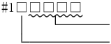

> **図の内容**
>
> `#1□□□□□`（□ の部分に波線と引き出し線。説明の文字は図に含まれていない）。

※グローバル変数に対してのタスク番号の指定は無意味です。

#### 7-3-4．グローバルマクロ変数

#1000〜

運転プログラム内で自由に使用できます。

グローバルマクロ変数は、FA-M3□/PCからは通信コマンドで1W毎または一括で読み/書きできます。

| 番号    | データ名称   | 形式   | 属性   | 設      | 定   |     値 |
|-------|-------------|------|------|--------|-----|-------|
| #1000 | 一般レジスタ      | W    | R/W  | -32768 | 〜   | 32767 |
| #1001 | 一般レジスタ      | W    | R/W  | -32768 | 〜   | 32767 |
| ・     | ・           |      | ・    |        | ・   |       |
| ・     | ・           |      | ・    | ・      |     |       |
| ・     | ・           |      | ・    | ・      |     |       |
| #1198 | 一般レジスタ      | W    | R/W  | -32768 | 〜   | 32767 |
| #1199 | 一般レジスタ      | W    | R/W  | -32768 | 〜   | 32767 |

※表記番号･･･変数番号

データ名称･･･データ名

属性･･･ R-読込可、W-書込可設定値･･･データ範囲

形式･･･ W:ワード、L:ロングワード

#### 7-3-5．ラダー共有マクロ変数(W/R)

#1200〜 (FA-M3□←→PLMC-M3EX)

FA-M3□からWrite/Read命令で読み/書きできます。

| 番号    | データ名称   | 形式   | 属性   | 設定    | 値       | データ位置番号   |
|-------|-------------|------|------|--------|---------|-----------|
| #1200 | 一般レジスタ      | W    | R    | -32768 | 〜 32767 | 1001      |
| #1201 | 一般レジスタ      | W    | R    | -32768 | 〜 32767 | 1002      |
| ・     | ・           |      | ・    | ・      |         | ・         |
| ・     | ・           |      | ・    | ・      |         | ・         |
| ・     | ・           |      | ・    | ・      |         | ・         |
| #1298 | 一般レジスタ      | W    | R    | -32768 | 〜 32767 | 1099      |
| #1299 | 一般レジスタ      | W    | R    | -32768 | 〜 32767 | 1100      |

#### 7-3-6．ラダー共有マクロ変数(R)

#1300〜 (FA-M3□←PLMC-M3EX)

FA-M3□からRead命令で読みだせます。

| 番号    | データ名称   | 形式   | 属性   | 設定    | 値       | データ位置番号   |
|-------|-------------|------|------|--------|---------|-----------|
| #1300 | 一般レジスタ      | W    | R/W  | -32768 | 〜 32767 | 1101      |
| #1301 | 一般レジスタ      | W    | R/W  | -32768 | 〜 32767 | 1102      |
| ・     | ・           |      | ・    | ・      |         | ・         |
| ・     | ・           |      | ・    | ・      |         | ・         |
| ・     | ・           |      | ・    | ・      |         | ・         |
| #1398 | 一般レジスタ      | W    | R/W  | -32768 | 〜 32767 | 1199      |
| #1399 | 一般レジスタ      | W    | R/W  | -32768 | 〜 32767 | 1200      |

#### 7-3-7．ローカルマクロ変数(W/R)

#1400〜 (タスク毎)

FA-M3□/PCからは通信コマンドで1W毎読み書きできます。

| 番号    | データ名称   | 形式   | 属性   | 設定    | 値       |
|-------|-------------|------|------|--------|---------|
| #1400 | 一般レジスタ      | W    | R/W  | -32768 | 〜 32767 |
| #1401 | 一般レジスタ      | W    | R/W  | -32768 | 〜 32767 |
| ・     | ・           |      | ・    | ・      |         |
| ・     | ・           |      | ・    | ・      |         |
| ・     | ・           |      | ・    | ・      |         |
| #1498 | 一般レジスタ      | W    | R/W  | -32768 | 〜 32767 |
| #1499 | 一般レジスタ      | W    | R/W  | -32768 | 〜 32767 |

#### 7-3-8．各種情報

#1500〜

| 番号            | 名称                       | 名称        | 形式   | 属性   | 補足       |
|---------------|--------------------------|-----------|------|------|----------|
| #1500         | STATUS.mc.Status         | 全体ステータス   | W    | R    | グローバル変数  |
| #1501         | STATUS.mc.Alarm          | 全体アラーム    | W    | R    | （全タスク共通） |
| #1510 〜 #1518 | STATUS.ax[0-8].AxStatus  | 軸ステータス    | W    | R    | タスク毎の    |
| #1520 〜 #1528 | STATUS.ax[0-8].AxAlarm   | 軸アラーム     | W    | R    | 論理軸のみ    |
| #1530         | STATUS.task[].TaskStatus | タスクステータス  | L    | R    | タスク毎     |
| #1531         | STATUS.task[].TaskAlarm  | タスクアラーム   | W    | R    |          |
| #1532         | STATUS.task[].Override   | 送りオーバライド  | W    | R/W  |          |
| #1533         | STATUS.task[].COverride  | 補間オーバライド  | W    | R/W  |          |
| #1534         | STATUS.task[].SOverride  | 主軸オーバライド  | W    | R/W  |          |
| #1535         | STATUS.task[].ProgramNo  | 実行プログラム番号 | W    | R/W  |          |
| #1536         | STATUS.task[].StepNo     | 実行ステップ番号  | W    | R    |          |

##### 7-3-8-1．全体情報

#1500〜

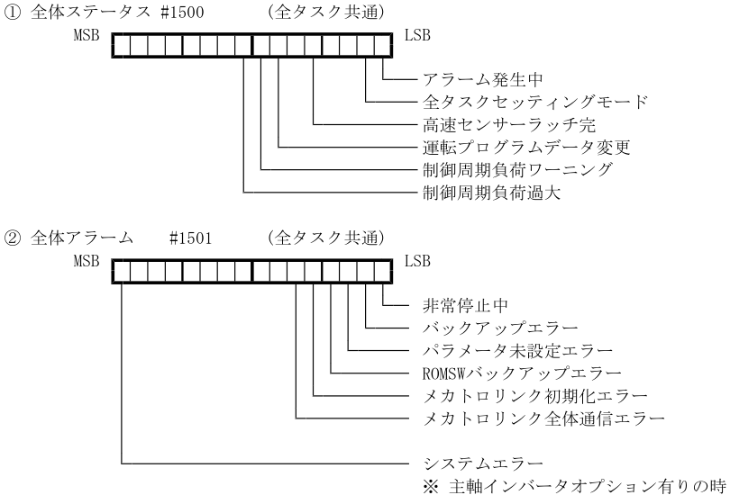

> **図の内容**
>
> ① 全体ステータス #1500（全タスク共通）。16 ビット:
>
> | ビット | 内容 |
> |---|---|
> | D0 | アラーム発生中 |
> | D1 | 全タスクセッティングモード |
> | D4 | 高速センサーラッチ完 |
> | D6 | 運転プログラムデータ変更 |
> | D7 | 制御周期負荷ワーニング |
> | D8 | 制御周期負荷過大 |
>
> ② 全体アラーム #1501（全タスク共通）。16 ビット:
>
> | ビット | 内容 |
> |---|---|
> | D0 | 非常停止中 |
> | D1 | バックアップエラー |
> | D2 | パラメータ未設定エラー |
> | D3 | ROMSWバックアップエラー |
> | D4 | メカトロリンク初期化エラー |
> | D5 | メカトロリンク全体通信エラー |
> | D15 | システムエラー |
>
> ※ 主軸インバータオプション有りの時（図の最後の注記。どの項目に掛かるかは図からは読み取れない）

##### 7-3-8-2．軸ステータス

#1510〜（タスク毎）

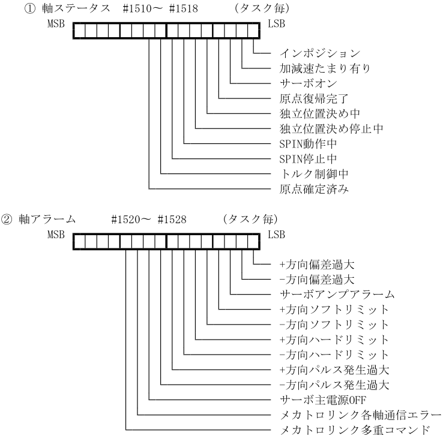

> **図の内容**
>
> ① 軸ステータス #1510～#1518（タスク毎）。16 ビット:
>
> | ビット | 内容 |
> |---|---|
> | D0 | インポジション |
> | D1 | 加減速たまり有り |
> | D2 | サーボオン |
> | D3 | 原点復帰完了 |
> | D4 | 独立位置決め中 |
> | D5 | 独立位置決め停止中 |
> | D6 | SPIN動作中 |
> | D7 | SPIN停止中 |
> | D8 | トルク制御中 |
> | D9 | 原点確定済み |
>
> ② 軸アラーム #1520～#1528（タスク毎）。16 ビット:
>
> | ビット | 内容 |
> |---|---|
> | D0 | +方向偏差過大 |
> | D1 | −方向偏差過大 |
> | D2 | サーボアンプアラーム |
> | D3 | +方向ソフトリミット |
> | D4 | −方向ソフトリミット |
> | D5 | +方向ハードリミット |
> | D6 | −方向ハードリミット |
> | D7 | +方向パルス発生過大 |
> | D8 | −方向パルス発生過大 |
> | D9 | サーボ主電源OFF |
> | D10 | メカトロリンク各軸通信エラー |
> | D11 | メカトロリンク多重コマンド |

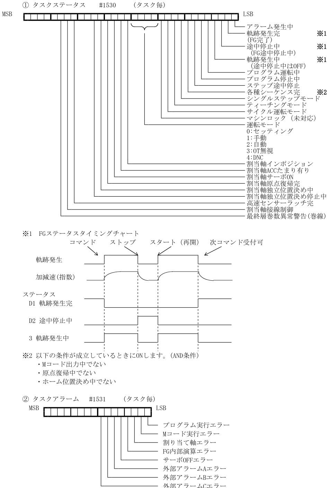

> **図の内容**
>
> ① タスクステータス #1530（タスク毎）。32 ビット:
>
> | ビット | 内容 |
> |---|---|
> | D0 | アラーム発生中 |
> | D1 | 軌跡発生完 (FG完了) ※1 |
> | D2 | 途中停止中 (FG途中停止中) ※1 |
> | D3 | 軌跡発生中 (途中停止中はOFF) ※1 |
> | D4 | プログラム運転中 |
> | D5 | プログラム停止中 |
> | D6 | ステップ途中停止 |
> | D7 | 各種シーケンス完 ※2 |
> | D8 | シングルステップモード |
> | D9 | ティーチングモード |
> | D10 | サイクル運転モード |
> | D11 | マシンロック（未対応） |
> | D12～D15 | 運転モード 0:セッティング、1:手動、2:自動、3:OT無視、4:DNC |
> | D16 | 割当軸インポジション |
> | D17 | 割当軸ACCたまり有り |
> | D18 | 割当軸サーボON |
> | D19 | 割当軸原点復帰完 |
> | D20 | 割当軸独立位置決め中 |
> | D21 | 割当軸独立位置決め停止中 |
> | D24 | 高速センサーラッチ完 |
> | D25 | 割当軸接線制御 |
> | D26 | 最終層巻数異常警告(巻線) |
>
> ※1 FGステータスタイミングチャート: コマンドで軌跡発生が始まり、ストップで止まり、スタート（再開）で再び始まり、終わると次コマンド受付可。加減速(指数) の曲線。ステータスは D1 軌跡発生完（軌跡発生中は OFF、終わると ON）、D2 途中停止中（ストップからスタートまで ON）、3 軌跡発生中（軌跡発生の間 ON、途中停止中は OFF）。
>
> ※2 以下の条件が成立しているときにONします。(AND条件) ・Mコード出力中でない ・原点復帰中でない ・ホーム位置決め中でない
>
> ② タスクアラーム #1531（タスク毎）。16 ビット:
>
> | ビット | 内容 |
> |---|---|
> | D0 | プログラム実行エラー |
> | D1 | Mコード実行エラー |
> | D2 | 割り当て軸エラー |
> | D3 | FG内部演算エラー |
> | D4 | サーボOFFエラー |
> | D5 | 外部アラームAエラー |
> | D6 | 外部アラームBエラー |
> | D7 | 外部アラームCエラー |

外部アラームCエラー

- ③ 送りオーバーライド #1532 (タスク毎) PTP/JOG速度のオーバーライド(%値)です。指定された速度に対する実速度の割り合いです。
- ④補間オーバーライド #1533 (タスク毎) 補間速度のオーバーライド(%値)です。
- ⑤ 主軸オーバーライド #1534 (タスク毎) 主軸速度のオーバーライド(%値)です。
- ⑥ 選択・実行プログラム番号 #1535 (タスク毎) ステータスがプログラム実行中でない場合 → 選択中のプログラム番号ステータスがプログラム実行中の場合 → 実行中のプログラム番号
- ⑦待機・実行ステップ番号 #1536 (タスク毎) ステップ実行中でない場合 → 待機中のステップ番号
- ステップ実行中の場合
- → 実行中のステップ番号

#### 7-3-9．入／出力パターン

#1600〜

| 番号    | データ名称                     | 形式   | 属性   | 設定値   |
|-------|-------------------------------|------|------|---------|
| #1600 | 入力1パターン（I#0000:Ysss33〜Ysss48） | W    | R    | -       |
| #1601 | 入力2パターン（I#0001:Ysss49〜Ysss64） | W    | R    | -       |
| #1602 | 入力3パターン（I#0002:SRY0:D0〜D15）   | W    | R    | -       |
| #1603 | 入力4パターン（I#0003:SRY1:D0〜D15）   | W    | R    | -       |
| ：     | ：                             | ：    | ：    | ：       |
| #1635 | 入力36パターン（I#0035:SRY33:D0〜D15） | W    | R    | -       |
| #1640 | 出力1パターン（O#0001:Xsss01〜Xsss16） | W    | R/W  | -       |
| #1641 | 出力2パターン（O#0002:Xsss17〜Xsss32） | W    | R/W  | -       |
| #1642 | 出力3パターン（O#0003:SRX0:D0〜D15）   | W    | R/W  | -       |
| #1643 | 出力4パターン（O#0004:SRX1:D0〜D15）   | W    | R/W  | -       |
| ：     | ：                             | ：    | ：    | ：       |
| #1651 | 出力12パターン（O#0011:SRX8:D0〜D15）  | W    | R/W  | -       |

各入出力ポートのデータを16bitバイナリ値として読み込みます。各ビットの詳細は以下の通りです。

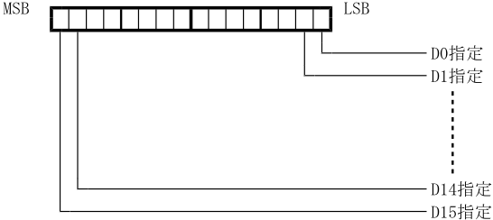

> **図の内容**
>
> 16 ビット（MSB ～ LSB）。LSB から D0指定、D1指定 … D14指定、D15指定。

※出力パターンへの書き込みは、汎用出力のみ有効です。 (汎用出力以外へ書き込んだ値は無視されます。)

7-3-10．サーボパラメータ

#2001〜（タスク毎）

※ 下表のRTCはサーボ制御周期をmsec単位で表した数値です。

| 番号    | データ名称    | 形式   | 属性   | 設定値                 |         |
|-------|--------------|------|------|-----------------------|---------|
| #2000 | 第1軸D/A出力ゲイン  | L    | R/W  | 0.004〜256.0           |         |
| #2001 | 第1軸INPOS量    | L    | R/W  | 0〜10000               | [pulse] |
| #2002 | 第1軸偏差上限値     | L    | R/W  | 1〜1000000000          | [pulse] |
| #2003 | 第1軸MPOS偏差上限値 | L    | R/W  | 1〜1000000000          | [pulse] |
| #2004 | 第1軸PTP時定数    | L    | R/W  | 0〜32767               | [msec]  |
| #2005 | 第1軸PTP速度     | L    | R/W  | 1000/RTC 〜 1000000000 | [pps]   |
| #2006 | 第1軸JOG速度     | L    | R/W  | 1000/RTC 〜 1000000000 | [pps]   |
| #2007 | 第1軸補間加減速時定数  | L    | R/W  | -2000×RTC 〜 1000      | [msec]  |
| #2008 | 第1軸+側ソフトリミット | L    | R/W  | 1〜1000000000          | [pulse] |
| #2009 | 第1軸-側ソフトリミット | L    | R/W  | 1〜1000000000          | [pulse] |
| #2010 | 第1軸形状補正係数    | L    | R/W  | 0〜30000               |         |
| #2011 | 第1軸S字加減速時定数  | L    | R/W  | 0〜 1000×RTC           | [msec]  |
| #2100 | 第2軸D/A出力ゲイン  | L    | R/W  | 0.004〜256.0           |         |
| #2101 | 第2軸INPOS量    | L    | R/W  | 0〜10000               | [pulse] |
| #2102 | 第2軸偏差上限値     | L    | R/W  | 1〜1000000000          | [pulse] |
| #2103 | 第2軸MPOS偏差上限値 | L    | R/W  | 1〜1000000000          | [pulse] |
| #2104 | 第2軸PTP時定数    | L    | R/W  | 0〜32767               | [msec]  |
| #2105 | 第2軸PTP速度     | L    | R/W  | 1000/RTC 〜 1000000000 | [pps]   |
| #2106 | 第2軸JOG速度     | L    | R/W  | 1000/RTC 〜 1000000000 | [pps]   |
| #2107 | 第2軸補間加減速時定数  | L    | R/W  | -2000×RTC 〜 1000      | [msec]  |
| #2108 | 第2軸+側ソフトリミット | L    | R/W  | 1〜1000000000          | [pulse] |
| #2109 | 第2軸-側ソフトリミット | L    | R/W  | 1〜1000000000          | [pulse] |
| #2110 | 第2軸形状補正係数    | L    | R/W  | 0〜30000               |         |
| #2111 | 第2軸S字加減速時定数  | L    | R/W  | 0〜 1000×RTC           | [msec]  |
| #2200 | 第3軸D/A出力ゲイン  | L    | R/W  | 0.004〜256.0           |         |
| #2201 | 第3軸INPOS量    | L    | R/W  | 0〜10000               | [pulse] |
| #2202 | 第3軸偏差上限値     | L    | R/W  | 1〜1000000000          | [pulse] |
| #2203 | 第3軸MPOS偏差上限値 | L    | R/W  | 1〜1000000000          | [pulse] |
| #2204 | 第3軸PTP時定数    | L    | R/W  | 0〜32767               | [msec]  |
| #2205 | 第3軸PTP速度     | L    | R/W  | 1000/RTC 〜 1000000000 | [pps]   |
| #2206 | 第3軸JOG速度     | L    | R/W  | 1000/RTC 〜 1000000000 | [pps]   |
| #2207 | 第3軸補間加減速時定数  | L    | R/W  | -2000×RTC 〜 1000      | [msec]  |
| #2208 | 第3軸+側ソフトリミット | L    | R/W  | 1〜1000000000          | [pulse] |
| #2209 | 第3軸-側ソフトリミット | L    | R/W  | 1〜1000000000          | [pulse] |
| #2210 | 第3軸形状補正係数    | L    | R/W  | 0〜30000               |         |
| #2211 | 第3軸S字加減速時定数  | L    | R/W  | 0〜 1000×RTC           | [msec]  |
| #2300 | 第4軸D/A出力ゲイン  | L    | R/W  | 0.004〜256.0           |         |
| #2301 | 第4軸INPOS量    | L    | R/W  | 0〜10000               | [pulse] |
| #2302 | 第4軸偏差上限値     | L    | R/W  | 1〜1000000000          | [pulse] |
| #2303 | 第4軸MPOS偏差上限値 | L    | R/W  | 1〜1000000000          | [pulse] |
| #2304 | 第4軸PTP時定数    | L    | R/W  | 0〜32767               | [msec]  |
| #2305 | 第4軸PTP速度     | L    | R/W  | 1000/RTC 〜 1000000000 | [pps]   |
| #2306 | 第4軸JOG速度     | L    | R/W  | 1000/RTC 〜 1000000000 | [pps]   |
| #2307 | 第4軸補間加減速時定数  | L    | R/W  | -2000×RTC 〜 1000      | [msec]  |
| #2308 | 第4軸+側ソフトリミット | L    | R/W  | 1〜1000000000          | [pulse] |
| #2309 | 第4軸-側ソフトリミット | L    | R/W  | 1〜1000000000          | [pulse] |
| #2310 | 第4軸形状補正係数    | L    | R/W  | 0〜30000               |         |
| #2311 | 第4軸S字加減速時定数  | L    | R/W  | 0〜 1000×RTC           | [msec]  |

- 【注】サーボパラメータ/工具長補正パラメータをマクロ変数書き込みで値を変更した場合、一時的なワークメモリのみ変更し、同パラメータのバックアップメモリの数値は変更しません。

また、PLMC-M3EXは電源 OFF → ON で、バックアップメモリから同パラメータを読み出します。

そのため、書き込んだ後も電源 OFF → ONで元の値(パックアップメモリの値)に戻ります。

読み出し値は書き込んだワークメモリの値でなくバックアップメモリの値です。

バックアップメモリのパラメータを変更するのは、セッティングPCソフト、またはユーザアプリケーションソフトから書き込む必要があります。

| 番号    | データ名称    | 形式   | 属性   | 設定値                 |         |
|-------|--------------|------|------|-----------------------|---------|
| #2400 | 第5軸D/A出力ゲイン  | L    | R/W  | 0.004〜256.0           |         |
| #2401 | 第5軸INPOS量    | L    | R/W  | 0〜10000               | [pulse] |
| #2402 | 第5軸偏差上限値     | L    | R/W  | 1〜1000000000          | [pulse] |
| #2403 | 第5軸MPOS偏差上限値 | L    | R/W  | 1〜1000000000          | [pulse] |
| #2404 | 第5軸PTP時定数    | L    | R/W  | 0〜32767               | [msec]  |
| #2405 | 第5軸PTP速度     | L    | R/W  | 1000/RTC 〜 1000000000 | [pps]   |
| #2406 | 第5軸JOG速度     | L    | R/W  | 1000/RTC 〜 1000000000 | [pps]   |
| #2407 | 第5軸補間加減速時定数  | L    | R/W  | -2000×RTC 〜 1000      | [msec]  |
| #2408 | 第5軸+側ソフトリミット | L    | R/W  | 1〜1000000000          | [pulse] |
| #2409 | 第5軸-側ソフトリミット | L    | R/W  | 1〜1000000000          | [pulse] |
| #2410 | 第5軸形状補正係数    | L    | R/W  | 0〜30000               |         |
| #2411 | 第5軸S字加減速時定数  | L    | R/W  | 0〜 1000×RTC           | [msec]  |
| #2500 | 第6軸D/A出力ゲイン  | L    | R/W  | 0.004〜256.0           |         |
| #2501 | 第6軸INPOS量    | L    | R/W  | 0〜10000               | [pulse] |
| #2502 | 第6軸偏差上限値     | L    | R/W  | 1〜1000000000          | [pulse] |
| #2503 | 第6軸MPOS偏差上限値 | L    | R/W  | 1〜1000000000          | [pulse] |
| #2504 | 第6軸PTP時定数    | L    | R/W  | 0〜32767               | [msec]  |
| #2505 | 第6軸PTP速度     | L    | R/W  | 1000/RTC 〜 1000000000 | [pps]   |
| #2506 | 第6軸JOG速度     | L    | R/W  | 1000/RTC 〜 1000000000 | [pps]   |
| #2507 | 第6軸補間加減速時定数  | L    | R/W  | -2000×RTC 〜 1000      | [msec]  |
| #2508 | 第6軸+側ソフトリミット | L    | R/W  | 1〜1000000000          | [pulse] |
| #2509 | 第6軸-側ソフトリミット | L    | R/W  | 1〜1000000000          | [pulse] |
| #2510 | 第6軸形状補正係数    | L    | R/W  | 0〜30000               |         |
| #2511 | 第6軸S字加減速時定数  | L    | R/W  | 0〜 1000×RTC           | [msec]  |
| #2600 | 第7軸D/A出力ゲイン  | L    | R/W  | 0.004〜256.0           |         |
| #2601 | 第7軸INPOS量    | L    | R/W  | 0〜10000               | [pulse] |
| #2602 | 第7軸偏差上限値     | L    | R/W  | 1〜1000000000          | [pulse] |
| #2603 | 第7軸MPOS偏差上限値 | L    | R/W  | 1〜1000000000          | [pulse] |
| #2604 | 第7軸PTP時定数    | L    | R/W  | 0〜32767               | [msec]  |
| #2605 | 第7軸PTP速度     | L    | R/W  | 1000/RTC 〜 1000000000 | [pps]   |
| #2606 | 第7軸JOG速度     | L    | R/W  | 1000/RTC 〜 1000000000 | [pps]   |
| #2607 | 第7軸補間加減速時定数  | L    | R/W  | -2000×RTC 〜 1000      | [msec]  |
| #2608 | 第7軸+側ソフトリミット | L    | R/W  | 1〜1000000000          | [pulse] |
| #2609 | 第7軸-側ソフトリミット | L    | R/W  | 1〜1000000000          | [pulse] |
| #2610 | 第7軸形状補正係数    | L    | R/W  | 0〜30000               |         |
| #2611 | 第7軸S字加減速時定数  | L    | R/W  | 0〜 1000×RTC           | [msec]  |
| #2700 | 第8軸D/A出力ゲイン  | L    | R/W  | 0.004〜256.0           |         |
| #2701 | 第8軸INPOS量    | L    | R/W  | 0〜10000               | [pulse] |
| #2702 | 第8軸偏差上限値     | L    | R/W  | 1〜1000000000          | [pulse] |
| #2703 | 第8軸MPOS偏差上限値 | L    | R/W  | 1〜1000000000          | [pulse] |
| #2704 | 第8軸PTP時定数    | L    | R/W  | 0〜32767               | [msec]  |
| #2705 | 第8軸PTP速度     | L    | R/W  | 1000/RTC 〜 1000000000 | [pps]   |
| #2706 | 第8軸JOG速度     | L    | R/W  | 1000/RTC 〜 1000000000 | [pps]   |
| #2707 | 第8軸補間加減速時定数  | L    | R/W  | -2000×RTC 〜 1000      | [msec]  |
| #2708 | 第8軸+側ソフトリミット | L    | R/W  | 1〜1000000000          | [pulse] |
| #2709 | 第8軸-側ソフトリミット | L    | R/W  | 1〜1000000000          | [pulse] |
| #2710 | 第8軸形状補正係数    | L    | R/W  | 0〜30000               |         |
| #2711 | 第8軸S字加減速時定数  | L    | R/W  | 0〜 1000×RTC           | [msec]  |

| 番号    | データ名称    | 形式   | 属性   | 設定値                 | 設定値       |
|-------|--------------|------|------|-----------------------|-------------|
| #2800 | 第9軸D/A出力ゲイン  | L    | R/W  | 0.004〜256.0           | 0.004〜256.0 |
| #2801 | 第9軸INPOS量    | L    | R/W  | 0〜10000               | [pulse]     |
| #2802 | 第9軸偏差上限値     | L    | R/W  | 1〜1000000000          | [pulse]     |
| #2803 | 第9軸MPOS偏差上限値 | L    | R/W  | 1〜1000000000          | [pulse]     |
| #2804 | 第9軸PTP時定数    | L    | R/W  | 0〜32767               | [msec]      |
| #2805 | 第9軸PTP速度     | L    | R/W  | 1000/RTC 〜 1000000000 | [pps]       |
| #2806 | 第9軸JOG速度     | L    | R/W  | 1000/RTC 〜 1000000000 | [pps]       |
| #2807 | 第9軸補間加減速時定数  | L    | R/W  | -2000×RTC 〜 1000      | [msec]      |
| #2808 | 第9軸+側ソフトリミット | L    | R/W  | 1〜1000000000          | [pulse]     |
| #2809 | 第9軸-側ソフトリミット | L    | R/W  | 1〜1000000000          | [pulse]     |
| #2810 | 第9軸形状補正係数    | L    | R/W  | 0〜30000               | 0〜30000     |
| #2811 | 第9軸S字加減速時定数  | L    | R/W  | 0〜 1000×RTC           | [msec]      |

- D/A出力ゲイン

将来用として用意。現在使用していません。

- INPOS量

インポジションの範囲を、パルス単位の絶対値量で指定します。

【設定範囲】 0〜10000 [pulse]

- 偏差上限値

偏差の絶対値の上限値を指定します。

偏差が本設定値を越えた場合、偏差過大アラームとなります。

【設定範囲】 1〜1000000000[pulse]

- MPOS偏差上限値

将来用として用意。現在使用していません。

- PTP時定数

PTP及びJOGの直線加減速の時定数を指定します。

「100Kppsに達するまで」または「PTP速度に達するまで」の時間を設定します。

【設定範囲】 0〜32767[msec]

- PTP速度

PTPの速度を指定します。

【設定範囲】 1000/RTC(msec) 〜 1000000000 [pps]

- JOG速度

JOGの速度を指定します。

【設定範囲】 1000/RTC(msec) 〜 1000000000 [pps]

- 補間加減速時定数

補間の指数型加減速の時定数を指定します。

【設定範囲】 0 〜 1000[msec]

「定時直線型補間加減速」オプション有りの時、マイナスの値を入れることで、直線型加減速時定数を指定します。

【「定時直線型補間加減速」オプション有効時設定範囲】

-2000 ×RTC(msec) 〜 0 [msec]

- +側/-側ソフトリミットソフトウェアストロークリミットを、各方向(+/-)別に指定します。機械座標が本設定値を越えた場合、ソフトリミットエラーとなります。

【設定範囲】 1〜1000000000[pulse]

- 形状補正係数

形状補正機能＜オプション＞のゲインを設定します。設定値を小さくするほど、形状補正機能のゲインが大きくなります。 0を設定すると形状補正機能を無効にします。

【設定範囲】 0〜30000

- S字加減速時定数

「S時補間加減速」オプション有りの時の時定数を指定します。

【設定範囲】 0(msec) 〜 1000 ×RTC [msec]

- 【注1】本マクロ変数でパラメータを読み出した場合、常にバックアップされたパラメータが読み出されます。
- 【注2】本マクロ変数に書き込みを行った場合、書き込んだ値は一時的なワークメモリに反映されます。

#2001 = 100; ← ここでパラメータ変更・・この間は変更されたパラメータ（ワークメモリ）で動作・ #2001 = #2001; ← バックアップされたパラメータが読み出されるためパラメータの

- 値が元に戻る。
- 【注3】異常な値を書き込んだ場合は、軸の制御が正常に行えなくなる可能性がありますので十分に注意して下さい。
- 【注4】補間加減速時定数と、S時加減速時定数は、加減速たまり無しの時のみ変更可能です。

#### 7-3-11．工具長補正テーブル

#3000〜（タスク毎）

工具長補正テーブルに設定されている値です。

| 番号    | データ名称   | 形式   | 属性   | 設定値                         |
|-------|-------------|------|------|-------------------------------|
| #3000 | 工具長補正データ1   | L    | R/W  | -1000000000〜1000000000[pulse] |
| #3001 | 工具長補正データ2   | L    | R/W  | -1000000000〜1000000000[pulse] |
| #3002 | 工具長補正データ3   | L    | R/W  | :                             |
| #3003 | 工具長補正データ4   | L    | R/W  | :                             |
| #3004 | 工具長補正データ5   | L    | R/W  | :                             |
| #3005 | 工具長補正データ6   | L    | R/W  | :                             |
| #3006 | 工具長補正データ7   | L    | R/W  | :                             |
| #3007 | 工具長補正データ8   | L    | R/W  | :                             |
| #3008 | 工具長補正データ9   | L    | R/W  | :                             |
| #3009 | 工具長補正データ10  | L    | R/W  | :                             |
| #3010 | 工具長補正データ11  | L    | R/W  | :                             |
| #3011 | 工具長補正データ12  | L    | R/W  | :                             |
| #3012 | 工具長補正データ23  | L    | R/W  | :                             |
| #3013 | 工具長補正データ14  | L    | R/W  | :                             |
| #3014 | 工具長補正データ15  | L    | R/W  | :                             |
| #3015 | 工具長補正データ16  | L    | R/W  | :                             |
| #3016 | 工具長補正データ17  | L    | R/W  | :                             |
| #3017 | 工具長補正データ18  | L    | R/W  | :                             |
| #3018 | 工具長補正データ19  | L    | R/W  | -1000000000〜1000000000[pulse] |
| #3019 | 工具長補正データ20  | L    | R/W  | -1000000000〜1000000000[pulse] |

【注】サーボパラメータ/工具長補正パラメータをマクロ変数書き込みで値を変更した場合、一時的なワークメモリのみ変更し、同パラメータのバックアップメモリの数値は変更しません。また、PLMC-M3EXは電源 OFF → ON で、バックアップメモリから同パラメータを読み出します。そのため、書き込んだ後も電源 OFF → ONで元の値(パックアップメモリの値)に戻ります。バックアップメモリのパラメータを変更するのは、セッティングPCソフト、またはユーザアプリケー

ションソフトから書き込む必要があります。

#### 7-3-12．工具長補正値

#3100〜（タスク毎）

各軸の現在の補正量です。

| 番号    | データ名称   | 形式   | 属性   | 設定値                         |
|-------|-------------|------|------|-------------------------------|
| #3100 | 第1軸工具長補正データ | L    | R/W  | -1000000000〜1000000000[pulse] |
| #3101 | 第2軸工具長補正データ | L    | R/W  | -1000000000〜1000000000[pulse] |
| #3102 | 第3軸工具長補正データ | L    | R/W  | :                             |
| #3103 | 第4軸工具長補正データ | L    | R/W  | :                             |
| #3104 | 第5軸工具長補正データ | L    | R/W  | :                             |
| #3105 | 第6軸工具長補正データ | L    | R/W  | :                             |
| #3106 | 第7軸工具長補正データ | L    | R/W  | :                             |
| #3107 | 第8軸工具長補正データ | L    | R/W  | -1000000000〜1000000000[pulse] |
| #3108 | 第9軸工具長補正データ | L    | R/W  | -1000000000〜1000000000[pulse] |

- 【注】上記の変数は、書き込み禁止です。書き込みをした場合、異常な動作となる場合があります。

#### 7-3-13．工具径補正テーブル #3500〜（タスク毎）

工具径補正テーブルに設定されている値です。

| 番号    | データ名称   | 形式   | 属性   | 設定値                         |
|-------|-------------|------|------|-------------------------------|
| #3500 | 工具径補正用データ1  | L    | R/W  | -1000000000〜1000000000[pulse] |
| #3501 | 工具径補正用データ2  | L    | R/W  | -1000000000〜1000000000[pulse] |
| #3502 | 工具径補正用データ3  | L    | R/W  | :                             |
| #3503 | 工具径補正用データ4  | L    | R/W  | :                             |
| #3504 | 工具径補正用データ5  | L    | R/W  | :                             |
| #3505 | 工具径補正用データ6  | L    | R/W  | :                             |
| #3506 | 工具径補正用データ7  | L    | R/W  | :                             |
| #3507 | 工具径補正用データ8  | L    | R/W  | :                             |
| #3508 | 工具径補正用データ9  | L    | R/W  | :                             |
| #3509 | 工具径補正用データ10 | L    | R/W  | :                             |
| #3510 | 工具径補正用データ11 | L    | R/W  | :                             |
| #3511 | 工具径補正用データ12 | L    | R/W  | :                             |
| #3512 | 工具径補正用データ13 | L    | R/W  | :                             |
| #3513 | 工具径補正用データ14 | L    | R/W  | :                             |
| #3514 | 工具径補正用データ15 | L    | R/W  | :                             |
| #3515 | 工具径補正用データ16 | L    | R/W  | :                             |
| #3516 | 工具径補正用データ17 | L    | R/W  | :                             |
| #3517 | 工具径補正用データ18 | L    | R/W  | :                             |
| #3518 | 工具径補正用データ19 | L    | R/W  | -1000000000〜1000000000[pulse] |
| #3519 | 工具径補正用データ20 | L    | R/W  | -1000000000〜1000000000[pulse] |

- 【注】工具径補正データをマクロ変数書き込みで値を変更した場合、一時的なワークメモリのみ変更し、同パラメータのバックアップメモリの数値は変更しません。

また、PLMC-M3EXは電源 OFF → ON で、バックアップメモリから同パラメータを読み出します。そのため、書き込んだ後も電源 OFF → ONで元の値(パックアップメモリの値)に戻ります。バックアップメモリのパラメータを変更するのは、セッティングPCソフト、またはユーザアプリケーションソフトから書き込む必要があります。

| 番号#   | データ名称    | 形式   | 属性   |         設定 | 値   |                                     |
|-------|--------------|------|------|-------------|-----|-------------------------------------|
| #4000 | 第1軸指令位置      | L    | R    | -1000000000 | 〜   | 1000000000[pulse]                   |
| #4001 | 第1軸機械位置      | L    | R    | -1000000000 | 〜   | 1000000000[pulse]                   |
| #4002 | 第1軸偏差量       | L    | R    | -1000000000 | 〜   | 1000000000[pulse]                   |
| #4003 | 第1軸最新ブロック払出量 | L    | R    | -1000000000 | 〜   | 1000000000[pulse]                   |
| #4004 | 第1軸絶対位置      | L    | R    | -1000000000 | 〜   | 1000000000[pulse]                   |
| #4005 | 第1軸絶対位置指令値   | L    | R    | -1000000000 | 〜   | 1000000000[pulse]                   |
| #4100 | 第2軸指令位置      | L    | R    | -1000000000 | 〜   | 1000000000[pulse]                   |
| #4101 | 第2軸機械位置      | L    | R    | -1000000000 | 〜   | 1000000000[pulse]                   |
| #4102 | 第2軸偏差量       | L    | R    | -1000000000 | 〜   | 1000000000[pulse]                   |
| #4103 | 第2軸最新ブロック払出量 | L    | R    | -1000000000 | 〜   | 1000000000[pulse]                   |
| #4104 | 第2軸絶対位置      | L    | R    | -1000000000 | 〜   | 1000000000[pulse]                   |
| #4105 | 第2軸絶対位置指令値   | L    | R    | -1000000000 | 〜   | 1000000000[pulse]                   |
| #4200 | 第3軸指令位置      | L    | R    | -1000000000 | 〜   | 1000000000[pulse]                   |
| #4201 | 第3軸機械位置      | L    | R    | -1000000000 | 〜   | 1000000000[pulse]                   |
| #4202 | 第3軸偏差量       | L    | R    | -1000000000 | 〜   | 1000000000[pulse]                   |
| #4203 | 第3軸最新ブロック払出量 | L    | R    | -1000000000 | 〜   | 1000000000[pulse]                   |
| #4204 | 第3軸絶対位置      | L    | R    | -1000000000 | 〜   | 1000000000[pulse]                   |
| #4205 | 第3軸絶対位置指令値   | L    | R    | -1000000000 | 〜   | 1000000000[pulse]                   |
| #4300 | 第4軸指令位置      | L    | R    | -1000000000 | 〜   | 1000000000[pulse]                   |
| #4301 | 第4軸機械位置      | L    | R    | -1000000000 | 〜   | 1000000000[pulse]                   |
| #4302 | 第4軸偏差量       | L    | R    | -1000000000 | 〜   | 1000000000[pulse]                   |
| #4303 | 第4軸最新ブロック払出量 | L    | R    | -1000000000 | 〜   | 1000000000[pulse]                   |
| #4304 | 第4軸絶対位置      | L    | R    | -1000000000 | 〜   | 1000000000[pulse]                   |
| #4305 | 第4軸絶対位置指令値   | L    | R    | -1000000000 | 〜   | 1000000000[pulse]                   |
| #4400 | 第5軸指令位置      | L    | R    | -1000000000 | 〜   | 1000000000[pulse]                   |
| #4401 | 第5軸機械位置      | L    | R    | -1000000000 | 〜   | 1000000000[pulse]                   |
| #4402 | 第5軸偏差量       | L    | R    | -1000000000 | 〜   | 1000000000[pulse]                   |
| #4403 | 第5軸最新ブロック払出量 | L    | R    | -1000000000 | 〜   | 1000000000[pulse]                   |
| #4404 | 第5軸絶対位置      | L    | R    | -1000000000 | 〜   | 1000000000[pulse]                   |
| #4405 | 第5軸絶対位置指令値   | L    | R    | -1000000000 | 〜   | 1000000000[pulse]                   |
| #4500 | 第6軸指令位置      | L    | R    | -1000000000 | 〜   | 1000000000[pulse]                   |
| #4501 | 第6軸機械位置      | L    | R    | -1000000000 | 〜   | 1000000000[pulse]                   |
| #4502 | 第6軸偏差量       | L    | R    | -1000000000 | 〜   | 1000000000[pulse]                   |
| #4503 | 第6軸最新ブロック払出量 | L    | R    | -1000000000 | 〜   | 1000000000[pulse]                   |
| #4504 | 第6軸絶対位置      | L    | R    | -1000000000 | 〜   | 1000000000[pulse]                   |
| #4505 | 第6軸絶対位置指令値   | L    | R    | -1000000000 | 〜   | 1000000000[pulse]                   |
| #4600 | 第7軸指令位置      | L    | R    | -1000000000 | 〜   | 1000000000[pulse]                   |
| #4601 | 第7軸機械位置      | L    | R    | -1000000000 | 〜   | 1000000000[pulse]                   |
| #4602 | 第7軸偏差量       | L    | R    | -1000000000 | 〜   | 1000000000[pulse]                   |
| #4603 | 第7軸最新ブロック払出量 | L    | R    | -1000000000 | 〜   | 1000000000[pulse]                   |
| #4604 | 第7軸絶対位置      | L    | R    | -1000000000 | 〜   | 1000000000[pulse]                   |
| #4605 | 第7軸絶対位置指令値   | L    | R    | -1000000000 | 〜   | 1000000000[pulse]                   |
| #4700 | 第8軸指令位置      | L    | R    | -1000000000 | 〜   | 1000000000[pulse]                   |
| #4701 | 第8軸機械位置      | L    | R    | -1000000000 | 〜   | 1000000000[pulse]                   |
| #4702 | 第8軸偏差量       | L    | R    | -1000000000 | 〜   | 1000000000[pulse]                   |
| #4703 | 第8軸最新ブロック払出量 | L    | R    | -1000000000 | 〜   | 1000000000[pulse]                   |
| #4704 | 第8軸絶対位置      | L    | R    | -1000000000 | 〜   | 1000000000[pulse]                   |
| #4705 | 第8軸絶対位置指令値   | L    | R    | -1000000000 | 〜   | 1000000000[pulse]                   |
| #4800 | 第9軸指令位置      | L    | R    | -1000000000 | 〜   | 1000000000[pulse]                   |
| #4801 | 第9軸機械位置      | L    | R    | -1000000000 | 〜   | 1000000000[pulse]                   |
| #4802 | 第9軸偏差量       | L    | R    | -1000000000 | 〜   | 1000000000[pulse]                   |
| #4803 | 第9軸最新ブロック払出量 | L    | R    | -1000000000 | 〜   | 1000000000[pulse] 1000000000[pulse] |
| #4804 | 第9軸絶対位置      | L    | R    | -1000000000 | 〜   | 1000000000[pulse]                   |
| #4805 | 第9軸絶対位置指令値   | L    | R    | -1000000000 | 〜   |                                     |

- 第1軸〜第9軸指令位置

論理原点を0点として各軸へ出力した指令から算出した現在位置。

- 第1軸〜第9軸機械位置論理原点を0点として各軸のエンコーダF.B.から算出した現在位置。

※論理座標系は、原点設定コマンドにより、原点セットされます。

- 第1軸〜第9軸偏差量指令位置と機械位置の差分です。
- 第1軸〜第9軸最新ステップ払出量

各軸移動命令１ステップ毎の移動量。

- 第1軸〜第9軸絶対位置機械原点を0点とした現在位置。

#### 7-3-15．センサーラッチポジションデータ #5000〜（タスク毎）

| 番号    | データ名称       | 形式   | 属性   | 設定           | 値                 |
|-------|-----------------|------|------|---------------|-------------------|
| #5000 | 第1軸センサーラッチ論理座標  | L    | R    | -1000000000 〜 | 1000000000[pulse] |
| #5001 | 第2軸センサーラッチ論理座標  | L    | R    | -1000000000 〜 | 1000000000[pulse] |
| #5002 | 第3軸センサーラッチ論理座標  | L    | R    | -1000000000 〜 | 1000000000[pulse] |
| #5003 | 第4軸センサーラッチ論理座標  | L    | R    | -1000000000 〜 | 1000000000[pulse] |
| #5004 | 第5軸センサーラッチ論理座標  | L    | R    | -1000000000 〜 | 1000000000[pulse] |
| #5005 | 第6軸センサーラッチ論理座標  | L    | R    | -1000000000 〜 | 1000000000[pulse] |
| #5006 | 第7軸センサーラッチ論理座標  | L    | R    | -1000000000 〜 | 1000000000[pulse] |
| #5007 | 第8軸センサーラッチ論理座標  | L    | R    | -1000000000 〜 | 1000000000[pulse] |
| #5008 | 第9軸センサーラッチ論理座標  | L    | R    | -1000000000 〜 | 1000000000[pulse] |
| #5100 | 第1軸センサーラッチアブソ座標 | L    | R    | -1000000000 〜 | 1000000000[pulse] |
| #5101 | 第2軸センサーラッチアブソ座標 | L    | R    | -1000000000 〜 | 1000000000[pulse] |
| #5102 | 第3軸センサーラッチアブソ座標 | L    | R    | -1000000000 〜 | 1000000000[pulse] |
| #5103 | 第4軸センサーラッチアブソ座標 | L    | R    | -1000000000 〜 | 1000000000[pulse] |
| #5104 | 第5軸センサーラッチアブソ座標 | L    | R    | -1000000000 〜 | 1000000000[pulse] |
| #5105 | 第6軸センサーラッチアブソ座標 | L    | R    | -1000000000 〜 | 1000000000[pulse] |
| #5106 | 第7軸センサーラッチアブソ座標 | L    | R    | -1000000000 〜 | 1000000000[pulse] |
| #5107 | 第8軸センサーラッチアブソ座標 | L    | R    | -1000000000 〜 | 1000000000[pulse] |
| #5108 | 第9軸センサーラッチアブソ座標 | L    | R    | -1000000000 〜 | 1000000000[pulse] |

- ※ 設定範囲を超えて移動させたときは、上記範囲を超えて-2147483648 〜 2147483647[pulse]の範囲のデータになることがあります。
- #5000〜第1軸〜第9軸センサーラッチ論理座標(PR)

センサーラッチ信号がONした時の、ラッチした論理座標系機械位置です。

- #5100〜第1軸〜第9軸センサーラッチアブソ座標(AR)

センサーラッチ信号がONした時の、ラッチしたアブソ座標系機械位置です。

#### 7-3-16．メカトロリンクコマンド発行命令用データ(開発中) #5200〜5289

| 番号    | データ名   | 称形式   | 属性   | 設定値   |
|-------|-----------|--------|------|---------|
| #5200 | 第1軸データ1   |        | R/W  |         |
| #5201 | 第1軸データ2   |        | R/W  |         |
| #5202 | 第1軸データ3   |        | R/W  |         |
| #5203 | 第1軸データ4   |        | R/W  |         |
| #5204 | 第1軸データ5   |        | R/W  |         |
| #5205 | 第1軸データ6   |        | R/W  |         |
| #5206 | 第1軸データ7   |        | R/W  |         |
| #5207 | 第1軸データ8   |        | R/W  |         |
| #5208 | 第1軸データ9   |        | R/W  |         |
| #5209 | 第1軸データ10  |        | R/W  |         |
| #5210 | 第2軸データ1   |        | R/W  |         |
| #5211 | 第2軸データ2   |        | R/W  |         |
| #5212 | 第2軸データ3   |        | R/W  |         |
| #5213 | 第2軸データ4   |        | R/W  |         |
| #5214 | 第2軸データ5   |        | R/W  |         |
| #5215 | 第2軸データ6   |        | R/W  |         |
| #5216 | 第2軸データ7   |        | R/W  |         |
| #5217 | 第2軸データ8   |        | R/W  |         |
| #5218 | 第2軸データ9   |        | R/W  |         |
| #5219 | 第2軸データ10  |        | R/W  |         |
| #5220 | 第3軸データ1   |        | R/W  |         |
| ・     | ・         |        | ・    |         |
| ・     | ・         |        | ・    |         |
| ・     | ・         |        | ・    |         |
| #5278 | 第8軸データ9   |        | R/W  |         |
| #5279 | 第8軸データ10  |        | R/W  |         |
| #5280 | 第9軸データ1   |        | R/W  |         |
| #5281 | 第9軸データ2   |        | R/W  |         |
| #5282 | 第9軸データ3   |        | R/W  |         |
| #5283 | 第9軸データ4   |        | R/W  |         |
| #5284 | 第9軸データ5   |        | R/W  |         |
| #5285 | 第9軸データ6   |        | R/W  |         |
| #5286 | 第9軸データ7   |        | R/W  |         |
| #5287 | 第9軸データ8   |        | R/W  |         |
| #5288 | 第9軸データ9   |        | R/W  |         |
| #5289 | 第9軸データ10  |        | R/W  |         |

#### 7-3-17．マクロ変数LONGアクセス

#5500〜

#5500 〜 #5999(L)は、 #1000〜#1499(W)のLONGアクセスです。

#5500 〜 #5698 ：#1000 〜 #1099 グローバルマクロ

#5700 〜 #5798 ：#1200 〜 #1299 ラダー共有マクロ(読み出し用)

#5800 〜 #5898 ：#1300 〜 #1399 ラダー共有マクロ(読み出し／書き込み用)

#5900 〜 #5998 ：#1400 〜 #1499 ローカルマクロ

<例> #5500＝#1000，#1001 #5501＝#1001，#1002

- ※ ラダー共有マクロ領域（#1200〜#1399、→ #5700〜#5899）は偶数アドレスで使用してください。奇数アドレスで使用すると、ラダーでのREAD/WRITE時に上位ワード/下位ワードの不整合が発生する可能性があります。

#### 7-3-18．HEX 入力データ

#6000〜

| 番号    | データ名   | 称形式   | 属性   | 設定値   |
|-------|-----------|--------|------|---------|
| #6001 | HEX入力1    | W      | R    | 0 〜 15  |
| #6002 | HEX入力2    | W      | R    | 0 〜 15  |
| #6003 | HEX入力3    | W      | R    | 0 〜 15  |
| #6004 | HEX入力4    | W      | R    | 0 〜 15  |
| #6005 | HEX入力5    | W      | R    | 0 〜 15  |
| #6006 | HEX入力6    | W      | R    | 0 〜 15  |
| #6007 | HEX入力7    | W      | R    | 0 〜 15  |
| #6008 | HEX入力8    | W      | R    | 0 〜 15  |
| #6009 | HEX入力9    | W      | R    | 0 〜 15  |
| #6010 | HEX入力10   | W      | R    | 0 〜 15  |
| #6011 | HEX入力11   | W      | R    | 0 〜 15  |
| #6012 | HEX入力12   | W      | R    | 0 〜 15  |
| #6013 | HEX入力13   | W      | R    | 0 〜 15  |
| #6014 | HEX入力14   | W      | R    | 0 〜 15  |
| #6015 | HEX入力15   | W      | R    | 0 〜 15  |
| #6016 | HEX入力16   | W      | R    | 0 〜 15  |

**○ HEX入力**

汎用入力のON/OFF状態を4bitバイナリ値(HEX:16進数)として、読み込みます。各汎用入力とHEX入力の対応は以下の通りです。

| データ - 名称   | ビット - D3   | ビット - D2   | ビット - D1   | ビット - D0   |
|-------------|------------|------------|------------|------------|
| HEX入力1      | RI03       | RI02       | RI01       | RI00       |
| HEX入力2      | RI07       | RI06       | RI05       | RI04       |
| HEX入力3      | RI11       | RI10       | RI09       | RI08       |
| HEX入力4      | RI15       | RI14       | RI13       | RI12       |
| HEX入力5      | RI19       | RI18       | RI17       | RI16       |
| HEX入力6      | RI23       | RI22       | RI21       | RI20       |
| HEX入力7      | RI27       | RI26       | RI25       | RI24       |
| HEX入力8      | RI31       | RI30       | RI29       | RI28       |
| HEX入力9      | RI35       | RI34       | RI33       | RI32       |
| HEX入力10     | RI39       | RI38       | RI37       | RI36       |
| HEX入力11     | RI43       | RI42       | RI41       | RI40       |
| HEX入力12     | RI47       | RI46       | RI45       | RI44       |
| HEX入力13     | RI51       | RI50       | RI49       | RI48       |
| HEX入力14     | RI55       | RI54       | RI53       | RI52       |
| HEX入力15     | RI59       | RI58       | RI57       | RI56       |
| HEX入力16     | RI63       | RI62       | RI61       | RI60       |

#### 7-3-19．内部データ

7-3-19-1．軸インタロック

#7100〜（タスク毎）

| 番号    | データ名称   | 形式   | 属性   | 設定値          |
|-------|-------------|------|------|----------------|
| #7100 | 第1軸インタロック   | W    | R/W  | 0:フリー、1:インタロック |
| #7101 | 第2軸インタロック   | W    | R/W  | 0:フリー、1:インタロック |
| #7102 | 第3軸インタロック   | W    | R/W  | 0:フリー、1:インタロック |
| #7103 | 第4軸インタロック   | W    | R/W  | 0:フリー、1:インタロック |
| #7104 | 第5軸インタロック   | W    | R/W  | 0:フリー、1:インタロック |
| #7105 | 第6軸インタロック   | W    | R/W  | 0:フリー、1:インタロック |
| #7106 | 第7軸インタロック   | W    | R/W  | 0:フリー、1:インタロック |
| #7107 | 第8軸インタロック   | W    | R/W  | 0:フリー、1:インタロック |
| #7108 | 第9軸インタロック   | W    | R/W  | 0:フリー、1:インタロック |

7-3-19-2．軸ネグレクト

#7200〜（タスク毎）

| 番号    | データ名   | 称形式   | 属性   | 設定値         |
|-------|-----------|--------|------|---------------|
| #7200 | 第1軸ネグレクト  | W      | R/W  | 0:フリー、1:ネグレクト |
| #7201 | 第2軸ネグレクト  | W      | R/W  | 0:フリー、1:ネグレクト |
| #7202 | 第3軸ネグレクト  | W      | R/W  | 0:フリー、1:ネグレクト |
| #7203 | 第4軸ネグレクト  | W      | R/W  | 0:フリー、1:ネグレクト |
| #7204 | 第5軸ネグレクト  | W      | R/W  | 0:フリー、1:ネグレクト |
| #7205 | 第6軸ネグレクト  | W      | R/W  | 0:フリー、1:ネグレクト |
| #7206 | 第7軸ネグレクト  | W      | R/W  | 0:フリー、1:ネグレクト |
| #7207 | 第8軸ネグレクト  | W      | R/W  | 0:フリー、1:ネグレクト |
| #7208 | 第9軸ネグレクト  | W      | R/W  | 0:フリー、1:ネグレクト |

7-3-19-3．バックラッシュ補正値

#7400〜（タスク毎）

| 番号    | データ名称       | 形式   | 属性   | 設定値   |   設定値 | 設定値   |
|-------|-----------------|------|------|---------|---------|---------|
| #7400 | 第1軸バックラッシュ補正データ | W    | R    | 0 〜     |   10000 | [pulse] |
| #7401 | 第2軸バックラッシュ補正データ | W    | R    | 0 〜     |   10000 | [pulse] |
| #7402 | 第3軸バックラッシュ補正データ | W    | R    | 0 〜     |   10000 | [pulse] |
| #7403 | 第4軸バックラッシュ補正データ | W    | R    | 0 〜     |   10000 | [pulse] |
| #7404 | 第5軸バックラッシュ補正データ | W    | R    | 0 〜     |   10000 | [pulse] |
| #7405 | 第6軸バックラッシュ補正データ | W    | R    | 0 〜     |   10000 | [pulse] |
| #7406 | 第7軸バックラッシュ補正データ | W    | R    | 0 〜     |   10000 | [pulse] |
| #7407 | 第8軸バックラッシュ補正データ | W    | R    | 0 〜     |   10000 | [pulse] |
| #7408 | 第9軸バックラッシュ補正データ | W    | R    | 0 〜     |   10000 | [pulse] |

【注】「バックラッシュ補正値」のマクロ変数への書き込みで値を変更した場合、ワークメモリのみ変更し、保存用のパラメータ値は変更しません。

また、読み出し値は常に保存用のパラメータ値となります。

### 7-4．運転プログラムフォーマットエラー/実行エラー

#### 7-4-1．「プログラムフォーマットエラー」

運転プログラムをダウンロードする時にチェックします。エラーが発生したステップ番号(行)及び、その前後ステップをご確認下さい。

- ■ プログラムフォーマットエラー要因

<テクノコード/Gコード共通>

- プログラム先頭に「PNO」命令がない
- プログラム1ステップの長さが4096文字以上(コメントは除く)
- 未定義コードを指定した

有効なコードの詳細については、以下を参照して下さい

- 7-1．テクノコード運転プログラム命令
- 7-2．Gコード運転プログラム命令
- 7-1-2．付加データ(テクノコード)、7-2-2．付加データ(Gコード)
- 付加データが必要な命令で、付加データを記述していない付加データについては以下を参照して下さい
- 7-1-2．付加データ(テクノコード)、7-2-2．付加データ(Gコード)
- 同一コードの2重指定
- プログラム1ステップ内に、同時に指令できない指令コードが同時に指令されている
- 文字コードに続く数値指定にて、数字、 "-"、 "+"、 "." 以外の指定
- 円弧半径指定が0
- 補間指令時のF指定が範囲外、または指定がない。 F値の範囲は1pps〜1000000000ppsです (F指定は、モーダルFも含みます)
- 円弧指令の目標位置で、円弧補間を行う2軸のどちらも指令されていない (1軸のみ指定した場合、他の軸は0とみなします)
- 円弧指令にて、半径指定と中心指定が同時に行われていた
- 半径指定円弧にて、始点と終点が同じ(一周円が指令された)
- 半径指定円弧にて、平面指定が行われていない
- 中心指定円弧にて、中心指定が無い
- プリ解加減速指定にて、P1〜P3以外が指定された
- 不要な指定を行った(例:PTPでのF指定)
- 演算指令ステップにて、左辺値に対して単項演算子を付加した

<テクノコードのみ>

- 入出力制御指定（"ENR","ER","JNR","JR","SNR","SR","WNR","WR","OFR","ONR"）を、1ステップ内に5つ以上行った
- 円弧指令以外で平面指定を行った
- "CALL","JMP"指令以外でラベル指定を行った
- 半径指定円弧にて、平面指定が間違っている
- プリ解加減速指定にて、加速("P1","P3")が指定された時、前ステップのFが現ステップのFより大きいか、同じ
- プリ解加減速指定にて、減速("P2","P3")が指定された時、次ステップのFが現ステップのFより大きいか、同じ
- "CALL","JMP"指令にて、呼び出しラベルの指定がない
- "CALL"指令にて、呼び出し回数が範囲外(1〜500000以外)
- DNC運転にて、"CALL","JMP","PTMA"指令、ラベル指定、ポイントデータ指定を行った
- ラベルが重複している
- 総ラベル数以上のラベルを設定した(199個以上)
- プログラムステップに、指令コードがない
- "CALL","JMP"指令にて、呼び出し先ラベルがない
- "PTMA"/"LIMA"指令にて、範囲外(1〜2147483647以外)のポイントテーブルを指定した

<Gコードのみ>

- Mコード指定にて、255以上を指定
- Sコード指定にて、±320000以上を指定
- アブソ指令に、プリ解加減速を指定した
- ＤＮＣ運転にて、"M98","M99","G100"を指令した
- "M98"指令にて、呼び出し先がプログラムに存在しない
- "G100"指令にて、範囲外(1〜2147483647以外)のポイントテーブルを指定した
- "G04"指令にて、Pコード指定がない
- "G43"指令にて、Hコード指定がない

#### 7-4-2．「プログラムバッファオーバーフロー」

運転プログラムをダウンロードする時にチェックします。

- ■ プログラムバッファオーバーフロー要因
- プログラムステップ数が最大ステップ(1860ステップ)数を超えた

#### 7-4-3．「プログラム実行エラー」

実運転中にチェックします。

- ■ プログラム実行エラー要因

<テクノコード/Gコード共通>

- サーボOFF軸に、以下の指令を行った
- 以下の移動指令の軸指定にて、SPIN動作("SPIN"/"G120")中の軸を指定した PTP移動(ポイント位置決め) "PTPx"/"G0","G28" 直線補間移動 "LINx","SLIN"/"G1","G31" 円弧補間移動 "CIRL","CIRR","CIRLA","CIRRA"/"G2","G3" 独立位置決め指令 "AXMVx"/"G101","G128" ポイント位置決め指令 "PTMA"/"G100" ポイント直線補間指令 "LIMA"

PTP移動(ポイント位置決め) "PTPx"/"G0","G28"

直線補間移動

"LINx","SLIN"/"G1","G31"

円弧補間移動

"CIRL","CIRR","CIRLA","CIRRA"/"G2","G3"

独立位置決め指令

"AXMVx"/"G101","G128"

ポイント位置決め指令

"PTMA"/"G100"

ポイント直線補間指令

"LIMA"

無限回転軸速度指令

"SPIN"/"G120"

・以下の移動指令の軸指定にて、インタロック中の軸を指定した

PTP移動(ポイント位置決め) "PTPx"/"G0","G28"

直線補間移動

"LINx","SLIN"/"G1","G31"

円弧補間移動

"CIRL","CIRR","CIRLA","CIRRA"/"G2","G3"

独立位置決め指令

"AXMVx"/"G101","G128"

ポイント位置決め指令

"PTMA"/"G100"

ポイント直線補間指令

"LIMA"

無限回転軸速度指令

"SPIN"/"G120"

- 主軸オプション無しの状態で、主軸ON/OFF(M3/M4/M5)指令を行った
- サブプログラム呼び出し指令("CALL"/"M98")のネストが20レベル上になった
- ポイント位置決めオプション無しの状態で、ポイント位置決め指令を行った
- ポイント位置決め指令で指定されたポイントデータが無い
- 接線制御オプション無しの状態で、接線制御有効/無効、接線制御軸回転指令を行った
- 接線制御軸回転指令にて、次ブロックに接線制御軸が指令されている

接線制御有効指令 "STNE"/"G110"

接線制御無効指令 "STND"/"G111"

接線制御軸回転指令 "TURN"/"G112"

- 接線制御軸回転指令にて、次ブロックに接線制御軸の基準軸1、基準軸2ともに移動指定が無い
- 工具長補正オプション無しの状態で、工具長補正有効/キャンセル指令を行った工具長補正有効 "THSET"/"G43"

工具長補正キャンセル "THOFF"/"G49"

- 工具径補正オプション無しの状態で、工具径補正有効指令を行った工具径補正有効 "DR"、"DL"/"G42"、"G41"
- センサーラッチオプション無しの状態で、センサーラッチ直線補間指令を行ったセンサーラッチ直線補間 "SLIN"/"G31"
- MOK入力有効の状態で、MOK入力がOFFでMFIN入力がONした
- 内部解析の円弧指令ステップで、始点から終点までの直線距離が円弧直径より大きい (終点が円弧上にない)
- 内部解析の中心指定円弧指令ステップで、円弧始点の半径と円弧終点の半径が2パルス以上違っている
- 移動量のレジスタ指定、ポイント番号のレジスタ指定、IFステップ、演算ステップにて、指定された番号のマクロ変数が存在しない。
- 独立位置決め中の軸に対して以下の命令を行った。
- マクロ変数で付加データを指定した時に、指定したマクロ変数が付加データの範囲外 <例>

PTP移動(ﾎﾟｲﾝﾄ位置決め) "PTPx"/"G0","G28"

直線補間移動

"LINx","SLIN"/"G1","G31"

円弧補間移動

"CIRL","CIRR","CIRLA","CIRRA"/"G2","G3"

ポイント位置決め指令 "PTMA"/"G100"

ポイント直線補間指令 "LIMA"

無限回転軸速度指令 "SPIN"/"G120"

補間指令のF値として設定したマクロ変数値が範囲外の場合

#5500がF値の範囲外(0pps〜1000000000pps)の場合はエラーになります。 LIN X1000000000 F#5500;

### 7-5．運転プログラム事例

#### 7-5-1．運転プログラム事例1 SWICH/CASEの応用

```c
/*** SWITCH/CASEを使用した運転プログラム例
/*** #1300～は、ラダーからPLMC-M3EXにアクセスする固定領域です。
/*** #1300：本プログラム実行前に上位から動作選択番号をセット
/*** #1305：本プログラム実行前に上位から位置決めポイントを設定
    PNO1;          /* プログラム番号１ */
    SWITCH #1300;  /* 動作選択 */
    CASE 1;        /* 1:PORT1から取り出し */
    PTMA #1305;    /* 指定ポイントへ位置決め */
    CALL INTRI;    /* IN取りサブルーチン実行 */
    BREAK;
    CASE 2;        /* 2:PORT2に供給 */
    PTMA #1305;    /* 指定ポイントへ位置決め */
    CALL RACKOKI;  /* ラック置きサブルーチン実行 */
    BREAK;
    CASE 3;        /* 3:指定ラックから取り出し */
    PTMA #1305;    /* 指定ポイントへ位置決め */
    CALL RACTORI;  /* ラック取りサブルーチン実行 */
    BREAK;
    CASE 4;        /* 4:PORT3から排出 */
```

***/

***/

***/

***/

SWITCH #1300; /* 動作選択

PTMA #1305;

PTMA #1305;

PTMA #1305;

PTMA #1305; /* 指定ポイントへ位置決め */

```c
    CALL OUTOKI;  /* OUT置きサブルーチン実行 */
    BREAK;
    CASE 5;       /* 5:退避位置へ */
    PTMA #1305;   /* 退避位置へ位置決め */
    BREAK;
    DEFAULT;      /* 上記外の場合 */
#0 = #0;          /* プログラム実行エラー */
    BREAK;
    ENDSWITCH;
    END;
```

PTMA #1305;

#0 = #0;

#### 7-5-2．運転プログラム事例２マクロ変数で位置指定する搬送動作

マクロ変数で位置指定する搬送動作事例

```c
/**************************************************************/
/* 各マクロ変数の設定 */
/* (この部分はプログラム上に書かず、ラダーから行うことも可能) */
/**************************************************************/
/******** 指定位置関連 ********/
/*A点*/
    PNO1;             /* プログラム番号1 */
#1000 = 1000;         /* A点(X) */
#1001 = 1010;         /* A点(Y) */
#1002 = 2000;         /* A点(Z) */
#1003 = 2500;         /* A点(A) */
/*B点*/
#1010 = 3010;         /* B点(X) */
#1011 = 1210;         /* B点(Y) */
#1012 = 3010;         /* B点(Z) */
#1013 = 2610;         /* B点(A) */
#1014 =#1000 -#1010;  /* B点→A点へのZ軸下降量 */
#1015 =#1001 -#1011;  /* B点→A点へのZ軸下降量 */
#1016 =#1002 -#1012;  /* B点→A点へのZ軸下降量 */
#1017 =#1003 -#1013;  /* B点→A点へのZ軸下降量 */
/*C点*/
#1020 = 3010;                             /* C点(X) */
#1021 = 1210;                             /* C点(Y) */
#1022 = 3010;                             /* C点(Z) */
#1023 = 2610;                             /* C点(A) */
#1024 =#1020 -#1010;                      /* B点→C点への移動量(X) */
#1025 =#1021 -#1011;                      /* B点→C点への移動量(Y) */
#1026 =#1022 -#1012;                      /* B点→C点への移動量(Z) */
#1027 =#1023 -#1013;                      /* B点→C点への移動量(A) */
/*D点*/
#1030 = 3010;                             /* D点(X) */
#1031 = 1210;                             /* D点(Y) */
#1032 = 4010;                             /* D点(Z) */
#1033 = 2610;                             /* D点(A) */
#1034 =#1030 -#1020;                      /* C点→D点への移動量(X) */
#1035 =#1031 -#1021;                      /* C点→D点への移動量(Y) */
#1036 =#1032 -#1022;                      /* C点→D点への移動量(Z) */
#1037 =#1033 -#1023;                      /* C点→D点への移動量(A) */
#1038 =#1022 -#1032;                      /* D点→C点への移動量(Z) */
/******** 速度関連 ********/
#5550 = 50000;                            /* B点→A点への移動速度 */
#5551 = 40000;                            /* A点→B点への移動速度 */
#1052 = 2000;                             /* B点→C点への移動速度 */
#1053 = 10000;                            /* C点→D点への移動速度 */
/**************************************************************/
/**************************************************************/
/* A点からD点へのワークを移載動作 */
/**************************************************************/
    PTPA X#1010 Y#1011 Z#1012 A#1013;     /* 任意の位置からB点へ向けて移動 */
    LIN Z#1016 F#5550;                    /* パス動作でA点に下降移動 */
    TIM2.0;
    ONR00;                                /* チャック閉 */
    LINA Z#1012 F#5551;                   /* B点へ上昇移動 */
    LIN X#1024 Y#1025 Z#1026 A#1027 F#1052;  /* C点へ向けて移動 */
    LIN Z#1036 F#1053;                    /* D点へ下降移動 */
    TIM2.0;
    OFR00;                                /* チャック開 */
    LIN Z#1038 F#1053;                    /* C点へ向けて移動 */
```
