# Ⅳ 試運転・調整編

改版時の主な修正箇所には「◆バージョン番号」マークが書いてあります。例）Ver0.1で改版した場合は「◆0.1」となります。

## 1.試運転の前に

- a. <導入編>の「2.初期導入作業」が完了していることを確認下さい。
2. ■ 員数チェック
3. ■ 出荷リストチェック
4. ■ PCソフトインストール「セッティングPCソフト」「ROMSW設定ソフト」
5. ■ FA-M3□とPCとの通信接続(WideField□の接続)
6. ■ PLMC-M3EXとPCとの通信接続(セッティングPCソフト)
7. ■ ROMSWの設定
8. ■ パラメータ未設定エラー/バックアップメモリエラーの解除
- b. PLMC-M3EX周辺回路の設計・製作が完了していることを確認下さい。
10. ■ 回路設計

アンプ〜モータ/PG及びその周辺回路入/出力(センサやリレー) 強電回路

その他の機器との接続

※1 入/出力の配線が一部未完でも動作させる方法はあります。

- c. 関連する図面・マニュアル・ツールソフトを準備下さい。
2. ■ PLMC-M3EX 関連マニュアル ■ PLMC-M3EXユーザーズマニュアル(TB00-0980)(本書)
3. ■ PLMC-M3EXセッティングPCマニュアル(TB00-0981)
4. ■ PLMC-M3EX ROMSW設定ソフトマニュアル(TB00-0982)
5. ■ 周辺回路図(ユーザ殿設計) ■ 展開接続図
6. ■ ケーブル図など
7. ■ 横河電機FA-M3□関連のマニュアルや説明書 FA-M3□ツールソフト WideField□を使います。

※1

※2

- ■ 安川電機MECHATROLINK-ⅢΣ-V(以降ΣV又はΣと略記します)サーボのマニュアルや説明書 ※2 ツールソフトSigmaWin+ (以降Σ-Winと略記します)を使います。
- ※2 関連図番は、本マニュアル「まえがき」のところに記載しています。詳細は、横河電機および安川電機の関連HPを参照ください。

## 2. 試運転・調整までの作業フロー(概略)

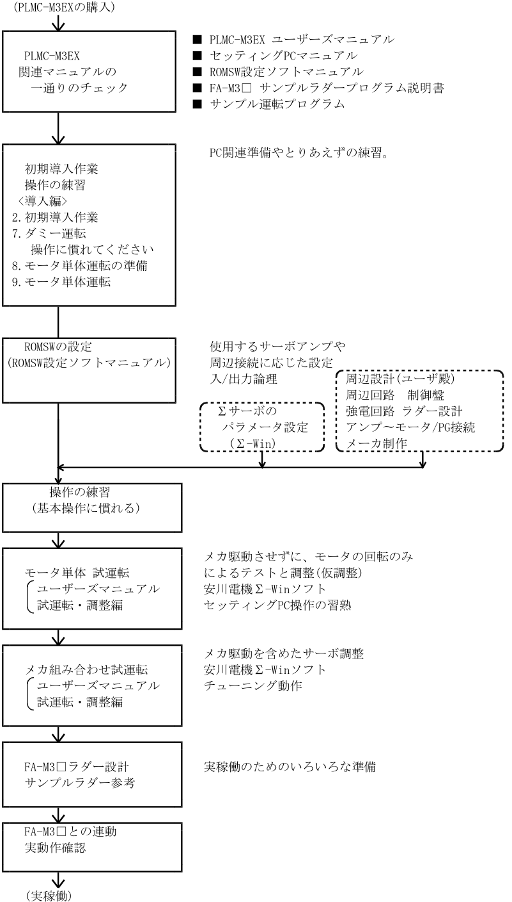

> **図の内容**
>
> (PLMC-M3EXの購入) から (実稼働) までの流れ:
> 1. PLMC-M3EX 関連マニュアルの一通りのチェック — ■ PLMC-M3EX ユーザーズマニュアル、■ セッティングPCマニュアル、■ ROMSW設定ソフトマニュアル、■ FA-M3□ サンプルラダープログラム説明書、■ サンプル運転プログラム
> 2. 初期導入作業、操作の練習〈導入編〉2.初期導入作業、7.ダミー運転 操作に慣れてください、8.モータ単体運転の準備、9.モータ単体運転 — PC関連準備やとりあえずの練習。
> 3. ROMSWの設定(ROMSW設定ソフトマニュアル) — 使用するサーボアンプや周辺接続に応じた設定 入/出力論理。あわせて「Σサーボのパラメータ設定 (Σ-Win)」と「周辺設計(ユーザ殿) 周辺回路 制御盤、強電回路 ラダー設計、アンプ～モータ/PG接続、メカ制作」
> 4. 操作の練習（基本操作に慣れる）
> 5. モータ単体 試運転（ユーザーズマニュアル 試運転・調整編） — メカ駆動させずに、モータの回転のみによるテストと調整(仮調整)。安川電機Σ-Winソフト。セッティングPC操作の習熟
> 6. メカ組み合わせ試運転（ユーザーズマニュアル 試運転・調整編） — メカ駆動を含めたサーボ調整。安川電機Σ-Winソフト。チューニング動作
> 7. FA-M3□ラダー設計 サンプルラダー参考 — 実稼働のためのいろいろな準備
> 8. FA-M3□との連動 実動作確認

## 3. ROMSW(ロムスイッチ)の設定

PLMC-M3EXとPCとの接続が確認できたら、ROMSW設定ソフトにより、「ユーザ設定ROMSW」を設定下さい。

設定方法の詳細は、「ROMSW設定ソフトマニュアル」TB00-0982を参照下さい。

- 【注】ROMSWの基本画面 : 「仮想アンプ機能」をチェックすると、MECHATROLINK接続がない状態でも、

軸を仮想的に動作できます。上位ソフトやラダー単体のデバッグなどには有効な場合もあります。

## 4. サーボパラメータ

PLMC-M3EXにおけるサーボ(制御軸)に関するパラメータです。実機に応じて最適な値を設定します。セッティングPC「パラメータ画面」で設定します。

- 【注】 PLMC-M3EXのサーボパラメータとサーボアンプのパラメータとは、別物です。 Σサーボのパラメータは、安川電機「Σ-Win」ソフトにて設定してください。

サーボパラメータ設定画面

※1 「MPOS偏差上限値」は無効です。(入力しないで下さい)


> **図の内容**
>
> 画面「サーボパラメータ」。タスク0 の 第1軸(X)～第4軸(A) の列に、INPOS量、偏差上限値、MPOS偏差上限値、補間加減速時定数、S字加減速時定数、PTP時定数、PTP速度、JOG速度、+側ソフトリミット、−側ソフトリミット、原点復帰方向、原点距離、原点復帰逃げ量、原点復帰早送り速度、原点復帰アプローチ速度、原点復帰最終サーチ速度、原点復帰順位、ホームポジション距離、ホームポジション順位、バックラッシュ補正量 などの値が並ぶ。ボタン: ファイルから読出、ファイルに保存、アップロード、ダウンロード、編集前に戻す、閉じる。
> 値は小さくて判読しにくい。

※1

### 4-1. 送り速度、加減速などのパラメータ

① PTP時定数位置決め(PTP)、JOG動作の時の直線加減速の傾きです。このとき設定できる最大値は32767、最小値は0です。

ROMSWのPTP時定数PTP速度基準の設定により意味合いが変わります。

ROMSWのPTP時定数PTP速度基準:チェック無しの場合

0から100kppsに到達するまでの時間

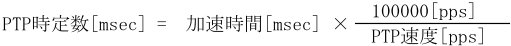

> **図の内容**
>
> PTP時定数[msec] ＝ 加速時間[msec] × 100000[pps] ／ PTP速度[pps]

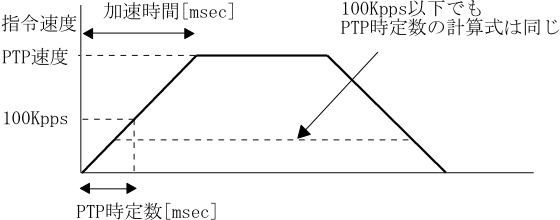

> **図の内容**
>
> 指令速度の台形。PTP速度まで上がる時間が「加速時間[msec]」、100Kpps に達するまでの時間が「PTP時定数[msec]」。注記: 100Kpps以下でもPTP時定数の計算式は同じ。

ROMSWのPTP時定数PTP速度基準:チェック有りの場合

0からサーボパラメータで設定するPTP速度に到達するまでの時間 PTP時定数[msec]=加速時間[msec]

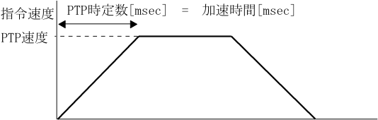

> **図の内容**
>
> 指令速度の台形。PTP速度に達するまでの時間が「PTP時定数[msec] ＝ 加速時間[msec]」。

具体例:PTP速度 200Kpps を 100msec で立ち上げる時

PTP時定数PTP速度基準チェック無し:PTP時定数=50msec

PTP時定数PTP速度基準チェック有り:PTP時定数=100msec

PTP速度 50Kpps を 100msec で立ち上げる時

PTP時定数PTP速度基準チェック無し:PTP時定数=200msec

PTP時定数PTP速度基準チェック有り:PTP時定数=100msec

- ② PTP速度 PTP送りの速度[pps]
- ③ JOG速度 JOG送りの速度[pps]

- ※ 本マニュアルでの速度単位[pps]は[パルス/秒]です。

- ④ 補間時定数一般的には、20〜40msec

この値を大きくすると、円弧補間の時に実際の半径が小さくなりますので注意下さい。

指数形加減速 (補間送り)

直線形補間加減速

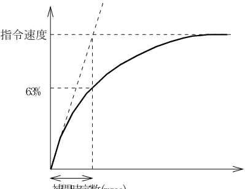

> **図の内容**
>
> 指令速度へ向かって指数関数的に立ち上がる曲線。指令速度の 63% に達するまでの時間（原点での接線（点線）が指令速度と交わるまでの時間）が補間時定数。

補間時定数(msec)

マイナスの値を入れると、直線形の補間加減速をおこないます。<オプション>

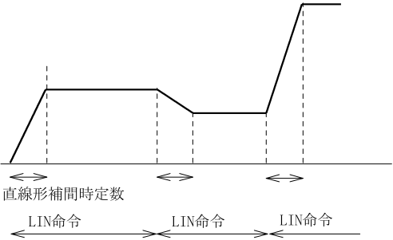

> **図の内容**
>
> LIN命令が 3 つ続くときの速度の変化。各 LIN命令の速度変化（加速・減速）が、それぞれ一定の時間（「直線形補間時定数」、下の矢印）の直線で行われる。

⑤ S字加減速(S字補間時定数) <オプション>

S字補間の時定数を[msec]単位で設定します。

直線型補間加減速が前提です。

S字の時定数は、直線型補間加減速の時定数の1/3以下としてください。詳細は「4-3 補間加減速(指数形/直線形/S字形)」を参照下さい。

### 4-2. ストロークリミットのパラメータ

- ① +側ソフトリミット
- ② -側ソフトリミット

ソフトウェアにより、動作可能な範囲を規定。この領域を越える移動指令があった場合、 PLMC-M3EXは停止して、アラームとなります。この場合、サーボ主電源は落ちません。そのまま手動にてもどせます。ソフトリミットは、機械座標でチェックします。設定できる最大値は1×10 9 です。

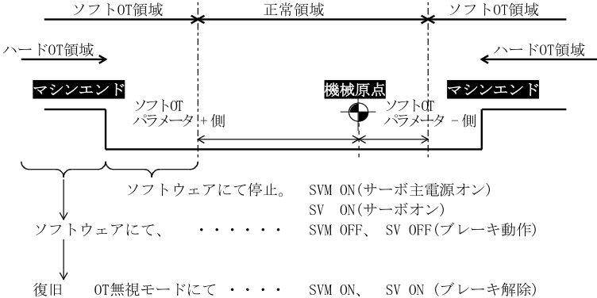

> **図の内容**
>
> - 左から: ハードOT領域（マシンエンド）、ソフトOT領域、正常領域、ソフトOT領域、ハードOT領域（マシンエンド）
> - 正常領域の両端が「ソフトOTパラメータ +側」と「ソフトOTパラメータ −側」。その間に機械原点
> - ソフトOT領域: ソフトウェアにて停止。SVM ON（サーボ主電源オン）、SV ON（サーボオン）
> - ハードOT領域: ソフトウェアにて、SVM OFF、SV OFF（ブレーキ動作）
> - 復旧: OT無視モードにて SVM ON、SV ON（ブレーキ解除）


ハードウェアストロークリミットマシンエンドに配置したLS信号をΣサーボアンプへ入力(ハードOT)します。一般はb接論理で入力し､これがOFFするとサーボは緊急停止して、 PLMC-M3EXはサーボ主電源を落とします。

【注】

Σサーボのソフトリミット機能は、PLMC-M3EXを使用する場合は通常は使いません。

### 4-3. 原点復帰の動作

詳細や関連パラメータの内容は、7-9.原点復帰(メカ組み合わせ試運転)を参照下さい。

原点復帰方式は、ROMSWでの方式選択とサーボパラメータ「原点復帰方向」で選択します。

[ROMSW設定と原点復帰方式の関係]

| 原点復帰方式          | 特徴速度精度   | 特徴速度精度   | ROMSW設定原点復帰方式       | サーボパラメータ「原点復帰方向」   | 詳細説明         |
|-----------------|------------|------------|----------------------|---------------------|---------------|
| FBラッチ方式(原点信号あり) | 高速中速      | 高精度高精度    | FBラッチ原点復帰 (原点信号検出)   | 2段 ±方向 1段 ±方向       | 7-9-1. 7-9-2. |
| FBラッチ方式(原点信号なし) | 低速         | 高精度        | FBラッチ原点復帰 (原点信号検出なし) | 2段 ±方向※ 1段 ±方向※     | 7-9-3. 7-9-3. |
| DECサーチ方式        | 高速中速      | △ △        | DECサーチ原点復帰           | 2段 ±方向 1段 ±方向       | 7-9-4. 7-9-5. |
| FBラッチ方式(OT信号)   | 中速         | 高精度        | FBラッチ原点復帰 (OT信号検出)   | 2段 ±方向※ 1段 ±方向※     | 7-9-6. 7-9-6. |
| OTサーチ原点復帰       | 低速         | △          | OTサーチ原点復帰            | 2段 ±方向※ 1段 ±方向※     | 7-9-7. 7-9-7. |

※ 1段/2段原点復帰のどちらに設定しても、同じ動きをします。

FBラッチエンコーダのC相(Z相)とFB(フィードバック)パルス基準なので高精度で経年変化なし原点(DEC)信号高速にDECの最初のエッジへ動作

2段方式

その後減速してからラッチ信号やDECのエッジでサーチ

1段方式

比較的ゆっくりDEC信号へ向かって動き、最初のエッジを基準にラッチ信号やDECのエッジでサーチ

DECサーチ方式 C相(Z相)を使わない。DECのエッジの経年変化に要注意

### 4-4. 全軸原点復帰の逃げ動作

① 原点復帰逃げ量 (下図参照)

※原点復帰逃げ量は必ず減速LSと原点との距離以上の充分な値(2倍程度)として下さい。(図のAの2倍)

全軸原点復帰時に原点付近に軸がある場合は、原点からの逃げ動作(正常領域内へ移動)を行い、その後で原点復帰を行います。

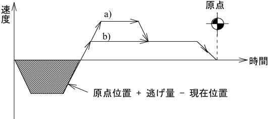

> **図の内容**
>
> 横軸 時間、縦軸 速度。原点付近に軸がある場合、まず逆方向へ移動し（斜線部の面積 ＝ 原点位置 ＋ 逃げ量 － 現在位置）、その後 a) または b) の速度で原点方向へ進んで原点に止まる。

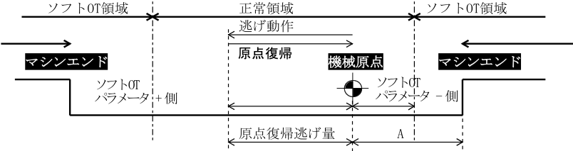

> **図の内容**
>
> 4-2 の領域の図（マシンエンド、ソフトOT領域、正常領域、ソフトOTパラメータ +側／−側、機械原点）に、「逃げ動作」「原点復帰」の矢印と、「原点復帰逃げ量」「A」の範囲を書き加えたもの。

### 4-5. 全軸原点復帰シーケンス(順位)

①原点復帰順位

### 4-6. その他のパラメータ

① バックラッシュ補正量軸にバックラッシュがある場合に設定して下さい。原点復帰済後から補正が有効となります。原点復帰未完や無効の時は、本機能は無効です。

- ②形状補正係数 <オプション>

軌跡形状補正を行う場合のパラメータです。

使用しない場合は、ゼロにします。

③ホームポジション距離ホームポジション位置決め実行時に位置決めを行う機械座標系の位置を設定します。

④ホームポジション順位ホームポジション置決め実行時に位置決めを行う軸の順位を設定します。

- ⑤原点復帰時論理座標

原点復帰を完了した位置の論理座標をこの値にセットアップします。

数字の小さい順(0→1→2…)に原点復帰を行います。例 Z軸をまず原点復帰、その後でX,Yが原点復帰 Zの順位 = 0 X, Yの順位 = 1

## 5. 操作の練習

いよいよ実際の操作です。説明の流れに沿って、作業を進めて下さい。操作や機能の詳細は「セッティングPCマニュアル」を参照下さい。

- 【注】ROMSWの基本画面:「仮想アンプ機能」をチェックすると、MECHATROLINK接続がない状態でも、軸を仮想的に動作できます。上位ソフトやラダー単体のデバッグなどには有効な場合もあります。

### 5-1. 配線チェック

電源を入れる前には、必ず全ての配線をチェック(テスターチェック)して下さい。特に電源などの誤配線には充分気をつけて下さい。

### 5-2. セッティングPCの起動

- ■ セッティングPCを起動します。(PLM3EXDRVのショートカットをダブルクリック) PLMC-M3EXの電源がオフなので以下の状態になります。

【運転画面】

- TO(タイムアウト)エラー(通信不良)のダイアログ表示
- OK をクリックして下さい。(ダイアログが消えます)
- 【注】FA-M3□とPCの通信が正常であることが前提です。導入編を参照ください。

### 5-3. PLMC-M3EX本体(FA-M3□)電源オン

- ■ 電源をオンして下さい。(サーボは、オフ) PLMC-M3EXの「RDY」LEDの点灯を確認下さい。
- ■ セッティングPCのメインメニューで、運転を押して下さい。

【運転画面】

- ポジション表示が 0 になります。(正常状態)
- ■ 異常のチェック

以下の状態は異常です

- ポジション表示の数値が表示されない
- 「RDY」LEDが点灯しない

異常の時はPLMC-M3EXのバックプレーンへの取付を確認してください

### 5-4. セッティングPCソフトの練習

セッティングPCの機能や画面に慣れて下さい。(セッティングPCマニュアル参照)ただ、サーボ電源がオフなので、運転はまだできません。

「導入編 7.ダミー運転」も参照下さい。サーボなしでも「セッティングPC」の操作の練習ができます。

【運転画面】

PLMC-M3EXの内部情報(動作モード、動作状態、アラーム情報)や、PLMCが制御する各軸ポジションのリアルタイム表示を行います。またPLMCに対して、動作や状態変更の指令を行うこともできます。

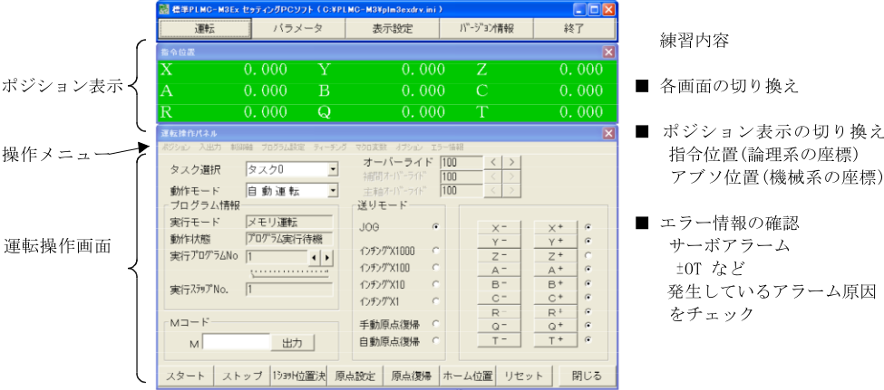

> **図の内容**
>
> セッティングPCソフトの運転画面。各部の名前: 「ポジション表示」（X、Y、Z、A、B、C、R、Q、T の位置、すべて 0.000）、「操作メニュー」、「運転操作画面」。
> 練習内容:
> - 各画面の切り換え
> - ポジション表示の切り換え: 指令位置(論理系の座標)、アブソ位置(機械系の座標)
> - エラー情報の確認: サーボアラーム、±OT など、発生しているアラーム原因をチェック

- ※ FA-M3□のラダーが走っている必要があります。サンプルラダーは、テクノから提供しています。

【入出力モニタリング画面】

操作メニューの「入出力」をクリックすると以下の画面を表示します。 PLMC-M3EXの入出力の状態をリアルタイム表示します。また、入出力の状態を変更(強制設定)することもできます。

FA-M3□のラダー動作は、必須ですので、ご注意下さい。

- ■ 入力信号の確認リミットSWなどが配線されていれば、ON/OFFさせて表示を確認

して下さい。

- ■ 出力信号の確認 ONさせても安全な出力(リレーやソレノイド)であれば、強制

出力でON/OFFさせて下さい。

- ■ アラーム要因の排除 ±OT、非常停止などの入力を正常な状態にして下さい

SWの配線や強制入力設定。

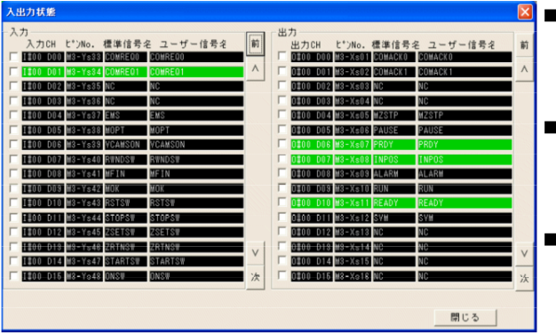

> **図の内容**
>
> 画面「入出力状態」。左が入力（入力CH、ピンNo.、標準信号名、ユーザー信号名）、右が出力（出力CH、ピンNo.、標準信号名、ユーザー信号名）。
> - 入力は I000 D00～D15。標準信号名 COMRED0、COMRED1、NC、NC、EMS、MOPT、VCAMSON、RWNDSW、MFIN、MOK、RSTSW、STOPSW、ZSETSW、ZRTNSW、STARTSW、ONSW（ピンNo. は M3-Ys33～M3-Ys48）。COMRED1 が緑（ON）
> - 出力は O000 D00～D15。標準信号名 COMACK0、COMACK1、NC、NC、MZSTP、PAUSE、PRDY、INPOS、ALARM、RUN、READY、SVM、NC、NC、NC、NC（ピンNo. は M3-Xs01～M3-Xs16）。PRDY、INPOS、READY が緑（ON）
> - 各行の左に強制入出力のチェックボックス。ボタン: 前、次、閉じる

- ※ 「導入編 7.ダミー運転」も参照してください。

サーボアンプやモータ無しでも「セッティングPC」の操作や練習ができます。

### 5-5. PLMC-M3EXのバックアップ情報

PLMC-M3EXには、以下のようなバックアップ情報があります。

購入・導入直後の状態で、バックアップ情報の一部に破損があると、「バックアップエラー」になります。

ユーザが管理する情報

PLMC-M3EX内で記憶する情報

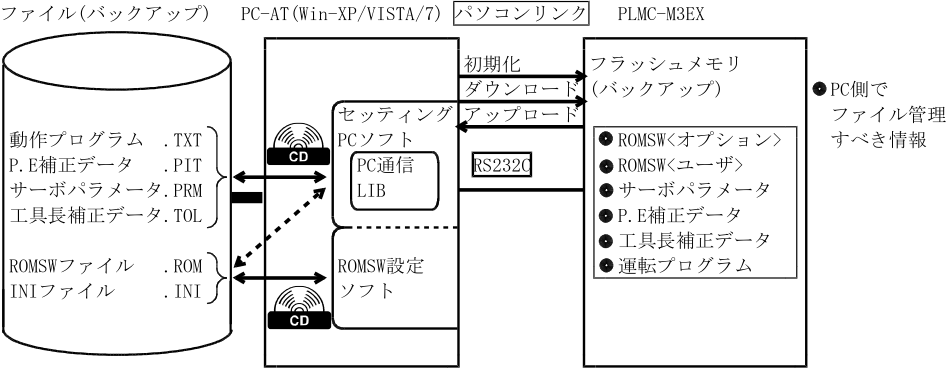

> **図の内容**
>
> - 「ファイル(バックアップ)」: 動作プログラム .TXT、P.E補正データ .PIT、サーボパラメータ .PRM、工具長補正データ .TOL は「セッティングPCソフト（PC通信LIB）」と読み書き。ROMSWファイル .ROM、INIファイル .INI は「ROMSW設定ソフト」と読み書き（セッティングPCソフトからは点線の矢印）
> - 「PC-AT (Win-XP/VISTA/7)」のセッティングPCソフト・ROMSW設定ソフトは、それぞれ CD から入れる
> - 「パソコンリンク」（RS232C）で「PLMC-M3EX」の「フラッシュメモリ(バックアップ)」へ 初期化、ダウンロード。フラッシュメモリから アップロード
> - フラッシュメモリの中身: ROMSW〈オプション〉、ROMSW〈ユーザ〉、サーボパラメータ、P.E補正データ、工具長補正データ、運転プログラム。● は「PC側でファイル管理すべき情報」

■ パラメータ未設定エラー

セッティングPCからパラメータの「初期化」をおこなって､PLMC-M3EX内バックアップ情報がクリアーされている時。

- ■ バックアップエラー

フラッシュメモリ内のバックアップデータの一部に破損があった時

### 5-6. バックアップメモリーエラー/パラメータ未設定エラーの解除

- a. 「バックアップメモリーエラー」が生じた場合、セッティングPCのパラメータバックアップデータ初期化の操作で、「バックアップデータ初期化画面」を表示させます。そこで、

パラメータ初期化プログラム初期化アブソポジション初期化マクロ変数初期化

を全ておこないます。

- ※本来は、消えた情報に対する初期化再設定で良いですが、初めの場合は、全てやり直す方法

がわかりやすいです。

- b. 初期化後は「パラメータ未設定エラー」となりますので、あらかじめ保存しておいた「サーボパラメータファイル」をダウンロードして下さい。
- c. サーボパラメータのバックアップファイルがない場合

万一、上記ファイルをなくしてしまったら、PLMC-M3EX内のデフォルトパラメータをアップロードしてください。

アップロードしたままの情報をそのままダウンロードしても「パラメータ未設定エラー」は、解除できます。

- 【注】この場合、サーボパラメータはデフォルトになってしまいます。従ってメカ（システム）固有のサーボパラメータを新しく作り直す必要があります。

### 5-7. モータを回す

セッティングPCの機能や操作に慣れたら、いよいよモータを回します。アラーム要因をクリアーしておく必要があります。

- 【注】ROMSWの基本画面:「仮想アンプ機能」をチェックすると、MECHATROLINK接続がない状態でも、軸を仮想的に動作できます。上位ソフトやラダー単体のデバッグなどには有効な場合もあります。

#### 5-7-1.サーボ電源を入れる

PLMC-M3EXの「RDY」LEDが点灯している状態を確認して、サーボ電源を入れます。

「運転画面」にてリセット → サーボオンします。

正常であれば、「サーボオン」し、モータがサーボロックします。

【サーボオンしない場合】

アラーム要因を調べます。セッティングPCの「エラー情報」

- サーボアラーム → ・異常が発生している。
- ハードリミット(各軸OT) → ・B接入力でオープンになっている。
- 非常停止

【サーボが異常に動く】

急に回ったり、がたがた動く時は、サーボアンプやモータとの接続に問題があります。配線を再チェックして下さい。

- ※ 最近のACサーボは、単独でも動作します。単独動作にてサーボアンプ/モータ自体をチェック下してさい。

「メンテナンス編1-4サーボ関連の異常」を参照下さい。

### 5-8. 手動操作

【運転画面】にて、手動にてサーボを回します。「手動モード」にします。

【ジョグ送り】

- +X -Y などのキーを押します。

送りモードでJOG送りを選択

【インチング送り】

送りモードで×1、×10、×100などを選択

押している間、モータは指定の方向に回ります。オーバライドを下げておきます。

操作は、ジョグ送りと同じです。

【オーバライド変更】 ▲ ▲ で%を変更

ジョグ送りの速さ(回転速度)が%に応じて増減します。

### 5-9. その他の基本的操作

運転画面リセットアラーム情報のクリアー、サーボ電源投入

原点設定現在位置を論理系のゼロ(原点)とします。指令位置がゼロになります。

以上で「操作の練習」は終わりです!

## 6. サーボ系の制御性能

### 6-1. 機械の剛性の重要性

機械の剛性が高くなければ、高精度なサーボ系の調整は困難です。ユーザ(機械設計担当者)は、まず機械の剛性を高めることに努力下さい。

| 機械の剛性                | 高(良)    | 低(悪)                  |
|----------------------|---------|-----------------------|
| 機械的「ガタ」              | ない      | ある                    |
| ねじりバネ要素              | 小 (かたい) | 大(やわらかい) 細くて長いボールネジなど |
| イナーシャ                | 小       | 大                     |
| ボールネジの張りタイミングベルトの張り | 強       | 弱                     |

### 6-2.制御系の良さ

制御系の良さとは、次のようなことです。

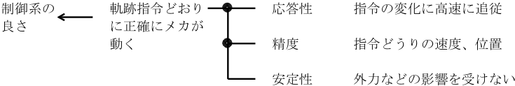

> **図の内容**
>
> 制御系の良さ ＝ 軌跡指令どおりに正確にメカが動く。その要素:
> - 応答性: 指令の変化に高速に追従
> - 精度: 指令どうりの速度、位置
> - 安定性: 外力などの影響を受けない

### 6-3. サーボ系の3重ループ

サーボ系は、図のような3重ループの制御になっています。

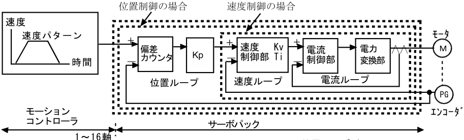

> **図の内容**
>
> 「モーションコントローラ」の速度パターン（1～16軸）→「サーボパック」の 偏差カウンタ → Kp →（速度制御部 Kv Ti）→ 電流制御部 → 電力変換部 → モータ（M）。エンコーダ（PG）からのフィードバックで、内側から 電流ループ、速度ループ、位置ループの 3 重ループになる。点線の枠は「位置制御の場合」と「速度制御の場合」の範囲。

位置制御型サーボアンプ使用時

そのため、制御性能の責任は以下の順番で生じます。

メカ剛性 >> >

サーボモータの特性サーボアンプの特性位置ループの特性 PG(検出器の精度) 電流ループ・速度ループサーボアンプ又はPLMC-M3EX

KP：位置ループゲイン

KV：速度ループゲイン

TI：積分時定数

### 6-4. PLMC-M3EXとサーボ系の関係

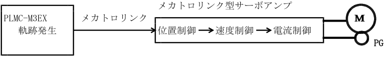

> **図の内容**
>
> 「PLMC-M3EX 軌跡発生」→「メカトロリンク」→「メカトロリンク型サーボアンプ」（位置制御 → 速度制御 → 電流制御）→ モータ（M）、PG。

### 6-5. サーボモータ応用時の一般的注意

#### 6-5-1. モータの選定

負荷イナーシャ、最高速度、加減速時間、1パルス移動量などの条件をもとに選定します。詳細は各サーボメーカの説明書を参照下さい。

最近のACサーボは、加速性能は高いものの、定速回転(特に低速)での速度リップルが大きい傾向があります。サーボアンプの速度ループゲインを上げることで、このリップルを小さくします。

#### 6-5-2. 速度ループゲイン調整

サーボアンプのパラメータ調整にて、速度ループゲインを上げていきます。往復運転をしながら、速度ループゲインを上げていき、発振限界のゲインを探します。

メカのストロークに対して、中央/両端どの場所でも発振させない値にして下さい。

- 【注】 (1)発振させると、非常に大きな音が出て、メカ強度が不足(特にカップリングなど)している部分は、まれに壊れる可能性があります。発振が生じた場合は、すぐに速度ループゲインを大きく下げて発振を止めて下さい。
- (2)メカ調整(ボールネジ/ベルトの張りなど)により速度ループゲインの上限値は変わります。

#### 6-5-3. ACサーボの単体動作とパラメータ設定

6-4の構成図のように、制御特性の調整はサーボアンプのパラメータ設定によりおこないます。この場合、パソコンや設定器(各サーボアンプメーカ)による単体動作が基本です。

#### 6-5-4. 多軸のゲイン調整

複数軸で補間動作をさせ、軌跡精度を重視する応用では、以下のパラメータについては必ず同じ値を設定して下さい。

- ■ 位置ループゲイン
- ■ 補間時定数(指数形/直線形)

サーボアンプパラメータ PLMC-M3EXパラメータ

#### 6-5-5. 安川電機Σサーボの設定・調整例

■ΣⅤシリーズの場合

ΣⅤシリーズMECHATROLINK-Ⅲサーボパックマニュアルを必ず参照ください。

特に7章「運転」の「機械に合わせた設定」、「上位装置に合わせた設定」、「サーボパックの設定」の項を充分にご確認ください。

■ΣⅤシリーズの場合

ΣⅤシリーズユーザーズマニュアルを必ず参照ください。

特に「設計・保守編」の3章「配線と接続」の「入出力信号の接続」、「入出力信号割り付け表」、 4章の「運転のための基本機能の設定」、「試運転」の項を充分にご確認下さい。

■PLMC-M3EXでΣサーボを使う場合の基本方針

モータ回転方向は、Σサーボで設定する。

OTとして、P-OT(CN1-7)N-OT(CN1-8)をB接(N.C)で使う

OT発生時は、DB停止

サーボオフ時は、DB停止

Σサーボのソフトリミット機能は、使わない。(PLMC-M3EXの機能を使う)

原点信号DECを(CN1-9)でA接(N.O)で使う。

ラッチ動作をさせる場合は、/EXT1(CN1-10)をA接(N.O)で使う。(通常は、使用しない)

Σサーボ内部の加減速機能は、通常は使用しない。

Σサーボ内部の原点復帰関連の機能は、使用しない。(PLMC-M3EXの機能を使う)

ブレーキ制御が必要なときは、ΣのBK出力をつかう。

■ΣVのIO推奨設定 ○:標準的に使う △:必要な場合に使う

| 入力    |   PIN | 機能     |    | 出力    | PIN   | 機能     |    |
|-------|-------|--------|----|-------|-------|--------|----|
| P-OT  |     7 | +OT B接 | ○  | /BK   | 1,2   | ブレーキ出力 | △  |
| N-OT  |     8 | -OT B接 | ○  | /CLT  | 23,24 | トルク制限中 | △  |
| /DEC  |     9 | 原点     | ○  | /COIN | 25,26 | 位置決め完了 | △  |
| /EXT  |    10 | ラッチ    | △  |       |       |        |    |
| /P-CL |    11 | +電流制限  | △  |       |       |        |    |
| /N-CL |    12 | -電流制限  | △  |       |       |        |    |

■パラメータの設定例

| パラメータ番号    | 名称          | 設定方法                                      | 設定方法                                      |
|------------|-------------|-------------------------------------------|-------------------------------------------|
| Pn000:0桁   | 回転方向        | 0:負荷側から見てCCWが正転                           | 1:その逆                                     |
| Pn001:1桁   | OT時の停止方法    | 1:OT時に減速停止後にサーボロック停止後に振動が発生する時はPn406を下げる | 1:OT時に減速停止後にサーボロック停止後に振動が発生する時はPn406を下げる |
| Pn205      | マルチターンリミット | 絶対値エンコーダかつ無限回転軸のときに設定                     | 絶対値エンコーダかつ無限回転軸のときに設定                     |
| Pn20E      | 電子ギヤ分子      | Bの値                                       | Bの値                                       |
| Pn212      | 電子ギヤ分母      | Aの値                                       | Aの値                                       |
| Pn50A:1□□□ |             | A:P-OT(CN1-7)B接                           | 1881                                      |
| Pn50B:□□□2 |             | B:N-OT(CN1-8)B接                           | 8882                                      |
|            |             | /P-CL、/N-CLを使う場合                          | 6582                                      |
| Pn50E:□□□3 |             | /COIN出力(CN1-25,26)                        | 0003                                      |
| Pn50F:□1□2 |             | /BK(CN1-1,2)、/CLT(CN1-23,24)              | 0102                                      |
| Pn511:□□43 |             | DEC(CN1-9)でA接 EXT1(CN1-10)をA接             | 8843                                      |
| Pn801:□0□3 |             | ソフトリミットなし                                 | 0003                                      |
| Pn80A〜80F  |             | 独立位置決めの時の加減速                              |                                           |

※ □はパラメータの各一桁の数字を表します。

- ■Pn205 マルチターンリミットの設定【0】

絶対値エンコーダかつ無限回転軸の時、設定が必要です。

- モータm回転でメカ端n回転のとき、Σサーボのマルチターンリミットにm-1を設定ください (m,nは整数)。

nの値は、PLMC-M3EXのROMSWの軸設定の「マルチターンリミット」に設定します。

- ■電子ギヤ指令パルス × [B(分子)/A(分母)] = エンコーダ分解能
- ■絶対値エンコーダの場合 Σサーボのマニュアル「運転」「絶対値エンコーダ」を参照ください。

■調整

Σサーボのノーマルチューニングやアドバンスドチューニングを実施ください。詳細は、同マニュアル「調整」を参照ください。

以下は、必ずご確認ください。また、必要であれば、マニュアルで再設定してください。

Pn100 速度ループゲイン往復動作時に発振しない範囲で、上限値

Pn101 速度ループ時定数発振しない範囲で、小さい値

Pn102 位置ループゲイン発振しない範囲で、上限値

多軸補間で軌跡制御する場合は、お互いに同じ値にする。

#### 6-5-6. 安川電機ΣⅤの設定・調整例

ΣⅤの場合も、ΣⅢと同様な考え方で設定してください。

ただし、ΣⅤ+メカトロリンクIFユニットの場合は、ΣサーボのCN1の信号が変わりますのでご注意ください。正式には、安川電機の関連資料でご確認をお願い致します。

■ΣⅤ+メカトロリンクIFユニットの時のCN1信号

○:標準的に使う △:必要時に使う

| 入力    |   PIN | 機能     |    | 出力    | PIN   | 機能     |    |
|-------|-------|--------|----|-------|-------|--------|----|
| P-OT  |    42 | +OT B接 | ○  | BK    | 27,28 | ブレーキ出力 | △  |
| N-OT  |    43 | -OT B接 | ○  | /COIN | 25,26 | 位置決め完了 | △  |
| /DEC  |    41 | 原点     | ○  |       |       |        |    |
| /EXT  |    44 | ラッチ    | △  |       |       |        |    |
| /P-CL |    45 | +電流制限  | △  |       |       |        |    |
| /N-CL |    46 | -電流制限  | △  |       |       |        |    |

## 7. 実際の試運転・調整(技術員、機械とりまとめの方へ)

PLMC-M3EXシリーズの試運転・調整は、以下の2段階でおこなって下さい。

- ■ 制御盤/モータ単体試運転メカ駆動なし。(モータのみ回転)
- ■ メカ組合せ試運転

メカ駆動ありの最終形。

また、使用するサーボアンプ・サーボモータの説明書についても充分理解された上で試運転を行って下さい。

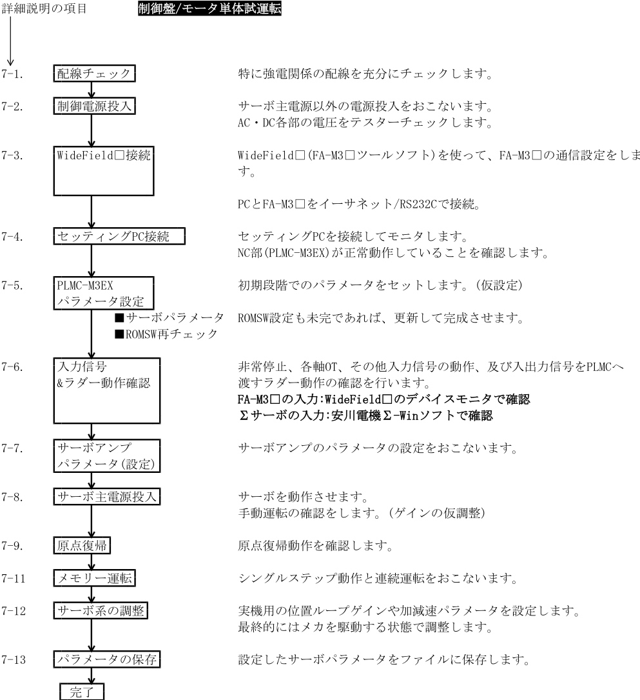

> **図の内容**
>
> | 詳細説明の項目 | 作業 | 内容 |
> |---|---|---|
> | 7-1. | 配線チェック | 特に強電関係の配線を充分にチェックします。 |
> | 7-2. | 制御電源投入 | サーボ主電源以外の電源投入をおこないます。AC・DC各部の電圧をテスターチェックします。 |
> | 7-3. | WideField□接続 | WideField□(FA-M3□ツールソフト)を使って、FA-M3□の通信設定をします。PCとFA-M3□をイーサネット/RS232Cで接続。 |
> | 7-4. | セッティングPC接続 | セッティングPCを接続してモニタします。NC部(PLMC-M3EX)が正常動作していることを確認します。 |
> | 7-5. | PLMC-M3EX パラメータ設定（■サーボパラメータ ■ROMSW再チェック） | 初期段階でのパラメータをセットします。(仮設定) ROMSW設定も未完であれば、更新して完成させます。 |
> | 7-6. | 入力信号&ラダー動作確認 | 非常停止、各軸OT、その他入力信号の動作、及び入出力信号をPLMCへ渡すラダー動作の確認を行います。FA-M3□の入力:WideField□のデバイスモニタで確認。Σサーボの入力:安川電機Σ-Winソフトで確認 |
> | 7-7. | サーボアンプパラメータ(設定) | サーボアンプのパラメータの設定をおこないます。 |
> | 7-8. | サーボ主電源投入 | サーボを動作させます。手動運転の確認をします。(ゲインの仮調整) |
> | 7-9. | 原点復帰 | 原点復帰動作を確認します。 |
> | 7-11 | メモリー運転 | シングルステップ動作と連続運転をおこないます。 |
> | 7-12 | サーボ系の調整 | 実機用の位置ループゲインや加減速パラメータを設定します。最終的にはメカを駆動する状態で調整します。 |
> | 7-13 | パラメータの保存 | 設定したサーボパラメータをファイルに保存します。 |
>
> 最後に「完了」。

メカ組合せ試運転

対象のマシンにより、各々詳細は異なります。ここでは代表的な例について説明します。リンク系のロボットや落下軸のあるマシンは、特にサーボオン/オフとブレ-キのオフ/オンの関係に充分気をつけて下さい。

制御盤/モータ単体試運転が正常に完了していることを前提としています。

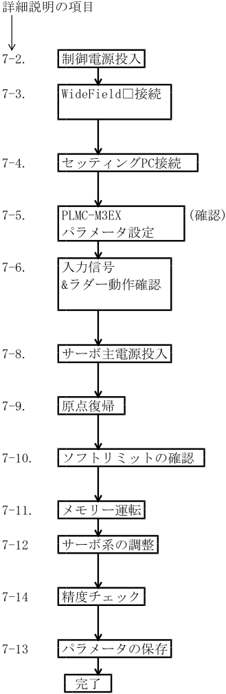

> **図の内容**
>
> 詳細説明の項目の順: 7-2. 制御電源投入 → 7-3. WideField□接続 → 7-4. セッティングPC接続 → 7-5. PLMC-M3EX パラメータ設定（確認）→ 7-6. 入力信号&ラダー動作確認 → 7-8. サーボ主電源投入 → 7-9. 原点復帰 → 7-10. ソフトリミットの確認 → 7-11. メモリー運転 → 7-12 サーボ系の調整 → 7-14 精度チェック → 7-13 パラメータの保存 → 完了

サーボ主電源以外の電源投入をおこないます。

WideField□(FA-M3□ツールソフト)を使って、 FA-M3□の通信設定をします。 PCとFA-M3□をイーサネット/RS232Cで接続。

セッティングPCを接続してモニタします。 PLMC-M3EXが正常動作していることを確認します。

(確認) パラメータの確認をします。安全のため速度やゲインなどは、最初は小さくします。

非常停止、各軸OT、その他入力信号の動作、及び入出力信号をPLMC-M3EXへ渡すラダー動作の確認を行います。

FA-M3□の入力:WideField□のデバイスモニタで確認 Σサーボの入力:安川電機Σ-Winソフトで確認

サーボを動作させます。手動運転の確認をします。指令単位があっているか移動量を確認します。 (例 1p=1μmのとき100000pの移動指令で100mm動くかの確認) 原点復帰動作を確認します。減速LS(DEC信号)とC(Z)相パルスの位置関係をチェックします。

ソフトリミットを設定します。

又、ハードOTとの位置関係もチェックします。

シングルステップ動作と連続運転をおこないます。

位置ループゲインや加減速パラメータを設定します。又モータの負荷電流などもチェックします。

当社モーションアナライザーTPCにより「サーボ応答」「軌跡精度」のチェックを行うことを推奨します。

設定したサーボパラメータをファイルに保存します。

### 7-1. 配線チェック(単体試運転)

配線チェックは大変重要ですので入念におこなって下さい。

信号ケーブル

強電配線

ケーブル製作時点で確実にチェックして下さい。特に混色や接触不良などは、試運転作業を大幅に遅らせる原因になります。必ず事前に充分なチェックをおこなって下さい。

電源関係の配線やリレー回路などは、配線ミスが焼損の原因になる場合があります。

必ず配線図と照合チェックして下さい。

また､線サイズ、端子カシメ、ネジ締めなどもチェックして下さい。

- 【注1】リレーコイルや電磁開閉器には、必ずサージサプレッサーを入れて下さい。
- 【注2】一般信号ケーブルと強電回路は配線経路を極力分離して下さい。
- 【注3】ケーブルのシールドは、アースプレートやクランプ用金具にて制御盤アースへ落として下さい。

### 7-2. 制御電源投入(単体試運転/メカ組合せ試運転)

サーボ主電源のMC(電磁開閉器)がONしないようにして下さい(7-6までOFFのままです)。また、非常停止スイッチもONさせて下さい。電源を投入します。

I/O用の電源のAC入力電圧及びDCの出力電圧などを確認して下さい。

### 7-3. WideField□接続(単体試運転/メカ組合せ試運転)

PCとFA-M3□との接続を確認します。

接続形態は、イーサネット、もしくはRS232Cで接続してください。 (PLMCは、USB接続未対応です。)

- ※ 通信設定については、PCと接続しているモジュールの説明書、及びWideField□の説明書を参照下さい。

### 7-4. セッティングPC接続(単体試運転/メカ組合せ試運転)

PCを接続し、セッティングPCを起動して下さい。

通信エラーとなった場合、一度FA-M3□側を電源入/切りして、セッティングPCソフトを再起動して下さい。それでも通信エラーとなる時は、以下のような原因が考えらます。

- RS232Cケーブルやイーサネットケーブルの配線不良 (メンテ編 1-1 2 参照)
- PCのCOMポート設定のミス(RS232Cの場合)
- ※ セッティングPCの使用方法は、「セッティングPCマニュアル」を参照下さい。
- ※ PLMC-M3EXの「RDY」LED が不点灯の場合は、PLMC-M3EX側の問題です。

(メンテ編 1-1 1 参照)

### 7-5. PLMC-M3EXパラメータ設定(単体試運転/メカ組合せ試運転)

PLMC-M3EXの出荷時には、標準的なパラメータが設定されています(デフォルトパラメータ)。セッティングPCの【パラメータ編集画面】にて確認下さい。

以下を参照して適切なパラメータを設定(ダウンロード)し、ファイルも保存して下さい

- 本マニュアル試運転調整編4.サーボパラメータ
- セッティングPCマニュアル

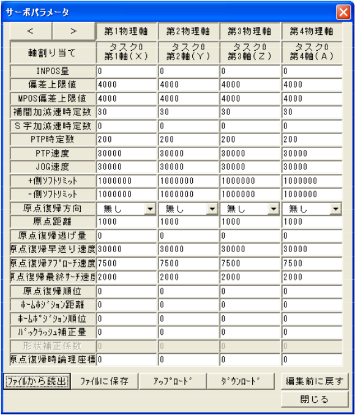

> **図の内容**
>
> 4 章と同じ「サーボパラメータ」画面（タスク0 の第1軸～第4軸）。値は小さくて判読しにくい。

### 7-6. 入力信号&ラダー動作確認(単体試運転/メカ組合せ試運転)

#### 7-6-1. デバイスモニタ(WideField□)によるチェック

WideField□のメニュー【オンラインーデバイスモニターX･Y入出力】を選択。

モニタするモジュールを選択し、使用している入/出力が正常動作していることを確認します。

#### 7-6-2. 信号モニタ(SigmaWin+)によるチェック

原点信号やOT信号をΣサーボへ接続している場合は、安川電機製SigmaWin+(Σ-Win)にて確認します。 Σ-Winの【入力信号モニタ】や【出力信号モニタ】から使用している入/出力が正常動作していることを確認します。

#### 7-6-3. ラダー動作の確認

PLMC-M3EXへ入出力信号を入れるには、FA-M3□のラダー動作が必要です。サンプルラダーを参照し、処理を作成・確認してください。

#### 7-6-4. 入出力モニタ(セッティングPC)によるチェック

セッティングPCの【入出力モニター画面】により、使用している入/出力が正常動作していることを確認します。

FA-M3□のラダー動作が必要です。サンプルラダーを参照ください。

単体試運転で外部スイッチがない時は、端子台などでショート/オープンさせてチェックします。メカ組合せ試運転ではLSや近接SWをオン/オフさせてモニター画面の1/0でチェックします。

入出力モニタリング画面

操作メニューの「入出力」をクリックすると以下の画面を表示します。

PLMC-M3EXの入出力の状態をリアルタイム表示します。また、入出力の状態を変更(強制設定)する事もできます。

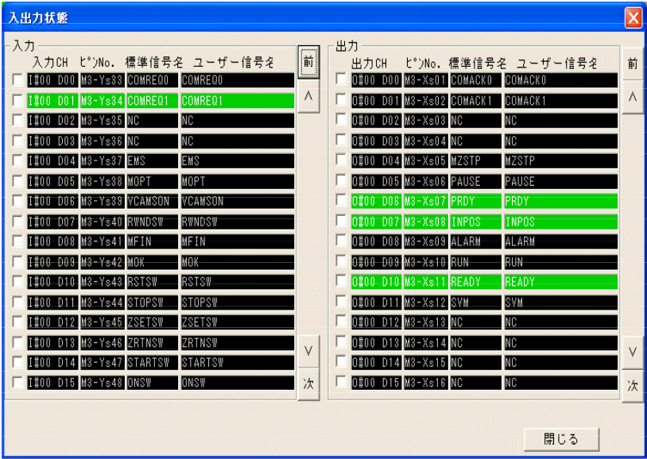

> **図の内容**
>
> 5-4 と同じ「入出力状態」画面。入力 COMRED1、出力 PRDY、INPOS、READY が緑（ON）。

に

#### 7-6-5. 非常停止関係のチェック

「非常停止」や「OT入力」でサーボ主電源断(PLMC-M3EXからのSVM OFF) することをチェックします。

(FA-M3□のラダー動作が必要です。サンプルラダーを参照ください。)

単体試運転ではb接点のOT等は端子台でショートするか、強制入力設定などして正常状態として下さい。

非常停止入力を解除して電源投入します。サーボ主電源が投入されます。

サーボ主電源がONした状態で、「非常停止」及び「各OT入力」(b接点のショートなら、オープンにする) て、主電源断になることを確認して下さい。

サーボ主電源が入らない場合は、他にアラーム要因があります。

セッティングPCのモニター画面にて、アラーム要因を確認して下さい。


<ブレーキ電源チェック>

落下軸の場合、ブレーキの動作チェックをします。サーボフリーのまま、ブレーキ解除しますので、落下防止の処置(材木などによる支え)をして下さい。 SVM ONにて、ブレーキ電圧が発生し、ブレーキは解除します。ブレーキ解除のディレータイム

も長め(2〜3秒)に設定して下さい。

### 7-7. サーボアンプのパラメータ設定

使用するサーボやパルスモータアンプの設定をおこないます。

具体的設定方法は各アンプメーカの説明を参照下さい。

また、基本的な考え方は、本マニュアルの<試運転・調整>6項「サーボ系の制御性能」と6-5-5.安川ΣⅤ の設定・調整例を参照下さい。

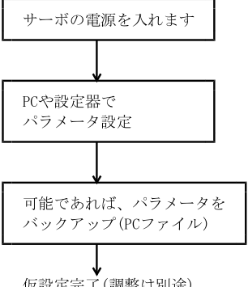

> **図の内容**
>
> 「サーボの電源を入れます」→「PCや設定器でパラメータ設定」→「可能であれば、パラメータをバックアップ(PCファイル)」→「仮設定完了(調整は別途)」

必要であれは、PLMC-M3EXの強制出力にて主電源回路ON

使用上の設定(安川Σサーボの例6-5-5.参照) 速度ループゲイン/位置ループゲインは低め一般的には、安川電機Σ-Winソフトを使います。

仮設定完了(調整は別途)

投

### 7-8. サーボ主電源投入(単体試運転/メカ組合せ試運転)

非常停止やOTを解除して電源投入を行うとサーボ主電源が入ります。非常停止ボタンに手をおいて電源入して下さい。

乱調や急な動作をした場合は、すぐに非常停止を押して下さい。

サーボロックを確認後、ジョグ操作により +方向、-方向に動かして様子を見ます。設定したストロークリミットを越えないように注意して下さい。

<指令単位の確認>

念のため指令単位に間違いがないか確認します。

例 1p = 1μm 100000pの送りで100mm移動

例 1p = 0.001ﾟ 90000pの送りで90ﾟ移動

異る場合メカ諸元(ギヤ比、ボールネジなど)を確認下さい。また、「電子ギヤ」(Σサーボのパラメータ)の設定が必要な場合もあります。

<サーボが乱調したとき>

(単体試運転)

配線不良やサーボアンプの設定不良の可能性があります。

安川Σ-Winソフトで、サーボ・モータ単体動作をさせてください。

### 7-9. 原点復帰(メカ組合せ試運転)

原点復帰方式は、ROMSWでの方式選択とサーボパラメータによる選択・調整があります。

はじめは、1軸ずつで、早送り速度(PTP速度)・アプローチ速度などはなるべく低速に設定してテストして下さい。(安全のため)

原点ドグエッジとC(Z)相パルスが重ならないように確認して下さい。(以下のAの値)

Aの値は、原点復帰の完了時にセッティングPC「相対移動量」に表示されます。

この時表示される値は、任意分周や電子ギアを掛けていない値です。

アプローチ速度が速いと値のバラツキがありますので、何回おこなっても以下の条件を満足するように、原点ドグ位置やC(Z)相を調整下さい。

安全に動作する事を確認したら、速度関係のパラメータを変更し、効率的な原点復帰動作に設定ください。

■アブソエンコーダの軸の場合

設定などは、7-9-11.「絶対値エンコーダの軸の設定」を参照下さい。

ただし、以下の理由でアブソ仕様軸でも通常の機械原点復帰を先に確認しておく事を推奨します。アブソエンコーダのバックアップエラーなどで、再度アブソポジションクリアーをして、機械原点を再設定する場合があります。以前と正確に同じ位置で設定するためには、機械原点復帰が必要です。

[ROMSW設定と原点復帰方式の関係]

| 原点復帰方式          | 特徴速度精度   | 特徴速度精度   | ROMSW設定原点復帰方式       | サーボパラメータ「原点復帰方向」   | 詳細説明         |
|-----------------|------------|------------|----------------------|---------------------|---------------|
| FBラッチ方式(原点信号あり) | 高速中速      | 高精度高精度    | FBラッチ原点復帰 (原点信号検出)   | 2段 ±方向 1段 ±方向       | 7-9-1. 7-9-2. |
| FBラッチ方式(原点信号なし) | 低速         | 高精度        | FBラッチ原点復帰 (原点信号検出なし) | 2段 ±方向※ 1段 ±方向※     | 7-9-3. 7-9-3. |
| DECサーチ方式        | 高速中速      | △ △        | DECサーチ原点復帰           | 2段 ±方向 1段 ±方向       | 7-9-4. 7-9-5. |
| FBラッチ方式(OT信号)   | 中速         | 高精度        | FBラッチ原点復帰 (OT信号検出)   | 2段 ±方向※ 1段 ±方向※     | 7-9-6. 7-9-6. |
| OTサーチ原点復帰       | 低速         | △          | OTサーチ原点復帰            | 2段 ±方向※ 1段 ±方向※     | 7-9-7. 7-9-7. |

※1段/2段原点復帰のどちらに設定しても、同じ動きをします。

FBラッチ

原点(DEC)信号

エンコーダのC相(Z相)とFB(フィードバック)パルス基準なので、高精度で経年変化なし。

高速にDECの最初のエッジへ動作。

2段方式

その後減速してからラッチ信号やDECのエッジでサーチ。

1段方式

DECサーチ方式

比較的ゆっくりDEC信号へ向かって動き、最初のエッジを基準にラッチ信号やDECのエッジでサーチ。

C相(Z相)を使わない。DECのエッジの経年変化に要注意。

[以降の図の表記]

- a: 原点復帰早送り速度 (サーボパラメータ)
- b: 原点復帰アプローチ速度 (サーボパラメータ)
- c: 原点復帰最終サーチ速度 (サーボパラメータ)
- S: 原点距離

(サーボパラメータ)

- A: 原点信号〜C(Z)相間距離原点復帰の直後にセッティングPC「相対移動量」に表示

[ラッチ信号]

ROMSWの軸設定「原点復帰FBラッチ信号」で、C(Z)相、EXT1、EXT2、EXT3の信号を選択。

[原点復帰時の条件] 注意!

|OFS| < A < |PLS-OFS|

Aがこの範囲でない場合は、ドグ位置または、Z(C)相を再調整すべき

OFS < PLS ÷ 4

OFS = (FEED × RTC × 6) ÷ 1000

FEED: 原点復帰速度、アプローチ速度[pps]

PLS : モータ1回転パルス数[pulse]

RTC : RTC(制御)周期[msec]

A : 原点信号とC(Z)相間の距離[pulse]

#### 7-9-1. 《FBラッチ方式(原点信号あり) ±2段原点復帰》

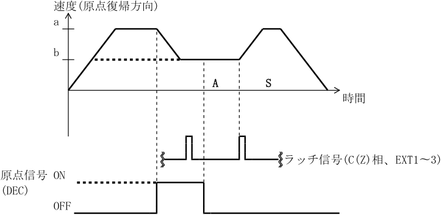

> **図の内容**
>
> 速度 a で進み、原点信号(DEC)が ON で速度 b に減速し、原点信号の変化から距離 A の後のラッチ信号（C(Z)相、EXT1～3）をラッチして、原点距離 S の位置で止まる。

#### 7-9-2. 《FBラッチ方式(原点信号あり) ±1段原点復帰》

速度(原点復帰方向)

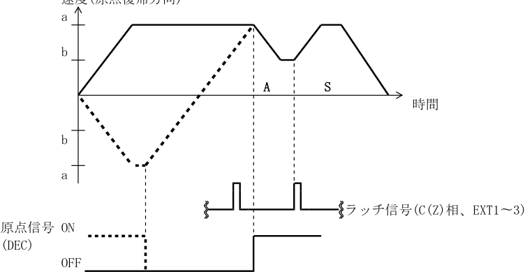

> **図の内容**
>
> 速度 a で進み（原点信号の状態により逆方向へ速度 a で戻る場合を点線で示す）、原点信号の変化から距離 A の後のラッチ信号（C(Z)相、EXT1～3）をラッチして、原点距離 S の位置で止まる。

#### 7-9-3. 《FBラッチ方式(原点信号無し)》

※1段/2段原点復帰のどちらに設定でも、同じ動きをします。

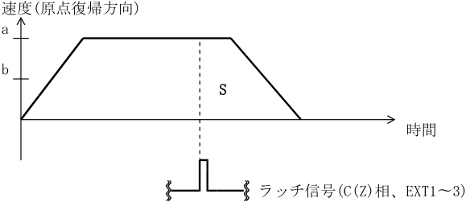

> **図の内容**
>
> 速度 a で進み、ラッチ信号（C(Z)相、EXT1～3）の位置をラッチし、そこから原点距離 S の位置で止まる（減速しながら移動）。

#### 7-9-4. 《DECサーチ方式 ±2段原点復帰》

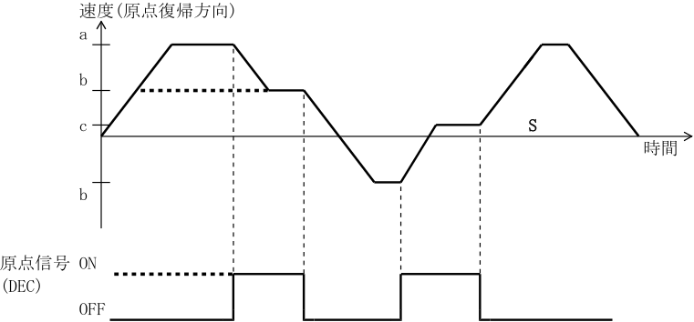

> **図の内容**
>
> 速度 a で進み、原点信号(DEC)が ON になると減速して速度 b で逆方向に戻り、原点信号が OFF になると速度 c で再び原点方向へ進み、原点信号の変化で止まったあと、原点距離 S だけ移動する。

#### 7-9-5. 《DECサーチ方式 ±1段原点復帰》

速度(原点復帰方向)

7-9-6. 《FBラッチ(OT信号)》(1段/2段は、同じ動作)

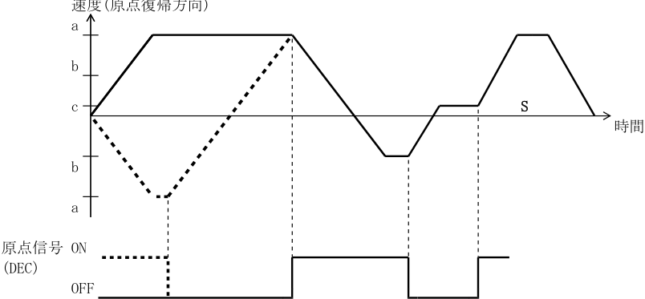

> **図の内容**
>
> 速度 a で進み（原点信号の状態により逆方向へ速度 a で戻る場合を点線で示す）、原点信号の変化から速度 b・c でサーチし、原点距離 S だけ移動する。

【注】 a:原点復帰早送り速度は、低めにして下さい。

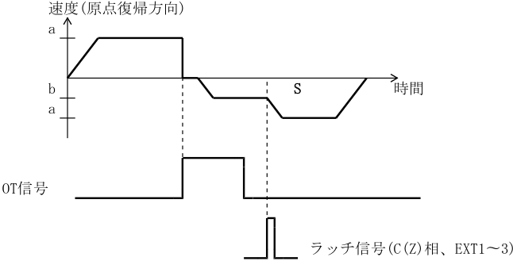

> **図の内容**
>
> 速度 a で進み、OT信号が ON で逆方向へ速度 b で戻り、OT信号 OFF の後のラッチ信号（C(Z)相、EXT1～3）をラッチし、原点距離 S だけ移動する（S は逆方向で、速度 a まで下がる）。

#### 7-9-7. 《OTサーチ原点復帰》(1段/2段は、同じ動作)

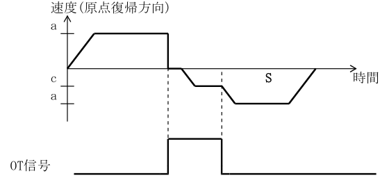

> **図の内容**
>
> 速度 a で進み、OT信号が ON になると止まって逆方向へ速度 c で戻り、OT信号が OFF になったあと原点距離 S だけ移動する（S は逆方向で、速度 a まで下がる）。

- 【注1】 s: 原点距離は、原点復帰方向によらず、+の値で設定してください。

-値を設定すると異常な動作となります。OTサーチを繰り返して、動作が終了しません。

- 【注2】 a: 原点復帰早送り速度は、低めにして下さい。

#### 7-9-8. 原点復帰未完でOTに到達した場合(原点信号あり)

この場合は、OT到達後に反対方向へ動作して、DEC信号を越えてから原点復帰をやりなおします(2段原点復帰/1段原点復帰とも共通)。

- 例 ①DEC信号が無いので+OTへ。
- ②反転してDEC信号を越えます。
- ③再度原点復帰動作をします。

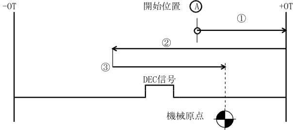

> **図の内容**
>
> -OT と +OT の間。開始位置 Ⓐ から ① +OT まで進み、② 逆方向へ戻って DEC信号を通り過ぎ、③ 再び原点方向へ進んで DEC信号の位置で機械原点を決める。

#### 7-9-9. 原点復帰未完でOTに到達した場合(原点信号なし)

OT到達後にもどり、ラッチ信号を確認後に、再度ラッチ信号をもとに原点復帰します。

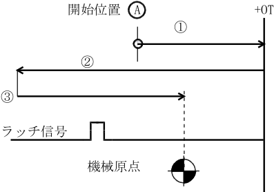

> **図の内容**
>
> 開始位置 Ⓐ から ① +OT まで進み、② 逆方向へ戻ってラッチ信号を通り過ぎ、③ 再び原点方向へ進んでラッチ信号を確認し、機械原点を決める。

#### 7-9-10. 1段原点復帰でベタドグ(原点信号)のメリット

原点(DEC)信号をベタドグとして1段原点復帰を選択すれば、どの位置にあっても原点復帰時にOTへ行くことはありません。

A の場合は必ず戻ります。

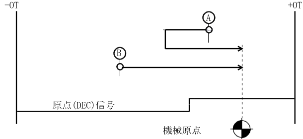

> **図の内容**
>
> -OT と +OT の間。原点(DEC)信号は機械原点の手前から +OT 側まで ON のまま（ベタドグ）。開始位置 Ⓐ（原点信号 ON の側）からは一度戻ってから原点へ、開始位置 Ⓑ（原点信号 OFF の側）からはそのまま原点へ進み、機械原点に止まる。

#### 7-9-11. 絶対値エンコーダの軸の設定

絶対値エンコーダ(Σサーボのアブソエンコーダ)を使用する場合、以下の手順で設定下さい。

①絶対値エンコーダを有効とする設定

- ■PLMCのROMSWの設定

ROMSWの軸設定画面で"絶対値エンコーダ"にチェックし、ダウンロードします。

- ■Σサーボの設定

SigmaWinにてPn002の2桁目を"1"に設定し、絶対値エンコーダを有効にします。

どちらも、一度電源OFF後に有効になります。設定後は必ず電源オフ/オンをしてください。

②絶対値エンコーダのセットアップ(Σサーボ)

以下の場合、絶対値エンコーダのセットアップ(初期化)が必要です。

- a. 機械の最初の立ち上げのとき(初回)
- b. 「エンコーダバックアップアラーム(A.810)」が発生したとき
- c. 「エンコーダサムチェックアラーム(A.820)」が発生したとき
4. SigmaWinもしくはディジタルオペレータからセットアップを行ってください。詳細は、Σサーボのマニュアルを参照下さい。

③原点復帰&アブソポジションクリア

- ③-1.(絶対値エンコーダ使用軸以外の軸も含め)全軸、原点復帰を完了してください。絶対値エンコーダ使用軸で原点復帰ができない(原点信号やOTが無い)軸は、原点復帰方法(※) を"無効"にし、機械原点とする位置へ移動して下さい。
- ③-2.全軸が機械原点にいる状態で、セッティングPCからアブソポジションクリアを行います。

(アブソエンコーダの位置とPLMCの座標との関係を記憶します。)

- アブソポジションクリアは、セッティングPCの【バックアップデータ初期化画面】で"アブソポジション初期化"ボタンを押します。
- ③-3.以後、絶対値エンコーダ使用軸は原点復帰が不要です。

絶対値エンコーダ使用軸の原点復帰方向(※)を"無効"に設定して下さい。

【注】以下の場合は、再度③-1からの手順が必要です。

- a. PLMCの"バックアップエラー"
- b. 誤って、PLMCの"アブソポジションクリア"を行った場合
- c. Σサーボの"エンコーダバックアップアラーム
4. ※ 原点復帰方向は、セッティングPCの【サーボパラメータ画面】から設定します。
5. ■アブソ仕様軸での原点信号の準備

アブソエンコーダのバックアップエラーなどで、再度アブソポジションクリアーをして、機械原点を再設定する場合があります。以前と正確に同じ位置で設定するためには、機械原点復帰が正常に動作できる事が重要です。

そのため、アブソ仕様の軸でも、原点信号を準備して、通常の機械原点復帰を可能としておくことを推奨します。

- ■アブソ使用軸ではバックラッシュ補正は使用しないでください。

#### 7-9-12. 同一指令2軸制御での原点復帰

同一指令2軸制御(平行軸)の原点復帰では、2軸のDEC信号やZ相パルスの発生位置に注意ください。方式によっては、両軸での発生位置を合わせる必要もあります。

| 原点復帰方式         | 原点復帰方式   | 2軸の各信号の位置合わせの必要性           | 2軸の各信号の位置合わせの必要性              | 同一指令2軸への適用                         |
|----------------|----------|----------------------------|-------------------------------|-------------------------------------|
|                |          | 原点(DEC)/OT                 | Z(C)相/EXT1〜3                  | 同一指令2軸への適用                         |
| FBラッチ          | 2段       | DEC ①                      | ②                             | 推奨                                  |
| (原点信号あり)       | 1段       | DEC ①                      | ②                             | 推奨(安全)                              |
| FBラッチ (原点信号なし) | 2段 1段    | 使用せず                       | ラッチ前後で同じ速度なので、位置が異なっても問題なし。 | 推奨                                  |
| FBラッチ (OT信号)   | 2段 1段    | OT エッジが同じ位置                | ②                             | 推奨                                  |
| DECサーチ         | 2段 1段    | DEC 両エッジとも同じ位置 ONエッジのみ同じ位置 | 使用せず                          | 同一指令2軸には、不向き。 Z相(EXT)基準でないと精度が悪い。 |
| OTサーチ          | 2段 1段    | OT エッジが同じ位置                | 使用せず                          | 同一指令2軸には、不向き。 Z相(EXT)基準でないと精度が悪い。 |

① 原点(DEC)信号

両軸の原点信号(DEC)の前のエッジ位置があっている方がベターです。

(1段では前のエッジのみです。2段では前後の両エッジがありますが、後ろのエッジの位置は多少ずれていても問題なしです。)

前のエッジ位置が異なる場合サーボパラメータの「原点復帰早送り速度a」と「原点復帰アプローチ速度b」が同じであれば、問題ありません。

② Z相(またはEXT)

両軸のZ相(またはEXT)の位置があっているのがベターです。

異なる場合

「原点復帰早送り速度a」と「原点復帰アプローチ速度b」が同じであれば、問題ありません。

- ■原点距離(サーボパラメータ)の調整

両軸の原点距離(サーボパラメータ)は、原点復帰の完了で正確に平行になるように調整下さい。

- ■平行軸のOT信号位置

お互いの軸のOT発生位置をできるだけ合わせてください。

起動時にOTでの折り返しによる原点復帰を行う場合があります。

また、万一OTとなる場合、片軸だけでなく両軸ともOT発生となる方が自然です。

- ■DEC/OT信号の並列入力

上記の理由からDECやOTは、同じセンサーの信号を両軸用として並列配線する方法が現実的です。

### 7-10. ソフトリミットの設定(メカ組合せ試運転)

全軸が原点復帰した位置にて、最終的なソフトウェアストロークリミット（ソフトリミット）のパラメータを設定してください。

その位置(機械座標値)より、すこし内側に+(-)ソフト

- +(-)OTになるまでゆっくりと移動。リミットを設定。
- ※ 機械原点位置を変更した場合には、ソフトリミットの再設定が必要です。

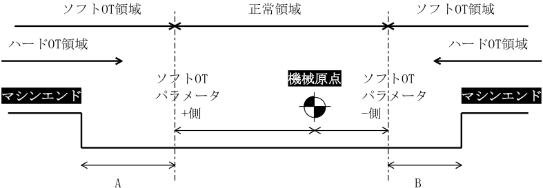

> **図の内容**
>
> 4-2 の領域の図（マシンエンド、ハードOT領域、ソフトOT領域、正常領域、機械原点、ソフトOTパラメータ +側／−側）。左のマシンエンドからソフトOTパラメータ +側までが A、ソフトOTパラメータ −側から右のマシンエンドまでが B。

AやBの値は、大きい方が安全ですが、その分正常領域が狭くなります。

<ハードOT領域>

ハードOTから実際のマシンエンドまでの距離も大きい方が安全ですが、現実には数10mmが一般的です。

ある程度の高速でハードOTに入った場合は、惰走でマシンエンドにぶつかる可能性があります。マシン設計においては、物理的な安全策(メカダンパーなど)を必ずおこなって下さい。

### 7-11. メモリー運転(単体試運転/メカ組合せ試運転)

代表的な運転プログラムを作成し、運転して下さい。また「出力制御」や「入力処理」についても、各々の機械仕様に合せて作成して下さい。

<概略手順>

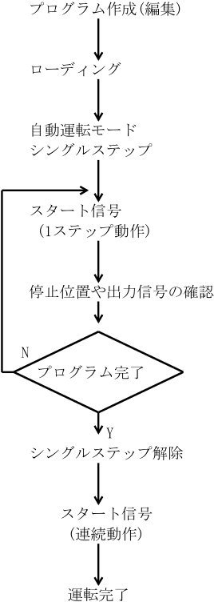

> **図の内容**
>
> プログラム作成(編集) → ローディング → 自動運転モード シングルステップ → スタート信号（1ステップ動作）→ 停止位置や出力信号の確認 → プログラム完了?（N ならスタート信号へ戻る）→ Y: シングルステップ解除 → スタート信号（連続動作）→ 運転完了

グ

#### 7-11-1. サーボ調整用動作プログラム

サーボ調整用としては、1軸毎の往復動作でPTP動作(直線形加減速)と直線補間(指数形加減速)で作成して下さい。

例 PTPA X0;

CALL SUB L100;

```c
    CALL SUB L100;  /* 100往復 */
    END;
```

:SUB

LIN X100000 F100000;

TIM0.1; ※1

LIN X-100000;

TIM0.1; ※1

END;

- ※1 サーボアンプの速度ループゲインの上限値(発振限界)の確認では、往復での折り返し時に、少しタイマーを入れる事を推奨します。

停止/折り返しによって、静止摩擦と動摩擦の両方の確認ができる事に意味がありそうです。

#### 7-11-2. メモリー運転の注意事項

<ソフトリミットエラー>

操作ミス等でソフトリミットにかかると停止します。手動モードでは、戻す方向には操作できます。

<ハードOTエラー>

(メカ組合せ試運転)

ハードOTを越えた場合は以下のように対処して下さい。

- a. 機械が手でもどる場合は、もとの位置にもどします。
- b. 「OT無視モード」にして、リセット入力するとアラームは消えます。安全を充分に確認してジョ送りにて戻して下さい。

復旧後は「OT無視モード」をすみやかに解除(正常なモードに戻す)して下さい。

<安全な位置への移動> (メカ組合せ試運転)

ジョグ動作した軸については、機械構造や周囲との関係、他の軸との関係から最も安全と思われる位置に移動して、他の軸のチェックへ移行して下さい。

<落下軸の注意> (メカ組合せ試運転)

正常なサーボロックを確認するまで、おさえの材木などは、はずさないで下さい。

<ゲインの仮調整>

ジョグ動作でなめらかにモータが回転するように、速度ループゲインや位置ループゲインを仮調整して下さい。
