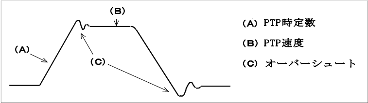
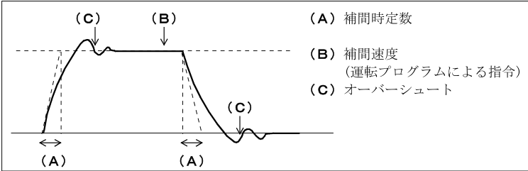
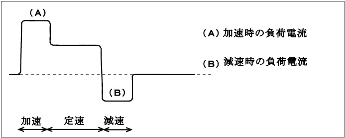
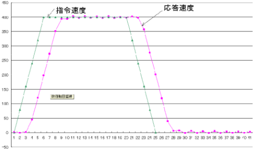
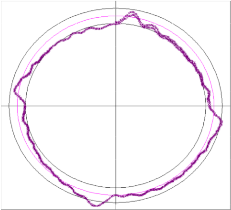

7

### 7-12.サーボ系の調整(単体試運転/メカ組合せ試運転)

実際の運転に応じた位置ループゲインや加減速定数を設定します。7-11-1.の動作プログラムを使います。

| 分類     | 分類           | 調整箇所                    | 第1〜9軸                                                                           |
|---------|---------------|-------------------------|---------------------------------------------------------------------------------|
| 制御性の調整 | 速度ループ位置ループ | サーボアンプの調整 (パラメータ設定)    | 使用上の設定参照・本マニュアル6.サーボ系の制御性能速度ループゲイン(上限値) ・各サーボアンプメーカマニュアル位置ループゲイン(最適値) (全軸同一) |
| 指令系の    | 指令系の          | PLMC-M3EX 加速度 PLMC-M3EX | PTP時定数なめらかな早送りを可能とする最小値補間時定数なめらか補間送りを可能とする最小値 PTP速度早送り速度                    |
| 調整     |               | 送り速度軌跡形状補正             | JOG速度手動送り速度原点復帰速度原点復帰の早送り速度軌跡形状を特に改善したい場合同係数 ≧位置ループゲイン                     |
|         |               | PLMC-M3EX               | 形状補正係数 <オプション>                                                                  |

#### 7-12-1. サーボ応答の確認(メカ組合せ試運転)

実際には、送り速度、加減速定数、位置ループゲイン(Kp)の関係でオーバーシュートや発振が発生する場合があります。

実際の動きに対してオーバーシュートのないサーボ応答にする必要があります。

安川Σサーボでは、安川電機Σ-Winソフトを用いるのが一般的です。

サーボ応答の観測方法は、「当社モーションアナライザTPCを用いる方法」、「TPCデータロギング機能とEXCELによる解析」、「サーボアンプの速度モニタ(各社ソフト)」などがあります。

モーションアナライザTPCやEXCEL解析ソフトを用いれば、サーボ応答だけでなく、軌跡精度や実動作の局所的動作も詳細にチェックできます。

<PTPの速度モニター>

> **図の内容**
>
> 台形の速度の波形。(A) PTP時定数（立ち上がりの傾き）、(B) PTP速度（一定の高さ）、(C) オーバーシュート（立ち上がりと停止のあとの揺れ）。

- (C)の値がなくなるか、許容の大きさになるように(A)PTP時定数やKpを調整します。一般に(B)については、仕様面から決められます。

<直線補間の速度モニター>

> **図の内容**
>
> 補間の速度の波形。(A) 補間時定数（立ち上がりと立ち下がりの幅）、(B) 補間速度（運転プログラムによる指令）、(C) オーバーシュート。

PTP同様に(C)の大きさを見ながら(A)補間時定数や位置ループゲインKpを調整します。

#### 7-12-2. 負荷電流の確認(メカ組合せ試運転)

特に1号機の場合、サーボアンプの電流モニターにて、モータ負荷電流のチェックをおこなって下さい。一般には、加速時と減速時に最も大きい電流が発生します。この電流がサーボアンプ/モータの最大負荷電流を越えないように加減速パラメータなどで調整して下さい。

(A) (B) ≦ 最大負荷電流

> **図の内容**
>
> モータの負荷電流の波形。区間: 加速、定速、減速。(A) 加速時の負荷電流（加速の区間で高い）、(B) 減速時の負荷電流（減速の区間で逆向き）。本文: (A) (B) ≦ 最大負荷電流。

- 【注1】機械の摩擦やイナーシャ及びモータ/サーボアンプ選定によっては、期待された加速が得られないこともあります。
- 【注2】∑シリ-ズのような最新のサ-ボでは、デジタルオペレ-タパネルなどにより、負荷トルクが数値表示で読めます。

### 7-13.パラメータの保存(単体試運転/メカ組合せ試運転)

設定したパラメータは機械に対して最適調整した大事なデータです。セッティングPCにて必ずファイルにセーブして保存して下さい。

ファイル名としては、機械の名称などに合わせて管理しやすい名称として下さい。

ファイルに保存しておけば、他の機械の調整やパラメータを誤って変更してしまった場合、簡単に再ロードできます。

### 7-14.PCによる精度チェック(メカ組合せ試運転)

テクノ製MCには、軌跡/サーボ応答解析のための位置ロギング機能(TPCロギング)があります。TPCロギングしたデータを専用のEXCELソフト「TPC-EXCEL」(テクノ製)で解析することで、モーションの精度解析やサーボ系の最適調整が可能です。

バックラッシュ、異常な摩擦、振動、オ-バシュ-トなどが定量的に測定できます。ただし同時にFBを取り込めるのは最大2軸です。

詳細は「TPCガイダンス」を参照下さい。

- ■ 精度解析処理(EXCEL/TPC処理ソフト) <オプション>

時系列データファイルをEXCEL専用ソフトで解析・グラフィック表示します。詳細は、テクノHPを参照下さい。

サーボ応答解析各軸の速度カーブ

軌跡解析

2軸の合成軌跡

直線精度解析理想直線との誤差分を拡大

真円精度解析理想円弧との誤差分を拡大

■ サーボ応答解析

> **図の内容**
>
> TPC-EXCEL のサーボ応答解析のグラフ。「指令速度」（緑）と「応答速度」（ピンク）の台形の速度。縦軸 -50～450、横軸はデータの番号（1～41）。応答速度は指令速度に 2～3 点遅れて追従する。グラフ中に小さな表示（判読できず）がある。

■ 真円精度解析

> **図の内容**
>
> TPC-EXCEL の真円精度解析のグラフ。理想円（ピンク）の内側と外側に目盛りの円（灰色）があり、実際の軌跡（紫）が理想円の周りで凹凸を持って一周している。

### 7-15.現地でのサーボ立ち上げ手順例

事例として、以下の想定をします。

Y軸(第2軸):水平軸、 X/A軸(第1/第4軸):上下軸で同期軸

#### 7-15-1. 全体的な作業項目

|    | 大項目                   | 作業項目                            | 内容補足資料注意点                                                                      | 必要な資料・道具                         |
|----|-----------------------|---------------------------------|----------------------------------------------------------------------------------|----------------------------------|
|  1 | 制御盤                   | 設置・配線                           | モータ関連つなぎ込み I/O関連つなぎ込み電源ショートチェック                                                 | 展接テスタ                           |
|  2 | 制御電源投入                | 電源オン                            | FA-M3□電源オン LED表示その他制御電源オンの確認サーボはオフ                                             | 同上                               |
|  3 | サーボのパラメータ            | パラメータローディング                    | サーボメーカのソフト接続準備したパラメータファイルを書き込む                                                  | サーボメーカソフト安川Σ-Win                |
|  4 | PLMC-M3EX ROMSW パラメータ | パラメータ ROMSW                     | テクノPCソフトの接続 PLMC-M3EXのパラメータ、 ROMSWの設定 (PLMCには、設定済み)                              | パラメータファイル ROMSWファイル              |
|  5 | I/Oチェック               | FA-M3□ 入出力配線チェック               | セッティングPCや WideField□(FA-M3□ソフト)で ON/OFFチェック特に非常停止、±OT                           | セッティングPC WideField□ テスター         |
|  6 | サーボ関係詳細は、 7-15-2.を参照 | サーボ電源アラーム確認水平軸動作上下軸動作機械原点設定 | サーボ電源を入れるアラーム無し、リセット操作非常停止、OTでサーボオフになるか? 通常軸のサーボ動作確認上下軸、ブレーキ付き軸の動作確認機械原点の設定 | サーボマニュアル (Σマニュアル) ツールソフト (Σ-Win) |
|  7 | サーボ系の調整              | 運転プログラムサーボゲイン調整               | 連続運転サーボアンプオートチューニングマニュアルチューニング速度ループゲイン位置ループゲイン補間時定数など                      | サーボマニュアル                         |
|  8 | TPC精度解析               | PLMC-M3EX                       | TPC-EXCELによる軌跡精度解析など                                                             | 試運転マニュアル                         |

#### 7-15-2. サーボ関係の動作確認

##### 7-15-2-1. 一般的な注意点

(A) サーボアンプのトルク制限の利用

サーボアンプでは、トルク制限が掛けられます。

はじめの動作が不安な場合は、アンプのパラメータで「最大トルク」を小さくしておくことをお勧めします。

- ■水平軸であれば、20%〜30%程度。
- ■上下軸では、50%程度。

もともと、摩擦や荷重があると、動かさない状態でもモータのトルクが必要になります。

特に上下軸で重力を受けている場合、トルク制限で力不足となって、落下することもあります。

(B) サーボアンプのアラーム履歴

サーボアンプでは、一般的に電源オフしても最近のアラーム要因を10個程度記憶しています。サーボアラームになった場合、後からでも要因が判ります。

- (C) サーボアンプメーカのツールソフト(安川電機 Σ-Winなど)

サーボ調整では、「使用するサーボアンプに適したツールソフト」を使用してください。サーボパラメータの一覧表示、修正、一括読み出しや書き込み、ファイル保存など便利です。動作モニタでは、速度モニタ(指令/FB)、トルクモニタなどグラフィック表示します。

(D) サーボアンプのOT入力など

サーボアンプの入力信号でOTや非常停止関係でB接入力指定するものがあります。これを未配線にしているとサーボのアラームが解除できません。使わない場合は、パラメータで「使用せず」の設定をします。

##### 7-15-2-2. 水平軸の動作確認

(A) 準備

使用しない上下軸は、サーボオフでブレーキ作動のままとします。普通にサーボONすると全軸(他の軸)がONしてしまうので要注意です。

セッティングPCソフトの「軸設定画面」で第1/第4軸にサーボオフ軸の指定をしてください。

(B) JOG動作

はじめは、サーボパラメータのジョグ速度を低めにして下さい。正常な動作を確認してから、ジョグ(JOG)速度を適当な値に上げてください。

- (オーバライドでもジョグ速度は、変わります)
- (1) +-の方向確認。違っていたら、ROMSWの「軸設定」画面の指令出力極性を変更。
- (2) ±OTの確認。

OTでサーボオフするかの確認。OTからの引き戻しは、OT無視モードで行います。

OTでアラーム→OT無視モード → リセット(アラーム解除・サーボON)

→ JOGで内側に引き戻す → 正常位置でOT無視モードをやめて、手動モード。

- (3) モータの振動や異常動作があった場合

サーボアンプのパラメータを確認サーボアンプメーカのマニュアルを参照

(C) 移動距離の確認

指定の移動量を指令して、実際の移動距離を量ります。(とりあえずは、目視でもOK) 例:まず 10mm分の指令 → 実際に約10mm ?

次に 100mm分の指令 → 実際に約100mm ?

単位系の桁数が間違うと非常に大きく動いてしまうことがあります。小さい値からはじめます。

- (1) 移動量が違っていたら
2. サーボアンプのパラメータ「電子ギヤ」を確認

PLMCのパラメータ「電子ギヤ」を確認

(D) 最大ストロークチェック

- (1) +OTの仮の座標を記録
- (2) -OTの仮の座標を記録
- (3) -(2)の値でストローク距離を確認(予定どおり?) → OTセンサの位置が悪いとストロークが不足。

##### 7-15-2-3. 上下軸のサーボ

上下軸(落下あり)で平行軸(同一指令2軸)と仮定します。

(例: ROMSWのオプション設定で「同期軸制御(同一指令制御)」にチェックが有り、基準軸:第1物理軸で第1論理軸、従属軸:第4物理軸で第4論理軸の場合 )

- (A) メカ連結をはずせる場合(2つの軸をそれぞれ動作)
- (a) 準備
- (1)サーボオフで確実にブレーキで保持できていることを確認。
- (2) 危ない場合は、落下を防ぐため「あて木」の様な緩衝材で機構を支持する。
- (3) メカ連結を取り外す
- (4) ROMSWの軸設定で従属軸の「同期軸(従軸)基準軸」のチェックを消し、独立軸にします。 ROMSW変更後(ローディング)
- (5)基準軸と従属軸は、それぞれ個別に通常どおりに動作。(第1軸:X 第4軸:A)
- (b) 個別の軸の通常動作確認
- (1) サーボON

サーボONで、サーボロック(モータの保持力で停止)し「ブレーキ解除」するはず。

- 【注1】ブレーキが作動していてもモータの力によって、動いてしまうことがあります。

この場合、ブレーキを傷めます。

- (2) ブレーキ解除しないとき

ブレーキ電源に関係するラダーロジックや配線などを再確認してください。

- (3) ジョグなど

通常にサーボロックしたら、水平軸と同様に確認。

ジョグ確認 → 移動距離の確認 → ストロークチェック

(B) メカ連結をはずせない場合

(a) 準備

- (1) ROMSWのオプションで「同期軸制御(同一指令制御)」有り、と軸設定で「同期軸(従軸)基準軸」の設定を確認してください。

従属軸には常に基準軸と同じ指令がでます。

- (2) ブレーキ保持や落下防止の準備
- (3) サーボONして、サーボロックとブレーキ解除の確認
3. (b) ちょっと動かして確認
- (1) 平行軸を1パルスずつ動かして見ます。(インチング×1)

同じ方向に動けば、OK。

違う方向の場合 → いずれかの軸の指令極性が違ってます。

移動量が違う → 電子ギヤなどの設定

片方が動かない→ その軸の配線サーボアンプの設定など

- (2) 1パルスずつでは、よくわからない場合 → ×10で10パルスずつ操作。

【注1】

機構には、多少遊びがあります。その範囲で動く場合は、機構にストレスはあリません。ただ、遊びが少ない機構で連結している場合は、要注意です。

【注2】

機構をあて木で支持しておいて、サーボのトルク制限を掛けておこなう方法もよいかもしれません。

##### 7-15-2-4. 仮の機械原点の設定

- (1) 適当な位置で以下の操作をして、その位置を機械原点として下さい。セッティングPCの「バックアップデータ初期化」で「アブソポジション初期化」ボタンを押します。これで、その位置を機械座標系の原点とします。指令位置や機械位置が、ゼロクリアーされます。
- (2) その後で、各軸のソフトリミットを設定してください。各軸のOT近くまで動作→その位置を記録

その位置を参考にサーボパラメータのソフトリミットの値を設定してください。

- (3) サーボパラメータの「ホーム位置」の利用定位置に位置決めをしたいときに便利です。

##### 7-15-2-5. 運転プログラムで連続動作

簡単な運転プログラムを作成し、軸の連続運転などをおこなって、様子を見てください。はじめは、オーバライドで速度を下げておく方が安全です。

運転プログラムの作成方法は、「サンプル運転プログラム」を参照下さい。

ガイドや機構に異常が無いかを確認します。特に振動や異音には要注意です。また、一定量を数十回往復動作させて、位置ズレが発生しないことも確認してください。

マニュアルでサーボのゲイン調整をするときには、以下の様な運転を繰り返します。 +方向へ一定量/一定速度→0.2秒程度停止→-方向へ一定量/一定速度 → 0.2秒程度停止これで、発振しない限界の速度ループゲインや位置ループゲインを探します。

##### 7-15-2-6. サーボ系のゲイン調整

各社サーボメーカのマニュアルに従って、ゲインを確認して下さい。はじめは、オートチューニングをお勧めします。速度ループゲインは、発信しない範囲で高くしてください。サーボ剛性を確保します。

位置ループゲインも高い方が軌跡精度がよくなります。特に、合成軌跡精度が必要な軸では、同じ値に設定する必要があります。

PLMC-M3EXの補間時定数をゼロにして、調整する方が正確です。補間時定数の値が、大きくなると軌跡精度を劣化させます。
