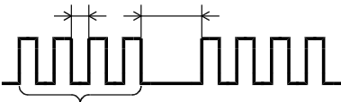
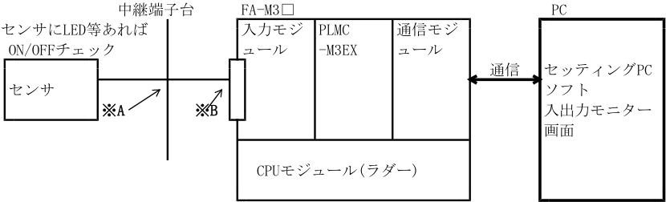
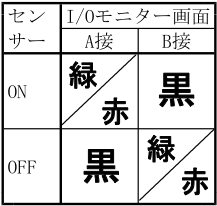
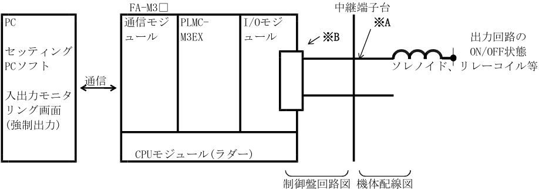
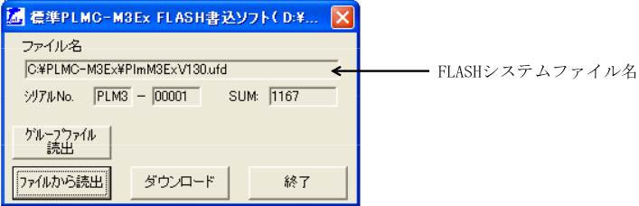
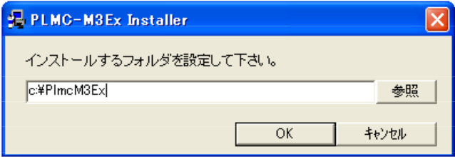

# Ⅴ メンテナンス編

改版時の主な修正箇所には「◆バージョン番号」マークが書いてあります。例）Ver0.1で改版した場合は「◆0.1」となります。

保守や疑問点については、テクノHPのFAQ(良くある質問)も合わせてご覧下さい。 HPについては、日々更新しますので、詳しい情報を記載している可能性があります。

## 1. 異常時の処理(PLMC-M3EX 本体側)

### 1-1. 基本動作に関する異常

|                                                                             | 異常状態推定される原因                                                                                                                                                                                                                        | 処置                                                                                                        | 詳細説明                           |
|-----------------------------------------------------------------------------|-------------------------------------------------------------------------------------------------------------------------------------------------------------------------------------------------------------------------------------|-----------------------------------------------------------------------------------------------------------|--------------------------------|
| 1 PLMC-M3EX 上の「RDY」LEDが点灯しない                                              | FA-M3のベースモジュールとの接触不良フラッシュ書き込みミス                                                                                                                                                                                                   | PLMCの着脱や交換による調査フラッシュ再書き込み                                                                                | 横河資料メンテ編フラッシュ書込み手順          |
| 2 セッティングPCの接続不可 (タイムアウト) ※通信モジュールとは FA-M3□のCPUモジュール、イーサネットモジュールなどを示します | 【接続】 RS232Cケーブル不良・イーサネットケーブル不良・FA-M3□パソコンリンクモジュールの不良【PC側設定】・COMポートが使用不可能になってる・設定したIPアドレスが通信モジュールと合っていない・PLMC-M3EXを指定するCPU番号やユニット番号、スロット番号は間違っている・PCのIPアドレス、サブネットマスタの設定が不一致、または他の機器と干渉している・アスキー/バイナリモード設定が通信モジュールと整 | PC側設定の再チェック (セッティングPCの通信設定等) 通信モジュールの設定確認 WideFiled□で接続確認ケーブルをテスターチェックして、不良があれば修正またはケーブル交換他のPCを使ってみる | 横河資料                           |
| 3 操作入力全ての入力が不可一部の入力が不可                                                    | 合していないラダーが正常動作していない I/O用の24Vの供給不良外部配線不良                                                                                                                                                                                           | セッティングPC入出力モニタラダーを確認 WideField□のデバイスモニタでの信号確認 I/O電源 24Vをチェックセンサーや入力信号の配線チェック                          | 横河資料 I/Oチャンネル表詳細メンテナンス編 3-1. |
| 4 出力信号出力が出ない一部の出力が不可                                                      | ラダーが正常動作していない I/O用の24Vの供給不良外部配線不良                                                                                                                                                                                                  | セッティングPC入出力モニタラダーを確認 WideField□のデバイスモニタでの信号確認 I/O電源 24Vをチェックし異常があれば修正または交換出力の配線チェックし不良が有れば修正         | ハード編 I/Oチャンネル表詳細メンテナンス編 3-2. |

#### 1-1-1. PLMC-M3EXの前面LED表示

各LEDの意味は以下の通りです。

「RDY」･･･消灯:内部初期化中

点灯:内部初期化完了後(正常)

「LNK」･･･消灯:メカトロリンク通信未接続点灯:メカトロリンク通信中

「WRN」･･･消灯:エラー未発生(正常)

点灯:エラー発生中

(エラーの詳細は、セッティングPCにて確認してください。)

「ALM」･･･点灯や点滅:システムエラー発生時(「LNK」、「WRN」は消灯します。)

「ALM」点滅タイミング

250ms

1500ms

この回数でエラー要因を示す。

> **図の内容**
>
> パルス波形。点灯（パルス）が 3 回続き、長い消灯をはさんで、また 3 回の点灯が続く。
> - 上の矢印: 1 回の点灯の幅（本文の 250ms）と、点滅のまとまりの間の消灯（本文の 1500ms）
> - 下の括弧: 1 まとまりの点灯の回数。本文: この回数でエラー要因を示す。
> （図の 2 つの矢印と本文の 250ms・1500ms の対応は、図中に数値がないため配置から読んだもの。）

|   回数 | 発生エラー           |
|------|-----------------|
|    2 | ROM/RAM領域オーバー   |
|    4 | 一般不当命令          |
|    5 | RTC動作待ち         |
|    6 | スロット不当命令        |
|    9 | CPUアドレスエラー      |
|   10 | DMAC/DTCアドレスエラー |
|   12 | NMI発生(システム停止)   |
|   13 | スタックオーバーフロー     |
|   14 | ウォッチドッグエラー      |

### 1-2. アラーム表示をともなう異常(全体エラー)

|                | 異常状態                      | 推定される原因                                                                              | 処置                                                                                                                                                 | 詳細説明                         |
|----------------|---------------------------|--------------------------------------------------------------------------------------|-----------------------------------------------------------------------------------------------------------------------------------------------------|------------------------------|
| 1              | 非常停止                      | 非常停止スイッチが作動中非常停止スイッチの解除非常停止スイッチの配線ミス非常停止入力(B接OFF等)ラダー上の論理回路ミスなるようにする            | スイッチの配線・ラダーの回路で正常時は入力信号がOFFに                                                                                                                       |                              |
| 2              | バックアップエラー                | バックアップメモリーが消えている                                                                    | 全バックアップデータをクリアして再設定する                                                                                                                              | 試運転･調整編詳細                   |
| 3 パラメータ未設定エラー |                           | パラメータ初期化後、有効なパラメータを設定（ダウンロード）していない                                                 | 〃                                                                                                                                                   | メンテナンス編 3-4.                 |
| 4              | ROMSWバックアップエラー           | ソフトバージョンアップ(FLASH 書換) により、ROMSWも更新する必要が発生した                                         | 新しいROMSWをダウンロードする (PLMC-M3EX内のROMSWデータはデフォルトになっています)                                                                                              |                              |
| 5              | メカトロリンク初期化エラー            | 設定した制御周期や通信設定では有効軸数と通信できない                                                          | ROMSWで下記設定の見直し ■基本画面サーボ制御周期(長くする) MECHATROLINK通信設定 ■軸設定有効物理軸のみの選択にする                                                                              | ROMSW設定ソフトマニュアル (TB00-0982) |
|                |                           | Σサーボ側の設定がROMSWの設定とあっていないハード異常                                                      | Σサーボと伝送周期、バイト数、C2マスタ、局アドレスの整合をとる (PLMC-M3EXでは伝送周期=サーボ周期) (テクノにて詳細調査)                                                                             | Σサーボマニュアル                   |
| 6              | メカトロリンク全体通信エラー           | ケーブル接続異常                                                                             | ケーブル接続確認(がたなど) ケーブル交換                                                                                                                               | Σ-Win Σサーボマニュ                |
|                |                           | Σ側の応答がない                                                                             | Σ側主電源とアラーム状態を確認(Σ-Winで確認)し、サーボマニュアルに従ったメカトロリンク初期化エラーの処置をする                                                                                      | アル                           |
| 7 インバータエラー     | メカトロリンク                   | ハード(通信用IC)異常インバータが以下の状態主電源OFF アラーム発生                                               | (テクノにて詳細調査) インバータの前面のLEDでエラー要因を確認しインバータマニュアルに従った処置をする                                                                                             |                              |
| 8              | システムエラー                   | ワーニング発生ハードウェアの異常 (プロテクト処理で異常検出)                                                     | 条件や状況を連絡下さい。 (テクノにて詳細調査)                                                                                                                            |                              |
| 9              | 制御周期負荷ワーニングまたは、制御周期負荷過大 | 制御周期が短すぎるサーボ制御処理時間の最大値と ROMSWで設定したサーボ制御周期の比が ■87.5%以上制御周期負荷ワーニング ■100%以上制御周期負荷過大 | ROMSW設定ソフト「基本」画面の「サーボ制御周期」を長くする制御周期負荷ワーニング、制御周期負荷過大の解除はセッティングPCの「オプション」- 「制御周期モニタ」で「RTC」を選択し、「計測値クリア」ボタンを押します (又は、REQ_TIMERRESETコマンドを発行します) |                              |

### 1-3. アラーム表示をともなう異常(タスク別エラー)

| 異常状態                                | 推定される原因                                                                                       | 処置                                                                                  | 詳細説明           |
|-------------------------------------|-----------------------------------------------------------------------------------------------|--------------------------------------------------------------------------------------|----------------|
| 1 プログラム実行エラー                       | 運転プログラムの表記又はデータ上の矛盾など                                                                        | ティーチング画面でエラー発生時の運転プログラムを確認し、単独ステップでも発生か、前ステップとの関連で発生か、など異常発生時の条件から不具合を追求する      | 機能編テキストプログラム |
| 2 Mコード実行エラー                         | ROMSWのMOK入力有効の設定で MFIN検出エッジでMOK入力がOFF エラー発生時 MOKがON: MOKの立ち上がりが遅れている MOKがOFF:MOK信号が入力されていない | リセット入力で解除｡ラダー回路でMFINONの前にMOK がONするようにする信号線割付けと配線をI/Oモニター画面で確認して修正ラダー回路を見直して修正    | 機能編 Mコード出力     |
| 3 割り当て軸エラー                          | 現PLMC-M3EXでは発生しないはず                                                                           |                                                                                      |                |
| 4 FG内部演算エラー                         | 現PLMC-M3EXでは発生しないはず                                                                           |                                                                                      |                |
| 5 サーボOFFエラー                         | ROMSWで起動時サーボオフを設定している(不具合ではない)                                                               | リセット入力で解除                                                                            |                |
|                                     | 【リセット操作でONしない】 OT入力非常停止入力【一度ONしてすぐに落ちる】サーボアラーム                                             | OT、非常停止、アラーム信号を I/Oモニター画面で確認し不良信号の原因を修正するサーボ単体で動作させサーボアンプ/モ-タ関係の異常を調べる (主電源強制ON) |                |
|                                     | Σサーボがつながっていない                                                                                 | Σサーボとの接続を確認                                                                          | Σサーボマニュアル     |
| 6 外部アラーム Aエラー外部アラームBエラー外部アラームCエラー | 外部アラーム□信号がONした □:A〜C                                                                          | リセット入力で解除外部アラーム信号をONさせている要因をI/Oモニター画面で確認し、配線、ラダーを修正する                             | 機能編入力信号と機能    |

### 1-4. アラーム表示をともなう異常(各軸エラー)

| 異常状態                                  | 推定される原因                                                                                                           | 処置                                                                                                                        | 詳細説明                                              |
|---------------------------------------|-------------------------------------------------------------------------------------------------------------------|----------------------------------------------------------------------------------------------------------------------------|---------------------------------------------------|
| 1 偏差過大エラー □軸+方向偏差過大エラー □軸-方向偏差過大エラー | モータが動かないトルク無し:トルク制限トルク有り:機械干渉位置ループゲイン(kp)が小さいサ-ボパラメータER上限値が小さい速度指令が速すぎる・補間命令(LIN等)で発生 → ・位置決め(PTP等)で発生 → → | サーボアンプのトルク確認トルク制限指令、パラメータを修正する機械の干渉を無くす可能範囲でサーボkpを上げる ER上限値、ER飽和量を大きくする F値(補間速度)を遅くするパラメ-タのPTP速度を下げるパラメ-タのジョグ速度を下げる | Σサーボマニュアル詳細メンテナンス編 3-3. セッティングPC マニュアル運転プログラム |
| 2 サーボアラーム □軸サーボアラ-ム                   | ・ジョグ移動中サーボアンプのアラームサーボ主電源不良                                                                                      | ΣWinソフトでアラーム内容を確認しサーボマニュアルに従った処置サーボアンプ/モータの単体動作にして再度アラーム内容を確認 (サ-ボのデジタルオペレータでもアラーム要因トレ-スが可能)                          | Σサーボマニュアル                                        |
| 3 ソフトリミット                             | ソフトリミットのパラメータ値                                                                                                    | パラメータ値を修正                                                                                                                  | 試運転・調整編                                           |

| □軸+方向ソフトリミット □軸-方向ソフトリミット              | 不良 PLMCのアブソPOS.(位置)が異常な値になっている                                                                                               | 原点復帰を行い、原点を再設定するまたは、バックアップデータの初期化で「アブソPOS.」をクリア(「アブソPOS.」をクリアすると、その位置が原点となります)             | セッティングPC マニュアル         |
|------------------------------------------|-------------------------------------------------------------------------------------------------------------------------------|-------------------------------------------------------------------------------------------------|------------------------|
| 4 ハードリミット □軸+方向ハードリミット □軸-方向ハードリミット    | 運転中のソフトリミット OT入力がON 配線不良 B接入力がオープン運転中のハードリミット後の立ち上げソフトリミットで止まらずOT位置まで行った原因の確認・ソフトリミットがOTより外側・送り速度が速いとソフトリミットを越してOTまで行く | ジョグでリミット内に戻すセッティングPC入出力状態とOT 動作を調べ不具合箇所を修正 OT無視モードにしてリミット内へ戻すソフトリミット/OT間の距離と送り速度の関係を見直しソフトリ | Σサーボ、 I/Oモジュール試運転・調整編 |
| 5 パルス発生過大 □軸+方向または □軸-方向パルス発生過大エラー      | 現在PLMC-M3EXでは、発生しないはずです                                                                                                      | ミット値を修正                                                                                         |                        |
| 6 サーボ主電源オフ □軸サーボ主電源オフ                    | Σサーボの主電源がOFF サーボの他のエラー発生で主電源をOFFしていることもある                                                                                    | サーボのエラー履歴を確認、要因が有れば、サーボマニュアルに従って処置する非常停止などでΣサーボの主電源をOFFしていないか確認しその原因修正する                   |                        |
| 7 メカトロリンク通信エラー □軸メカトロリンク通信エラー          | メカトロリンク通信のエラーデータ受信エラーウォッチドグエラータイムアウトエラー多重コマンドエラー                                                                          | ケーブル接続状態を確認・長過ぎ・引き回し(周辺のノイズ) ケーブル交換異常発生時の条件を記録 (テクノ調査)                                       |                        |
| 8 メカトロリンク多重コマンドエラー □軸メカトロリンク多重コマンドエラー | 多重コマンドエラー                                                                                                                     | 異常発生時の条件を記録 (テクノ調査)                                                                             |                        |

### 1-5. 動作や操作に伴う異常

| 異常状態                     | 推定される原因                                    | 処置                                                                | 詳細説明                         |
|--------------------------|--------------------------------------------|--------------------------------------------------------------------|------------------------------|
| 1 原点復帰しない                | サーボパラメータで「原点復帰なし」の指定になっている                | パラメータを適宜変更                                                         | 試運転・調整編 7-9.参照               |
| 2 原点復帰が完了しない            | 原点信号が入らない(Σ) 原点復帰関係サーボパラメータが意図した動作と異なっている | 原点信号を変化させ、入力変化が正しくなるよう修正(ΣWinで原点信号をチェック) 原点復帰関係パラメータを(方式 /設定値)修正 | 試運転・調整編 7-9.参照サーボアンプのマニュアル |
| 3 原点位置がずれる (モータ1回転分ずれる) | 原点信号のエッジとPGのC相が重なっている原点ドグの論理逆            | ドグ位置を調整(メカ) 信号の論理を修正                                               | 試運転・調整編 7-9.原点復帰 Aの値に注意      |
| 4 プログラム運転がスタートしない       | 運転プログラムがダウンロードされてない自動運転モードになっていない        | 運転プログラムをダウンロード (タスク、PNO. 注意) モード変更、「自動運転」                          |                              |
| 5 Mコード出力で止まったまま         | MFINが返らない                                  | 相手のMFIN出力をチェック FA-M3□のラダーの信号を調べ不具合を修正                             |                              |

※ ラダーやPCアプリでの操作上のトラブルの時は、まずセッティングPCで同じ操作を確認下さい。

### 1-6. サーボ関連の異常

|    | 異常状態                     | 推定される原因                                                                       | 処置                                                                                                                | 詳細説明               |
|----|--------------------------|-------------------------------------------------------------------------------|--------------------------------------------------------------------------------------------------------------------|--------------------|
|  1 | サーボ主電源が入らない             | アラーム発生 OT入力非常停止入力サーボ主電源回路の不良 I/OモニターでSVMのbitはONするが、主電源リレーが動作しない           | I/OモニターでOTや非常停止入力をチェックし不具合修正サーボ主電源回路の不良を修正強制出力でオンする場合は、アラームなど再確認強制出力でONしない場合はSVMの配線、割り付けを調べ不良箇所を修正ラダー回路を修正 |                    |
|  2 | サーボ主電源が ONしてすぐに落ちる       | ラダーが正しくないサーボアンプのサーボアラーム主電源OFF→ONのインターバル不足 (数秒以上サーボアンプの特性)                 | サーボアラーム履歴を調べ、サーボマニュアルに従って修正サーボアンプ/モータの単体動作 (アンプ/モータ間の接続修正)                                                       | Σサーボマニュアル         |
|  3 | 低速で回るサーボロックしない          | サーボアンプ/モータ側の異常サーボアンプの設定不良                                                    | サーボアンプ/モータの単体動作で状態を確認し、サーボマニュアルに従って原因を修正                                                                         | Σサーボマニュアル         |
|  4 | 発振するがたがた動く暴走する偏差過大になる | 速度ループゲインが大きすぎるサーボアンプ/モータ側の異常サーボアンプの設定不良                                     | サーボの位置ループ、速度ループのゲインを下げる単体動作で正常に動作するように、サーボマニュアルに従って配線不良の修正、パラメータを修正するガタ、引っかかり、滑り修正                           | Σサーボマニュアル 3-3参照   |
|  5 | オーバシュートする                | 機構の不良サーボアンプ設定不良サーボアンプの位置ループゲインKpが高すぎる(メカ剛性不足) PLMC-M3EXの加減速時定数の不良モータの力不足 | サーボの「速度ループゲイン」をサーボマニュアルに従って調整する位置ループゲインを下げる加減速時定数を適宜設定(加速度を下げる) Σ-Winでトルクを確認しトルク                              | Σサーボマニュアル試運転・調整編 |
|  6 | 速度ムラ低速送りのリップル           | サーボアンプ速度ループゲインが低い(メカ剛性不足) 機構の摩擦                                              | 不足なら原因を修正する速度ループゲインを上げる異常な摩擦がないか調べる ΣWinでトルクを観測しながら運転し、リップル発生状況から原因を突き止め修正する                                   | Σサーボマニュアル         |
|  7 | 位置ズレする                   | セッティングPCの指令表示上で・指令がずれている場合・指令がずれていない場合モータ軸端もずれてる機構の問題か                    | ティーチング画面でプログラムステップを確認しずれるステップの運転プログラムをチェックサーボ単体で往復動作し確認サーボマニュアルに従い対処機構を確認し原因修正                                | メンテナンス編 3-3.参照     |

※ サーボ動作の異常の場合は、サーボ単体動作(Σ-Win操作)での確認をお願いします。原因の切り分け(サーボ側/PLMC-M3EX側)に有効です。

## 2. PCソフト側の異常

### 2-1. 通信処理

| エラーメッセ-ジ                   | 推定される原因                                                                                           | 処置                                                        | 詳細説明                       |
|----------------------------|---------------------------------------------------------------------------------------------------|------------------------------------------------------------|----------------------------|
| 1 通信パラメータエラー。             | 初期設定ファイルとROMSWの設定内容が異なる                                                                          | ROMSW設定ソフトでROMの設定内容を読み出し初期設定ファイルを更新する                    | ROMSW設定ソフトマニュアル           |
| 2 通信異常(TO/RO/R R)です。       | 【RS232C接続】 RS232Cケーブル不良 (断線、短絡、誤接続) 【イーサネット】イーサネットケーブル不良【PC側】通信モジュールの通信設定がセッティングPCの設定とあっていない | ケーブルをテスターチェックし不良なら修正または交換ケーブル交換 PC側の通信設定の修正通信モジュール設定の修正 | セッティングPC マニュアル横河電機資料      |
| 3 指定のデータが存在しません。          | PLMC-M3EX の運転プログラムがダウンロードされてない運転プログラムを初期化した                                                     | 運転プログラムを再ダウンロード                                           |                            |
| 4 指定のデータを書き込めません。         | プログラムダウンロ-ド・指定した番号のプログラムを実行中パラメータ/ROMSWデータのダウンロ-ド・セッティングモ-ドになって                              | 運転が終了してからダウンロ- ドするセッティングモ-ドに変更する機械パネル:無効とすべき             | セッティングPC マニュアル機能編機械パネルIF |
| 5 現在実行できません。              | いないアラーム発生中にコマンドを発行指定したコマンドを実行できるモードになっていない他のコマンドの動作中                                          | アラーム要因のクリアモードの変更他のコマンドの実行が終了するのを待つか、終了させる               |                            |
| 6 通信処理にて正体不明のエラーが発生しました。 | 通信中にケーブルを抜いた通信ケーブルの異常通信設定で指定した内容が間違っている                                                        | 通信ケーブルやコネクタ調べ不良箇所が有れば修正、交換通信設定を正しく再設定                    |                            |

### 2-2. プログラム変換処理

| エラーメッセ-ジ            | 推定される原因                                         | 処置                                                                                                           | 詳細説明                 |
|---------------------|-------------------------------------------------|---------------------------------------------------------------------------------------------------------------|----------------------|
| 1 プログラムバファオーバ-フロー。 | 運転プログラムのステップ数が多すぎる円弧命令(CIR□)のプリ解析処理でステップ数が増加 | PLMC-M3EXでは1本のプログラムの最大ステップ数は1589ステップ、198ラベルです(32ブロックに相当) 上記容量にあわせてステップ数を減らす円弧精度を荒くする DNC機能を用いる「内部円弧」を指定 | セッティングPC 説明書表示設定画面で |
| 2 プログラムフォーマットエラー。  | 運転プログラムの表記の間違い                                  | 運転プログラムの表示されたステップの内容をチェック                                                                                    | 選択機能編テキストプログラム     |

### 2-3. アプリケ-ション起動時

| エラーメッセ-ジ                                                                                                                                             | 推定される原因                                      | 処置                                                                  | 詳細説明         |
|------------------------------------------------------------------------------------------------------------------------------------------------------|----------------------------------------------|----------------------------------------------------------------------|--------------|
| 1 初期設定ファイルがありませんデフォルト情報で実行しますか。                                                                                                                    | カレントディレクトリにINI ファイルが存在しない                    | セッティングPCの通信設定後、 ROMSW設定ソフトでROMSWの内容をアップロードする                        | 導入編 2-6      |
| 2 □□ライブラリが見つかりません。                                                                                                                                  | カレントディレクトリまたは PATHの通ったディレクトリに DLLが存在しない      | ・必要なDLLのコピー・再インストール (再インスト-ルは、導入編の "システムのバージョンアップ手順"を参照)           | セッティングPC説明書 |
| 3 □□のソフトウェアバージョンが違っています。バージョン不整合による問題が発生する可能性があります。ボードと対応するPCソフトウェアを使用してください。                                                                 | 表示されているファイルのバージョンが異なる                       | ・再インストール (再インスト-ルは、導入編の"システムのバージョンアップ手順"を参照) その後も発生する場合は、テクノに連絡   |              |
| 4 バージョン情報ファイルがありません。 [オープンできません] [壊れています] ソフトウェアバージョンチェックが実行できませんでした。バージョン不整合による問題が発生する可能性があります。PC ソフトウェアCDのファイルVersion.sysを、フォルダにコピーしてください。 | バージョン確認用ファイル (Version.sys)が壊れているもしくは、見つからない | ・再インストール (再インストールは、導入編の "システムのバージョンアップ手順"を参照) その後も発生する場合は、テクノに連絡 |              |
| 5 □□ライブラリ内に必要な関数が見つかりません。                                                                                                                          | DLLのバ-ジョンが異なる                                | ファイルの構成ファイルの日付(バージョン)を確認                                           |              |

## 3. 詳細チェック手順

### 3-1. 一部の入力が不可の時の調査方法

| チェック箇所             | チェック内容                                                                                                                                 | 推定される不具合                                                        | その他                |
|--------------------|----------------------------------------------------------------------------------------------------------------------------------------|-----------------------------------------------------------------|--------------------|
| ROMSW設定ソフト         | 必要な入力が正しい入出力チャンネルに割り当てられていること                                                                                                         | 入出力チャンネルの割当を間違えている                                             |                    |
| ラダー                | I/O情報が正しくPLMC側に伝わっているかの確認横河電機資料に従ってラダー回路を横河電機WideField□でチェック                                                                        | ラダー回路の論理ミス                                                      |                    |
| セッティングPC 入出力モニタ    | 入力をOFF/ONさせたときにセッティングPCの入出力モニタが変化すること入出力チャンネルの割付に誤りは無いか                                                                             | センサー不良、ケーブル断線コネクター接触不良やショート割付ミス                               | セッティング PCモニター画面参照 |
| ※A:中継端子台           | 配線不良、誤配線、ショート、ゆるみ                                                                                                                     | 組み立ての不具合                                                        |                    |
| ※B:I/Oモジュール入力コネクタ | コネクタや端子台の接触不良 Σへ接続した±OTやDECはΣ-Winの入力信号モニタでチェック                                                                                        | 配線、外部機器の不具合                                                     |                    |
| 入力が時々 ONする OFFする   | ケーブルをゆすって入力信号が変化しないかの再現性の確認 I/Oモニタの入力が変化するか? (表示リフレッシュが遅いので見えない可能性あり) 中継端子台にて、ON/OFFの電圧レベルをチェック ON :2V以下 ※1 OFF :20V以上センサー自体が正常か? | コネクタや端子台のカシメや締め付け不良センサーの残留電圧や、OFF時のリーク電圧などセンサー不良電源が中途半端に低下 |                    |

チェック箇所

> **図の内容**
>
> - 「センサ」→「中継端子台」→ FA-M3□ の「入力モジュール」→「PLMC-M3EX」→「通信モジュール」→「通信」→ PC の「セッティングPCソフト 入出力モニター画面」
> - FA-M3□ の下部は「CPUモジュール（ラダー）」
> - チェック箇所: ※A（センサと中継端子台の間）、※B（中継端子台と入力モジュールの間）。「センサにLED等あれば ON/OFFチェック」

- ※1 オープンコレクタ信号は、負荷抵抗（プルアップ）が無いと電圧測定はできません。

> **図の内容**
>
> | センサー | I/Oモニター画面 A接 | I/Oモニター画面 B接 |
> |---|---|---|
> | ON | 緑／赤 | 黒 |
> | OFF | 黒 | 緑／赤 |
>
> （「緑／赤」は 1 つのセルが斜線で分けられ、緑と赤が書かれているもの。）

### 3-2. 一部の出力が不可の時の調査方法

| チェック箇所                    | チェック内容                                                   | 推定される不具合                                                | その他                |
|---------------------------|----------------------------------------------------------|---------------------------------------------------------|--------------------|
| ROMSW設定ソフト                | 必要な出力が出力ピンに割り当てられていること                                  | 出力ピンの割当を間違えている                                          |                    |
| ラダー                       | ラダーで正常に出力情報が伝わっていこと                                     | ラダー回路ミス                                                 |                    |
| セッティングPC強制出力             | セッティングPCの強制出力機能を使い、該当する出力を強制ON/OFFさせ動作を確認              | 出力が変化しない ONしない→ケーブル断線コネクタの接触不良 OFFしない→ケーブルショート (ONのまま) | セッティング PCモニター画面参照 |
| ※A:中継端子台                  | 配線不良、誤配線、ショート、ゆるみ                                        | 組み立ての不具合                                                |                    |
| ※B:I/Oモジュールコネクタ          | コネクターの接触不良 →コネクターを抜き差ししてみる (無理に挿入していないか?)                | ピンが曲がり、カシメ不良コネクタの接続作業が不適切                              | ハード編コネクタ表         |
| 操作していないのに、出力が時々 ON/OFFする | ケーブルをゆすってみて、出力が変化しないかの再現性の確認                            | ケーブルのカシメ不良やショート                                        |                    |
| 操作していないのに、出力が時々 ON/OFFする | リレーやコイルの駆動電流は充分か? リレー・コイルの定格(電流/電圧)をチェック I/O用の電源の電圧チェック | 駆動容量(電流/電圧)不足電源選択が不適切リレーなどの器具選択が不適切動作時の電源低下          |                    |

チェック箇所

> **図の内容**
>
> - PC の「セッティングPCソフト 入出力モニタリング画面（強制出力）」→「通信」→ FA-M3□ の「通信モジュール」→「PLMC-M3EX」→「I/Oモジュール」→「中継端子台」→「ソレノイド、リレーコイル等」
> - FA-M3□ の下部は「CPUモジュール（ラダー）」
> - チェック箇所: ※B（I/Oモジュールと中継端子台の間）、※A（中継端子台の先）。「出力回路の ON/OFF状態」
> - 下に「制御盤回路図」「機体配線図」の範囲を示す括弧

### 3-3. サーボ関連異常の調査方法(サーボの単体動作)

- (1) サーボアンプの電源を入れます。

PLMC-M3EXのSVM出力による電源シーケンス回路を組んでいる場合には、強制SVMで電源を入れて下さい。

- (2) サーボアンプのオペレーションパネルかPCソフトにより、サーボON状態にします。
- (3) 同様に、オペレーションパネル/PCソフトよりJOG操作を行い、軸が正しく動作する否かを確認します。
3. ※ サーボアンプ単体による動作を行う場合は、サーボアンプのパラメータの確認を必ずおこなって下さい。

(JOGの移動速度等)詳細は、各社のサーボアンプのマニュアルを参照して下さい。

- ※ 安川電機Σサーボの場合は、Σ-Winソフトを使ってください。速度、トルクの波形確認も試運転では必要です。【注意！】チェックの際は送り速度を下げる等、安全に注意して下さい。

### 3-4. バックアップエラー時の対処

フラッシュメモリですので、通常はこのエラーにはなりません。

仮に発生する可能性

- a. ハード個体不良(故障)
- b. フラッシュメモリの10万回書き込み制限

(パラメータや運転プログラムを10回/日の頻度で365日×27.4年に相当)

いずれの場合もテクノでの調査・修理作業になります。

テクノに連絡して下さい。

## 4. システムのバージョンアップ

機能追加等、システム（PLMC-M3EX/PCのソフトウェア）のバージョンアップを行うための説明です。別途、当社からご提供するバージョンアップ用のファイルを使用してバージョンアップを行います。（お客様のご都合によるバージョンアップは、別途バージョンアップ費を申し受けます。）

尚、以下の説明では、インストール済みで現在使用しているソフトを「現ソフト」、新しくインストールするソフトを「新ソフト」と呼びます。

### 4-1. バージョンアップ手順

#### 4-1-1.バージョンアップ準備

テクノからご提供した新ソフトを準備します。（まだインストールは行いません。）テクノから新ソフトをご提供する方法には、以下の２通りの方法がありますので、ご提供の方法に応じて準備して下さい。

- CDでご提供した場合：

CDドライブへCDを挿入して下さい。

- ※ AutoRunによりインストーラが起動した場合は、「キャンセル」ボタンをクリックして、中断して下さい。
- メールの添付ファイル等で圧縮ファイル(zip)でご提供した場合：圧縮ファイルを任意のフォルダに解凍して下さい。

#### 4-1-2.バージョンアップ作業

現ソフトと新ソフトのソフトウェアバージョン番号によって、作業手順が分かれます。ソフトウェアバージョンは Ver1.0.0A の様に数字部分(1.0.0)と英字部分(A)に分かれています。この数字部分と英字部分の違いにより、作業手順を判断して下さい。

- ① 現ソフトと新ソフトのバージョンの数字部分が違う
- → 「4-2.ファームウェアバージョンアップ(FLASH書き込み)」を行います。
- ② 現ソフトと新ソフトのバージョンの数字部分が同じで、英字部分が違う。（上記以外） → 「4-3.PCソフトバージョンアップ」を行います。

### 4-2. ファームウェアバージョンアップ（FLASH書き込み）

#### 4-2-1.FLASH書き込みソフト＆必要ファイル

以下の３つファイルを使用します。

実際の書き込み手順については、「4-2-3.ファームウェアバージョンアップ（FLASH書き込み）手順」を参照下さい。

- ① FLASH書き込みソフト： PLM3EXFDL.EXE
- ※ 新ソフトのFLASH書き込みソフトでなく、現ソフトのFLASH書き込みソフトを使用して下さい。（現ソフトをインストールしているフォルダに入っています。）
- ② FLASHシステムファイル： (******.ufd)
- ※ FLASHへ書き込むファイル（拡張子は .ufd）です。新ソフトに含まれているファイルを使用して下さい。

ファイル名はご注文の状況により、以下のいずれかの形式になっています。

- 個別管理

個体毎(シリアル番号毎)にFLASHシステムファイルをご提供します。

FLASH書き込みを行うシリアル番号に応じたFLASHシステムファイルをご使用下さい。

[ファイルフォーマット]

シリアル番号.ufd （PLM3EX*****.ufd）

例）PLM3EX00001.ufd

- グループ管理

グループ共通のFLASHシステムファイルをご提供します。

別途グループファイルを読み込むことにより、グループに含まれる全てのシリアル番号の個体に対して共通のFLASHシステムファイルを使用できます。

[ファイルフォーマット]

グループ番号.ufd （G*****.ufd）

例）G00001.ufd

- ③ グループファイル： (G*****.asg)
- ※ グループファイル（拡張子は .asg）です。グループ管理されていない場合は使用しません。（ファイルが存在しません。）新バージョンのインストールCD内のファイルを使用して下さい。

#### 4-2-2.FLASH書き込みソフトの機能

> **図の内容**
>
> ウィンドウ「標準PLMC-M3Ex FLASH書込ソフト ( D:¥…」。
> - ファイル名: C:¥PLMC-M3Ex¥PlmM3ExV130.ufd（矢印で「FLASHシステムファイル名」）
> - ｼﾘｱﾙNo.: PLM3 － 00001、SUM: 1167
> - ボタン: グループファイル読出、ファイルから読出、ダウンロード、終了

- グループファイル読出･･･グループファイルを読み出します。

グループシリアル(GS)管理の場合のみ、グループファイルが存在します。 GS管理については、ユーザーズマニュアルⅠ導入編 1.初期導入作業【重要1】を参照下さい。

- ファイルから読出･･･ダウンロードするFLASHシステムファイル名を選択します。
- ダウンロード･･･････ PLMC-M3EXへFLASHシステムファイルを書き込みます。

※ 以下場合はダウンロードできません。

- FLASHシステムファイルのシリアルNoと書き込み先PLMC-M3EXのシリアルNoが一致しない。
- グループファイル内に書き込み先PLMC-M3EXのシリアルNoが存在しない。

#### 4-2-3.ファームウェアバージョンアップ（FLASH書き込み）手順

- (1) 通信の確認（推奨）

現ソフトのセッティングPCソフト(Plm3exdrv.exe)にてPLMCとの通信が行える事を確認して下さい。 ※ FLASH書き込みソフトでは、セッティングPCソフトの通信設定を参照して、通信を行います。

- そのため、前もってセッティングPCで通信が行えるようにして下さい。

通信設定については、ユーザーズマニュアルの「Ⅰ 導入編 2-6. PLMC-M3EXとPCとの通信」を参照下さい。

- (2) 各種データのバックアップファイル作成（推奨）

現ソフトのまま、PLMC-M3EXに格納している各種パラメータ／動作プログラム等のデータをバックアップして下さい。

- ①．ROMSW設定ソフト(Plm3exswset.exe)にて、ROMSW設定をバックアップします。
- （ROMSW設定ソフトを起動して、「アップロード」→「ファイル保存」を行い、ファイルに保存して下さい。）
- ②．セッティングPCソフト(Plm3exdrv.exe)にて、各種パラメータ／動作プログラムをバックアップします。

セッティングPCソフトを起動して、以下の画面にて、「アップロード」→「ファイル保存」を行い、ファイルに保存して下さい。

（オプションの画面はオプション未購入時は表示されません。バックアップは不要です。）

- サーボパラメータ画面
- プログラム管理画面（動作プログラム）

- ピッチエラーパラメータ画面：オプション
- 補間前加減速パラメータ画面：オプション
- 工具長補正パラメータ画面：オプション
- 工具径補正パラメータ画面：オプション

- (3) PCソフト環境バックアップ（推奨）

現ソフトの動作環境／ソフトをバックアップします。

（後述するインストール手順で上書きインストールを行うことを推奨しているため、念のため元の環境をバックアップします。）

- ①．エクスプローラにて、PCソフトをインストールしたフォルダ（デフォルトだと "c:\PlmcM3Ex\"）を任意のフォルダにコピーして下さい。
- (4) フラッシュへの書き込み(ROMソフト更新)
- ① 現ソフトのFLASH書き込みソフト(Plm3exFdl.exe)を起動します。
- ※ 新ソフトでなく、現ソフトのFLASH書き込みソフトです。ご注意下さい。
- ② 「ファイルから読出」ボタンを押して、新ソフトのFLASHシステムファイル(〜.ufd)を選択します。グループ管理の場合は、「グループファイル読出」ボタンを押してグループファイル(〜.asg)も選択

て下さい。

- ※ 現ソフトでなく、新ソフトに含まれているFLASHシステムファイル／グループファイルです。ご注意下さい。
- ③ 「ダウンロード」ボタンを押して、ダウンロードします。

まず、「FLASHデータの送信処理」プログレスバーが伸び、その後、「FLASHデータ書き込み処理」プログレスバーが伸びて行きます。

全ての処理が完了後、転送終了のメッセージが表示されます。

- ④ 「OK」ボタンを押して、フラッシュ書き込みソフトを終了します。
- ⑤ FA-M3（PLMC-M3EX）の電源を OFF → ON して下さい。
- ⑥ 「RDY」LEDの点灯を確認下さい。

点灯：正常

消灯：異常（テクノにて再書き込みをする必要があります。テクノまでご連絡下さい。）

- 【注1】上記③のダウンロードは中断しないで下さい。

中断した場合、ソフトが動作しなくなる場合があります。

その場合は、PLMC-M3EXをテクノに戻していただき、再書き込みをする必要があります。

- 【注2】上記③のダウンロード完了時(プログレスバーが全て延びた状態)、タイミングによってはまれに通信エラーが発生する場合があります。

その為、ダウンロード完了時に通信エラーが発生しても、念のため③以降の手順を行って下さい。 ⑥でLEDが点灯していれば正常に書き込めています。

- (5) 「4-3.PCソフトバージョンアップ」へ

### 4-3. PCソフトバージョンアップ

4-3-1.PCソフトバージョンアップ手順

- (1) PCソフトバージョンアップ準備（推奨）

もし出荷時CDに入っていたサンプルデータファイル(Default.rom / L_*.txt / G_*.txt / L_*.pnt 等) をお客様で変更されている場合はインストール前にファイル名を変更しておいてください。インストール時に上書きしてしまいます。

- (2) 新ソフトをPCへインストール(PCソフト更新)
2. ① インストーラを起動します。

エクスプローラにて、CDドライブ内又は圧縮ファイルを解凍したフォルダ内（テクノのご提供状況によります）の "setup.exe" を実行して下さい。

> **図の内容**
>
> ダイアログ「PLMC-M3Ex Installer」。「インストールするフォルダを設定して下さい。」、フォルダ「c:¥PlmcM3Ex」、ボタン: 参照、OK、キャンセル。

- ② 現ソフトをインストールしているフォルダを指定して、「OK」ボタンをクリックして下さい。選択したフォルダにファイルがコピーされます。

【注意！】現ソフトをインストールしているフォルダには、インストール後に作成された設定ファイル(*.ini)が存在します。

そのファイルを新ソフトでも流用するため、同じフォルダにインストールする事をお勧め致します。

尚、異なるフォルダにインストールしても設定ファイル(*.ini)をコピーして頂ければ、問題ありません。

- (3) セッティングPCを起動し、バージョン情報のROMソフトのバージョンが書き込んだバージョンになっているか確認します。
