# お願い

このマニュアルの記載内容について、まちがいや不明な点がありましたら、お手数ですがFAXまたはメールにてテクノへお知らせ下さい。今後さらに改善していきます。

株式会社テクノ〒358-0011 埼玉県入間市下藤沢1304-5 TEL 04-2964-3677 FAX 04-2964-3322 E-mail mail@open-mc.com

PLMC-M3Ex標準運転ソフト Windows XP/Vista/7版

セッティングPCマニュアル

Ver1.0 2014.6.23

－目次－

- 1.概要
- 2.用途
- 3.製品構成/動作環境
  - 3-1．品構成(ファイル構成)
  - 3-2．動作環境
  - 3-3．インストール
  - 3-4．関連資料
- 4.概略機能
  - 4-1．画面ツリー
- 5.運転画面
  - 5-1．メインメニュー
  - 5-2．運転画面
    - 5-2-1.運転操作画面
    - 5-2-2.ポジション表示メニュー
    - 5-2-3.入出力モニタリングメニュー
    - 5-2-4.制御軸メニュー
    - 5-2-5.プログラム管理画面
    - 5-2-6.プログラムティーチング画面
    - 5-2-7.マクロ変数メニュー
    - 5-2-8.オプションメニュー
    - 5-2-9.エラー表示画面
  - 5-3．パラメータ画面
    - 5-3-1.サーボパラメータ設定画面
    - 5-3-2.ピッチエラー補正データ設定画面＜オプション＞
    - 5-3-3.工具長補正データ設定画面＜オプション＞
    - 5-3-4.工具径補正データ設定画面＜オプション＞
    - 5-3-5.バックアップデータ初期化画面
    - 5-3-6.補間前加減速パラメタ設置画面〈オプション〉
  - 5-4．表示設定画面
    - 5-4-1.インタフェース
    - 5-4-2.ポジション表示形式設定画面
    - 5-4-3.入出力表示設定画面
  - 5-5．バーション表示画面
    - 5-5-1.セッティングPCソフトバージョン表示画面

## 1.概要

このソフトウェアは、PLMC-M3Exモーションコントローラ(以降、PLMC)用の運転・試運転・調整用ソフトです。 PC(Windows)上で動作します。

ラダー設計なしに、PLMCの全ての機能をPCから使えます。

PCとPLMCは、FA-M3□(横河電機)のパソコンリンク機能(RS232C/イーサネット)で接続します。

## 2.用途

モニタリング機能

- (1) 設定(初期調整)、保守････････････････････マニュアル操作機能

パラメータ変更機能

プログラムダウン・アップロード機能 (2) 運転プログラムの作成･･･････････････････プログラムファイルライト・リード機能プログラム簡易編集機能(64KB以下) チィーチング

(3) 運転････････････････････････････････････手動運転

自動運転(プログラム) DNC運転

## 3.製品構成/動作環境

### 3-1．品構成(ファイル構成)

PLM3EXDRV.EXE ･･･････････････････････････セッティングPCソフト実行プログラム PLM3EXCOMNT.DLL ･････････････････････････通信ライブラリ PLM3EXTCNV.DLL ･･････････････････････････テクノコードプログラム変換ライブラリ PLM3EXGCNV.DLL ･･････････････････････････ Gコードプログラム変換ライブラリ PLM3EXSWSET.EXE ･････････････････････････ ROMSW設定ソフト実行プログラム詳細は下記ソフトマニュアルを参照下さい。

｢PLMC-M3Ex ROMSW設定ソフトマニュアル｣ (TB00-0982)

TH00-*****(PLM3EX*****).ROM･･････････････出荷時のROM SWファイル

オーダ番号ボードのシリアル番号

VERSION.SYS ･･･････････････････････････ソフトウェアバージョン情報ファイル

### 3-2．動作環境

対応OS ････････････････････

対応パソコン･･･････････････

Windows XP/Vista/7

CPU 80386以降のX86プロセッサ画面解像度 1024×768以上要マウス

### 3-3．インストール

「PLMC-M3Exユーザーズマニュアル」<Ⅰ 導入編>(TB00-0980A)を参照下さい。

### 3-4．関連資料

| 「PLMC-M3Ex ユーザーズマニュアル」               | (TB00-0980)   |
|--------------------------------------|---------------|
| 「PLMC-M3Ex セッティングPCマニュアル」            | (TB00-0981)※  |
| 「PLMC-M3Ex ROMSW設定ソフトマニュアル」          | (TB00-0982)   |
| 「PLMC-M3Ex 対応通信ライブラリリファレンスマニュアル」    | (TB00-0983)   |
| 「PLMC-M3Ex 送受信データ説明書」                | (TB00-0984)   |
| 「PLMC-M3Ex 対応 Tコード変換ライブラリリファレンスマニュアル | (TB00-0985)   |
| 「PLMC-M3Ex 対応 Gコード変換ライブラリリファレンスマニュアル | (TB00-0986)   |
| 「PLMC-MⅡEX 対応サンプルラダープログラム説明書」       | (TB00-0917)   |

## 4.概略機能

(1) モニタリング機能

ポジションモニタリング（指令位置、機械位置、アブソ位置、偏差量、相対移動量）

入出力モニタリング

動作状態モニタリング

アラームモニタリング

タスク機能モニタリング

マクロ変数モニタリング

(2) 運転機能

手動送り(JOG、インチング、1ショット位置決め、独立位置決め) 原点復帰(軸個別、全軸同時)

原点設定

自動運転(メモリ運転、プログラム選択、プログラム転送・編集、DNC運転<オプション>)

ティーチング(パソコンティーチング)[開発中]

モード変更

オーバーライド変更(0～200%)

リセット

入出力状態強制設定

主軸操作<オプション>

(3) プログラム設定機能

プログラム編集・ダウンロード/アップロードブロック番号指定

(4) パラメータ設定機能

以下のパラメタやデータの編集・ダウンロード/アップロード

位置決めポイントテーブル

サーボパラメータ

ピッチエラー補正データ<オプション>

工具長補正データ<オプション>

工具径補正データ<オプション>

補間前加減速データ<オプション>

バックアップデータ初期化(パラメータ、プログラム、アブソポジション、マクロ変数データ) 運転プログラムバックアップ

※ 本書

(5) 表示設定機能

インタフェース設定(通信ポート、円弧解析精度、送り速度単位) ポジション表示設定(軸名称、小数点位置) 入出力表示設定(表示有/無、入出力ユーザ信号名)

(6) データファイル操作機能

ファイルの読み出し :保存してあるファイルを読み出し

ファイルの保存 :データをファイルに保存

ダウンロード

:PCソフトからPLMC-M3Exへデータをダウンロード

アップロード

:PLMC-M3ExからPCソフトへデータをアップロード

サーボパラメータファイル

(拡張子".prm")

ピッチエラー補正データファイル (拡張子".pit")

工具長補正データファイル (拡張子".tol")

工具径補正データファイル (拡張子".tod")

補間前加減速パラメータファイル (拡張子".aco")

運転プログラムファイル (拡張子".txt")

マクロ変数ファイル

(拡張子".mcr")

位置決めポイントテーブルファイル (拡張子".pnt")

TPCログファイル ※

(拡張子".csv")

※ ファイルの保存のみ

- 【注1】入出力/パラメタ(タスク共通のデータ)以外、ほとんどの操作はタスク毎(選択中のタスク)になります。

【注2】論理軸:X～T軸はタスク毎の軸名称です。

物理軸(第1軸～第16軸)との対応は、ROMSW(ロムスイッチ)設定で行います。物理軸とは、実際に接続されているサーボ軸の事です。

### 4-1．画面ツリー

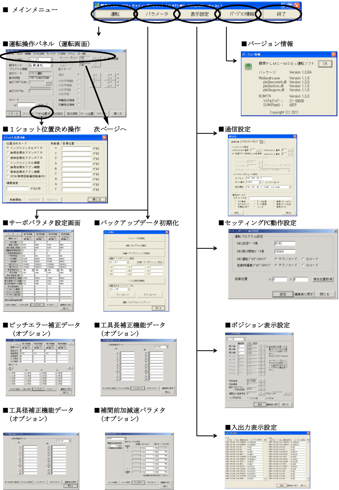

> **図の内容**
>
> メインメニュー（運転、パラメータ、表示設定、バージョン情報、終了）から開く画面のつながりを、縮小画像で示した図。運転操作パネル、1ショット位置決め、サーボパラメータ設定画面、バックアップデータ初期化、ピッチエラー補正データ、工具長補正機能データ、工具径補正機能データ、補間前加減速パラメータ、通信設定、セッティングPC動作設定、ポジション表示設定、入出力表示設定、バージョン情報など。
> 縮小画像の文字は小さくて判読できず。

■ 操作メニュー

運転画面の操作メニュー

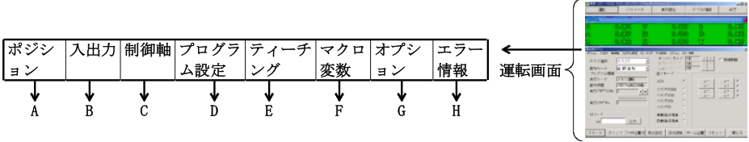

> **図の内容**
>
> 運転操作パネルのメニュー: ポジション(A)、入出力(B)、制御軸(C)、プログラム設定(D)、ティーチング(E)、マクロ変数(F)、オプション(G)、エラー情報(H)。右に「運転画面」の縮小画像。

- A ポジション表示

■指令位置

- ■機械位置

■偏差量


> **図の内容**
>
> 指令位置、機械位置、偏差量、アブソ位置、相対移動量。

| 指令位置   |
|--------|
| 機械位置   |
| 偏差量    |
| アブソ位置  |
| 相対移動量  |

B 入出力


■アブソ位置


■相対移動量


■汎用入出力


C 軸制御

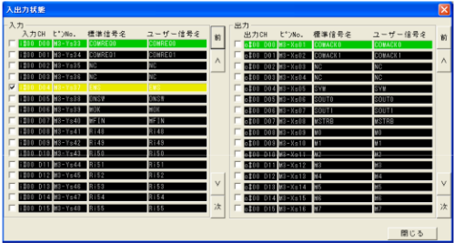

■軸設定

■各軸ステータス

■Σサーボステータス

| 軸設定        |
|------------|
| 各軸ステータス    |
| Σサーボステータス  |
| メカトロリンクモニタ |

D プログラム設定

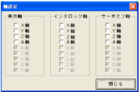

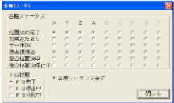

■メカトロリンクモニタ

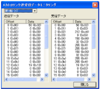

■プログラム設定

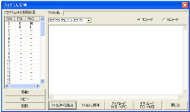

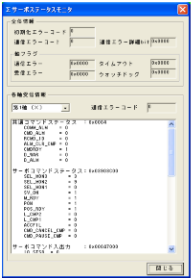


E ティーチング

■ティーチング

- F マクロ変数

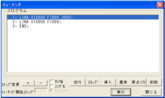

■一般レジスタ表示

■マクロ変数書き込み

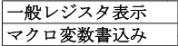

- G オプション

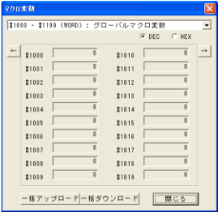

■主軸操作

■TPCロギング

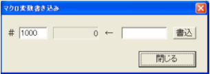

■手パモード

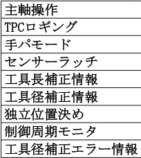

> **図の内容**
>
> 主軸操作、TPCロギング、手パモード、センサーラッチ、工具長補正情報、工具径補正情報、独立位置決め、制御周期モニタ、工具径補正エラー情報。

H エラー情報

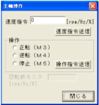

■センサーラッチモニタ ■工具長補正情報

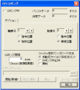

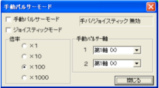

- ■工具径補正情報

■独立位置決め

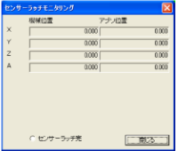

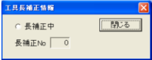

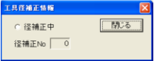


■制御周期モニタ ■工具径補正エラー情報

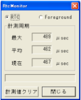

■エラー情報

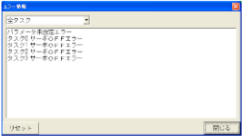

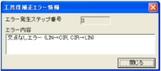

## 5.運転画面

### 5-1．メインメニュー

このメニューの各ボタンをクリックするとそれぞれの画面を表示します


> **図の内容**
>
> ウィンドウ「標準PLMC-M3Ex セッティングPCソフト（C:¥PLMC-M3¥plm3exdrv.ini）」。タイトルに、使っている ini ファイルのパスが表示される。
> メニュー: 運転、パラメータ、表示設定、バージョン情報、終了。

- ※ セッティングPCが参照しているINIファイルのファイル名を表示します。詳細は「PLMC-M3Exユーザーズマニュアル」<Ⅰ導入編>(TB00-0980A)を参照下さい。

### 5-2．運転画面

PLMC-M3ExＣの内部情報（動作モード/動作状態/アラーム情報）のモニタや、各種命令を行うことができます。（運転画面で選択されているタスクに対するモニタ/指令です。）

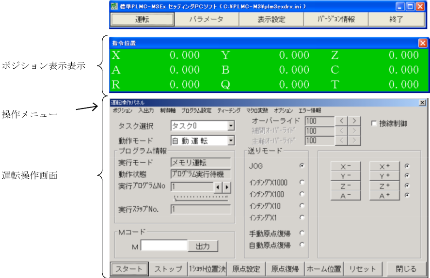

> **図の内容**
>
> 運転画面の構成: 上が「ポジション表示表示」（X、Y、Z、A、B、C、R、Q、T の 9 軸の位置）、中が「操作メニュー」、下が「運転操作画面」。

#### 5-2-1.運転操作画面

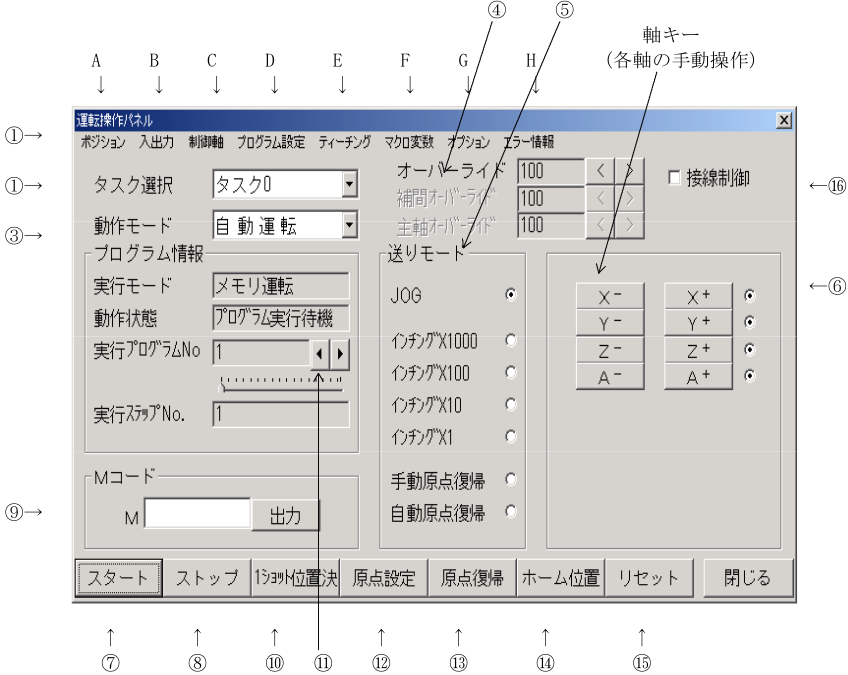

> **図の内容**
>
> 運転操作パネルに、本文の番号が付いている。メニュー A～H、① タスク選択（タスク0）、② 動作モード（自動運転）、③ プログラム情報、④ オーバライド・補間オーバライド・主軸オーバライド（100）、⑤ 接線制御、⑥ 送りモード、⑦～⑮ 下のボタン（スタート、ストップ、1ショット位置決め、原点設定、原点復帰、ホーム位置、リセット、閉じる）、⑨ Mコード、軸キー（各軸の手動操作。X-/X+ ～ T-/T+）。

① 操作メニュー

操作メニューをクリックすることで画面を切り換えたり、必要な画面を表示させることができます。

- A. ポジション表示メニュー（5-2-2.を参照下さい）
2. ├ 指令位置
3. ├ 機械位置
4. ├ 偏差量
5. ├ アブソ位置
6. └ 相対移動量
- B. 入出力モニタリングメニュー（5-2-3.を参照下さい）

汎用入出力

- C. 制御軸メニュー

（5-2-4.を参照ください）

- ├ 軸設定
- ├ 軸ステータス
- ├ Σサーボステータス
- ├ メカトロリンク
- └ 主軸インバータステータス

- D. プログラム設定メニュー（5-2-5.を参照下さい）
- E. ティーチングメニュー（5-2-6.を参照下さい）
- F. マクロ変数メニュー

（5-2-7.を参照下さい）

一般レジスタ表示マクロ変数書き込み

G. オプションメニュー

（5-2-8.を参照下さい）

主軸操作

- TPCロギング
- 手パモード
- センサーラッチモニタ-
- 工具長補正情報
- 工具径補正情報
- 独立位置決め
- 制御周期モニタ
- 工具径補正エラー情報

H. エラー情報メニュー

（5-2-9.を参照下さい）

② タスク選択セッティングPCで運転するタスクを選択してください。(タスク0～7) 基本的には、セッティングPCの操作は選択中の1つのタスクに対して行います。同時進行している複数のタスクは、タスク選択ボタンで表示を切り替えて、監視・操作をしていただきます。

③ 動作モード変更操作

▼ ボタンを押すとメニュ－が出ますので動作モードを選択してください。各々の動作モードでは、以下の操作が可能です。

○ ※1

× ※2

○：実行可、×：実行不可

| 操作 ＼ モード | セッティングモード | 手動運転モード | 自動運転モード | ＯＴ無視モード ※5 | ＤＮＣ運転モード |
|---|---|---|---|---|---|
| 送りオーバーライド変更 | ○ | ○ | ○ | ○ | ○ |
| ＪＯＧ送り | × | ○ | ○ | ○ | ○ |
| インチング送り | × | ○ | ○ | × | ○ |
| １ショット位置決め | × | ○ | ○ | × | ○ |
| 原点復帰 | × | ○ | ○ | × | ○ |
| プログラム選択 | ○ | ○ | ○ | ○ | - ※3 |
| プログラムスタート | × | × | ○※4 | × | ○ |
| プログラムストップ | × | × | ○※4 | × | ○ |
| リセット | ○ | ○ | ○ | ○ | ○ ※1 |
| 原点設定 | ○ | ○ | ○ | ○ | ○ |
| プログラムダウンロード | ○ | ○ | ○ | ○ | × |
| プログラムアップロード | ○ | ○ | ○ | ○ | × ※2 |
| パラメータダウンロード | ○ | × | × | × | × |
| パラメータアップロード | ○ | ○ | ○ | ○ | ○ |

- ※1 プログラム実行中のみ有効となります。
- ※2 実行中のプログラムに対しては、書き込みはできません。
- ※3 セッティングPCではプログラムファイル名を選択します。
- ※4 ティーチングも可能です。[開発中]
- ※5 OT無視モード使用時(OTからの復旧)の動作については、「PLMC-M3Exユーザーズマニュアル」<Ⅲ 機能編 5-14.ストロークリミット>(TB00-0980E)を参照して下さい。

- ④ オーバーライド変更操作（オーバライド、補間オーバライド、主軸オーバライド）＜＞ボタンによりオーバーライド設定を変更します。

ROMSW設定ソフトの「基本」画面で、「補間オーバライド個別指定」と、「主軸オーバライド個別指定」が設定できます。

対応するオーバーライドは以下の通りです。

| ROMSW設定移動種別   | ROMSWオーバライド個別指定 ※ - 有効   | ROMSWオーバライド個別指定 ※ - 無効   |
|----------------|--------------------------|--------------------------|
| 補間送り           | 補間オーバライド                 |                          |
| S指令/ SPIN指令    | 主軸オーバライド                 |                          |
| それ以外の移動指令     | 通常オーバライド                 |                          |

- ※ 補間送りに対応するオーバライド :ROMSW設定ソフト「基本画面」の「補間オーバライド個別指定」主軸/SPIN命令に対応するオーバライド :ROMSW設定ソフト「基本画面」の「主軸オーバライド個別指定」
- 主軸回転指令に対しオーバライドを反映させるにはROMSW設定ソフト「基本」画面の "主軸機能選択" で「主軸オーバライド」を有効にする必要があります。
- ※「主軸オーバライド」と「主軸オーバライド個別指定」は意味が異なります。

詳細は、「PLMC-M3Ex ROMSW設定ソフトマニュアル」<4-1.基本パラメータ>(TB00-982)を参照してください。

⑤ 手動送りモード

ラジオボタン( )をクリックして、手動送りモードを選択します。

a ジョグ送り(JOG)

軸キーを押している間、一定速度で移動を続けます。

移動速度は、パラメータ(JOG速度)にて設定します。

b インチング送り(×1000、×100、×10、×1)

軸キーをクリックする毎に、軸が指定された量移動します。

移動量は×1000､×100､×10､×1選択に応じて、それぞれ1000パルス、100パルス、10パルス、1パルスになります。

c 各軸手動原点復帰

各軸キーを押している間、逃げ動作をしない原点復帰を行います。(軸キーの+/- はどちらでも同じ動作です。区別しません。)

d 各軸自動原点復帰

各軸キーをクリックすると、逃げ動作を行った後、原点復帰を行います。(軸キーの+/- はどちらでも同じ動作です。区別しません。)

電源投入後、一度も原点復帰を完了していない場合は、逃げ動作を行いません。

逃げ動作については、「PLMC-M3Ex ユーザーズマニュアル」<Ⅳ 試運転調整編 4-4.全軸原点復帰の逃げ動作>(TB00-0980H)を参照下さい。

- ※ 原点復帰の詳細は、「PLMC-M3Ex ユーザーズマニュアル」<Ⅳ 試運転調整編 4-3.原点復帰の動作> (TB00-0980H)を参照下さい。

⑥ 原点復帰完了表示ボタン

原点復帰が完了している軸はこのボタンがＯＮになります。

- ⑦ プログラム運転開始（スタートボタン）

プログラム運転を開始します。

- ⑧ プログラム運転停止（ストップボタン）プログラム運転を一時停止します。スタートボタンによりプログラム運転を再開できます。

⑨ マニュアルMコード( 出力ボタン)

エディットボックスに入力した数値をMコードとして出力します。

入力できる値の範囲は0～255です。範囲外の値を設定し、「出力」ボタンを押すと、Mコードは出力されず、表示は前回設定値に戻ります。

⑩ 1ショット位置決め操作画面

操作画面の1ショット位置決ボタンを押すと、以下の画面を表示します。各軸の座標値や移動量を入力して、位置決めを行います。

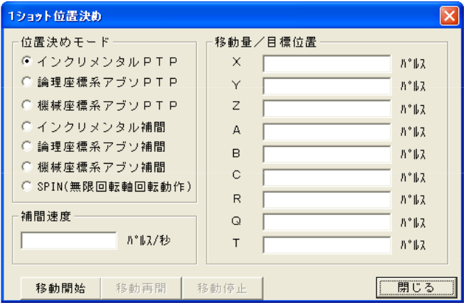

> **図の内容**
>
> 「位置決めモード」: インクリメンタルPTP、論理座標系アブソPTP、機械座標系アブソPTP、インクリメンタル補間、論理座標系アブソ補間、機械座標系アブソ補間、SPIN（無限回転軸回転動作）。
> 「移動量／目標位置」X、Y、Z、A、B、C、R、Q、T（ﾊﾟﾙｽ）、「補間速度」（ﾊﾟﾙｽ/秒）。ボタン: 移動開始、移動再開、移動停止、閉じる。

位置決めの方式としては、PTP移動(早送り移動)と補間移動があります。

またそれぞれ、ポジションの指定方式として、インクリメンタル指定とアブソリュート指定があります。補間移動の場合は、ポジション指定と同時に、送り速度の指定が必要です。補間移動の送り速度は指定された全軸の合成速度です。

「PLMC-M3Exユーザーズマニュアル」の以下のマニュアルを参考にして下さい。

- 論理座標系、機械座標系について :<Ⅲ 機能編 5-1.座標系>(TB00-0980E)
- アブソ指令、インクレ指令について :<Ⅲ 機能編 5-2.アブソ指令とインクレ指令>(TB00-0980E)
- 補間移動送りの合成速度について :<Ⅲ 機能編 5-6.直線補間>(TB00-0980E)

⑪ プログラム選択 ( Ï Ì ボタン)

自動運転時、プログラム番号を選択します。(プログラムメモリ上の PNo) DNC運転時、プログラムファイルを選択します。

- 【注】運転プログラムは、PLMCへダウンロード(ローディング)する時に、ブロック番号(BLK)、タスク番号(TSK)、プログラム番号(PNo)を指定します。詳細は、「5-2-5. プログラム管理画面」を参照ください。

⑫ 原点設定操作 ( 原点設定ボタン)

現在位置を論理座標系の原点(運転プログラムの原点)とします。

⑬ 原点復帰操作 ( 原点復帰ボタン)

全軸原点復帰を行います。各軸の原点復帰パラメータ(速度、復帰方向、順位)は、サーボパラメータで設定できます。詳細は、「PLMC-M3Exユーザーズマニュアル」<Ⅳ 試運転・調整編 4.サーボパラメタ> (TB00-0980H)を参照して下さい。

⑭ ホームポジション位置決め操作( ホーム位置ボタン)

パラメータ画面のサーボパラメータ項目内の「ホームポジション距離」で設定された位置に位置決めを行います。(各軸のホームポジション距離、順位は、サーボパラメータで設定できます。)

「ホームポジション距離」は機械座標系で設定します。

詳細は、「PLMC-M3Exユーザーズマニュアル」<Ⅳ 試運転・調整編 4.サーボパラメタ>(TB00-0980H)を参照して下さい。

⑮ リセット操作 ( リセットボタン)

PLMCのアラームやプログラム運転のリセットを指令します。また、アラーム要因のクリアーとサーボ電源投入を同時に行います。但し、ONSW機能有効時はサーボ電源投入は行いません。詳細は、以下を参照して下さい。

- 「ROMSW設定ソフトマニュアル」<4-1-2.サーボON動作の補足説明>(TB00-0982)
- 「PLMC-M3Exユーザーズマニュアル」<Ⅲ 機能編 2-1-1.一般入力>(TB00-0980D)

⑯ 接線制御 (オプション)

ROMSW設定ソフトで接線制御オプションが有効の時に表示されます。チェックすると接線制御が有効になります。

#### 5-2-2.ポジション表示メニュー

① 指令位置画面（画面色：緑）

論理原点を0点として各軸へ出力した指令から算出した現在位置を表示します。

操作画面の操作メニューの「ポジション」から指令位置を選択することにより表示します。

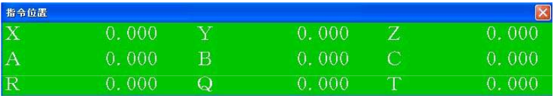

> **図の内容**
>
> 「指令位置」の表示（緑の背景）。X、Y、Z、A、B、C、R、Q、T とも 0.000。

② 機械位置画面（画面色：黄）

論理原点を0点として各軸のエンコーダフィードバック（以降FB）から算出した現在位置を表示します。 (ROMSW設定ソフトで"仮想アンプ機能"を有効にしている軸の現在位置は、指令位置と同じになります。)※ 操作画面の操作メニューの「ポジション」から機械位置を選択することにより表示します。

③ アブソ位置画面（画面色：青）

機械座標系（機械原点を0点とした座標系）の、A「指令した位置」又は B「エンコーダFB位置」を表示

します。A/Bは、ROMSW設定（基本画面の「アブソ位置ステータス指令基準」設定）で選択します。ただし、ROMSW設定ソフトで"仮想アンプ機能"※を有効にしている軸は、設定によわらずAを表示します。操作画面の操作メニューの「ポジション」からアブソ位置を選択することにより表示します。

④ 偏差量画面（画面色：赤）

モータの遅れ量（指令位置－機械位置）を表示します。

操作画面の操作メニューの「ポジション」から偏差量を選択することにより表示します。

⑤ 相対移動量画面（画面色：白）

各種移動命令１ステップ毎の移動量を表示します。

(C(Z)相原点復帰終了時はドグからC(Z)相までの距離を表示します。ドグ～C(Z)相間距離のチェック用) 操作画面の操作メニューの「ポジション」から相対移動量を選択することにより表示します。

- ※ "仮想アンプ機能"については「PLMC-M3Ex ROMSW設定ソフトマニュアル<4-1.基本パラメータ>」 (TB00-0982)を参照してください。

#### 5-2-3.入出力モニタリングメニュー

##### 5-2-3-1.汎用入出力画面

操作メニューの「入出力」をクリックし、「汎用入出力」を選択すると以下の画面を表示します。 PLMCの入出力の状態をリアルタイム表示します。また、入出力の状態を変更(強制設定)することもできます。

アドレス bit

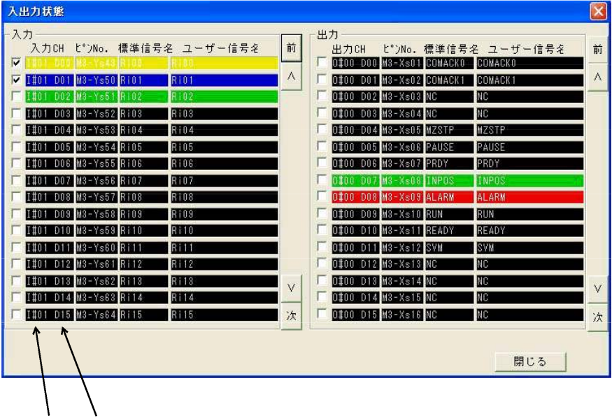

> **図の内容**
>
> 「入出力状態」画面。入力と出力それぞれに、入力CH/出力CH、ﾋﾟﾝNo.、標準信号名、ユーザー信号名の列。ON の信号が色付きで表示されている。
> 細部は小さくて判読できず。

強制設定したい入出力のチェックボックスをチェック( )します。その後信号名称をクリックしてON状態/OFF状態を設定します。

ON/OFF状態は以下のように表示されます。

| 信号の種類・状態    | ON状態   | OFF状態   |
|-------------|--------|---------|
| アラーム・停止関連信号 | 赤      | 黒       |
| 強制設定中の信号    | 黄      | 青       |
| その他の信号      | 緑      | 黒       |

上図はI#01 D00を強制ON、I#01 D01を強制OFF状態にした図です。 ON,OFF状態はトグルで切り替わります。

強制設定

入力信号の強制設定実際の入力のON/OFFに関わらず、強制設定のON/OFFを入力状態として見なします。

- (例)・ b接OT信号が未接続場合に、それを強制設定でOFFすることにより、アラームを発生しないようにする。
- 運転プログラムの判別処理の動作確認(デバッグ)を行いたい場合、その入力を強制設定する。

出力信号の強制設定任意の出力信号の状態を強制的に変更することができます。

(例)・アラーム発生中においてもサーボ主電源を投入させる。

- 強制的に外部のソレノイドやシリンダーを動作させる。

強制入出力をしながら運転させることは、例外的状況(アラームや保護機能を無効にする等)ですので、細心の注意が必要です。

- 【注】各入出力信号のアドレスとbitに対応したチャンネルとピン番については、「PLMC-M3Ex ユーザーズマニュアル」<Ⅲ 機能編 2-3.標準入出力チャンネル表>(TB00-0980F)を参照下さい。

入出力の動作は、FA-M3□側のラダーが正常動作していることが前提です。

以下を参照下さい。

- 「PLMC-M3Ex ユーザーズマニュアル」<Ⅲ 機能編 2 入出力機能>(TB00-0980F)
- 「PLMC-MⅡEX サンプルラダー説明書」<4.ラダー処理>(TB00-0917)

#### 5-2-4.制御軸メニュー

操作メニューの「制御軸」をクリックすると「軸設定」、「軸ステータス」、「Σサーボステータス」、「メカトロリンク」が選択できます。

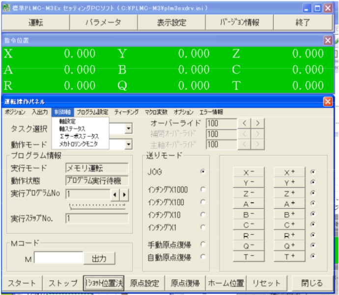

> **図の内容**
>
> 運転操作パネルで「制御軸」メニューを開いた状態。項目: 軸設定、軸ステータス、Σサーボステータス、メカトロリンクモニタ。

##### 5-2-4-1.軸設定画面

操作メニューの「制御軸」をクリックし、「軸設定」を選択すると以下の画面を表示します。各軸の無効軸、インタロック軸、サーボオフ軸としての状態の表示・変更を行う画面です。

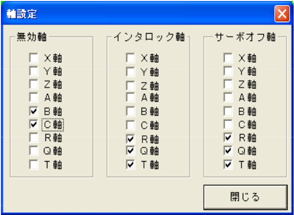

> **図の内容**
>
> 「軸設定」画面。「無効軸」（B軸、C軸にチェック）、「インタロック軸」（R軸、Q軸、T軸にチェック）、「サーボオフ軸」（B軸、R軸、Q軸、T軸にチェック）。X～T の 9 軸のチェック欄と「閉じる」。

設定変更したい軸のチェックボックスをチェック( )する事によりON状態/OFF状態を設定します。 ON,OFF状態はトグルで切り替わります。

無効軸・・・・・・・各軸に対する指令を無効にします。

無効軸は、運転プログラムによる移動命令やJOG操作の指令を無視します。

インタロック軸に、運転プログラムによる移動命令を指令すると「プログラム

- インタロック軸・・・各軸に対する指令をインタロックします。実行エラー」になります。

サーボオフ軸・・・・強制的にサーボオフします。サーボオフ軸設定をON状態にすると、同じ論理軸のインタロック軸設定が自動的にON状態になります。この状態からサーボオフ軸設定をOFF状態にしても、インタロック軸設定は自動的にOFF状態にはなりません。必要に応じてインタロック軸をOFFして下さい。

##### 5-2-4-2.軸ステータス画面

操作メニューの「制御軸」をクリックし、「軸ステータス」を選択すると、以下の画面を表示します。

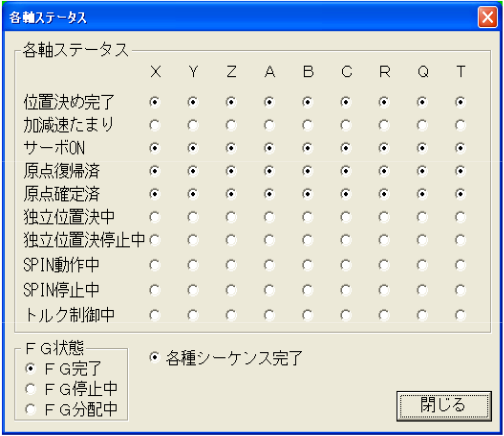

> **図の内容**
>
> 「各軸ステータス」画面。X～T の 9 軸について、位置決め完了、加減速たまり、サーボON、原点復帰済、原点確定済、独立位置決め中、独立位置決め停止中、SPIN動作中、SPIN停止中、トルク制御中。
> 「FG状態」: FG完了（選択）、FG停止中、FG分配中。「各種シーケンス完了」。「閉じる」。

・各軸ステータス

位置決め完了・・・位置決め完了時に、ON( )の表示になります。

各軸の偏差量(指令位置と機械位置の差)がサーボパラメータのINPOS量以下の時、位置決め完了とします。

加減速たまり・・・(指数型、定時直線型、S字)補間加減速による遅れが発生しているときに、 ON( )の表示になります。

サーボON・・・・・各軸がサーボONしているときに、ON( )の表示になります。

原点復帰済・・・・各軸の原点復帰が完了しているときに、ON( )の表示になります。原点復帰無効の軸は、常にONとなります。

独立位置決中・・独立位置決め指令で移動中にON( )となります。

独立位置決停止中・独立位置決め指令の途中停止でON( )となります。

SPIN動作中・・・・SPIN指令で回転動作中にON( )となります。

SPIN停止中・・・・SPIN指令の途中停止でON( )となります。

トルク指令中・・・トルク指令中でON( )となります。

・FG状態

FG完了・・・・・・各軸の移動指令出力が完了しているときに、ON( )の表示になります。

FG停止中・・・・・各軸の移動指令出力が一時停止しているときに、ON( )の表示になりす。

FG分配中・・・・・各軸の移動指令出力を行っているときに、ON( )の表示になります。

各FG状態のタイミングについては、

「PLMC-M3Ex ユーザーズマニュアル」<Ⅲ 機能編 7-4-7-3.タスク情報>(TB00-0980F)の "FGステータスタイミングチャート"を参照して下さい。

画面上の表示と、タイミングチャート内の用語の対応は以下のとおりです。

FG完了・・・・・軌跡発生完了

FG停止中・・・・途中停止中

FG分配中・・・・軌跡発生中

・各種シーケンス完了

以下のPLMC内部シーケンスを実行していないときに、ON( )の表示になります。

(実行中はOFFの表示になります。)

汎用入出力制御処理、Mコード出力処理、自動原点復帰処理、ホーム位置決め処理

##### 5-2-4-3.シグマサーボステータス画面

操作メニューの「制御軸」をクリックし、「Σサーボステータス」を選択すると、以下の画面を表示します。

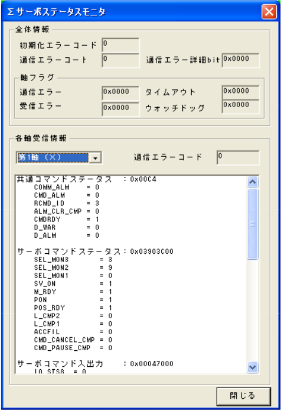

> **図の内容**
>
> 「Σサーボステータスモニタ」画面。全体情報（初期化エラーコード、通信エラーコード、通信エラー詳細bit、軸フラグ: 通信エラー・タイムアウト・受信エラー・ウォッチドッグ）と、各軸受信情報（軸選択、通信エラーコード、共通コマンドステータス、サーボコマンドステータス、サーボコマンド入力の各ビットの値の一覧）。
> 値は小さくて判読できず。

全体情報のエラー

メカトロリンク通信のエラーです。エラー発生時は、メカトロリンクケーブルを確認/交換して、再度確認ください。

エラーが解消しない場合は、テクノへ連絡ください。

各軸情報

サーボアンプ内の情報です。

詳細は安川電機Σサーボマニュアルを参照ください。

##### 5-2-4-4.メカトロリンクモニタ画面

操作メニューの「制御軸」をクリックし、「メカトロリンクモニタ」を選択すると、以下の画面を表示します。

詳細は安川電機Σサーボ/MECHATROLINK-Ⅲ仕様を参照ください。

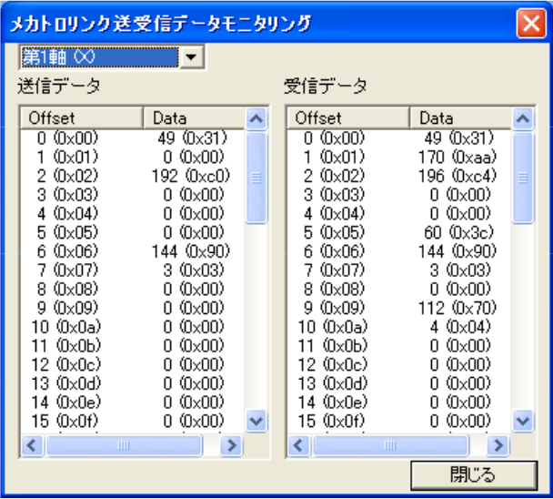

> **図の内容**
>
> 「メカトロリンク送受信データモニタリング」画面（第1軸(X)）。「送信データ」と「受信データ」に、Offset 0 (0x00)～15 (0x0f) と Data（10 進と 16 進）の一覧。例: 送信データ Offset 0 は 49 (0x31)、受信データ Offset 0 は 49 (0x31)。「閉じる」。

#### 5-2-5.プログラム管理画面

操作メニューの「プログラム設定」をクリックすると、プログラム管理画面を表示します。運転プログラムのPLMC内への配置状況の確認、及び、運転プログラムのアップロード/ダウンロードが可能です。

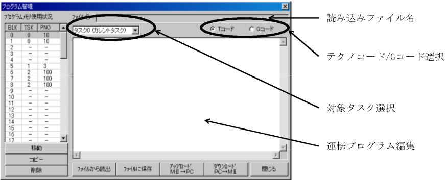

> **図の内容**
>
> 「プログラム管理」画面。矢印の説明: 読み込みファイル名、テクノコード/Gコード選択、対象タスク選択、運転プログラム編集。

- プログラムメモリ使用状況

プログラムメモリ(全64ブロック)の使用状況を表示します。

```c
    BLK
    TSK
    PNO
```

:プログラムブロック番号

:タスク番号

:プログラム番号

- ※ 運転プログラムは、ダウンロード時に「対象タスク選択」指定されているタスクでのみ実行可能です。

（画面の「TSK」欄で、指定されたタスクを確認することができます。）

本画面での各種操作(移動/コピー/削除/アップロード/ダウンロード)は、ここで選択されているブロックに対して行われます。

上記の画面は、以下のダウンロードを完了した状態です。

P10 をBLOCK0からタスク0用としてダウンロード。(59～116ステップのプログラム)

P3 をBLOCK5からタスク1用としてダウンロード。(58ステップ以下)

P100 をBLOCK6からタスク2用としてダウンロード。(117～174ステップのプログラム)

プログラムメモリの容量や番号管理については、以下を参照して下さい。

「PLMC-M3Ex ユーザーズマニュアル」<Ⅲ 機能編6-1-1. 運転プログラムの容量>、

<Ⅲ 機能編6-1-2. 運転プログラムの番号管理>(TB00-0980F)

・移動ボタン

「プログラムメモリ使用状況」で選択されているブロックが含まれているプログラムを任意のブロックに移動します。

- コピーボタン

「プログラムメモリ使用状況」で選択されているブロックが含まれているプログラムを任意の

ブロックにコピーします。(移動先のタスク番号/プログラム番号を指定します)

- 削除ボタン

「プログラムメモリ使用状況」で選択されているブロックが含まれているプログラムを削除します。

- ファイル名「ファイルから読み出し」「ファイルに保存」した際に選択したファイル名を表示します。
- Tコード(テクノコード)/Gコード選択

編集している運転プログラムの種別を選択します。

「アップロード」した場合は、自動的にアップロードしたプログラムの種別に変わります。

・対象タスク選択

編集している運転プログラムの対象タスクを選択します。

指定したタスク以外のタスクで実行する事はできません。

「アップロード」した場合は、自動的にアップロードしたプログラムのタスクに変わります。

- ファイルから読み出し

任意のファイルから運転プログラムを読み込みます。

（運転プログラムは通常のテキストファイルですので、テキストエディタ等で作成する事が出来ます。）

- ファイルに保存

表示している（編集している）運転プログラムを任意のファイルに保存します。

（運転プログラムは通常のテキストファイルですので、テキストエディタ等で編集する事が出来ます。）

- アップロード(PLMC-M3Ex → PC)

「プログラムメモリ使用状況」で選択されているブロックが含まれているプログラムをPLMC-M3Exからアップロード(取得)して表示します。

- ダウンロード(PC → PLMC-M3Ex)

編集中の運転プログラムを、「プログラムメモリ使用状況」で選択されているPLMC-M3Exのブロックへダウンロード(設定)します。

#### 5-2-6.プログラムティーチング画面

操作メニューの「ティーチング」をクリックすると以下の画面を表示します。

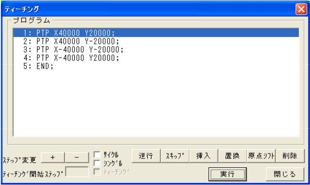

> **図の内容**
>
> 「ティーチング」画面の「プログラム」欄:
> ```
> 1: PTP X40000 Y20000;   （選択中）
> 2: PTP X40000 Y-20000;
> 3: PTP X-40000 Y-20000;
> 4: PTP X-40000 Y20000;
> 5: END;
> ```
> ボタン: ｽﾃｯﾌﾟ変更 ＋ －、サイクル、シングル、ティーチング、逆行、スキップ、挿入、置換、原点シフト、削除、実行、閉じる。

①ティーチング開始ステップ[開発中]

ティーチングモードに入った時のステップNOを表示します。但し、ティーチング操作(挿入,置換等) をした時はそのステップNOに変わります。

②各ボタンの説明

| ボタン           | 機能                                                                                                                              | 条件                                  |
|---------------|----------------------------------------------------------------------------------------------------------------------------------|--------------------------------------|
| サイクル          | サイクル運転モードになります。                                                                                                                  |                                      |
| シングル          | シングルステップモードになります。                                                                                                                |                                      |
| ティーチング ※1     | ティーチングモードになります。                                                                                                                  | ・ステップ間停止                             |
| スッテプ変更 ※1     | ティーチング対象のステップ(カーソルが反転表示しているステップ)を変更します。 (但し運転プログラムの実行は伴いません。) + : ティーチング対象ステップを次のステップに移動します。 - : ティーチング対象ステップを直前のステップに移動します。 | ・ティーチングモード・ティーチング移動中でない             |
| 逆行 ※1 <オプション> | 直前のステップがPTP、LINの時、直前ステップ実行前の位置へ戻ります。                                                                                            | ・ティーチングモードでない・ステップ間停止               |
| 削除 ※1         | ティーチング対象のステップが削除され、それ以降の既存ステップが繰り上げられます。                                                                                        |                                      |
| スキップ ※1       | 現在ステップをスキップして次のステップに移ります。                                                                                                       | ・プログラム実行停止・ティーチングモードでない            |
| 挿入 ※1         | ティーチング対象のステップ以降のステップが繰り下げられ、ティーチング移動した分の新たなPTP指令ステップがティーチング対象のステップとして新たに登録されます。                                               | ・ティーチングモード・ステップ間停止                  |
| 置換 ※1         | ティーチング対象のステップが、ティーチング移動した PTP指令に差し変わります。                                                                                         |                                      |
| 実行            | プログラム運転を開始/再開します。                                                                                                                | ・運転プログラムが存在・原点復帰完了・アラーム無し・自動運転モード |

- ※ ティーチング機能の詳細については、以下を参照して下さい。

「PLMC-M3Ex ユーザーズマニュアル」<Ⅲ 機能編 5-18.ティーチング>(TB00-0980E)

※１これらの機能は、開発中です。

- 【注】ティーチング画面でのプログラム編集は、そのままででは保存されません。

PLMC-M3Ex 内に保存させるには、一度、運転プログラム管理画面を表示して、PCへアップロードして、再度ダウンロードしてください。

#### 5-2-7.マクロ変数メニュー

##### 5-2-7-1.マクロ変数表示画面

PLMC-M3Ex内部のマクロ変数をモニタリング表示します

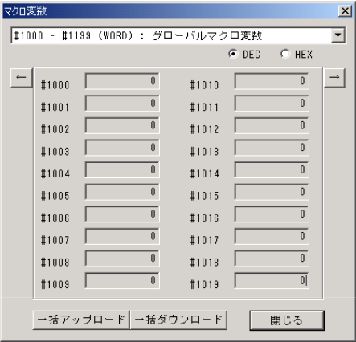

> **図の内容**
>
> 「マクロ変数」画面。表示範囲「#1000 - #1199（WORD）: グローバルマクロ変数」、DEC/HEX の切り替え、#1000～#1019 の値（すべて 0）。ボタン: 一括アップロード、一括ダウンロード、閉じる。

- ① 10進(DEC)ラジオボタン

ONすると、変数表示が10進数になります。

- ② 16進(HEX)ラジオボタン

ONすると、変数表示が16進数になります。

一括アップロード選択中のマクロ変数を一括でPCへアップロードします。マクロ変数ファイル(.mcr)へ保存します。

一括ダウンロードマクロ変数ファイル(.mcr)選択ダイアログを表示します。

選択したマクロ変数ファイルをPLMC-M3Exへダウンロードします。

※マクロ機能の詳細については、「PLMC-M3Exユーザーズマニュアル」<Ⅲ 機能編 7-4. マクロ機能> (TB00-0980F)を参照下さい。

##### 5-2-7-2.マクロ変数書き込み画面

マクロ変数への書き込みをする事ができます。同時に現在値のモニタリングも行います。


> **図の内容**
>
> 「マクロ変数書き込み」画面。「# 1000」の現在値 0 と、書き込む値の欄、「書込」「閉じる」ボタン。

※書き込み可/不可につては、「PLMC-M3Exユーザーズマニュアル」 <Ⅲ 機能編 7-4. マクロ機能> (TB00-0980F)を参照下さい。


#### 5-2-8.オプションメニュー

各種オプション機能用の画面を表示します。

操作メニューの「オプション」をクリックすると「主軸操作」、「TPCロギング」、「手パモード」、「センサーラッチモニター」、「工具長補正情報」、「工具径補正情報」、「独立位置決め」、「制御周期モニタ」、が選択できます。

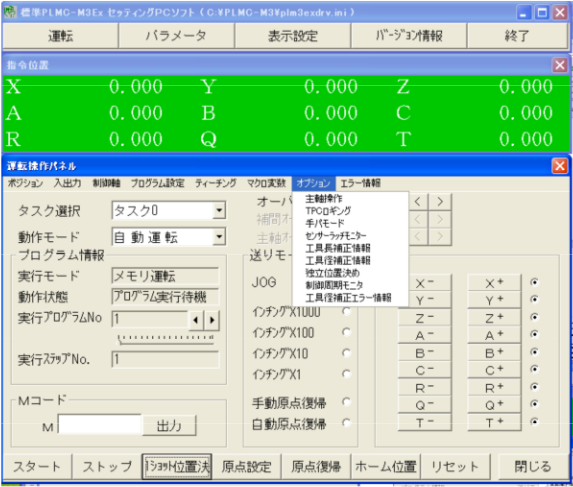

> **図の内容**
>
> 運転操作パネルで「オプション」メニューを開いた状態。項目: 主軸操作、TPCロギング、手パモード、センサーラッチモニター、工具長補正情報、工具径補正情報、独立位置決め、制御周期モニタ、工具径補正エラー情報。

##### 5-2-8-1.主軸操作画面 <オプション>

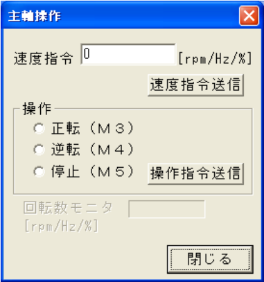

> **図の内容**
>
> 「主軸操作」画面。速度指令 0 [rpm/Hz/%]、「速度指令送信」。操作: 正転(M3)、逆転(M4)、停止(M5)、「操作指令送信」。回転数モニタ [rpm/Hz/%]（灰色）。「閉じる」。

① 速度指令

主軸の回転速度を設定します。(Sコード)

速度指令送信ボタンを押すことで、現在表示中の速度をPLMC-M3Exへ送信します。

I/O主軸の場合、0～3を指令し、SOUT出力を操作します。

インバータ主軸の場合、指令単位は、インバータ側で設定します。

② 操作

主軸の回転動作を指令します。(M03～M05)

ラジオボタン( )をクリックして、主軸の動作を選択します。

操作指令送信ボタンを押すことで、現在選択されている動作を開始します。

③ 回転数モニタ

主軸の現在速度をモニタリングします。インバータ主軸時のみ有効です。

- ※主軸機能の詳細については、「PLMC-M3Ex ユーザーズマニュアル」<Ⅲ 機能編 5-16. 主軸機能> (TB00-0980E)を参照下さい。

##### 5-2-8-2.TPCロギング画面

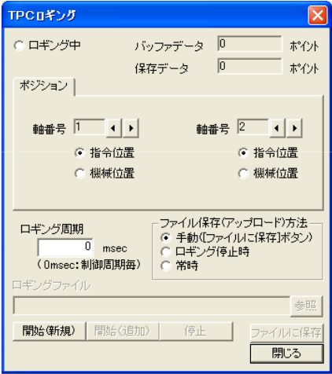

> **図の内容**
>
> ダイアログ「TPCロギング」。
> - 「ロギング中」の表示、「バッファデータ [0] ポイント」「保存データ [0] ポイント」
> - タブは「ポジション」だけ（SLM8000 のような「64CH」のタブはない）。左右それぞれに「軸番号」（左 1、右 2）と「指令位置」「機械位置」の選択（左右とも指令位置が選ばれている）
> - 「ロギング周期 [0] msec」（0msec:制御周期毎）
> - 「ファイル保存(アップロード)方法」: 手動([ファイルに保存]ボタン)（選択中）、ロギング停止時、常時
> - 「ロギングファイル」の欄と「参照」（灰色）
> - ボタン: 開始(新規)、開始(追加)、停止、ファイルに保存、閉じる

任意の2軸分の座標をロギングして、ファイルに出力する事ができます。

(*.csv, *.asl)

ロギング周期

TPCロギングを行う周期をmsec単位で設定します。(1～32767)

"0"を設定すると制御周期毎にロギングを行います。

制御周期以下の値を設定した場合は、制御周期毎にロギングを行います。

ファイル保存

手動

: ファイルに保存ボタンの操作でアップロードします。

ロギング停止時 : ロギング停止時(停止ボタン又はバッファーフル)の時に自動的にアップロードします。

常時

: バッファにたまったデータを常時アップロードします。

但し、ロギングが2msec 以下の場合、アップロードが間に合わず途中でロギングが停止してしまいます。

TPCについての詳細は以下を参照して下さい。

- 「PLMC-M3Ex ユーザーズマニュアル」<Ⅳ 試運転・調整編 7-14.TPCによる精度チェック> (TB00-0980I)
- 「TPC-EXCELマニュアル」(TB04-1478)

##### 5-2-8-3.手パモード画面＜オプション＞

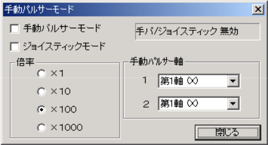

> **図の内容**
>
> 「手動パルサーモード」画面。手動パルサーモード、ジョイスティックモードのチェック欄、「手パ/ジョイスティック 無効」の表示。倍率: ×1、×10、×100（選択中）、×1000。手動パルサー軸: 1 第1軸(X)、2 第1軸(X)。「閉じる」。

手パモードの有効・無効、ジョイスティックモードの有効・無効、手パ倍率、手パ軸(2軸)を設定します。

##### 5-2-8-4.センサーラッチモニタリング画面 <オプション>

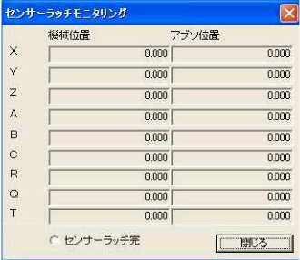

> **図の内容**
>
> 「センサーラッチモニタリング」画面。X～T の 9 軸の機械位置とアブソ位置（すべて 0.000）。「センサーラッチ完」の表示、「閉じる」。

センサーラッチ状態のモニタリングを行います。

※センサーラッチ機能の詳細については、「PLMC-M3Ex ユーザーズマニュアル」

<Ⅲ 機能編 5-15-6.センサーラッチ機能(スキップ機能)>(TB00-0980E)を参照して下さい。

##### 5-2-8-5.工具長補正情報

工具長補正の有効/無効状態と、現在選択中の工具長補正データ番号をモニタ出来ます。

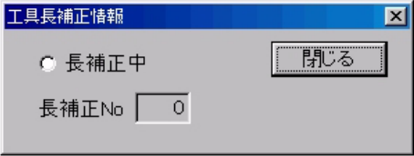

> **図の内容**
>
> 「工具長補正情報」画面。「長補正中」の表示、長補正No 0、「閉じる」。

##### 5-2-8-6.工具径補正情報

工具径補正の有効/無効状態と、現在選択中の工具径補正データ番号をモニタ出来ます。


> **図の内容**
>
> 「工具径補正情報」画面。「径補正中」の表示、径補正No 0、「閉じる」。

##### 5-2-8-7.独立位置決め

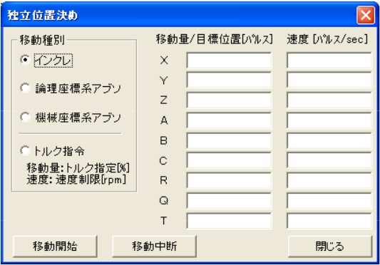

> **図の内容**
>
> 「独立位置決め」画面。「移動種別」: インクレ（選択中）、論理座標系アブソ、機械座標系アブソ、トルク指令（移動量:トルク指定[%]、速度:速度制限[rpm]）。X～T の 9 軸の「移動量/目標位置[ﾊﾟﾙｽ]」と「速度[ﾊﾟﾙｽ/sec]」。ボタン: 移動開始、移動中断、閉じる。

移動種別

インクレ、論理座標系アブソ、機械座標系アブソ、トルク指令を選択

移動量/目標位置パルス単位で設定

速度

pps(パルス/秒)で設定

移動開始

"移動種別"で選択した動作を開始します。

移動中断

移動を中断します。

- ※ 移動種別で"トルク指令"を選択した場合は、設定項目の意味が下記のように変わります。

移動量/目標位置 : トルク指定[%]

速度

: 速度制限指定[rpm]

トルク指令は、オプションです。トルク指令オプションが有効でないと、"移動種別"のトルク指令は選択できません。(灰色表示)

- ※ 独立位置決め機能の詳細は、「PLMC-M3Ex ユーザーズマニュアル」<Ⅲ 機能編 7-3-25.独立位置決め>(TB00-0980E)を参照して下さい。

##### 5-2-8-8.制御周期モニタ

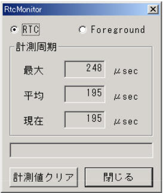

> **図の内容**
>
> ウィンドウ「RtcMonitor」。表示の切り替え: RTC（選択中）、Foreground。「計測周期」: 最大 248 μsec、平均 195 μsec、現在 195 μsec。ボタン: 計測値クリア、閉じる。
> 本文: RTC は「割り込み処理の実行時間」。実行時間が制御周期を越えると「制御周期負荷過大」、制御周期の 99.6% を越えると「制御周期負荷ワーニング」。

RTC

割り込み処理の実行時間。割り込み周期以下である必要があります。実行時間が制御周期を越えると「制御周期負荷過大」になります。

実行時間が制御周期の99.6%を越えると「制御周期負荷ワーニング」になります。

Foreground その他の処理時間。あまり遅いとPLCやPCとの通信の応答性が下がるなどの問題が発生します。

計測クリアー最大値を一端クリアーし、計測を再開します。

##### 5-2-8-9.工具径補正エラー情報

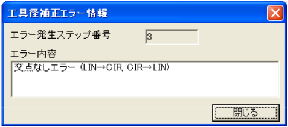

> **図の内容**
>
> 「工具径補正エラー情報」画面。エラー発生ステップ番号 3、エラー内容「交点なしエラー（LIN→CIR, CIR→LIN）」、「閉じる」。

工具径補正実行中に、図形によっては指定の補正が不可能な場合が発生する可能性が有ります。このときは、「プログラム実行エラー」になりますが、エラーの詳細をこの画面で確認することができます。

#### 5-2-9.エラー表示画面

操作メニューの「エラー情報」をクリックすると以下の画面を表示します。発生している各種エラーを表示する画面です。

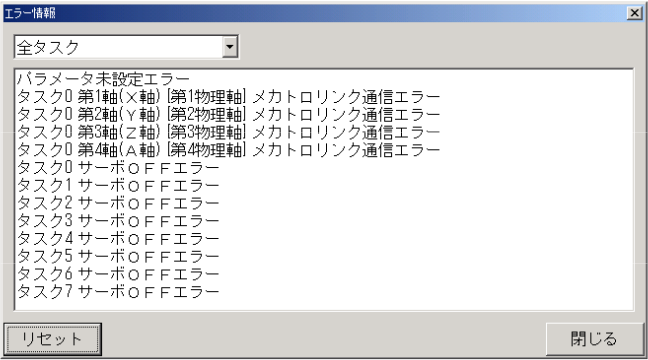

> **図の内容**
>
> 「エラー情報」画面（全タスク）。表示例:
> ```
> パラメータ未設定エラー
> タスク0 第1軸(X軸)[第1物理軸] メカトロリンク通信エラー
> タスク0 第2軸(Y軸)[第2物理軸] メカトロリンク通信エラー
> タスク0 第3軸(Z軸)[第3物理軸] メカトロリンク通信エラー
> タスク0 第4軸(A軸)[第4物理軸] メカトロリンク通信エラー
> タスク0 サーボＯＦＦエラー
> タスク1～タスク7 サーボＯＦＦエラー
> ```
> ボタン: リセット、閉じる。

タスク指定

全タスク :全てのタスクで発生しているエラーを表示

タスク□ :そのタスクで発生しているエラーを表示(□はタスク番号)

リセットボタン

原因を取り除いた上で、このボタンを押すとエラーは解除されます。ボタンを押すとアラーム要因のクリアとサーボ電源投入を同時に行います。

ONSW機能有効時は、サーボ電源投入は行いません。

詳細は、以下を参照して下さい。

- 「ROMSW設定ソフトマニュアル」<4-1-2.サーボON動作の補足説明>(TB00-0982)
- 「PLMC-M3Exユーザーズマニュアル」<Ⅲ 機能編 2-1-1.一般入力>(TB00-0980D)

### 5-3．パラメータ画面

軸制御に必要な各種パラメータの編集、設定を行います。またバックアップデータの初期化を行います。メインメニューのパラメータボタンを押すと、以下に示す画面を表示します。

- サーボパラメータ設定画面
- ピッチエラー補正データ設定画面<オプション>
- 工具長補正データ設定画面<オプション>
- 工具径補正データ設定画面<オプション>
- バックアップデータ初期化画面
- 補間前加減速パラメタ<オプション>

#### 5-3-1.サーボパラメータ設定画面

軸制御に必要なサーボパラメータの作成・設定を行う画面です。

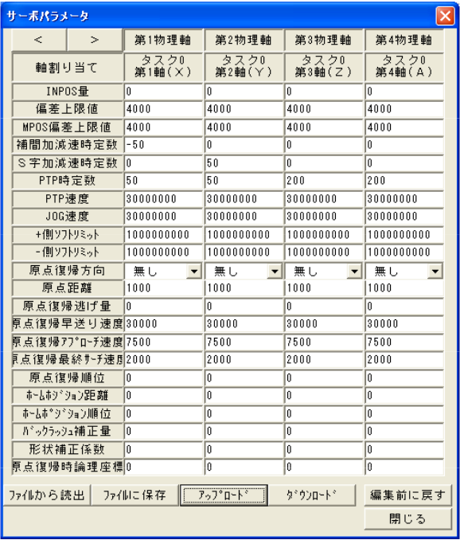

> **図の内容**
>
> 「サーボパラメータ」画面。第1物理軸～第4物理軸（タスク0 第1軸(X)～第4軸(A)）について、INPOS量、偏差上限値、MPOS偏差上限値、補間加減速方式（指数型）、補間加減速時定数、S字加減速、PTP時定数、PTP速度、JOG速度、ソフトリミット、原点復帰関係、バックラッシュ補正量などの値。ボタン: ファイルから読出、ファイルに保存、アップロード、ダウンロード、編集前に戻す、閉じる。
> 値は小さくて判読できず。

- ① ファイルから読出ボタン

サーボパラメータファイルを読み出します。

- ② ファイルに保存ボタン

サーボパラメータファイルに保存します。

- ③ アップロードボタン PLMC-M3Exに格納されているサーボパラメータを読み出します。
- ④ ダウンロードボタン

サーボパラメータをPLMC-M3Exに格納します。

- ⑤ 編集前に戻すボタン編集中に押すと編集前の状態にします。

- ※ サーボパラメータの詳細については「PLMC-M3Ex ユーザーズマニュアル」 <Ⅳ 試運転・調整編 4.サーボパラメタ>(TB00-0980H)を参照下さい。

#### 5-3-2.ピッチエラー補正データ設定画面＜オプション＞

ピッチエラー補正時に必要な補正パラメータの作成・設定を行う画面です。本画面は、ピッチエラー補正オプションが有効の時のみ、表示されます。

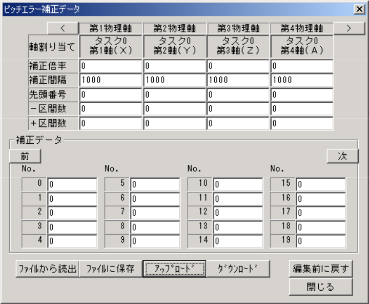

> **図の内容**
>
> 「ピッチエラー補正データ」画面。第1物理軸～第4物理軸（タスク0 第1軸(X)～第4軸(A)）の補正倍率 0、補正間隔 1000、先頭番号 0、－区間数 0、＋区間数 0。補正データ No.0～19（すべて 0）。ボタン: ファイルから読出、ファイルに保存、アップロード、ダウンロード、編集前に戻す、閉じる。

- ① ファイルから読出ボタンピッチエラー補正データファイルを読み出します。
- ② ファイルに保存ボタン

ピッチエラー補正データファイルに保存します。

- ③ アップロードボタン

PLMC-M3Exに格納されているピッチエラー補正データを読み出します。

- ④ ダウンロードボタン

ピッチエラー補正データをPLMC-M3ExＣに格納します。

- ⑤ 編集前に戻すボタン編集中に押すと編集前の状態にします。
- ※ ピッチエラー補正機能の詳細については、「PLMC-M3Ex ユーザーズマニュアル」 <Ⅲ 機能編 5-17-4.ピッチエラー補正機能>(TB00-0980E)を参照下さい。

#### 5-3-3.工具長補正データ設定画面＜オプション＞

工具長補正時に必要な補正パラメータの作成・設定を行う画面です。本画面は、工具長補正オプションが有効の時のみ、表示されます。

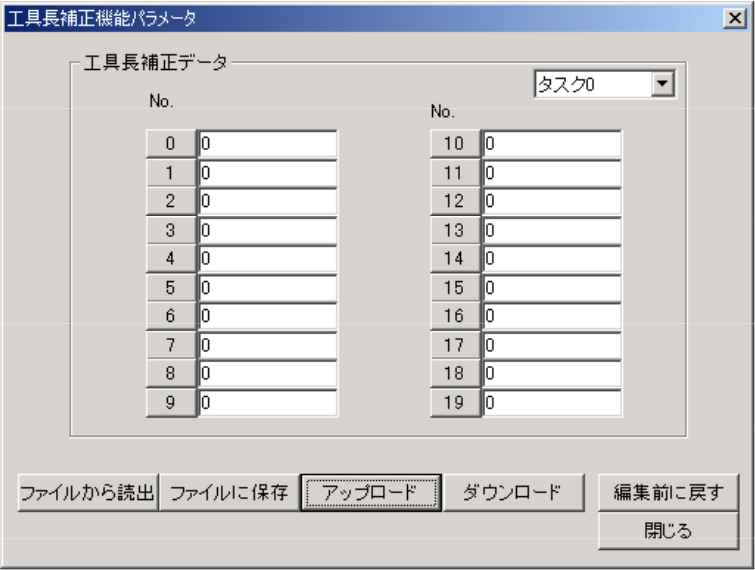

> **図の内容**
>
> 「工具長補正機能パラメータ」画面（タスク0）。工具長補正データ No.0～19（すべて 0）。ボタン: ファイルから読出、ファイルに保存、アップロード、ダウンロード、編集前に戻す、閉じる。

- ① ファイルから読出ボタン

工具長補正データファイルを読み出します。

- ② ファイルに保存ボタン

工具長補正データファイルに保存します。

- ③ アップロードボタン

PLMC-M3Exに格納されている工具長補正データを読み出します。

- ④ ダウンロードボタン工具長補正データをPLMC-M3Exに格納します。
- ⑤ 編集前に戻すボタン

編集中に押すと編集前の状態にします。

- ※ 工具長補正機能の詳細については、「PLMC-M3Ex ユーザーズマニュアル」

<Ⅲ 機能編 5-17-2.工具長補正機能及び摩耗補正機能>(TB00-0980E)を参照下さい。

#### 5-3-4.工具径補正データ設定画面＜オプション＞

工具径補正時に必要な補正パラメータの作成・設定を行う画面です。本画面は、工具径補正オプションが有効の時のみ、表示されます。

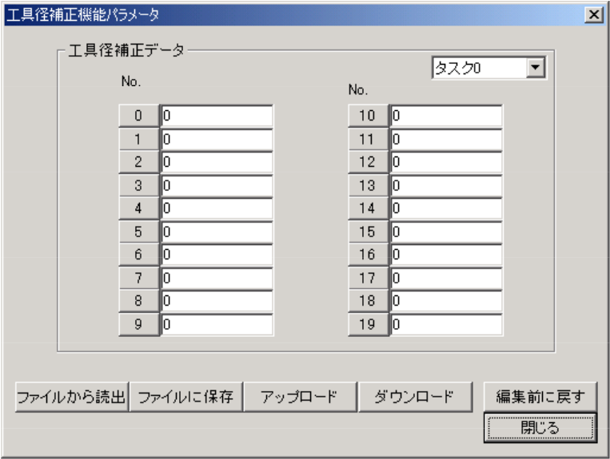

> **図の内容**
>
> 「工具径補正機能パラメータ」画面（タスク0）。工具径補正データ No.0～19（すべて 0）。ボタンは工具長補正と同じ。

- ① ファイルから読出ボタン工具径補正データファイルを読み出します。
- ② ファイルに保存ボタン

工具径補正データファイルに保存します。

- ③ アップロードボタン

PLMC-M3Exに格納されている工具径補正データを読み出します。

- ④ ダウンロードボタン工具径補正データをPLMC-M3Exに格納します。
- ⑤ 編集前に戻すボタン

編集中に押すと編集前の状態にします。

- ※ 工具径補正機能の詳細については、「PLMC-M3Ex ユーザーズマニュアル」 <Ⅲ 機能編 5-17-3.工具径補正機能>(TB00-0980E)を参照下さい。

#### 5-3-5.バックアップデータ初期化画面

バックアップデータの初期化を行う画面です。

また、ポイント位置決めテーブルのアップロード/ダウンロードや運転プログラムの手動バックアップも、この画面で行います。

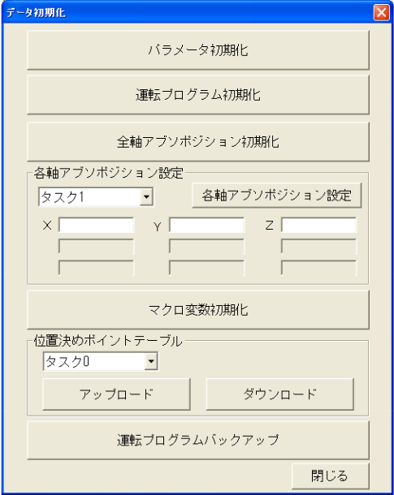

> **図の内容**
>
> 「データ初期化」画面。ボタン: パラメータ初期化、運転プログラム初期化、全軸アブソポジション初期化、各軸アブソポジション設定（タスク1、X・Y・Z の欄）、マクロ変数初期化、位置決めのポイントテーブル（タスク0、アップロード、ダウンロード）、運転プログラムバックアップ、閉じる。

##### 5-3-5-1.バックアップデータ初期化(初期化ボタン)

「□□□初期化」ボタンは通常使用しないで下さい。

「バックアップエラー」の時のみ全てのデータの初期化を行って下さい。

この「初期化」を行った直後、PLMCは「パラメータ未設定エラー」となります。

PC上に保存しているファイルから以下の②～⑦をダウンロードして下さい。

(使用してないオプション機能のデータは不要です)

PLMC-M3Exがバックアップするデータは以下の通りです。

また、(*.□□□)は、関連のファイルの拡張子です。

- ① ROMSW(*.rom)
- ② サーボパラメータ(*.prm)
- ③ ピッチエラーパラメータ(*.pit)
- ④ 補間前加減速パラメータ(*.aco)
- ⑤ 工具径補正パラメータ(*.tod)
- ⑥ 工具長補正パラメータ(*.tol)
- ⑦ 摩耗補正パラメータ(開発中)
- ⑧ 絶対位置オフセット(Σ側座標とEx内アブソ位置とのオフセット)

(アブソモータ使用時のみ)

- ⑨ 運転プログラム(方式によってバックアップする/しない)
- ※ バックアップデータの詳細については、「ROMSW設定ソフトマニュアル」<1.PLMC-M3Exシリーズのパラメータ>(TB00-0982)を参照下さい。

「パラメタ初期化」ボタン

上記の②～⑦を全てクリアー（初期化/デフォルト化）します。

「運転プログラム初期化」ボタン

PLMC-M3Ex内部の運転プログラムをクリアーします。

「全軸アブソポジション初期化」ボタン

現在の長補正値（モーダル値）、加減速溜まり、論理座標オフセット、全ての座標系をゼロにします。

アブソエンコーダの軸は、絶対位置オフセット(Σ側座標と差分)を再設定します。

「各軸アブソポジション設定」ボタン

指定されたタスクでの、座標値を書き込まれた軸のみ、現在位置を指令された座標位置を設定します。空白のままの軸は座標値の変更は行いません。

アブソエンコーダの軸は、絶対位置オフセット(Σ側座標と差分)を再設定します。

「マクロ変数初期化」ボタン

グローバルマクロを0にします。

##### 5-3-5-2.位置決めポイントテーブル

- タスク選択

アップロード/ダウンロード対象のタスクを選択します。

- 「アップロード」ボタン選択中のタスクのポイント位置決めテーブルを読み出します。
- 「ダウンロード」ボタン

ファイル選択して、選択中のタスクのポイント位置決めテーブルとして書き込みます。

データヘッダ(左から軸フラグ、開始ポイント番号、ポイント数) 0,0,0,0,0,0,0,0,0 各軸ポイントは軸フラグで指定した軸の分だけ記述します。


> **図の内容**
>
> ［ファイル形式］
> ```
> 0x1ff, 1, 400
> 0, 0, 0, 0, 0, 0, 0, 0, 0
> :
> 0, 0, 0, 0, 0, 0, 0, 0, 0
> ```
> 1 行目（矢印）と、2 行目以降（中かっこ）に、本文の説明が対応する。

ポイントテーブル(各軸ポイント × ポイント数) (前詰め)

- ※ 詳細は「送受信データ説明書」<4-1-27.ポイントテーブル書込/読出>(TB00-0984)を参照下さい。
- ※ ポイント位置決めテーブルは電源OFFで全軸無効に初期化されます。電源投入するたびにダウンロードする必要があります。

##### 5-3-5-3.運転プログラム(手動)バックアップ

ROMSW設定ソフトの"運転プログラム保存方法"の選択により、動作が変わります。

- ■自動バックアップ"の場合自動バックアップなので、このボタンでのバックアップは行いません。

すぐに"データ反映完了"ダイアログを表示します。

- ■手動バックアップ"の場合
- このボタン操作で、運転プログラムをバックアップします。

全運転プログラム格納領域(384KByte)をバックアップします。数秒掛かります。

運転プログラム書き込み中やプログラム実行中は、エラーになります。

("現在実行できません"ダイアログを表示します。)

- ■バックアップ無し"の場合

バックアップは行いません。

常にエラーになります。("現在実行できません"ダイアログを表示します。)

- "運転プログラム保存方法"については、「ROMSW設定ソフトマニュアル」<4-1.基本パラメタ> (TB00-0982)を参照下さい。
- ※ 送受信コマンド「FLASHROMへ運転プログラム反映指令」によって、PCソフトやラダーからバックアップ動作を指示することも可能です。

#### 5-3-6.補間前加減速パラメタ設置画面〈オプション〉


> **図の内容**
>
> 「補間前加減速パラメータ」画面（タスク0）。補間前加減速時定数 0 msec（0:補間前加減速無効）。最小オーバライド設定（加速度[pls/sec2] の範囲 → 最小オーバライド[%]）が 7 行で、表示されている値は加速度がすべて 0、最小オーバライドがすべて 100。「※加速度は絶対値を設定して下さい。」ボタン: ファイル読出、ファイル保存、アップロード、ダウンロード、編集前に戻す、閉じる。

詳細は、「PLMC-M3Ex ユーザーズマニュアル」<Ⅲ 機能編 5-19.補間前加減速機能>(TB00-0980E)を参照下さい。

### 5-4．表示設定画面

通信/プログラム変換パラメータ、ポジションの表示形式や、入出力名等を設定する画面です。メインメニューの表示設定ボタンを押すと、以下に示す画面を表示します。

- 通信設定画面
- セッティングPC動作設定画面
- ポジション表示設定画面
- 入出力表示設定画面
- ※ 設定を変更した後設定ボタンを押すと変更内容が有効になります。(INIファイル書き込み) キャンセルボタンを押すと、変更内容は無効になります。(全画面共通)

#### 5-4-1.インタフェース

##### 5-4-1-1.通信設定画面

PCとPLMC-M3Exとの通信の設定を行う画面です。


> **図の内容**
>
> 「通信設定」画面。
> - 通信形態: パソコンリンク(イーサネット)
> - パソコンリンク設定: CPU(FA-M3)番号 1、PLMCユニット番号 0、PLMCスロット番号 2
> - パソコンリンクモジュール(RS232C)設定（灰色）: シリアルポート COM1、ステーション番号、サムチェック、終端文字、通信速度・パリティチェック
> - イーサネットモジュール設定: IPアドレス 192.168.1.210、ポート番号 12289、バイナリーモード（チェックなし）、設定履歴「192.168.1.210:12289, text mode」
> - 通信エラーログ: ログファイル名、チェック欄（ログ無効、全てロギング、初期化/終了、データ送信、データ受信、コマンド、通信エラー(全て)、通信エラー(伝送)、通信リトライ）
> - ボタン: 設定、閉じる

通信形態

パソコンリンク(RS232C)、パソコンリンク(イーサネット)を選択してください。

CPU番号 FA-M3□のCPUモジュールのスロット番号を指定してください。

PLMCユニット番号光FAバス等のサブユニット使用時に対象となるPLMC-M3Exが実装されているユニット番号を指定してください。

PLMCスロット番号通信対象のPLMC-M3Exが実装されているスロット番号を指定してください。

シリアルボート使用するシリアルポートを選択します。

ステーション番号

サムチェック

終端文字

通信先の機器により以下の通り設定して下さい。

通信速度

/ パリティチェック

IPアドレス

| 通信先                                             | ステーション番号            | サムチェック     | 終端文字       | 通信速度             | パリティ          |
|-------------------------------------------------|----------------------|-------------|-------------|------------------|---------------|
| FA-M3□ プログラミングポート                               | １                    | ※           | ※           | ※                | ※             |
| LC11-1N(RS232C) LC11-1F(RS232C) LC12-1F(RS232C) | １                    | DIPSW =bit5 | DIPSW =bit6 | ロータリーSW 伝送速度設定用 | DIPSW= bit2,3 |
| LC11-21N (RS422/485)                            | ロータリーSW ステーション番号設定用 | DIPSW =bit5 | DIPSW =bit6 | ロータリーSW 伝送速度設定用 | DIPSW= bit2,3 |

- ※ 横河電機殿のWideField2で設定します。

「プロジェクト」→「コンフィギュレーション」→「通信設定」で設定します。尚、「パソコンリンク機能を使用する」を必ず有効にしてください。

イーサネットモジュールの場合:ロータリSW1～8で設定したアドレスを設定します。

CPUモジュール(SP66-4S,SP67-6S)の場合:CPUプロパティのEthernet設定へ設定したIP アドレスを設定します。

ポート番号イーサネットモジュールの場合バイナリーモード

:SW9の設定に応じて以下のように設定します。

| LE01-5T LE11-0T LE12-0T   |   ポート番号 | バイナリーモード      |
|---------------------------|---------|---------------|
| SW9:bit1=OFF              |   12289 | チェック無し(アスキー)  |
| SW9:bit1=ON               |   12289 | チェックあり(バイナリー) |
| SW9:bit1=OFF              |   12291 | チェックあり(バイナリー) |
| SW9:bit1=ON               |   12291 | チェック無し(アスキー)  |

- ※ LE01-5T モジュールのレビジョンが Rev.04 以前の場合は、バイナリモードを使用できません。

CPUモジュール(SP66-4S,SP67-6S)の場合:ポート番号は、12289(ポートA)か12291 (ポートB)のいずれかを選択下さい。

バイナリモードは、そのポート番号に対して、CPUプロパティの上位リンクサービスで設定した形式にあわせて下さい。

TCP/IPプロトコルのみに対応しています。（UDP/IPでは通信できません）

CPUプロパティなどの設定については、横河電機資料「シーケンスCPUモジュール（ネットワーク搭載型）はじめて操作マニュアル」などを参照下さい。

通信エラー

通信ロギングファイル名

ログファイル名 PLMC-M3Exとの通信のログをとる場合にログファイル名を指定します。

弊社サポートから特に指示がない場合は、空欄(ログ無効)にして下さい。

ログをとる場合、実行ファイルと同じディレクトリに以下のファイルが作成されます。

1. 「通信ロギングファイル名」で指定したファイル
2. 「通信ロギングファイル名」で指定したファイルのベース

ファイル名の最後に1～5の数字を付加したファイル

3. M3LnkExxxxxxxxxx.tmp (イーサネット接続時) M3LnkRxxxxxxxxxx.tmp (RS232C接続時）通信設定により動的に作成

ログファイル(1のファイル)が512Kバイトをこえると現ログファイルはリネームされて、履歴ファイルとなります。

その後、新しいログファイルを作成してロギングを継続します。

履歴ファイル名は、指定されたログファイル名のベース名に履歴番号として1～5を付加した名前です。(最大5世代)

- 例）ログファイル名として"TMP.LOG"を指定すると、履歴ファイルとして TMP1.LOG～TMP5.LOGが作成されます。

##### 5-4-1-2.セッティングPC動作設定画面

DNC送信や変換プログラムタイプ等のセッティングPC上の処理に関する設定を行います。


> **図の内容**
>
> 「セッティングPCソフト動作設定」画面。運転プログラム設定: DNC送信データ長 8192、DNC実行開始データ長 16384、DNC運転プログラムタイプ テクノコード（選択）/Gコード、起動時編集プログラムタイプ テクノコード（選択）/Gコード。起動位置 X 0、Y 0、「現在位置取得」。ボタン: 設定、編集前に戻す、閉じる。

DNC送信データ長「DNC運転」オプション有効で、DNC運転を行っている時のプログラムデータのバッファリング量(1回当たりの送信量)を指定します。このデータを大きくすることにより、微少ブロックの実行性能が向上します。但し、余り大きくすると表示の更新等が遅く

なります。

DNC実行開始データ長「DNC運転」オプション有効でDNC運転を行う時、プログラムの開始タイミングを指定

します。

このデータを大きくすると処理能力の低いパソコンでも微少ブロック実行時のブロック間停止がおきにくくなります。(プログラムの実行がデータ転送に追いつきにくくなります)

但し、あまり大きくし過ぎると、プログラム開始操作( スタートボタン押下)から、機械の実働作までのタイムラグが大きくなります。

また、大容量データの場合本データの規定値を最大(196608)にしてもあまり効果はありません。

DNC運転プログラム DNC運転時のプログラムタイプをテクノコード・Gコードから選択します。タイプ

起動時編集プログラセッティングPC起動時に運転画面のプログラム設定メニューを開いたとき

ムタイプに選択されているプログラムタイプをテクノコード・Gコードから選択します。

起動位置

セッティングPCの起動時の画面上の位置を設定することができます。

(起動時表示位置) 現在位置取得ボタンを押すと現在のセッティングPCの表示位置を取得することができます。

表示位置は画面左上を(0,0)とする座標値です。

#### 5-4-2.ポジション表示形式設定画面

ポジション表示時の軸名称/小数点位置の設定およびプログラム変換処理の設定を行う画面です。


> **図の内容**
>
> 「ポジション表示形式設定」画面（タスク0）。第1軸～第9軸の軸名称（X、Y、Z、A …）とパルス/表示単位（1000）。注記: 「軸名称を変更しても動作プログラムの軸アドレスは変わりません。(X,Y,Z,…R,Q,T のまま) セッティングPC/ROMSW設定ソフトの表示が変わるだけですので御注意下さい。」円弧処理 MC内部、円弧精度 1、動作プログラム小数点桁数 1000、補間送り速度単位 1 ﾊﾟﾙｽ/sec、XZ円弧平面 XZ平面（選択）/ZX平面。ボタン: 設定、編集前に戻す、閉じる。
> 細部は小さくて判読しにくい。

軸名称として設定できる文字列は、全角で最大2文字(半角4文字)です。パルス/表示と小数点位置の関係は下表の通りです。

|   パルス/表示 |   小数点位置 |
|----------|---------|
|   100000 | 0.00001 |
|    10000 |  0.0001 |
|     1000 |   0.001 |
|      100 |    0.01 |
|       10 |     0.1 |
|        1 |       1 |

又、本設定は運転プログラムでの各軸移動量/座標の小数点にも反映されます。

例えば、X軸のパルス/表示に1000と指定して、運転プログラムでX1.0と指定すると「X1000」と認識されます。

円弧処理

円弧補間の処理の仕方(プリ解析/PLMC内部)を選びます。

プリ解析ではプログラム長が長くなりダウンロードに時間がかかります。

PLMC-M3Ex内部だとプログラム長が短くダウンロードもすぐ終わります。

PLMC-M3Ex内部の場合、円弧ステップの始めと終わりで、微妙な速度変動が生じる場合があります。詳しくは「PLMC-M3Exユーザーズマニュアル」<Ⅲ 機能編 5-7.円弧補間> (TB00-0980E)を参照下さい。

円弧精度

プリ解析処理にて、円弧を直線ステップに分解する際に円弧と直線ベクトルの許容誤差を指定します。単位はパルスです。通常1～10で使用下さい。

円弧精度と分割数の関係については、「PLMC-M3Exユーザーズマニュアル」<Ⅲ 機能編補足資料1.円弧プリ解析処理(ステップ数/処理時間)>(TB00-0980F)を参照下さい。

運転プログラム運転プログラムで円弧半径に小数点を指定した時にパルス数へ変換するための倍率を小数点桁数設定します。

例えば本設定に1000と指定して、運転プログラムでCR1.0と指定すると、「CR1000」と認識します。

※ 各軸の移動量/座標は「5-4-2. ポジション表示形式設定画面」の設定が反映されます。

- 補間送り速度単位自動運転プログラムの補間指令(LIN、CIR等)の送り速度の単位を指定します。
- ①と②の設定の組み合わせにより単位を決定します。
- ①は1、10、100、1000、10000と設定できます。

②はmin、secと設定できます。

以下に設定例を示します。


> **図の内容**
>
> | 設定 | 速度単位 |
> |---|---|
> | ①:1 ②:sec | pps(pulse/sec) |
> | ①:1000 ②:min | 1000p/min |

速度指定の小数点は以下のようになります。

「F1.25」指定の場合

速度単位 pulse/secの時 :1 pulse/sec

速度単位10 pulse/secの時 :12 pulse/sec

速度単位100 pulse/secの時 :125 pulse/sec

運転プログラムでX/Z軸の円弧を指定した時の動き方を設定します。動き方は以下の通りです。

【注】テクノ言語の半径指定の円弧命令では、命令中に平面指定(PXZ、PZX)がありますので、本機能は無効です。


> **図の内容**
>
> - XZ平面: 縦軸 +Z、横軸 +X。G03/CIRL と G02/CIRR の回る向きが矢印で示されている
> - ZX平面: 縦軸 +X、横軸 +Z。同じく G03/CIRL と G02/CIRR の回る向きが示されている

XZ円弧平面

#### 5-4-3.入出力表示設定画面

入出力表示の有無、信号名称の設定を行う画面です。


> **図の内容**
>
> 「入出力表示設定」画面。入力と出力それぞれに、入力CH/出力CH、ﾋﾟﾝNo.、標準信号名、表示のチェック、ユーザー信号名。入力の例: I#00 D00 COMREQ0、D01 COMREQ1、D02 NC、D03 NC、D04 EMS、D05 MOPT、D06 VCAMSON、D07 RWNDSW、D08 MFIN、D09 MOK、D10 RSTSW、D11 STOPSW、D12 ZSETSW、D13 ZRTNSW、D14 STARTSW、D15 ONSW。出力の例: O#00 D00 COMACK0、D01 COMACK1、D02 NC、D03 NC、D04 MZSTP、D05 PAUSE、D06 PRDY、D07 INPOS、D08 ALARM、D09 RUN、D10 READY、D11 SVM、D12～D15 NC。ボタン: 設定、編集前に戻す、閉じる。
> ピン番号などの細部は小さくて判読しにくい。

入出力モニタリング画面では、チェックボックスにチェックされている入出力信号のみ表示します。信号名称は変更が可能です。

信号名称として設定できるのは、全角で最大7文字(半角14文字)です。

テクノ出荷時は、標準の名称が設定されています。

専用名をつけたい時に入力して下さい。

- ※ ここで設定した信号名称は初期設定ファイル(INIファイル)に記憶されます。

またROMSW設定ソフトにも自動的に反映します。

### 5-5．バーション表示画面

#### 5-5-1.セッティングPCソフトバージョン表示画面

セッティングPCソフト等のPC上のソフト/PLMC-M3Ex内のROMソフトのバージョン確認/シリアルナンバーの表示を行う画面です。

メインメニューのバージョン情報ボタンを押すと、以下に示す画面を表示します。 ROMソフトのSUM値もここで確認することができます。


> **図の内容**
>
> 「バージョン情報」画面。標準PLMC-M3Ex運転ソフト。パッケージ Version 1.3.0A、Plm3exdrv.exe Version 1.1.0、plm3excomnt.dll Version 1.3.0、plm3extcnv.dll Version 1.1.0、plm3exgcnv.dll Version 1.1.0、ROMソフト Version 1.3.0。シリアルナンバー、SUM(Flash) の表示（画面の例の値）。Copyright (C) 2011。

トラブルなどで当社へ連絡/質問される場合には、上記の画面でセッティングPCとROMソフトのバージョン番号を確認し、御連絡下さい。
