PLMC-M3Ex ユーザ設定パラメータ

# ROMSW 設定ソフト

ロムスイッチユーザーズマニュアル

PLMC-M3Exの御購入ありがとうございます。

試運転前に、本ソフトにてユーザ設定パラメタ「ROMSW パラメタ」をお客様にて設定して下さい。

PLMC-M3Exの導入作業については、

「PLMC-M3Ex ユーザーズマニュアル導入編(TB00-0980A)」をご覧下さい。

お願い

このマニュアルの記載内容について、まちがいや不明な点がありましたら、お手数ですがFAXまたはメールにてテクノへお知らせ下さい。今後さらに改善していきます。

株式会社テクノ

〒358-0011 埼玉県入間市下藤沢1304-5

TEL 04-2964-3677 FAX 04-2964-3322

E-mail mail@open-mc.com Ver.1.0 2014.6.23

－目次－

- 1.PLMCシリーズのパラメータ
  - 1-1.PLMC-M3Exで記憶している情報
  - 1-2.ROMSW(ロムスイッチ)の目的
  - 1-3.ROMSW設定ソフトの使用上の注意
- 2.操作
  - 2-1.作業の手順
- 3.メインメニュー
- 4.各画面とＲＯＭＳＷパラメータの内容
  - 4-1.基本パラメータ
    - 4-1-2 MECHATROLINK通信設定
    - 4-1-4 機械パネル:コード仕様
    - 4-1-5 バックアップ方法
    - 4-1-6 主軸機能選択 <オプション>
    - 4-1-7巻線命令設定
    - 4-1-8 エラー発生/リセット時の軸停止方法選択
    - 4-1-9 自動原点復帰ディレイ(msec) 【2048】
    - 4-1-10 工具径補正角度一致閾値 (1/1000pls) 【3000】
    - 4-1-11 サーボ主電源OFF無視時間【2048】
    - 4-1-12 サーボON動作の補足説明
  - 4-2.入力信号の設定
    - 4-2-1入力信号(PLMC-M3Ex)のアドレス/bit/名称
  - 4-3.出力信号の設定
    - 4-3-1出力信号(PLMC-M3Ex)のアドレス/bit/名称(デフォルト設定)
  - 4-4. 軸設定パラメータ
  - 4-5.手動送り設定<オプション>
    - 4-5-1手動パルサ軸選択
  - 4-6.オプション

## 1.PLMCシリーズのパラメータ

### 1-1.PLMC-M3Exで記憶している情報

PLMC-M3Exで記憶している情報は、以下のとおりです。これらは、全てPLMC-M3Ex個体毎(各マシン毎)に管理して下さい。

| 記憶している情報                       | 設定者     | 設定方法                           | 内容                                                                   | PC側ファイル拡張子   |
|--------------------------------|---------|--------------------------------|-----------------------------------------------------------------------|---------------|
| ROMSW<オプション> ロムスイッチ ROMSW<ユーザ> | テクノ     | ユーザダウンロード ROMSW               | オプション機能の有無。                                                           | .ROM          |
| ロムスイッチサーボパラメータ                | ユーザユーザ | 設定ソフトセッティングPC                 | 軸数、指令極性、信号論理などメカ/システムに合わせた設定(設計レベル) 加減速や速度などメカ諸元やメカ個体差に応じた設定(調整レベル) | .PRM          |
| 初期化ファイル INI(イニ)ファイル            | ユーザ     | ROMSW設定 (終了時) セッティングPC (入出力名称) | PLMC個体のオプション情報や入出力名称を記憶しておき、セッティングPCの表示内容を設定する情報                   | .INI          |
| 動作プログラム                        | ユーザ     | セッティングPC 汎用エディター               | 動作(運転)プログラムテクノ言語/G言語                                                 | .TXT          |
| ピッチエラー補正データ                    | ユーザ     | セッティングPC                       | P.E補正<オプション>用のデータ                                                     | .PIT          |
| 工具長補正データ                       | ユーザ     | セッティングPC                       | 工具長補正<オプション>用のデータ                                                     | .TOL          |
| 工具径補正データ                       | ユーザ     | セッティングPC                       | 工具径補正<オプション>用のデータ                                                     | .TOD          |
| 補間前加減速パラメータ                    | ユーザ     | セッティングPC                       | 補間前加減速<オプション>用のデータ                                                    | .ACO          |
| 絶対位置オフセット                      | ユーザ     | セッティングPC                       | Σのアブソエンコーダ座標との差分                                                      | (無し)          |

ユーザが管理する情報

PLMC内で記憶する情報

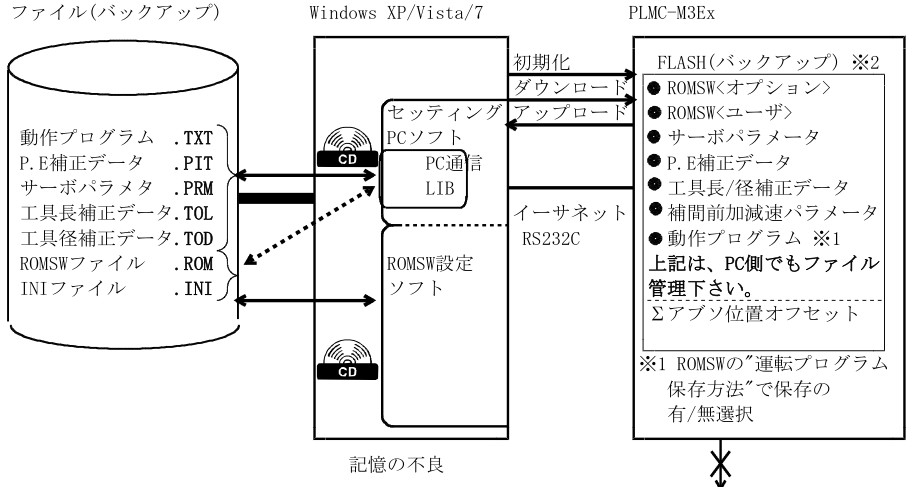

> **図の内容**
>
> - **ファイル(バックアップ)**: 動作プログラム .TXT、P.E補正データ .PIT、サーボパラメータ .PRM、工具長補正データ .TOL、工具径補正データ .TOD、ROMSWファイル .ROM、INIファイル .INI
> - **Windows XP/Vista/7**: 「セッティングPCソフト」（PC通信LIB）と「ROMSW設定ソフト」（どちらも CD で提供）。イーサネットまたは RS232C で PLMC-M3Ex とつながる
> - **PLMC-M3Ex**: 「FLASH(バックアップ) ※2」に ROMSW〈オプション〉、ROMSW〈ユーザ〉、サーボパラメータ、P.E補正データ、工具長/径補正データ、補間前加減速パラメータ、動作プログラム ※1。「上記は、PC側でもファイル管理下さい。」。ほかに Σアブソ位置オフセット
> - Windows → PLMC-M3Ex: 「初期化」「ダウンロード」、PLMC-M3Ex → Windows: 「アップロード」
> - ※1 ROMSWの"運転プログラム保存方法"で保存の有/無選択
> - 下に「記憶の不良」（× の付いた矢印）

□ パラメタ未設定エラー

□バックアップエラー

セッティングPCからパラメータの「初期化」をおこなって､PLMC-M3Ex内がクリアーされている時。

バックアップデータの一部に破損があった時

※2 フラッシュメモリの書き込みには、10万回の回数制限があります。

### 1-2.ROMSW(ロムスイッチ)の目的

ROMSWの設定をしていただくことでユーザ殿には大きな自由度とメリットが生じます。多様な周辺設計(センサーや入出力の論理)にも柔軟に対応できます。

機械の設計諸元や使用するサーボアンプなどのいろいろな条件に合わせてPLMC-M3Exを設定できます。軸構成や形態が変わっても現場で変更できます。

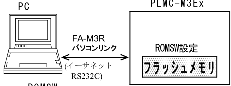

> **図の内容**
>
> 「PC」の「ROMSW」（設定ソフト）から、「FA-M3R パソコンリンク（イーサネット RS232C）」を経て「PLMC-M3Ex」の「ROMSW設定」を「フラッシュメモリ」に書き込む。

ROMSW

設定ソフト設定情報を記憶してマシンの要求に合わせます！

おもなROMSW

- ■基本パラメータ

Mechatrolink通信設定仮想アンプ機能機械パネル関係主軸機能

- ■ユーザーフリーオプション起動時サーボオン ONSW有効原点復帰時のホーム位置決め

自動原点復帰 OT時サーボオフ有り無し原点復帰時の論理座標 MOK使用 M00/M01有り

### 1-3.ROMSW設定ソフトの使用上の注意

- a. ユーザ各位は、PLMC-M3Exの購入後、必ずこのマニュアルをもとに「ROMSW」パラメータを設定して下さい。
- b. 導入手順は「ユーザーズマニュアル導入編(TB0-0980A)」に記載してありますので、その手順に従って下さい。
- c. ROMSW( .ROM)、サーボパラメータ( .PRM)、INIファイル( .INI)は必ず、ファイル保存して下さい。
- d. 「ROMSW設定ソフト」の使用環境
5. （注記）全ての関連ファイルは、PC上(又は別のメディア)で必ずユーザー殿にてバックアップしてください。 PLMC-M3Exの故障などで交換する際には、再設定が必要です。

OS Windows XP/Vista/7 CPU 80386以降のX86プロセッサ画面解像度 1024×768以上

■軸設定パラメータ(各軸) 有効軸局アドレスタスク指定論理軸割付け絶対値エンコーダソフトリミット有原点復帰方式

- ■その他

入出力の割り当て手動パルサ関連ジョイスティック関連入出力信号の論理 (A接/B接)

## 2.操作

### 2-1.作業の手順

- (1) ソフトウェアインストール作業 (初回のみ)

購入いただいたCDから、使用するパソコンへソフトウェアをインストールして下さい。

実際の操作は、「PLMC-M3Exユーザーズマニュアル」<Ⅰ 導入編>(TB00-0980A)を参照して下さい。購入後、はじめて「ROMSW設定ソフト」を使用する際は、<Ⅰ 導入編>の手順に従って下さい。

- (2) PCとPLMC-M3Exの接続

FA-M3Rのパソコンリンク機能を経由して、PCとPLMC-M3Exを接続して下さい。アップロード/ダウンロードができない場合は、「PLMC-M3Exユーザーズマニュアル」 <Ⅴ メンテナンス編 2.PCソフト側の異常> (TB00-0980J)を参照下さい。

ただし、PLMC-M3Exへのダウンロード/アップロードを行わない場合は、PC単独でも使用できます。

- (3) ROMSW設定ソフト「PLM3EXSWSET.EXE」を起動。
- (4) ROMSWパラメータの「アップロード」又は「ファイル読出し」を必ずおこなって下さい。
3. PLMC-M3Ex導入直後の初回は、必ずアップロードしてください。

当社の出荷時のパラメータ(ROMSWオプション)を読み出す必要があります。 ROMSWパラメータの設定は、このオプションの内容により制限されます。

- (5) 各々のROMSWパラメータを編集。(3.各画面の操作を参照)
- (6) ファイル保存をおこなって下さい。
- (7) PLMC-M3Exへダウンロードして下さい。
- (8) 終了する時にINIファイル(PCソフトの設定ファイル)に反映するか聞いてきます。 "はい"を選択すると、ROMSWの内容を反映してカレントディレクトリのINIファイルを更新します。 INIファイルが存在しない時は自動で作成します。

## 3.メインメニュー

※

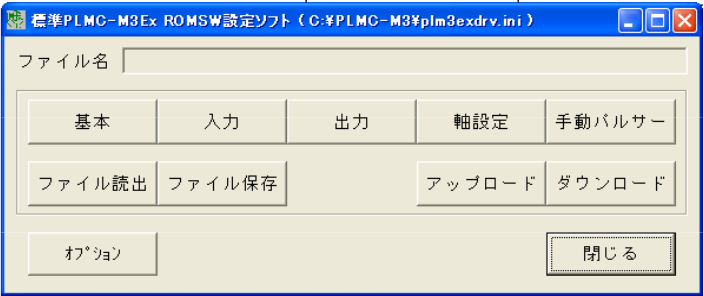

> **図の内容**
>
> ウィンドウ「標準PLMC-M3Ex ROMSW設定ソフト（C:¥PLMC-M3¥plm3exdrv.ini）」。タイトルに、使っている ini ファイルのパスが表示される。
> 「ファイル名」の欄、ボタン: 基本、入力、出力、軸設定、手動パルサー、ファイル読出、ファイル保存、アップロード、ダウンロード、ｵﾌﾟｼｮﾝ、閉じる。

※使用しているINIファイル名を表示します。

詳細は「PLMC-M3Exユーザーズマニュアル」<Ⅰ導入編>(TB00-0980A)を参照下さい。

基本入力出力軸設定の全てのユーザパラメータの設定が必要です。

又オプション設定によって手動パルサーのユーザパラメータの設定が必要です。

オプションは、別途購入されたオプションの確認にご使用ください。

あらかじめデフォルト設定してありますので、変更点のみ入力して下さい。

ファイル読出

あらかじめ保存しているファイル「*.ROM」を選択して読み出します。

ファイル保存

※ * はファイル名称、 .ROM はファイル名の拡張し

ROMSWファイルを名称をつけて保存します。

アップロード

PLMC-M3ExからROMSW情報を読み出します。

ダウンロード

PLMC-M3ExへROMSW情報(このソフトで設定・更新した情報)を書き込みます。

グループファイル読出グループファイルを読み出します。

グループシリアル(以降GS)管理の場合のみ、グループファイルが存在します。

GS管理については、「PLMC-M3Exユーザーズマニュアル」

<Ⅰ 導入編 2.初期導入作業【重要1】>(TB00-0980A)を参照ください。

「ファイル読出」で読み出したファイル名、又は「ファイル保存」で保存したファイル名が表示されます。

ROMSWデータに設定されているシリアルナンバーが表示されます。 ROMSWデータはシリアルナンバーが一致するPLMC-M3Exにのみダウンロード可能です。

ファイル名

シリアルナンバー

## 4.各画面とＲＯＭＳＷパラメータの内容

### 4-1.基本パラメータ

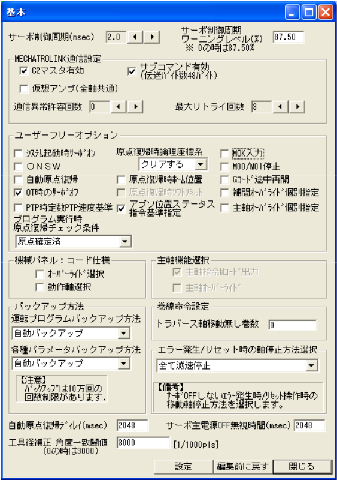

> **図の内容**
>
> 「基本」画面。サーボ制御周期(msec) 2.0、サーボ制御周期ワーニングレベル(%) 87.50（※ 0の時は87.50%）、MECHATROLINK通信設定（C2マスタ有効、サブコマンド有効（伝送バイト数48バイト）、仮想アンプ（全局共通）、通信異常許容回数、最大リトライ回数）、ユーザーフリーオプション、機械パネル:コード仕様、主軸機能選択、バックアップ方法、巻線命令設定、エラー発生/リセット時の軸停止方法選択、自動原点復帰ディレイ(msec) 2048、サーボ主電源OFF無視時間(msec) 2048、工具径補正 角度一致閾値 3000 [1/1000pls]。ボタン: 設定、編集前に戻す、閉じる。
> ほかの細部の値は小さくて判読できず。

4-1-1 サーボ制御周期

※【】の数字はデフォルト値

① サーボ制御周期(msec) 【2】

MECHATROLINKの伝送周期を設定します。

伝送周期（制御周期）とスレーブ局数（軸数）との関係

| 伝送   |   伝送周期(制御周期) |   伝送周期(制御周期) |   伝送周期(制御周期) |   伝送周期(制御周期) |   伝送周期(制御周期) |   伝送周期(制御周期) | 伝送周期(制御周期)   |
|------|--------------|--------------|--------------|--------------|--------------|--------------|--------------|
| バイト数 |          0.5 |          1.0 |          1.5 |          2.0 |          3.0 |          4.0 | ms           |
| 48   |            3 |            8 |           12 |           16 |           24 |           32 | 軸            |

- ※ 伝送バイト数は「基本」画面で設定します。
- ※ C2マスタ無効時は利用可能局数が１つ増えます。（C2マスタ有効/無効は「基本」画面で設定します）
- ※ 余った局数はMECHATROLINKⅢの通信リトライに使用します。(最大７局)
- ※ 上記は、あくまで目安です。タスク数・オプション選択などで軸数の上限は変わります。

② サーボ制御周期ワーニングレベル(%) 【87.5】

サーボ制御周期毎に実行するソフト処理時間が、設定された「サーボ制御周期」の一定時間比率を超えたときに、ソフト処理が間に合わなくなりそうだという警告を出します。このときの時間比率を任意に設定することができます。

何も設定しないとき(デフォルト)または"0"を設定したときは87.5%の設定になります。

#### 4-1-2 MECHATROLINK通信設定

- ① C2マスタ有効【有効】 C2マスタ(SigmaWin+のMECHATROLINKⅢI/F等)を使えるようにします。

② サブコマンド有効(伝送バイト数48バイト)【有効】

MECHATROLINKⅢのサブコマンドの有効/無効を選択します。

サブコマンド有効:MECHATROLINKⅢの伝送バイト数48バイト仕様です。サブコマンド無効:MECHATROLINKⅢの伝送バイト数32バイト仕様です。

本設定はサーボアンプの設定と合わせる必要があります。

(Σサーボの場合 S3:bit1=OFF,bit2=ON)

※ 現状ではサブコマンドは使用していませんが、Σサーボの出荷時設定が48バイトです。

③ 仮想アンプ機能(全軸共通)

このチェックを有効にすると全ての軸をMECHATROLINK接続なしに、仮想的に軸の動作が可能です。

PLMC-M3Ex単体(サーボ無し)とラダー/PCソフトとのデバッグができます。

各軸毎に設定する場合は、このチェックを外し、「軸設定」画面で各軸毎に設定して下さい。

このチェックを有効にすると、「軸設定」画面での設定は無視し、全軸仮想アンプとなります。

④ 通信異常許容回数【0】

連続して許容回数より多い回数の通信エラーが発生するまで、エラーを無視します。

⑤ 最大リトライ回数【3】

通信エラーが発生したとき同一通信をリトライします。最大リトライ回数以上エラーが続くと通信異常とします。

4-1-3 ユーザーフリーオプション

※ 無償オプションです。

使用する機能を選択します。

システム起動時サーボオン PLMC-M3Exの電源ONから128msec後に自動的にサーボオンさせます。

- ON SW(オンスイッチ)

ONSW有効の場合は、ONSW入力=ONでサーボオンさせます。

- 自動原点復帰
- OT時のサーボオフ

本機能は入力信号"ONSW"を使用します。この信号を入力ピンに割り当てて下さい。

詳細は、"4-1-12サーボON動作の補足説明"や「PLMC-M3Exユーザーズマニュアル」<Ⅲ 機能編 2-1-1.一般入力>(TB00-0980D)を参照して下さい。

システム起動時サーボオン、又はONSW機能でサーボオン時に自動的に全軸原点復帰を行います。

OTエラー時に、自動的にサーボオフします。 OT時の動作については、「PLMC-M3Exユーザーズマニュアル」

<Ⅲ 機能編 5-14.ストロークリミット>(TB00-0980E)を参照して下さい。

PTP時定数PTP速度基準チェック無し:100kppsに到達するまでの時間チェック有り:PTP速度に到達するまでの時間詳細は「PLMC-M3Exユーザーズマニュアル」 <Ⅳ 試運転・調整編 4-1送り速度、加減速などのパラメータ> (TB00-0980H)を参照ください。

原点復帰時ホーム位置全軸/各軸自動原点復帰完了後にセッティングPCのサーボパラメータで設定したホームポジション距離に自動的に位置決めします。

原点復帰時ソフトリミット全軸原点復帰時に、ソフトリミットチェックを有効にします。

[開発中]

- アブソ位置ステータス指令セッティングPCのアブソ位置表示を「指令した位置」で行います。基準指定チェック無しの場合は、「エンコーダFB位置」で表示します。又、ステータスデータ読み出し（通信コマンド）により取得するSTATUS データのアブソ位置（STATUS.ax[n].AbsReg）も本設定で変わります。
- MOK入力
- M00/M01停止

Mコードシーケンス実行にて、MFIN入力ON時にMOK入力をチェックします。

MFIN入力ON時、MOK入力OFFの場合、Mコード実行エラーとしてプログラムを強制停止します。

本機能は入力信号"MOK"を使用します。この信号を入力ピンに割り当てて下さい。

M00/M01停止機能を有効にします。

- Gコード途中再開

M00指令時･･･プログラム実行を停止します。

M01指令時･･･オプショナルスットプ入力(T□MOPT)ONの時プログラム実行停止します。

M00/M01共にMコード出力は行いません。

M01停止を行う場合は、"T□MOPT"を使用します。この信号を入力ピンに割り当てて下さい。

Gコードプログラム途中再開機能を有効にします。

本機能を有効にすると、Gコードプログラムの実行をリセットやアラームで中断した後の再開時、最後に実行したシーケンス番号から実行を再開します。

ただし、電源断した後は最初から実行します。

補間オーバライド個別指定補間指令のみに反映される補間オーバライドを有効にします。本機能が無効の時は、通常のオーバライドが補間指令に反映されます。

主軸オーバライド個別指定 S指令、SPIN命令のみに反映される主軸オーバライドを有効にします。本機能が無効の時は、通常のオーバライドがS指令/SPIN命令に反映されます。

この設定によらず、"4-1-6 の主軸オーバライドがオフの場合は、主軸回転に対しオーバライドは反映されません。

原点復帰チェック条件自動運転開始時の原点復帰状態の条件

チェック無し(V120A互換)

原点復帰の状態に関係なく自動運転を実行できます。

原点確定済

原点が確定していれば自動運転を実行できます。

原点復帰済

原点復帰動作を終了しないと自動運転を実行できません。

① 原点復帰時論理座標系【クリアする】

全軸/各軸自動原点復帰完了時の論理座標系の設定方法。

クリアする : 機械原点を論理原点とします。

クリアしない : 原点復帰前の機械原点～論理原点のオフセットを保持します。

座標設定する : 機械原点～論理原点のオフセットをセッティングPCのサーボパラメータで設定した "原点復帰時論理座標"で設定します。

② プログラム実行時原点復帰チェック条件【原点確定済】

自動運転開始時の原点復帰状態の条件

チェック無し: 原点復帰の状態に関係なく自動運転を実行できます。

原点確定済 : 原点が確定していれば自動運転を実行できます。

原点復帰済 : 原点復帰動作を終了しないと自動運転を実行できません。

#### 4-1-4 機械パネル:コード仕様

使用する機能を選択します。

オーバライド選択チェック無し: ８点の入力信号に対し25%間隔で25%～200%の選択ができます。

チェック有り: ８ビットのコード化信号で1%単位で選択することができます。

- 動作軸選択

チェック無し: 4点の入力信号でＸ軸からＡ軸までを信号対応で選択できます。

チェック有り: 4ビットのコード化信号でＸ軸からＴ軸までの選択ができます。

詳細は「PLMC-M3Ex ユーザーズマニュアル」<Ⅲ機能編 2-1-5 機械操作パネル> (TB00-0980D)を参照ください。

#### 4-1-5 バックアップ方法

① 運転プログラムバックアップ方法【自動バックアップ】

■自動バックアップ

運転プログラムを自動的にバックアップします。

運転プログラム書き込み、運転プログラムの移動・コピー・削除時にバックアップを行います。一度、運転プログラムを書き込めば、電源投入毎に書き込む必要はありません。

■手動バックアップ

運転プログラムの自動バックアップは行いません。

バックアップする場合は、セッティングPCの"バックアップデータ初期化"画面内、 "運転プログラムバックアップ"を押して、手動で運転プログラムをバックアップして下さい。 (動作要求コマンドの"FLASHROM反映コマンド"でも、バックアップします。) バックアップしない場合は、電源投入毎に必要に応じて書き込む必要が有ります。

■バックアップ無し

運転プログラムをバックアップしません。

電源投入毎に必要に応じて書き込む必要が有ります。

- (注意) PLMC-M3Exの運転プログラムのバックアップは、FLASHROMに書込みます。

FLAHSROMには、10万回の書き込み制限があります。

例 50回(1日あたり)×200日×10年=100000回

■バックアップ方式の比較(ご参考)

| 方式        | メリット                                                  | デメリット                                                                        |
|-----------|-------------------------------------------------------|------------------------------------------------------------------------------|
| 自動バックアップ | 電源投入毎に運転プログラムを書き込む必要が無い。                             | 運転プログラムの書込み※1の実行時間が長くなる。バックアップ処理時、他タスクへの影響(動作がもたつく等)が発生する場合がある。10万回の回数制限。 |
| 手動バックアップ | 運転プログラムの書込み※1の実行時間が短い。必要なときに、バックアップが可能。回数制限に到達しにくい。 | バックアップしていない運転プログラムは、再起動後、実行前に再書き込みが必要。                                     |
| バックアップなし | 運転プログラムの書込み※1の実行時間が短い。回数制限の問題無し。                     | 毎起動後、運転プログラム実行前に再書き込みが必要。                                                   |

※1 運転プログラムの書込み:移動・コピー・削除なども含みます。

② 各種パラメータバックアップ方式【自動バックアップ】

- ■自動バックアップ

パラメータを自動的にバックアップします。

パラメータ書き込み、パラメータのコピー・削除時にバックアップを行います。

一度、パラメータ書き込めば、電源投入毎に書き込む必要はありません。

- ■新規バックアップ無し

自動的なバックアップは行いません。保存が必要なときはファイルに保存の操作で保存してください。

#### 4-1-6 主軸機能選択 <オプション>

使用する機能を選択

します。

主軸指令Mコード出力主軸回転指令(M03～M05)が指令されたときにMコードを出力します。

主軸オーバライド

主軸回転指令に対してオーバライドが反映されます。

#### 4-1-7巻線命令設定

本設定は巻線オプションが設定されているときのみ有効になります。

「トラバース軸移動無し巻数」は巻き終わり処理指定がされているとき、残り巻数と移動有り／無しを指定するパラメータです。

※ 巻線機能の詳細は「TB00-0936巻線仕様書」を参照してください。

#### 4-1-8 エラー発生/リセット時の軸停止方法選択

エラー発生時及びリセット時は移動中の全軸を停止しますが、停止のやり方の選択ができます。

- ■補間命令は減速停止、それ以外は即停止

補間軸に関しては軌跡ずれが少なくなるように考慮し、独立で動いている軸は即時に停止します。

- ■全て減速停止

衝撃が少ないように全ての動作軸を減速して停止します。

- ■全て即停止

できるだけ早く停止するため全軸即時停止します。

#### 4-1-9 自動原点復帰ディレイ(msec) 【2048】

"4-1-3ユーザーフリーオプション"の「自動原点復帰」有効時は、サーボオンのあと、さらにこの時間後

に全軸原点復帰を開始します。

#### 4-1-10 工具径補正角度一致閾値 (1/1000pls) 【3000】

角度一致閾値を1/1000パルス単位で設定します。(1000で1パルスです。)

- ※ 工具径補正では、補正後の軌跡を求めるために、径補正後の交点を使用します。円弧指令を使用していると、交点が2つ出来てしまうため、使用する交点を判別する必要が

あります。この際、演算誤差による誤判別を避けるため、角度一致の閾値を設定できるようにしています。デフォルト値(0:3000)で交点を誤判別するようでしたら調整してください。

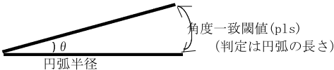

> **図の内容**
>
> 2 本の直線のなす角 θ と「円弧半径」。開きの大きさが「角度一致閾値(pls)（判定は円弧の長さ）」。

円弧半径と角度一致閾値(pls)から角度θを求め、θを交点判別時の許容誤差にします。

尚、主な演算誤差の原因は以下の通りです。

- 運転プログラム作成時の離散誤差(パルス単位で指令するための切り捨て/切り上げ)
- 浮動小数点演算による演算誤差

#### 4-1-11 サーボ主電源OFF無視時間【2048】

サーボOFFが発生しても、移動中軸でなければこの時間はエラー発生としない。特にシステム立ち上がり時、サーボが立ち上がるまでの余裕をみて設定してください。

#### 4-1-12 サーボON動作の補足説明

サーボON動作は以下の通りです。

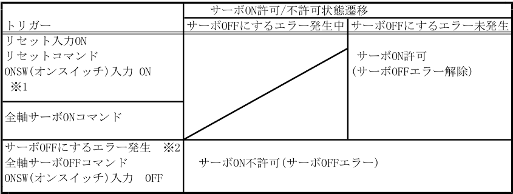

> **図の内容**
>
> 見出しは「サーボON許可/不許可状態遷移」。
>
> | トリガー | サーボOFFにするエラー発生中 | サーボOFFにするエラー未発生 |
> |---|---|---|
> | リセット入力ON、リセットコマンド、ONSW(オンスイッチ)入力 ON ※1 | （斜線） | サーボON許可（サーボOFFエラー解除） |
> | 全軸サーボONコマンド | （斜線） | （上の行と同じ欄） |
> | サーボOFFにするエラー発生 ※2、全軸サーボOFFコマンド、ONSW(オンスイッチ)入力 OFF | サーボON不許可（サーボOFFエラー） | サーボON不許可（サーボOFFエラー） |

| 状態      | SVM信号状態   | 各軸サーボON信号状態 - 各軸サーボON指定 ※3   | 各軸サーボON信号状態 - 各軸サーボOFF指定 ※3   |
|----------|-----------|------------------------------|-------------------------------|
| サーボON許可  | ON        | ON                           | OFF                           |
| サーボON不許可 | OFF       | OFF                          | OFF                           |

※1 エラー解除含む

- ※2 サーボOFFにするエラーはROMSWによって変わります。 (非常停止、サーボアラーム、偏差過大、±OT)
- ※3 セッティングPCソフト軸設定画面、または各軸サーボON/OFFコマンドで変更します。

### 4-2.入力信号の設定

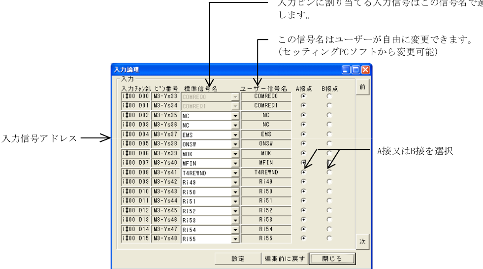

> **図の内容**
>
> 「入力論理」画面。矢印の説明:
> - 「入力信号アドレス」（左の列）
> - 「入力ピンに割り当てる入力信号はこの信号名で選択します。」（標準信号名の欄）
> - 「この信号名はユーザーが自由に変更できます。（セッティングPCソフトから変更可能）」（ユーザー信号名の欄）
> - 「A接又はB接を選択」（右の列）
> 表示されている信号の例: COMREQ0、COMREQ1、NC、NC、EMS、ONSW、MOK、MFIN、T0REWND、Ri49～Ri55 など。細部は小さくて判読できず。

各入力ピンへの入力信号の割当てと論理(A接/B接)を各々設定できます。

A接 (正論理)

割り当てたリレー/データレジスタのビットが"1"でアクティブ(ON)になります。

B接 (負論理:論理を反転します)

割り当てたリレー/データレジスタのビットが"0"でアクティブ(ON)になります。一般に非常停止等の信号は、B接にします。(フェイルセーフのため)

※ 入力信号の詳細については

「PLMC-M3Exユーザーズマニュアル」<Ⅲ 機能編 2-1.入力信号の名称と機能> (TB00-0980D) を参照して下さい。

#### 4-2-1入力信号(PLMC-M3Ex)のアドレス/bit/名称

以降の表では、入力画面等で使用するアドレス/ビットと、FA-M3Rの出力リレー/拡張出力の対応を表しています。

「接点アドレス」の(Ysss□□)と記述されている部分が、FA-M3Rのリレーに割り当てられています。

sssはPLMC-M3Exが装着されているFA-M3Rのスロット番号を表しています。

<例> アドレスY00237(信号名:Y_MC_EMS)の場合

Y00237の「002」の部分がPLMC-M3Exが装着されているスロット番号になります。

この場合2スロット目にPLMC-M3Exが装着されています。

FA-M3Rの出力リレーと拡張出力については、ユーザーズマニュアルの以下を参照して下さい。「PLMC-M3Exユーザーズマニュアル」<Ⅲ 機能編 >

- <2-1.入力信号の名称と機能>
- (TB00-0980D)
- <4-2.入出力リレー> (TB00-0980E)
- <4-3.特殊モジュールレジスタ> (TB00-0980E)

以降の表は、デフォルト(出荷時)の入力チャンネル割り当てです。ユーザ信号名は、セッティングPCで変更可能です。

入力信号チャンネル(デフォルト設定)

| アドレス          | bit   | 接点アドレス    |        | 標準信号名   | 入力論理   | 補足       |
|----------------|-------|-----------|--------|---------|--------|----------|
| 全タスク共通 I#0000 | D00   | FA-M3R 出力 | Ysss33 | COMREQ0 | A      | 通信専用     |
| 全タスク共通 I#0000 | D01   | FA-M3R 出力 | Ysss34 | COMREQ1 | A      | 通信専用     |
| 全タスク共通 I#0000 | D02   | FA-M3R 出力 | Ysss35 | NC      | A      |          |
| 全タスク共通 I#0000 | D03   | FA-M3R 出力 | Ysss36 | NC      | A      |          |
| 全タスク共通 I#0000 | D04   | FA-M3R 出力 | Ysss37 | EMS     | A      | 非常停止     |
| 全タスク共通 I#0000 | D05   | FA-M3R 出力 | Ysss38 | ONSW    | A      | オンスイッチ   |
| 全タスク共通 I#0000 | D06   | FA-M3R 出力 | Ysss39 | MOK     | A      | Mコード正常終了 |
| 全タスク共通 I#0000 | D07   | FA-M3R 出力 | Ysss40 | MFIN    | A      | Mコード読込完了 |
| 全タスク共通 I#0000 | D08   | FA-M3R 出力 | Ysss41 | Ri48    | A      | 汎用入力     |
| 全タスク共通 I#0000 | D09   | リレー       | Ysss42 | Ri49    | A      | 〃        |
| 全タスク共通 I#0000 | D10   | FA-M3R 出力 | Ysss43 | Ri50    | A      | 〃        |
| 全タスク共通 I#0000 | D11   | FA-M3R 出力 | Ysss44 | Ri51    | A      | 〃        |
| 全タスク共通 I#0000 | D12   | FA-M3R 出力 | Ysss45 | Ri52    | A      | 〃        |
| 全タスク共通 I#0000 | D13   | FA-M3R 出力 | Ysss46 | Ri53    | A      | 〃        |
| 全タスク共通 I#0000 | D14   | FA-M3R 出力 | Ysss47 | Ri54    | A      | 〃        |
| 全タスク共通 I#0000 | D15   | FA-M3R 出力 | Ysss48 | Ri55    | A      | 〃        |
| 全タスク共通 I#0001 | D00   | FA-M3R 出力 | Ysss49 | Ri00    | A      | 汎用入力     |
| 全タスク共通 I#0001 | D01   | FA-M3R 出力 | Ysss50 | Ri01    | A      | 〃        |
| 全タスク共通 I#0001 | D02   | FA-M3R 出力 | Ysss51 | Ri02    | A      | 〃        |
| 全タスク共通 I#0001 | D03   | FA-M3R 出力 | Ysss52 | Ri03    | A      | 〃        |
| 全タスク共通 I#0001 | D04   | FA-M3R 出力 | Ysss53 | Ri04    | A      | 〃        |
| 全タスク共通 I#0001 | D05   | FA-M3R 出力 | Ysss54 | Ri05    | A      | 〃        |
| 全タスク共通 I#0001 | D06   | FA-M3R 出力 | Ysss55 | Ri06    | A      | 〃        |
| 全タスク共通 I#0001 | D07   | FA-M3R 出力 | Ysss56 | Ri07    | A      | 〃        |
| 全タスク共通 I#0001 | D08   | FA-M3R 出力 | Ysss57 | Ri08    | A      | 〃        |
| 全タスク共通 I#0001 | D09   | リレー       | Ysss58 | Ri09    | A      | 〃        |
| 全タスク共通 I#0001 | D10   | FA-M3R 出力 | Ysss59 | Ri10    | A      | 〃        |
| 全タスク共通 I#0001 | D11   | FA-M3R 出力 | Ysss60 | Ri11    | A      | 〃        |
| 全タスク共通 I#0001 | D12   | FA-M3R 出力 | Ysss61 | Ri12    | A      | 〃        |
| 全タスク共通 I#0001 | D13   | FA-M3R 出力 | Ysss62 | Ri13    | A      | 〃        |
| 全タスク共通 I#0001 | D14   | FA-M3R 出力 | Ysss63 | Ri14    | A      | 〃        |
| 全タスク共通 I#0001 | D15   | FA-M3R 出力 | Ysss64 | Ri15    | A      | 〃        |

| アドレス          | bit   | 接点アドレス       | 標準信号名        | 入力論理   | 補足           |
|----------------|-------|--------------|--------------|--------|--------------|
| 全タス            | D00   | FA-M3R       | Ri16         | A      | 汎用入力         |
| ク共通            | D01   |              | Ri17         | A      | 〃            |
| ク共通            | D02   |              | Ri18         | A      | 〃            |
| ク共通            | D03   | 拡張           | Ri19         | A      | 〃            |
| ク共通            | D04   | 出力           | Ri20         | A      | 〃            |
| ク共通            | D05   |              | Ri21         | A      | 〃            |
| ク共通            | D06   |              | Ri22         | A      | 〃            |
| I#0002         | D07   | FA-M3R SRY00 | Ri23         | A      | 〃            |
| I#0002         | D08   | 出力           | Ri24         | A      | 〃            |
| I#0002         | D09   | リレー          | Ri25         | A      | 〃            |
| I#0002         | D10   |              | Ri26         | A      | 〃            |
| I#0002         | D11   |              | Ri27         | A      | 〃            |
| I#0002         | D12   |              | Ri28         | A      | 〃            |
| I#0002         | D13   |              | Ri29         | A      | 〃            |
| I#0002         | D14   |              | Ri30         | A      | 〃            |
| I#0002         | D15   |              | Ri31         | A      | 〃            |
| 全タスク共通 I#0003 | D00   |              | Ri32         | A      | 汎用入力         |
|                | D01   | FA-M3R       | Ri33         | A      | 〃            |
|                | D02   |              | Ri34         | A      | 〃            |
|                | D03   | 拡張           | Ri35         | A      | 〃            |
|                | D04   | 出力           | Ri36         | A      | 〃            |
|                | D05   |              | Ri37         | A      | 〃            |
|                | D06   |              | Ri38         | A      | 〃            |
|                | D07   | FA-M3R SRY01 | Ri39         | A      | 〃            |
|                | D08   | 出力           | Ri40         | A      | 〃            |
|                | D09   | リレー          | Ri41         | A      | 〃            |
|                | D10   |              | Ri42         | A      | 〃            |
|                | D11   |              | Ri43         | A      | 〃            |
|                | D12   |              | Ri44         | A      | 〃            |
|                | D13   |              | Ri45         | A      | 〃            |
|                | D14   |              | Ri46         | A      | 〃            |
|                | D15   |              | Ri47         | A      | 〃            |
| タスク毎          | D00   |              | TxRESET      | A      | リセット         |
| タスク毎          | D01   | FA-M3R 拡張出力 | TxSTOP       | A      | 停止           |
| タスク毎          | D02   |              | TxSTART      | A      | 起動           |
| タスク毎          | D03   |              | TxEXTALMB    | A      | 外部アラーム       |
| タスク毎          | D04   |              | TxCRCLR      | A      | 原点設定         |
| タスク毎          | D05   | FA-M3R       | TxMOPT       | A      | オプショナルストップ   |
| タスク毎          | D06   | 特殊           | TxMP_ENABLE  | A      | MP:機械パネル有効   |
| I#0004         | D07   | レジスタ SRY02   | TxMP_MDSET   | A      | MP:セッティングモード |
| I#0008         | D08   | SRY06        | TxMP_MDAUTO  | A      | MP:自動運転モード   |
| I#0012         | D09   | SRY10        | TxMP_MDDNC   | A      | MP:DNC運転モード  |
| I#0016         | D10   | SRY14        | TxMP_MDSNGL  | A      | MP:シングルステップ  |
| I#0020         | D11   | SRY18        | TxMP_MDZRN   | A      | MP:原点復帰モード   |
| I#0024         | D12   | SRY22        | TxMP_MDJOG   | A      | MP:JOGモード    |
| I#0028         | D13   | SRY26        | TxMP_MDINCH  | A      | MP:インチングモード  |
| I#0032         | D14   | SRY30        | TxMP_MDHNDL  | A      | MP:手パモード     |
|                | D15   |              | TxMP_MDOTDIS | A      | MP:OT無視モード   |

| アドレス                      | bit     | 接点アドレス                                                   |              | 標準信号名       | 入力論理   | 補足              |
|----------------------------|---------|----------------------------------------------------------|--------------|-------------|--------|-----------------|
| タスク毎                      | D00     | 拡張出力 FA-M3R                                             | FA-M3R       | TxMP_INCH0  | A      | MP:手パ/インチング倍率選択 |
| タスク毎                      | D01     | 拡張出力 FA-M3R                                             | FA-M3R       | TxMP_INCH1  | A      | 〃               |
| タスク毎                      | D02     | 拡張出力 FA-M3R                                             | FA-M3R       | TxMP_INCH2  | A      | 〃               |
| タスク毎                      | D03     | 拡張出力 FA-M3R                                             | FA-M3R       | TxMP_INCH3  | A      | 〃               |
| タスク毎                      | D04     | 拡張出力 FA-M3R                                             | FA-M3R       | TxMP_HSEL0  | A      | MP:手パ軸選択        |
| タスク毎                      | D05     | 拡張出力 FA-M3R                                             | FA-M3R       | TxMP_HSEL1  | A      | 〃               |
| タスク毎                      | D06     | 特殊                                                       | FA-M3R       | TxMP_HSEL2  | A      | 〃               |
| タスク毎                      | D07     | レジスタ SRY03                                               | FA-M3R       | TxMP_HSEL3  | A      | 〃               |
| I#0005 I#0009              | D08     | SRY07                                                    | FA-M3R       | TxMP_AXSEL0 | A      | MP:JOG/インチング軸選択 |
| I#0013                     | D09     | SRY11                                                    | FA-M3R       | TxMP_AXSEL1 | A      | 〃               |
| I#0017                     | D10     | SRY15                                                    | FA-M3R       | TxMP_AXSEL2 | A      | 〃               |
| I#0021                     | D11     | SRY19                                                    | FA-M3R       | TxMP_AXSEL3 | A      | 〃               |
| I#0025                     | D12     | SRY23                                                    | FA-M3R       | TxMP_AXSEL4 | A      | 〃               |
| I#0029                     | D13     | SRY27                                                    | FA-M3R       | TxMP_AXSEL5 | A      | 〃               |
| I#0033                     | D14     | SRY31                                                    | FA-M3R       | TxMP_AXSEL6 | A      | 〃               |
| I#0033                     | D15     | 拡張出力 FA-M3R                                             | FA-M3R       | TxMP_AXSEL7 | A      | 〃               |
| タスク毎 I#0006 I#0010 I#0014 | D00     | FA-M3R 特殊レジスタ SRY08 SRY12 SRY16 SRY20 SRY24 SRY28 SRY32 | FA-M3R 拡張出力 | TxMP_OVR0   | A      | MP:全体オーバーライド    |
| タスク毎 I#0006 I#0010 I#0014 | D01     | FA-M3R 特殊レジスタ SRY08 SRY12 SRY16 SRY20 SRY24 SRY28 SRY32 | FA-M3R 拡張出力 | TxMP_OVR1   | A      | 〃               |
| タスク毎 I#0006 I#0010 I#0014 | D02     | FA-M3R 特殊レジスタ SRY08 SRY12 SRY16 SRY20 SRY24 SRY28 SRY32 | FA-M3R 拡張出力 | TxMP_OVR2   | A      | 〃               |
| タスク毎 I#0006 I#0010 I#0014 | D03     | FA-M3R 特殊レジスタ SRY08 SRY12 SRY16 SRY20 SRY24 SRY28 SRY32 | FA-M3R 拡張出力 | TxMP_OVR3   | A      | 〃               |
| タスク毎 I#0006 I#0010 I#0014 | D04     | FA-M3R 特殊レジスタ SRY08 SRY12 SRY16 SRY20 SRY24 SRY28 SRY32 | FA-M3R 拡張出力 | TxMP_OVR4   | A      | 〃               |
| タスク毎 I#0006 I#0010 I#0014 | D05     | FA-M3R 特殊レジスタ SRY08 SRY12 SRY16 SRY20 SRY24 SRY28 SRY32 | FA-M3R 拡張出力 | TxMP_OVR5   | A      | 〃               |
| タスク毎 I#0006 I#0010 I#0014 | D06     | FA-M3R 特殊レジスタ SRY08 SRY12 SRY16 SRY20 SRY24 SRY28 SRY32 | FA-M3R 拡張出力 | TxMP_OVR6   | A      | 〃               |
|                            | D07     | FA-M3R 特殊レジスタ SRY08 SRY12 SRY16 SRY20 SRY24 SRY28 SRY32 | SRY04        | TxMP_OVR7   | A      | 〃               |
|                            | D08     | FA-M3R 特殊レジスタ SRY08 SRY12 SRY16 SRY20 SRY24 SRY28 SRY32 | SRY04        | TxMP_COVR0  | A      | MP:補間オーバーライド    |
|                            | D09     | FA-M3R 特殊レジスタ SRY08 SRY12 SRY16 SRY20 SRY24 SRY28 SRY32 | SRY04        | TxMP_COVR1  | A      | 〃               |
| I#0018                     | D10     | FA-M3R 特殊レジスタ SRY08 SRY12 SRY16 SRY20 SRY24 SRY28 SRY32 | SRY04        | TxMP_COVR2  | A      | 〃               |
| I#0022                     | D11     | FA-M3R 特殊レジスタ SRY08 SRY12 SRY16 SRY20 SRY24 SRY28 SRY32 | SRY04        | TxMP_COVR3  | A      | 〃               |
| I#0026                     | D12     | FA-M3R 特殊レジスタ SRY08 SRY12 SRY16 SRY20 SRY24 SRY28 SRY32 | SRY04        | TxMP_COVR4  | A      | 〃               |
| I#0030                     | D13     | FA-M3R 特殊レジスタ SRY08 SRY12 SRY16 SRY20 SRY24 SRY28 SRY32 | SRY04        | TxMP_COVR5  | A      | 〃               |
| I#0034                     | D14     | FA-M3R 特殊レジスタ SRY08 SRY12 SRY16 SRY20 SRY24 SRY28 SRY32 | SRY04        | TxMP_COVR6  | A      | 〃               |
| I#0034                     | D15     | FA-M3R 特殊レジスタ SRY08 SRY12 SRY16 SRY20 SRY24 SRY28 SRY32 | SRY04        | TxMP_COVR7  | A      | 〃               |
| タスク毎                      | D00     | FA-M3R 特殊レジスタ SRY05 SRY09                               | FA-M3R 拡張出力 | TxMP_PSEL00 | A      | MP:実行プログラム番号    |
| タスク毎                      | D01     | FA-M3R 特殊レジスタ SRY05 SRY09                               | FA-M3R 拡張出力 | TxMP_PSEL01 | A      | 〃               |
| タスク毎                      | D02     | FA-M3R 特殊レジスタ SRY05 SRY09                               | FA-M3R 拡張出力 | TxMP_PSEL02 | A      | 〃               |
| タスク毎                      | D03     | FA-M3R 特殊レジスタ SRY05 SRY09                               | FA-M3R 拡張出力 | TxMP_PSEL03 | A      | 〃               |
| タスク毎                      | D04     | FA-M3R 特殊レジスタ SRY05 SRY09                               | FA-M3R 拡張出力 | TxMP_PSEL04 | A      | 〃               |
| タスク毎                      | D05     | FA-M3R 特殊レジスタ SRY05 SRY09                               | FA-M3R 拡張出力 | TxMP_PSEL05 | A      | 〃               |
| タスク毎                      | D06     | FA-M3R 特殊レジスタ SRY05 SRY09                               | FA-M3R 拡張出力 | TxMP_PSEL06 | A      | 〃               |
| I#0007                     | D07     | FA-M3R 特殊レジスタ SRY05 SRY09                               | FA-M3R 拡張出力 | TxMP_PSEL07 | A      | 〃               |
| I#0011                     | D08     | FA-M3R 特殊レジスタ SRY05 SRY09                               | FA-M3R 拡張出力 | TxMP_PSEL08 | A      | 〃               |
| I#0015                     | D09     | SRY13                                                    | FA-M3R 拡張出力 | TxMP_PSEL09 | A      | 〃               |
| I#0019                     | D10     | SRY17                                                    | FA-M3R 拡張出力 | TxMP_PSEL10 | A      | 〃               |
| I#0023                     | D11     | SRY21                                                    | FA-M3R 拡張出力 | TxMP_PSEL11 | A      | 〃               |
| I#0027                     | D12     | SRY25                                                    | FA-M3R 拡張出力 | TxMP_PSEL12 | A      | 〃               |
| I#0031                     | D13     | SRY29                                                    | FA-M3R 拡張出力 | TxMP_PSEL13 | A      | 〃               |
| I#0035                     | D14 D15 | SRY33                                                    | FA-M3R 拡張出力 | TxMP_PSEL14 | A      | 〃               |
|                            |         | FA-M3R 特殊レジスタ SRY05 SRY09                               | FA-M3R 拡張出力 | TxMP_PSEL15 | A      | 〃               |

入力論理 A = そのbitが "1" でアクティブ(正論理)

B = そのbitが "0" でアクティブ(負論理)

FA-M3R拡張出力SR□については、「PLMC-M3Exユーザーズマニュアル」 <Ⅲ 機能編 4-3.特殊モジュールレジスタ> (TB00-0980E)を参照して下さい。

### 4-3.出力信号の設定

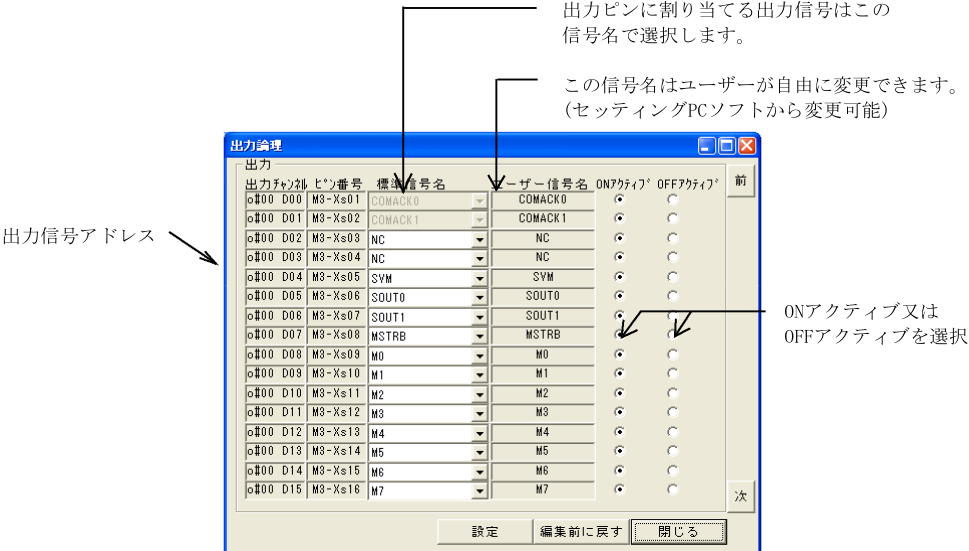

> **図の内容**
>
> 「出力論理」画面。矢印の説明:
> - 「出力信号アドレス」（左の列）
> - 「出力ピンに割り当てる出力信号はこの信号名で選択します。」（標準信号名の欄）
> - 「この信号名はユーザーが自由に変更できます。（セッティングPCソフトから変更可能）」（ユーザー信号名の欄）
> - 「ONアクティブ又はOFFアクティブを選択」（右の列）
> 表示されている信号の例: COMACK0、COMACK1、NC、NC、SVM、SOUT0、SOUT1、MSTRB、M0～M7。細部は小さくて判読できず。

各出力ピンへの出力信号の割当てと論理(ONアクティブ/OFFアクティブ)を設定できます。また、電源投入時/CPUリセット時は、出力OFFになります。

ONアクティブ (正論理)

信号がアクティブ(ON)で、割り当てたリレー/データレジスタのビットが"1"になります。

OFFアクティブ (負論理:論理を反転します)

信号がアクティブ(ON)で、割り当てたリレー/データレジスタのビットが"0"になります。一般にALARM等の信号は、OFFアクティブにします。(フェイルセーフのため)

※ 出力信号の詳細については、「PLMC-M3Exユーザーズマニュアル」 <Ⅲ 機能編 2-2.出力信号の名称と機能> (TB00-0980D)を参照して下さい。

#### 4-3-1出力信号(PLMC-M3Ex)のアドレス/bit/名称(デフォルト設定)

以降の表では、出力画面等で使用するアドレス/ビットと、FA-M3Rの入力リレー/拡張入力の対応を表しています。

「接点アドレス」の(Xsss□□)と記述されている部分が、FA-M3Rのリレーに割り当てられています。 sssはPLMC-M3Exが装着されているFA-M3Rのスロット番号を表しています。

<例> アドレスX00205(信号名:X_MC_SVM)の場合

X00205の「002」の部分がPLMC-M3Exが装着されているスロット番号になります。

- この場合2スロット目にPLMC-M3Exが装着されています。

FA-M3Rの入力リレーと拡張入力については、以下を参照して下さい。

「PLMC-M3Exユーザーズマニュアル」<Ⅲ 機能編 >

- <2-2.出力信号の名称と機能>

(TB00-0980D)

- <4-2.入出力リレー> (TB00-0980E)
- <4-3.特殊モジュールレジスタ> (TB00-0980E)

以降の表は、デフォルト(出荷時)の入力チャンネル割り当てです。信号名は、セッティングPCで変更可能です。

| ｱﾄﾞﾚｽ          | bit   | 接点アドレス        |        | 標準信号名   | 出力論理   | 補足     |
|----------------|-------|---------------|--------|---------|--------|--------|
| 全タスク共通 O#0000 | D00   | FA-M3R 入力     | Xsss01 | COMACK0 | ON     | 通信制御   |
| 全タスク共通 O#0000 | D01   | FA-M3R 入力     | Xsss02 | COMACK1 | ON     |        |
| 全タスク共通 O#0000 | D02   | FA-M3R 入力     | Xsss03 | NC      | ON     |        |
| 全タスク共通 O#0000 | D03   | FA-M3R 入力     | Xsss04 | NC      | ON     |        |
| 全タスク共通 O#0000 | D04   | FA-M3R 入力     | Xsss05 | SVM     | ON     | サーボ主電源 |
| 全タスク共通 O#0000 | D05   | FA-M3R 入力     | Xsss06 | SOUT0   | ON     | 主軸出力0  |
| 全タスク共通 O#0000 | D06   | FA-M3R 入力     | Xsss07 | SOUT1   | ON     | 主軸出力1  |
| 全タスク共通 O#0000 | D07   | FA-M3R 入力     | Xsss08 | MSTRB   | ON     | MSTRB  |
| 全タスク共通 O#0000 | D08   | FA-M3R 入力     | Xsss09 | M0      | ON     | Mコード出力 |
| 全タスク共通 O#0000 | D09   | リレー           | Xsss10 | M1      | ON     | 〃      |
| 全タスク共通 O#0000 | D10   | FA-M3R 入力     | Xsss11 | M2      | ON     | 〃      |
| 全タスク共通 O#0000 | D11   | FA-M3R 入力     | Xsss12 | M3      | ON     | 〃      |
| 全タスク共通 O#0000 | D12   | FA-M3R 入力     | Xsss13 | M4      | ON     | 〃      |
| 全タスク共通 O#0000 | D13   | FA-M3R 入力     | Xsss14 | M5      | ON     | 〃      |
| 全タスク共通 O#0000 | D14   | FA-M3R 入力     | Xsss15 | M6      | ON     | 〃      |
| 全タスク共通 O#0000 | D15   | FA-M3R 入力     | Xsss16 | M7      | ON     | 〃      |
| 全タスク共通 O#0001 | D00   | FA-M3R 入力リレー | Xsss17 | Ro00    | ON     | 汎用出力   |
| 全タスク共通 O#0001 | D01   | FA-M3R 入力リレー | Xsss18 | Ro01    | ON     | 〃      |
| 全タスク共通 O#0001 | D02   | FA-M3R 入力リレー | Xsss19 | Ro02    | ON     | 〃      |
| 全タスク共通 O#0001 | D03   | FA-M3R 入力リレー | Xsss20 | Ro03    | ON     | 〃      |
| 全タスク共通 O#0001 | D04   | FA-M3R 入力リレー | Xsss21 | Ro04    | ON     | 〃      |
| 全タスク共通 O#0001 | D05   | FA-M3R 入力リレー | Xsss22 | Ro05    | ON     | 〃      |
| 全タスク共通 O#0001 | D06   | FA-M3R 入力リレー | Xsss23 | Ro06    | ON     | 〃      |
| 全タスク共通 O#0001 | D07   | FA-M3R 入力リレー | Xsss24 | Ro07    | ON     | 〃      |
| 全タスク共通 O#0001 | D08   | FA-M3R 入力リレー | Xsss25 | Ro08    | ON     | 〃      |
| 全タスク共通 O#0001 | D09   | FA-M3R 入力リレー | Xsss26 | Ro09    | ON     | 〃      |
| 全タスク共通 O#0001 | D10   | FA-M3R 入力リレー | Xsss27 | Ro10    | ON     | 〃      |
| 全タスク共通 O#0001 | D11   | FA-M3R 入力リレー | Xsss28 | Ro11    | ON     | 〃      |
| 全タスク共通 O#0001 | D12   | FA-M3R 入力リレー | Xsss29 | Ro12    | ON     | 〃      |
| 全タスク共通 O#0001 | D13   | FA-M3R 入力リレー | Xsss30 | Ro13    | ON     | 〃      |
| 全タスク共通 O#0001 | D14   | FA-M3R 入力リレー | Xsss31 | Ro14    | ON     | 〃      |
| 全タスク共通 O#0001 | D15   | FA-M3R 入力リレー | Xsss32 | Ro15    | ON     | 〃      |

出力論理 ON = そのbitが "1" でアクティブ(正論理) OFF = そのbitが "0" でアクティブ(負論理)

| アドレス   | bit   | 接点アドレス    | 接点アドレス       | 標準信号名   | 出力論理   | 補足        |
|---------|-------|-----------|--------------|---------|--------|-----------|
| 全タス     | D00   |           |              | Ro16    | ON     | 汎用出力      |
| ク共通     | D01   |           |              | Ro17    | ON     | 〃         |
| ク共通     | D02   |           | FA-M3R       | Ro18    | ON     | 〃         |
| ク共通     | D03   |           | 拡張           | Ro19    | ON     | 〃         |
| ク共通     | D04   |           | 入力           | Ro20    | ON     | 〃         |
| ク共通     | D05   |           |              | Ro21    | ON     | 〃         |
| ク共通     | D06   |           |              | Ro22    | ON     | 〃         |
| O#0002  | D07   | FA-M3R    | SRX0         | Ro23    | ON     | 〃         |
| O#0002  | D08   | 特殊        |              | Ro24    | ON     | 〃         |
| O#0002  | D09   | レジスタ      |              | Ro25    | ON     | 〃         |
| O#0002  | D10   |           |              | Ro26    | ON     | 〃         |
| O#0002  | D11   |           |              | Ro27    | ON     | 〃         |
| O#0002  | D12   |           |              | Ro28    | ON     | 〃         |
| O#0002  | D13   |           |              | Ro29    | ON     | 〃         |
| O#0002  | D14   |           |              | Ro30    | ON     | 〃         |
| O#0002  | D15   |           |              | Ro31    | ON     | 〃         |
| 全タスク共通 | D00   | FA-M3R 特殊 |              | Ro32    | ON     | 汎用出力      |
|         | D01   |           | FA-M3R       | Ro33    | ON     | 〃         |
|         | D02   |           |              | Ro34    | ON     | 〃         |
|         | D03   |           | 拡張           | Ro35    | ON     | 〃         |
|         | D04   |           | 入力           | Ro36    | ON     | 〃         |
|         | D05   |           |              | Ro37    | ON     | 〃         |
|         | D06   |           |              | Ro38    | ON     | 〃         |
| O#0003  | D07   |           | SRX1         | Ro39    | ON     | 〃         |
| O#0003  | D08   |           |              | Ro40    | ON     | 〃         |
| O#0003  | D09   | レジスタ      |              | Ro41    | ON     | 〃         |
| O#0003  | D10   |           |              | Ro42    | ON     | 〃         |
| O#0003  | D11   |           |              | Ro43    | ON     | 〃         |
| O#0003  | D12   |           |              | Ro44    | ON     | 〃         |
| O#0003  | D13   |           |              | Ro45    | ON     | 〃         |
| O#0003  | D14   |           |              | Ro46    | ON     | 〃         |
| O#0003  | D15   |           |              | Ro47    | ON     | 〃         |
| タスク毎   | D00   |           |              | TxREADY | ON     | READY     |
| タスク毎   | D01   | FA-M3R    | FA-M3R 拡張入力 | TxALARM | ON     | アラーム発生中   |
| タスク毎   | D02   | FA-M3R    |              | TxRUN   | ON     | 運転中       |
| タスク毎   | D03   | FA-M3R    |              | TxPAUSE | ON     | 途中停止中     |
| タスク毎   | D04   | FA-M3R    |              | TxINPOS | ON     | インポジション   |
| タスク毎   | D05   | FA-M3R    |              | TxPRDY  | ON     | P起動可      |
| タスク毎   | D06   | FA-M3R    |              | TxMZSTP | ON     | M00/01停止中 |
| O#0004  | D07   | FA-M3R    | SRX2         | TxMODE0 | ON     | 動作モード     |
| O#0005  | D08   | FA-M3R    | SRX3         | TxMODE1 | ON     | 〃         |
| O#0006  | D09   | 特殊レジスタ   | SRX4         | TxMODE2 | ON     | 〃         |
| O#0007  | D10   |           | SRX5         | NC      | ON     |           |
| O#0008  | D11   |           | SRX6         | NC      | ON     |           |
| O#0009  | D12   |           | SRX7         | NC      | ON     |           |
| O#0010  | D13   |           | SRX8         | NC      | ON     |           |
| O#0011  | D14   |           | SRX9         | NC      | ON     |           |
|         | D15   |           |              | NC      | ON     |           |

FA-M3R拡張入力SRX0～8については、

「PLMC-M3Exユーザーズマニュアル」<Ⅲ 機能編 4-3.特殊モジュールレジスタ>(TB00-0980E)を参照ください。

### 4-4. 軸設定パラメータ

使用する軸に対して、各々設定して下さい。

※ 以下、【】はデフォルト値です。

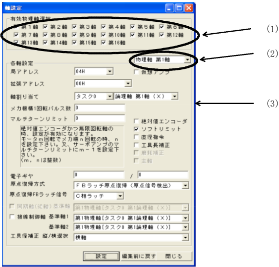

> **図の内容**
>
> 「軸設定」画面。(1) 有効物理軸選択（第1軸～第16軸のチェック。楕円で囲まれている）、(2) 物理軸の選択（物理軸 第1軸）、(3) 各軸設定（局アドレス、拡張アドレス、軸割り当て（タスク0 論理軸 第1軸(X)）、メカ機構1回転パルス数、マルチターンリミット、絶対値エンコーダ、ソフトリミット、電子ギヤ、原点復帰方式（FBラッチ+原点信号検出）、原点復帰ラッチ信号（C相ラッチ）、同期制御軸、接線制御軸、工具径補正 径/横選択など）。ボタン: 設定、編集前に戻す、閉じる。
> 値は小さくて判読できず。

- (1) 有効物理軸選択（第1軸～第16軸）使用する軸を選択してください。
- (2) 設定軸選択（物理軸第1軸～第16軸）

"(3)機能設定"をどの軸に対して行うか、このドロップダウンリストで選択します。

- (3) 機能設定(物理軸毎に指定)
2. ① 局アドレス【第1軸:03H、第2軸:04H ･･･第9軸:0BH】軸の局アドレスを設定します。本設定は各軸毎のサーボアンプの設定と合わせる必要があります。

(Σサーボの場合はロータリスイッチ SW1、SW2 で設定)

- ② 仮想アンプ【無効】

MECHATROLINK接続なしに仮想的に軸の動作が可能です。

「基本」画面の「仮想アンプ(全軸共通)」をチェックした場合は、このチェックによらず全ての軸が仮想アンプとして動作します。

- ③ 軸割り当てタスク0～7:その物理軸を使用するタスク

論理軸第1(X)～第9(T):タスク内の論理軸設定

- ④ メカ機構1回転パルス数【0】

無限回転をおこなう軸のみ設定します。この値で座標系をラウンドアップします。直動や有限回転をおこなう軸では、0を設定下さい。

- ⑤ マルチターンリミット【0】絶対値エンコーダかつ無限回転軸の時、設定が有効になります。モータm回転でメカ端 n 回転のとき、n を設定ください。又、Σサーボのマルチターン

リミットに m-1 を設定ください(m , n は整数)。

- ⑥ 絶対値エンコーダ無効【無効】

ΣサーボのアブソPGを使用する場合、有効にします。

Σサーボのパラメータと合わせる必要があります。

詳細は、「PLMC-M3Exユーザーズマニュアル」<Ⅲ 試運転・調整編 7-9-11.絶対値エンコーダ軸の設

定>(TB00-0980H)を参照して下さい。

- ⑦ ソフトリミット【有効】

ソフトリミット機能を有効にします。

⑧ 直径指令【無効】

有効:旋盤のワーク径方向をイメージして、指令値を直径として与えることができます。

動作プログラム内の数値だけが直径指令(実移動量の2倍)として扱われます。

ワンショットPTPやサーボパラメータは半径値(実移動量)として扱われます。

また、現在位置表示画面の指令位置は直径指令値として表示され。

アブソ位置、機械位置、偏差量は半径指令値として表示されます。

無効:通常軸です。

例:X軸を直径指令とし、動作プログラム中で下記の記述をした命令を実行した場合 PTP X100;

指令位置には100と表示され、アブソ位置、機械位置には50と表示されます。

偏差量も半径指令単位で表示します。(移動が無いときの偏差量50)

1ショット位置決めではPTPでも補間でも、X軸に100と命令したときは、指令位置には 200と表示され、アブソ位置、機械位置、(偏差量)には100と表示されます。

⑨ 工具長補正

工具長補正を有効にします。

複数の軸を有効にしないでください。同じ補正パラメータが、有効軸全てに反映されてしまいます。詳細は、「PLMC-M3Exユーザーズマニュアル」<Ⅲ 機能編 5-15-2.工具長補正及び摩耗補正機能> (TB00-0980E)を参照下さい。

⑩ 摩耗補正 <開発中>

- ⑪ 電子ギヤ【0/0】

移動指令値とサーボ系パルスの比率を変換することができます。どちらかの数値に"0"があるときは、 1:1となります。

- ⑫ 原点復帰方式【FBラッチ(原点信号検出)】

「FBラッチ原点復帰(原点信号検出)」,「FBラッチ原点復帰(原点信号検出なし)」,「DECサーチ」、「FBラッチ原点復帰(OT信号検出)」、「OTサーチ原点復帰」の選択。

詳細は「PLMC-M3Exユーザーズマニュアル」<Ⅳ 試運転・調整編 7-9 原点復帰> (T00-0980H)を参照ください。

⑬ FBラッチ信号【C相ラッチ】

C(Z)相ラッチ,EXT1,EXT2,EXT3の選択です。

(EXT1～EXT3の信号はΣサーボのPn511:1～3桁で設定します。)

⑭ 同期軸

チェックを入れると現在選択中の軸が同一指令2軸(同期軸)のスレーブ軸となります。基準軸:同機能のマスター軸を選択します。

各タスクで1組の同期軸(マスター/スレーブ)が設定可能です。

詳細は、「PLMC-M3Exユーザーズマニュアル」<Ⅲ 機能編 5-15-4.同一指令2軸制御>(TB00-0980E)を参照下さい。

⑮ 接線制御軸

チェックを入れると現在選択中の軸が接線制御の回転軸の選択となります。

基準軸1:同機能の軌跡評価の1軸目を選択します。

基準軸2:同機能の軌跡評価の2軸目を選択します。

各タスクで1組の接線制御(基準軸1/基準軸2/接線制御軸)が設定可能です。

詳細は、「PLMC-M3Exユーザーズマニュアル」

詳細は、「PLMC-M3Exユーザーズマニュアル」<Ⅲ 機能編 5-15-5.接線制御機能>(TB00-0980E)を参照下さい。

- ⑯ 工具径補正横/縦軸選択

径補正を反映させる1軸目(例:X軸)と2軸目(例:Y軸)を選択します。

詳細は、「PLMC-M3Exユーザーズマニュアル」<Ⅲ 機能編 5-17-3.工具径補正機能>(TB00-0980E)を参照下さい。

※ 現在は、各タスクで以下の設定のみ対応しています。

径補正横軸:論理軸第1軸

径補正縦軸:論理軸第2軸

### 4-5.手動送り設定<オプション>

手動送りハンドル/ジョイスティックを使用する場合は、設定して下さい。

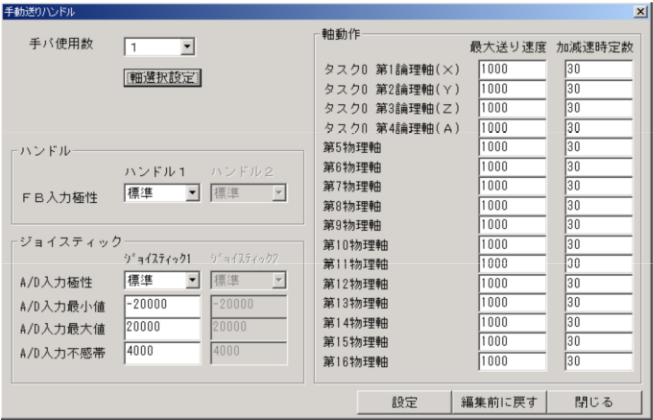

> **図の内容**
>
> 「手動送り/ハンドル」画面。
> - 手パ使用数 1、「軸選択設定」ボタン
> - ハンドル: FB入力極性 標準（ハンドル1）
> - ジョイスティック: A/D入力極性 標準、A/D入力最小値 -20000、A/D入力最大値 20000、A/D入力不感帯 4000（ジョイスティック1）
> - 軸動作: タスク0 第1論理軸(X)～第4論理軸(A)、第5物理軸～第16物理軸のそれぞれの最大送り速度 1000、加減速時定数 30
> - ボタン: 設定、編集前に戻す、閉じる

(1) 全体設定

- ① 手パ使用数【1】

手パ使用数を設定します。最大2台まで使用することができます。

- ② 軸選択設定

手パ軸選択設定画面(4-5-1)を表示します。

(2) ハンドル設定

- ① FB入力極性【標準】

各ハンドルのFB入力の極性を設定します。

標準:+カウントで+方向へ進みます。

反転:+カウントで-方向へ進みます。

- (3) ジョイスティック設定
2. ① A/D入力極性【標準】

各A/D入力の極性を設定します。

標準:基準値より大きい値で+方向へ進みます。

反転:基準値より大きい値で-方向へ進みます。

- ②A/D入力最小値【-20000】

A/D入力の最小値を設定します。ラダーからのデータです。特別な単位はありません。

- ③A/D入力最大値【20000】

A/D入力の最大値を設定します。

- ④A/D入力不感帯【4000】

A/D入力の基準値を中心とした不感帯を設定します。4000は、±2000の事です。

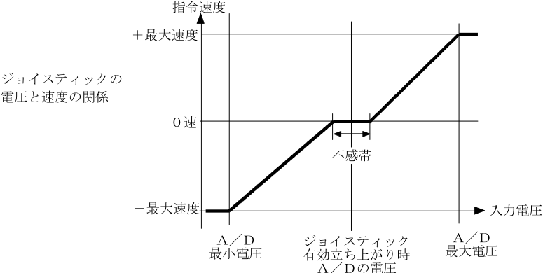

> **図の内容**
>
> 横軸「入力電圧」、縦軸「指令速度」。「A/D最小電圧」以下では「－最大速度」、「A/D最大電圧」以上では「＋最大速度」。中央の「0速」の区間が「不感帯」。「ジョイスティック有効立ち上がり時A/Dの電圧」が中央。

(4) 軸動作

- ① 最大送り速度【1000】

ハンドル操作で移動するときの最大速度をPPS単位で設定します。

- ② 加減速時定数【30】

指数形加減速の時定数を設定します。設定値の詳細は

「PLMC-M3Exユーザーズマニュアル」<Ⅳ 試運転・調整編 4.サーボパラメータ> (TB00-0980H)を参照してください。

#### 4-5-1手動パルサ軸選択

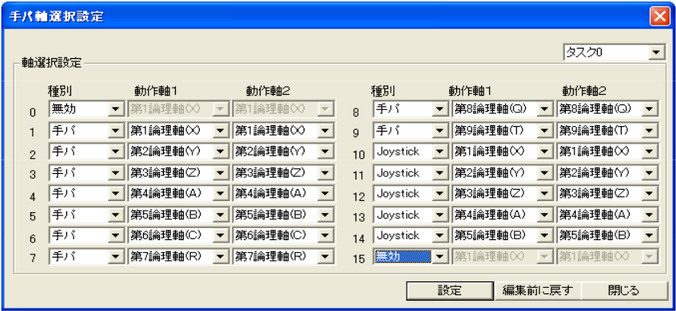

> **図の内容**
>
> 「手パ軸選択設定」画面（タスク0）。軸選択設定 0～15 の種別と動作軸1・動作軸2:
>
> | 番号 | 種別 | 動作軸1 | 動作軸2 |
> |---|---|---|---|
> | 0 | 無効 | （灰色） | （灰色） |
> | 1 | 手パ | 第1論理軸(X) | 第1論理軸(X) |
> | 2 | 手パ | 第2論理軸(Y) | 第2論理軸(Y) |
> | 3 | 手パ | 第3論理軸(Z) | 第3論理軸(Z) |
> | 4 | 手パ | 第4論理軸(A) | 第4論理軸(A) |
> | 5 | 手パ | 第5論理軸(B) | 第5論理軸(B) |
> | 6 | 手パ | 第6論理軸(C) | 第6論理軸(C) |
> | 7 | 手パ | 第7論理軸(R) | 第7論理軸(R) |
> | 8 | 手パ | 第8論理軸(Q) | 第8論理軸(Q) |
> | 9 | 手パ | 第9論理軸(T) | 第9論理軸(T) |
> | 10 | Joystick | 第1論理軸(X) | 第1論理軸(X) |
> | 11 | Joystick | 第2論理軸(Y) | 第2論理軸(Y) |
> | 12 | Joystick | 第3論理軸(Z) | 第3論理軸(Z) |
> | 13 | Joystick | 第4論理軸(A) | 第4論理軸(A) |
> | 14 | Joystick | 第5論理軸(B) | 第5論理軸(B) |
> | 15 | 無効 | （灰色） | （灰色） |
>
> 動作軸の表示は小さくて読みにくく、自信がない。ボタン: 設定、編集前に戻す、閉じる。

タスク毎に、機械操作パネルの手パ軸選択入力の入力パターン(0～15:0000～1111)に対して手パ/ジョイスティックの有効/無効、及び動作する軸を選択します。

① 種別

手パ/ジョイスティックを使用するかどうかを選択します。無効を指定するとこの入力パターンは無効となります。

② 動作軸1/2

手パ/ジョイスティックにて動作する軸を選択します。手パ使用数が1の場合、動作軸2は無効となります。動作軸1/2の対応は以下の通りです。

| ハンドル1   | 動作軸1   |
|---------|--------|
| ハンドル2   | 動作軸2   |

上の画面例では以下のようになっています。

| 軸選択入力   | 軸選択入力   | 軸選択入力   | 軸選択入力   | 第1手パ          | 第2手パ          |
|-------------|-------------|-------------|-------------|---------------|---------------|
| HAX3        | HAX2        | HAX1        | HAX0        | /ジョイスティック     | /ジョイスティック     |
| 0           | 0           | 0           | 0           | 無効            | 無効            |
| 0           | 0           | 0           | 1           | 第1軸(手パ)       | 第1軸(手パ)       |
| 0           | 0           | 1           | 0           | 第2軸(手パ)       | 第2軸(手パ)       |
| 0           | 0           | 1           | 1           | 第3軸(手パ)       | 第3軸(手パ)       |
| 0           | 1           | 0           | 0           | 第4軸(手パ)       | 第4軸(手パ)       |
| 0           | 1           | 0           | 1           | 第5軸(手パ)       | 第5軸(手パ)       |
| 0           | 1           | 1           | 0           | 第6軸(手パ)       | 第6軸(手パ)       |
| 0           | 1           | 1           | 1           | 第7軸(手パ)       | 第7軸(手パ)       |
| 1           | 0           | 0           | 0           | 第8軸(手パ)       | 第8軸(手パ)       |
| 1           | 0           | 0           | 1           | 第9軸(手パ)       | 第9軸(手パ)       |
| 1           | 0           | 1           | 0           | 第1軸(ジョイスティック) | 第1軸(ジョイスティック) |
| 1           | 0           | 1           | 1           | 第2軸(ジョイスティック) | 第2軸(ジョイスティック) |
| 1           | 1           | 0           | 0           | 第3軸(ジョイスティック) | 第3軸(ジョイスティック) |
| 1           | 1           | 0           | 1           | 第4軸(ジョイスティック) | 第4軸(ジョイスティック) |
| 1           | 1           | 1           | 0           | 第5軸(ジョイスティック) | 第5軸(ジョイスティック) |
| 1           | 1           | 1           | 1           | 無効            | 無効            |

### 4-6.オプション

御購入いただいたオプション機能の有無を確認することができます。

- ※ 本画面はご注文頂いたオーダオプションを元に弊社にて設定をします。お客様が変更する事はできません。

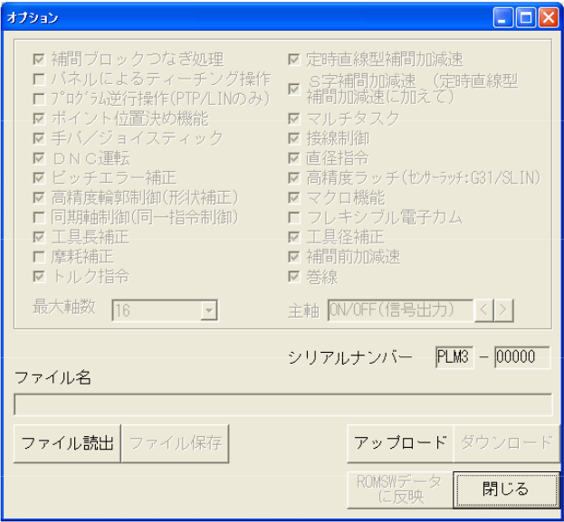

> **図の内容**
>
> 「オプション」画面。オプションのチェック欄（灰色で表示のみ）: 補間ブロックつなぎ処理、パネルによるティーチング操作、プログラム逆行操作（PTP/LIN）、ポイント位置決め機能、手パ/ジョイスティック、DNC運転、ピッチエラー補正、高精度輪郭制御（形状補正）、同期制御（同一指令2軸制御）、工具長補正、摩耗補正、トルク指令、定時直線型補間加減速、S字補間加減速（定時直線型補間加減速に加えて）、マルチタスク、接線制御、直径指令、高精度ラッチ（センサーラッチ:G31/SLIN）、マクロ機能、フレキシブル電子カム、工具径補正、補間前加減速、巻線、最大軸数 16、主軸 ON/OFF（信号出力）。
> 「シリアルナンバー PLM3 - 00000」。ボタン: ファイル読出、ファイル保存（灰色）、アップロード、ダウンロード（灰色）、ROMSWデータに反映（灰色）、閉じる。
> どれにチェックが入っているかは小さくて判読できず。
