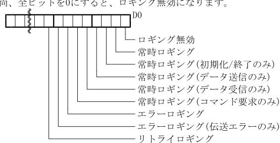
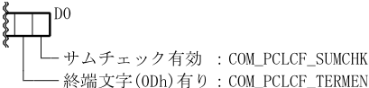
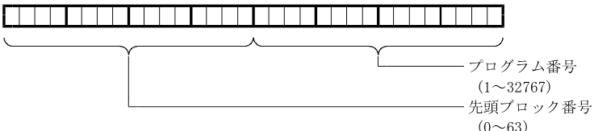
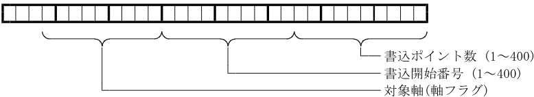
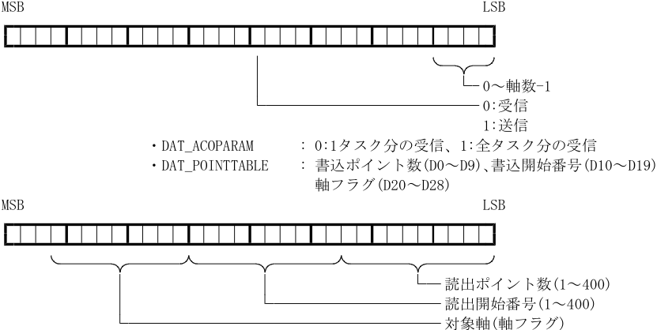
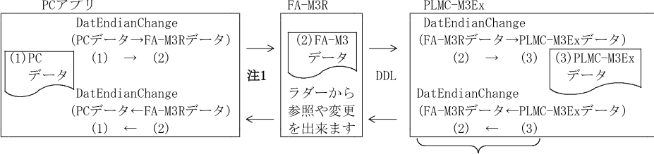
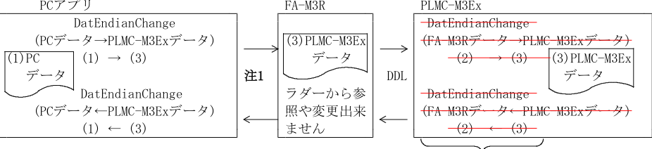

標準PLMC-M3Ex対応通信ライブラリリファレンスマニュアル

# PLM3EX-COMNT説明書

Ver1.0 2014.6.23

－目次－

- 1. 形式
- 2. 製品構成
- 3. 概要
- 4. 関連資料
- 5. 使用環境
- 6. 複数台での使用
- 7.インストール
- 8.ライブラリ使用上の注意事項
- 9.関数使用例
  - 9-1. MS-VC以外のC言語処理系での利用方法
  - 9-2. 関数呼び出し時の戻り値
- 10.関数仕様
  - 10-1. 通信
    - InitCommProc
    - QuitCommProc
    - SendData
    - ReceiveData
    - SendCommand
    - DatEndianChange
    - SetErrlog
  - 10-2. タイマー
    - SetTimeOut
    - CheckTimeOut

## 1. 形式

PLM3EXCOM-NT

## 2. 製品構成

```c
    PLM3EXCOMNT
    PLM3EXCOMNT
    PLM3EXCOMNT
    PLM3EXDATA
    SYNCDEF
```

.DLL ････････ダイナミックリンクライブラリーファイル

.LIB ････････インポートライブラリーファイル

.H ････････インクルードファイル(関数定義)

.H ････････インクルードファイル(構造体定義)

.H ････････インクルードファイル(マクロ定義)

PLM3EXCOMAPI .TXT ････････ビジュアルベーシック用データ型･関数定義

## 3. 概要

本ライブラリ(標準PLMC-M3Exシリーズ対応通信ライブラリ)は、パソコンとPLMC-M3ExコントローラをFAM3のパソコンリンク機能を利用して通信を行うための処理をライブラリ化したものです。本ライブラリの機能は、C言語の関数形式で呼び出して、利用できます。

本ライブラリを利用して以下のような処理が行えます。

- データ送信
- データ受信
- 動作指示

各データの詳細は送受信データ説明書を参照下さい。

## 4. 関連資料

| 「標準PLMC-M3Ex対応   | ユーザーズマニュアル」             | (TB00-0980)   |
|------------------|-------------------------|---------------|
| 「標準PLMC-M3Ex対応   | セッティングPCマニュアル」          | (TB00-0981)   |
| 「標準PLMC-M3Ex対応   | ROMSW設定ソフトマニュアル」        | (TB00-0982)   |
| 「標準PLMC-M3Ex対応   | 通信ライブラリリファレンスマニュアル」     | (TB00-0983)   |
| 「標準PLMC-M3Ex対応   | 送受信データ説明書」              | (TB00-0984)   |
| 「標準PLMC-M3Ex対応   | Tコード変換ライブラリリファレンスマニュアル」 | (TB00-0985)   |
| 「標準PLMC-M3Ex対応   | Gコード変換ライブラリリファレンスマニュアル」 | (TB00-0986)   |
| 「標準PLMC-MⅡEx対応   | サンプルラダープログラム説明書」        | (TB00-0917)   |
| 「標準PLMC-40/MⅡ対応  | サンプルラダープログラム補足説明書」      | (TB00-0884)   |

## 5. 使用環境

本ライブラリが対応するパソコン及び、Cコンパイラは以下の通りです。

対応パソコン・・・ Windows XP/Vista/7が動作するx86CPU搭載機

対応Cコンパイラ・・・ Visual C++ Ver6.0

Visual Basic Ver6.0

## 6. 複数台での使用

1台のパソコンから複数台のPLMC-M3Exと送受信を行うことが可能です。

複数台のパソコンから1台のPLMC-M3Exに送受信を行うことはできません。

※ 本書

## 7.インストール

DLLファイルをプログラム検索パスの通っているディレクトリ(フォルダ)に格納して下さい。

## 8.ライブラリ使用上の注意事項

PLMシリーズ用通信ライブラリーを使用して、アプリケーションを作成するときは、以下の事を注意して下さい。

・プログラムデータの作成には、弊社プログラム処理ライブラリが必要です。

## 9.関数使用例

本ライブラリの使用法は、以下の2通りがあります。

- インポートライブラリを使用して関数をインポートする。ライブラリーに付属のインポートライブラリをアプリケーションの作成時にリンクします。この方法は、使用言語がMS-VC++ Ver6.0の時のみ有効です。
- DLLロード関数を使用して関数をインポートする。

DLLロード関数を使用してDLLをメモリにロードし、関数アドレスを取得して関数を呼び出します。この方法は、ウィンドウズ上で動作する言語処理系(32ビット版)全てで有効です。詳細は次項を参照して下さい。

### 9-1. MS-VC以外のC言語処理系での利用方法

MS-VC以外のC言語処理系でDLLを使用する場合は、以下の手順で行います。

```c
    1. DLLのロード
    2. DLL内の任意の関数のアドレス取得
```

:

- : DLL内の関数の利用

:

3. DLLのアンロード
2. ※ 関数アドレス取得時に指定する関数名は、本説明書(ヘッダーファイル)の関数名と異なります。アドレス取得時の関数名のフォーマットは、ヘッダーファイルの関数名の前に"_"(アンダーバー)を付け、関数名の後に@、その後に引数の数×4を付けます。
3. 具体的には以下の通りとなります。

_関数名@引数の数×4

- 例 InitCommProc(PSXDEF psxdef, int *phCom)の場合

関数名･････ _InitCommProc@8

これらの定義がPlm3excomnt.h内にあるので、独自の処理を作成する場合は参考にして下さい。

関数アドレス取得時に指定する関数名／関数ポインタのデータ型は､Plm3excomnt.h内で定義しています。 Plm3excomnt.h をインクルードする前に LOADLIBRARY_MCDLL を定義(define)することによってこれらの定義を使用できるようになります。

（LOADLIBRARY_MCDLLを定義しなかった場合はインポートライブラリを使用する設定になります。）

以下の例は、通信ライブラリの関数取得例を示します。

```c
#define LOADLIBRARY_MCDLL // テクノ製ライブラリ明示的リンク指定
#include "Plm3excomnt.h" // 通信ライブラリ宣言
    // グローバルデータ定義
    HINSTANCE hComInst;      /* 通信ライブラリハンドル */
    INITPROC *InitCommProc;  /* 通信初期化関数へのポインタ */
    QUITPROC *QuitCommProc;  /* 通信終了処理関数へのポインタ */
    // 通信ライブラリ関数ロード処理
    int LoadPlmComm(void)
    {
    // DLLのロード
    if(NULL == (hComInst = LoadLibrary(LNCOMDLL))){
    return 0;
}
    // DLLが正常にロードできた場合
    // DLL関数ポインタの取得
    InitCommProc = (INITPROC *)GetProcAddress(hComInst, FNINITPROC);
    QuitCommProc = (QUITPROC *)GetProcAddress(hComInst, FNQUITPROC);
    if((NULL == InitCommProc) || (NULL == QuitCommProc)){
    // 関数アドレス取得が失敗した場合
    // DLLの解放
    FreeLibrary(hComInst);
    return 0;
}
    return 1;
}
```

### 9-2. 関数呼び出し時の戻り値

| E$OK          | :( 0)   | 正常終了             |
|---------------|---------|------------------|
| E$DEVNRDY     | :( 1)   | デバイス未初期化         |
| E$PARAM       | :( 2)   | 通信パラメータ設定異常      |
| E$TIME        | :( 3)   | タイムアウト発生         |
| E$RTRY        | :( 4)   | リトライオーバー発生       |
| E$MLTRTRY     | :( 5)   | 多重リトライ発生         |
| E$HARDER      | :( 6)   | 通信ハードウェアエラー      |
| E$NEXIST      | :( 7)   | 要求データが存在しない      |
| E$PROTECT     | :( 8)   | 送信データ書込不可        |
| E$SEQ         | :( 9)   | 通信データフォーマットエラー   |
| E$PRGTERM     | :(10)   | プログラム書込中断        |
| E$PRGBUFF     | :(11)   | プログラムバッファオーバーフロー |
| E$CMDNOT      | :(12)   | コマンド実行不可         |
| E$EMPTYHANDLE | :(13)   | 空き通信ハンドル無し       |
| E$NOHANDLE    | :(14)   | 無効ハンドル           |
| E$BUSY        | :(15)   | 通信ビジー            |
| E$PRMWRITE    | :(16)   | パラメータ書き込みエラー     |
| E$ERR         | :(-1)   | 不明エラー            |

## 10.関数仕様

### 10-1. 通信

#### InitCommProc

**機能**

通信インタフェースの初期化及び、通信処理の組み込みを実行します。

**プロトタイプ**

```c
#include "Plm3excomnt.h" 関数宣言に必要なイン
    int WINAPI InitCommProc(PSXDEF psxdef, int *phCom);
    PSXDEF psxdef 通信定義構造体
```

"Plm3excomnt.h" 関数宣言に必要なインクルードファイル

通信定義構造体

通信処理の各種定義を行います。

```c
typedef struct {
    long nSize; // 通信初期化構造体サイズ
    short fComType; // 通信種別フラグ
    short fShare; // 共有フラグ
    long fLogging; // 通信ロギングフラグ
    char *pLogFile; // 通信ロギングファイル名
    // pclink common
    short nCpuNo; // CPU番号
    short nUnitNo; // PLMC-M3Ex ユニット番号 [0～7]
    short nSlotNo; // PLMC-M3Ex スロット番号 [1～16]
    short Reserved; // 予約
    // pclink Rs232c
    short nComPort; // PC RS232C通信ポート番号
    short nStation; // パソコンリンクモジュール ステーション番号[1～32]
    short nComSel; // パソコンリンクモジュール 通信速度／パリティ選択
    short fComFlag; // パソコンリンクモジュール 付加データ選択フラグ
    // pclink Ether
    unsigned char nIpAddr[4]; // イーサネットモジュール IPアドレス
    unsigned short nIpPort; // イーサネットモジュール ポート番号
    short fBinary; // イーサネットモジュール バイナリモードフラグ
} SXDEF, *PSXDEF;
```

各変数の内容は以下の通りです。

nSize 構造体サイズ

本構造体（通信定義構造体）のサイズを設定して下さい。 sizeof():VC++/ LenB():VB 関数でサイズを取得できます。

fComType 通信種別フラグ

【0～1】

パソコンリンク(RS232C)(0) ：RS232C通信

パソコンリンク(イーサネット)(1) ：イーサネット通信

fShare 共有フラグ

【1】

1を指定して下さい。

fLogging 通信ロギングフラグ

通信ロギングの設定を行います。内容は下記の通りです。

上位の未定義ビットは全て0にして下さい。

尚、全ビットを0にすると、ロギング無効になります。



> **図の内容**
>
> 「尚、全ビットを0にすると、ロギング無効になります。」
> | ビット | 内容 |
> |---|---|
> | D0 | ロギング無効 |
> | D1 | 常時ロギング |
> | D2 | 常時ロギング（初期化/終了のみ） |
> | D3 | 常時ロギング（データ送信のみ） |
> | D4 | 常時ロギング（データ受信のみ） |
> | D5 | 常時ロギング（コマンド要求のみ） |
> | D6 | エラーロギング |
> | D7 | エラーロギング（伝送エラーのみ） |
> | D8 | リトライロギング |

pLogFile 通信ロギングファイル名

PLMC-M3Exとの通信のログを保存するファイル

名を指定します。

NULLを指定するとロギングが無効になります。

ファイル名を指定＆通信ロギングフラグ指定でログを有効にした場合、実行ファイルと同じディレクトリに以下のファイルが作成されます。

- 1.「通信ロギングファイル名」で指定したファイル
- 2.「通信ロギングファイル名」で指定したファイルのベースファイル名の最後に1～5の数字を付加したファイル
3. RS232C通信の場合

M3LnkRo.tmp ポート番号イーサネット通信の場合 M3LnkEo.tmp Ip番号、Unit番号、slot番号

ログファイル(1のファイル)が512Kバイトをこえると現ログファイルはリネームされて、履歴ファイルとなります。その後、新しいログファイルを作成してロギングを継続します。履歴ファイル名は、指定されたログファイル名のベースに履歴番号として1~5を付加した名前です。(最大5世代)

例)ログファイル名として"TMP.LOG"を指定すると、

履歴ファイルとしてTMP1.LOG～TMP5.LOGが作成されます。

nCpuNo CPUモジュールスロット番号

【1～4】

通信対象のFA-M3のCPUモジュール/ｱﾄﾞｵﾝCPUﾓｼﾞｭｰﾙのスロット番号を指定します。

nUnitNo PLMC-M3Exユニット番号

【0～7】

光FAバス等のサブユニット使用時に対象となるPLMC-MⅢ

Exが実装されているユニット番号を指定します。

nSlotNo PLMC-M3Exスロット番号

【1～16】

通信対象のPLMC-M3Exが実装されているスロット番号を指定します。

nComPort シリアル通信ポート番号

【1～256】

RS232C通信に使用するシリアルポート番号を指定します。

nStation パソコンリングモジュールステーション番号【1～32】※1 通信対象のパソコンリングモジュールのステーション番号を指定します。

nComSel 通信速度/パリティ選択

【0～9】※1

ＲＳ２３２Ｃ通信時の通信速度とﾊﾟﾘﾃｨﾁｪｯｸの組み合わせを設定します。

設定する値は、以下から選択します。

COM_PCLCS_9600PE (0)： 9600bps､パリティ偶数

COM_PCLCS_9600PN (1)： 9600bps､パリティ無し

COM_PCLCS_19200PE (2)： 19200bps､パリティ偶数

COM_PCLCS_19200PN (3)： 19200bps､パリティ無し

COM_PCLCS_38400PE (4)： 38400bps､パリティ偶数

COM_PCLCS_38400PN (5)： 38400bps､パリティ無し

COM_PCLCS_57600PE (6)： 57600bps､パリティ偶数

COM_PCLCS_57600PN (7)： 57600bps､パリティ無し

COM_PCLCS_115200PE (8)：115200bps､パリティ偶数

COM_PCLCS_115200PN (9)：115200bps､パリティ無し

fComFlag パソコンリンクプロトコル選択【0～3】※1

RS232C通信時のパソコンリングコマンドの付加デｰタ(プロトコル)を選択します。

内容は以下の通りです。

上位の未定義ビットは全て0にして下さい。



> **図の内容**
>
> | ビット | 内容 |
> |---|---|
> | D0 | サムチェック有効：COM_PCLCF_SUMCHK |
> | D1 | 終端文字(0Dh)有り：COM_PCLCF_TERMEN |

nIpAddr イーサネット通信時の接続先IPアドレス

イーサネットモジュールへ接続した場合：

SW1～8で設定したアドレス

CPUモジュール(SP66-4S,SP67-6S)へ接続した場合：

CPUプロパティのEthernet設定へ設定したIPアドレス

例)169.254.205.249を設定する場合

nIpAddr[0]=169、nIpAddr[1]=254、

nIpAddr[2]=205、nIpAddr[3]=249

nIpPort 接続先ポート番号【12289/12291】※1

イーサネット通信時の接続先ポート番号を指定します。以下のどちらかの値を選択して下さい。

12289：COM_PCLPT_ETHERPORT0

12291：COM_PCLPT_ETHERPORT1

イーサネットモジュールへ接続した場合、機種によってはポート番号が選択できないものがあります。

fBinary バイナリ通信フラグ

【0～1】※1

イーサネット通信時の接続先ポートのコマンドデータ形式

- (0):ASCII形式
- (1):バイナリ形式

選択したポート番号のコマンドデータ形式は

イーサネットモジュールへ接続した場合：

SW9の設定により決定

CPUモジュール(SP66-4S,SP67-6S)へ接続した場合：

CPUプロパティの上位リンクサービス設定で設定した形式

※1 各設定に関しては

「標準PLMC-M3Ex対応セッティングＰＣマニュアル5-4-1.インターフェース設定画面」も参照にして下さい。

```c
    RS232C通信時
    int *phCom 通信ハンドル
```

通信の種別により、以下の項目の設定の必要はありません。

イーサネット通信時：nComPort、nComSel、fComFlag

但し、nStationには1を設定

：nIpAddr、nIpPort、fBinary

*phCom 通信ハンドル

**戻り値**

初期化が正常に終了した場合に、ハンドルを格納するデータのポインタを指定します。

通信処理実行ステータスとして以下の値を返します。

E$OK

：正常終了

E$EMPTYHANDLE ：ハンドル取得不可

E$PARAM ：パラメータ設定異常

E$ERR

：異常終了

正常に初期化が終了した場合、接続されたPLMC-M3Exコントローラを識別するためのハンドルをphCom の指し示すアドレスへ格納します。

【参考】

VB6.0使用時のログファイル名指定方法

〔方法1〕

SXDEFの初期化で

sdf.pLogFile = StrPtr(StrConv("test.log", vbFromUnicode)) '通信ロギングファイル名と指定。〔方法2〕

Plm3excomapi.txtのSXDEF構造体にあるpLogFileを

pLogFile As String

と変更し

SXDEFの初期化で

sdf.pLigFile = "test.log" と指定。

'通信ロギングファイル名と指定。

#### QuitCommProc

**機能**

関数InitCommProcの実行によって組み込まれた通信処理を切り放し、組み込み前の状態に戻します。

**プロトタイプ**

```c
#include "Plm3excomnt.h" 関数宣言に必要なインクルードファイル
    int WINAPI QuitCommProc(int hCom);
```

int hCom

通信ハンドル通信初期化処理で取得したハンドルを指定します。

**戻り値**

ステータスとして以下の値を返します。

E$OK

：正常終了

E$NOHANDLE ：無効ハンドル

E$ERR

：異常終了

#### SendData

**機能**

PLMC-M3Exコントローラに対して、各種データ設定を行います。

**プロトタイプ**

```c
#include "Plm3excomnt.h" 関数宣言に必要なインクルードファイル
    int WINAPI SendData(int hCom, short type, short task, long prm, DWORD size, LPVOID data);
```

int hCom

通信ハンドル

short type

通信初期化処理で取得したハンドルを指定します。

データタイプ

short task DAT_PARAMETER等、送信するデータのタイプを指定します。

タスク番号

long prm

設定対象のタスク番号(0～7)を指定します。

タスク指定が関係ない設定の場合は0を指定して下さい。

付加パラメータ

データタイプによって、指定する値が異なります。

送受信データ説明書の各データタイプの説明を参照して設定下さい。

（《パラメータ》の説明に応じて設定して下さい。ただし、本項に「なし」と記載されている場合は０を設定して下さい。）

例）

・DAT_PROGRAM :プログラム番号(D0～D15)、先頭ブロック番号(D16～D31)

MSB

LSB



> **図の内容**
>
> 32 ビット。
> | ビット | 内容 |
> |---|---|
> | D0～D15 | プログラム番号（1～32767） |
> | D16～D31 | 先頭ブロック番号（0～63） |

(0～63)

- DAT_DNCDATA ：先頭／継続フラグ０：先頭時、１：継続時
- DAT_MCRREG ：マクロ変数番号
- DAT_ACOPARAM ：0:1タスク分の受信、1:全タスク分の受信
- DAT_POINTTABLE：書込ポイント数(D0～D9)､書込開始番号(D10～D19)

軸フラグ(D20～D28)

MSB

LSB



> **図の内容**
>
> 32 ビット。
> | ビット | 内容 |
> |---|---|
> | D0～D9 | 書込ポイント数（1～400） |
> | D10～D19 | 書込開始番号（1～400） |
> | D20～D28 | 対象軸（軸フラグ） |

DWORD

size

送信データサイズ

LPVOID

0～65535バイト

data 送信データ格納バッファへのポインタ

本関数のデータタイプに指定できるデータについては、「標準PLMC-M3Ex対応送受信データ説明書」の"データ送受信機能"を参照して下さい。

**戻り値**

通信処理実行ステータスとして以下の値を返します。

E$OK

：正常終了

E$DEVNRDY ：デバイス未初期化

E$PARAM ：通信パラメータ設定異常

E$TIME ：タイムアウト発生

E$RTRY ：リトライオーバー発生

E$MLTRTRY ：多重リトライ発生

E$HARDER ：通信ハードウェアエラー

E$PROTECT ：送信データ書込不可

E$SEQ

：通信データフォーマットエラー

E$PRGTERM ：プログラム書込中断

E$PRGBUFF ：プログラムバッファオーバーフロー

E$NOHANDLE ：無効ハンドル

#### ReceiveData

**機能**

PLMC-M3Exコントローラ内部の、各種データ読出を行います。

**プロトタイプ**

```c
#include "Plm3excomnt.h" 関数宣言に必要なインクルードファイル
    int WINAPI ReceiveData(int hCom, short type, long task, short prm, LPDWORD size, LPVOID data);
```

int hCom

通信ハンドル

short type

通信初期化処理で取得したハンドルを指定します。

データタイプ

short task DAT_PARAMETER等、受信するデータのタイプを指定します。

タスク番号

long prm

読出対象のタスク番号(0～7)を指定します。

タスク指定が関係ない読出の場合は0を指定して下さい。

付加パラメータ

データタイプによって、指定する値が異なります。送受信データ説明書の各データタイプの説明を参照の上設定して下さい。（《パラメータ》の説明に応じて設定して下さい。ただし、本項に「なし」と

記載されている場合は０を設定して下さい。）

例）

・DAT_PROGRAM : プログラム番号 1～32767

・DAT_ONEBLOCK : ステップ番号 0～32767

・DAT_MCRREG : マクロ変数番号

・DAT_TPCDATA : 読み出しデータサイズ 0～65535

- DAT_ML2INFO : 軸番号

0～軸数-1 :軸指定(1軸分)

-1

:全軸指定

・DAT_ML2MON : 軸番号(D0～D3)、送受信データフラグ(D15)



> **図の内容**
>
> 上の図（32 ビット）:
> | ビット | 内容 |
> |---|---|
> | D0～D3 | 0～軸数-1 |
> | D15 | 0:受信、1:送信 |
> 本文: DAT_ML2MON は軸番号(D0～D3)、送受信データフラグ。
>
> 図の中の文:
> - DAT_ACOPARAM : 0:1タスク分の受信、1:全タスク分の受信
> - DAT_POINTTABLE : 書込ポイント数(D0～D9)、書込開始番号(D10～D19)、軸フラグ(D20～D28)
>
> 下の図（32 ビット、ポイントテーブル読出）:
> | ビット | 内容 |
> |---|---|
> | D0～D9 | 読出ポイント数（1～400） |
> | D10～D19 | 読出開始番号（1～400） |
> | D20～D28 | 対象軸（軸フラグ） |

```c
    LPDWORD size
    LPVOID data
```

受信データサイズ格納変数へのポインタ

受信データ格納バッファへのポインタ

本関数のデータタイプに指定できるデータについては、「標準PLMC-M3Ex対応送受信データ説明書」の"データ送受信機能"を参照して下さい。

**戻り値**

通信処理実行ステータスとして以下の値を返します。

E$OK

：正常終了

E$DEVNRDY ：デバイス未初期化

E$PARAM ：通信パラメータ設定異常

E$TIME ：タイムアウト発生

E$RTRY ：リトライオーバー発生

E$MLTRTRY ：多重リトライ発生

E$HARDER ：通信ハードウェアエラー

E$NEXIST ：要求データが存在しない

E$SEQ

：通信データフォーマットエラー

E$NEXIST ：要求データが存在しない

E$NOHANDLE ：無効ハンドル

#### SendCommand

**機能**

PLMC-M3Exコントローラに対して、各種動作指示を行います。

**プロトタイプ**

```c
#include "Plm3excomnt.h" 関数宣言に必要なインクルードファイル
    int WINAPL SendCommand(int hCom, short cmnd, short task, LPVOID data);
```

int hCom

通信ハンドル

short cmnd

通信初期化処理で取得したハンドルを指定します。

動作指示コード

short task REQ_RESET等、動作指示のタイプを指定します。

タスク番号

LPVOID

data

動作指示対象のタスク番号(0～7)を指定します。

タスク指定が関係ない動作指示の場合は0を指定して下さい。

動作パラメータ格納バッファへのポインタ

本関数の動作指示コードに指定できるデータについては､「標準PLMC-M3Ex対応送受信データ説明書」の"動作コマンド付加データ詳細"を参照して下さい。

**戻り値**

通信処理実行ステータスとして以下の値を返します。

E$OK

：正常終了

E$DEVNRDY ：デバイス未初期化

E$PARAM ：通信パラメータ設定異常

E$TIME ：タイムアウト発生

E$RTRY ：リトライオーバー発生

E$MLTRTRY ：多重リトライ発生

E$HARDER ：通信ハードウェアエラー

E$SEQ

：通信データフォーマットエラー

E$CMDNOT ：コマンド実行不可

E$NOHANDLE ：無効ハンドル

#### DatEndianChange

**機能**

ダイナミックデータローディング(DDL)用のデータ変換処理を行います。

PC/FA-M3R/PLMC-M3Exでは、多バイトデータをメモリ/ファイルに格納する際のデータの並び順(エンディアン) が異なります。本関数でデータの並び順を変更する事で、データを相互に使用できるようにします。

- ※ 通信ライブラリを使用してPLMC-M3Exと直接通信する場合は、本関数を使用する必要はありません。通信ライブラリ内で自動的に本関数を呼び出します。

FA-M3RとPLMC-M3Exのデータ通信(ダイナミックデータローディング)を使用する場合で、PCとFA-M3Rの間でもデータを相互に運用する場合に本関数を使用して下さい。

- 表1) DWORDデータ 0x12345678 をメモリ/ファイルに格納した場合のデータ並び
- 表2) WORDデータ 0x1234 をメモリ/ファイルに格納した場合のデータ並び

|     | データ元          |   アドレス - 0 | アドレス      | アドレス   | 備考               |
|-----|---------------|------------|-----------|--------|-------------------|
| (1) | PC(Intel系CPU) |         78 | 1 2 56 34 | 3 12   | リトルエンディアンと呼ばれています |
| (2) | FA-M3         |         56 | 78 12     | 34     |                   |
| (3) | PLMC-M3Ex     |         12 | 34 56     | 78     | ビッグエンディアンと呼ばれています |

|     | データ元          |   アドレス |   アドレス | 考                 |
|-----|---------------|--------|--------|-------------------|
|     | データ元          |      0 |      1 | 考                 |
| (1) | PC(Intel系CPU) |     34 |     12 | リトルエンディアンと呼ばれています |
| (2) | FA-M3         |     12 |     34 |                   |
| (3) | PLMC-M3Ex     |     12 |     34 | ビッグエンディアンと呼ばれています |

【注意点】

データタイプ(DAT_PARAMETER等)に応じて以下の2通りの変換方法があります。

どちらの変換方法になるかは、データタイプにより決まりますので、御注意下さい。

**○方式1**



> **図の内容**
>
> - 「PCアプリ」の (1)PCデータ と、「FA-M3R」の (2)FA-M3Rデータ の間を、DatEndianChange（PCデータ→FA-M3Rデータ: (1)→(2)、PCデータ←FA-M3Rデータ: (1)←(2)）で変換する。注1（メモリモジュールやイーサネットモジュールなどで PC と FA-M3R の間でデータを授受）
> - FA-M3R のデータは、ラダーから参照や変更を出来ます
> - FA-M3R と「PLMC-M3Ex」の (3)PLMC-M3Exデータ の間は DDL で送り、PLMC-M3Ex 内部の DatEndianChange（FA-M3Rデータ→PLMC-M3Exデータ: (2)→(3)、逆: (2)←(3)）で変換する

PLMC-M3Ex内部で自動的に変換します。

[データタイプ] 方式2以外のデータタイプ

**○方式2**

PLMC-M3Ex内部では変換を行いません。



> **図の内容**
>
> - 「PCアプリ」の (1)PCデータ と、FA-M3R 上の (3)PLMC-M3Exデータ の間を、DatEndianChange（PCデータ→PLMC-M3Exデータ: (1)→(3)、PCデータ←PLMC-M3Exデータ: (1)←(3)）で変換する。注1
> - FA-M3R 上のデータは PLMC-M3Ex の並びのままなので、ラダーから参照や変更出来ません
> - PLMC-M3Ex 内部の DatEndianChange は取り消し線で消されている（変換しない）
>
> 本文: 方式2 になるデータタイプは DAT_PROGRAM、DAT_DNCDATA、DAT_ADLOG、DAT_TPCDATA。ただし「通信ライブラリを使用してPLMC-M3Exと直接通信する場合は、本関数を使用する必要はありません」。

[データタイプ]

DAT_PROGRAM :動作プログラム(バイナリ)送受信

DAT_DNCDATA :DNC動作プログラム(バイナリ)送信

DAT_ADLOG :ADロギングデータ受信

DAT_TPCDATA :TPCロギングデータ受信

注1:メモリモジュール(CFカード)/イーサネットモジュール等のFA-M3の機能を使用して、PCとFA-M3Rの間でデータを授受します。

**プロトタイプ**

#include "Plm3excomnt.h" 関数宣言に必要なインクルードファイル

int WINAPL DatEndianChange(int lbcf, short type, long size, void *src, void *dst)

int lbcf データ変換フラグ

データの変換方法を指定します。変換方法はデータタイプに応じて決まりますので、御注意下さい。

詳細は上記「機能」説明を参照下さい。

LBC_McToPc: /* PLMC-M3Ex → PC */

LBC_PcToMc: /* PC → PLMC-M3Ex */

LBC_PcToM3: /* PC → FA-M3 */

LBC_M3ToPc: /* FA-M3 → PC */

short type

データタイプ

long size

```c
    void
    void
```

*src DAT_PARAMETER等、変換するデータのタイプを指定します。

変換データサイズ 0～65535バイト

変換元データ格納バッファへのポインタ

*dst 変換先データ格納バッファへのポインタ

本関数のデータタイプに指定できるデータについては、「標準PLMC-M3Ex対応送受信データ説明書」の"データ送受信機能"を参照して下さい。

**戻り値**

FALSE :変換失敗

TRUE

:変換成功

#### SetErrlog

**機能**

PLMC-M3Exコントローラに対して、通信エラーログファイル名を指定します。通信初期化処理で設定した項目と同じです。

この関数によっても、エラーログファイルを指定できます。

エラーログファイル名やフラグのみを変更する場合に使用します。

**プロトタイプ**

```c
#include "Plm3excomnt.h" 関数宣言に必要なインクル
    int WINAPI SetErrLog(int hCom, char *fname, short flg);
```

関数宣言に必要なインクルードファイル

int hCom

通信ハンドル

char

通信初期化処理で取得したハンドルを指定します。

*fname 通信ロギングファイル名

short flg InitComProcのpLogFileの項をご参照下さい。

通信ロギングフラグ

InitComProcのfLoggingの項をご参照下さい。

**戻り値**

通信処理実行ステータスとして以下の値を返します。

E$OK

：正常終了

E$DEVNRDY ：デバイス未初期化

E$PARAM ：通信パラメータ設定異常

E$NOHANDLE ：無効ハンドル

E$ERR

：初期化処理異常終了

### 10-2. タイマー

Windowsが持つ､1msec間隔のインターバルタイマーをもとに､タイマーによる処理のディレイや同期､またタイムアウト処理などが可能となります。

「タイマーチェック起点関数」及び「タイムアウトチェック関数」によりアプリケーションにて通信処理以外の目的で､タイマー処理を行うことができます。

#### SetTimeOut

**機能**

タイムアウトチェックの起点設定を行います。

**プロトタイプ**

```c
#include "Plm3excomnt.h" 関数宣言
    void WINAPI SetTimeOut(PDWORD origin);
    PDWORD origin タイム
```

"Plm3excomnt.h" 関数宣言に必要なインクルードファイル

origin タイムアウトチェック起点時間格納ポインタ

#### CheckTimeOut

**機能**

タイムアウトの判定を行います。

**プロトタイプ**

```c
#include "Plm3excomnt.h" 関数宣言に必要なインクルー
    BOOl WINAPI CheckTimeOut(DWORD origin, DWORD limit);
    DWORD origin 関数SetTimeOut()で取得した
    DWORD limit タイムリミット値(単位:1ms
```

"Plm3excomnt.h" 関数宣言に必要なインクルードファイル

origin 関数SetTimeOut()で取得したタイムアウトチェック起点時間

limit タイムリミット値(単位:1msec)

**戻り値**

FALSE:タイムアウトしていない

TRUE :タイムアウトしている

```c
#include <conio.h>
#include "Plm3excomnt.h"
    main()
    {
    int ch;
    DWORD StartTime;
    ch＝getch();                          /*キー入力 */
    SetTimeOut(&StartTime);               /*タイマーチェック起点設定 */
    While(!CheckTimeOut(StartTime,1100L));  /*1.1秒待ち */
    putch(ch);                            /*入力キーコード表示 */
}
```

このプログラムは､キー入力があってから1.1秒後に､入力キーを表示します。
