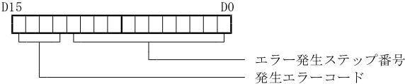
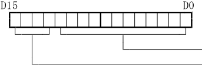
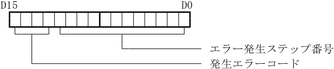
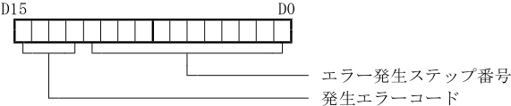
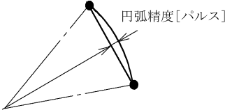

# 標準PLMC-M3Ex対応 Gコード仕様テキストプログラム変換ライブラリリファレンスマニュアル

PLM3EX-GCNV 説明書

Ver1.0 2014.6.21

－目次－

- 1. 形式
- 2. 製品構成
- 3. 概要
- 4. 関連資料
- 5. 使用環境
- 6. インストール
- 7. ライブラリ使用上の注意事項
- 8. 関数使用例
  - 8-1. MS-VC以外のC言語処理系での利用方法
- 9. 関数仕様
  - MemGcodeConv
  - MemTaskGcodeConv
  - MemGcodeRConv
  - FileGcodeConv
  - FileTaskGcodeConv
  - FileGcodeRConv
  - DncGcodeConv
  - GcdCircleSet
  - GcdSetProgramMemSize
  - GcdFeedUnitSet
  - GcdSTSelect
  - GcdPaccTimeSet
  - GcdPositionUnitSet
  - GcdCircleMode
  - GcdDiametralAxis
  - GcdSetMultiplier
  - GcdGetErrLine
  - GcdSetZXPlane

## 1. 形式

PLM3EX-GCNV

## 2. 製品構成

PLM3EXGCNV.DLL・・・・・・・・・テキストプログラム変換ダイナミックリンクライブラリ

PLM3EXGCNV.LIB・・・・・・・・・テキストプログラム変換インポートライブラリ

PLM3EXGCNV.H・・・・・・・・・・プログラム変換関数定義ファイル

PLM3EXGCDAPI.TXT・・・・・・・・ビジュアルベーシック用データ型・関数定義

## 3. 概要

プログラム変換ライブラリは、テキストファイル形式のGコードプログラムを解析し、バイナリ形式のプログラムに変換するものです。

本ライブラリの入出力は、以下の2通りがあります。

テキスト入力バイナリー出力

メモリ(メモリアドレス指定) → メモリ

ファイル(ファイル名指定) → メモリ

**《テキストプログラム例》**

G90 G00 X0 Y0 Z0 A0;

M98 P100 L10;

G04 P1.0;

G90 G00 X100 Y100 Z100 A100;

M98 P100 L5;

G04 P1.0;

G03 X400 Y0 Z100 I200 J0 F1000;

```c
    M30;
    N100
```

G00 X100 Y-100 Z100 A-100;

G00 X-100 Y100 Z-100 A100;

G01 X1500 Y2000 Z2500 A3000 F1000;

M99;

## 4. 関連資料

「標準PLMC-M3Ex対応ユーザーズマニュアル」

(TB00-0980)

「標準PLMC-M3Ex対応セッティングPCマニュアル」

(TB00-0981)

「標準PLMC-M3Ex対応 ROMSW設定ソフトマニュアル」

(TB00-0982)

「標準PLMC-M3Ex対応通信ライブラリリファレンスマニュアル」

(TB00-0983)

「標準PLMC-M3Ex対応送受信データ説明書」

(TB00-0984)

「標準PLMC-M3Ex対応 Tコード変換ライブラリリファレンスマニュアル」

(TB00-0985)

「標準PLMC-M3Ex対応 Gコード変換ライブラリリファレンスマニュアル」

(TB00-0986) ※

「標準PLMC-MⅡEx対応サンプルラダープログラム説明書」

(TB00-0917)

「標準PLMC-40/MⅡ対応サンプルラダープログラム補足説明書」

(TB00-0884)

※ 本書

## 5. 使用環境

本ライブラリが対応するパソコン及び、Cコンパイラは以下の通りです。

対応パソコン・・・ Windows XP / Vista / 7が動作する x86CPU搭載機対応Cコンパイラ・・・ Visual C++ Ver6.0

## 6. インストール

DLLファイルをプログラム検索パスの通っているディレクトリ(フォルダ)に格納して下さい。

## 7. ライブラリ使用上の注意事項

- 円弧補間指令をプリ解析指定で変換する場合、複数の微小直線補間指令ステップに分解されます。プリ解析にて円弧ステップが何ステップに分解されるかは、「PLMC-M3Exユーザーズマニュアル機能編補足資料・1 円弧プリ解析処理(ステップ数/処理時間)」を参照して下さい。円弧補間指令を含むプログラムの場合、分解後のステップ数が最大ステップ数をこえないようにして下さい。
- 位置決めポイントデータとプログラムステップは共通のバッファを使用しています。このため位置決めポイントデータを指定すると最大プログラムステップ数は、関数"SetProgMemSize" にて設定したステップ数以下になります。プログラムステップと位置決めポイントデータ数の関係についてはユーザーズマニュアルを参照下さい。
- PositionUnitSet関数は全ての軸指定の小数点位置を変更します。従って、PositionUnitSet関数をSetMultiplier関数の後で呼び出すと、SetMultiplier関数で設定した軸毎の小数点位置がPositionUnitSet関数で指定した小数点位置に置き換わってしまいます。 SetMultiplier関数は、必ずPositionUnitSet関数の後で呼び出すようにしてください。
- メインプログラムは必ず先頭に記述してください。
- テキストプログラムの詳細な説明については、「PLMC-M3Exユーザーズマニュアル」(TB00-0980)を参照してください。

## 8. 関数使用例

本ライブラリの使用法は、以下の2通りがあります。

- インポートライブラリを使用して関数をインポートする。ライブラリーに付属のインポートライブラリをアプリケーションの作成時にリンクします。この方法は、使用言語がMS-VC++ Ver6.0の時のみ有効です。
- DLLロード関数を使用して関数をインポートする。 DLLロード関数を使用してDLLをメモリにロードし、関数アドレスを取得して関数を呼び出します。この方法は、ウィンドウズ上で動作する言語処理系(32ビット版)全てで有効です。詳細は次項を参照して下さい。

### 8-1. MS-VC以外のC言語処理系での利用方法

MS-VC以外のC言語処理系でDLLを使用する場合は、以下の手順で行います。

- 1.DLLのロード
- 2.DLL内の任意の関数のアドレス取得

:

: DLL内の関数の利用

:

- 3.DLLのアンロード
- ※ 関数アドレス取得時に指定する関数名は、本説明書(ヘッダーファイル)の関数名と異なります。アドレス取得時の関数名のフォーマットは、ヘッダーファイルの関数名の前に_(アンダーバー)を付け、関数名の後に@、その後に引数の数×4を付けます。
- 具体的には以下の通りとなります。

_関数名@引数の数×4

- 例 MemGcodeConv(LPBYTE text, LPDWORD size, LPVOID bin)の場合

関数名･････ _MemGcodeConv@12

これらの定義がPlm3exgcnv.h内にあるので、独自の処理を作成する場合は参考にして下さい。

関数アドレス取得時に指定する関数名/関数ポインタのデータ型は、Plm3exgcnv.h内で定義しています。 Plm3exgcnv.h をインクルードする前に LOADLIBRARY_MCDLL を定義(define)することによってこれらの定義を使用できるようになります。

(LOADLIBRARY_MCDLLを定義しなかった場合はインポートライブラリを使用する設定になります。)

以下の例は、プログラム変換ライブラリの関数取得例を示します。

```c
#define LOADLIBRARY_MCDLL // テクノ製ライブラリ明示的リンク指定
#include "Plm3exgcnv.h" // Gコード変換ライブラリ宣言
    // グローバルデータ定義
    HINSTANCE hGcdInst;         /* プログラム変換ライブラリハンドル */
    MEMPRGCNV *MemGcodeConv;    /* Gコードテキスト → バイナリ変換関数へのポインタ */
    MEMPRGRCNV *MemGcodeRConv;  /* バイナリ → Gコードテキスト変換関数へのポインタ */
    // Gコードプログラム変換ライブラリ関数ロード処理
    int LoadGcdcnv(void)
    {
    // DLLのロード
    if(NULL == (hGcdInst = LoadLibrary(GLNCNVDLL))){
    return 0;
}
    // DLLが正常にロードできた場合
    // DLL関数ポインタの取得
    MemGcodeConv = (MEMPRGCNV *)GetProcAddress(hGcdInst, GFNMEMPRGCNV);
    MemGcodeRConv = (MEMPRGRCNV *)GetProcAddress(hGcdInst, GFNMEMPRGRCNV);
    if((NULL == MemGcodeConv) || (NULL == MemGcodeRConv)){
    // 関数アドレス取得が失敗した場合
    // DLLの解放
    FreeLibrary(hGcdInst);
    return 0;
}
    return 1;
}
```

## 9. 関数仕様

### MemGcodeConv

### MemTaskGcodeConv

**機能**

テキスト形式プログラムをバイナリー形式プログラムに変換します。

**プロトタイプ**

```c
#include "Plm3exgcnv.h" 関数宣言に必要なインクルードファイル
    ASISSAPI short MemGcodeConv(LPBYTE text, LPDWORD size, LPVOID bin, short *pno);
    ASISSAPI short MemTaskGcodeConv(LPBYTE text, LPDWORD size, LPVOID bin, WORD task, short *pno);
    LPBYTE text テキストプログラム格納バッファポインタ
    LPDWORD size バイナリープログラムサイズ
    LPVOID bin バイナリープログラム格納バッファポインタ
```

"Plm3exgcnv.h" 関数宣言に必要なインクルードファイル

テキストプログラム格納バッファポインタ

バイナリープログラムサイズ

WORD

task

バイナリープログラム格納バッファポインタ (192kバイト以上のバッファが必要です。)

プログラムタスク指定番号

short

*pno

タスク指定番号については「標準PLMC-M3Ex対応送受信データ説明書(TB00-0984) 4-1-4.マルチタスクプログラム書込/読込」を参照下さい。

プログラム番号格納ポインタ

戻り値変換処理実行ステータスとして以下の値を返します。



> **図の内容**
>
> 16 ビット（D15～D0）。ビットの範囲は図の括弧の位置から求めた（RTMC64 の TB00-1045・1046 と同じ構成）。
> - D15～D12: 発生エラーコード
> - D11～D0: エラー発生ステップ番号

エラーコード =2 : プログラムバッファオーバーフロー

=3 : テキストプログラムフォーマットエラー

=4 : プログラム変換演算エラー

=5 : 作業メモリオーバーフロー

上記ステータスが全て0の場合、正常終了

マルチタスクのプログラムを変換する場合は、MemTaskGcodeConv()を使用下さい。

### MemGcodeRConv

**機能**

バイナリー形式プログラムをテキスト形式プログラムに変換します。

**プロトタイプ**

```c
#include "Plm3exgcnv.h" 関数宣言に必要なインクルードファイル
    ASISSAPI short MemGcodeRConv(LPVOID bin, LPDWORD size, LPBYTE text);
    LPVOID bin バイナリープログラム格納バッファポイ
    LPDWORD size バイナリープログラムサイズ
    LPBYTE text テキストプログラム格納バッファポイン
```

"Plm3exgcnv.h" 関数宣言に必要なインクルードファイル

バイナリープログラム格納バッファポインタ

バイナリープログラムサイズ

テキストプログラム格納バッファポインタ (512kバイト以上のバッファが必要です。)

**戻り値**

変換処理実行ステータスとして以下の値を返します。



> **図の内容**
>
> 16 ビット（D15～D0）。ほかの図と同じく、D15～D12 と D11～D0 の 2 つの範囲に括弧がある。引き出し線の先の文字（発生エラーコード、エラー発生ステップ番号）は画像の右端で切れていて写っていない。

エラー発生ステップ番号発生エラーコード

エラーコード =2 : プログラムバッファオーバーフロー

=5 : 作業メモリオーバーフロー

上記ステータスが全て0の場合、正常終了

### FileGcodeConv

### FileTaskGcodeConv

**機能**

テキスト形式プログラムをバイナリー形式プログラムに変換します。

**プロトタイプ**

```c
#include "Plm3exgcnv.h" 関数宣言に必要なインクルードファイル
    ASISSAPI short FileGcodeConv(LPBYTE fname, LPDWORD size, LPVOID bin, short *pno);
    ASISSAPI short FileTaskGcodeConv(LPBYTE fnamee, LPDWORD size, LPVOID bin, WORD task, short *pno);
    LPBTE fname テキストプログラム格納ファイル名
    LPDWORD size バイナリープログラムサイズ
    LPVOID bin バイナリープログラム格納バッファポインタ
```

"Plm3exgcnv.h" 関数宣言に必要なインクルードファイル

fname テキストプログラム格納ファイル名

バイナリープログラムサイズ

WORD

task

バイナリープログラム格納バッファポインタ (192kバイト以上のバッファが必要です。)

プログラムタスク指定ビットフラグ

short

*pno

タスク指定番号については「標準PLMC-M3Ex対応送受信データ説明書(TB00-0984) 4-1-4.マルチタスクプログラム書込/読込」を参照下さい。

プログラム番号格納ポインタ

**戻り値**

変換処理実行ステータスとして以下の値を返します。



> **図の内容**
>
> 16 ビット（D15～D0）。ビットの範囲は図の括弧の位置から求めた（RTMC64 の TB00-1045・1046 と同じ構成）。
> - D15～D12: 発生エラーコード
> - D11～D0: エラー発生ステップ番号

エラーコード =1 : テキストプログラムファイルエラー

=2 : プログラムバッファオーバーフロー

=3 : テキストプログラムフォーマットエラー

=4 : プログラム変換演算エラー

=5 : 作業メモリオーバーフロー

上記ステータスが全て0の場合、正常終了

マルチタスクのプログラムを変換する場合は、FileTaskGcodeConv()を使用下さい。

### FileGcodeRConv

**機能**

バイナリー形式プログラムをテキスト形式プログラムに変換します。

**プロトタイプ**

```c
#include "Plm3exgcnv.h" 関数宣言に必要なインクルードファイル
    ASISSAPI short FileGcodeRConv(LPBYTE fname, LPDWORD size, LPVOID text);
    LPBYTE fname バイナリープログラム格納ファイル名
    LPDWORD size テキストプログラムサイズ
    LPVOID text テキストプログラム格納バッファポインタ
```

"Plm3exgcnv.h" 関数宣言に必要なインクルードファイル

fname バイナリープログラム格納ファイル名

テキストプログラムサイズ

テキストプログラム格納バッファポインタ (512kバイト以上のバッファが必要です。)

**戻り値**

変換処理実行ステータスとして以下の値を返します。


> **図の内容**
>
> 16 ビット（D15～D0）。ビットの範囲は図の括弧の位置から求めた（RTMC64 の TB00-1045・1046 と同じ構成）。
> - D15～D12: 発生エラーコード
> - D11～D0: エラー発生ステップ番号

エラーコード =1 : バイナリープログラムファイルエラー

=2 : プログラムバッファオーバーフロー

=5 : 作業メモリオーバーフロー

上記ステータスが全て0の場合、正常終了

### DncGcodeConv

**機能**

テキスト形式プログラムをDNC運転用バイナリー形式プログラムに変換します。

**プロトタイプ**

```c
#include "Plm3exgcnv.h" 関数宣言に必要なインクルードファイル
    ASISSAPI short DncGcodeConv(LPBYTE *text, LPDWORD size, LPVOID bin,short cont);
    LPBYTE *text テキストプログラム格納バッファポインタ
    LPDWORD size バイナリープログラムサイズ格納ポインタ
    LPVOID bin バイナリープログラム格納バッファポインタ
```

"Plm3exgcnv.h" 関数宣言に必要なインクルードファイル

*text テキストプログラム格納バッファポインタ

バイナリープログラムサイズ格納ポインタ

short cont

バイナリープログラム格納バッファポインタ (192kバイト以上のバッファが必要です。)

先頭/継続指定フラグ

**戻り値**

変換処理実行ステータスとして以下の値を返します。



> **図の内容**
>
> 16 ビット（D15～D0）。ビットの範囲は図の括弧の位置から求めた（RTMC64 の TB00-1045・1046 と同じ構成）。
> - D15～D12: 発生エラーコード
> - D11～D0: エラー発生ステップ番号

エラーコード =2 : プログラムバッファオーバーフロー

=3 : テキストプログラムフォーマットエラー

=4 : プログラム変換演算エラー

=5 : 作業メモリオーバーフロー

上記ステータスが全て0の場合、正常終了

textが示すバッファに格納された、Gコードプログラム文字列を、null文字が見つかるまでDNCバイナリデータに変換します。

変換後のデータはbinが示すバッファに格納され、この時の総バイト数がsizeに返されます。また、一連のDNC運転プログラムにおける先頭部分の変換である時cont=0を、続きのデータである場合cont=1を指定します。

サポートしているGコード機能中、下記のコードについてはDNC運転では使用できませんので注意して下さい。

```c
    M98
    G100
    PNT
```

:サブプログラム呼出

:ポイント指定PTP移動

:位置決めポイント設定

概要

注意事項

### GcdCircleSet

**機能**

円弧補間計算精度を設定します。(デフォルト値は10パルス)

**プロトタイプ**

```c
#include "Plm3exgcnv.h" 関数宣言
    ASISSAPI short GcdCircleSet(short size);
```

"Plm3exgcnv.h" 関数宣言に必要なインクルードファイル

short size

円弧補間計算精度 1～1000(パルス)

- ※ プリ解円弧軌跡計算をする際の理想円と実際の指令位置との最大のずれ量です。(図参照) 本ライブラリでは、円弧形状を微小直線の集合

に変換する事により実現しています。

円弧補間計算精度を高くする(=本設定値を小さくする)と微小直線の数が増えるため、変換後のデータ量が大きくなります。

円弧補間計算精度を低くする(=本設定値を大きくする)と、変換のデータ量を小さく押さえる事ができます。



> **図の内容**
>
> 円弧の両端の点を結ぶ弦と、円弧との最大のずれが「円弧精度[パルス]」。中心から両端へ半径の線が引かれている。

プリ解円弧と内部円弧の違いについてはユーザーズマニュアルを参照下さい。

**戻り値**

正常終了の場合、戻り値として0を返します。

### GcdSetProgramMemSize

**機能**

円弧精度の指定値が設定範囲外の場合、-1を返します。

プログラムメモリ容量(1プログラムあたりの最大プログラムステップ数)を設定します。

**プロトタイプ**

```c
#include "Plm3exgcnv.h" 関数宣言に必要なインクルードファイル
    ASISSAPI short GcdSetProgMemSize(short mflg);
```

short mflg

メモリー容量指定フラグ

**戻り値**

PROG_SIZE_64K : デフォルト

```c
    PROG_SIZE_32K
    PROG_SIZE_16K
```

各フラグとプログラムメモリ容量の関係は下表の通りです。

| フラグ           |   大ステップ数 |   最大ラベル数 |   最大位置決ポイント数 |
|---------------|----------|----------|---------------|
| PROG_SIZE_64K |      619 |       65 |           619 |
| PROG_SIZE_32K |      309 |       33 |           309 |
| PROG_SIZE_16K |      154 |       16 |           154 |

正常終了の場合、戻り値として0を返します。メモリ容量の指定値が設定範囲外の場合、-1を返します。

### GcdFeedUnitSet

**機能**

補間移動時のF指定の単位を設定します。(デフォルトは[パルス/秒])

**プロトタイプ**

```c
#include "Plm3exgcnv.h" 関数宣言に必要なインクル
    ASISSAPI short GcdFeedUnitSet(long pluse, short timef);
```

"Plm3exgcnv.h" 関数宣言に必要なインクルードファイル

long pluse 単位時間あたりの移動量 1～200000パルス

short timef 単位時間フラグ

**戻り値**

SEC_UNIT ・・・秒

MIN_UNIT ・・・分

正常終了の場合、戻り値として0を返します。送り速度単位の指定値が設定範囲外の場合、-1を返します。

### GcdSTSelect

**機能**

PLMC-M3Exの制御周期を設定します。

**プロトタイプ**

```c
#include "Plm3exgcnv.h" 関数宣言
    ASISSAPI short GcdSTSelect(short type);
```

"Plm3exgcnv.h" 関数宣言に必要なインクルードファイル

short type PLMC-M3Exの制御周期をμsecで指定します。(500～4000)

**戻り値**

PLMC-M3Exの制御周期はROMSW設定ソフトで御確認下さい。

正常終了の場合、戻り値として0を返します。指定値が設定範囲外の場合、-1を返します。

### GcdPaccTimeSet

**機能**

プリ解加減速機能の加減速時間を指定します。

**プロトタイプ**

```c
#include "Plm3exgcnv.h" 関数宣言に必
    ASISSAPI short GcdPaccTimeSet(short Time);
```

"Plm3exgcnv.h" 関数宣言に必要なインクルードファイル

short Time

プリ解加減速時間 50msec～500msec

**戻り値**

正常終了の場合、戻り値として0を返します。指定値が設定範囲外の場合、-1を返します。

### GcdPositionUnitSet

**機能**

**プロトタイプ**

```c
#include "Plm3exgcnv.h" 関数宣言に必要なインクルードファイル
    ASISSAPI short GcdPositionUnitSet(short flag);
```

short flag

乗数フラグ

**戻り値**

0:1 [パルス]

1:10

2:100

3:1000

4:10000

5:100000

正常終了の場合、戻り値として0を返します。座標/移動量単位フラグが設定範囲外の場合、-1を返します。

### GcdCircleMode

**機能**

円弧補間解析モード設定を指定します。

**プロトタイプ**

```c
#include "Plm3exgcnv.h" 関数宣言
    ASISSAPI short GcdCircleMode(short md);
```

"Plm3exgcnv.h" 関数宣言に必要なインクルードファイル

short md

円弧補間解析処理モード 0:プリ解､1:コントローラ内部解析

**戻り値**

正常終了の場合、戻り値として0を返します。円弧補間解析処理モードが設定範囲外の場合、-1を返します。

全軸の座標/移動量指定、円弧半径指定の小数点単位を指定します。 ("X1." や "R1."と記述時の倍率指定)

PositionUnitSet関数は全ての軸指定の小数点位置を変更します。

従って、PositionUnitSet関数をSetMultiplier関数の後で呼び出すと、SetMultiplier関数で設定した軸毎の小数点位置がPositionUnitSet関数で指定した小数点位置に置き換わってしまいます。 SetMultiplier関数は、必ずPositionUnitSet関数の後で呼び出すようにしてください。

### GcdDiametralAxis

**機能**

直径指令軸設定処理を指定します。

**プロトタイプ**

```c
#include "Plm3exgcnv.h" 関数宣言に必
    ASISSAPI short GcdDiametralAxis(short ax);
```

"Plm3exgcnv.h" 関数宣言に必要なインクルードファイル

short ax

直径指令軸フラグ

**戻り値**

正常終了の場合、戻り値として0を返します。

直径指令軸指定を無効軸に対して指定すると、-1を返します。

### GcdSetMultiplier

**機能**

各軸の小数点位置を指定します。

**プロトタイプ**

```c
#include "Plm3exgcnv.h" 関数宣言に必要なイ
    ASISSAPI short GcdSetMultiplier(long (*tbl)[9]);
    long (*tbl)[9] 各軸小数点位置
```

"Plm3exgcnv.h" 関数宣言に必要なインクルードファイル

(*tbl)[9] 各軸小数点位置 1～100000[パルス] N

必ず10 の値を設定してください。

**戻り値**

常に0(正常終了)を返します。

- 本関数では、円弧半径指定には影響しません。

本関数と、PositionUnitSet関数を同時に使用するときは注意が必要です。

(PositionUnitSet関数の説明を参照して下さい。)

本機能はオプションです。

### GcdGetErrLine

**機能**

プログラムエラー行数を取得します。

**プロトタイプ**

```c
#include "Plm3exgcnv.h" 関数
    ASISSAPI long GcdGetErrLine(void);
```

"Plm3exgcnv.h" 関数宣言に必要なインクルードファイル

**戻り値**

### GcdSetZXPlane

**機能**

フォーマットエラーが発生した行数を返します。エラー行がないときは最終行が返ります。

X軸/Z軸円弧の平面を選択します。

**プロトタイプ**

```c
#include "Plm3exgcnv.h" 関数宣言に必
    ASISSAPI long GcdSetZXPlane(short zx_flg);
```

"Plm3exgcnv.h" 関数宣言に必要なインクルードファイル

short zx_flg ZX平面指定フラグ 0:XZ平面、1:ZX平面

**戻り値**

正常終了の場合、戻り値として0を返します。 ZX平面指定フラグの値が不正の場合、-1を返します。
