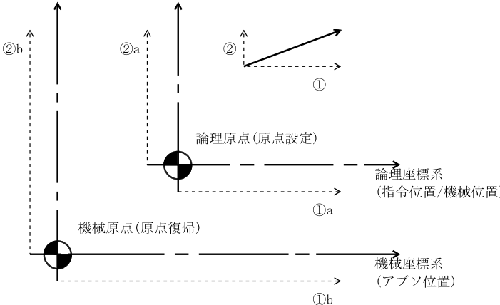

# 標準PCベースファインモーションコントローラ[RTMC64-M3/RTMC64-EC]

ユーザーズマニュアル

Ｖer. 1.3 2021.8.25

PCベースファインモーションコントローラの御購入ありがとうございます。 PCベースファインモーションコントローラにはRTMC64-M3とRTMC64-ECの2種類あります。このマニュアルでは共通部をRTMC64-M3/ECまたはRTMC64と略して記述しています。どちらかに特有な説明はRTMC64-M3は[M3]、RTMC64-ECは[EC]と注記して説明します。

お願い

このマニュアルの記載内容について、まちがいや不明な点がありましたら、お手数ですがFAXまたはメールにてテクノへお知らせ下さい。今後さらに改善していきます。

株式会社テクノ

〒358-0011 埼玉県入間市下藤沢1304-5 TEL 04-2964-3677 FAX 04-2964-3322 E-mail mail@open-mc.com

まえがき

RTMC64-M3/ECをご使用いただきありがとうございます。

PCベースファインコントローラRTMC64はサーボアンプへの通信の違いに対応し、2種類あります。

- RTMC64-M3 ・・・・・・・・ MECHATROLINK-Ⅲ
- RTMC64-EC ・・・・・・・・ EtherCAT

以降、２種類の製品をRTMC64-M3/EC、又はRTMC64と略記します。

ユーザーズマニュアルは、RTMC64を実際に使用し、機械や周辺電気品(制御盤など)の設計をしていただくために「RTMC64-M3/ECの導入方法」、「RTMC64-M3/Eの機能」、「試運転・調整方法」、「メンテナンス」について説明しています。

本書以外にも以下のマニュアルや資料がありますので、あわせて御覧下さい。

- [ ] □ RTMC64-M3/EC セッティングPCマニュアル

TB00-1041

- [ ] □ RTMC64-M3/EC ROMSW設定ソフトマニュアル

TB00-1042

EtherCATのコンフィグレーションの手順書

- [ ] □ ENIファイル作成手順書(RSI-ECAT-Master用) TB00-1058

- [ ] □ ENIファイル作成手順書(AlgoEtherCAT"TwinCAT3"用) TB00-1149

- [ ] □ ENIファイル作成手順書(AlgoEtherCAT"ET9000"用) TB00-1059

PCアプリ/INtime上のソフト開発の資料

- [ ] □ RTMC64-M3/EC 通信ライブラリーリファレンスマニュアル TB00-1043

- [ ] □ RTMC64-M3/EC 送受信データマニュアル

TB00-1044

- [ ] □ RTMC64-M3/EC テクノコード変換ライブラリリファレンスマニュアル TB00-1045

- [ ] □ RTMC64-M3/EC Gコード変換ライブラリリファレンスマニュアル TB00-1046

PLCからラダー制御する場合の参考資料

- [ ] □ RTMC64-M3/EC サンプルラダープログラム説明書

TB00-1047

使用される各社サーボのマニュアル及びサーボツールの説明書も参照下さい。

－目次－

| ……………………………………………… Ⅰ 導入編 ………………………………… 1．導入から運転・実稼働までの全体の作業(概要)                                                                | A1 A1                                         |
|--------------------------------------------------------------------------------------------------------------------------------|-----------------------------------------------|
| ………………………………………… 2．初期導入作業(購入後の初めての作業)                                                                                          | A3                                            |
| ………………………………………………………………………………………………………… 2-1.員数チェック!                                                                           | A3                                            |
| ……………………………………………………………… 2-2.マニュアルをご覧下さい ! (HPからダウンロード)                                                                        | A4                                            |
| …………………………………………………… 3．RTMC64-M3/ECのインストール A5                                                                                  | …………………………………………………… 3．RTMC64-M3/ECのインストール A5 |
| …………………………………………………………………………………………………… (1).システム構成                                                                              | A5                                            |
| ……………………………………………………………………………………… (2).RTMC64インストール作業                                                                           | A5                                            |
| …………………………………………………………………………………… (Ⅰ).RTMC64-M3の場合のインストール                                                                       | A6                                            |
| ……………………………………………………………………………………… 3-1. RTMC64インストール作業[M]                                                                       | A6                                            |
| …………………………………………………… 3-1-1.テクノPCベースファインモーションのインストール                                                                            | A6                                            |
| ……………………………………………………………… 3-1-2.RTMC64データバックアップファイルの配置                                                                          | A6                                            |
| …………………………………………………………………………………… 3-2. ドライバインストール作業[M]                                                                          | A6                                            |
| ………………………………………………… 3-2-1.Mechatrolink-Ⅲインターフェースボードの追加・設置                                                                      | A6                                            |
| ……………………………………………………………………………… 3-2-2.Windowsドライバインストール                                                                         | A7                                            |
| ……………………………………………………………………………………………… 3-4.INtimeカーネル設定[M]                                                                       | A7                                            |
| ………………………………………………………………………………… 3-5.MECHATROLINK-Ⅲデバイス設定[M]                                                                    | A9                                            |
| ………………………………………………………………………………………………… 3-6.自動起動の設定[M]                                                                           | A12 A12                                       |
| ………………………………………………………………………………………… 3-6-1.RT64M3自動起動設定 …………………………………………………………………… 3-6-2.ライセンス認証デーモン自動起動設定                       | A13                                           |
| …………………………………………………………… (Ⅱ).RTMC64-EC(RSI-ECAT-Master)の場合のインストール                                                               | A14                                           |
| ……………………………………………………………………………………… 3-1. RTMC64インストール作業[R] 3-1-1.テクノPCベースファインモーションのインストール                                        | A14 …………………………………………………… A14                  |
| ……………………………………………………………… 3-1-2.RTMC64データバックアップファイルの配置                                                                          | A14                                           |
| …………………………………………………………………………………… 3-2. ドライバインストール作業[R]                                                                          | A14                                           |
| ……………………………………………………………………… 3-2-1.ネットワークデバイスの追加・設置                                                                             | A14                                           |
| ………………………………………………………………………… 3-2-2.Windowsドライバのインストール …………………………………………………………………………………… 3-3. INtime-RTのインストール[R]                | A15 A15                                       |
| …………………………………………………………………………………………… 3-4.INtimeカーネル設定[R]                                                                        | A15                                           |
| ………………………………………………………………… 3-5.EtherCATマスタースタックのインストール[R] …………………………………………………………………… 3-6.NIC(Network Interface Controller)設定[R] | A17 A17                                       |
| …………………………………………………………………………………………………… 3-6-1.NICの設置                                                                            | A17                                           |
| ………………………………………………………………………… 3-6-2.Windowsドライバのインストール                                                                          | A17                                           |
| …………………………………………………… 3-6-3.NICのINtimeへのパス-INpassを使用する場合(推奨)                                                                    | A17                                           |
| ……………………………………… 3-6-4.NICのINtimeへのパス-INtime Device Managerを使用する場合                                                              | A19                                           |
| …………………………………………………………………………………………… 3-7.RSI-ECAT-Master設定[R]                                                                   | A21 A21                                       |
| ………………………………………………… 3-7-1.使用するNIC(Network Interface Controller)の指定                                                             |                                               |
| …………………………………………………………………… 3-7-2.通信周期(サイクリックタイム)の指定                                                                            | A22 A24                                       |
| ………………………………………………………………………………………… 3-7-3.RSL検索パスの設定                                                                            | A25                                           |
| ………………………………………………………………………………………………… 3-8.ENIファイル作成[R] 3-8-1.PDOマッピング                                                          | A25                                           |
| ………………………………………………………………………………………………                                                                                           | A26                                           |
| ……………………………………………………………………………………… 3-8-2.ENIファイル作成手順                                                                            |                                               |
| ………………………………………………………………………………………………… 3-9.自動起動の設定[R] ………………………………………………………………………………………… 3-9-1.RT64EC自動起動設定                     | A27 A27                                       |
| …………………………………………………………………… 3-9-2.ライセンス認証デーモン自動起動設定                                                                             | A28                                           |
| ………………………………………………………………… (Ⅲ).RTMC64-EC(AlgoEtherCAT)の場合のインストール                                                                | A29 A29                                       |
| ……………………………………………………………………………………… 3-1.RTMC64インストール作業[A] …………………………………………………… 3-1-1.テクノPCベースファインモーションのインストール                    | A29                                           |
| 3-1-2.RTMC64データバックアップファイルの配置                                                                                                   | A29                                           |
| ………………………………………………………………                                                                                                       |                                               |
| …………………………………………………………………………………… 3-2. ドライバインストール作業[A]                                                                          | A29                                           |
| …………………………………………………………………………………… 3-3. INtime-RTのインストール[A] …………………………………………………………………………………………… 3-4.INtimeカーネル設定[A]              | A29 A30                                       |
| …………………………………………………………………… 3-5.NIC(Network Interface Controller)設定[A]                                                          | A33                                           |

| 3-5-1.NICのINtimeへのパス                                                                                           | ……………………………………………………………………………………… A33                                             |
|----------------------------------------------------------------------------------------------------------------|-----------------------------------------------------------------------------------|
| …………………………………………………………………………………………… 3-6.NICと通信周期の設定[A]                                                         | A35                                                                               |
| 3-7.ENIファイル作成[A]                                                                                               | ………………………………………………………………………………………………… A36                                         |
| 3-7-1.PDOマッピング                                                                                                 | ……………………………………………………………………………………………… A36                                          |
| 3-7-2.ENIファイル作成手順                                                                                              | ……………………………………………………………………………………… A37                                             |
| ………………………………………………………………………………………………… 3-8.自動起動の設定[A]                                                           | A38                                                                               |
| 3-8-1.RT64EC自動起動設定                                                                                             | ………………………………………………………………………………………… A38                                            |
| 3-8-2.ライセンス認証デーモン自動起動設定                                                                                        | …………………………………………………………………… A39                                                    |
| 4．パラメータの設定                                                                                                     | ………………………………………………………………… A40                                                     |
| 4-1. ROMSW(ロムスイッチ)の設定                                                                                          | ……………………………………………………………………………………… A40                                             |
| ………………………………………………………………………………………………… 4-1-1.ROMSWの設定                                                           | A40                                                                               |
| 4-1-2.ROMSW設定変更時のINtimeプロセス再起動 ……………………………………………………………………………………………… 4-1-3.INtimeの再起動                           | ……………………………………………………………… A41 A41                                                  |
| 4-1-4.RTMC64正常起動確認                                                                                             | ………………………………………………………………………………………… A41                                            |
| 4-2. パラメータ未設定エラー/バックアップメモリエラーの解除                                                                               | ………………………………………………… A42                                                           |
| 4-2-1.パラメータ未設定エラー/バックアップメモリエラーの確認                                                                              | ………………………………………… A42                                                              |
| 4-2-2.パラメータ初期化／バックアップ                                                                                          | ………………………………………………………………………… A43                                                  |
| 4-3. セッティングPCソフト設定                                                                                             | ……………………………………………………………………………………… A45                                             |
| 5．通信接続の設定/確認                                                                                                   | …………………………………………………………… A47                                                       |
| 5-1. 通信設定（共有メモリ）                                                                                              | ………………………………………………………………………………………… A47 ……………………………………………………………………………………… A48      |
| 5-2. 通信設定（イーサネット）                                                                                             |                                                                                   |
| …………………………………………………………………………………………… 5-2-1.FAPC上のNIC設定 …………………………………………………………………………… 5-2-2.INtimeノード上のNetwork設定 | A48 A50                                                                           |
| …………………………………………………………………………………… 5-2-3.別PCのネットワーク設定                                                            | A54                                                                               |
| 5-2-4.別PC上の設定                                                                                                  | ………………………………………………………………………………………………… A56                                         |
| 5-3. 通信確認                                                                                                      | …………………………………………………………………………………………………………… A58                                     |
| 6．アンインストール                                                                                                     | ………………………………………………………………… A58                                                     |
| 7．ダミー運転                                                                                                       | ……………………………………………………………………… A59                                                   |
| 7-1. ROMSWの設定                                                                                                  | ……………………………………………………………………………………………………… A59                                       |
| 7-2. セッティングPCソフトを起動                                                                                            | …………………………………………………………………………………… A60                                              |
| ……………………………………………………………………………………………… 7-3. ダミーで運転・操作                                                            | A60 …………………………………………………………………………                                                  |
| 7-3-1.手動操作（ジョグ／インチング）                                                                                          | A61                                                                               |
| 7-3-2.ワンショット位置決め                                                                                               | ……………………………………………………………………………………… A61                                             |
| 7-3-3.ホーム位置決め                                                                                                  | A63                                                                               |
| ……………………………………………………………………………………………… 7-3-4.運転プログラムのダウンロード                                                      | …………………………………………………………………………… A64                                                 |
| 7-3-5.自動モードでメモリー運転 7-3-6.ティーチング画面でシングルステップ運転                                                                   | ………………………………………………………………………………… A65 ……………………………………………………………… A65                  |
| 7-4. 他の画面をみる                                                                                                   |                                                                                   |
| ……………………………………………………………………………………………………                                                                         | A66                                                                               |
| 7-5. その他の運転の準備                                                                                                 | ……………………………………………………………………………………………… A66 ……………………………………………………………………………………………… A66 |
| 7-5-1.アラームの解除 7-5-2.RTMC64の再起動                                                                                 | ……………………………………………………………………………………………… A66                                          |
| 8．モータ単体運転の準備                                                                                                  | ………………………………………………………… A67                                                        |
| …………………………………………………………………………………………………………… 8-1. 配線準備                                                            | A67                                                                               |
| ……………………………………………………………………………………… 8-2. 組立・配線・配線チェック                                                            | A67 …………………………………………………………………………………… A67                                          |
| 8-3.サーボアンプの局アドレス設定                                                                                             | A68                                                                               |
| ……………………………………………………………………………………………… 8-4.RTMC64のROMSWの設定 8-5.RTMC64のサーボパラメータの設定例                               | ……………………………………………………………………………… A70                                                |
| ………………………………………………………………………………………………… 8-6.サーボアンプの設定                                                            | A70                                                                               |
| 9．モータ単体運転                                                                                                     | A75 ……………………………………………………………………………………                                              |
| ………………………………………………………………… 9-1. サーボ主電源投入シーケンス                                                                   | A75 A75                                                                           |
| 9-2. サーボロックの確認                                                                                                 | ……………………………………………………………………………………………… A75                                          |
| 9-3. サーボの異常                                                                                                    | A75                                                                               |
| ……………………………………………………………………………………………………… ……………………………………………………………………………………………………… 9-4. 手動/自動運転                   | ……………………………………………………………                                                           |
| 10．導入編の補足資料                                                                                                   | A76 ……………………………………………………………………………………………… A76                                      |
| 10-1. 出荷リストサンプル                                                                                                |                                                                                   |
| 10-2. 出荷CDの中身                                                                                                  | ……………………………………………………………………………………………………… A77                                       |
| 10-3. サンプル運転プログラム                                                                                              | ………………………………………………………………………………………… A79                                            |

| 10-4. ソフトウェアバージョン 10-4-1.                                                                               | ………………………………………………………………………………………… A79                                                                                                                                     |
|---------------------------------------------------------------------------------------------------------|----------------------------------------------------------------------------------------------------------------------------------------------------------------------------|
| ……………………………………………………………………… ソフトウェアバージョンの付け方 …………………………………………………………………… 10-4-2.ソフトウェアバージョンの確認方法          | A79 A79                                                                                                                                                                    |
| Ⅱ 機能編                                                                                                   | ……………………………………………… D1                                                                                                                                                      |
|                                                                                                         | …………………………………………………………………………… D1                                                                                                                                           |
| 1.機能概要 1-1.RTMC64の構成                                                                                    | ………………………………………………………………………………………………………… D1                                                                                                                                |
| 1-1-1.全体ブロック図                                                                                           | ……………………………………………………………………………………………… D1                                                                                                                                    |
| 1-1-2.RTMC64内の各部の役割(概略)                                                                                 | ……………………………………………………………………………… D3                                                                                                                                          |
| 1-2.RTMC64-M3/ECの運転・操作 1-2-1. Windows上のPCアプリ(Win-IF)からの運転・操作                                            | ………………………………………………………………………………………… D5 …………… 【RTMC全体ブロック図(4-1),(6)】 D5                                                                                                      |
| 1-2-2.INtime上のユーザ制御ソフト（PLC-IF/C-IF）からの運転・操作                                                             | ……………………………………… D6                                                                                                                                                         |
| 1-2-3.入出力局（M/Eスレーブ）からの運転・操作【M/E通信の入力/出力                                                                | …… ブロック図(5)】 D8                                                                                                                                                            |
| 1-3.共有メモリインタフェースの概要                                                                                     | ………………………………………………………………………………… D9                                                                                                                                         |
| 1-3-1.通信領域INtime用                                                                                       | …………………………………………………………………………………………… D9                                                                                                                                     |
| 1-3-2.RTMC64専用レジスタ・入出力局直接アクセス                                                                           | …………………………………………………………… D10                                                                                                                                                |
| …………………………………………………………………………………………………………… 1-4.機能リスト                                                     | D11                                                                                                                                                                        |
| 1-4-1.RTMC64-M3/EC本体機能リスト                                                                               | D11                                                                                                                                                                        |
| ……………………………………………………………………………… ……………………………………………………………………………………… 1-4-2.機械パネル機能リスト                       | D13                                                                                                                                                                        |
| 1-4-3.セッティングPC機能リスト(PC)                                                                                 | …………………………………………………………………………… D13                                                                                                                                          |
| 1-4-4.通信コマンド機能リスト(PC(Windows)/PLC)                                                                      | …………………………………………………………… D14                                                                                                                                                |
| 1-5.基本仕様                                                                                                | ……………………………………………………………………………………………………………… D16                                                                                                                             |
| 2.入出力機能                                                                                                 | ………………………………………………………………………… D18                                                                                                                                           |
| 2-1.入力信号の名称と機能 2-1-1.一般入力 2-1-2.補助機能入力 2-1-3.汎用入力                                                       | ……………………………………………………………………………………………… D18 ……………………………………………………………………………………………………… D18 ………………………………………………………………………………………………… D20 ……………………………………………………………………………………………………… D20 |
| 2-1-4.軸制御入力                                                                                             | …………………………………………………………………………………………………… D21 ………………………………………………………………………………………………                                                                                            |
|                                                                                                         | D21 ………………………………………………………………………………… D22                                                                                                                                    |
| 2-1-5.機械パネル入力                                                                                           |                                                                                                                                                                            |
| 2-1-6.機械パネル入力の補足説明 2-1-7.機械パネル入力のモード選択                                                                  | ……………………………………………………………………………… D24                                                                                                                                         |
| ……………………………………………………………………………………………… 2-2.出力信号の名称と機能                                                     | D25                                                                                                                                                                        |
| 2-3.入出力信号のアドレス表                                                                                         | …………………………………………………………………………………………… D27                                                                                                                                    |
| 2-3-1.入力信号のアドレス                                                                                         | ………………………………………………………………………………………… D27                                                                                                                                     |
|                                                                                                         | D34 D37                                                                                                                                                                    |
| 2-3-2.出力信号のアドレス 2-4.入出力局の信号割り付け                                                                         | …………………………………………………………………………………………                                                                                                                                         |
| ………………………………………………………………………… 3. 動作モード                                                                   | …………………………………………………………………………………………… D38                                                                                                                                    |
| 3-1. 各動作モードと主な機能                                                                                        | D38                                                                                                                                                                        |
| …………………………………………………………………………………………                                                                      |                                                                                                                                                                            |
| 4.INtimeユーザ制御ソフト(PLC/C)とのインターフェース ……………………………………………………………………………………… 4-1．PLC/CとRTMC64-M3/ECの関係           | …………………………… E1 E1                                                                                                                                                          |
| ……………………………………………………………………………………… 4-2．共有メモリインターフェース ……………………………………………………………………………………… 4-3．通信領域を使用した通信機能 | E2 E4                                                                                                                                                                      |
| ……………………………………………………………………………………………… 4-3-1．通信処理の概要 …………………………………………………………………………………………………                | E4                                                                                                                                                                         |
| 4-3-2．通信領域詳細 ……………………………………………………………………………………………………… 4-4．サンプルラダー                                        | E4                                                                                                                                                                         |
|                                                                                                         | E5                                                                                                                                                                         |
| 4-4-1．コピーして使う部分                                                                                         | E5                                                                                                                                                                         |
| 5.サーボ制御（一般仕様） …………………………………………………………………………………………………………………                                               | …………………………………………………………………………………………                                                                                                                                         |
| 5-1．座標系                                                                                                 | …………………………………………………………… E6                                                                                                                                                 |
|                                                                                                         | E6                                                                                                                                                                         |
| 5-2．アブソ指令とインクレ指令 (指数形/直線形/S字)                                                                           | ………………………………………………………………………………………… E6 E7                                                                                                                                   |
| 5-3．補間加減速 5-4．直線形加減速                                                                                    | ……………………………………………………………………………… ………………………………………………………………………………………………………… E7                                                                                                 |
| PTP/G00                                                                                                 | ……………………………………………………………………………………… E8                                                                                                                                       |
| LIN/GO1                                                                                                 | ……………………………………………………………………………………… E8                                                                                                                                       |
| 5-5．PTP制御(位置決め)                                                                                         | ……………………………………………………………………                                                                                                                                                 |
| 5-6．直線補間                                                                                                | E9                                                                                                                                                                         |
| 5-7．円弧補間 CIRR、CIRL / G02、G03                                                                            | …………………………………………………………………………………………………                                                                                                                                      |
| 5-7-1．プリ解析方式                                                                                            | E9                                                                                                                                                                         |

| 5-7-2．RTMC64内部方式                                                                                                                                                                                            | ……………………………………………………………………………………………… E9                    |
|-------------------------------------------------------------------------------------------------------------------------------------------------------------------------------------------------------------|------------------------------------------------------------|
| …………………………………………………………………………………………………………… 5-8．手動送り                                                                                                                                                          | E10                                                        |
| …………………………………………………………………………………………… 5-8-1．ジョグ(JOG)送り                                                                                                                                                        | E10                                                        |
| …………………………………………………………………………………… 5-8-2．インチング送り(手動)                                                                                                                                                          | E10                                                        |
| ………………………………………………………………………………………… 5-9．インポジションチェック                                                                                                                                                          | E10                                                        |
| ………………………………………………………………………………… 5-10．なめらかな送り制御(パス機能)                                                                                                                                                        | E11                                                        |
| …………………………………………………………………………………………… 5-11．シングルステップ動作                                                                                                                                                         | E12                                                        |
| ……………………………………………………………………………………………………… 5-12．サイクル運転                                                                                                                                                         | E12                                                        |
| ……………………………………………………………………………………………… 5-13．オーバーライド機能                                                                                                                                                         | E12                                                        |
| ……………………………………………………………………………………………… 5-14．ストロークリミット                                                                                                                                                         | E13                                                        |
| …………………………………………………………………………………… 5-15．軸制御に関するその他の機能                                                                                                                                                         | E14                                                        |
| ………………………………………………………………………………………… 5-15-1．周回処理(回転軸)                                                                                                                                                         | E14                                                        |
| ………………………………………………………………………………… 5-15-2．回転速度指令 SPIN/G120                                                                                                                                                     | E14                                                        |
|                                                                                                                                                                                                             | ………………………………… E15                                          |
| 5-15-3．ねじ切り機能(同期送り) <オプション> (計画中) 5-15-4．同一指令2軸制御 <オプション> 5-15-5．接線制御軸機能 <オプション>                                                                                                                            | E15                                                        |
| ……………………………………………… ………………………………………………                                                                                                                                                                       | E16                                                        |
| ……………………………………………… 5-15-6．センサーラッチ機能（スキップ機能） <オプション>                                                                                                                                                         | E18                                                        |
| ………………………………… 5-15-7．コンベア追従送り同調・同期送り <オプション> (計画中)                                                                                                                                                         | E20                                                        |
| ……………………………………………… 5-15-8．直径指令 <オプション>                                                                                                                                                                      | E21 E22                                                    |
| ………………………………… 5-15-9．フレキシブル電子カム制御 <オプション> (計画中)                                                                                                                                                             | E23                                                        |
| ……………………………………………… 5-15-10．巻線指令 <オプション>                                                                                                                                                                     | E28                                                        |
| ……………………………………………… 5-15-11．トルク指令 <オプション>                                                                                                                                                                    |                                                            |
| ……………………………………………… 5-16．主軸機能 <オプション>                                                                                                                                                                        | E31                                                        |
| …………………………………………………………………………………… 5-16-1．ON/OFF(信号出力)主軸                                                                                                                                                      | E31                                                        |
| ………………………………………………………………………………………………… 5-16-2．サーボ主軸                                                                                                                                                          | E31                                                        |
| …………………………………………………………………………………………………………… 5-17．補正機能                                                                                                                                                         | E33                                                        |
|                                                                                                                                                                                                             | ………………………………………………………………………………… 5-17-1．バックラッシュ補正機能 E33 E33 |
| ……………………………………………… 5-17-2．工具長補正機能 <オプション> ……………………………………………… 5-17-3．工具径補正機能 <オプション> ……………………………………………… 5-17-4．ピッチエラー補正機能 <オプション>                                                                            | E35                                                        |
| ……………………………………………… 5-17-5．形状補正(高精度輪郭制御) <オプション>                                                                                                                                                             | E54                                                        |
|                                                                                                                                                                                                             | E56                                                        |
| ………………………………………………………………………………………… 5-18．ティーチング (開発中)                                                                                                                                                        | E61                                                        |
| ……………………………………………………………………………………………… 5-18-1．ティーチング                                                                                                                                                          | E61                                                        |
| ………………………………………………………………………………………… 5-18-2．「逆行」動作詳細 …………………………………………………………………………………… 5-18-3．「スキップ」動作詳細                                                                                                       | E63 E64                                                    |
| ………………………………………………………………………………………… 5-18-4．「挿入」動作詳細                                                                                                                                                          | E64                                                        |
| ………………………………………………………………………………………… 5-18-5．「置換」動作詳細                                                                                                                                                          | E65                                                        |
| ………………………………………………………………………………… 5-18-6．「原点シフト」動作詳細                                                                                                                                                          | E67 E67                                                    |
| ………………………………………………………………………………………… 5-18-7．「削除」動作詳細 ………………………………………… 5-19．補間前加減速(自動コーナオーバライド)機能 <オプション>                                                                                                      | E68                                                        |
|                                                                                                                                                                                                             | E68                                                        |
| ………………………………………………… 5-19-1．補間前加減速(自動コーナオーバライド)のメリット                                                                                                                                                         | ……………………………………………………… 5-19-2．補間前加減速(自動コーナオーバライド)の概要 E68    |
| 5-19-3．補間前加減速(自動コーナオーバライド)をしているときの速度変化(オーバライド)の様子                                                                                                                                                           | …… E68                                                     |
| ……………………………………………………………………………………………… 5-19-4．制限事項など                                                                                                                                                          | E69                                                        |
| ………………………………………………………………………… 5-19-5．加速度(速度変化量)の算出方法 5-19-6．パラメータの設定について                                                                                                                                     | E69 E70                                                    |
| ………………………………………………………………………………                                                                                                                                                                              |                                                            |
| ……………………………………………………………………………………………………… 5-19-7．動作例                                                                                                                                                          | E71                                                        |
| 5-19-8．パラメータの選定例                                                                                                                                                                                            | E72                                                        |
| ……………………………………………………………………………………… ……………………………………………………………………………………………………… 5-20．独立位置決め                                                                                                                       | E73                                                        |
|                                                                                                                                                                                                             | E76                                                        |
| ………………………………………… 5-21．手動パルサ/ジョイスティック <オプション>                                                                                                                                                                |                                                            |
| 5-21-1．ハードウェアの準備                                                                                                                                                                                            | E76                                                        |
| ………………………………………………………………………………………                                                                                                                                                                           | E76 E76                                                    |
| ……………………………………………………………………………………………… 5-21-2．手動送り設定 ………………………………………………………………………………………… 5-21-3．手パモードの選択 …………………………………………………………………………………………… 5-21-4．手動運転の条件 ………………………………………………………………………………………………… 5-21-5．信号の流れ | E76 E76 E77                                                |
| ……………………………………………………………………………………………………… 5-22．原点復帰機能                                                                                                                                                         |                                                            |
|                                                                                                                                                                                                             | E77                                                        |
| ……………………………………………………………………………… 5-22-1．各軸の原点復帰方式の選択 ………………………………………………………………………………………… 5-22-2．原点復帰逃げ動作                                                                                                       | ………………………………………………………………………………… 5-22-3．原点復帰時論理座標設定 E90 E91 |
|                                                                                                                                                                                                             | E90                                                        |
| ……………………………………………………………………………………………… 5-22-4．全軸原点復帰                                                                                                                                                          |                                                            |
|                                                                                                                                                                                                             | TB00-1040-V13.jtd-6                                        |

…………………………………………………………………………………

| 6. 運転プログラムの処理と各種運転方法                                                                                             | …………………………………………… F1                     |
|------------------------------------------------------------------------------------------------------------------|------------------------------------------|
| …………………………………………………………………………………… 6-1．運転プログラムの保存の仕組み                                                              | F1                                       |
| ……………………………………………………………………………………… 6-1-1．運転プログラムの容量                                                               | F2                                       |
| ………………………………………………………………………………… 6-1-2．運転プログラムの番号管理                                                               | F2                                       |
| …………………………………………………………………………………………… 6-1-3．ポイントテーブル                                                               | F2                                       |
| …………………………………………………………………………………………… 6-2．運転プログラムの事例                                                               | F3                                       |
| …………………………………………………………………………………… 6-3．自動運転におけるステップ動作                                                              | F5                                       |
| ……………………………………………………………………………………………………… 6-3-1．自動運転                                                               | F5                                       |
| ………………………………………………………………………………………… 6-3-2．シングル運転(順行)                                                              | F5                                       |
| ……………………………………………………………………………………………… 6-3-3．ステップ間停止                                                               | F5                                       |
| …………………………………………………………………………………………… 6-3-4．ステップ途中停止                                                               | F5                                       |
| ……………………………………………………………………… 6-3-5．逆行(ステップ逆行) （開発中）                                                               | F5                                       |
| ………………………………………………………………………… 6-4．プリ解析処理(テキスト→バイナリ変換) ……………………………………………………………………………… 6-5．DNC(Direct NC)方式 <オプション> | F6                                       |
|                                                                                                                  | F8                                       |
| …………………………………………………………………………………………………… 6-6．単独コマンド運転                                                              | F9                                       |
| ………………………………………………………………………………… 6-7．マルチタスク <オプション>                                                               | F10                                      |
| ……………………………………………………………………………………… 6-7-1．マルチタスクの概要                                                                | F10                                      |
| ……………………………………………………………… 7. 運転プログラム詳細                                                                            | F12                                      |
| ……………………………………………………………………………… 7-1．テクノコード運転プログラム命令                                                               | F12                                      |
| ………………………………………………………………………………………… 7-1-1．運転プログラム例                                                                | F14                                      |
|                                                                                                                  | F15                                      |
| ………………………………………………………………………………………………… 7-1-2．付加データ ………………………………………………………………………………………… 7-1-3．指令フォーマット              | F16                                      |
|                                                                                                                  | F18                                      |
| …………………………………………………… 7-1-4．テクノコードプログラムの詳細（Gr1aグループ） ……………………………………………… 7-1-5．テクノコードプログラム指令の詳細（Gr1bグループ）          | F34                                      |
| ……………………………………………… 7-1-6．テクノコードプログラム指令の詳細（Gr1cグループ）                                                              | F39                                      |
| ………………………………………………… 7-1-7．テクノコードプログラム指令の詳細（Gr2グループ）                                                              | F42                                      |
| ………………………………………………… 7-1-8．テクノコードプログラム指令の詳細（Gr3グループ）                                                              | F43                                      |
| ………………………………………………… 7-1-9．テクノコードプログラム指令の詳細（Gr4グループ）                                                              | F45                                      |
| …………………………………………………… 7-1-10．テクノコードプログラムの詳細（Gr5グループ）                                                              | F47                                      |
| …………………………………………………………… 7-1-11．テクノコードプログラムの詳細（その他）                                                               | F48                                      |
| ……………………………………………………………………………………… 7-2．Gコード運転プログラム命令                                                              | F49                                      |
|                                                                                                                  | F49                                      |
| …………………………………………………………………………… 7-2-1．Gコード運転プログラムの概要 ………………………………………………………………………………………………… 7-2-2．付加データ             | F52                                      |
| …………………………………………………………………………………………… 7-2-3．指令の表記方法                                                               | F52                                      |
| …………………………………………………………… 7-2-4．Gコードプログラムの詳細（Gr1グループ）                                                              | F55                                      |
| ……………………………………………………………… 7-2-5．Gコードプログラムの詳細(Gr2グループ)                                                             | F75                                      |
| ……………………………………………………………………… 7-2-6．Gコードプログラムの詳細(その他)                                                              | F81                                      |
|                                                                                                                  | F82                                      |
| ………………………………………………………………………………………… 7-3．マクロ機能 <オプション> ………………………………………………………………………………………………………… 7-3-1．書式           | F82                                      |
| ……………………………………………………………………………… 7-3-2．マクロ変数使用可能コード 7-3-3．レジスタ一覧                                                   | F83                                      |
|                                                                                                                  | ……………………………………………………………………………………………… F84 |
| …………………………………………………… 7-3-4．グローバルマクロ変数 #1000～                                                                     | F85 F85                                  |
| ………………………………… 7-3-5．ラダー共有マクロ変数 #1200～ (RTMC64→PLC) 7-3-6．ラダー共有マクロ変数 #1300～ (PLC→RTMC64)                          | F86                                      |
| ………………………………… …………………………………… 7-3-7．ローカルマクロ変数 #1400～ (タスク毎) …………………………………………………… 7-3-8．各種情報 #1500～                | F86 F86                                  |
|                                                                                                                  | F90                                      |
| …………………………………………………… 7-3-9．入／出力パターン #1600～                                                                      |                                          |
| …………………………………… 7-3-10．サーボパラメータ #2001～（タスク毎）                                                                     | F91                                      |
| …………………………………… 7-3-11．工具長補正テーブル #3000～（タスク毎） 7-3-12．工具長補正値 #3100～（タスク毎）                                        | F95 F95                                  |
| ……………………………………                                                                                                   | F96                                      |
| …………………………………… 7-3-13．工具径補正テーブル #3500～（タスク毎）                                                                    | F97                                      |
| …………………………………… 7-3-14．ポジションデータ #4000～（タスク毎）                                                                     | F98                                      |
| …………………………………… 7-3-15．センサーラッチポジションデータ #5000～（タスク毎）                                                              | F99                                      |
| ……………………………… 7-3-16．メカトロリンクコマンド発行命令用データ(開発中) #5200～5289                                                          | F99                                      |
| …………………………………………………… 7-3-17．マクロ変数LONGアクセス #5500～                                                                 |                                          |
| …………………………………………………… 7-3-18．HEX 入力データ #6000～                                                                     | F100                                     |
| …………………………………………………                                                                                              | F101                                     |
| 7-3-19．内部データ #7100～                                                                                              |                                          |

| 7-3-20．                                                                               | 入／出力Bit #10000～                                                                       | … ◆1.2 F102                                                            |
|---------------------------------------------------------------------------------------|---------------------------------------------------------------------------------------|------------------------------------------------------------------------|
| 7-3-21．                                                                               | MECHATROLINK通信CMDデータ/RxPDOデータ                                                         | … #200000～ ◆1.2 F102                                                   |
| 7-3-22．                                                                               | MECHATROLINK通信RSPデータ/TxPDOデータ                                                         | … #200000～ ◆1.2 F102                                                   |
| 7-4．運転プログラム                                                                           | フォーマットエラー/実行エラー                                                                       | …………………………………………………………… F103                                           |
|                                                                                       | 7-4-1．「プログラムフォーマットエラー」                                                                | …………………………………………………………………… F103                                        |
|                                                                                       | 7-4-2．「プログラムバッファオーバーフロー」                                                              | ……………………………………………………………… F105                                          |
|                                                                                       | 7-4-3．「プログラム実行エラー」                                                                    | ……………………………………………………………………………… F105                                    |
|                                                                                       | ……………………………………………………………………………………………… 7-5．運転プログラム事例                                    | F107                                                                   |
|                                                                                       | 7-5-1．運転プログラム事例1 SWICH/CASEの応用                                                        | …………………………………………………………… F107                                           |
|                                                                                       | マクロ変数で位置指定する搬送動作                                                                      | F107                                                                   |
| 7-5-2．運転プログラム事例２                                                                      | 7-5-2．運転プログラム事例２                                                                      | ……………………………………                                                         |
| Ⅲ 試運転・調整編                                                                             | Ⅲ 試運転・調整編                                                                             | …………………………………… H1 ……………………………………………………………………… H1                       |
| 試運転の前に試運転・調整までの作業フロー(概略) 3. ROMSW(ロムスイッチ)の設定                                         |                                                                                       | …………………………………………… H2 …………………………………………………… H3                           |
| …………………………………………………………………… 4. サーボパラメータ                                                | …………………………………………………………………… 4. サーボパラメータ                                                | H3                                                                     |
| 4-1.                                                                                  | 送り速度、加減速などのパラメータ                                                                      | ……………………………………………………………………………… H4                                      |
| 4-2.                                                                                  | ストロークリミットのパラメータ                                                                       | ………………………………………………………………………………… H6                                     |
| 4-3.                                                                                  | 原点復帰の動作                                                                               | ……………………………………………………………………………………………………… H7                             |
| 4-4.                                                                                  | 全軸原点復帰の逃げ動作                                                                           | …………………………………………………………………………………………… H8                                 |
| 4-5.                                                                                  | 全軸原点復帰シーケンス(順位)                                                                       | …………………………………………………………………………………… H9 H9                                 |
| ………………………………………………………………………………………………… 4-6. その他のパラメータ 5. セッティングPCでモータを回す               | ………………………………………………………………………………………………… 4-6. その他のパラメータ 5. セッティングPCでモータを回す               | ………………………………………………… H10                                                |
| 5-1.                                                                                  | ……………………………………………………………………………………………………… 配線チェック                                        | H10                                                                    |
| 5-2.                                                                                  | RTMC64-M3/ECの起動                                                                       | ……………………………………………………………………………………………… H10                               |
| 5-3.                                                                                  | セッティングPCの起動                                                                           | …………………………………………………………………………………………… H11                                |
| 5-4.                                                                                  | セッティングPCソフトの練習                                                                        | …………………………………………………………………………………… H11                                   |
| 5-5.                                                                                  | RTMC64-M3/ECのバックアップ情報                                                                 | ……………………………………………………………………………… H12                                     |
| 5-6.                                                                                  | バックアップエラー/パラメータ未設定エラーの解除                                                              | ………………………………………………………… H12                                             |
| 5-7. モータを回す                                                                           | ………………………………………………………………………………………………………                                               | H13                                                                    |
| 5-8.                                                                                  | 5-7-1.サーボ電源を入れる                                                                       | ………………………………………………………………………………………… H13                                 |
| …………………………………………………………………………………………………………… 手動操作                                        | …………………………………………………………………………………………………………… 手動操作                                        | H13                                                                    |
| 5-9. その他の基本的操作                                                                        | 5-9. その他の基本的操作                                                                        | ……………………………………………………………………………………………… H13                               |
| サーボ系の制御性能 ……………………………………………………………………………………………… 6-1. 機械の剛性の重要性                         | サーボ系の制御性能 ……………………………………………………………………………………………… 6-1. 機械の剛性の重要性                         | …………………………………………………………… H14 H14                                        |
| ………………………………………………………………………………………………………… 6-2.制御系の良さ                                   | ………………………………………………………………………………………………………… 6-2.制御系の良さ                                   | H14                                                                    |
| 6-3. サーボ系の3重ループ                                                                       | 6-3. サーボ系の3重ループ                                                                       | ……………………………………………………………………………………………… H14                               |
| 6-4. RTMC64-M3/ECとサーボ系の関係 6-5.                                                        | 6-4. RTMC64-M3/ECとサーボ系の関係 6-5.                                                        | ………………………………………………………………………………… H15 ……………………………………………………………………………… H15 |
| サーボモータ応用時の一般的注意 ………………………………………………………………………………………………                                  | サーボモータ応用時の一般的注意 ………………………………………………………………………………………………                                  | H15                                                                    |
| 6-5-1. モータの選定                                                                         | 6-5-1. モータの選定                                                                         | …………………………………………………………………………………… H15                                   |
| 6-5-2. 速度ループゲイン調整                                                                     | 6-5-2. 速度ループゲイン調整                                                                     |                                                                        |
| 6-5-3. ACサーボの単体動作とパラメータ設定 6-5-4. 多軸のゲイン調整                                             | 6-5-3. ACサーボの単体動作とパラメータ設定 6-5-4. 多軸のゲイン調整                                             | ………………………………………………………………… H15                                          |
|                                                                                       |                                                                                       | ………………………………………………………………………………………… H15                                 |
| 6-5-5. 設定・調整例                                                                         | 6-5-5. 設定・調整例                                                                         | H16                                                                    |
| ……………………………………………………………………………………………… 7. 実際の試運転・調整(技術員、機械とりまとめの方へ)                     | ……………………………………………………………………………………………… 7. 実際の試運転・調整(技術員、機械とりまとめの方へ)                     | ………………………… H18 H20                                                     |
| ……………………………………………………………………………………… 7-1. 配線チェック(単体試運転) 7-2. 制御電源投入(単体試運転/メカ組合せ試運転) 7-3. | ……………………………………………………………………………………… 7-1. 配線チェック(単体試運転) 7-2. 制御電源投入(単体試運転/メカ組合せ試運転) 7-3. | ………………………………………………………………… H20 H20                                      |
| セッティングPC起動(単体試運転/メカ組合せ試運転) 7-4. RTMC64-M3/ECパラメータ設定(単体試運転/メカ組合せ試運転)                   | セッティングPC起動(単体試運転/メカ組合せ試運転) 7-4. RTMC64-M3/ECパラメータ設定(単体試運転/メカ組合せ試運転)                   | …………………………………………………………                                                 |
| 7-5. 入力信号の確認(単体試運転/メカ組合せ試運転)                                                          | 7-5. 入力信号の確認(単体試運転/メカ組合せ試運転)                                                          | ……………………………………………… H21 ……………………………………………………………… H22                    |
| 7-5-1. 信号モニタによるチェック                                                                   | 7-5-1. 信号モニタによるチェック                                                                   | ……………………………………………………………………………… H22                                     |
|                                                                                       |                                                                                       | ………………………………………………………… H22                                             |
| 7-5-2. ROMSW「局設定」の入出力信号割り付けの確認 7-5-3. ソフトウェアPLCまたはINtime上のC言語ソフトの確認                   | 7-5-2. ROMSW「局設定」の入出力信号割り付けの確認 7-5-3. ソフトウェアPLCまたはINtime上のC言語ソフトの確認                   | H22                                                                    |
| 7-5-4. 汎用入出力(セッティングPC)モニタ画面によるチェック                                                    | 7-5-4. 汎用入出力(セッティングPC)モニタ画面によるチェック                                                    | ……………………………………………… …………………………………………… H22                               |
| 7-5-5. 非常停止関係のチェック                                                                    | 7-5-5. 非常停止関係のチェック                                                                    | ………………………………………………………………………………… H23                                    |

| 7-6.                                                                                                                                                                                                                                                                           | ………………………………………………………………………………… サーボアンプのパラメータ設定                                                                                                                                                                                                                                 | H23                                                      |
|--------------------------------------------------------------------------------------------------------------------------------------------------------------------------------------------------------------------------------------------------------------------------------|--------------------------------------------------------------------------------------------------------------------------------------------------------------------------------------------------------------------------------------------------------------------------------|----------------------------------------------------------|
|                                                                                                                                                                                                                                                                                | …………………………………………………………… 7-7. サーボ主電源投入(単体試運転/メカ組合せ試運転) H24                                                                                                                                                                                                                      |                                                          |
| 7-8.                                                                                                                                                                                                                                                                           | …………………………………………………………………………………… 原点復帰(メカ組合せ試運転)                                                                                                                                                                                                                                | H24                                                      |
|                                                                                                                                                                                                                                                                                | …………………………………………………… 7-8-1. 《FBラッチ方式(原点信号あり) ±2段原点復帰》                                                                                                                                                                                                                          | H26                                                      |
| 7-8-2.                                                                                                                                                                                                                                                                         | …………………………………………………… 《FBラッチ方式(原点信号あり) ±1段原点復帰》                                                                                                                                                                                                                                 | H26                                                      |
| 7-8-3.                                                                                                                                                                                                                                                                         | ……………………………………………………………………… 《FBラッチ方式(原点信号無し)》                                                                                                                                                                                                                                  | H27                                                      |
| 7-8-4.                                                                                                                                                                                                                                                                         | ……………………………………………………………………… 《DECサーチ方式 ±2段原点復帰》                                                                                                                                                                                                                                 | H27                                                      |
| 7-8-5.                                                                                                                                                                                                                                                                         | ……………………………………………………………………… 《DECサーチ方式 ±1段原点復帰》                                                                                                                                                                                                                                 | H27                                                      |
| 7-8-6.                                                                                                                                                                                                                                                                         | ………………………………………………………… 《FBラッチ(OT信号)》(1段/2段は、同じ動作)                                                                                                                                                                                                                              | H28                                                      |
| 7-8-7.                                                                                                                                                                                                                                                                         | ………………………………………………………… 《OTサーチ原点復帰》(1段/2段は、同じ動作)                                                                                                                                                                                                                                | H28                                                      |
| 7-8-8.                                                                                                                                                                                                                                                                         | ………………………………………… 絶対値エンコーダの軸の設定 (安川電機製ΣVサーボの例)                                                                                                                                                                                                                                  | H29                                                      |
| …………………………………………………………………………… 7-8-9. 同一指令2軸制御での原点復帰                                                                                                                                                                                                                            | …………………………………………………………………………… 7-8-9. 同一指令2軸制御での原点復帰                                                                                                                                                                                                                            | H30                                                      |
| …………………………………………………………………… 7-9. ソフトリミットの設定(メカ組合せ試運転)                                                                                                                                                                                                                           | …………………………………………………………………… 7-9. ソフトリミットの設定(メカ組合せ試運転)                                                                                                                                                                                                                           | H31                                                      |
| ……………………………………………………………… 7-10. メモリー運転(単体試運転/メカ組合せ試運転) …………………………………………………………………………… 7-10-1. サーボ調整用運転プログラム                                                                                                                                                                      | ……………………………………………………………… 7-10. メモリー運転(単体試運転/メカ組合せ試運転) …………………………………………………………………………… 7-10-1. サーボ調整用運転プログラム                                                                                                                                                                      | H32                                                      |
| 7-10-2.                                                                                                                                                                                                                                                                        |                                                                                                                                                                                                                                                                                | H33                                                      |
|                                                                                                                                                                                                                                                                                | ………………………………………………………………………………… メモリー運転の注意事項                                                                                                                                                                                                                                    | H33                                                      |
| ……………………………………………………………… 7-11.サーボ系の調整(単体試運転/メカ組合せ試運転) I1                                                                                                                                                                                                                       | ……………………………………………………………… 7-11.サーボ系の調整(単体試運転/メカ組合せ試運転) I1                                                                                                                                                                                                                       | ……………………………………………………………… 7-11.サーボ系の調整(単体試運転/メカ組合せ試運転) I1 |
| ………………………………………………………………… 7-11-1. サーボ応答の確認(メカ組合せ試運転)                                                                                                                                                                                                                           | ………………………………………………………………… 7-11-1. サーボ応答の確認(メカ組合せ試運転)                                                                                                                                                                                                                           | I1                                                       |
| …………………………………………………………………… 7-11-2. 負荷電流の確認(メカ組合せ試運転)                                                                                                                                                                                                                           | …………………………………………………………………… 7-11-2. 負荷電流の確認(メカ組合せ試運転)                                                                                                                                                                                                                           | I2                                                       |
| …………………………………………………………… 7-12.パラメータの保存(単体試運転/メカ組合せ試運転)                                                                                                                                                                                                                          | …………………………………………………………… 7-12.パラメータの保存(単体試運転/メカ組合せ試運転)                                                                                                                                                                                                                          | I2                                                       |
| …………………………………………………………………… 7-13.TPCによる精度チェック(メカ組合せ試運転)                                                                                                                                                                                                                         | …………………………………………………………………… 7-13.TPCによる精度チェック(メカ組合せ試運転)                                                                                                                                                                                                                         | I3                                                       |
| …………………………………………………………………………………… 7-14.現地でのサーボ立ち上げ手順例                                                                                                                                                                                                                           | …………………………………………………………………………………… 7-14.現地でのサーボ立ち上げ手順例                                                                                                                                                                                                                           | I4                                                       |
|                                                                                                                                                                                                                                                                                |                                                                                                                                                                                                                                                                                | I4                                                       |
| ………………………………………………………………………………………… 7-14-1. 全体的な作業項目                                                                                                                                                                                                                            | ………………………………………………………………………………………… 7-14-1. 全体的な作業項目                                                                                                                                                                                                                            | I4                                                       |
| …………………………………………………………………………………… 7-14-2. サーボ関係の動作確認 …………………………………………………………………………………… 7-14-2-1. 一般的な注意点                                                                                                                                                                         | …………………………………………………………………………………… 7-14-2. サーボ関係の動作確認 …………………………………………………………………………………… 7-14-2-1. 一般的な注意点                                                                                                                                                                         | I4 I6 I7 I7                                              |
| …………………………………………………………………………………… 7-14-2-3. 上下軸のサーボ ……………………………………………………………………………… 7-14-2-4. 仮の機械原点の設定 ……………………………………………………………………… 7-14-2-5. 運転プログラムで連続動作 …………………………………………………………………………… 7-14-2-6. サーボ系のゲイン調整 …………………………………… Ⅴ メンテナンス編 ……………………………………………… 異常時の処理(RTMC64-M3/EC 側) | …………………………………………………………………………………… 7-14-2-3. 上下軸のサーボ ……………………………………………………………………………… 7-14-2-4. 仮の機械原点の設定 ……………………………………………………………………… 7-14-2-5. 運転プログラムで連続動作 …………………………………………………………………………… 7-14-2-6. サーボ系のゲイン調整 …………………………………… Ⅴ メンテナンス編 ……………………………………………… 異常時の処理(RTMC64-M3/EC 側) | I7 J1                                                    |
| 1.                                                                                                                                                                                                                                                                             |                                                                                                                                                                                                                                                                                | J1                                                       |
| 1-1.                                                                                                                                                                                                                                                                           |                                                                                                                                                                                                                                                                                | J1                                                       |
| 1-2.                                                                                                                                                                                                                                                                           | ……………………………………………………………………………………………… 基本動作に関する異常 ……………………………………………………………………… アラーム表示をともなう異常(全体エラー)                                                                                                                                                                               | J2                                                       |
| 1-3.                                                                                                                                                                                                                                                                           | ………………………………………………………………… アラーム表示をともなう異常(タスク別エラー)                                                                                                                                                                                                                               | J5                                                       |
|                                                                                                                                                                                                                                                                                |                                                                                                                                                                                                                                                                                | J6                                                       |
| 1-4. 1-5.                                                                                                                                                                                                                                                                      | ……………………………………………………………………… アラーム表示をともなう異常(各軸エラー) ……………………………………………………………………………………………… 動作や操作に伴う異常                                                                                                                                                                               |                                                          |
|                                                                                                                                                                                                                                                                                |                                                                                                                                                                                                                                                                                | J7                                                       |
|                                                                                                                                                                                                                                                                                | サーボ関連の異常                                                                                                                                                                                                                                                                       |                                                          |
| 1-6.                                                                                                                                                                                                                                                                           | ……………………………………………………………………………………………………                                                                                                                                                                                                                                         |                                                          |
|                                                                                                                                                                                                                                                                                |                                                                                                                                                                                                                                                                                | J8                                                       |
| 2. 2-1.                                                                                                                                                                                                                                                                        | …………………………………………………… PCソフト側(Windows側)の異常 ……………………………………………………………………………………………………………… 通信処理                                                                                                                                                                                       | J9 J9                                                    |
| 2-3.                                                                                                                                                                                                                                                                           | プログラム変換処理アプリケ-ション起動時                                                                                                                                                                                                                                                          | J12 J13                                                  |
| ……………………………………………………………………………………………… 2-2. …………………………………………………………………………………………… ………………………………………………………………… 3. 詳細チェック手順                                                                                                                                                            | ……………………………………………………………………………………………… 2-2. …………………………………………………………………………………………… ………………………………………………………………… 3. 詳細チェック手順                                                                                                                                                            |                                                          |
|                                                                                                                                                                                                                                                                                |                                                                                                                                                                                                                                                                                | J14                                                      |
| 3-1.                                                                                                                                                                                                                                                                           |                                                                                                                                                                                                                                                                                | J14                                                      |
| 3-2.                                                                                                                                                                                                                                                                           | ……………………………………………………………………………… 一部の入力が不可の時の調査方法 ……………………………………………………………………………… 一部の出力が不可の時の調査方法                                                                                                                                                                                  | J15 J16                                                  |
| 3-3.                                                                                                                                                                                                                                                                           | ……………………………………………………………… サーボ関連異常の調査方法(サーボの単体動作)                                                                                                                                                                                                                                |                                                          |
| 3-4.                                                                                                                                                                                                                                                                           | …………………………………………………………………………………… バックアップエラー時の対処                                                                                                                                                                                                                                 | J16                                                      |
| 4.                                                                                                                                                                                                                                                                             | ……………………………………………………… システムのバージョンアップ                                                                                                                                                                                                                                            | J17                                                      |
|                                                                                                                                                                                                                                                                                |                                                                                                                                                                                                                                                                                | J17                                                      |
| 4-1.                                                                                                                                                                                                                                                                           | …………………………………………………………………………………………… バージョンアップ手順                                                                                                                                                                                                                                 | J17                                                      |
|                                                                                                                                                                                                                                                                                | ………………………………………………………………………………… 4-1-1.バージョンアップの前準備                                                                                                                                                                                                                             | J18                                                      |
|                                                                                                                                                                                                                                                                                | ………………………………………………………………………………………… 4-1-2.RTMC64の起動/停止                                                                                                                                                                                                                          | J18                                                      |
|                                                                                                                                                                                                                                                                                | …………………………………………………………………………… 4-1-3.プログラムのバージョンアップ                                                                                                                                                                                                                             |                                                          |

……………………………………………… K1

| 改版履歴(Ver1.0)                                          | 改版履歴(Ver1.0)                                          | 改版履歴(Ver1.0)                                          | 2016.05.11                                                                                          | 2016.05.11                                                                                          | ……………………………………………………………………………………………… K1                                                             |
|-------------------------------------------------------|-------------------------------------------------------|-------------------------------------------------------|-----------------------------------------------------------------------------------------------------|-----------------------------------------------------------------------------------------------------|-----------------------------------------------------------------------------------------------------|
| ……………………………………………………………………………………………………………………… 初版発行 K1 | ……………………………………………………………………………………………………………………… 初版発行 K1 | ……………………………………………………………………………………………………………………… 初版発行 K1 | ……………………………………………………………………………………………………………………… 初版発行 K1                                               | ……………………………………………………………………………………………………………………… 初版発行 K1                                               | ……………………………………………………………………………………………………………………… 初版発行 K1                                               |
| 改版履歴(Ver1.0 → Ver1.1)                                 | 改版履歴(Ver1.0 → Ver1.1)                                 | 改版履歴(Ver1.0 → Ver1.1)                                 | 改版履歴(Ver1.0 → Ver1.1)                                                                               | 2016.07.06                                                                                          | ………………………………………………………………………………… K1                                                                  |
| 表紙 Ⅱ                                                  | ………………………………………………………………………………………………………………… 機能編 K1    | ………………………………………………………………………………………………………………… 機能編 K1    | ………………………………………………………………………………………………………………… 機能編 K1                                                  | ………………………………………………………………………………………………………………… 機能編 K1                                                  | ………………………………………………………………………………………………………………… 機能編 K1                                                  |
| 改版履歴(Ver1.1 → Ver1.2) 表紙                              | 改版履歴(Ver1.1 → Ver1.2) 表紙                              | 改版履歴(Ver1.1 → Ver1.2) 表紙                              | 改版履歴(Ver1.1 → Ver1.2) 表紙                                                                            | 2020.07.03                                                                                          | ………………………………………………………………………………… K1                                                                  |
|                                                       | …………………………………………………………………………………………………………………………… K1    | …………………………………………………………………………………………………………………………… K1    | …………………………………………………………………………………………………………………………… K1                                                  | …………………………………………………………………………………………………………………………… K1                                                  | …………………………………………………………………………………………………………………………… K1                                                  |
|                                                       |                                                       |                                                       | ………………………………………………………………………………………………………………… Ⅰ 導入編 ………………………………………………………………………………………………………………… Ⅱ 機能編 | ………………………………………………………………………………………………………………… Ⅰ 導入編 ………………………………………………………………………………………………………………… Ⅱ 機能編 | ………………………………………………………………………………………………………………… Ⅰ 導入編 ………………………………………………………………………………………………………………… Ⅱ 機能編 |
| Ⅲ                                                     | 試運転・調整編                                               | 試運転・調整編                                               | ……………………………………………………………………………………………………… K3                                                          | ……………………………………………………………………………………………………… K3                                                          | ……………………………………………………………………………………………………… K3                                                          |
|                                                       |                                                       |                                                       | ……………………………………………………………………………………………………… Ⅳ メンテナンス編改版履歴(Ver1.2 → Ver1.3)                             | ……………………………………………………………………………………………………… Ⅳ メンテナンス編改版履歴(Ver1.2 → Ver1.3)                             | ……………………………………………………………………………………………………… Ⅳ メンテナンス編改版履歴(Ver1.2 → Ver1.3)                             |
|                                                       |                                                       |                                                       |                                                                                                     | 2021.08.25                                                                                          | ………………………………………………………………………………… K3                                                                  |
| …………………………………………………………………………………………………………………………… 表紙 K3 | …………………………………………………………………………………………………………………………… 表紙 K3 | …………………………………………………………………………………………………………………………… 表紙 K3 | …………………………………………………………………………………………………………………………… 表紙 K3                                               | …………………………………………………………………………………………………………………………… 表紙 K3                                               | …………………………………………………………………………………………………………………………… 表紙 K3                                               |
| Ⅰ                                                     | 導入編                                                   | ………………………………………………………………………………………………………………… K3        | ………………………………………………………………………………………………………………… K3                                                      | ………………………………………………………………………………………………………………… K3                                                      | ………………………………………………………………………………………………………………… K3                                                      |
| Ⅱ                                                     | 機能編                                                   | ………………………………………………………………………………………………………………… K3        | ………………………………………………………………………………………………………………… K3                                                      | ………………………………………………………………………………………………………………… K3                                                      | K4 K4                                                                                               |
|                                                       | 試運転・調整編                                               | 試運転・調整編                                               | ……………………………………………………………………………………………………… Ⅲ                                                           | ……………………………………………………………………………………………………… Ⅲ                                                           | ……………………………………………………………………………………………………… Ⅲ                                                           |
|                                                       |                                                       |                                                       | ……………………………………………………………………………………………………… Ⅳ メンテナンス編                                                   | ……………………………………………………………………………………………………… Ⅳ メンテナンス編                                                   | ……………………………………………………………………………………………………… Ⅳ メンテナンス編                                                   |

改版時の主な修正箇所には「◆バージョン番号」マークが書いてあります。例）Ver0.1で改版した場合は「◆0.1」となります。

■座標や位置

| キーワード          | 簡単な説明                                                                                                                                                                    | 参照項目NO.                | 参照項目NO.                |
|----------------|------------------------------------------------------------------------------------------------------------------------------------------------------------------------------|-------------------------|-------------------------|
| アブソ位置          | 機械原点を0とする現在位置。機械座標値                                                                                                                                                          | Ⅱ機能編                    | 5-2.                    |
| 指令位置           | 論理座標系での指令位置。サーボへ指令している現在の位置。                                                                                                                                                 | Ⅱ機能編                    | 5-2.                    |
| 機械位置           | 論理座標系で位置検出器からフィードバックされた位置。                                                                                                                                                   | Ⅱ機能編                    | 5-2.                    |
| 相対移動量          | 各種移動命令1ステップ毎の移動量。(ステップ開始位置から現在位置までの移動量)                                                                                                                                     | Ⅱ機能編                    | 5-2.                    |
| アブソ指令          | 目標位置を論理座標系の位置で設定する指令。(移動命令)                                                                                                                                                  | Ⅱ機能編                    | 5-2.                    |
| インクレ指令         | 目標位置を移動量で設定する指令。(移動命令)                                                                                                                                                       | Ⅱ機能編                    | 5-2.                    |
| 機械座標系          | 機械原点を原点とする座標系。(機械固有の座標系)                                                                                                                                                     | Ⅱ機能編                    | 5-1.                    |
| 論理座標系 (指令座標)   | 原点設定した位置を原点とする座標系。原点設定ごとに変わります。                                                                                                                                             | Ⅱ機能編                    | 5-1.                    |
| ソフトリミットエラー    | アブソ位置がパラメータ(ソフトリミット)に設定した範囲を越えたときに発生するエラー。誤操作でメカ端に衝突するのを防ぎます。                                                                                                               | Ⅱ機能編                    | 5-14.                   |
| ハードリミットエラー    | OT(オーバートラベル)のリミットスイッチ信号など検出時に発生するエラー。誤操作でメカ端に衝突するのを防ぎます。                                                                                                                    | Ⅱ機能編                    | 5-14.                   |
| 原点設定           | 現在の位置を論理座標の原点に設定すること。                                                                                                                                                        | Ⅱ機能編 7-1-6-4. 7-2-4-15. | 5-1.                    |
| 機械原点           | 原点復帰動作が完了した位置。                                                                                                                                                               | Ⅱ機能編                    | 5-1. 5-14.              |
| 論理原点 (プログラム原点) | 原点設定した位置。又は運転プログラムにて、CSET/G92を実行した結果、論理座標がすべて0になる位置。                                                                                                                        | Ⅱ機能編                    | 5-1. 7-1-6-4. 7-2-4-15. |
| FB/FBパルス       | FB:フィードバック。位置検出信号/情報                                                                                                                                                         |                         |                         |
| C相(Z相)信号       | エンコーダ上で正確な位置を検出するための信号。通常は回転型のエンコーダで１回転に１回のみONするため、それを機械原点の基準とする。                                                                                                          | Ⅲ試運転・調整編                | 4-3.                    |
| DEC信号          | 原点復帰をする際に、原点近傍で変化する信号。通常は、DEC信号が変化したら原点近傍と判断して減速する。減速後、 C相等の機械原点の基準信号を検出する。減速を開始する信号として用いることから、減速(Deceleration)を省略しDEC信号と呼ぶ。C相が検出できない装置の場合に、DEC信号そのものを機械原点の基準信号とする場合もある。 | Ⅲ試運転・調整編                | 4-3.                    |

RTMC64-M3/EC キーワード集

■アブソ/インクレで紛らわしい言葉

「アブソ」と「インクレ」は、座標(位置)/移動指令方式/エンコーダの種類として、よく使われる言葉ですが、紛らわしいので整理しておきます。

※1 「機械位置」は、機械座標系でなく、論理座標系です。特にご注意下さい。

| キーワード             | 簡単な説明                  | 簡単な説明                                      | 補足   | 補足   |
|-------------------|----------------------------|------------------------------------------------|------|------|
| 座標系               | 機械座標系                      | 機械原点を原点とする座標系。                                 | Ⅱ機能編 | 5-2. |
| 座標系               | 論理座標系                      | 原点設定した位置を原点とする座標系。                             | Ⅱ機能編 | 5-2. |
| 位置情報              | アブソ位置(機械座標系)               | 機械原点を0とする現在位置。機械座標値                            | Ⅱ機能編 | 5-2. |
| 位置情報              | 機械位置(論理座標系)                | FB情報をもとにした、論理座標系での位置。機械座標系ではありません。 ※1         | Ⅱ機能編 | 5-2. |
| 位置情報              | 指令位置(論理座標系)                | 指令情報をもとにした、論理座標系での位置。                         | Ⅱ機能編 | 5-2. |
| 移動指令              | アブソ指令(G90) (LINA/LINB など)  | 機械座標系/論理座標系を問わず、座標で目標を指定します。                  | Ⅱ機能編 | 5-2. |
| 移動指令              | インクレ指令(G91) (LINなど)        | 移動量(増分値)を指定します。                                | Ⅱ機能編 | 5-2. |
| エンコーダ(PG) (位置検出器) | アブソエンコーダ (アブソPG) インクレエンコーダ | 電源を切っても座標を記憶している位置検出器。原点復帰が不要になります。通常のエンコーダ。 | Ⅱ機能編 | 5-2. |
| エンコーダ(PG) (位置検出器) | (インクレPG)                   |                                                | Ⅱ機能編 | 5-2. |

- ■座標系と移動指令(アブソ/インクレ)の図

移動指令

位置データ (座標/表示)

インクレ指定(PTP/LIN) LIN X① Y② (G91 G01) 論理座標系アブソ指令(PTPA/LINA) LINA X①a Y②a (G90 G01) 機械座標系アブソ指令(PTPB/LINB)

LINB X①b Y②b

> **図の内容**
>
> - 「機械原点(原点復帰)」を原点とする「機械座標系(アブソ位置)」と、そこからずれた「論理原点(原点設定)」を原点とする「論理座標系(指令位置/機械位置)」
> - 右上の矢印は移動の例で、① と ② はインクレの移動量
> - ①a・②a は論理座標系での目標位置、①b・②b は機械座標系での目標位置
> （本文の LIN X① Y②、LINA X①a Y②a、LINB X①b Y②b に対応する）

論理座標系

指令位置

機械座標系

機械位置(FB位置)

アブソ位置

※FB: フィードバック

■軸制御

| キーワード                    | 簡単な説明                                                                                   | 参照項目NO.                                        |
|--------------------------|---------------------------------------------------------------------------------------------|-------------------------------------------------|
| 論理軸                      | 各タスクに割り当てた軸。最大9軸。通常の運転は、各タスクの論理軸への指令です。各タスクへの割り当て(論理軸定義)はROMSW設定ソフトで設定する。                 |                                                 |
| 物理軸                      | 第1軸～第64軸。これらの実際の軸を、ROMSW設定で、各タスクに割り当て(論理軸定義) します。                                          |                                                 |
| 直線形加減速                   | 目標速度まで直線的に加速(減速)します。PTPの移動命令の時の加減速の形態です。(加速度が一定です)                                         | Ⅱ機能編 5-4.                                       |
| 指数形加減速                   | 目標速度まで指数的に加速(減速)します。補間指令(直線、円弧)を行うときの加減速の形態です。                                             | Ⅱ機能編 5-3.                                       |
| 直線形補間加減速                 | 補間指令(直線、円弧)において目標速度まで直線的に加速(減速)します。(時定数が一定です)                                              | Ⅱ機能編 5-3.                                       |
| 補間前加減速(自動コーナオーバライド)     | 補間の連続点で速度変化(加速度)の大きさを予測し、それに応じて自動的に減速/加速します。補間の合成速度全体を調整します。                               | Ⅱ機能編 5-19.                                      |
| パス機能                     | 各ステップ間で停止せずに動作をなめらかに連結させる機能。                                                                | Ⅱ機能編 5-10.                                      |
| インポジションチェック (INPOSチェック) | 移動指令時に、目標位置に到達しているかどうかチェックすること。目標位置と機械位置の差が、INPOS量(サーボパラメータで設定)の範囲以内に入っているかどうかによってチェックする。 | Ⅱ機能編 5-9. 7-1-6-6. 7-1-6-7. 7-2-4-13. 7-2-4-14. |
| 周回処理                     | 1回転以上する軸の座標を+360°~-360°で処理する方法。                                                             | Ⅱ機能編 5-15-1.                                    |
| 回転速度指令                   | 定速回転指令、加減速も可能。スピナーやツール軸に使用。                                                                 | Ⅱ機能編 5-15-2.                                    |
| ネジ切り機能                   | 旋盤応用でのネジ切り動作。                                                                               | Ⅱ機能編 5-15-3.                                    |
| 同一指令2軸制御                 | 1つの指令で、2つのモータを同期制御。（ガントリ制御）                                                                 | Ⅱ機能編 5-15-4.                                    |
| 接線制御                     | 2軸(X/Y)の軌跡のベクトル(方向)に応じて、Z軸の回転位置(歯先の向き)を自動追従させる機能。                                          | Ⅱ機能編 5-16-5.                                    |
| センサーラッチ (スキップ機能)         | サーボアンプの外部入力(EXT1)がONするとその位置を記憶する機能。                                                         | Ⅱ機能編 5-16-6.                                    |
| 同調/同期追従                  | 移動するワークに対して、自動的に速度・位置を同調させる機能。                                                              | Ⅱ機能編 5-16-7.                                    |

■動作指令

| キーワード        | 簡単な説明                                           | 参照項目N                           |
|--------------|-----------------------------------------------------|----------------------------------|
| インチング動作      | 一定のパルス量で移動する動作。(1,10,100,1000) 機械を微小に動かしたい時に使います。   | Ⅱ機能編 5-8.                        |
| JOG(ジョグ)動作   | 指定された軸を一定速度で移動する動作。                                 | Ⅱ機能編 5-8.                        |
| オーバーライド      | パラメータや移動指令の速度に対する実際の移動速度の比率。比率の範囲は0～200％           | Ⅱ機能編 5-13.                       |
| ワン 1ショット位置決め | 目標位置を指定して各軸の位置決めを行う機能。 (セッティングPCの手動操作画面にて操作)。       | セッティングPC ソフトマニュアル 5-2-1.⑩        |
| ポイント位置決め     | 位置決めポイントの座標をあらかじめ定しておき、そのポイントの番号を指定して位置決めを行う命令。    | Ⅱ機能編 7-1-4-4. 7-1-4-5. 7-2-4-16. |
| 原点復帰         | 機械原点の復帰を行う動作。                                       | Ⅲ試運転・調整編 4-3.                    |
| ヘリカル補間       | 円弧補間の動きに同期してその円弧平面に含まれない軸で直線補間を行う動作。(螺旋状の軌跡) ラセン | Ⅱ機能編 7-1-4-3. 7-2-4-4.           |

■動作モード

| キーワード     | 簡単な説明                                                   | 参照項目N   | 参照項目N   |
|-----------|-------------------------------------------------------------|----------|----------|
| OT無視モード   | OT領域から正常領域に復帰する時に指定するRTMC64-M3/ECの動作モード。 (OT信号でアラームにせずに動作) | Ⅱ機能編     | 3-1.     |
| 自動運転モード   | 自動運転(メモリー運転、DNC運転)を行う時に指定するRTMC64-M3/ECの動作モード。             | Ⅱ機能編     | 3-1.     |
| DNC運転モード  | 自動運転(DNC運転)を行う時に指定するRTMC64-M3/ECの動作モード。                     | Ⅱ機能編     | 3-1.     |
| 手動運転モード   | 手動運転を行う時に指定するRTMC64-M3/ECの動作モード。                            | Ⅱ機能編     | 3-1.     |
| セッティングモード | パラメータの設定を行う時に指定するRTMC64-M3/ECの動作モード。                        | Ⅱ機能編     | 3-1.     |

■運転方法

| キーワード                  | 簡単な説明                                                                                                                                                                                                            | 参照項目NO.   | 参照項目NO.     |
|------------------------|----------------------------------------------------------------------------------------------------------------------------------------------------------------------------------------------------------------------|------------|--------------|
| プリ解析処理                 | プログラムのテキストデータをRTMC64-M3/ECで扱えるようなバイナリーデータにPCにて変換する処理。 (円弧補間指令の場合は、微小な直線指令に展開します。)                                                                                                                                   | Ⅱ機能編       | 6-4.         |
| メモリ運転                  | PCからSLM8000のメモリ上へダウンロードした運転プログラムでプログラム運転をおこなうこと。                                                                                                                                                                    | Ⅱ機能編       | 6-1.         |
| DNC運転 (Direct NC)      | 運転プログラムをPCやソフトウェアPLCからRTMC64へダウンロードしながらプログラム運転をおこなうこと。                                                                                                                                                              | Ⅱ機能編       | 6-5.         |
| マルチタスク機能               | 同時に2つ以上の運転プログラムを実行する機能。                                                                                                                                                                                              | Ⅱ機能編       | 6-7.         |
| マクロ機能                  | 運転プログラム中の演算及び条件判断をおこなう機能。内部情報を変数として扱うことが可能。                                                                                                                                                                         | Ⅱ機能編       | 7-3.         |
| 単独コマンド運転               | PCやソフトウェアPLCから1動作毎のコマンド(指令)を出して、RTMC64- M3/ECを動作させる運転方法。                                                                                                                                                             | Ⅱ機能編       | 6-6.         |
| ステップ                   | 運転プログラムにおける1実行単位。                                                                                                                                                                                                    | Ⅱ機能編       | 6-3.         |
| ステップ間停止                | ステップの実行を開始する直前で停止している状態。 (前ステップの実行完了から現在ステップ未実行)                                                                                                                                                                     | Ⅱ機能編       | 6-3-3.       |
| ステップ途中停止               | ステップの途中で停止している状態。                                                                                                                                                                                                    | Ⅱ機能編       | 6-3-4.       |
| シングルステップモード           | 1ステップ実行する毎に停止(ステップ間停止)するモード。1回のスタート入力毎に1ステップづつ実行する。                                                                                                                                                                 | Ⅱ機能編       | 5-11. 6-3-2. |
| ダイナミックデータローディング (DDL) | あらかじめPCにてRTMC64-M3/EC用に作成したデータ(運転プログラム、パラメータ、補正データなど)をPLCからRTMC64-M3/ECへローディング (転送)すること。                                                                                                                            |            |              |
| プログラムモーダル (Ｐモーダル)      | 運転プログラム実行中に保持される情報。運転プログラム起動時・終了時に初期化される。例えば、補間指令(LIN/CIRR/CIRL/G01/G02/G03)の補間移動速度(F) は、一度実行すると保持されるため、以降の補間移動速度(F)を指定しない補間指令にはその保持された値が指定される。本書中では"Ｐモーダル"と省略して記載される場合がある。                                      | Ⅲ機能編       | 7-1. 7-2.    |
| システムモーダル (Ｓモーダル)       | SLM8000の電源投入時に初期化して電源ON中は保持される情報。工具長補正の補正値等、バッテリーバックアップされているものは電源投入時にバックアップしている値で初期化する。例えば、接線制御の状態は、通信コマンド(REQ_TLINE)や運転プログラム(STNE/G110)で有効にするが、電源ON中は明示的に無効にしない限り接線制御有効の状態が保持される。本書中では"Ｓモーダル"と省略して記載される場合がある。 | Ⅲ機能編       | 7-1. 7-2.    |
| Gコードモーダル               | Gコードプログラムの記述において、一度指令すると次のステップ以降ではその指令の記述を省略できるGコードを「Gコードモーダル」指令と呼びます。                                                                                                                                             | Ⅲ機能編       | 7-2-1-4.     |

■付加機能

| キーワード        | 簡単な説明                                                                                                               | 参照項目N           |
|--------------|-------------------------------------------------------------------------------------------------------------------------|------------------|
| ティーチング機能     | 手動運転(ジョグやインチング)などで目標位置を教示することにより運転プログラムを作成する機能。                                                                        | Ⅱ機能編 5-18.       |
| Mコード出力       | シーケンサへコマンドや他の情報を渡すために使用する出力。                                                                                            | Ⅱ機能編 2-2. 7-1-9. |
| ロムスイッチ ROMSW | 制御軸数、指令極性、入出力信号の論理などメカ、システム諸元に合わせて設定するパラメータ。ユーザがROMSW設定ソフトで自由に設定できます。                                                 | ROMSW設定ソフトマニュアル |
| 機械操作パネル      | 一般設備工作機械溶接ロボット専用加工機 (手に持って使う) (制御盤に設置) ※ RTMC64-M3/ECでは、入出力信号に仮想的な機械操作パネルを想定します。RTMC64-M3/EC から実配線により接続するものではありません。 | Ⅱ機能編 2-1.        |

■補正機能

| キーワード     | 簡単な説明                                             | 参照項目NO.     |
|-----------|-------------------------------------------------------|--------------|
| 形状補正      | サーボ系の遅れによる軌跡のずれを補正する機能。                               | Ⅱ機能編 5-17-5. |
| ピッチエラー補正  | 機械原点を基点として、一定間隔毎に補正量を指令に加えることによりボールネジの誤差を自動的に補正する機能。 | Ⅱ機能編 5-17-4. |
| バックラッシュ補正 | 機械系の「ガタ」によって移動方向が変わったときに発生する位置の誤差を補正する機能。            | Ⅱ機能編 5-17-1. |
| 工具長補正     | 工具の長さをオフセットして動作する機能                                   | Ⅱ機能編 5-17-2. |
| 工具摩耗補正    | 工具歯先の変化分を調整するための機能                                    |              |
| 工具径補正     | 工具の径をオフセットして動作する機能                                    | Ⅱ機能編 5-17-3. |

■略記

| 略記          | 正式名称                             |
|--------------|-------------------------------------|
| 安川           | 株式会社安川電機                           |
| MC           | RTMC64-M3、RTMC64-EC、他モーションコントローラも含む |
| Σ            | 安川電機Σサーボシリーズ                        |
| ΣV           | 安川電機Σ-Ⅴサーボ（SGDV）                    |
| Σ-Win        | SigmaWin+                           |
| MECHATROLINK | MECHATROLINK-Ⅲ、又はMECHATROLINK一般     |
