# Ⅰ 導入編

改版時の主な修正箇所には「◆バージョン番号」マークが書いてあります。

- 例）Ver0.1で改版した場合は「◆0.1」となります。

インストールから、モータ単体での運転・操作まで、具体的な作業手順をご説明します。

サンプルの運転プログラムもありますので、この流れに沿って作業いただければ、日常操作(手動運転・自動運転) まで自然と体験できます。

初めての方は、必ずこの「導入編」に従って、作業を進めて下さい。

本説明書ではRTMC64-M3(MECHATROLINK-Ⅲ)とRTMC64-EC(EtherCAT)の両機種の説明を行っています。両機種に共通部分はRTMC64と表記します。RTMC64-M3とRTMC64-ECで異なる部分は、RTMC64-M3の場合[M3] 、RTMC64-ECの場合[EC]と表記します。

また、MECHATROLINKまたはEtherCAT通信をM/E通信と表記します。

## 1．導入から運転・実稼働までの全体の作業(概要)

RTMC64-M3またはRTMC64-ECのご購入から試運転確認までの手順の概要です。

A.初期導入作業(インストール)

(詳細は、導入編の<2．初期導入作業>を参照 )

ご購入直後からとりあえずの運転準備までの作業です。

|   作業項目 | 作業項目                 | 目的          | 注意点・補足情報など                        | 関連資料           | お客様準備        |
|--------|----------------------|-------------|-----------------------------------|----------------|--------------|
|      1 | 員数確認                 | 製品(納品物) の確認 | 出荷リストで内容確認マニュアル準備                | 出荷リスト          | 本マニュアル (PDF) |
|      2 | PCソフトインストール         | ソフト環境つくり    | インストーラ起動 ID 通信設定フォルダーの作り方        | 導入編 TB00-1040A | PC           |
|      3 | PCソフト動作              | PCソフトの動作確認 | RTMC64実行とセッティングPCの実行 PCインストール完了確認 | 同上             | RTMC64 PC    |
|      4 | ROMSW設定(初回) (ロムスイッチ) | 最低限の設定      | デフォルト設定でOK                        | 導入編4-1.を参照    |              |
|      5 | パラメータ設定 (初回)         | 最低限の設定      | 未設定エラーの解除デフォルト設定のダウンロード          | 導入編4-2.を参照    |              |

B.ダミー運転セッティングPCソフトの練習 (詳細は、導入編の<7．ダミー運転>を参照 )

RTMC64の"仮想アンプ"設定を利用します。モータやサーボアンプを接続せずに標準運転ソフトの練習をします。セッティングPCソフト(標準運転ソフト)の機能や操作に自然に慣れていただきます。マニュアルの手順に沿って、操作してください。

|   作業項目 | 作業項目            | 目的       | 注意点・補足情報など                   | 関連資料             | お客様準備      |
|--------|-----------------|----------|------------------------------|------------------|------------|
|      1 | ROMSW設定         | ダミー運転用設定 | 軸割付け、仮想アンプ機能の設定              | ROMSW設定ソフトマニュアル |            |
|      2 | セッティングPC ソフトの操作 | 一通り慣れる   | セッティングPCソフトの基本操作に慣れる (体験手順) | セッティング PCマニュアル   | 初期導入作業の完了 |
|      3 | プログラム運転         | 自動運転に慣れる | サンプル運転プログラムで運転 (体験手順)        | サンプル運転プログラム     |            |

C.モータ単体運転 (詳細は、導入編の<8．モータ単体運転の準備><9．モータ単体運転>を参照)

準備として最低限の配線作業(サーボアンプの主電源、モータ・エンコーダ、M/E通信)をします。モータ単体で動作(機構を動かさず)させて、機能と操作にさらに慣れていただきます。ダミー運転と同じことをモータを空運転しながらおこなっていただきます。

|    | 作業項目            | 内容・目的                        | 注意点・補足情報など                            | 関連資料          | お客様準備                          |
|----|-----------------|------------------------------|---------------------------------------|---------------|--------------------------------|
|  1 | 配線              | サーボ主電源・モータ・エンコーダを接続サーボ通信線 | 簡単なユニットまとめ部品の手配(購入)                  | サーボマニュアル     | サーボ関連周辺部品ユニットまとめ             |
|  2 | 配線部品製作        | 電気品の動作確認                     | モータを単体で回す準備最低限の配線                    | サーボマニュアル     | ご自身の図面                         |
|  3 | 配線チェック          | 事故が無いように                     | サーボ主電源周りの配線は特に注意                      |               | ご自身の図面                         |
|  4 | ROMSW設定(単体運転用) | 機械諸元に応じて                     | 具体的設定事例に沿って軸数や回転方向等の設定詳細はROMSW説明書   | ROMSW説明書      | サーボメーカ取説                       |
|  5 | パラメータ設定 (単体試験用) | 機構・サーボ系に応じて設定               | 機構・サーボ系に応じて設定具体的設定事例詳細はパラメータ説明の項目   | 試運転調整編パラメータ例 | サーボメーカ取説安川Σ-Win Pana PANATERM |
|  6 | 電源投入モータ単体運転    | 基本動作の確認                      | サーボ動作の確認 9．モータ単体運転(機構駆動無し) の手順で作業を進める | サンプル運転プログラム  |                                |
|  7 | 動作確認            | 基本操作                         | 9．モータ単体運転の手順で作業を進めるモータの動作に慣れる       | サンプル運転プログラム  |                                |
|  8 | 基本機能の確認         | モータ空回りで一通りの動作               | デモユニット練習ガイドテクノ言語やG言語運転プログラムの練習      |               |                                |

D.機構を含めた試運転・調整作業 (詳細は、<Ⅲ試運転・調整編>を参照下さい)

|    | 作業項目            | 目的                         | 注意点・補足情報など                                     | 関連資料                   | お客様準備            |
|----|-----------------|----------------------------|------------------------------------------------|------------------------|------------------|
|  1 | 機構の準備モータの取り付け | モータ取り付け機構駆動の準備            | 機構側準備センサーなど準備部品手配(機構、電気) 機体配線図               | モータ資料                  | 機構図組み立て図        |
|  2 | 機体配線など          | 機体配線の完了配線チェック             | モータ、センサーなどの実配線配線チェック                          | センサー資料など              | 機体配線図            |
|  3 | 入力信号のチェック      | I/O電源オン入力信号の確認            | ラダー設計センサー、スイッチなど動作確認特に非常停止やOTなど              | セッティングPC マニュアルサンプルラダー | I/Oチャンネル表ラダー設計 |
|  4 | 出力信号のチェック      | 出力回路の確認                    | LED、シリンダ、リレーなど機構やお互いの干渉に注意                    | セッティングPC マニュアルサンプルラダー | I/Oチャンネル表ラダー設計 |
|  5 | サーボ主電源          | サーボ電源投入                    | 機構を駆動                                          | セッティングPC マニュアルサンプルラダー | 主電源回路図           |
|  6 | 軸諸元の再確認         | 軸関連諸元を再確認                 | サーボアンプ接続移動方向、パルスと移動量の比                        | サーボマニュアル              | 軸諸元資料            |
|  7 | 軸動作の確認          | 手動動作                       | 移動方向、移動量を実測ストローク確認、OT調整                       |                        |                  |
|  8 | 原点復帰            | 原点の確立                      | 再現性確認、原点ドグ調整                                   |                        |                  |
|  9 | ソフトリミット設定      | ソフトリミット                    | 安全性                                            |                        |                  |
| 10 | メモリ運転           | 慣らし運転                      | 機構の様子サーボ系の様子なめらかさ異常は無いことの確認最初は低速で、後に速度を上げる | サンプル運転プログラム           |                  |
| 11 | サーボ系の調整         | 速度ループゲイン位置ループゲイン加減速などの調整 | サーボアンプのゲイン調整サーボメーカ調整ソフト TPC-EXCEL解析真円度リップル  | TPC-EXCEL 説明書          |                  |

E.システム動作の確認

システムの全体的な動作を確認いただきます。

- ■ お客様の実作業/実生産のための運転プログラムの作成や動作確認。
- ■ PLCのラダープログラムの作成。
- ■ 周辺機器(他のコントローラ)との接続の確認。
- ■ 最適な生産性を実現するための各種設定。

## 2．初期導入作業(購入後の初めての作業)

必ず以下の「2-1.」→「5-3.」の手順で進めて下さい。


ライセンス認証デーモン用USBドングルキー 1個ソフトウェア CD 1枚

(RTMC64-M3/ECソフト、セッティングPC関連ソフト及びROMSW設定ソフト) 不明点があれば、すぐにテクノへ問い合わせ下さい。

問い合わせ時、出荷リストに記載してあるオーダNO.(TH00～)を連絡下さい。 (出荷リストをそのままテクノへFAX下さい)

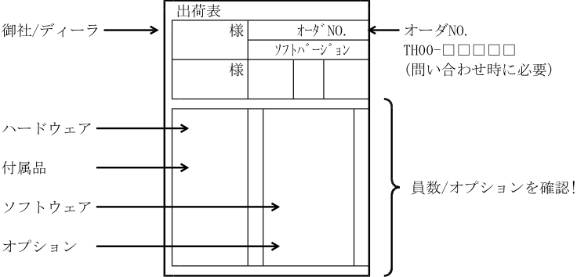

> **図の内容**
>
> 「出荷表」の各欄の説明:
> - 「御社/ディーラ」→ 宛先の欄（○○様）
> - 「オーダNO.」「ソフトバージョン」の欄 →「オーダNO. TH00-□□□□□（問い合わせ時に必要）」
> - 「ハードウェア」「付属品」「ソフトウェア」「オプション」の各行 →「員数/オプションを確認!」

【重要1】 RTMC64のシリアルナンバーについて


全てのRTMC64には、固有のシリアルナンバーが付いています。

- 以下の場合は対象のRTMC64のシリアルナンバーをご連絡頂く必要があります。
- ①オプションを追加でご購入頂く場合：追加オプションをRTMC64に設定する時にチェック
- ② ソフトのバージョンアップを行う場合：RTMC64の制御ソフトを変更する時にチェック

PCソフトで上記作業を行う場合、ご提供したファイル(オプションファイルやバックアップシステムファイル)のシリアルナンバーとRTMC64のシリアルナンバーをチェックして、シリアルナンバーが異なる場合は作業を続けられなくなっています。

このため、お客様にて機械とそれに使用しているRTMC64のシリアルナンバーの対応を管理しておいて下さい。（RTMC64のシリアルナンバーはセッティングPCソフトのバージョン情報画面で確認できますので、不明な場合はセッティングPCソフトで確認する事も可能です。）

- ※ 特別な場合、シリアナンバーとは別にグループシリアル(GS)で管理することがあります。

その場合、②のバージョンアップについては複数のRTMC64に対して同一のファイルを使用できます。

【重要2】 RTMC64のソフトウェアバージョンについて


RTMC64のソフトウェア(本体ソフト、PCソフト)は、常に出荷時点での最新バージョンが出荷されます。

リピート購入される場合、バージョンの違う新旧ソフトウェアの組み合わせによって問題が発生する可能性がありますので、ソフトウェア(CD)とRTMC64のバージョンを管理して、同一バージョンの組み合わせで使用して下さい。

尚、お急ぎの時には読み飛ばして頂いても大丈夫な箇所には印を付けています。お急ぎの時は後でゆっくりご参照下さい。

### 2-1.員数チェック!

- ■ ハード
- ■ ソフト

### 2-2.マニュアルをご覧下さい ! (HPからダウンロード)

「どのマニュアルに何が書いてあるか」程度をご確認下さい。導入作業は、「導入編」に沿って作業できます。その他は、必要に応じて見てください。

- ■ 動作・操作の詳しい説明書は、次のマニュアルが有ります。
- ■ ユーザーズマニュアル(導入、ハード、機能)
- ■ セッティングPCマニュアル
- ■ ROMSW(ロムスイッチ)設定マニュアル
- ■ RTMC64-M3/ECサンプルラダープログラム説明書

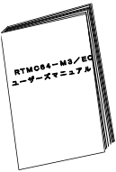


## 3．RTMC64-M3/ECのインストール

(1).システム構成

RTMC64(INtime)、ユーザ制御ソフト(PLC)(INtime)、PCアプリ(Windows)との関連図

FAPC

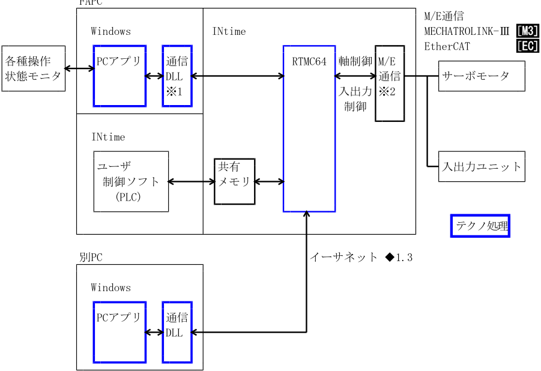

> **図の内容**
>
> - **FAPC**: 「Windows」の「各種操作 状態モニタ」「PCアプリ」→「通信DLL ※1」。「INtime」の「RTMC64」（軸制御、入出力制御）→「M/E通信 ※2」（MECHATROLINK-Ⅲ [M3] ／ EtherCAT [EC]）→「サーボモータ」「入出力ユニット」。「INtime」の「ユーザ制御ソフト(PLC)」は「共有メモリ」を経て RTMC64 とつながる
> - **別PC**: 「Windows」の「PCアプリ」→「通信DLL」→「イーサネット ◆1.3」で FAPC の RTMC64 へ
> - 凡例: 青枠は「テクノ処理」

- ※1 "通信" FAPC上のPCアプリとRTMC64との接続(連係)を、従来のテクノモーション(PLMC、SLMなど) にならって「通信」と呼びます。
- ※2 制御用の通信ネットワークでRTMC64-M3はMECHATROLINK-Ⅲを使用し、RTMC64-ECはEtherCATを使用します。通信ネットワークにはサーボと入出力ユニットの接続ができます。以降M/E通信と表記します。
- ※ 詳細は<Ⅱ機能編 1-1-1.RTMC64全体ブロック図>(TB00-1040D)を参照下さい。

(2).RTMC64インストール作業

RTMC64のインストールは次の3パターンによりインストール手順が異なります。個々の章に分けて記述します。下表に従って作業を行って下さい。

| RTMC64機種   | ネットワーク         | ドライバソフト         | 章   | 付記   | ページ     |
|------------|----------------|-----------------|-----|------|---------|
| RTMC64-M3  | MECHATROLINK-Ⅲ |                 | (Ⅰ) | [M]  | A6 ～A13 |
| RTMC64-EC  | EtherCAT       | RSI-ECAT-Master | (Ⅱ) | [R]  | A14～A28 |
| RTMC64-EC  | EtherCAT       | AlgoEtherCAT    | (Ⅲ) | [A]  | A29～A39 |

各章見出しは、RTMC64-M3(MECHATROLINK-Ⅲ)の場合は[M]、RTMC64-EC(EtherCAT)のRSI-ECATの場合は[R]、 RTMC64-EC(EtherCAT)のAlgoEtherCATの場合は[A]を付記します。

例) 3-1.RTMC64インストール作業[M]

(Ⅰ).RTMC64-M3の場合のインストール

### 3-1. RTMC64インストール作業[M]

- 3-1-1.テクノPCベースファインモーションのインストール

出荷CD内の"setup.exe"を実行すると、ファイルのコピー先の入力を促されます。インストール先は任意に指定可能ですが、特に問題がなければデフォルトのインストール先 "C:\RT64M3"にインストールして下さい。

インストーラーが自動的に起動しない場合は、以下の手順でインストーラーを実行して下さい。 ①「スタート」ボタンをクリックしてから「ファイル名を指定して実行」を選択します。

- ②「ファイル名を指定して実行」ダイアログで、"<CD-ROMドライブ名>:\setup" と入力します。 (例: d:\setup)
- ③ OK ボタンをクリックするとインストーラーが起動します。

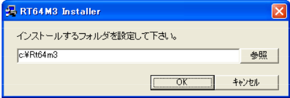

> **図の内容**
>
> ダイアログ「RT64M3 Installer」。「インストールするフォルダを設定して下さい。」、フォルダ「c:¥Rt64m3」、ボタン: 参照、OK、キャンセル。

#### 3-1-2.RTMC64データバックアップファイルの配置

"[インストールフォルダ]\flash\" にある以下のRTMC64のバックアップファイルをリネームして下さい。「RT64M3_DEF(RT64M3-[シリアルNo.]).fdt」→「RT64M3.fdt」

"RT64M3.rta"(RTMC64実行ファイル)は同じフォルダにある"RT64M3.fdt"をバックアップファイルとしてデータ管理を行います。

また、同じフォルダにあるテキストファイル"RT64M3.fpt"内に記載されたパスをバックアップファイルとすることも出来ます。

- 例) 以下のように各ファイルの配置するとバックアップファイルをRTMC64実行ファイルとは違うフォルダに配置できます。
- c:\Rt64m3\flash\RT64M3.rta
- c:\Rt64m3\flash\RT64M3.fpt → ファイル内に"d:\work\RT64M3.fdt"と記述
- d:\work\RT64M3.fdt

### 3-2. ドライバインストール作業[M]

- 3-2-1.Mechatrolink-Ⅲインターフェースボードの追加・設置

◆1.2

以下のいずれかのユニットをPCIスロットに実装して下さい。

- 「安川電機 NT112A」
- 「アルゴシステム AP300EX」
- 「アルゴシステム AP302EX」
- 「システック SY-M3-01」
- 「安川電機
- NT112B」

取り付け方法は各ハードウェアのマニュアルを参照下さい。

#### 3-2-2.Windowsドライバインストール

◆1.2

新たにMechatrolink-Ⅲインターフェースボードを追加・設置した場合には、Windows起動後、Windows デバイスドライバのインストールが求められます。ネットワークデバイスのマニュアルに沿って、 Windowsデバイスドライバをインストールして下さい。

- 安川電機(NT112A)の場合

Windowsデバイスマネージャーからドライバ更新を実行して下さい。

Windowsドライバーは以下のパスにあります。

[インストールフォルダ]\drivers\NT112AWindowsDriver

- アルゴシステム(AP300EXまたはAP302EX)の場合

出荷時にWindowsDriverは組み込まれていますのでインストールの必要はありません。

- システック(SY-M3-01)の場合

Windowsデバイスマネージャーからドライバ更新を実行して下さい。

Windowsドライバーは以下のパスにあります。

32Bit版Windowsの場合：[インストールフォルダ]\drivers\SY-M3-01WindowsDriver\x86

64Bit版Windowsの場合：[インストールフォルダ]\drivers\SY-M3-01WindowsDriver\x64

- 安川電機(NT112B)の場合

Windowsデバイスマネージャーからドライバ更新を実行して下さい。

Windowsドライバーは以下のパスにあります。

[インストールフォルダ]\drivers\NT112BWindowsDriver

### 3-3. INtime-RTのインストール[M]

INtime-RTをインストールしてください。

具体的なインストール方法はご使用のINtimeに従ってください。

### 3-4.INtimeカーネル設定[M]

【設定内容】

- ブートモード

ブートモードを"専有(Dedicated)"にします。

- カーネルメモリ

RTMC64実行のための最低カーネルメモリは64MBです。 64MB以上に設定してください。

- カーネルティック

INtimeカーネルティック値は通信周期以下としてください。

【操作方法】

- (1)「INtime Configuration」の起動

Windowsタスクトレイに常駐しているINtimeのアイコンをクリックします。


> **図の内容**
>
> タスクトレイの隠れたアイコン。INtime のアイコン（黄色）が赤丸で囲まれている。

- (2)ポップアップメニューの「INtime Configuration」をクリックします。

「INtime Configuration Panel」画面が表示されます。

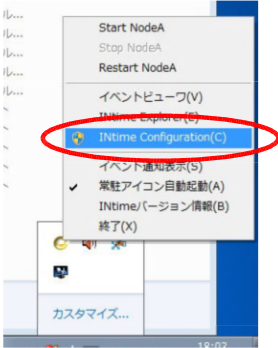

> **図の内容**
>
> INtime のアイコンを右クリックしたメニューで、「INtime Configuration(C)」が赤丸で囲まれている。ほかの項目: Start NodeA、Stop NodeA（灰色）、Restart NodeA、イベントビューワ(V)、INtime Explorer(E)、イベント通知表示(S)、常駐アイコン自動起動(A)、INtimeバージョン情報(B)、終了(X)。

- (3)「INtime Node Management」起動

①

①"Node Management"をダブルクリック

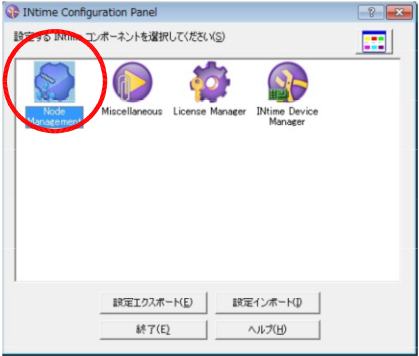

> **図の内容**
>
> 「INtime Configuration Panel」画面。「設定する INtime コンポーネントを選択してください(S)」の中の「Node Management」が赤丸で囲まれている。ほかに Miscellaneous、License Manager、INtime Device Manager。ボタン: 設定エクスポート(E)、設定インポート(I)、終了(E)、ヘルプ(H)。

- (4)"ブートモード"設定
- ①"System Wide"タブを開く
- ②ブートモード設定

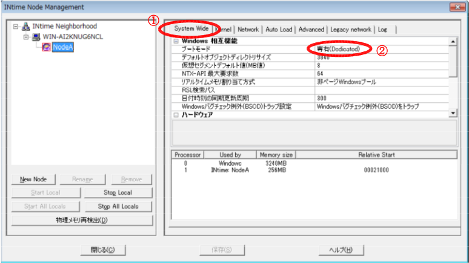

> **図の内容**
>
> 「INtime Node Management」画面。① 「System Wide」タブ、② 「Windows 相互接続」のブートモードの値「専有(Dedicated)」が赤丸で囲まれている。
> ほかの設定値は小さくて判読できず。

ブートモード：専有(Dedicated)

- (5)"カーネルメモリ"・"カーネルティック"設定
- ①"Kernelタブ"を開く
- ②カーネルメモリ設定カーネルメモリ：64MB以上

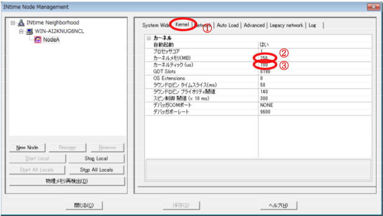

> **図の内容**
>
> 「INtime Node Management」画面。① 「Kernel」タブ、② カーネルメモリ（MB）の値、③ カーネルティック（us）の値が赤丸で囲まれている。本文: カーネルメモリ：64MB以上。
> 値は小さくて判読できず。

※RTMC64-M3以外のプロセスに必要なメモリ量を加えて設定してください。

- ③カーネルティック設定

MECHATROLINK-Ⅲの伝送周期以下の数値を設定して下さい。

### 3-5.MECHATROLINK-Ⅲデバイス設定[M]

【設定内容】

MECHATROLINK-ⅢのインターフェースボードのデバイスをINtimeにパスします。

【操作方法】

- (1)「INtime Device Manager」起動
- ①「3-4.(1)「INtime Configuration」起動」の操作方法で「INtime Configuration」を起動
- ②「INtime Device Manager」をダブルクリック

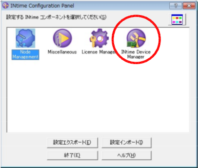

> **図の内容**
>
> 「INtime Configuration Panel」画面で、「INtime Device Manager」が赤丸で囲まれている。

- (2)MECHATROLINK-ⅢデバイスのINtimeへのパス
- A. 「JAPMC-NT112A-E」の場合
- ①[INtime YASKAWA MECHATROLINK-Ⅲ Adapter PCI Board NT112]を右クリック
- ②[INtimeへ移す(IRQあり)]をクリック
- B. 「AP300EXまたはAP302EX」の場合
- ①[INtime MECHATROLINK-Ⅲ Adapter PCI Board AP300EX(またはAP302EX)]を右クリック
- ②[INtimeへ移す(IRQあり)]をクリック

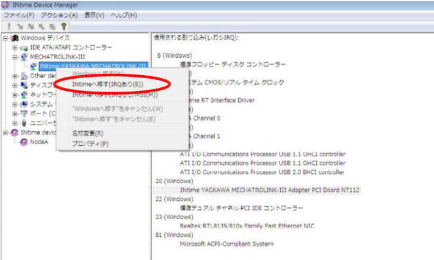

> **図の内容**
>
> 「INtime Device Manager」画面。「MECHATROLINK-Ⅲ」の下のボードを右クリックしたメニューで、「INtimeへ移す(IRQあり)(E)」が赤丸で囲まれている。右側に割り込み（IRQ）ごとのデバイスの一覧（INtime YASKAWA MECHATROLINK-Ⅲ Adapter PCI Board NT112 など）。
> 細部は小さくて判読しにくい。

※I: INtime6.*の場合は右枠に"INtime G8 MECHATROLINK Board"が有ります。これを左クリックすると左枠のINtime devicesのNodeAのINtime Rt Device Driversに"INtime G8 MECHATROLINK Board (MSIcapable)"が追加されます。

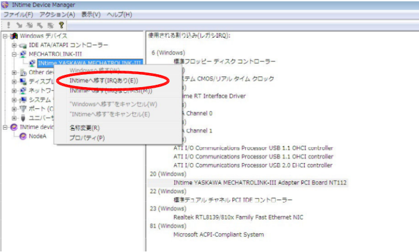

> **図の内容**
>
> 前の図と同じ画面で、「INtimeへ移す(IRQあり)」が赤丸で囲まれている。本文: INtime6.* の場合は右枠に"INtime G8 MECHATROLINK…"と表示される。

- C. 「SY-M3-01」の場合
2. ①[メモリテクノロジードライバー]を右クリック
3. ②[INtimeへ移す(IRQなし/MSI)]をクリック
- D. 「JAPMC-NT112B-E」の場合
5. ①[メモリテクノロジードライバー]を右クリック
6. ②[INtimeへ移す(IRQなし/MSI)]をクリック
7. ③INtimeへのパスの適用

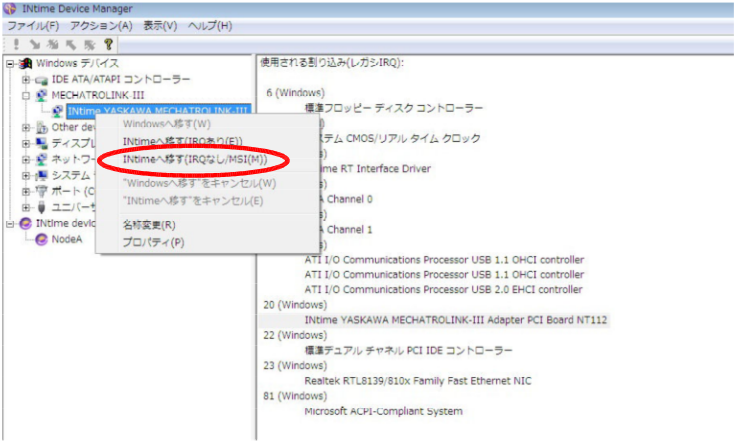

> **図の内容**
>
> 同じ画面で、メニューの「INtimeへ移す(IRQなし/MSI)(M)」が赤丸で囲まれている。


> **図の内容**
>
> 同じ画面で、メニューの「INtimeへ移す(IRQなし/MSI)」が赤丸で囲まれている。

ツールバーにある！ボタンを押下し、INtimeへのパスを適用します。

※環境によっては、Windowsの再起動が求められます。この場合には、Windowsの再起動を実行して下さい。

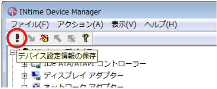

> **図の内容**
>
> 「INtime Device Manager」のツールバーの「!」ボタン（ツールチップ「デバイス設定情報の保存」）が赤丸で囲まれている。

![見出し「3-6. 自動起動の設定 [M]」](TB00-1040A/images/image_000021_07ecc16e1102a6ce0709903570ba29b0b765da630da6e41e031e83ffa16b4d98.png)

#### 3-6-1.RT64M3自動起動設定

- ◆1.2
- ①「3-4.(1)「INtime Configuration」起動」
- ②「3-4.(3)「INtime Node Management」起動」
- ③[Auto load]タブ選択
- ④ 追加ボタンを押す
- ⑤Auto loadアプリケーション設定

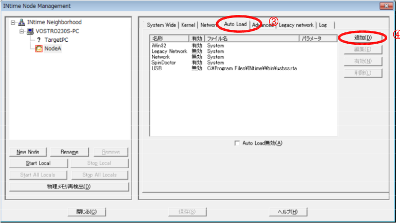

> **図の内容**
>
> 「INtime Node Management」画面。③ 「Auto Load」タブ、④ 「追加」ボタンが赤丸で囲まれている。一覧には iWin32、Legacy Network、Network、SpinDoctor、USB などのアプリケーションがある。

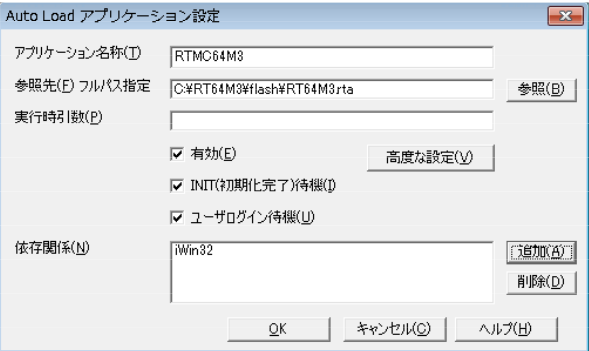

> **図の内容**
>
> ダイアログ「Auto Load アプリケーション設定」。
> - アプリケーション名(T): RTMC64M3
> - 参照先(F)フルパス指定: C:¥RT64M3¥flash¥RT64M3.rta（参照(B)）
> - 実行時引数(P): （空）
> - チェック: 有効(E)、INIT(初期化完了)待機(I)、ユーザログイン待機(U)。「高度な設定(V)」ボタン
> - 依存関係(N): iWin32（追加(A)、削除(D)）
> - ボタン: OK、キャンセル(C)、ヘルプ(H)

アプリケーション名称：RTMC64-M3

参照先フルパス指定：インストール先のINtimeプロセスを登録してください。

(デフォルト C:\RT64M3\flash\RT64M3.rta)

有効

：チェック

INIT(初期化完了)待機：チェック

ユーザログイン待機：チェック

依存関係

：「iWin32」を追加(INtime4.*,INtime5.*)※I

と設定します。

※I: INtime6.*の場合は「iWin32」は依存関係への設定不要です。

④

3-6-2.ライセンス認証デーモン自動起動設定

◆1.2

モーション実行プロセス[RT64M3.rta]を動作させるためには、ライセンス認証デーモン[Rt64m3DM_enc .exe]が常時実行されている必要があります。

スタートアップに登録して常時実行されるようにしてください。

※PC起動時にライセンスが認証できる必要があります。

認証ドングルキーは実行環境PCの起動前にUSBポートに挿入しておいてください。

インストール先の「RT64M3\Rt64m3DM_enc.exe」のショートカットをWindowsのスタートアップに登録してください。PC再起動後、認証デーモンソフトは自動で起動します。

※スタートアップの登録先はWindowsのバージョンにより異なりますが、Windows7/Windows10では、以下のパスにショートカットを置いて下さい。

「C:\ProgramData\Microsoft\Windows\Start Menu\Programs\Startup」

【起動確認】

認証デーモン起動後は、Windowsタスクトレイにアイコンが表示されます。

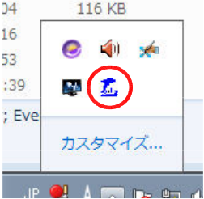

> **図の内容**
>
> タスクトレイの隠れたアイコン。認証デーモンのアイコン（青）が赤丸で囲まれている。上部に「116 KB」の表示。

【注】

アルゴシステム社製産業用PCをご使用の場合、テクノ製の別製品「RTPL-EC」がプリインストールされている場合があります。

その場合、同じアイコンの「RtplECT Deamon」が起動していますが、「Rt64m3DM_enc.exe」とは異なりますので注意してください。

(Ⅱ).RTMC64-EC(RSI-ECAT-Master)の場合のインストール

### 3-1. RTMC64インストール作業[R]

3-1-1.テクノPCベースファインモーションのインストール出荷CD内の"setup.exe"を実行すると、ファイルのコピー先の入力を促されます。インストール先は任意に指定可能ですが、特に問題がなければデフォルトのインストール先 "C:\RT64EC"にインストールして下さい。

インストーラーが自動的に起動しない場合は、以下の手順でインストーラーを実行して下さい。

- ①「スタート」ボタンをクリックしてから「ファイル名を指定して実行」を選択します。
- ②「ファイル名を指定して実行」ダイアログで、"<CD-ROMドライブ名>:\setup" と入力します。 (例: d:\setup)
- ③ OK ボタンをクリックするとインストーラーが起動します。
- 3-1-2.RTMC64データバックアップファイルの配置

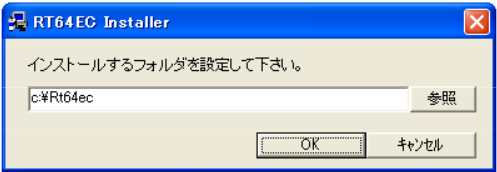

> **図の内容**
>
> ダイアログ「RT64EC Installer」。「インストールするフォルダを設定して下さい。」、フォルダ「c:¥Rt64ec」、ボタン: 参照、OK、キャンセル。

"[インストールフォルダ]\flash\" にある以下のRTMC64のバックアップファイルをリネームして下さい。「RT64EC_DEF(RT64EC-[シリアルNo.]).fdt」→「RT64EC.fdt」

"RT64EC.rta"(RTMC64実行ファイル)は同じフォルダにある"RT64EC.fdt"をバックアップファイルとしてデータ管理を行います。

また、同じフォルダにあるテキストファイル"RT64EC.fpt"内に記載されたパスをバックアップファイルとすることも出来ます。

- 例) 以下のように各ファイルの配置するとバックアップファイルをRTMC64実行ファイルとは違うフォルダに配置できます。
- c:\Rt64ec\flash\RT64EC.rta
- c:\Rt64ec\flash\RT64EC.fpt → ファイル内に"d:\work\RT64EC.fdt"と記述
- d:\work\RT64EC.fdt

### 3-2. ドライバインストール作業[R]

- 3-2-1.ネットワークデバイスの追加・設置

INtimeリアルタイムネットワーク HPE2ドライバに対応した以下のネットワークデバイスを使用して下さい。

- Intel 100Mbps ネットワークアダプタ (推奨)
- Intel 1Gbps ネットワークアダプタ (推奨)
- RealTek 1Gbps ネットワークアダプタ
- ※ INtime HPE2ドライバ対応状況については、マイクロネット社HPの、以下URLを御参照下さい。 http://www.mnc.jp/INtime/user/intimedev.php?INtime%A4%C7%BB%C8%CD%D1%B2%C4%C7%BD%A4%CANIC.4 上記URLにて、「HPE2:○」と記載されているデバイスのみサポートされています。

#### 3-2-2.Windowsドライバのインストール

新たにネットワークデバイスを追加・設置した場合には、Windows起動後、Windowsデバイスドライバのインストールが求められます。ネットワークデバイスのマニュアルに沿って、Windowsデバイスドライバをインストールして下さい。

### 3-3. INtime-RTのインストール[R]

INtime-RTをインストールしてください。

具体的なインストール方法はご使用のINtimeに従ってください。

### 3-4.INtimeカーネル設定[R]

【設定内容】

- ブートモード
- ブートモードを"専有(Dedicated)"にします。
- カーネルメモリ

RTMC64実行のための最低カーネルメモリは64MBです。

RSI-ECATのために32MB必要です。

96MB以上に設定してください。

※RTMC64以外のプロセスに必要なメモリ量を加えて設定してください。

・カーネルティック

INtimeカーネルティック値は通信周期以下としてください。

※EtherCATの場合は、通信周期の設定は「3-7-2.通信周期(サイクリックタイム)の指定」を確認してください。

【操作方法】

- (1)「INtime Configuration」の起動 Windowsタスクトレイに常駐しているINtimeのアイコンをクリックします。
- (2)ポップアップメニューの「INtime Configuration」をクリックします。

![3-4 タスクトレイの INtime アイコン（[R]）](TB00-1040A/images/image_000026_f068b48a22b132bba476f5fe02e97ba30a35b6d586fe41d58dc2fdba906101c9.png)

> **図の内容**
>
> タスクトレイの隠れたアイコン。INtime のアイコン（黄色）が赤丸で囲まれている。

「INtime Configuration Panel」画面が表示されます。

- (3)ポップアップメニューの「INtime Configuration」をクリックします。

「INtime Configuration Panel」画面が表示されます。

![3-4 INtime のメニュー（INtime Configuration、[R]）](TB00-1040A/images/image_000027_f66d6f734a2bd6a1fb51a694ffa59df31dd72df0f17c67505bb44f8296198ea4.png)

> **図の内容**
>
> INtime のメニューで「INtime Configuration(C)」が赤丸で囲まれている。

- (4)「INtime Node Management」起動

①

![3-4 INtime Configuration Panel（Node Management、[R]）](TB00-1040A/images/image_000028_01b57b483ad6c5b7c928c0255264edf7e45e447039e6b365a08f8d07743ea827.png)

> **図の内容**
>
> 「INtime Configuration Panel」画面。① 「Node Management」が赤丸で囲まれている。

- ①"Node Management"をダブルクリック
- (5)"ブートモード"設定
- ①"System Wide"タブを開く
- ②ブートモード設定

![3-4 INtime Node Management（ブートモード設定、[R]）](TB00-1040A/images/image_000029_ef6c0a485cf7aac565c62590efbe1053def80c71d745c4c07a81535c3ea24202.png)

> **図の内容**
>
> ① 「System Wide」タブ、② ブートモードの値「専有(Dedicated)」が赤丸で囲まれている。

ブートモード：専有(Dedicated)

- (6)"カーネルメモリ"・"カーネルティック"設定
- ①"Kernelタブ"を開く

![3-4 INtime Node Management（カーネル設定、[R]）](TB00-1040A/images/image_000030_e3ddb88b74e56f91ca997cd0b61cabb6513b9631ce94fdb6b3dbe3e0cc671bb9.png)

> **図の内容**
>
> ① 「Kernel」タブ、② カーネルメモリの値、③ カーネルティックの値が赤丸で囲まれている。値は小さくて判読できず。

- ②カーネルメモリ設定

カーネルメモリ：96MB以上

- ③カーネルティック設定

カーネルティック :EtherCAT通信周期の整数分の１

例)EtherCAT通信周期 = 500μs

カーネルティック = 100μs

※EtherCAT通信周期の設定は「3-7-2.通信周期(サイクリックタイム)の指定」を確認してください。

### 3-5.EtherCATマスタースタックのインストール[R]

マイクロネット社『RSI-ECAT-Master/DC』または『RSI-ECAT-Master/RED』をインストールして下さい。

### 3-6.NIC(Network Interface Controller)設定[R]

3-6-1.NICの設置

PCのオンボードLANを使用する等、NIC設置済みの場合はこの作業は必要ありません。

3-6-2.Windowsドライバのインストール

拡張NICを増設した場合、Windows起動後自動的にWindowsデバイスドライバのインストールが開始されます。

該当NICのドライバインストール手順に沿って、ドライバをインストールして下さい。

3-6-3.NICのINtimeへのパス-INpassを使用する場合(推奨)

なるべく、INpassを使用してNICのINtimeへのパスを行ってください。

INpassでできない時のみ、

「3-6-4.NICのINtimeへのパス-INtime Device Managerを使用する場合」をご参照ください。

【設定内容】

RSI-ECAT-MasterがNICを使用できるようにINtimeにパスします。

【操作方法】

- (1)"INpass"起動

[スタートメニュー]→[プログラム]→[Micronet]→[RSI-ECAT]→[Tools]→[INpass]

- (2)"INpass"起動画面
- "INpass"を起動すると、上記ダイアログが表示されます。

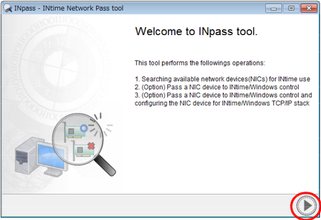

> **図の内容**
>
> ウィンドウ「INpass - INtime Network Pass tool」。「Welcome to INpass tool.」「This tool performs the followings operations: 1. Searching available network devices(NICs) for INtime use 2. (Option) Pass a NIC device to INtime/Windows control 3. (Option) Pass a NIC device to INtime/Windows control and configuring the NIC device for INtime/Windows TCP/IP stack」。右下の次へ（▶）ボタンが赤丸で囲まれている。

右下のボタンをクリックして、進めてください。

(3)NICの選択

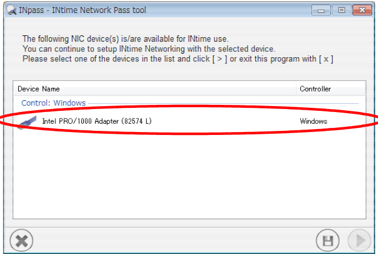

> **図の内容**
>
> 「The following NIC device(s) is/are available for INtime use. You can continue to setup INtime Networking with the selected device. Please select one of the devices in the list and click [ > ] or exit this program with [ x ]」。一覧（Device Name / Controller）の「Control: Windows」の下の「Intel PRO/1000 Adapter (82574 L)」（Windows）が赤丸で囲まれている。

設定可能なNIC一覧が表示されます。設定するNICを選択して次に進みます。

※何も表示されない場合は、対応するNICが検出できなかったということです。 INpassは使用可能なNICのうち"MSI capable"のものを表示します。

(4)"EtherCAT"を選択

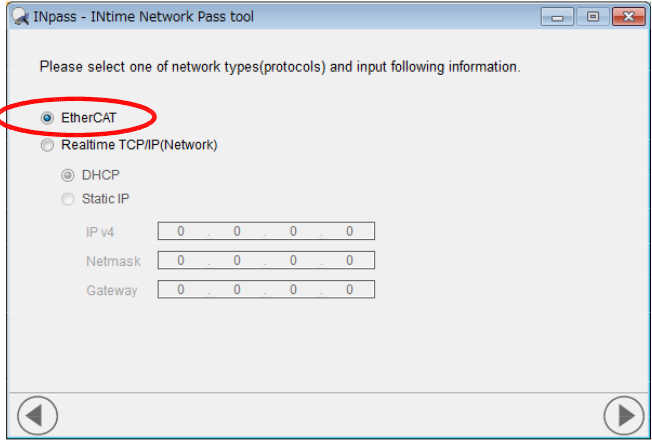

> **図の内容**
>
> 「Please select one of network types(protocols) and input following information.」。選択肢「EtherCAT」（赤丸で囲み、選択中）と「Realtime TCP/IP(Network)」（DHCP / Static IP、IP v4・Netmask・Gateway は 0.0.0.0 で灰色）。

"EtherCAT"を選択し、最後まで進めてください。

(5)Windowsの再起動

最後まで進めるとWindowsの再起動を求められます。

再起動をすると、NICのINtimeへのパスは完了です。

3-6-4.NICのINtimeへのパス-INtime Device Managerを使用する場合

「3-6-3.NICのINtimeへのパス-INpassを使用する場合」を推奨しますが、INpassでできない時のみ、本項を参照下さい。

【設定内容】

RSI-ECAT-MasterがNICを使用できるようにINtimeにパスします。

【操作方法】

- (1)"INtime Configuration"起動

A."Windowsスタートメニューから起動"の場合

[スタートメニュー]→[プログラム]→[INtime]→[INtime Configuration]

B."タスクトレイから起動"の場合

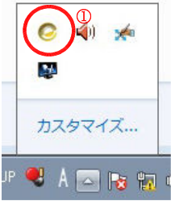

> **図の内容**
>
> タスクトレイの隠れたアイコン。① INtime のアイコン（黄色）が赤丸で囲まれている。

- ①タスクトレイの"INtimeアイコン"をクリック
- ②"INtime Configuration"をクリック

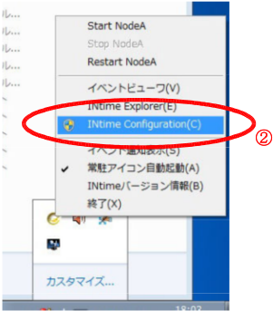

> **図の内容**
>
> INtime のメニューで ② 「INtime Configuration(C)」が赤丸で囲まれている。

- (2)"INtime Device Manager"起動


> **図の内容**
>
> 「INtime Configuration Panel」画面。① 「INtime Device Manager」が赤丸で囲まれている。

①"INtime Device Manager"をダブルクリック

- (3)EtherCAT通信に使用するNICをINtimeにパス

NICのタイプによって、AまたはBのどちらかを実行して下さい。

- A. 対象のNICが、MSIをサポートしたPCI Expressタイプの場合右クリックのポップアップメニューから、"INtimeへ移す(IRQなし/MSI(M))"を選択し、クリックして下さい。
- B. 対象のNICが、PCIタイプの場合


> **図の内容**
>
> 「INtime Device Manager」画面。「ネットワーク アダプター」の下の「Intel(R) PRO/1000 GT Desktop Adapter #3」を右クリックしたメニューで、「INtimeへ移す(IRQなし/MSI)(M)」が赤丸で囲まれている。ほかの項目: Windowsへ移す(W)、INtimeへ移す(IRQあり)(E)、"Windowsへ移す"をキャンセル(W)、"INtimeへ移す"をキャンセル(E)、名称変更(R)、プロパティ(P)。

右クリックのポップアップメニューから、"INtimeへ移す(IRQあり(E))"を選択し、クリックして下さい。


> **図の内容**
>
> 同じ画面で、メニューの「INtimeへ移す(IRQあり)(E)」が赤丸で囲まれている。

- ※ Bを実行した後、右ウィンドウに"(INtime) 競合!!!"と表示された場合IRQがWindowsデバイスと競合している為、利用できない状況です。

本作業を中断し、競合しているWindowsデバイス全てを無効にするか、NICのPCIスロット位置を変更し、再度試みて下さい。

この状態のままでは、EtherCAT通信が出来ません。

(4)INtimeへのパスの適用

ツールバーにある！ボタンを押下し、INtimeへのパスを適用します。

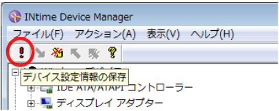

> **図の内容**
>
> ツールバーの「!」ボタン（ツールチップ「デバイス設定情報の保存」）が赤丸で囲まれている。

※環境によっては、Windowsの再起動が求められます。この場合には、Windowsの再起動を実行して下さい。

(5)INtimeへのパスの確認

INtimeへのパスが完了すると、"INtime Device Manager"上の"INtime devices"のツリーにNICが移動します。

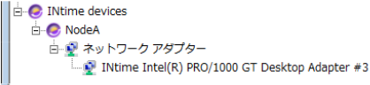

> **図の内容**
>
> 「INtime devices」→「NodeA」→「ネットワーク アダプター」の下に「INtime Intel(R) PRO/1000 GT Desktop Adapter #3」が表示されている。

※最下段の"INtimeIntel(R)PRO/1000GT Desktop Adapter #3"は環境により変わります。 ◆1.2

(3)の"ネットワークアダプター"で表示されるアダプター名称と同じ名称が移動されていれば完了です。

### 3-7.RSI-ECAT-Master設定[R]

3-7-1.使用するNIC(Network Interface Controller)の指定

設定ファイル"ecatmkpa.ini"へ利用するINtime NICドライバを指定する必要があります。 (1)設定ファイル"ecatmkpa.ini"を開く

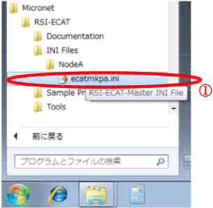

> **図の内容**
>
> スタートメニューの「Micronet」→「RSI-ECAT」→「INI Files」→「NodeA」の下の ① 「ecatmkpa.ini」（ツールチップ「RSI-ECAT-Master INI File」）が赤丸で囲まれている。ほかに Documentation、Sample Pr…、Tools。

[スタートメニュー]→[プログラム]→[Micronet]→[RSI-ECAT]→[INI Files]

→[NodeA(RSI-ECATを実行するINtimeノード名)]→[ecatmkpa.ini]

(2)"HPE2Ifs"設定

設定項目、"HPE2Ifs"使用するNICを設定します。

HPE2Ifs=ie1g0 ie1g1

上記はIntelの1GbpsのNICを使用する場合の設定です。(デフォルト値) 使用するNICにより以下のような書式で設定してください。

Intel 1Gbps ネットワークアダプタ： Ie1gN (N:0,1,2...)

Intel 100Mbps ネットワークアダプタ： ie100mN (N:0,1,2...)

RealTek 1Gbps ネットワークアダプタ： rtl1gN (N:0,1,2...)

※詳細な設定内容については『RSI-ECAT-Master』のマニュアル

「RSI-ECAT-Master User's manual」を確認してください。

3-7-2.通信周期(サイクリックタイム)の指定

EtherCAT通信周期はENIファイルに設定します。

本項では、RSI-ECAT-Masterの通信周期がENIファイルと同じ周期となるように起動パラメータの設定をします。

【設定内容】

EtherCAT通信周期がENIファイルの設定となるように、RSI-ECAT-Master起動パラメータを設定します。

【操作方法】

- (1) "INtime Configuration"起動
2. A."Windowsスタートメニューから起動"の場合

[スタートメニュー]→[プログラム]→[INtime]→[INtime Configuration]

- B."タスクトレイから起動"の場合
- ①タスクトレイの"INtimeアイコン"をクリック
- ②"INtime Configuration"をクリック
- (2) "INtime Node Management"起動
- ① "Node Management"をダブルクリック

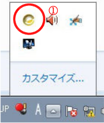

> **図の内容**
>
> タスクトレイの隠れたアイコン。① INtime のアイコン（黄色）が赤丸で囲まれている。

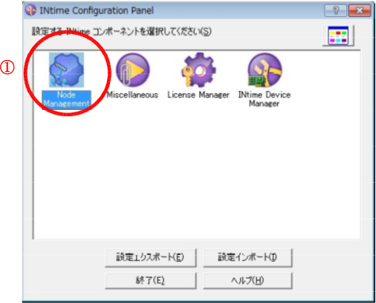

> **図の内容**
>
> 「INtime Configuration Panel」画面。① 「Node Management」が赤丸で囲まれている。

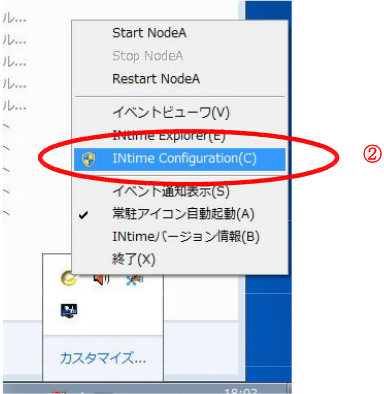

> **図の内容**
>
> INtime のメニューで ② 「INtime Configuration(C)」が赤丸で囲まれている。

- (3) "Auto Load"設定
2. ① "Auto load"タブ選択
3. ② "RSI-ECAT"を選択
4. ③ 編集ボタンを押下
5. (4)"Auto loadアプリケーション設定画面"設定
6. ※詳細な設定内容については『RSI-ECAT-Master』のマニュアル「RSI-ECAT-Master User's manual」をご確認ください。

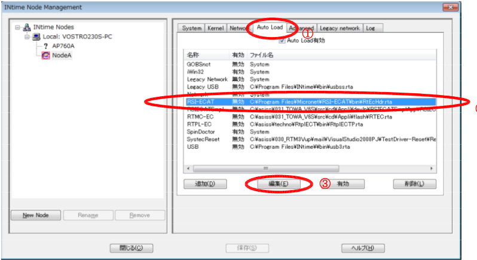

> **図の内容**
>
> 「INtime Node Management」画面。「Auto Load」タブ（赤丸で囲み）の一覧で、「RSI-ECAT」の行（C:¥Program Files¥Micronet¥RSI-ECAT¥bin¥… .rta）が赤丸で囲まれ、③ 「編集」ボタンが赤丸で囲まれている。ほかの行のパスは小さくて判読できず。

実行時引数："-cycle=eni"

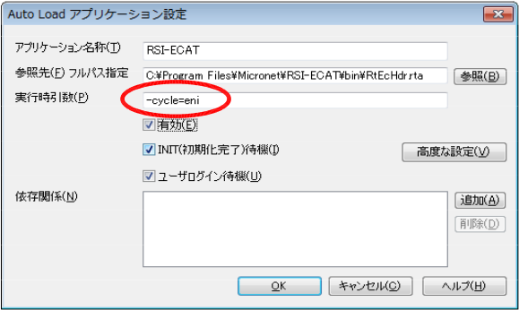

> **図の内容**
>
> ダイアログ「Auto Load アプリケーション設定」。
> - アプリケーション名(T): RSI-ECAT
> - 参照先(F)フルパス指定: C:¥Program Files¥Micronet¥RSI-ECAT¥bin¥RtEcHdr.rta
> - 実行時引数(P): -cycle=eni（赤丸で囲み）
> - チェック: 有効(E)、INIT(初期化完了)待機(I)、ユーザログイン待機(U)
> - 依存関係(N): （空）

②

3-7-3.RSL検索パスの設定

※RSI-ECAT-Masterのインストーラが自動設定します。

- ①「3-7-2.(1) 「INtime Configuration」起動」
- ②「3-7-2.(2) 「INtime Node Management」起動」
- ③[System Wide]タブ選択
- ④ [RSL検索パス]を入力します。

RSI-ECAT-Masterのデフォルトインストール先は以下です。

"C:\Program Files\Micronet\RSI-ECAT\bin"

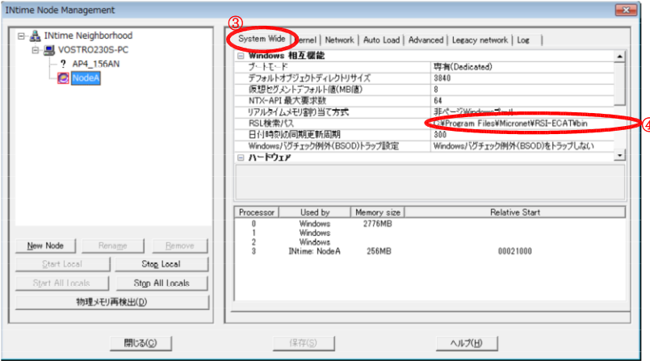

> **図の内容**
>
> 「INtime Node Management」画面。③ 「System Wide」タブ、④ 設定値「C:¥Program Files¥Micronet¥RSI-ECAT¥bin」が入った行が赤丸で囲まれている。ほかの設定は小さくて判読できず。

④

![見出し「3-8. ENIファイル作成 [R]」](TB00-1040A/images/image_000048_a13c3b02928861e755be641f89cc52f6259fffcb3da6bf94db292fa14b3497eb.png)

#### 3-8-1.PDOマッピング

CiA402に準拠したスレーブ(サーボ)の場合、RTMC64-ECで使用するオブジェクトをPDOにマッピングする必要があります。

以下に、機能により必要となるオブジェクトを記しますので、ENIファイル作成時に必要に応じて PDOマッピングを変更してください。

- ●必須項目(サイクリック位置モードに必須のオブジェクト)

【RxPDO】

- Control Word (6040h,00h)
- Target Position (607Ah,00h)

【TxPDO】

- Status Word (6041h,00h)
- Position Actual Value (6064h,00h)
- ●原点復帰「FBラッチ原点復帰」 - C相及びProbe1をONエッジでラッチする場合【RxPDO】
- Touch Probe Function (60B8h,00h)

【TxPDO】

- Touch Probe Status (60B9h,00h)
- Touch Probe Pos1 Positive Value (60BAh,00h)
- ●原点復帰「FBラッチ原点復帰」 - C相及びProbe1をOFFエッジでラッチする場合【RxPDO】
- Touch Probe Function (60B8h,00h)

【TxPDO】

- Touch Probe Status (60B9h,00h)
- Touch Probe Pos1 Negative Value (60BBh,00h)

- ●原点復帰「FBラッチ原点復帰」 - Probe2をONエッジでラッチする場合
- 【RxPDO】
- Touch Probe Function (60B8h,00h)

【TxPDO】

- Touch Probe Status (60B9h,00h)
- Touch Probe Pos2 Positive Value (60BCh,00h)
- ●原点復帰「FBラッチ原点復帰」 - Probe2をOFFエッジでラッチする場合【RxPDO】
- ●原点復帰（DEC、OT信号を使用する場合） - 原点信号,+OT,-OTでラッチする場合【TxPDO】
- Digital Inputs (60FDh,00h)
- ●独立位置決め

- Touch Probe Function (60B8h,00h)

【TxPDO】

| ・Touch Probe Status              | (60B9h,00h)   |
|----------------------------------|---------------|
| ・Touch Probe Pos2 Negative Value | (60BDh,00h)   |

【RxPDO】

- Modes Of Operation (6060h,00h)

【TxPDO】

- Modes Of Operation Display (6061h,00h)

●トルク指令

【RxPDO】

- Modes Of Operation (6060h,00h)
- Target Torque (6071h,00h)

【TxPDO】

- Modes Of Operation Display (6061h,00h)
- Torque Actual Value (6077h,00h)

- ●サーボ主軸（速度S指令）

【RxPDO】

- Modes Of Operation (6060h,00h)
- Target Velocity (60FFh,00h)

【TxPDO】

- Modes Of Operation Display (6061h,00h)

#### 3-8-2.ENIファイル作成手順

ENIファイルは次の資料の手順で作成して下さい。

「ENIファイル作成手順書(RSI-ECAT-Master用) (TB00-1058)」

![見出し「3-9. 自動起動の設定 [R]」](TB00-1040A/images/image_000049_06e21c680a547f68ad1eadd2250e05fd7983cd684346952557032fb4c6d70c90.png)

#### 3-9-1.RT64EC自動起動設定

- ◆1.2
- ①「3-7-2.(1) 「INtime Configuration」起動」
- ②「3-7-2.(2) 「INtime Node Management」起動」
- ③[Auto load]タブ選択
- ④ 追加ボタンを押す

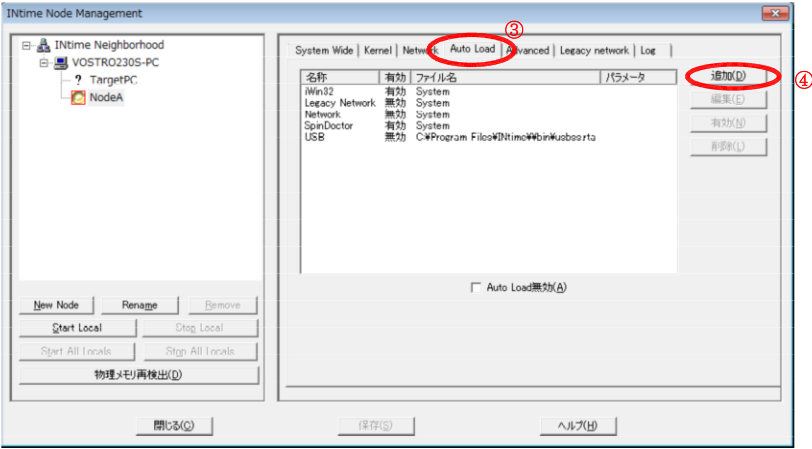

> **図の内容**
>
> 「INtime Node Management」画面。③ 「Auto Load」タブ、④ 「追加」ボタンが赤丸で囲まれている。

⑤Auto loadアプリケーション設定

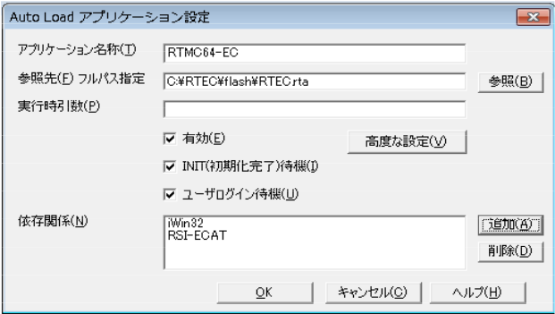

> **図の内容**
>
> ダイアログ「Auto Load アプリケーション設定」。
> - アプリケーション名(T): RTMC64-EC
> - 参照先(F)フルパス指定: C:¥RTEC¥flash¥RTEC.rta
> - 実行時引数(P): （空）
> - チェック: 有効(E)、INIT(初期化完了)待機(I)、ユーザログイン待機(U)
> - 依存関係(N): iWin32、RSI-ECAT

アプリケーション名称：RTMC64-EC

参照先フルパス指定：インストール先のINtimeプロセスを登録してください。

(デフォルト C:\RT64EC\flash\RT64EC.rta)

有効

：チェック

INIT(初期化完了)待機：チェック

ユーザログイン待機：チェック

依存関係

：「iWin32」と(INtime4.*,INtime5.*) ※I 「RSI-ECAT」を追加

と設定します。

※I: INtime6.*の場合は「iWin32」の依存関係は設定不要です。

3-9-2.ライセンス認証デーモン自動起動設定

◆1.2

モーション実行プロセス[RT64EC.rta]を動作させるためには、ライセンス認証デーモン[Rt64ecDM_enc .exe]が常時実行されている必要があります。

インストール先の「RT64EC\Rt64ecDM_enc.exe」のショートカットをWindowsのスタートアップに登録してください。PC再起動後、認証デーモンソフトは自動で起動します。

※スタートアップの登録先はWindowsのバージョンにより異なりますが、Windows7/Windows10では、以下のパスにショートカットを置いて下さい。

「C:\ProgramData\Microsoft\Windows\Start Menu\Programs\Startup」

※PC起動時にライセンスが認証できる必要があります。

認証ドングルキーは実行環境PCの起動前にUSBポートに挿入しておいてください。

【起動確認】

認証デーモン起動後は、Windowsタスクトレイにアイコンが表示されます。

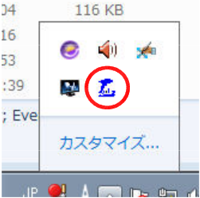

> **図の内容**
>
> タスクトレイの隠れたアイコン。認証デーモンのアイコン（青）が赤丸で囲まれている。

(Ⅲ).RTMC64-EC(AlgoEtherCAT)の場合のインストール

### 3-1.RTMC64インストール作業[A]

- 3-1-1.テクノPCベースファインモーションのインストール

出荷CD内の"setup.exe"を実行すると、ファイルのコピー先の入力を促されます。インストール先は任意に指定可能ですが、特に問題がなければデフォルトのインストール先 "C:\RT64EC"にインストールして下さい。

インストーラーが自動的に起動しない場合は、以下の手順でインストーラーを実行して下さい。 ①「スタート」ボタンをクリックしてから「ファイル名を指定して実行」を選択します。

- ②「ファイル名を指定して実行」ダイアログで、"<CD-ROMドライブ名>:\setup" と入力します。 (例: d:\setup)
- ③ OK ボタンをクリックするとインストーラーが起動します。

![3-1 RT64EC Installer（[A]）](TB00-1040A/images/image_000053_aa1ecd567d2f2eea8d416a0975fe231cd9820e27634499af1c9c08ac1c8acf62.png)

> **図の内容**
>
> ダイアログ「RT64EC Installer」。「インストールするフォルダを設定して下さい。」、フォルダ「c:¥Rt64ec」、ボタン: 参照、OK、キャンセル。

#### 3-1-2.RTMC64データバックアップファイルの配置

"[インストールフォルダ]\flash\" にある以下のRTMC64のバックアップファイルをリネームして下さい。「RT64EC_DEF(RT64EC-[シリアルNo.]).fdt」→「RT64EC.fdt」

"RT64EC.rta"(RTMC64実行ファイル)は同じフォルダにある"RT64EC.fdt"をバックアップファイルとしてデータ管理を行います。

また、同じフォルダにあるテキストファイル"RT64EC.fpt"内に記載されたパスをバックアップファイルとすることも出来ます。

- 例) 以下のように各ファイルの配置するとバックアップファイルをRTMC64実行ファイルとは違うフォルダに配置できます。
- c:\Rt64ec\flash\RT64EC.rta
- c:\Rt64ec\flash\RT64EC.fpt → ファイル内に"d:\work\RT64EC.fdt"と記述
- d:\work\RT64EC.fdt

### 3-2. ドライバインストール作業[A]

アルゴシステム社のPCの既存のネットワークデバイスを使用してください。アルゴシステムの場合はドライバのインストール作業は必要ありません。

次の項目はインストール済みになっています。

- ネットワークデバイスの追加・設置
- Windowsドライバのインストール

次の項目はハードウェアにバンドルされています。

- EtherCATマスタースタックのインストール

### 3-3. INtime-RTのインストール[A]

アルゴシステム社PCはINtimeはインストール済みです。

### 3-4.INtimeカーネル設定[A]

【設定内容】

- ブートモード

ブートモードを"専有(Dedicated)"にします。

- カーネルメモリ

RTMC64実行のための最低カーネルメモリは64MBです。

AlgoEtherCATは32MB必要です。

96MB以上に設定してください。

※RTMC64以外のプロセスに必要なメモリ量を加えて設定してください。

- カーネルティック INtimeカーネルティック値は通信周期以下としてください。

※通信周期の設定は「3-7-2.通信周期(サイクリックタイム)の指定」を確認してください。

【操作方法】

- (1)「INtime Configuration」の起動
- Windowsタスクトレイに常駐しているINtimeのアイコンをクリックします。
- (2)ポップアップメニューの「INtime Configuration」をクリックします。「INtime Configuration Panel」画面が表示されます。

![3-4 タスクトレイの INtime アイコン（[A]）](TB00-1040A/images/image_000054_acffacf766acf0b456c588bcba1bf837b23193b0e7cb1f2c21f6c9fd9bceb316.png)

> **図の内容**
>
> タスクトレイの隠れたアイコン。INtime のアイコン（黄色）が赤丸で囲まれている。

![3-4 INtime のメニュー（INtime Configuration、[A]）](TB00-1040A/images/image_000055_4d97197f8b5cf293d2971bf37ca807837205266ae587fbb66d8d5ce5660ce49d.png)

> **図の内容**
>
> INtime のメニューで「INtime Configuration(C)」が赤丸で囲まれている。

- (3)「INtime Node Management」起動
- (4)"ブートモード"設定
- ①"System Wide"タブを開く
- ②ブートモード設定

①"Node Management"をダブルクリック


> **図の内容**
>
> 「INtime Configuration Panel」画面。① 「Node Management」が赤丸で囲まれている。

![3-4 INtime Node Management（ブートモード設定、[A]）](TB00-1040A/images/image_000057_d32a256b1ece140155d151ec3849a196cd1fe453a092112882aa83fd9b06adfe.png)

> **図の内容**
>
> ① 「System Wide」タブ、② ブートモードの値「専有(Dedicated)」が赤丸で囲まれている。

ブートモード：専有(Dedicated)

- (5)"カーネルメモリ"・"カーネルティック"設定
- ①"Kernelタブ"を開く

![3-4 INtime Node Management（カーネル設定、[A]）](TB00-1040A/images/image_000058_b67ba946d4a1197fb4c0f2c72cd25b340f79ed830c70f3e7a6cc96634d21ce0e.png)

> **図の内容**
>
> ① 「Kernel」タブ、② カーネルメモリの値、③ カーネルティックの値が赤丸で囲まれている。値は小さくて判読できず。

- ②カーネルメモリ設定

カーネルメモリ：96MB以上

- ③カーネルティック設定

カーネルティック :EtherCAT通信周期の整数分の１

例)EtherCAT通信周期 = 500μs

カーネルティック = 100μs

※EtherCAT通信周期の設定は「3-6.NICと通信周期の設定」を確認してください。

(6)RSL検索パスの設定

- ①「(1)「INtime Configuration」起動」
- ②「(3)「INtime Node Management」起動」
- ③[System Wide]タブ選択
- ④ [RSL検索パス]を入力します。

AlgoEtherCATのデフォルトインストール先は以下です。

"C:\Program Files\ALGOSYSTEM\AlgoEtherCAT"

![3-4 INtime Node Management（System Wide のパス設定、[A]）](TB00-1040A/images/image_000059_147a7913d54b8a244459d68002302b604ba76803fbd81be6e7268d04e7919496.png)

> **図の内容**
>
> ③ 「System Wide」タブ、④ 設定値「C:¥Program Files¥ALGOSYSTEM¥AlgoEtherCAT」が入った行が赤丸で囲まれている。

④

### 3-5.NIC(Network Interface Controller)設定[A]

3-5-1.NICのINtimeへのパス

- ◆1.2

【設定内容】

AlgoEtherCATを使用できるようにINtimeにパスします。 ※Algoの場合は下記の操作は終了していますので、(1)、(2)の操作で(5)を確認できれば完了です。

- (5)で"ネットワークアダプター"が空白の場合は(3)～(5)の操作を実行してください。

【操作方法】

- (1)"INtime Configuration"起動

A."Windowsスタートメニューから起動"の場合

[スタートメニュー]→[プログラム]→[INtime]→[INtime Configuration]

B."タスクトレイから起動"の場合

![3-5 タスクトレイの INtime アイコン（[A]）](TB00-1040A/images/image_000060_85b29dd9d13dbacdc325bfc6080ebc5f17060bea3324518f8c6fa4058ad00e2d.png)

> **図の内容**
>
> タスクトレイの隠れたアイコン。① INtime のアイコン（黄色）が赤丸で囲まれている。

- ①タスクトレイの"INtimeアイコン"をクリック
- ②"INtime Configuration"をクリック
- (2)"INtime Device Manager"起動

![3-5 INtime Configuration Panel（INtime Device Manager、[A]）](TB00-1040A/images/image_000061_ddf1aabf137d171364b33a09a2417eaa34049fd345c18d4e163c91418a1e78bd.png)

> **図の内容**
>
> 「INtime Configuration Panel」画面。① 「INtime Device Manager」が赤丸で囲まれている。

①"INtime Device Manager"をダブルクリック

![3-5 INtime のメニュー（INtime Configuration、[A]）](TB00-1040A/images/image_000062_4a0598746b2aaf4990685c7bfe606ef7227c278b30b93619ecee5f3fb457e832.png)

> **図の内容**
>
> INtime のメニューで ② 「INtime Configuration(C)」が赤丸で囲まれている。

(3)EtherCAT通信に使用するNICをINtimeにパス

NICが、MSIをサポートしたPCI Expressタイプです。

右クリックのポップアップメニューから、"INtimeへ移す(IRQなし/MSI(M))"を選択し、クリックして下さい。

![3-5 INtime Device Manager（NIC を INtime へ移す・IRQなし/MSI、[A]）](TB00-1040A/images/image_000063_bb890bb8ee4cf2128662e97ae23beb36d39f9bb26472ba87dfd10f0d6d520433.png)

> **図の内容**
>
> 「ネットワーク アダプター」の下の「Intel(R) PRO/1000 GT Desktop Adapter #3」を右クリックしたメニューで、「INtimeへ移す(IRQなし/MSI)(M)」が赤丸で囲まれている。

(4)INtimeへのパスの適用

ツールバーにある！ボタンを押下し、INtimeへのパスを適用します。

![3-5 INtime Device Manager（デバイス設定情報の保存、[A]）](TB00-1040A/images/image_000064_ce31cd5f38fd59e729cd9b21f35a3607da18bdb7854355aafd66b09ef25567d4.png)

> **図の内容**
>
> ツールバーの「!」ボタン（ツールチップ「デバイス設定情報の保存」）が赤丸で囲まれている。

※環境によっては、Windowsの再起動が求められます。この場合には、Windowsの再起動を実行して下さい。

(5)INtimeへのパスの確認

INtimeへのパスが完了すると、"INtime Device Manager"上の"INtime devices"のツリーにNICが移動します。

![3-5 INtime Device Manager（INtime へのパス完了後、[A]）](TB00-1040A/images/image_000065_8f14df0d7122e14ed3c441e8f61085a11b2b7183f9c6a1284947f162b6180c57.png)

> **図の内容**
>
> 「INtime devices」→「NodeA」→「ネットワーク アダプター」の下に「INtime Intel(R) PRO/1000 GT Desktop Adapter #3」が表示されている。

※最下段の"INtimeIntel(R)PRO/1000GT Desktop Adapter #3"は環境により変わります。 ◆1.2

(3)の"ネットワークアダプター"で表示されるアダプター名称と同じ名称が移動されていれば完了です。

![見出し「3-6. NICと通信周期の設定 [A]」](TB00-1040A/images/image_000066_f5dad6e95259b832d62160d2aef4250ed810c27fc9424f52d418fdc3c47b7079.png)

◆1.2

ACMst.iniを編集してEtherCATで使用するNICと通信周期を設定して下さい。

C:\ProgramFiles\ALGOSYSTEM\AlgoEtherCAT\ACMst.iniを編集して下さい。

(1)NICの選択

EtherCATとして使用するLANポートに該当するボードを設定します。

ACMst.iniの[MASTER]のInstanceNumを設定して下さい。

[MASTER]

```c
    InstanceNum=
    (0,1,2)
    LANポートの番号
    0:BOARD_0
    1:BOARD_1
    2:BOARD_2
```

(2)通信周期の設定

ACMst.iniの[MASTER]ので設定したボードの通信周期を設定して下さい。

```c
    [BOARD_*]
    BusCycleTime=
```

サイクルタイムの単位はμsecです。必ずEMIファイル(子局の通信周期)の設定と合わせて下さい。

(3)通信自動復帰の解除

ACMst.iniの[MASTER]の自動復帰設定を解除して下さい。

[MASTER]

AutoComn=0

(AutoComnが0以外が設定されているときは0にして下さい。)

![3-6 ACMst.ini の設定（[A]）](TB00-1040A/images/image_000067_4264d1e3656e7adeeff8495b9ea37c7e7f3742d37d4b0998b005f53ea505ba9c.png)

> **図の内容**
>
> メモ帳で開いた「ACMst.ini」。赤丸と番号で示された箇所:
> - (1) `[MASTER]` の `InstanceNum=1`（矢印で (2) の `[BOARD_1]` を指す）
> - (2) `[BOARD_1]` の `BusCycleTime=1000`
> - (3) `[MASTER]` の `AutoComm=0`
>
> ファイルの内容（読める範囲）:
> ```
> [MASTER]
> ;; Master Instance Number
> InstanceNum=1
> ;; Automatic communication return
> AutoComm=0
> ;; Automatic communication return t…
> AutoCommTimeout=50000
> ;; Automatic communication return R…
> AutoCommRetry=1
>
> [BOARD_0]
> ;; Bus cycle time in microseconds
> BusCycleTime=1000
> ;; Master clock multiplier to deter…
> SlaveMultiplier=1
> …
> DcmMaxValidVal=3000
>
> [BOARD_1]
> BusCycleTime=1000
> SlaveMultiplier=1MaxBusSlaves=256
> CmdTimeout=30
> CmdMaxRetries=5
> MaxQueuedFrames=32
> MaxSlaveCmdPerFrame=32
> MaxSentQueuedFramesPerCyc=2
>
> DcTimeout=15000
> DcDevLimit=10
> DcSettleTime=1000
> DcTotalBurstLength=10000
> DcBurstBulk=8
>
> DcmCtlSetVal=500000
> DcmCtlGain=3
> DcmCtlDriftErrorGain=7
> DcmMaxValidVal=3000
>
> [BOARD_2]
> BusCycleTime=1000
> SlaveMultiplier=1
> ```
> （「SlaveMultiplier=1MaxBusSlaves=256」は画面で 2 行が重なって見えるもの。行末が切れたコメントは「…」とした。）

![見出し「3-7. ENIファイル作成 [A]」](TB00-1040A/images/image_000068_e5aee5083e397c07489860ef14618ba5216f40eeaaa9b9ac742cd09135eb50ec.png)

◆1.3

3-7-1.PDOマッピング

CiA402に準拠したスレーブ(サーボ)の場合、RTMC64-ECで使用するオブジェクトをPDOにマッピングする必要があります。

以下に、機能により必要となるオブジェクトを記しますので、ENIファイル作成時に必要に応じて PDOマッピングを変更してください。

- ●必須項目(サイクリック位置モードに必須のオブジェクト)

【RxPDO】

- Control Word (6040h,00h)
- Target Position (607Ah,00h)

【TxPDO】

- Status Word (6041h,00h)
- Position Actual Value (6064h,00h)
- ●原点復帰「FBラッチ原点復帰」 - C相及びProbe1をONエッジでラッチする場合【RxPDO】
- Touch Probe Function
- (60B8h,00h)

【TxPDO】

- Touch Probe Status (60B9h,00h)
- Touch Probe Pos1 Positive Value (60BAh,00h)
- ●原点復帰「FBラッチ原点復帰」 - C相及びProbe1をOFFエッジでラッチする場合【RxPDO】
- Touch Probe Function (60B8h,00h)

【TxPDO】

- Touch Probe Status (60B9h,00h)

・Touch Probe Pos1 Negative Value (60BBh,00h)

- ●原点復帰「FBラッチ原点復帰」 - Probe2をONエッジでラッチする場合
- 【RxPDO】
- Touch Probe Function (60B8h,00h)

【TxPDO】

- Touch Probe Status (60B9h,00h)
- Touch Probe Pos2 Positive Value (60BCh,00h)
- ●原点復帰「FBラッチ原点復帰」 - Probe2をOFFエッジでラッチする場合【RxPDO】
- ●原点復帰（DEC、OT信号を使用する場合） - 原点信号,+OT,-OTでラッチする場合【TxPDO】
- Digital Inputs (60FDh,00h)
- ●独立位置決め

- Touch Probe Function (60B8h,00h)

【TxPDO】

- Touch Probe Status (60B9h,00h)
- Touch Probe Pos2 Negative Value (60BDh,00h)

【RxPDO】

- Modes Of Operation (6060h,00h)

【TxPDO】

- Modes Of Operation Display (6061h,00h)

●トルク指令

【RxPDO】

| ・Modes Of Operation ・Target Torque 【TxPDO】                                                 | (6060h,00h) (6071h,00h)   |
|--------------------------------------------------------------------------------------------|---------------------------|
| ・Modes Of Operation Display ・Torque Actual Value ●サーボ主軸（速度S指令）【RxPDO】・Modes Of Operation | (6061h,00h) (6077h,00h)   |
| ・Target Velocity                                                                           | (6060h,00h) (60FFh,00h)   |
| 【TxPDO】・Modes Of Operation Display                                                        | (6061h,00h)               |

#### 3-7-2.ENIファイル作成手順

◆1.3

ENIファイルは次の資料の手順で作成して下さい。

「ENIファイル作成手順書(AlgoEtherCAT用) (TB00-1149)」

![見出し「3-8. 自動起動の設定 [A]」](TB00-1040A/images/image_000069_a0b73385e038eba301cf16d7ab44fe1d2dc5eb46d6c80508c02142d67719b663.png)

#### 3-8-1.RT64EC自動起動設定

- ◆1.2
- ①「3-4.(1)「INtime Configuration」起動」
- ②「3-4.(3)「INtime Node Management」起動」
- ③[Auto load]タブ選択
- ④[追加]ボタンを押す

![3-8-1 INtime Node Management（Auto Load の追加、[A]）](TB00-1040A/images/image_000070_1e801ad489e96de9707d3dfa47d68a4d1db7d62de691dac95c657a3649ac6406.png)

> **図の内容**
>
> 「INtime Node Management」画面。③ 「Auto Load」タブ、④ 「追加」ボタンが赤丸で囲まれている。

⑤Auto loadアプリケーション設定

![3-8-1 Auto Load アプリケーション設定（RTMC64-EC、[A]）](TB00-1040A/images/image_000071_b119be9532a433cb68dc9688171165e3d3efa16245164777a0a6001ae77f2a26.png)

> **図の内容**
>
> ダイアログ「Auto Load アプリケーション設定」。
> - アプリケーション名(T): RTMC64-EC
> - 参照先(F)フルパス指定: C:¥RTEC¥flash¥RTEC.rta
> - 実行時引数(P): （空）
> - チェック: 有効(E)、INIT(初期化完了)待機(I)、ユーザログイン待機(U)
> - 依存関係(N): ACatProc、iWin32

アプリケーション名称：RTMC64-EC

参照先フルパス指定：インストール先のINtimeプロセスを登録してください。

（デフォルト C:\RT64EC\flash\RT64EC.rta)

有効

：チェック

INIT(初期化完了)待機：チェック

ユーザログイン待機：チェック

依存関係

：「ACatProc」と

「iWin32」を追加(INtime4.*,INtime5.*)※I

と設定します。

※I: INtime6.*の場合は「iWin32」の依存関係は設定不要です。

④

3-8-2.ライセンス認証デーモン自動起動設定

◆1.2

モーション実行プロセス[RT64EC.rta]を動作させるためには、ライセンス認証デーモン[Rt64ecDM_enc .exe]が常時実行されている必要があります。

インストール先の「RT64EC\RtecDM_enc.exe」のショートカットをWindowsのスタートアップに登録してください。PC再起動後、認証デーモンソフトは自動で起動します。

※スタートアップの登録先はWindowsのバージョンにより異なりますが、Windows7/Windows10では、以下のパスにショートカットを置いて下さい。

「C:\ProgramData\Microsoft\Windows\Start Menu\Programs\Startup」

※PC起動時にライセンスが認証できる必要があります。

認証ドングルキーは実行環境PCの起動前にUSBポートに挿入しておいてください。

【起動確認】

認証デーモン起動後は、Windowsタスクトレイにアイコンが表示されます。

![3-8-1 認証デーモンのアイコン（[A]）](TB00-1040A/images/image_000072_993c907056b57826d44fd3a86e7c69eefbab9fa1f51682e5ae123d31a377ccbd.png)

> **図の内容**
>
> タスクトレイの隠れたアイコン。認証デーモンのアイコン（青）が赤丸で囲まれている。

【注】

アルゴシステム社製産業用PCをご使用の場合、テクノ製の別製品「RTPL-EC」がプリインストールされている場合があります。

その場合、同じアイコンの「RtplECT Deamon」が起動していますが、「Rt64ecDM_enc.exe」とは異なりますので注意してください。

## 4．パラメータの設定

### 4-1. ROMSW(ロムスイッチ)の設定

- 4-1-1.ROMSWの設定
- ①ROMSW設定ソフトを起動します。
- ② アップロードボタンをクリックします。

RTMC64-M3では RT64M3SWSET.EXE を実行します

RTMC64-ECでは RT64ECSWSET.EXE を実行します

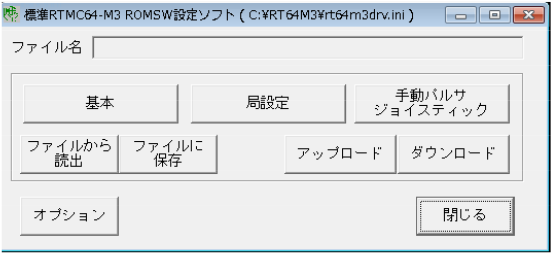

> **図の内容**
>
> ウィンドウ「標準RTMC64-M3 ROMSW設定ソフト ( C:¥RT64M3¥rt64m3drv.ini )」。ファイル名欄と、ボタン: 基本、局設定、手動パルサ ジョイスティック、ファイルから読出、ファイルに保存、アップロード、ダウンロード、オプション、閉じる。

※通信ライブラリの初期化エラー"が発生した場合は、RTMC64が正常に動作していない、または通信設定のノード設定が誤っている可能性があります。RTMC64の起動、通信設定を見直してください。

- (<5．通信接続の設定／確認>を参照下さい。)
- ③ ファイル保存ボタンをクリックします。

ファイル選択ダイアログが表示されるので、任意のファイル名を指定して下さい。（ ④で設定を変更する前に現在の設定をバックアップします。）

- ④必要に応じて設定を変更して下さい。

各項目については「RTMC64-M3/RTMC64-EC ROMSW設定ソフト説明書」を参照下さい。

- ※ 変更内容が未定/不明であれば、後日改めて変更して下さい。
- ※ このあとのダミー運転の場合は、変更する必要はありません。
- ⑤ ファイル保存ボタンをクリックします。

ファイル選択ダイアログが表示されるので、任意のファイル名を指定して下さい。

- ※ ④で設定を変更していなければ不要です。

（設定した内容をバックアップします。）

- ⑥ ダウンロードボタンをクリックします。
- ※ ④で設定を変更していなければ不要です。 ◆1.2
- ※ 通信エラーが発生した場合は、プログラムを終了(⑦)して通信設定を見直して下さい。 (<5．通信接続の設定／確認>を参照下さい。)
- ⑦ 閉じるボタンをクリックしてプログラムを終了します。

(「ROMスイッチの内容を設定ファイルに保存しますか?」のメッセージには必ず「はい」を選択して下さい。)

- 注意! ROMSWデータの変更をした場合には、必ず以下を実行してください。
- ■ ダウンロード(PC(Windows)→RTMC64)
- ■ ファイルへ保存
- ■ INIファイル作成(終了時に "ROMSWに反映しますか?" →「はい」)
- ■ PCを再起動します。(またはINtimeのRestart Node* を実行してください)

ROMSW設定ソフト"Rt64m3swset.exe"[M3] "Rt64m3swset.exe"[EC] にてROMSW設定を変更し、RTMC64にダウンロードした場合は、RTMC64の再起動が必要です。

- 4-1-2.ROMSW設定変更時のINtimeプロセス再起動 (RTMC64の再起動にて、設定変更が有効になります。)

#### 4-1-3.INtimeの再起動

ROMSW設定の変更時などRTMC64を初期状態から起動する必要があります。

RTMC64の初期からの再起動は、PC全体を再起動して下さい。

例外的にRTMC64のみを初期状態から再起動させるとき、INtimeの再起動で実行することができます。

調査などでテクノからINtimeの再起動をお願いした場合の時のため、INtimeの再起動手順を説明します。

①Windowsタスクトレイに常駐しているINtimeのアイコンをクリックします。

②メニューから「Restart NodeA」をクリックします。

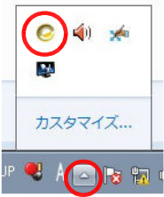

> **図の内容**
>
> タスクトレイの隠れたアイコンを表示したところ。INtime のアイコン（黄色）と、通知領域を開く「∧」ボタンが赤丸で囲まれている。

#### 4-1-4.RTMC64正常起動確認

RTMC64は起動時にM/E通信マスターとしての初期化を実行し、その結果をコンソールに表示します。

- 正常時のコンソールメッセージ "mst_init ==> 0x0"
- ※RTMC64-M3の場合、通信ICの初期化が成功すると"0x0"が表示されます。

"0x0"でもスレーブ局との接続が確立していない場合もありますので、正常に通信できない場合は、スレーブ毎のCONNECT状態を確認してください。

※RTEC64-ECの場合、このコンソールメッセージが"0x0"以外の場合、通信が確立されない原因を判別できます。コンソールメッセージの判別については、<Ⅴメンテナンス編 1-2. アラーム表示をともなう異常(全体エラー)>(TB00-1040J)を参照下さい。

またスレーブのLEDの表示状態から正常にM/E通信が確立しているかを判別できます。

- MECHATROLINK-Ⅲの場合 CONNECT LEDが点灯します。 ※正常に通信が確立しない場合、ROMSW設定やMECHATROLINKスレーブ局の通信設定を見直して下さい。
- EtherCATの場合

LINK LEDがFlickering(100ms周期で点滅)します。

※正常に通信が確立しない場合、ROMSW設定やENIファイル、EtherCATスレーブ局の通信設定を見直して下さい。

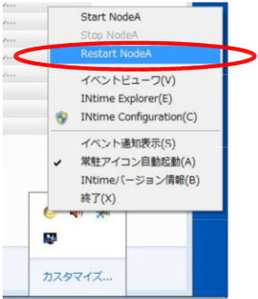

> **図の内容**
>
> INtime のメニューで「Restart NodeA」（選択中）が赤丸で囲まれている。Stop NodeA は灰色。

### 4-2. パラメータ未設定エラー/バックアップメモリエラーの解除

4-2-1.パラメータ未設定エラー/バックアップメモリエラーの確認

新しくRTMC64インストール後は、必ず"パラメータ未設定エラー"になっています。

①セッティングPCを起動すると、運転画面が表示されます。

RT64M3DRV.EXE を実行します[M3]

RT64ECDRV.EXE を実行します[EC]

(通信エラーが発生したら、<5．通信接続の設定/確認>を参照下さい。)

- ②「エラー情報」をクリックしエラー内容を確認します。

"パラメータ未設定エラー"もしくは"バックアップメモリエラー"が発生している場合は、4-2-2.の手順でエラーを解除してください。

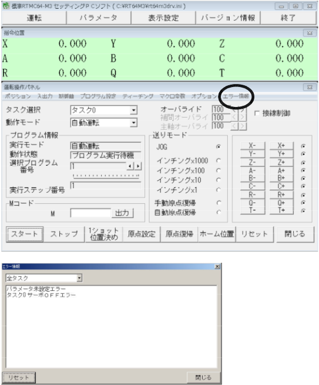

> **図の内容**
>
> セッティングPCソフトの運転画面（X、Y、Z、A、B、C、R、Q、T の位置はすべて 0.000）。画面右の欄が丸で囲まれ、その下に別ウィンドウ（エラーの一覧）が表示されている。細部は小さくて判読できず。

バックアップの概念図

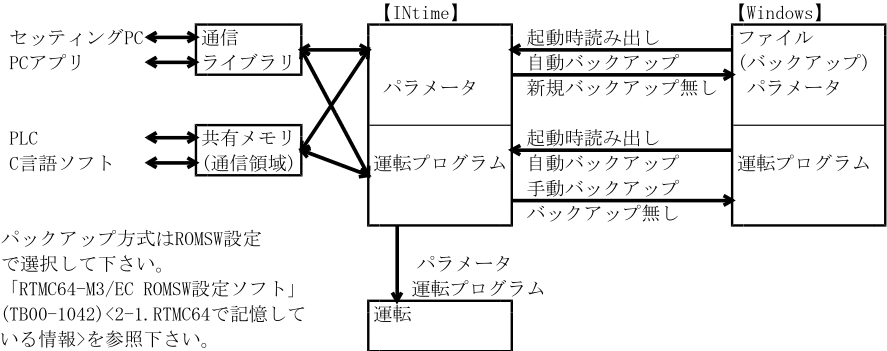

> **図の内容**
>
> - 「セッティングPC」「PCアプリ」は「通信ライブラリ」を、「PLC」「C言語ソフト」は「共有メモリ(通信領域)」を経て、【INtime】の「パラメータ」と「運転プログラム」の両方を読み書きする
> - 【INtime】の「パラメータ」と【Windows】の「ファイル(バックアップ) パラメータ」の間: 起動時読み出し（Windows → INtime）、自動バックアップ（INtime → Windows）、新規バックアップ無し
> - 【INtime】の「運転プログラム」と【Windows】の「運転プログラム」の間: 起動時読み出し（Windows → INtime）、自動バックアップ、手動バックアップ（INtime → Windows）、バックアップ無し
> - 【INtime】の「パラメータ」「運転プログラム」→「運転」
> - 注記: バックアップ方式はROMSW設定で選択して下さい。「RTMC64-M3/EC ROMSW設定ソフト」(TB00-1042)<2-1.RTMC64で記憶している情報>を参照下さい。

#### 4-2-2.パラメータ初期化／バックアップ

- ① パラメータボタンをクリックします。
- ②「バックアップデータ初期化」ダイアログの全ての初期化ボタンをクリックして下さい。 RTMC64-M3/ECで保存しているデータを初期化します。
- ③「サーボパラメータ」ダイアログを表示します。


> **図の内容**
>
> ウィンドウ「標準RTMC64-M3 セッティングPCソフト ( C:¥RT64M3¥rt64m3drv.ini )」のメニュー: 運転、パラメータ（丸で囲み）、表示設定、バージョン情報、終了。

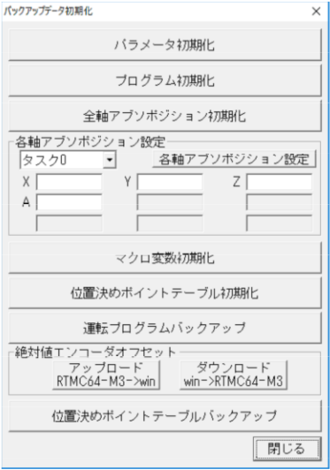

> **図の内容**
>
> 画面「バックアップデータ初期化」。ボタン: パラメータ初期化、プログラム初期化、全軸アブソポジション初期化、各軸アブソポジション設定（タスク0、X・Y・Z・A の入力欄、「各軸アブソポジション設定」ボタン）、マクロ変数初期化、位置決めポイントテーブル初期化、運転プログラムバックアップ、絶対値エンコーダオフセット（アップロード RTMC64-M3->win、ダウンロード win->RTMC64-M3）、位置決めポイントテーブルバックアップ、閉じる。

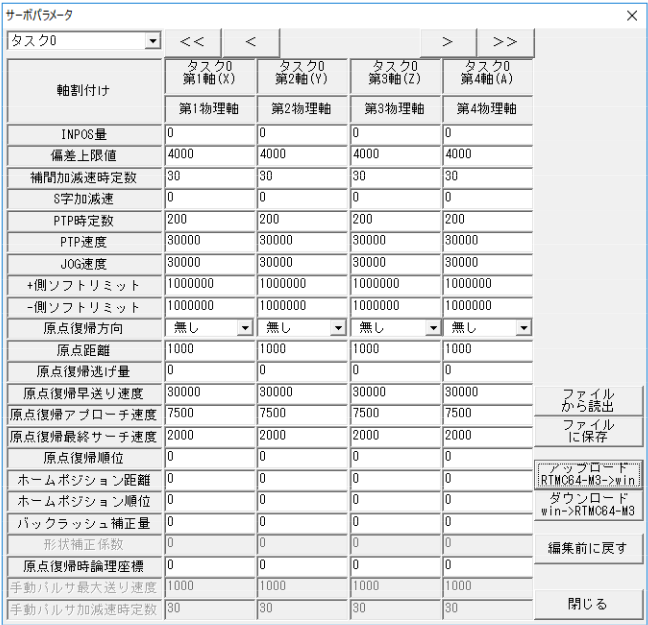

> **図の内容**
>
> 画面「サーボパラメータ」。タスク0 の 第1軸(X)〜第4軸(A) の列に、INPOS幅、最高速度、補間加減速時定数、S字加減速、PTP時定数、PTP速度、JOG速度、+側ソフトリミット、-側ソフトリミット、原点復帰方向、原点距離、原点復帰速度 などの値が並ぶ。右側にボタン: ファイルから読出、ファイルに保存、アップロード RTMC64-M3->win、ダウンロード win->RTMC64-M3、編集前に戻す、閉じる。
> 値は小さくて判読しにくい。

サーボパラメータ以外に、オプションで購入されたオプション機能のパラメータの設定も必要です。操作時の条件に応じた手順でパラメータの設定を行っていください。

- ■ 初期導入の場合は、以下の■新規導入の場合④～⑦の手順で作業してください。
- ■ 既設の場合は、⑧～⑩の手順で作業してください。
- ■ オプションを追加購入の場合は、⑪を行ってください。

・新規導入の場合

- ④ アップロードボタンをクリックします。（RTMC64からデフォルトのパラメータを読み出します。）
- ⑤必要に応じて設定を変更して下さい。
- (「ユーザーズマニュアル」「セッティングPCマニュアル」を参照下さい。)
- ※ 変更内容が未定/不明であれば、後日改めて変更して下さい。
- ⑥ファイルに保存ボタンをクリックします。

ファイル選択ダイアログが表示されるので、任意のファイル名を指定して下さい。

（パラメータファイルは、初期設定の区別ができるようなファイル名を指定して保存して下さい。）

- ⑦ ダウンロードボタンをクリックします。
- パラメータボタンで表示された全てのパラメータについて④～⑦の操作を繰り返してください。購入されたオプション機能により次のパラメータの設定が必要になります。
- サーボパラメータ(標準仕様)
- ピッチエラー補正データ(オプション)
- 工具長補正データ(オプション)
- 工具径補正データ(オプション)
- 補間前加減速パラメータ(オプション)
- 初回の保存は仮設定のものです。
- 後日、正式な試運転・調整の後、改めて保存(パラメータファイルの更新)して下さい。
- サーボパラメータは、今後の更新毎に必ずPC側で保存して下さい。
- また、上書きしたくない時は異なるファイル名にして下さい。
- 既設の場合のサーボパラメータダウンロード
- ⑧保存してあったサーボパラメータファイルをファイルから読出します。
- 内容を変更する必要があれば、変更してください。
- ⑨そのファイルをダウンロードします。
- ⑩サーボパラメータを変更した場合は、適宜名称を付けて、ファイルに保存して下さい。
- オプションの追加の場合
- ⑪「ピッチエラー補正」や「工具長補正」、「工具径補正」、「補間前加減速(自動コーナオーバライド)」のオプションを購入された場合、③から行った「サーボパラメータ」の設定にならって、それぞれの設定画面から設定して下さい。
- 上記のオプションの内、購入された全てのパラメータを設定することで、"パラメータ未設定エラー" を解除できます。


### 4-3. セッティングPCソフト設定

表示設定から｢通信設定｣、｢セッティングPCソフト動作設定｣、｢ポジション表示形式設定｣、｢入出力表示設定｣の各々の設定画面で、必要に応じて変更して、設定して下さい。各設定の詳細については、

「RTMC64-M3/EC セッティングPCマニュアル」(TB00-1041) <5-4-1.インタフェース設定>～<5-4-3.入出力表示設定> を参照下さい。

■通信設定 ◆1.3

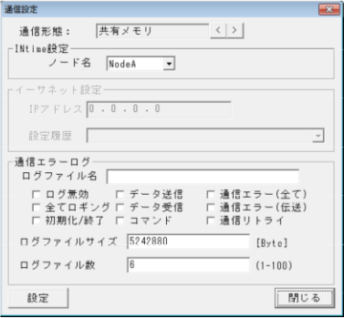

> **図の内容**
>
> 画面「通信設定」。
> - 通信形態: 共有メモリ
> - INtime設定: ノード名 NodeA
> - イーサネット設定（灰色）: IPアドレス 0.0.0.0、設定履歴
> - 通信エラーログ: ログファイル名（空）、チェック: ログ無効、全てロギング、初期化/終了、データ送信、データ受信、コマンド、通信エラー(全て)、通信エラー(伝送)、通信リトライ
> - ログファイルサイズ 5242880 [Byte]、ログファイル数 6 (1-100)
> - ボタン: 設定、閉じる

■セッティングPCソフト動作設定画面

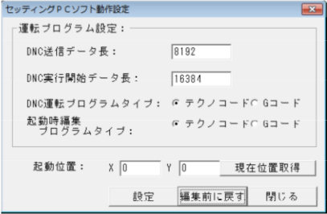

> **図の内容**
>
> 画面「セッティングPCソフト動作設定」。
> - 運転プログラム設定: DNC送信データ長 8192、DNC実行開始データ長 16384、DNC運転プログラムタイプ（テクノコード / Gコード）、起動時編集プログラムタイプ（テクノコード / Gコード）
> - 起動位置: X 0、Y 0、「現在位置取得」ボタン
> - ボタン: 設定、編集前に戻す、閉じる

■ポジション表示形式設定

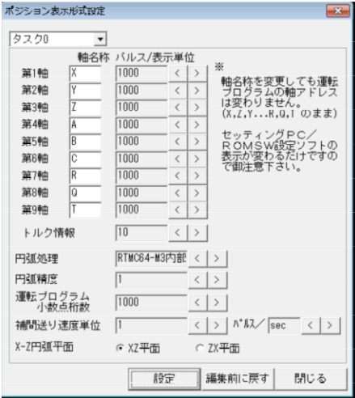

> **図の内容**
>
> 画面「ポジション表示形式設定」。タスク0。第1軸〜第9軸の軸名称（X、Y、Z、A、B、C、R、Q、T）とパルス/表示単位（すべて 1000）。トルク情報 10、円弧処理 RTMC64-M3内部、円弧精度 1、運転プログラム小数点桁数 1000、補間送り速度単位 1 パルス/sec、X-Z円弧平面（XZ平面 / ZX平面）。
> 注記: 軸名称を変更しても運転プログラムの軸アドレスは変わりません。(X,Z,Y…R,Q,T のまま) セッティングPC/ROMSW設定ソフトの表示が変わるだけですので御注意下さい。
> ボタン: 設定、編集前に戻す、閉じる。

軸名称や小数点の位置を変えることができます。

- [ ] 例左右 □□□□.□□ (小数2ケタ)

上下 □□□□.□□□□(小数4ケタ)

前後 □□□□.□□

※軸名称は漢字2文字まで可能です。

■入出力表示設定

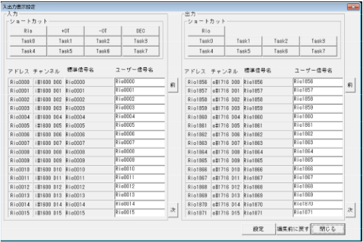

> **図の内容**
>
> 画面「入出力表示設定」。左が入力、右が出力。それぞれ上にショートカット（Rio、+OT、-OT、DEO など / Task0〜Task7）、下に一覧（アドレス、チャンネル、標準信号名、ユーザー信号名。入力は Rio0000〜Rio0015、出力は Rio1856〜Rio1871 など）。ボタン: 設定、編集前に戻す、閉じる。
> 細部は小さくて判読しにくい。

入出力信号名称を変更できます。


> **図の内容**
>
> 「設定」をクリックしないと反映されません。「設定」のクリックによって、INIファイル内の情報が更新されます。

以上で初期導入作業は終了です！

## 5．通信接続の設定/確認

RTMC64とWindows上のPCアプリとの接続(連係)を、従来のテクノモーション(PLMC、SLMなど)にならって「通信」と呼びます。

※ セッティングPCのソフトは機種により異なります。

RTMC64-M3 では RT64M3DRV.EXE RTMC64-EC では RT64ECDRV.EXE

### 5-1. 通信設定（共有メモリ）

◆1.2◆1.3

FAPC上のセッティングPCでRTMC64と通信する場合、共有メモリ経由で通信するINtimeのノードを選択します。

- ①セッティングPCを起動(※)して、表示設定ボタンをクリックします。
- ※ 通信設定があっていない場合、"通信異常"になります。
- ②「通信設定」ダイアログにて通信(ノード)の設定を行って下さい。
- 一般には出荷時設定で使用可能です。変更の必要はありません。
- ③「設定」ボタンをクリックして下さい。


> **図の内容**
>
> ウィンドウ「標準RTMC64-M3 セッティングPCソフト ( C:¥RT64M3¥rt64m3drv.ini )」のメニュー: 運転、パラメータ、表示設定（丸で囲み）、バージョン情報、終了。

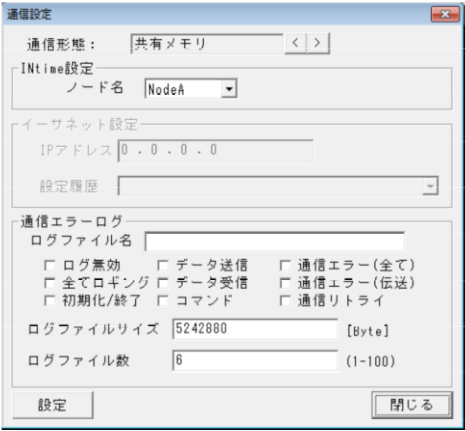

> **図の内容**
>
> 画面「通信設定」。通信形態: 共有メモリ、INtime設定のノード名 NodeA、イーサネット設定（灰色、IPアドレス 0.0.0.0）、通信エラーログ（チェックはすべて未選択）、ログファイルサイズ 5242880 [Byte]、ログファイル数 6 (1-100)。ボタン: 設定、閉じる。


> **図の内容**
>
> 「設定」をしないと反映されません。「設定」によって、INIファイル内の情報が更新されます。

### 5-2. 通信設定（イーサネット）

◆1.3

別PC上のセッティングPCで、FAPCのRTMC64と通信する場合、FAPC上にイーサネット通信用のNICを設定し、別PC上のセッティングPCにそのNICのIPアドレスを設定します。

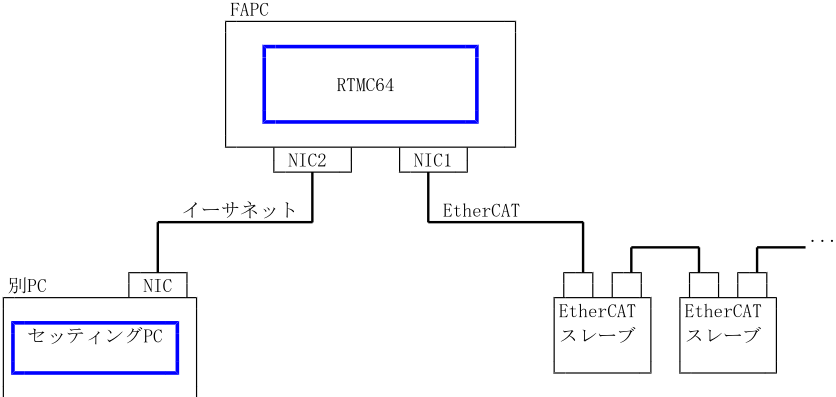

> **図の内容**
>
> - FAPC の「RTMC64」に NIC2 と NIC1 がある
> - NIC2 →「イーサネット」→ 別PC の NIC →「セッティングPC」
> - NIC1 →「EtherCAT」→「EtherCAT スレーブ」が数珠つなぎ（…）

| PC   | NIC   | ドライバ                   | ｲﾝｽﾀﾝｽ   | Interface   | IPアドレス        |
|------|-------|------------------------|----------|-------------|---------------|
| FAPC | NIC1  | Intel Gigabit Ethernet | 0        | ie1g0       | -             |
|      | NIC2  | Intel Gigabit Ethernet | 1        | ie1g1       | 192.168.0.100 |
| 別PC  | NIC   | -                      | -        | -           | 192.168.0.200 |

以下では、上記の構成として各設定を例示します。

#### 5-2-1.FAPC上のNIC設定

【設定内容】

RTMC64がイーサネットでNICを使用できるようにINtimeにパスします。

※RTMC64-ECの場合、イーサネット用にEtherCAT通信とは別のNICが必要です。

【操作方法】

(1)"INtime Configuration"起動

A."Windowsスタートメニューから起動"の場合 [スタートメニュー]→[プログラム]→[INtime]→[INtime Configuration]

B."タスクトレイから起動"の場合

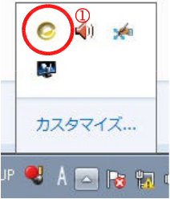

> **図の内容**
>
> タスクトレイの隠れたアイコン。① INtime のアイコン（黄色）が赤丸で囲まれている。


> **図の内容**
>
> INtime のメニューで ② 「INtime Configuration(C)」が赤丸で囲まれている。

- (2)"INtime Device Manager"起動

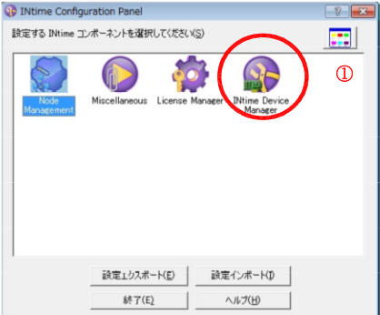

> **図の内容**
>
> 「INtime Configuration Panel」画面。① 「INtime Device Manager」が赤丸で囲まれている。

①"INtime Device Manager"をダブルクリック

- (3)イーサネット通信に使用するNICをINtimeにパス

NICのタイプによって、AまたはBのどちらかを実行して下さい。

- A. 対象のNICが、MSIをサポートしたPCI Expressタイプの場合右クリックのポップアップメニューから、"INtimeへ移す(IRQなし/MSI(M))"を選択し、クリック

して下さい。

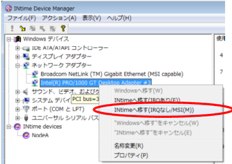

> **図の内容**
>
> 「ネットワーク アダプター」の下の「Intel(R) PRO/1000 GT Desktop Adapter #3」を右クリックしたメニューで、「INtimeへ移す(IRQなし/MSI)(M)」が赤丸で囲まれている。

- B. 対象のNICが、PCIタイプの場合

右クリックのポップアップメニューから、"INtimeへ移す(IRQあり(E))"を選択し、クリックして下さい。


> **図の内容**
>
> 同じ画面で、メニューの「INtimeへ移す(IRQあり)(E)」が赤丸で囲まれている。

- ※ Bを実行した後、右ウィンドウに"(INtime) 競合!!!"と表示された場合IRQがWindowsデバイスと競合している為、利用できない状況です。

本作業を中断し、競合しているWindowsデバイス全てを無効にするか、NICのPCIスロット位置を変更し、再度試みて下さい。

この状態のままでは、イーサネットT通信が出来ません。

- (4)INtimeへのパスの適用ツールバーにある！ボタンを押下し、INtimeへのパスを適用します。


> **図の内容**
>
> ツールバーの「!」ボタン（ツールチップ「デバイス設定情報の保存」）が赤丸で囲まれている。

※環境によっては、Windowsの再起動が求められます。この場合には、Windowsの再起動を実行して下さい。

(5)INtimeへのパスの確認

INtimeへのパスが完了すると、"INtime Device Manager"上の"INtime devices"のツリーにNICが移動します。


> **図の内容**
>
> 「INtime devices」→「NodeA」→「ネットワーク アダプター」の下に「INtime Intel(R) PRO/1000 GT Desktop Adapter #3」が表示されている。

※最下段の"INtimeIntel(R)PRO/1000GT Desktop Adapter #3"は環境により変わります。

(3)の"ネットワークアダプター"で表示されるアダプター名称と同じ名称が移動されていれば完了です。

#### 5-2-2.INtimeノード上のNetwork設定

【設定内容】

INtimeノードがイーサネット通信をするためのNetwork設定をします。

【操作方法】

- (1)「INtime Configuration」の起動

Windowsタスクトレイに常駐しているINtimeのアイコンをクリックします。


> **図の内容**
>
> タスクトレイの隠れたアイコン。INtime のアイコン（黄色）が赤丸で囲まれている。

- (2)ポップアップメニューの「INtime Configuration」をクリックします。

「INtime Configuration Panel」画面が表示されます。


> **図の内容**
>
> INtime のメニューで「INtime Configuration(C)」が赤丸で囲まれている。

- (3)「INtime Node Management」起動

①"Node Management"をダブルクリック


> **図の内容**
>
> 「INtime Configuration Panel」画面。① 「Node Management」が赤丸で囲まれている。

(4)"Network"設定


> **図の内容**
>
> 「INtime Node Management」画面。① 「Network」タブ、② 設定項目（ホスト名の行と思われる）の値、③ 「NIC 設定」の「ネットワークインターフェース(NIC)リスト」の行の「…」ボタンが赤丸で囲まれている。ほかの項目（Configuration、DNS、ルーティング設定など）の値は小さくて判読できず。

- ①"Network"タブを開く
- ②自動起動設定
- 自動起動：はい
- ③NIC設定

[ネットワークインターフェース(NIC)リスト]を選択→入力欄の右側に表示された[...]をクリック →「NIC管理設定」画面が開く


> **図の内容**
>
> 画面「NIC管理設定」。一覧（Interface、Driver、インスタンス）は空。④ 「追加(A)」ボタンが赤丸で囲まれている。ほかのボタン: 編集(E)、上に移動(U)、下に移動(D)、削除(D)、OK、キャンセル(C)、ヘルプ(H)。

④NIC設定の追加

[追加]ボタンを押す→「NICプロパティ」画面が開く


> **図の内容**
>
> 画面「NIC プロパティ - ie1g1」。⑤ インターフェース種類「Intel Gigabit, PCI/PCIe Ethernet (ie1g)」、⑥ インスタンス（値は判読できず）、⑦ 「IPv4 アドレス ネットマスク」の一覧の「追加」ボタンが赤丸で囲まれている。ほかに エイリアス(A)、DHCP有効(E)、割り込み使用（選択）、ポーリング使用、IPv6 アドレス プリフィクス長 の一覧。

- ⑤インターフェース種類の選択追加

インターフェース種類をプルダウンから選択します。

使用するINtimeのバージョンにより、使用できる種類の選択肢が異なる場合があります。以下は代表的な選択肢です。

Intel 1Gbps ネットワークアダプタ： ie1g

Intel 100Mbps ネットワークアダプタ： ie100m

RealTek 1Gbps ネットワークアダプタ： rtl1g

⑥インスタンス番号

インスタンス番号を選択します。

※インスタンス番号は、そのFAPC上の同じインターフェース種類のNICに対して0から昇順に連番が割り当てられます。

※RTMC64-ECの場合、EtherCAT通信とは別のNICを割り当てる必要があります。

RSI-ECATの場合、

- 「(Ⅱ).RTMC64-EC(RSI-ECAT-Master)の場合のインストール」
- -「3-7-1.使用するNIC(Network Interface Controller)の指定」
- -「(2)"HPE2Ifs"設定」

にて設定した"HPE2Ifs"とは異なるNICを割り当ててください。

AlgoEtherCATの場合、

「(Ⅲ).RTMC64-EC(AlgoEtherCAT)の場合のインストール」

- -「3-6.NICと通信周期の設定[A]」
- -「(1)NICの選択」

にて設定した"InstanceNum"とは異なるインスタンス番号を指定してください。

⑦IPv4設定の追加

IPv4アドレスのリストの横にある[追加]ボタンを押す→「IPv4アドレス設定」画面が開く


> **図の内容**
>
> 画面「IPv4 アドレス設定」。⑧ IPv4アドレス 192.168.000.100、⑨ ネットマスク 255.255.255.0、⑩ 「OK」ボタンが赤丸で囲まれている。

- ⑧IPv4アドレスの設定

IPv4アドレスを設定してください。

- ⑨ネットマスクの設定
- ネットマスクを設定してください。

※IPv4アドレスによっては自動的に設定される場合があります。

- ⑩[OK]ボタンを押してIPv4アドレス設定
- →「IPv4アドレス設定」画面が閉じる


> **図の内容**
>
> 画面「NIC プロパティ - ie1g1」。インターフェース種類「Intel Gigabit, PCI/PCIe Ethernet (ie1g)」、インスタンス 1、割り込み使用。IPv4 アドレスの一覧に「192.168.0.100 255.255.255.0」。⑪ 「OK」ボタンが赤丸で囲まれている。

- ⑪[OK]ボタンを押してNICプロパティ設定
- →「NICプロパティ」画面が閉じる
- ⑫[OK]ボタンを押してNIC管理設定
- →「NIC管理設定」画面が閉じる
- ⑬[保存]ボタンを押してNetwork設定を保存


> **図の内容**
>
> 画面「NIC管理設定」。一覧に Interface「ie1g1」、Driver「Intel Gigabit, PCI/PCIe Ethernet」、インスタンス「1」。⑫ 「OK」ボタンが赤丸で囲まれている。


> **図の内容**
>
> 「INtime Node Management」画面の「Network」タブ。NIC リストの値に「ie1g1」が入っている。⑬ 「保存」ボタンが赤丸で囲まれている。ほかの値は小さくて判読できず。

#### 5-2-3.別PCのネットワーク設定

【設定内容】

別PCがイーサネット通信をするため、Windowsのネットワークデバイスを設定をします。

【操作方法】

WindowsでのネットワークデバイスへのIPv4アドレスの設定の手順は複数あります。以下はWindows10においての一例です。

(1)「設定」の起動


> **図の内容**
>
> Windows のスタートメニュー（ドキュメント、ピクチャ、設定、電源）で、「設定」が赤丸で囲まれている。

[Windowsのスタートメニュー]→[設定]

- (2)「ネットワークとインターネット」をクリックします。


> **図の内容**
>
> Windows の「設定」画面で、「ネットワークとインターネット」（Wi-Fi、機内モード、VPN）が赤丸で囲まれている。ほかに システム、デバイス、電話、個人用設定、アプリ、アカウント、時刻と言語、ゲーム。

- (3)「アダプターのオプションを変更する」をクリックします。
- (4) 使用するアダプターのプロパティを開く
- (5) インターネットプロトコルバージョン４(TCP/IPv4)のプロパティを開く


> **図の内容**
>
> 「設定」の「状態」画面。「ネットワークの詳細設定」の「アダプターのオプションを変更する」が赤丸で囲まれている。

使用するアダプターを右クリックして「プロパティ」


> **図の内容**
>
> 「コントロール パネル > ネットワークとインターネット > ネットワーク接続」画面。「イーサネット」アダプターと、右クリックメニューの「プロパティ(R)」が赤丸で囲まれている。

「インターネットプロトコルバージョン４(TCP/IPv4)」を選択して「プロパティ」ボタンを押す


> **図の内容**
>
> 「イーサネット 2のプロパティ」画面（接続の方法: ASIX AX88179 USB 3.0 to Gigabit Ethernet Adapter）。項目一覧の「インターネット プロトコル バージョン 4 (TCP/IPv4)」と「プロパティ(R)」ボタンが赤丸で囲まれている。

(6) IPアドレスを設定

「IPアドレス」「サブネットマスク」を設定して「OK」ボタンを押す


> **図の内容**
>
> 「次の IP アドレスを使う」を選び、IP アドレス 192.168.0.200、サブネット マスク 255.255.255.0（赤丸で囲み）。デフォルト ゲートウェイと DNS サーバーは空。「OK」ボタンが赤丸で囲まれている。

#### 5-2-4.別PC上の設定

- (1)テクノPCベースファインモーションのインストール

出荷CD内の"setup.exe"を実行すると、ファイルのコピー先の入力を促されます。インストール先は任意に指定可能ですが、特に問題がなければデフォルトのインストール先 "C:\RT64EC"にインストールして下さい。

インストーラーが自動的に起動しない場合は、以下の手順でインストーラーを実行して下さい。 ①「スタート」ボタンをクリックしてから「ファイル名を指定して実行」を選択します。

- ②「ファイル名を指定して実行」ダイアログで、"<CD-ROMドライブ名>:\setup" と入力します。 (例: d:\setup)
- ③ OK ボタンをクリックするとインストーラーが起動します。
- (2) セッティングPCの通信設定
- ①セッティングPCを起動(※)して、表示設定ボタンをクリックします。


> **図の内容**
>
> ダイアログ「RT64EC Installer」。「インストールするフォルダを設定して下さい。」、フォルダ「c:¥Rt64ec」、ボタン: 参照、OK、キャンセル。

※ 通信設定があっていない場合、"通信異常"になります。


> **図の内容**
>
> ウィンドウ「標準RTMC64-M3 セッティングPCソフト ( C:¥RT64M3¥rt64m3drv.ini )」のメニュー: 運転、パラメータ、表示設定（丸で囲み）、バージョン情報、終了。

- ②「通信設定」ダイアログにてイーサネット通信の設定を行って下さい。
- ③「設定」ボタンをクリックして下さい。


> **図の内容**
>
> 画面「通信設定」。
> - 通信形態: イーサネット通信（切り替えの「< >」ボタンが赤丸で囲み）
> - INtime設定（灰色）: ノード名 NodeA
> - イーサネット設定: IPアドレス 192.168.0.100（赤丸で囲み）、設定履歴
> - 通信エラーログ: チェックはすべて未選択、ログファイルサイズ 5242880 [Byte]、ログファイル数 6 (1-100)
> - 「設定」ボタンが赤丸で囲まれている

通信形態：「イーサネット通信」を選択

IPアドレス：FAPCのNICに設定したIPアドレスを設定


設定をしないと反映されません。

設定によって、INIファイル内の情報が更新されます。


### 5-3. 通信確認

◆1.2◆1.3

- ①セッティングPCを起動します。

(既に起動している場合は運転ボタンをクリックします。)


> **図の内容**
>
> ウィンドウ「標準RTMC64-M3 セッティングPCソフト ( C:¥RT64M3¥rt64m3drv.ini )」のメニュー: 運転（丸で囲み）、パラメータ、表示設定、バージョン情報、終了。

- ②正しく動作していれば、以下のような運転画面がでます。


> **図の内容**
>
> セッティングPCソフトの運転画面。上部に X、Y、Z、A、B、C、R、Q、T の位置（すべて 0.000）。下部の運転操作パネルに タスク選択（タスク0）、動作モード（自動運転）、プログラム情報（実行モード 自動運転、動作状態 プログラム実行待機、選択プログラム番号、実行ステップ番号）、Mコード、オーバライド（100）、送りモード（JOG、インチングx1000〜x1、手動原点復帰、自動原点復帰）、軸キー（X-/X+ 〜 T-/T+）、ボタン（スタート、ストップ、1ショット位置決め、原点設定、原点復帰、ホーム位置、リセット、閉じる）。

③通信不良の時

下図の通信エラーが発生したときは次の確認を行って下さい。

◆1.2


> **図の内容**
>
> ダイアログ「Rt64m3drv」に警告アイコンと「通信ライブラリの初期化エラーです」、OK ボタン。

- ■RTMC64が実行されていない
- FAPCを再起動して下さい。
- ■通信設定が正しくない

「共有メモリ」の場合

- INtime設定で、RTMC64が動作しているノードを設定して下さい。

「イーサネット通信」の場合 ◆1.3

- イーサネット設定で、正しいIPアドレスを設定して下さい。

<Ⅴメンテナンス編 2.PCソフト側の異常>を参照下さい。

## 6．アンインストール

インストールしたフォルダ内の全てのファイルと、作成したショートカットを削除して下さい。（システムフォルダーやレジストリには変更を加えていません。）


> **図の内容**
>
> ダイアログ「Rt64m3drv」に警告アイコンと「通信デバイスが初期化されていません。」、OK ボタン。

## 7．ダミー運転

ここまでの段階で以下の初期導入作業が完了しました。

- ■ RTMC64ソフトインストール
- ■ Windowsソフトインストール「セッティングPCソフト」「ROMSW設定ソフト」
- ■ ROMSWの設定 (デフォルト)
- ■ サーボパラメータ等の設定 (デフォルト)
- ■ パラメータ未設定エラー/バックアップメモリエラー解除

この状態で、セッティングPCソフト(標準運転ソフト)で手動運転・自動運転を体験してください。

サーボを接続せずに、仮想アンプ機能でダミー運転ができます。

ROMSW設定「基本」の"全局仮想アンプ機能"を有効にするか、「局設定」の"仮想局"を有効にします。


### 7-1. ROMSWの設定

- 「4-1.ROMSW(ロムスイッチ)の設定」を参照して下記の操作を行ってください。
- (ア)ROMSW設定ソフトを起動
- (イ) アップロードボタンを押します。
- (ウ) 局設定画面
- ① 有効局選択で、第1軸～第4軸のチェックボックスを有効にします。
- ②「各局設定」内の「仮想局」と「論理軸割り当て」は、以下のように設定します。
- ③「仮想局」と「論理軸割り当て」以外の設定は変更せずに、設定ボタンを押して下さい。
- (エ) 「ダウンロード」 ①ROMSW設定ソフトのダウンロードボタンを押します。

RTMC64-M3 : はRT64M3SWSET.EXE を実行します


RTMC64-EC : はRT64ECSWSET.EXE を実行します


| 局選択    | タスク   | 論理軸        | 有効局   | 仮想局   |
|--------|-------|------------|-------|-------|
| 第1局(軸) | タスク0  | 論理軸第1軸(X) | 有効    | 有効    |
| 第2局(軸) | タスク0  | 論理軸第2軸(Y) | 有効    | 有効    |
| 第3局(軸) | タスク0  | 論理軸第3軸(Z) | 有効    | 有効    |
| 第4局(軸) | タスク0  | 論理軸第4軸(A) | 有効    | 有効    |

↓

- ②ダウンロード完了したら、閉じるボタンをおす。

↓

- ③"内容を設定ファイルに反映しますか？"と聞かれるので

はいを選択し、ROMSW設定ソフトを終了します。

<4-1.ROMSW(ロムスイッチ)の設定>を参照下さい。

- (オ) RTMC64の再起動
- PCを再起動します。

(またはINtime の Restart Node□ を実行します。)

以上で、ROMSWの設定が有効になります。

のマークの箇所は、お急ぎの時は、この部分は読み飛ばしてください。後で、ゆっくり理解して戴きたい箇所です。

### 7-2. セッティングPCソフトを起動

セッティングPCの起動

RTMC64-M3 : はRT64M3DRV.EXE を実行します


RTMC64-EC : はRT64ECDRV.EXE を実行します


セッティングPC画面で位置情報がゼロ表示になることを確認してください。これは、セッティングPC(Windows部)とRTMC64の通信が正常に確立していることを意味します。

ゼロ表示にならない場合は、通信エラーが考えられます。

<3-4.INtimeカーネル設定>からの手順を再度参照下さい。

### 7-3. ダミーで運転・操作

操作は、すべて以下の運転画面でおこないます。

入力信号状態などによりアラームが発生（エラー情報有り）する場合は、<7-5-1.アラームの解除> を参照下さい。


> **図の内容**
>
> 運転画面の各部の名前: 「メインメニュー」（上部のメニュー）、「位置表示」（X、Y、Z、A の位置）、「操作メニュー」（運転操作パネルのタブ）、「軸キー」（右側の X-/X+ などのボタン）、「操作ボタン」（下部のボタン列）。

#### 7-3-1.手動操作（ジョグ／インチング）

動作モードを「手動運転」とし、送りモード選択して X- 、 X+ キーを押すことでX軸が動作します。他の軸でも同様に、軸の方向キーを押すと押されたキーの軸がキーの方向に動きます。 JOGでは、軸キーを押し続けている間、その軸がサーボパラメータの「JOG速度」で動きます。ダミー運転では、サーボはありませんので、動くのはPC画面の座標(位置表示)だけです。インチングは、指定のインチング量を軸キーを押す毎に動きます。特に、微小送りで位置調整するときに便利です。

原点設定ボタンを押すことで、そのときの位置を座標原点とします。したがって、位置表示がゼロになります。

【運転画面にて】この表の「設定/選択/操作」の項目にならって順番に操作してください。

| 画面/項目   | 設定/選択/操作           | 動作/結果 (表示確認)       | 補足              |
|---------|--------------------|--------------------|------------------|
| 動作モード   | 手動運転               |                    |                  |
| 送りモード   | JOG                |                    |                  |
| (軸キー)   | X+                 | X座標が+方向に変化         | X軸が+方向にジョグ移動     |
|         | X-                 | X座標が-方向に変化         | X軸が-方向にジョグ移動     |
|         | Y+                 | Y座標が+方向に変化         | Y軸が+方向にジョグ移動     |
|         | Y-                 | Y座標が-方向に変化         | Y軸が-方向にジョグ移動     |
|         | 同様にZ,Aでも確認してください   | 同様にZ,Aでも確認してください   |                  |
| (操作ボタン) | 原点設定               | 座標がゼロになります         | 論理座標設定です。        |
| 送りモード   | インチング ×1000        |                    | 1000p単位のインチングモード |
| (軸キー)   | X+                 | X座標が+に1000変化       | X軸が+1000p移動      |
| (軸キー)   | X-                 | X座標が-に1000変化       | X軸が-1000p移動      |
| (軸キー)   | 同様にY,Z,Aでも確認してください | 同様にY,Z,Aでも確認してください |                  |
| 送りモード   | インチング ×100         |                    | 100p単位のインチングモード  |
| (軸キー)   | X+                 | X座標が+に100変化        | X軸が+100p移動       |
| (軸キー)   | X-                 | X座標が-に100変化        | X軸が-100p移動       |
| (軸キー)   | 同様にY,Z,Aでも確認してください | 同様にY,Z,Aでも確認してください |                  |
| 送りモード   | インチング ×10          |                    | 10p単位のインチングモード   |
| (軸キー)   | X+                 | X座標が+に10変化         | X軸が+10p移動        |
| (軸キー)   | X-                 | X座標が-に10変化         | X軸が-10p移動        |
| (軸キー)   | 同様にY,Z,Aでも確認してください | 同様にY,Z,Aでも確認してください |                  |
| 送りモード   | インチング ×1           |                    | 1p単位のインチングモード    |
| (軸キー)   | X+                 | X座標が+に1変化          | X軸が+1p移動         |
| (軸キー)   | X-                 | X座標が-に1変化          | X軸が-1p移動         |
| (軸キー)   | 同様にY,Z,Aでも確認してください | 同様にY,Z,Aでも確認してください |                  |

#### 7-3-2.ワンショット位置決め

位置決めや直線補間で軸を指定量(あるいは目標位置)へ移動させる機能です。操作ボタンの 1ショット位置決ボタンを押すと以下の画面がでます。

1ショット位置決め画面


> **図の内容**
>
> 画面「1ショット位置決め」。
> - 位置決めのモード: インクレPTP（選択）、論理座標系アブソPTP、機械座標系アブソPTP、インクレ直線補間、論理座標系アブソ補間、機械座標系アブソ補間、SPIN(無限回転軸回転動作)、同期軸無視 インクレPTP、同期軸無視 論理アブソPTP、同期軸無視 機械アブソPTP（最後の 3 つは灰色）
> - 移動量/目標位置: X、Y、Z、A（単位 パルス）、ほかの軸は灰色
> - 補間速度: パルス/秒
> - ボタン: 移動開始、移動再開、移動停止、閉じる

(1)インクリメンタルPTP(位置決め)の操作

一連の操作の中では、途中停止/再開、オーバライドも操作します。

【1ショット位置決め画面にて】「設定/選択/操作」の項目にならって順番に操作してください。

| 画面/項目                      | 設定/選択/操作                            | 動作/結果 (確認)                          | 補足                    |
|----------------------------|-------------------------------------|-------------------------------------|------------------------|
| 位置決めモード                    | インクリメンタルPTP                         |                                     |                        |
| 移動量                        | X:1000 Y:1000 Z:1000 A:1000         | X:1000 Y:1000 Z:1000 A:1000         |                        |
|                            | 移動開始                                | 各軸座標が+1000変化します。                   | 全軸1000p分の移動            |
| 同様に適当な値を設定して、位置決めをしてみてください | 同様に適当な値を設定して、位置決めをしてみてください          | 同様に適当な値を設定して、位置決めをしてみてください          |                        |
| 移動量                        | X:100000 Y:100000 Z:100000 A:100000 | X:100000 Y:100000 Z:100000 A:100000 | 移動量が大きいので位置決め完了まで時間がか |
|                            | 移動開始                                | 各軸座標が変化します                          | かります                   |
| (移動中に)                     | 移動停止                                | 座標変化がとまります                          | 途中停止しました               |
|                            | 移動再開                                | 座標変化が再開します                          | 移動再開です                 |
| 位置決め完了するまで、停止/再開は、何度も可能です  | 位置決め完了するまで、停止/再開は、何度も可能です           | 位置決め完了するまで、停止/再開は、何度も可能です           |                        |
| (移動中に) (運転画面で) オーバライド      | < で小さい値に変更                         | 座標変化が遅くなります                         | 移動速度がオーバライド比率で減少      |
| (移動中に) (運転画面で) オーバライド      | > で大きな値に変更                         | 座標変化が早くなります                         | 移動速度がオーバライド比率で増加      |

途中で座標をゼロセットしたいときは、操作ボタンの原点設定を押してください。

補足説明

インクリメンタル:移動指令量です。現在位置に加算して移動します。

アブソ

PTP

:目標座標(目標位置)を指令します。(移動量 = 目標位置 - 現在位置)

:位置決め各軸がサーボパラメータの「PTP」速度で移動します。

補間

補間のように多軸同期にはなりません。

:この場合は、直線補間です。

論理座標

機械座標

SPIN

移動指令した全ての軸が同期して動きます。したがって全軸が同時に指令した目標位置への到着します。移動速度は指令した全ての軸の合成速度になります。

:通常は、この座標系で位置を管理します。原点設定するとその位置が、論理座標系の原点になります

:本来は、フィードバックパルスを積算した座標です。アブソ位置のことです。ただし、ダミー運転では、FBなしなので指令パルスの積算となります。

いずれにしても、原点設定で、座標系のセットアップはしません。

:無限回転軸は連続速度運転が可能です。SPIN指令の場合は「移動量/目標位置」が回転速度になります。

同期軸無視 :"同一指令2軸制御"オプションが設定されているとき、同期の基準軸/従軸を各々同期させず独立に移動させることができます。

詳細は、以下を参照下さい。

ただ、ここでは基本操作を体験するのが目的です。詳細なご理解は、後からでもかまいません。「RTMC64-M3/ECユーザーズマニュアル(TB00-1040)＜キーワード集＞」「RTMC64-M3/ECユーザーズマニュアル(TB00-1040D,E,F)＜Ⅱ機能編＞」


(2)論理座標系でのPTPや補間

【1ショット位置決め画面にて】「設定/選択/操作の項目」にならって順番に操作してください。

| 画面/項目   | 設定/選択/操作                                    | 動作/結果                                       | (確認) 補                           | 足   |
|---------|---------------------------------------------|---------------------------------------------|----------------------------------|-----|
| 位置決めモード | 論理座標系アブソ PTP                                |                                             |                                  |     |
| 目標位置    | 目標位置を指定します。                                 | 目標位置を指定します。                                 |                                  |     |
|         | 移動開始                                        | 目標位置まで動きます                                  |                                  |     |
| 位置決めモード | インクリメンタル補間                                 |                                             |                                  |     |
| 移動量     | 移動量を適宜                                      |                                             |                                  |     |
| 補間速度    | 30000                                       |                                             |                                  |     |
|         | 移動開始                                        | 補間速度で指定の移動量動きます                            | 同じ移動量でも補間速度を変えると到達時間が反比例で変わります |     |
|         | 補間速度を1000pps(低速)～100000pps など変えてトライしてみてください | 補間速度を1000pps(低速)～100000pps など変えてトライしてみてください |                                  |     |
| 位置決めモード | 論理座標系アブソ補間                                 |                                             |                                  |     |
| 目標位置    | 目標位置を指定します。                                 | 目標位置を指定します。                                 |                                  |     |
| 補間速度    | 30000                                       |                                             |                                  |     |
|         | 移動開始                                        | 補間速度で指定の移動量動きます                            | 同じ移動量でも補間速度を変えると到達時間が反比例で変わります |     |
|         | 補間速度を1000pps(低速)～100000pps など変えてトライしてみてください | 補間速度を1000pps(低速)～100000pps など変えてトライしてみてください | 同じ移動量でも補間速度を変えると到達時間が反比例で変わります |     |

※ pps は pulse/sec です。

#### 7-3-3.ホーム位置決め

ホーム位置(パラメータ)は、出荷時に(0,0,0,0,0,0,0,0,0)になってます。

どこからでも機械座標がホーム位置(この場合ゼロの位置)になるまで戻ります。

| 画面/項目   | 設定/選択/操作   | 動作/結果（確認）     | 補足            |
|---------|------------|----------------|----------------|
| 運転画面    | ホーム位置      | 座標が変化して、ゼロになる | どの位置にいても原点に戻る |

座標が大きくずれていると、ホーム位置決めに時間がかかります。停止は、いつでも有効です。

#### 7-3-4.運転プログラムのダウンロード

◆1.2

PTP命令のサンプル運転プログラム"L_PTP.TXT"(テクノ言語)をファイル選択して、RTMC64のブロック番号 0にタスク0用プログラムとしてダウンロードします。

操作メニューから「プログラム設定」を押します。

プログラム管理画面

【プログラム管理画面にて】「設定/選択/操作の項目」の順番に操作してください。


> **図の内容**
>
> 画面「プログラム管理」。ファイル名「C:¥RT64M3¥l_PTP.txt」。左にプログラムメモリ使用状況（BLK、TSK、PNO。BLK 0 は TSK 0・PNO 1、BLK 1 は TSK 0・PNO 10、ほかは --）。「タスク0(カレントタスク)」、Tコード（選択）/ Gコード。プログラム:
> ```
> PNO10;
> /****************************/
> /*  L_PTP.TXT              */
> /****************************/
> PTP X40000 Y20000;      /* (0,0)から、(40000,20000)へ
> PTP X40000 Y-20000;     /* (40000,20000)から、(80000…
> PTP X-40000 Y-20000;    /* (80000,0)から、(40000,-20…
> PTP X-40000 Y20000;     /* (40000,-20000)から、(0,0)…
> END;
> ```
> （行末のコメントは画面で切れている。）ボタン: 移動、コピー、削除、ファイルから読出、ファイルに保存、アップロード RTMC64-M3->win、ダウンロード win->RTMC64-M3、閉じる。

※1:RTMC64-ECの場合はダウンロード

| 画面/項目               | 設定/選択/操作                  | 動作/結果 (確認)                      | 補足                                    |
|---------------------|---------------------------|---------------------------------|----------------------------------------|
| プログラム管理画面           | ファイルから読出                  | ファイル選択ダイアログが表示されます             |                                        |
| L_PTP.TXTを選択してください。 | L_PTP.TXTを選択してください。       | L_PTP.TXTを選択してください。             | PTP運転サンプル (プログラム先頭でプログラム番号をPNO10;と指定) |
| プログラム管理画面 Tコード      | プログラム管理画面 Tコード            | プログラム管理画面 Tコード                  |                                        |
|                     | タスク0                      |                                 |                                        |
| ダウンロード先BLK 番号       | プログラムメモリ使用状況リストでBLK0を選択 | BLK0の行が反転表示                     |                                        |
|                     | ダウンロード win → RTMC64-M3    | ※1 RTMC64のBLK0にPNO.10としてローディング |                                        |

win → RTMC64-EC

ローディングが完了しない場合

タスク0にPNO10の運転プログラムが既に存在 →PNOに別の番号を設定して下さい。

または、既存のPNO10へ別のPNOを設定して下さい。

#### 7-3-5.自動モードでメモリー運転

ダウンロードしたPno10(L_PTP.TXT)を運転します。

L_PTP.TXTのXY軌跡の様子

```c
    PNO10;
/****************************/
/* L_PTP.TXT */
/****************************/
```

PTP X40000 Y20000;

PTP X40000 Y-20000;

PTP X-40000 Y-20000;

PTP X-40000 Y20000;

END;

<X/Y軸の合成軌跡>


> **図の内容**
>
> 軌跡表示ウィンドウ。青い線で、左端から右上へ上がり、水平に進み、右端へ下がる台形と、左端から右下へ下がり、水平に進み、右端へ上がる台形が描かれ、全体で六角形の軌跡になっている。

【運転画面にて】「設定/選択/操作の項目」の順番に操作してください。

| 画面/項目     | 設定/選択/操作   | 動作/結果（確認）      | 補足   |
|-----------|------------|-----------------|-------|
| タスク選択     | タスク0       |                 |       |
| 動作モード     | 自動運転       |                 |       |
| 実行プログラムNO | 10         |                 |       |
| 実行ステップNO  | 1          |                 |       |
|           | 原点設定       | 座標をゼロにする        |       |
|           | スタート       | 運転開始。座標が変化。     |       |
|           | ( 停止 )     | 運転途中ならそこで停止     |       |
|           | スタート       | 再開終了していたら、最初から |       |
|           | ( リセット )   | 運転途中で強制終了します    |       |

運転途中でオーバライドを変更し、速度が遅くなったり、早くなったりするのを確認してください。

#### 7-3-6.ティーチング画面でシングルステップ運転

プログラムティーチング画面でシングルステップ運転をします。シングルステップでは、運転プログラムの1ステップ(1行)毎に、一度停止して、

スタートボタンを押す毎に1ステップずつ実行します。作成した運転プログラムの動作確認に便利です。

【運転画面にて】「設定/選択/操作の項目」の順番に操作してください。

| 画面/項目      | 設定/選択/操作   | 動作/結果 (確認)    | 補足   |
|------------|------------|---------------|-------|
| タスク選択      | タスク0       |               |       |
| 動作モード      | 自動運転       |               |       |
| 実行プログラムNO  | 10         |               |       |
| (実行ステップNO) | 1          |               |       |
|            | 原点設定       | [座標をゼロにする]を表示 |       |
| 操作メニュー     | ティーチング     | ティーチング画面になる   |       |

【ティーチング画面にて】「設定/選択/操作の項目」の順番に操作してください。

| 画面/項目    | 設定/選択/操作   | 動作/結果 (確認)                            | 補足   |
|----------|------------|---------------------------------------|-------|
| ティーチング画面 | シングル       | (シングル運転モードになる) 1ステップを実行して停止次のステップを実行 |       |
|          | 実行         |                                       |       |
|          | 実行         |                                       |       |
|          | 以下、繰り返し    | 以下、繰り返し                               |       |

以上でダミー運転は終了です !

余力がある方は、セッティングPCのすべての画面を覗いて見てください。


### 7-4. 他の画面をみる

パラメータ画面パラメータを眺めてください。

サーボパラメータの説明は、<Ⅲ試運転・調整編 4. サーボパラメータ>を参照下さい。表示設定画面

バージョン表示テクノへの連絡時などのため確認しておいてください。

### 7-5. その他の運転の準備

#### 7-5-1.アラームの解除

入力論理がデフォルトとは違う設定の場合や、ラダーでONしているとエラーとなる場合があります。

OT、タスク毎の外部アラーム、非常停止などの入力で発生している可能性があります。

- ROMSWソフトの入力論理がB接の設定で、未配線でアラームになっている場合 → ROMSWソフトで入力論理をA接にして、アラーム無しとします。

詳細は、ROMSW設定マニュアルを参照下さい。

- ラダーでONしている場合
- → ラダーロジックを変更して下さい。

#### 7-5-2.RTMC64の再起動

ROMSWを修正したときは、必ずRTMC64を再起動して下さい。

「4-1-3.ROMSW設定変更時のINtimeプロセス再起動」を参照下さい。

## 8．モータ単体運転の準備

準備として最低限の配線作業をしていただきます。

モータ単体で動作(機構を動かさず)させて、機能と操作にさらに慣れていただきます。

安心して、RTMC64を使っていただけるまでの作業です。

ダミー運転と同じことをモータを空運転しながらおこなっていただきます。

各モータに合わせて、サーボアンプやRTMC64のパラメータ設定が必要です。送り速度なども実回転速度に応じて運転していただく必要があります。

### 8-1. 配線準備

サーボ主電源、モータ、エンコーダ及びPC(RTMC64)との通信線(MECHATROLINK/EtherCAT)の配線が必要です。

サーボ主電源は、サーボアンプにアンプの定格に従いAC100Vまたは200Vを直接接続してもかまいません。

正式には、出力制御で主電源のON/OFF制御をします。

使用するサーボのマニュアルを十分にご確認下さい。配線ミスで思わぬ事故になる場合もあります。また、アースは必ず接地して下さい。

### 8-2. 組立・配線・配線チェック

正式には、制御ユニット（板金ボックスやシャーシなど）にまとめてください。

仮の配置でも、板（シャーシ）などの上に固定し、アース配線をしっかりするなど、最低限の安全策を取ってください。

実験机の上にバラバラに配置するのは、作業性の悪さ、アースの不備などから事故の元になります。配線箇所は、必ず全てテスターチェックなどをしてください。

### 8-3.サーボアンプの局アドレス設定

◆1.3

以降の説明は、以下のようなROMSW設定のデフォルト構成を仮定し説明しています。

(モータが4軸より少ない場合は、適宜読み替えて作業を進めて下さい。)

| フィールドバスの局番号 ※1   | フィールドバスの局番号 ※1   | フィールドバスの局番号 ※1   | フィールドバスの局番号 ※1   | フィールドバスの局番号 ※1   | 物理軸   | タスク   | 論理軸   | 論理軸    |
|------------------|------------------|------------------|------------------|------------------|-------|-------|-------|--------|
| RTMC64-M3 ※2     | RTMC64-M3 ※2     | RTMC64-M3 ※2     | RTMC64-EC ※3     | RTMC64-EC ※3     | 物理軸   | タスク   |       |        |
| 局アドレス            | 拡張アドレス           | ML Board ID      | Station Alias    | 局内連番             | 物理軸   | タスク   |       |        |
| 03H              | 00H              | 0                | 1                | 0                | 第1軸   | タスク0  | 論理軸   | 第1軸(X) |
| 04H              | 00H              | 0                | 2                | 0                | 第2軸   | タスク0  | 論理軸   | 第2軸(Y) |
| 05H              | 00H              | 0                | 3                | 0                | 第3軸   | タスク0  | 論理軸   | 第3軸(Z) |
| 06H              | 00H              | 0                | 4                | 0                | 第4軸   | タスク0  | 論理軸   | 第4軸(A) |

- ※1 フィールドバスの局番号は各通信規格の規約に沿った設定をしてください。
- ※2 RTMC64-M3(MECHATROLINK-Ⅲ)の場合はスレーブの「局アドレス」は"03H"～"EFH"の範囲で任意に設定します。「拡張アドレス」はマルチスレーブ局(１つのスレーブ局に複数モータを接続する局)のモータ毎に"00H"から昇順に設定します。

「ML Board ID」は複数のMECHATROLINK-Ⅲ通信ボードを使用する場合にボードを識別するために設定します。ボードが１つの場合は「ML Board ID」を無視します。

- システック(SY-M3-01)の場合ボード毎にディップスイッチ(DSW)にIDを設定します。"0"から昇順となるように設定します。
- 安川電機(NT112BM)の場合

「CH1」をID"0"、「CH2」をID"1"として設定します。

- ※3 RTMC64-EC(EtherCAT)の場合はスレーブの「Station Alias」は"1"～"32767"の範囲で任意に設定がが可能です。「局内連番」はマルチスレーブ局(１つのスレーブ局に複数モータを接続する局)のモータ毎に、"0"から昇順に設定します。

サーボアンプの局設定については、8-6. RTMC64のサーボパラメータの設定例を参照下さい。

- 【注】使用するサーボの取説や調整ソフトは、必ず準備してください。

### 8-4.RTMC64のROMSWの設定

- (ア) ROMSW設定ソフトを起動

RTMC64-M3では RT64M3SWSET.EXE を実行します

RTMC64-ECでは RT64ECSWSET.EXE を実行します

- (イ)「アップロード」ボタンを押します。
- (ウ)サーボ通信の設定
- RTMC64-M3の場合

「基本」画面の"MECHATROLINK-Ⅲ通信設定"

| C2マスタ有効                | 有効(デフォルト)        |
|------------------------|------------------|
| サブコマンド有効 (伝送バイト数48バイト) | 有効(デフォルト)        |
| 仮想アンプ                  | 全軸モータ無し試験のときチェック |
| 通信異常許容回数               | 0回(デフォルト)        |
| 最大リトライ回数               | 3回(デフォルト)        |

- RTMC64-ECの場合

「基本」画面の"EtherCAT通信設定"

| 仮想アンプ    | 全軸モータ無し試験のときチェック   |
|----------|--------------------|
| 通信異常許容回数 | 0回(デフォルト)          |

上記の設定後は、必ず設定ボタンを押して下さい。

詳細は、「ROMSW設定ソフトマニュアル(TB00-1042)<5-1.基本パラメータ>」を参照下さい。

(エ) 「局設定」画面

詳細は、「ROMSW設定ソフトマニュアル(TB00-1042)<5-4. 軸設定パラメータ>」を参照下さい。

- (1)「有効局選択」で、使用する軸のチェックボックスを有効にします。
- (2)「各局設定」で、使用する物理軸の設定を行います。各物理軸に以下の項目の設定を行って下さい。
- (3) 設定後は、必ず設定ボタンを押して下さい。
- (オ) RTMC64へ「ダウンロード」して設定を有効にします。
- (1)ROMSW設定ソフトのダウンロードボタンを押します。

| ①   | 局アドレス       | 有効軸に対し、<8-3.サーボアンプの設定>で設定した局アドレス                                                                                                                    | 有効軸に対し、<8-3.サーボアンプの設定>で設定した局アドレス                                                                                                                    | 有効軸に対し、<8-3.サーボアンプの設定>で設定した局アドレス                                                                                                                    | 有効軸に対し、<8-3.サーボアンプの設定>で設定した局アドレス                                                                                                                    | 有効軸に対し、<8-3.サーボアンプの設定>で設定した局アドレス                                                                                                                    |
|-----|-------------|-----------------------------------------------------------------------------------------------------------------------------------------------------|-----------------------------------------------------------------------------------------------------------------------------------------------------|-----------------------------------------------------------------------------------------------------------------------------------------------------|-----------------------------------------------------------------------------------------------------------------------------------------------------|-----------------------------------------------------------------------------------------------------------------------------------------------------|
| ②   | 軸割付け        | と、「タスク」、「論理軸」を設定します局選択局アドレスタスク論理軸                                                                                                               |                                                                                                                                                     |                                                                                                                                                     |                                                                                                                                                     |                                                                                                                                                     |
| ②   | 軸割付け        | と、「タスク」、「論理軸」を設定します局選択局アドレスタスク論理軸                                                                                                               | 第1局(軸) 第2局(軸)                                                                                                                                       | 03H 04H                                                                                                                                             | タスク0 タスク0                                                                                                                                           | 論理軸第1軸(X) 論理軸第2軸(Y)                                                                                                                               |
| ②   | 軸割付け        | と、「タスク」、「論理軸」を設定します局選択局アドレスタスク論理軸                                                                                                               | 第3局(軸)                                                                                                                                              | 05H                                                                                                                                                 | タスク0                                                                                                                                                | 論理軸第3軸(Z)                                                                                                                                          |
| ②   | 軸割付け        | と、「タスク」、「論理軸」を設定します局選択局アドレスタスク論理軸                                                                                                               | 第4局(軸)                                                                                                                                              | 06H                                                                                                                                                 | タスク0                                                                                                                                                | 論理軸第4軸(A)                                                                                                                                          |
| ②   | 軸割付け        | ※ 拡張アドレスは"0"にして下さい。                                                                                                                                 | ※ 拡張アドレスは"0"にして下さい。                                                                                                                                 | ※ 拡張アドレスは"0"にして下さい。                                                                                                                                 | ※ 拡張アドレスは"0"にして下さい。                                                                                                                                 | ※ 拡張アドレスは"0"にして下さい。                                                                                                                                 |
| ③   | 仮想アンプ       | 全ての軸でチェックを無効にして下さいデフォルトでチェック無効ですが、ダミー運転時チェックを有効にした軸があります                                                                                          | 全ての軸でチェックを無効にして下さいデフォルトでチェック無効ですが、ダミー運転時チェックを有効にした軸があります                                                                                          | 全ての軸でチェックを無効にして下さいデフォルトでチェック無効ですが、ダミー運転時チェックを有効にした軸があります                                                                                          | 全ての軸でチェックを無効にして下さいデフォルトでチェック無効ですが、ダミー運転時チェックを有効にした軸があります                                                                                          | 全ての軸でチェックを無効にして下さいデフォルトでチェック無効ですが、ダミー運転時チェックを有効にした軸があります                                                                                          |
| ④   | メカ機構１回転パルス数 | 0を設定します(デフォルト)                                                                                                                                      | 0を設定します(デフォルト)                                                                                                                                      | 0を設定します(デフォルト)                                                                                                                                      | 0を設定します(デフォルト)                                                                                                                                      | 0を設定します(デフォルト)                                                                                                                                      |
| ⑤   | マルチターンリミット  | 0を設定します(デフォルト)                                                                                                                                      | 0を設定します(デフォルト)                                                                                                                                      | 0を設定します(デフォルト)                                                                                                                                      | 0を設定します(デフォルト)                                                                                                                                      | 0を設定します(デフォルト)                                                                                                                                      |
| ⑥   | 絶対値エンコーダ    | チェックを無効にして下さい。(デフォルト) 絶対値エンコーダを使用している場合：「モータ単体運転」ではインクリメンタルエンコーダとして使用します. 安川電機製Σサーボの場合はこの設定に合わせて、 ΣサーボのPn0002の2桁目を1に設定して下さいサーボアンプの設定については8-6.を参照 | チェックを無効にして下さい。(デフォルト) 絶対値エンコーダを使用している場合：「モータ単体運転」ではインクリメンタルエンコーダとして使用します. 安川電機製Σサーボの場合はこの設定に合わせて、 ΣサーボのPn0002の2桁目を1に設定して下さいサーボアンプの設定については8-6.を参照 | チェックを無効にして下さい。(デフォルト) 絶対値エンコーダを使用している場合：「モータ単体運転」ではインクリメンタルエンコーダとして使用します. 安川電機製Σサーボの場合はこの設定に合わせて、 ΣサーボのPn0002の2桁目を1に設定して下さいサーボアンプの設定については8-6.を参照 | チェックを無効にして下さい。(デフォルト) 絶対値エンコーダを使用している場合：「モータ単体運転」ではインクリメンタルエンコーダとして使用します. 安川電機製Σサーボの場合はこの設定に合わせて、 ΣサーボのPn0002の2桁目を1に設定して下さいサーボアンプの設定については8-6.を参照 | チェックを無効にして下さい。(デフォルト) 絶対値エンコーダを使用している場合：「モータ単体運転」ではインクリメンタルエンコーダとして使用します. 安川電機製Σサーボの場合はこの設定に合わせて、 ΣサーボのPn0002の2桁目を1に設定して下さいサーボアンプの設定については8-6.を参照 |
| ⑦   | ソフトリミット     | チェックを有効にして下さい(デフォルト)                                                                                                                                | チェックを有効にして下さい(デフォルト)                                                                                                                                | チェックを有効にして下さい(デフォルト)                                                                                                                                | チェックを有効にして下さい(デフォルト)                                                                                                                                | チェックを有効にして下さい(デフォルト)                                                                                                                                |
| ⑧   | 直径指令        | チェックを無効にして下さい(デフォルト)                                                                                                                                | チェックを無効にして下さい(デフォルト)                                                                                                                                | チェックを無効にして下さい(デフォルト)                                                                                                                                | チェックを無効にして下さい(デフォルト)                                                                                                                                | チェックを無効にして下さい(デフォルト)                                                                                                                                |
| ⑨   | 工具長補正       | チェックを無効にして下さい(デフォルト)                                                                                                                                | チェックを無効にして下さい(デフォルト)                                                                                                                                | チェックを無効にして下さい(デフォルト)                                                                                                                                | チェックを無効にして下さい(デフォルト)                                                                                                                                | チェックを無効にして下さい(デフォルト)                                                                                                                                |
| ⑩   | 主軸          | チェックを無効にして下さい(デフォルト)                                                                                                                                | チェックを無効にして下さい(デフォルト)                                                                                                                                | チェックを無効にして下さい(デフォルト)                                                                                                                                | チェックを無効にして下さい(デフォルト)                                                                                                                                | チェックを無効にして下さい(デフォルト)                                                                                                                                |
| ⑪   | 電子ギヤ        | どちらも"0"を設定して下さい                                                                                                                                     | どちらも"0"を設定して下さい                                                                                                                                     | どちらも"0"を設定して下さい                                                                                                                                     | どちらも"0"を設定して下さい                                                                                                                                     | どちらも"0"を設定して下さい                                                                                                                                     |
| ⑫   | 原点復帰方式      | FBラッチ原点復帰(原点信号検出)を設定して下さい(デフォルト)                                                                                                                    | FBラッチ原点復帰(原点信号検出)を設定して下さい(デフォルト)                                                                                                                    | FBラッチ原点復帰(原点信号検出)を設定して下さい(デフォルト)                                                                                                                    | FBラッチ原点復帰(原点信号検出)を設定して下さい(デフォルト)                                                                                                                    | FBラッチ原点復帰(原点信号検出)を設定して下さい(デフォルト)                                                                                                                    |
| ⑬   | 原点復帰FBラッチ信号 | C(Z)相ラッチを設定して下さい(デフォルト)                                                                                                                             | C(Z)相ラッチを設定して下さい(デフォルト)                                                                                                                             | C(Z)相ラッチを設定して下さい(デフォルト)                                                                                                                             | C(Z)相ラッチを設定して下さい(デフォルト)                                                                                                                             | C(Z)相ラッチを設定して下さい(デフォルト)                                                                                                                             |
| ⑭   |             | チェックを無効にして下さい(デフォルト)                                                                                                                                | チェックを無効にして下さい(デフォルト)                                                                                                                                | チェックを無効にして下さい(デフォルト)                                                                                                                                | チェックを無効にして下さい(デフォルト)                                                                                                                                | チェックを無効にして下さい(デフォルト)                                                                                                                                |
|     | 同期軸         | チェックを無効にして下さい(デフォルト)                                                                                                                                | チェックを無効にして下さい(デフォルト)                                                                                                                                | チェックを無効にして下さい(デフォルト)                                                                                                                                | チェックを無効にして下さい(デフォルト)                                                                                                                                | チェックを無効にして下さい(デフォルト)                                                                                                                                |
| ⑮   | 接線制御軸       |                                                                                                                                                     |                                                                                                                                                     |                                                                                                                                                     |                                                                                                                                                     |                                                                                                                                                     |
| ⑯   | 工具径補正       | 未選択を設定して下さい(デフォルト)                                                                                                                                  | 未選択を設定して下さい(デフォルト)                                                                                                                                  | 未選択を設定して下さい(デフォルト)                                                                                                                                  | 未選択を設定して下さい(デフォルト)                                                                                                                                  | 未選択を設定して下さい(デフォルト)                                                                                                                                  |

↓

- (2)ダウンロード完了したら、閉じるボタンを押します。

↓

- (3)"内容を設定ファイルに反映しますか?"と聞かれるので、はいを選択し、ROMSW設定ソフトを終了してください。

### 8-5.RTMC64のサーボパラメータの設定例

モータ単体とはいえ、多少の設定が必要です。セッティングPCのパラメータ画面で設定します。また、機構を駆動する場合には、さらに速度や加減速の見直しが必要です。

30ｋ→360k(1rps) ※ モータ1回転で360000パルスの時

| サーボパラメータ   | 空運転時設定         |
|------------|----------------|
| PTP時定数     | 適宜             |
| PTP速度      | 30ｋ→360k(1rps) |
| JOG速度      | 適宜             |
| 補間時定数      | 適宜             |
| 原点復帰方向     | 無し→適宜 ※1       |

- ※1 モータ単体でも原点復帰を試したい場合は、原点復帰方向を適宜設定します。

### 8-6.サーボアンプの設定

サーボアンプの設定の詳細については、以下の例を参考に各社のサーボの説明書をご確認ください。

年間サポートを契約されている方

作成された接続図や配置図などをテクノにファックスかメールいただければ、RTMC64やサーボアンプの周辺接続を確認させていただきます。こちらから改善のご提案などさせていただくこともあります。また、サーボの設定についてもご相談いただければ、判る範囲ですが、ご支援します。

【例1】安川電機製Σサーボ(MECHATROLINK-Ⅲ)

- (ア) 局アドレスの設定


> **図の内容**
>
> サーボアンプ前面の絵。ロータリースイッチ S1、S2（0〜F）、DIP スイッチ S3（1〜4、ON）、7 セグメント表示 1 桁、端子。

ΣVアンプの正面にあるロータリスイッチS1とS2で、各軸のサーボアンプに2桁の局アドレスを設定してください。

モータ単体運転では、1軸目のモータから順番に03H～06Hを設定して下さい。

設定可能範囲は、「03H～EFH」です。局アドレスが、重複しないように注意して下さい。

使用する軸に、「03H、04H、05H・・・」と順番に設定すると、<8-4. ROMSW設定ソフトの設定>を行うときに分かりやすいと思います。

(イ) ディップスイッチS3の設定

ディップスイッチS3でMECHATROLINK-Ⅲ通信のデータ量を設定して下さい。

| スイッチ番号   | 機能                                | スィッチ設定   | スィッチ設定   |         | 出荷時        |
|----------|------------------------------------|----------|----------|---------|------------|
| スイッチ番号   | 機能                                | 1        | 2        |         | 出荷時        |
| 1、2      | 伝送バイト数の設定 (特別の理由が無ければ 48バイトにして下さい) | OFF      | OFF      | 16バイト   | 1:OFF 2:ON |
| 1、2      | 伝送バイト数の設定 (特別の理由が無ければ 48バイトにして下さい) | ON       | OFF      | 32      | 1:OFF 2:ON |
| 1、2      | 伝送バイト数の設定 (特別の理由が無ければ 48バイトにして下さい) | OFF ON   | ON ON    | 48 設定不可 | 1:OFF 2:ON |
| 3        | システム予約 (変更不可)                      |          |          |         |            |
| 4        | システム予約 (変更不可)                      |          |          |         |            |

[参考資料]

安川電機「Σ-Ⅴシリーズユーザーズマニュアル設計・保守編 MECHATROLINK-Ⅲ通信指令形/回転形 (SIJP S800000 46E) 4.1 MECHATROLINK-Ⅲ通信仕様の設定」

(ウ)Σ サーボパラメータの設定例

| 項目                    | ΣV SGDV   | ΣV SGDV   | 単位       | 説明                                       | 空運転時設定            |
|-----------------------|-----------|-----------|----------|------------------------------------------|-------------------|
| 制御方式                  | Pn000.0桁  | 0/1       |          | 回転方向 0:CCW 1:CW                          | 0:CCW(デフォルト)      |
| 絶対値エンコーダ (アブソエンコーダのみ) | Pn002.2桁  | 0/1       |          | 0:アブソPGとして使う 1:インクレメントPGとして使う            | 1:インクレメント PGとして使う |
| OT時の停止方法              | Pn001.2桁  | 0/1       |          | 0:OT時DB停止後フリーラン 1:非常停止時トルクで停止しその後サーボロック | ※3                |
| 速度ループゲイン              | Pn100     | 適宜        | 0.1hz    | 40→上限値を探す数百hz                           | 400(デフォルト)        |
| 速度ループ積分時定数            | Pn101     | 適宜        | 0.01msec | (20msec) (20～5msec)                      | 2000(デフォルト)       |
| 位置ループゲイン              | Pn102     | 適宜        | 0.1r/s   | 上限値を探す 50～150r/s 補間する軸は統一                | 400(デフォルト)        |
| 慣性モーメント比              | Pn103     | 適宜        | %        | 計算値をもとに設定                                | 100(デフォルト)        |
| 電子ギヤ比 (分子)            | Pn20E     | 適宜        | Pn20E    | 適宜設定                                     | ※1                |
| (分母)                  | Pn210     | 適宜        | Pn210    |                                          |                   |
| 正転トルク制限               | Pn402     |           | %        | 試運転などでトルク制限?                             | 50%               |
| 逆転トルク制限               | Pn403     |           | %        | 50%程度? (通常800%)                          | 50%               |
| P-OT入力使わない           | Pn50A.3桁  | 適宜        |          | PLC入力/OTなし:8 ※2                          | 8:P-OT無し          |
| N-OT入力使わない           | Pn50B.0桁  | 適宜        | 入力割付     | OTをΣ接続 :適宜                               | 8:N-OT無し          |
| 原点LS(DEC)             | Pn511.0桁  | 適宜        | 入力割付     | PLC入力/ΣのDECを使う ※2                        | 3(デフォルト)          |
| 外部ラッチ(EXT1)           | Pn511.1桁  |           |          | 入力割付(通常不要)                               | 4(デフォルト)          |

上記は、ΣV(MECHATROLINK-Ⅲ)を使用するときに一般に設定するパラメータです。

実際の設定は、安川電機の説明書にしたがってください。

- ※1 計算例仮定モータ1回転:360000[pulse] エンコーダ:20bit(1048576[pulse/rev])

Pn20E

エンコーダ分解能

1048576

Pn210 モータ軸1回転指令パルス数 360000 = =

※2 モータ単体運転では、とりあえずOTやDECの配線なしで行うのが簡単です。 I/Oユニットの入力に配線し、ラダー経由でRTMC64の入力割付から入力することも可能です。正式システムではOTやDECは、Σサーボに接続する方法を推奨します。

- ※3 OT時の詳細はTB00-1040Eの5-14.ストロークリミットを参照下さい。

【例2】Panasonic MINAS-A5B

- (ア) 局アドレスの設定


> **図の内容**
>
> サーボアンプ前面の絵。7 セグメント表示 2 桁、LED（RUN、ERR、L/AIN、L/AOUT）、「ID」のロータリースイッチ MSD と LSD（0〜F）、コネクタ X7。

サーボアンプの正面にあるロータリスイッチS1とS2で、各軸のサーボアンプに2桁の局アドレスを設定してください。

(イ) MINASサーボパラメータの設定例

| 項目                                                           | Index   | Sub Index   | 単位     | 説明                                                                                                                                                                                                    | 空運転時設定                        |
|--------------------------------------------------------------|---------|-------------|--------|-------------------------------------------------------------------------------------------------------------------------------------------------------------------------------------------------------|-------------------------------|
| Station alias selectio n                                     | 3741h   | 00h         |        | 0:前面パネルのロータリースイッチと3740h(Station alias setup(h igh))の設定値をStation Aliasとする 1:SIIエリア(0004h)の値をStaitio n Aliasとする。 2:メーカ使用(設定不可)                                                                        | 0:前面パネルのロータリースイッチ ※1         |
| Polarity (回転方向)                                              | 607Eh   | 00h         |        | 0:CCW 224:CW                                                                                                                                                                                          | 0:CCW                         |
| Absolute encoder setup (アブソリュートエンコーダ設定)                     | 3015h   | 00h         |        | 0:アブソリュートエンコーダとして用いる 1:インクリメンタルエンコーダとして用いる                                                                                                                                                          | 1:インクリメンタルエンコーダとして用いる       |
| Over-travel inhibit in put setup (駆動禁止入力設定)                  | 3504h   | 00h         |        | 0:サーボ(MINAS-A5)側減速停止 3505h(Sequence at over-travel i nhibit)に従い停止 1:CoE(CiA402)側減速停止位置制御・速度制御時には 6085h(Quick stop deceleration) (※5)でモータ停止、トルク制御時には6087h(Torque slope)でモータ停止 2:Err38.0(駆動禁止入力保護)発生 | 1:CoE(CiA402)側減速停止           |
| 1st velocity loop gain (第１速度ループゲイン)                          | 3101h   | 00h         | 0.1hz  | 40→上限値を探す数百hz                                                                                                                                                                                        | 270(デフォルト)                    |
| 1st velocity loop inte gration time constant (第１速度ループ積分時定数) | 3102h   | 00h         | 0.1ms  | (20msec) (20～5msec)                                                                                                                                                                                   | 210(デフォルト)                    |
| 1st gain of position l oop (第１位置ループゲイン)                      | 3100h   | 00h         | 0.1r/s | 上限値を探す 50～150r/s 補間する軸は統一                                                                                                                                                                             | 480(デフォルト)                    |
| Inertia ratio (イナーシャ比)                                       | 3004h   | 00h         | %      | 計算値をもとに設定                                                                                                                                                                                             | 250(デフォルト)                    |
| Encoder increments (エンコーダ移動量)                                | 608Fh   | 01h         | pulse  | エンコーダ分解能が自動設定                                                                                                                                                                                         | ※2                            |
| Feed (フィード量)                                                 | 6092h   | 01h         | 指令単位   | 適宜設定                                                                                                                                                                                                  | ※2                            |
| Motor shaft revolution (モータ回転数)                              | 6091h   | 01h         | r      |                                                                                                                                                                                                       | ※2                            |
| Driving Shaft revoluti on                                    | 6091h   | 02h         | r      |                                                                                                                                                                                                       | ※2                            |
| (出力後シャフト回転数) SI2 input selection (SI2(POT)入力設定)              | 3401h   | 00h         |        | 適宜設定                                                                                                                                                                                                  | ※3                            |
| SI3 input selection (SI3(NOT)入力設定)                           | 3402h   | 00h         |        |                                                                                                                                                                                                       | ※3                            |
| SI4 input selection (SI4(HOME)入力設定)                          | 3403h   | 00h         |        |                                                                                                                                                                                                       | ※3                            |
| SI5 input selection (SI5(EXT1)入力設定)                          | 3404h   | 00h         |        |                                                                                                                                                                                                       | ※3                            |
| Abort connection optio n code (主電源遮断時のモータ減速停止方法)            | 6007h   | 00h         |        | 0:No action 1:Fault signal 605Eh(Fault reaction option cod e)に従って減速                                                                                                                                   | 2:Disable voltag e command ※4 |

|                                |       |     | 2:Disable voltage command 605Bh(Shutdown option code)に従って減速 3:Quick stop command 605Ah(Quick stop option code)に従って減速                                             |                          |
|--------------------------------|-------|-----|--------------------------------------------------------------------------------------------------------------------------------------------------------------------|--------------------------|
| Shutdown option code           | 605Bh | 00h | 0:サーボ(MINAS-A5)側減速停止 3506h(Sequence at servo-off)でモータ停止 1:CoE(CiA402)側減速停止位置制御・速度制御時は、6084h(P rofile deceleration)(※5)でモータ停止、トルク制御時は、6087h(T orque slope)でモータ停止 | 0:サーボ(MINAS-A 5)側減速停止 ※4 |
| Disable operation opti on code | 605Ch | 00h | 0:サーボ(MINAS-A5)側減速停止 3506h(Sequence at servo-off)でモータ停止 1:CoE(CiA402)側減速停止位置制御・速度制御時は、6084h(P rofile deceleration)(※5)でモータ停止、トルク制御時は、6087h(T orque slope)でモータ停止 | 0:サーボ(MINAS-A 5)側減速停止    |

上記は、MINAS-A5B(EtherCAT)を使用するときに一般に設定するパラメータです。

実際の設定は、Panasonic社の説明書にしたがってください。

- ※1 試運転・調整時に電源を投入しなくてもサーボアンプ外部からStaiton Aliasが確認できる方が便利なため、3741h(Station alias selection)は0:前面パネルのロータリースイッチに設定することを推奨します。
- ※2 計算例仮定モータ1回転:360000[pulse] エンコーダ:20bit(1048576[pulse/rev]) 減速比(3/50)

Encoder increments(608Fh-01h) Motor shaft revolutions(6091h-01h) 1048576 × 50

Feed(6092h-01h)

Driving shaft revolutions(6091h-02h) 360000 × 3

- ※3 設定ミスを防ぐためサーボアンプの調整・設定ソフト"PANATERM"の"ピンアサイン設定"を使用します。モータ単体運転では、とりあえずOTやDECの配線なしで行うのが簡単です。

I/Oユニットの入力に配線し、共有メモリ経由でRTMC64の入力割付から入力することも可能です。

正式システムではOTやDECは、サーボに接続する方法を推奨します。

- ※4 主電源OFF時のアラーム抑止

6007h(Abort connection option code)をデフォルト値の1:Fault signalとすると主電源OFF時にアラームが発生します。サーボアンプ周辺の回路がアラーム出力によって主電源を遮断する回路の場合、このアラームが解除できなくなります。

アラームとならないように2:Disable voltage commandに設定を変更します。

但し、その場合主電源OFF時の停止方法が605Bh(Shutdown option code)に従いますので、適宜変更してください。(上記ではDB停止となるように0:サーボ(MINAS-A5)側減速停止を選択しています。)

- ※5 位置・速度・加速度等、指令単位に関連するパラメータの設定時の注意

ROMSW設定ソフトにおいて電子ギヤを設定した時、6084h(Profile deceleration)[指令単位/s2]のように指令単位を元にしたパラメータは、ROMSW設定ソフトの電子ギヤ設定を考慮する必要があります。

ROMSW設定ソフトの電子ギヤ設定：1048576／360000

の場合

6084h(Profile deceleration)：100000[指令単位/s2] →100000 × 1048576／360000 ≒ 291271

【例3】OMROM

- (ア) 局アドレスの設定


> **図の内容**
>
> サーボアンプ前面の絵。7 セグメント表示 2 桁、「ADR」のロータリースイッチ X10 と X1（0〜9）、コネクタ CN5。

サーボアンプの正面にあるロータリスイッチS1とS2で、各軸のサーボアンプに2桁の局アドレスを設定してください。

- (イ) OMROMサーボパラメータの設定

例1、例2と同様にサーボパラメータを設定して下さい。

## 9．モータ単体運転

モータは、単体で空回りしますが、急に回転すると自分の慣性で転がったりします。

必ず、モータ自身も仮固定してください。

### 9-1. サーボ主電源投入シーケンス

- (1)ラダーでサーボ主電源を投入(リレーシーケンス)

RTMC64を起動すると、一定のシーケンスの後でサーボアラーム以外のアラーム要因が無ければ、RTMC64 のSVM出力がONになります。ラダー制御で外部リレーを制御して、サーボ主電源を投入します。

また、各軸のサーボアンプに対し、SVONコマンドを発行し、サーボオンします。

(ROMSWの設定によっては、自動的にSVONコマンドを発行しないので、運転画面でリセット操作して、サーボオンさせます。)

- (2)直接のAC入力でサーボ主電源投入する場合

RTMC64が正常に動作して、かつサーボアラーム以外のアラーム要因が無いことを確認して、サーボアンプ

のAC主電源を入れます。

その後で、運転画面からリセット操作して、サーボオンにしてください。

### 9-2. サーボロックの確認

サーボが正常にサーボオンしたら、モータのシャフトがサーボロックされます。手で回しても動きません。位置ループ制御が正常であることが確認できます。モータのシャフトが簡単に手で回せる状態は、サーボオフの状態です。

### 9-3. サーボの異常

サーボ主電源を投入し、サーボオンしたときにモータが暴走したり異常な動作をする場合は、サーボアンプかサーボモータ(エンコーダも含む)、あるいはそれらの配線の不良の可能性があります。

また、主電源が投入されていて、RTMC64からSVONコマンドを発行したにもかかわらず、サーボロックしないのは異常です。

Σ-WinやPANTERMなどのサーボサービスソフトを接続すると、PCで内部状態のモニタリングやモータ単独運転ができますので、各社サーボメーカの説明書にしたがって、調べてください。

### 9-4. 手動/自動運転

ダミー運転と同じ手順でモータ空運転をおこなって下さい。

ダミー運転では仮想軸設定をしていましたが、モータ単体運転では仮想軸設定を解除して下さい。

- ROMSW設定「基本」の「全局仮想アンプ機能」
- ROMSW設定「局設定」の「仮想局」

## 10．導入編の補足資料

### 10-1. 出荷リストサンプル

納品書／出荷表ＲＴＭＣ－Ｍ３用出荷日２０１４年 □□月 □□日


> **図の内容**
>
> 「納品書／出荷表　ＲＴＭＣ－Ｍ３用」、出荷日 ２０１４年 □□月 □□日。
> - 受注先: ＡＢＣ商事 株式会社 様
> - ユーザ: ＤＥＦ工業 株式会社 様
> - オーダーNO. ＴＨ００－０８□□□、注番: □□□-□□□、見積書: TB02-□□□□
> - ソフトバージョン: 標準RTMC64-M3 Ｖｅｒｓｉｏｎ１．０．０Ａ
> - 初回オーダー TH00-08□□□、前回オーダー TH00-08□□□、オーダー担当者、出荷担当者（空欄）
> - 製品 内容: ★ボード「RTMC64-M3 [RTMC64M3_00*** ]」○ 数 1、「年間サポート（～　年　月迄） 出荷月から１年間」
> - ソフト オプション 他:
>   - セッティングPC（初回のみ）(○)、アプリケーションライブラリ（初回のみ）(○)
>   - 加減速: 定時直線型補間加減速、Ｓ字補間加減速（定時直線型補間加減速に加えて）、補間前加減速
>   - 同期送り: 同期軸制御(同一指令制御)、手動パルサインターフェース
>   - 特殊指令: 高精度ラッチ（Ｇ３１／ＳＬＩＮ）、接線制御、直径指令（旋盤用）、ポイント位置決め
>   - 主軸制御: 主軸ＯＮ／ＯＦＦ、インバータ主軸
>   - 補正: ピッチエラー補正、工具長補正、工具径補正、高精度輪郭制御(形状補正)
>   - 付加機能: ＤＮＣ運転、マルチタスク、マクロ、プログラム逆行動作（PTP/LINのみ）、フレキシブル電子カム

### 10-2. 出荷CDの中身

◆1.2

出荷CD内のソフトウエアの一覧を、以下に示します。

①RTMC64-M3の場合

cd

- ├ AUTORUN.INF 自動起動用情報ファイル

├ Setup.ini

インストール用情報ファイル

- ├ setup.exe インストール用実行ファイル
- ├ [vcredist]┬[32bit]─vcredist_x86.exe Visual C++2008再頒布パッケージ(32bit用) ◆1.2 │ └[64bit]─vcredist_x64.exe Visual C++2008再頒布パッケージ(64bit用)

└ RT64M3

- ├ devlp アプリケーション開発用ファイル
- ├ flash Flash書き込み用ソフトとFlashファイル
- ├ G_CALL.txt Gコード版サブルーチン呼び出し(M98)命令サンプル運転プログラム
- ├ G_CIR.txt Gコード版円弧補間命令(G91 G02/G03)サンプル運転プログラム
- ├ G_CSET.txt Gコード版論理座標系設定命令(G92)サンプル運転プログラム
- ├ G_INPD.txt Gコード版ｲﾝﾎﾟｼﾞｼｮﾝﾁｪｯｸ無効/無効命令(G61/G64)サンプル運転プログラム
- ├ G_LIN.txt Gコード版直線補間命令(G91 G01)サンプル運転プログラム
- ├ G_PTMA.txt Gコード版ポイント位置決め命令(G100)サンプル運転プログラム
- ├ G_PTP.txt Gコード版早送り命令(G91 G00)サンプル運転プログラム
- ├ G_PTPA.txt Gコード版アブソ早送り命令(G90 G00)サンプル運転プログラム
- ├ G_SPIN.txt Gコード版無限回転軸速度命令(G120)サンプル運転プログラム
- ├ L_CALL.txt Tコード版サブルーチン呼び出し(CALL)命令サンプル運転プログラム
- ├ L_CIR.txt Tコード版円弧補間命令(CIRR/CIRL)サンプル運転プログラム
- ├ L_CIR10.txt Tコード円弧補間命令(CIRL)の円弧中心指定/円弧半径指定サンプル運転プログラム
- ├ L_CSET.txt Tコード版論理座標系設定命令(CSET)サンプル運転プログラム
- ├ L_DI.txt Tコード版入力判断命令サンプル運転プログラム
- ├ L_DNC.txt Tコード版サンプルDNC運転プログラム
- ├ L_DO.txt Tコード版出力制御命令サンプル運転プログラム
- ├ L_INPD.txt Tコード版ｲﾝﾎﾟｼﾞｼｮﾝﾁｪｯｸ無効/無効命令(INPE/INPD)サンプル運転プログラム
- ├ L_LIMA.txt Tコード版ポイント直線補間命令(LIMA)サンプル運転プログラム
- ├ L_LIMA2.txt Tコード版ポイント直線補間命令(LIMA)サンプル運転プログラム２
- ├ L_LIN.txt Tコード版直線補間命令(LIN)サンプル運転プログラム
- ├ L_MicroMove.txt １ステップ＝１．１制御周期の微小移動運転プログラム
- ├ L_PTMA.txt Tコード版ポイント位置決め命令(PTMA)サンプル運転プログラム
- ├ L_PTP.txt Tコード版早送り命令(PTP)サンプル運転プログラム
- ├ L_PTPA.txt Tコード版アブソ早送り命令(PTPA)サンプル運転プログラム
- ├ L_SPIN.txt Tコード版無限回転軸速度命令(SPIN)サンプル運転プログラム
- ├ L_Square.txt 四角形軌跡サンプル運転プログラム
- ├ L_SWITCH.txt Tコード版スイッチ命令(SWITCH)サンプル運転プログラム
- ├ LangEn.dll 言語テーブル(英)
- ├ LangJp.dll 言語テーブル(日)
- ├ Rt64m3comnt.dll 通信ライブラリ
- ├ Rt64m3gcnv.dll Gコード変換ライブラリ
- ├ Rt64m3tcnv.dll Tコード変換ライブラリ
- ├ Rt64m3drv.exe セッティングPCソフト
- ├ Rt64m3Fdl.exe Flash書き込みソフト
- ├ Rt64m3swset.exe ROMSW設定ソフト
- ├ L_pnt_clr.pnt ポイント直線補間命令(LIMA)サンプル運転
- ├ L_pnt_t0.pnt 位置決めポイントテーブルクリア用データサンプル
- ├ L_pnt_t1.pnt 位置決めポイントテーブルデータサンプル(L_LIMA2.txt)
- ├ L_pnt_t2.pnt 位置決めポイントテーブルデータサンプル(L_LIMA2.txt)
- ├ L_pnt_t3.pnt 位置決めポイントテーブルデータサンプル(L_LIMA2.txt)
- ├ L_pnt_t4.pnt 位置決めポイントテーブルデータサンプル(L_LIMA2.txt)
- ├ L_pnt_t5.pnt 位置決めポイントテーブルデータサンプル(L_LIMA2.txt)
- ├ L_pnt_t6.pnt 位置決めポイントテーブルデータサンプル(L_LIMA2.txt)
- ├ L_pnt_t7.pnt 位置決めポイントテーブルデータサンプル(L_LIMA2.txt)
- ├ L_PTMA.pnt 位置決めポイントテーブルデータサンプル(G_PTMA.txt/L_PTMA.txt/L_LIMA.txt)
- └ Version.sys バージョン情報ファイル

②RTMC64-ECの場合

cd

- ├ AUTORUN.INF 自動起動用情報ファイル
- ├ Setup.ini インストール用情報ファイル
- ├ setup.exe インストール用実行ファイル
- ├ [vcredist]┬[32bit]─vcredist_x86.exe Visual C++2008再頒布パッケージ(32bit用) ◆1.2 │ └[64bit]─vcredist_x64.exe Visual C++2008再頒布パッケージ(64bit用)

└ RT64EC

- ├ devlp アプリケーション開発用ファイル
- ├ flash Flash書き込み用ソフトとFlashファイル
- ├ G_CALL.txt Gコード版サブルーチン呼び出し(M98)命令サンプル運転プログラム
- ├ G_CIR.txt Gコード版円弧補間命令(G91 G02/G03)サンプル運転プログラム
- ├ G_CSET.txt Gコード版論理座標系設定命令(G92)サンプル運転プログラム
- ├ G_INPD.txt Gコード版ｲﾝﾎﾟｼﾞｼｮﾝﾁｪｯｸ無効/無効命令(G61/G64)サンプル運転プログラム
- ├ G_LIN.txt Gコード版直線補間命令(G91 G01)サンプル運転プログラム
- ├ G_PTMA.txt Gコード版ポイント位置決め命令(G100)サンプル運転プログラム
- ├ G_PTP.txt Gコード版早送り命令(G91 G00)サンプル運転プログラム
- ├ G_PTPA.txt Gコード版アブソ早送り命令(G90 G00)サンプル運転プログラム
- ├ G_SPIN.txt Gコード版無限回転軸速度命令(G120)サンプル運転プログラム
- ├ L_CALL.txt Tコード版サブルーチン呼び出し(CALL)命令サンプル運転プログラム
- ├ L_CIR.txt Tコード版円弧補間命令(CIRR/CIRL)サンプル運転プログラム
- ├ L_CIR10.txt Tコード円弧補間命令(CIRL)の円弧中心指定/円弧半径指定サンプル運転プログラム
- ├ L_CSET.txt Tコード版論理座標系設定命令(CSET)サンプル運転プログラム
- ├ L_DI.txt Tコード版入力判断命令サンプル運転プログラム

├ L_DNC.txt Tコード版サンプルDNC運転プログラム

- ├ L_DO.txt Tコード版出力制御命令サンプル運転プログラム
- ├ L_INPD.txt Tコード版ｲﾝﾎﾟｼﾞｼｮﾝﾁｪｯｸ無効/無効命令(INPE/INPD)サンプル運転プログラム
- ├ L_LIMA.txt Tコード版ポイント直線補間命令(LIMA)サンプル運転プログラム
- ├ L_LIMA2.txt Tコード版ポイント直線補間命令(LIMA)サンプル運転プログラム２
- ├ L_LIN.txt Tコード版直線補間命令(LIN)サンプル運転プログラム
- ├ L_MicroMove.txt １ステップ＝１．１制御周期の微小移動運転プログラム
- ├ L_PTMA.txt Tコード版ポイント位置決め命令(PTMA)サンプル運転プログラム
- ├ L_PTP.txt Tコード版早送り命令(PTP)サンプル運転プログラム
- ├ L_PTPA.txt Tコード版アブソ早送り命令(PTPA)サンプル運転プログラム
- ├ L_SPIN.txt Tコード版無限回転軸速度命令(SPIN)サンプル運転プログラム
- ├ L_Square.txt 四角形軌跡サンプル運転プログラム
- ├ L_SWITCH.txt Tコード版スイッチ命令(SWITCH)サンプル運転プログラム

├ LangEn.dll 言語テーブル(英)

- ├ LangJp.dll 言語テーブル(日)
- ├ Rt64eccomnt.dll 通信ライブラリ
- ├ Rt64ecgcnv.dll Gコード変換ライブラリ
- ├ Rt64ectcnv.dll Tコード変換ライブラリ
- ├ Rt64ecdrv.exe セッティングPCソフト
- ├ Rt64ecFdl.exe Flash書き込みソフト
- ├ Rt64ecswset.exe ROMSW設定ソフト
- ├ L_pnt_clr.pnt ポイント直線補間命令(LIMA)サンプル運転
- ├ L_pnt_t0.pnt 位置決めポイントテーブルクリア用データサンプル
- ├ L_pnt_t1.pnt 位置決めポイントテーブルデータサンプル(L_LIMA2.txt)
- ├ L_pnt_t2.pnt 位置決めポイントテーブルデータサンプル(L_LIMA2.txt)
- ├ L_pnt_t3.pnt 位置決めポイントテーブルデータサンプル(L_LIMA2.txt)
- ├ L_pnt_t4.pnt 位置決めポイントテーブルデータサンプル(L_LIMA2.txt)
- ├ L_pnt_t5.pnt 位置決めポイントテーブルデータサンプル(L_LIMA2.txt)
- ├ L_pnt_t6.pnt 位置決めポイントテーブルデータサンプル(L_LIMA2.txt)
- ├ L_pnt_t7.pnt 位置決めポイントテーブルデータサンプル(L_LIMA2.txt)

├ L_PTMA.pnt 位置決めポイントテーブルデータサンプル(G_PTMA.txt/L_PTMA.txt/L_LIMA.txt)

- └ Version.sys バージョン情報ファイル

### 10-3. サンプル運転プログラム

テクノ言語やG言語の運転プログラム<10-2. CDの中身>の*.txtファイルです。

ダミー運転やモータ単体運転でも使います。

サンプル運転プログラムの一部は「サンプル運転プログラム説明書（TB04-0422）」に詳細説明があります。参照下さい。

（テクノHPの「マニュアルダウンロード」ページから取得できます。）

### 10-4. ソフトウェアバージョン

#### 10-4-1. ソフトウェアバージョンの付け方

バージョン番号の付け方は以下の通りです。

Ver1.0.0A

英字部分：PC側のソフトだけを変更した時に A→B→...→Z と上がって行きます。※1

数字部分：RTMC64のファームウェア(ROMソフト)のバージョンです。

※1 ファームウェアのバージョンアップ時には、PC側ソフトを変更していなくても英字部分は A に戻ります。

- 例）元バージョンが「Ver1.0.0B」だとして、バージョンアップの内容により、以下のようにバージョンが変わります。
- 1) ファームウェアとPC側ソフトの両方をバージョンアップ → 「Ver1.1.0A」
- 2) ファームウェアだけバージョンアップ → 「Ver1.1.0A」
- 3) PC側ソフトだけバージョンアップ → 「Ver1.0.0C」

#### 10-4-2.ソフトウェアバージョンの確認方法

- ① セッティングPCを起動します。
- ② バージョン情報ボタンを押します。


> **図の内容**
>
> ウィンドウ「標準RTMC64-M3 セッティングPCソフト ( C:¥RT64M3¥rt64m3drv.ini )」のメニュー: 運転、パラメータ、表示設定、バージョン情報（丸で囲み）、終了。

③表示されるバージョン情報ダイアログの以下の部分がバージョン番号です。

RTMC64-M3の場合


> **図の内容**
>
> ダイアログ「バージョン情報(Rt64m3drv)」。標準RTMC64-M3運転ソフト。
> - パッケージ: Version 1.3.0A（丸で囲み）
> - セッティングPC Version 1.2.0、CommDLL Version 1.1.0、TcnvDLL Version 1.2.0、GcnvDLL Version 1.2.0
> - ファームウェア(motion controller) Version 1.3.0
> - シリアル番号: 29-00020、SUM(Flash): 0000
> - Copyright (C) 2015-2016


> **図の内容**
>
> 「RTMC64-ECの場合」（改訂マーク ◆1.2）。ダイアログ「バージョン情報(Rt64ecdrv)」。標準RTMC64-EC運転ソフト。
> - パッケージ: Version 1.2.0A（丸で囲み）
> - セッティングPC Version 1.0.0、CommDLL Version 1.0.0、TcnvDLL Version 1.0.0、GcnvDLL Version 1.0.0
> - ファームウェア(motion controller) Version 1.2.0
> - シリアル番号: 30-00036、SUM(Flash): 0000
> - Copyright (C) 2016
