# Ⅱ 機能編

改版時の主な修正箇所には「◆バージョン番号」マークが書いてあります。 (例）Ver0.1で改版した場合は「◆0.1」となります。

本説明書ではRTMC64-M3とRTMC64-ECの2機種の説明を行っています。両機種に共通部分はRTMC64と表記します。 RTMC64-M3とRTMC64-ECで異なる部分は、RTMC64-M3の場合[M3] 、RTMC64-ECの場合[EC]と表記します。

## 1.機能概要

### 1-1.RTMC64の構成

#### 1-1-1.全体ブロック図

次ページの図はRTMC64とその周辺の全体ブロック図です。

データの流れと入出力による操作/制御を説明します。

特に運転・操作としては、M/E通信(MECHATROLINKまたはEtherCAT)のM/Eスレーブ入出力局、

WindowsのPCアプリ、INtimeのユーザ制御ソフト(ソフトウェアPLCやC言語ソフト)の3方式が可能です。

※ 以降次のように表記します。

- MECHATROLINK-ⅢまたはEtherCATネットワーク

M/E通信

- MECHATROLINK-ⅢまたはEtherCATネットワークのスレーブ局 M/Eスレーブ
- INtimeユーザ制御ソフト(ソフトウェアPLC/C言語ソフト)

PLC/C

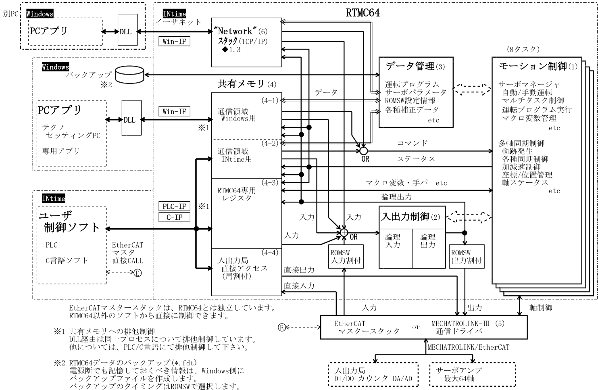

> **図の内容**
>
> RTMC64 とその周辺の全体ブロック図。破線の枠は、Windows 側、INtime 側（RTMC64 が動く側）、別 PC を表す。
>
> **RTMC64 の外（Windows と INtime のユーザソフト）**
> - 別PC の Windows: PCアプリ ⇔ DLL ⇔（イーサネット）⇔ "Network"(6) スタック(TCP/IP) ◆1.3。Win-IF。
> - 同じ PC の Windows: PCアプリ（テクノ セッティングPC、専用アプリ）⇔ DLL ⇔ 共有メモリの (4-1) 通信領域 Windows用。Win-IF。※1
> - Windows のバックアップ（ディスク）⇔ データ管理(3)。※2
> - INtime のユーザ制御ソフト（PLC、C言語ソフト）⇔ PLC-IF / C-IF ⇔ 共有メモリの (4-2) 通信領域 INtime用、(4-3) RTMC64専用レジスタ、(4-4) 入出力局直接アクセス（局割付）。※1
> - ユーザ制御ソフトから EtherCAT マスタを直接 CALL できる（Ⓔ で EtherCAT マスタースタックとつながる）。
>
> **RTMC64 の中**
> - 共有メモリ(4): (4-1) 通信領域 Windows用、(4-2) 通信領域 INtime用、(4-3) RTMC64専用レジスタ、(4-4) 入出力局直接アクセス(局割付)。
> - データ管理(3): 運転プログラム、サーボパラメータ、ROMSW設定情報、各種補正データ etc。(4-1)、(4-2)、"Network" とデータをやりとりする。
> - モーション制御(1)（8タスク）: サーボマネージャ（自動/手動運転、マルチタスク制御、運転プログラム実行、マクロ変数管理 etc）、多軸同期制御（軌跡発生、各種同期制御、加減速制御、座標/位置管理、軸ステータス etc）。
>   - (4-1)、(4-2)、"Network" からのコマンドを OR してモーション制御へ送る。モーション制御からステータスを返す。
>   - (4-3) とマクロ変数・手パ etc をやりとりする。
> - 入出力制御(2): 論理入力、論理出力。
>   - 論理入力: (4-1)、(4-2)、(4-3) からの入力と、ROMSW入力割付を通った M/E 通信の入力を OR する。
>   - 論理出力: (4-3) へ出力し、ROMSW出力割付を通って M/E 通信へ出力する。
> - (4-4) 入出力局直接アクセス: M/E 通信と直接出力・直接入力をやりとりする。
>
> **M/E 通信**
> - EtherCAT マスタースタック or MECHATROLINK-Ⅲ 通信ドライバ(5) が、MECHATROLINK/EtherCAT で、入出力局（DI/DO カウンタ DA/AD）とサーボアンプ（最大64軸）につながる。
> - モーション制御とは「軸制御」でやりとりする。
>
> **図の注記**
> - EtherCATマスタースタックは、RTMC64とは独立しています。RTMC64以外のソフトから直接に制御できます。
> - ※1 共有メモリへの排他制御: DLL経由は同一プロセスについて排他制御しています。他については、PLC/C言語にて排他制御して下さい。
> - ※2 RTMC64データのバックアップ(*.fdt): 電源断でも記憶しておくべき情報は、Windows側にバックアップファイルを作成します。バックアップのタイミングはROMSWで選択します。

#### 1-1-2.RTMC64内の各部の役割(概略)

全体ブロック図をもとに概略を説明します。全体像をつかんでいただくのが目的です。

(1)モーション制御

多軸モーション制御のメインの機能です。

- ■サーボマネージャ

動作モード(自動運転・手動運転・セッティングモードなど)はタスクごとに管理します。

また、マルチタスク制御や運転プログラムの実行を管理をします。さらにマクロ変数や内部状態の管理をします。

■多軸同期制御

運転に伴って、以下の管理や制御をします。

軌跡発生（位置決め・直線補間・円弧補間など）、各種加減速制御、座標系や位置の管理、

軸制御に関連する各種ステータス、アラームチェックなどを行います。

MECHATROLINKやEtherCATへの軸指令や軸情報の監視もします。

(2)入出力制御

RTMC64が管理する入出力を制御します。

RTMC64では、運転やモーション制御に関連する論理入力と論理出力を管理します。

論理入力については「2-1.入力信号の名称と機能」で、論理出力については「2-2.出力信号の名称と機能」で具体的にご説明します。

入出力については、３種類のインターフェース（IF）があります。

- ■M/Eスレーブの入出力局から

論理入出力をM/Eスレーブの入出力局の通信データに割り付けると、入力局の入力信号で操作し、出力局の出力信号を制御できます。

- ■PCアプリから(Win-IF)

PCアプリからDLLとRTMC64の共有メモリを経由して、入出力を制御できます。

- ■INtime上のソフトウェアPLCやC言語ソフトから(PLC-IF/C-IF)

INtime上のソフトウェアPLCやC言語ソフトから「共有メモリのRTMC64専用レジスタ」を経由して、 RTMC64の論理入出力を操作できます。

PLC-IFとC-IFは、同じ共有メモリです。

3種の入力は、RTMC64内部でorされます。排他制御はありませんので、使用するアプリ側で考慮して下さい。

論理出力は、3種のIFに出力されます。

(3)データ管理

RTMC64で使用するすべてのデータの送受信と管理をします。

- ■データの種類

運転プログラム

ROMSW情報

サーボパラメタ

ピッチエラー補正データ

補間前加減速データ

工具長補正データ

工具径補正データ

- ■バックアップ

電源断でも記憶しておき、RTMC64の再起動の際に自動的に読み出して使用すべきデータです。 ROMSW設定で選択したバックアップ方法で、Windows側にバックアップファイルを自動作成します。

- ◆バックアップ対象のデータ

運転プログラム

ROMSW情報

サーボパラメタ

ピッチエラー補正データ

補間前加減速データ

工具長補正データ

工具径補正データ

アブソ座標

(4)共有メモリ

PCアプリやINtime上の他のソフトとRTMC64は、共有メモリ経由ですべての情報をやりとりします。

■通信領域Windows用

Win-IFとして使用します。

PCアプリはDLL（通信ライブラリ）経由で、RTMC64のデータ・入出力情報・ステータスなどを読み書きできます。

また、モーション制御の機能を実行することができます。

テクノのセッティングPCでも、このDLLを使用しています。

ユーザ専用のPCアプリでも、同じDLLを使用します。

※この領域への直接アクセスは禁止です。

この領域の詳細仕様は非公開です。

■通信領域INtime用

PLC-IF／C-IFの通信領域です。

INtime上のユーザ制御ソフトからパケット送受信を行うことで、RTMC64のデータ・入出力情報・ステータスなどを読み書きできます。

また、モーション制御の機能を実行することができます。

※パケット送受信については「.NETサンプルアプリケーション説明書」(TB00-0818)を参照下さい。

■RTMC64専用レジスタ

PLC-IF／C-IFとして、直接読み書きする領域です。

入出力情報・ステータス・マクロ変数を直接読み書きできます。

論理入出力信号と同じ形式、同じ順序の写しで、同じ機能があります。

■入出力局直接アクセス

M/Eスレーブ局の通信データを直接読み書きできます。

ROMSWでRTMC64に割付けているM/Eスレーブ局の制御のために使用します。

サーボの通信データは読出しのみ可能です。M/Eスレーブ入出力局のデータは読み出し/書込み可能です。

※ 共有メモリの詳細については<Ⅱ機能編 4.INtimeユーザ制御ソフト(PLC)とのインターフェース> (TB00-1040E)を参照下さい。

- (5)MCHATROLINK-Ⅲ通信ドライバ/EtherCATマスタースタック

M/Eスレーブと通信を行い、その通信データをRTMC64から読み書きする機能です。

- (6) "Network" スタック ◆1.3

INtime上の"Network"スタックプロセスを介して、TCP/IPで別PCとイーサネット通信します。

### 1-2.RTMC64-M3/ECの運転・操作

#### 1-2-1. Windows上のPCアプリ(Win-IF)からの運転・操作

【RTMC全体ブロック図(4-1),(6)】

- ◆1.3

WindowsのDLLを使用して、共有メモリ(4-1)・"Network"スタック(6)経由で、全ての指令やデータの読み出し・書き込みができます。WindowsのPCアプリからRTMC64を運転・操作できます。

##### 1-2-1-1.セッテングPCソフトによる運転

セッティングPCソフト(テクノ標準運転ソフト)により自動運転・手動運転の全てが可能です。詳細は、「セッティングPCマニュアルTB00-1041」参照ください。

セッティングPC

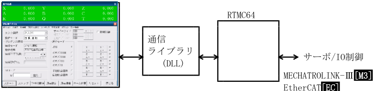

> **図の内容**
>
> セッティングPC の画面 ⇔ 通信ライブラリ(DLL) ⇔ RTMC64 ⇔ サーボ/IO制御（MECHATROLINK-Ⅲ[M3]、EtherCAT[EC]）。

##### 1-2-1-2.専用PCアプリケーションによる運転

DLLを公開しています。ユーザアプリ（CAM・生産管理など）から自由に運転できます。サンプルアプリをソースファイルでご提供しています。

■専用PCアプリ(ユーザ開発可能/DLL応用)

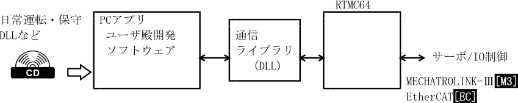

> **図の内容**
>
> 日常運転・保守 DLLなど（CD で提供）→ PCアプリ（ユーザ殿開発ソフトウェア）⇔ 通信ライブラリ(DLL) ⇔ RTMC64 ⇔ サーボ/IO制御（MECHATROLINK-Ⅲ[M3]、EtherCAT[EC]）。

■システム構成例

Windows部

- ■CAD/CAM ・オリジナルソフト
- ■生産管理・市販ソフトウェア
- ■オリジナルNC
- ■人工知能関数通信 /データベースコール ⇔ ライブラリ

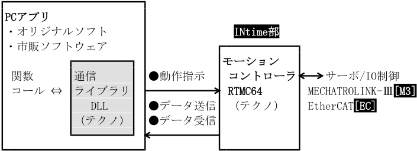

> **図の内容**
>
> - PCアプリ（オリジナルソフト、市販ソフトウェア）は、関数コールで通信ライブラリ DLL（テクノ）を呼ぶ。
> - 通信ライブラリから、INtime部のモーションコントローラ RTMC64（テクノ）へ「●動作指示」「●データ送信」を送り、RTMC64 から「●データ受信」で受け取る。
> - RTMC64 ⇔ サーボ/IO制御（MECHATROLINK-Ⅲ[M3]、EtherCAT[EC]）。

通信コマンドによる運転の例(タスク0、PTP X1000 Y-1500;)の例(C言語)

```c
    {
    PTPSTART ptpprm;
    int hMc;
    int sts;
    PRGTASK task = 0;               /* タスク0選択 */
    ptpprm.AxisFlag = 0x01 + 0x02;  /* 選択軸のビット X軸 + Y軸 */
    ptpprm.IncAxis[0] = 1000;       /* X軸の移動量 */
    ptpprm.IncAxis[1] = -1500;      /* Y軸の移動量 */
    sts = SendCommand(hMc,REQ_PTPSTART,task,&ptpprm);
}
```

※ 詳細は下記を参照下さい。

「RTMC64-M3/EC 通信ライブラリリファレンスマニュアル」(TB00-1043)

「RTMC64-M3/EC 送受信データ説明書」

(TB00-1044)

##### 1-2-1-3.通信ライブラリのコマンド/機能の一部

| 機能分類   | 機能          | 機能分類   | 機能          |
|--------|--------------|--------|--------------|
| データ送信  | サーボパラメータ設定   | 動作指示   | バックアップデータ初期化 |
| データ送信  | オプションパラメータ設定 | 動作指示   | 動作モード設定      |
| データ送信  | 運転プログラム書込    | 動作指示   | 軸移動停止        |
| データ受信  | サーボパラメータ読出   | 動作指示   | 軸移動再開        |
| データ受信  | オプションパラメータ読出 | 動作指示   | JOG移動        |
| データ受信  | 運転プログラム読出    | 動作指示   | 原点復帰         |
| データ受信  | ポジションステータス読出 | 動作指示   | PTP位置決め      |
| データ受信  | 入出力状態読出      | 動作指示   | 補間指令         |
| データ受信  | 動作モード読出      | 動作指示   | リセット         |
| データ受信  | 指令位置読出       | 動作指示   | 原点設定         |
| データ受信  | ステータスフラグ読出   | 動作指示   | 汎用出力直接制御     |
| データ受信  | アラームフラグ読出    | 動作指示   | サーボ電源ON/OFF  |
| データ受信  | 送りオーバライド設定読出 | 動作指示   | プログラム実行開始    |
|        |              | 動作指示   | 実行プログラム選択    |
|        |              | 動作指示   | 送り速度オーバライド変更 |
|        |              | 動作指示   | 全軸原点復帰開始     |

※ 詳細は下記を参照下さい。

「RTMC64-M3/EC 通信ライブラリリファレンスマニュアル」(TB00-1043) 「RTMC64-M3/EC 送受信データ説明書」 (TB00-1044)

#### 1-2-2.INtime上のユーザ制御ソフト（PLC-IF/C-IF）からの運転・操作

ユーザー制御ソフトがPLC-IF/C-IF経由でのRTMC64の運転・操作は、

- 共有メモリの"通信領域INtime用"を用いた通信コマンドによる運転・操作
- 共有メモリの"RTMC64専用レジスタ"を用いた運転・操作
- の二通りの方法があります。

PLCから運転する場合、また、他のC言語ソフトから運転する場合でも、同じ共有メモリにアクセスします。

共有メモリの詳細は、<Ⅱ機能編 4.INtimeユーザ制御ソフト(PLC)とのインターフェース>(TB00-1040E) を参照下さい。

##### 1-2-2-1.ユーザー制御ソフトからの通信コマンド運転・操作

【RTMC全体ブロック図(4-2)】

共有メモリの"通信領域INtime用"は、通信コマンドを実行するためのインターフェースです。 "通信領域INtime用"を用いた通信コマンドの送受信の手順については、<1-3-1.通信領域INtime用>を

参照下さい。

共有メモリの通信領域を使う通信コマンドは次の3種類あります。

- ■通信コマンド
- データ送信 RTMC64で使用する運転プログラム、パラメータ、変数などをPLCから設定できます。
- データ受信 RTMC64内部のステータス、状態、アラーム内容、位置情報、変数などすべての内部情報を読み出せます。
- 動作コマンド運転、操作、移動指令などあらゆる指示が可能です。

※送受信できるデータや、実行できる運転・操作の詳細は下記を参照下さい。「RTMC64-M3/EC 送受信データ説明書」 (TB00-1044)

※但し、PLCではファイルアクセスができません。よって、PLCからのDNC運転やダイナミックデータローディングはできません。

##### 1-2-2-2.ユーザー制御ソフトからの"RTMC64専用レジスタ"を用いた運転・操作【RTMC全体ブロック図(4-3)】

共有メモリの"RTMC64専用レジスタ"を直接読み書きすることで、以下のような運転・操作を実行します。 "RTMC64専用レジスタ"については<1-3-2.RTMC64専用レジスタ・入出力局直接アクセス>を参照下さい。

■論理入出力操作

RTMC64は共有メモリ入力に書き込まれた内容を直接論理入力信号として読込みます。また、論理出力信号を共有メモリ出力に出力します。

論理入出力操作のために下記の「ラダーによる操作例」のようなPLCソフトを実行します。 ※各論理入出力の機能については<2.入出力機能>を参照下さい。

INtimeユーザ制御ソフト

RTMC64

INtimeユーザ制御ソフト

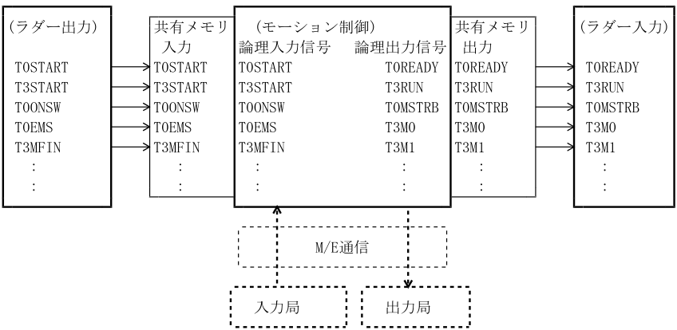

> **図の内容**
>
> INtime ユーザ制御ソフトのラダーと、RTMC64 の論理入出力信号の関係。
> - (ラダー出力) T0START、T3START、T0ONSW、T0EMS、T3MFIN … → 共有メモリ 入力 → (モーション制御) 論理入力信号 T0START、T3START、T0ONSW、T0EMS、T3MFIN …
> - (モーション制御) 論理出力信号 T0READY、T3RUN、T0MSTRB、T3M0、T3M1 … → 共有メモリ 出力 → (ラダー入力) T0READY、T3RUN、T0MSTRB、T3M0、T3M1 …
> - 論理入出力は、M/E通信の入力局・出力局ともつながる（破線）。

- ラダーによる操作例(タスク0のプログラム番号3のスタート) (プログラム選択3のときT0MP_PSEL00、TOMP_PSEL01がONします。T0MP_PSEL02はOFF)

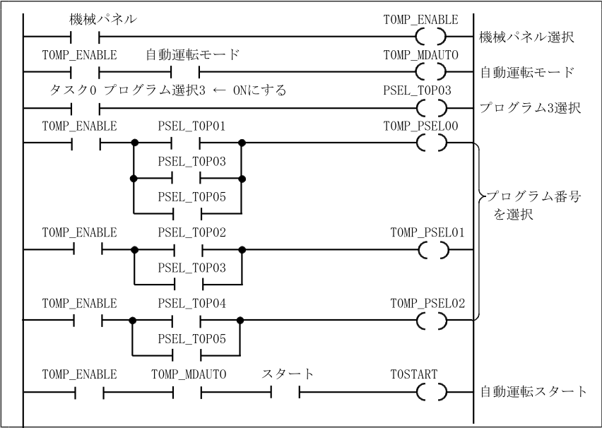

> **図の内容**
>
> ラダー図。各行の左が条件（接点）、右が出力（コイル）と説明。
> | 条件 | 出力 | 説明 |
> |---|---|---|
> | 機械パネル | T0MP_ENABLE | 機械パネル選択 |
> | T0MP_ENABLE AND 自動運転モード | T0MP_MDAUTO | 自動運転モード |
> | タスク0 プログラム選択3 ← ONにする | PSEL_T0P03 | プログラム3選択 |
> | T0MP_ENABLE AND (PSEL_T0P01 OR PSEL_T0P03 OR PSEL_T0P05) | T0MP_PSEL00 | プログラム番号を選択 |
> | T0MP_ENABLE AND (PSEL_T0P02 OR PSEL_T0P03) | T0MP_PSEL01 | プログラム番号を選択 |
> | T0MP_ENABLE AND (PSEL_T0P04 OR PSEL_T0P05) | T0MP_PSEL02 | プログラム番号を選択 |
> | T0MP_ENABLE AND T0MP_MDAUTO AND スタート | T0START | 自動運転スタート |

■手動パルサ/ジョイスティック

"RTMC64専用レジスタ"の「手動パルサカウンタ」や「ジョイスティックAD値」と論理入力の機能の1つの「機械パネル」を使用することで、手動パルサ/ジョイスティック機能を使用できます。

※機能については、<Ⅱ 機能編 5-21.手動パルサ/ジョイスティック>(TB00-1040E)を参照下さい。

■ラダー共有マクロ変数

運転プログラムから読み書きできるラダー共有マクロ変数を"RTMC64専用レジスタ"から読み書きして、ユーザー制御ソフトと運転プログラムの間でデータの受け渡しをすることができます。

※マクロ変数については、<Ⅱ 機能編 7-3.マクロ機能>(TB00-1040F)を参照ください。

■その他データ参照

上記以外に、

- RTC動作カウンタ

：制御周期毎にカウントアップします

- ステータスデータ
- ：全体情報、物理軸情報、タスク情報

等を"RTMC64専用レジスタ"から参照できます。

#### 1-2-3.入出力局（M/Eスレーブ）からの運転・操作【M/E通信の入力/出力ブロック図(5)】

M/E通信(MECHATROLINK/EtherCAT)に接続されたM/Eスレーブ入出力局の通信データを、ROMSW設定で任意の論理信号に割り付けることができます。この入出力信号で運転・操作することができます。

入出力の割り付けは「RTMC64-M3/EC ROMSW設定ソフトマニュアル」<5-2-1.入力信号の局アドレスへの割り付け>、<5-2-2.出力信号の局アドレスへの割り付け>(TB00-1042)を参照下さい。

INtimeユーザ制御ソフト

RTMC64

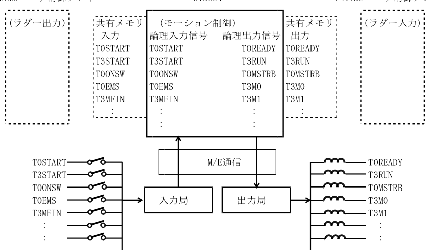

> **図の内容**
>
> - スイッチの入力 T0START、T3START、T0ONSW、T0EMS、T3MFIN … → 入力局 → M/E通信 → (モーション制御) 論理入力信号。
> - (モーション制御) 論理出力信号 T0READY、T3RUN、T0MSTRB、T3M0、T3M1 … → M/E通信 → 出力局 → リレーなどの出力 T0READY、T3RUN、T0MSTRB、T3M0、T3M1 …
> - 共有メモリの入出力と、INtime ユーザ制御ソフトのラダーは破線（この例では使わない）。

機械パネル信号による運転の例(タスク0、プログラム番号3のスタート)

- T0MP_ENABLE : ON

以下の機械パネル信号が有効になります。

- T0MP_MDAUTO : ON

"自動運転"モードにします。

- T0MP_PSEL00 : ON

PSEL00とPSEL01が両方ONでプログラム番号3を選択します。

- T0MP_PSEL01 : ON
- T0START

: OFF→ON 自動運転をスタートします。

T0START ONによりタスク0のプログラム番号3に記憶されている運転プログラムを実行します。

INtimeユーザ制御ソフト

### 1-3.共有メモリインタフェースの概要

#### 1-3-1.通信領域INtime用

(1)概略

INtime上のユーザー制御ソフトは<Ⅱ機能編 4-3.通信領域を使用した通信機能>(TB00-1040E)で説明している各データを使用して、RTMC64との通信を行います。

通信領域の通信データのサイズには制限があるため、送受信するデータサイズが大きいときは、複数のパケットに分割して送受信します。

パケット通信毎に通信領域の要求コマンド(DComQeq)/応答コマンド(DComAck)を使用したフラグハンドシェイクを行います。

ユーザー制御ソフトでは、送受信するデータを全て処理するまでパケット通信を繰り返します。

(2)パケット通信シーケンス

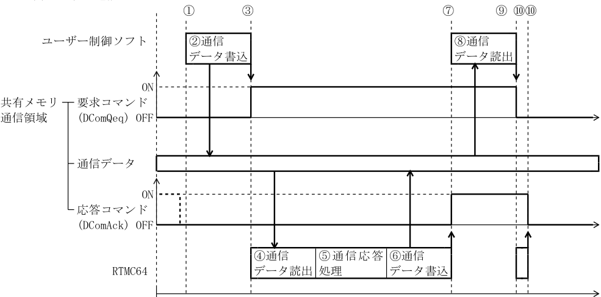

> **図の内容**
>
> 共有メモリの通信領域の、要求コマンド(DComQeq)、通信データ、応答コマンド(DComAck) のタイミング図。番号は本文の①〜⑩に対応する。
> 1. ① 応答コマンド(DComAck) が OFF であることを確認。
> 2. ユーザー制御ソフトが ② 通信データ書込。
> 3. ③ 要求コマンド(DComQeq) を ON。
> 4. RTMC64 が ④ 通信データ読出 → ⑤ 通信応答処理 → ⑥ 通信データ書込。
> 5. ⑦ RTMC64 が応答コマンド(DComAck) を ON。
> 6. ユーザー制御ソフトが ⑧ 通信データ読出。
> 7. ⑨ 要求コマンド(DComQeq) を OFF。
> 8. ⑩ RTMC64 が応答コマンド(DComAck) を OFF。

①応答コマンド(DComAck)OFF確認

ユーザー制御ソフトは、応答コマンド(DComAck)がOFFしていることで、前回のパケット通信が完了したことを確認します。

- ②通信データ書込

ユーザー制御ソフトが共有メモリの通信領域に、通信種別(1:データ書込、2:データ読出、3:動作指示)、通信データタイプ、通信パラメータや通信データ等を書込みます。

※通信データの内容の詳細は、「送受信データマニュアル」(TB00-1044)を参照下さい。

- ③要求コマンド(DComQeq)ON

ユーザー制御ソフトは②が完了したら要求コマンド(DComQeq)をONします。

- ④通信データ読出

RTMC64は要求コマンド(DComQeq)がONしたら、②でユーザー制御ソフトが書込んだ内容を読出します。

- ⑤通信応答処理

RTMC64は④で読出した内容に応じて処理を行います。

- ⑥通信データ書込み

RTMC64は⑤の処理の結果を共有メモリの通信領域に書込みます。

- ⑦応答コマンド(DComAck)ON

RTMC64は⑥が完了したら応答コマンド(DComAck)をONします。

- ⑧通信データ読出

ユーザー制御ソフトは応答コマンド(DComAck)がONしたら、⑥でRTMC64が書込んだ内容を読出します。

- ⑨要求コマンド(DComQeq)OFF

ユーザー制御ソフトは⑧が完了したら要求コマンド(DComQeq)をOFFします。

- ⑩応答コマンド(DComAck)OFF

RTMC64は要求コマンド(DComQeq)のOFFを確認したら応答コマンド(DComAck)をOFFします。

※ユーザー制御ソフトで上記シーケンスを実現するため、PLC-IFとC-IFそれぞれにサンプルがあります。

#### 1-3-2.RTMC64専用レジスタ・入出力局直接アクセス

(1)概略

共有メモリの「RTMC64専用レジスタ」と「入出力局直接アクセス」は、定期的にRTMC64に取り込まれ、内容が更新されます。

更新の周期はM/E通信の通信周期です。

(2)内容

- ■RTMC64専用レジスタ
- ■入出力局直接アクセス

- RTC動作カウンタ

：制御周期毎にカウントアップします

・出力レジスタ(PLC→RTMC64)：入力チャンネル i#1600 ～ i#1715

・入力レジスタ(RTMC64→PLC)：出力チャンネル o#1716 ～ o#1779

- ラダー共有マクロ変数：#1200 ～ #1299(RTMC64→PLC)

#1300 ～ #1399(PLC→RTMC64)

- ステータスデータ

：全体情報、物理軸情報、タスク情報

- 手パカウンタ

：2ch × 8タスク

- ジョイスティックAD ：2ch × 8タスク

M/E通信の受信データがそのまま共有メモリのこの領域にコピーされます。

また、共有メモリのこの領域に書込んだデータがそのまま、M/E通信の入出力局の送信データにコピーされます。

※サーボの送信データへの書込みは破棄されます。

(3)共有メモリ読み書き処理

M/E通信割込

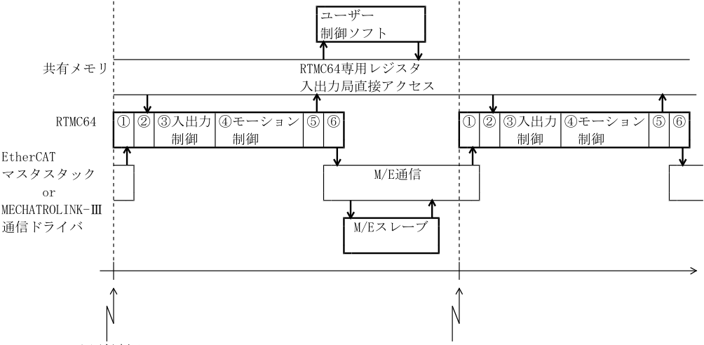

> **図の内容**
>
> M/E通信割込ごとの、RTMC64 の処理の順序（同じ処理が周期ごとにくり返される）。
> 1. ① M/E通信の受信データ読出し（EtherCAT マスタスタック or MECHATROLINK-Ⅲ 通信ドライバから）。
> 2. ② 共有メモリ「RTMC64専用レジスタ」「入出力局直接アクセス」の読出し。
> 3. ③ 入出力制御。
> 4. ④ モーション制御。
> 5. ⑤ 共有メモリへの書込み。
> 6. ⑥ M/E通信の送信データ書込み。そのあと M/E通信で M/Eスレーブとやりとりする。
> - ユーザー制御ソフトは、この間に共有メモリを読み書きする。

- ①M/E通信、受信データ読出し

M/E通信割込の直後に、RTMC64が、M/Eスレーブから受信したデータを読出します。

- ②共有メモリ「RTMC64専用レジスタ」・「入出力局直接アクセス」の読出し
- RTMC64が、共有メモリから「RTMC64専用レジスタ」・「入出力局直接アクセス」の値を読出します。
- ③入出力制御
- 入出力制御の処理を実行します。①②で読出したデータを用います。
- ④モーション制御

モーション制御の処理を実行します。①で取り込んだデータを用います。

- ⑤共有メモリ「RTMC64専用レジスタ」・「入出力局直接アクセス」への書込み

③④の処理結果を「RTMC64専用レジスタ」・「入出力局直接アクセス」に書込みます。

- ⑥M/E通信、送信データ書込み

RTMC64が、M/Eスレーブへの送信データを書込みます。

### 1-4.機能リスト

各機能を以下のように分類して記述します。

B:標準

O:オプション

S:専用化

開:開発中

PLC:ユーザ制御ソフト PC:PCアプリ(Windows)操作

#### 1-4-1.RTMC64-M3/EC本体機能リスト

◆1.2

軸制御

| 第1～64軸制御   | 軸数選択 (9軸/タスク)           | B   |
|------------|-------------------------|-----|
| 回転軸制御      | SPIN 回転軸速度指令            | B   |
| 同一指令2軸制御   | 1つの指令で2軸動作(ROMSW割り付け)   | O   |
| INPOS      | インポジションチェック             | B   |
| 接線制御       | 第1,2軸の合成方向に同期して第3軸を制御する | O   |
| 直径/半径指令    | 旋盤系のX軸指令                | O   |
| 回転軸周回処理    | 1回転したら座標を0に戻す           | B   |
| 手動パルサ      | ◆1.2 手動パルサ送り／ジョイスティック送り | O   |

加減速制御

| 直線加減速         | PTP､ジョグ送りの加減速   | B   |
|---------------|-----------------|-----|
| 指数形補間加減速      | 補間送りの加減速        | B   |
| 直線形補間加減速      | 補間送りの加減速        | O   |
| S字補間加減速       | 補間送りの加減速        | O   |
| 補間前加減速        | 軌跡発生より手前の加減速    | O   |
| (自動コーナオーバライド) |                 |     |

自動送り(運転プログラム、PC/PLC コマンド)

| パス機能              | ブロック間停止 0 (コンタリング)          | B   |
|-------------------|-----------------------------|-----|
| 自動原点復帰            | 電源投入時に自動的に原点復帰順序指定可能        | B   |
| オーバライド            | ◆1.2 運転中の速度変更 0～200%(補間/主軸) | B   |
| 位置決め(INC)PTP      | 1軸～9軸位置決め命令                | B   |
| 位置決め(ABS)PTPA     | 1軸～9軸位置決め命令・絶対値指令          | B   |
| 位置決め(ABS)PTPB     | 1軸～9軸位置決め命令・機械座標絶対値指令      | B   |
| 直線補間(INC)LIN      | 1軸～9軸同時9軸インクレ             | B   |
| 直線補間(ABS)LINA     | 1軸～9軸同時9軸絶対値              | B   |
| 中心指定円弧補間(I,J)     | 中心指定円弧補間任意2軸(プリ解/RTMC64内)  | B   |
| 半径指定円弧補間(CR)      | 半径指定円弧補間任意2軸(プリ解/RTMC64内)  | B   |
| ３点指定円弧補間(T_) ◆1.2 | ３点指定円弧補間任意2軸(プリ解/RTMC64内)  | B   |
| ヘリカル補間            | 円弧2軸 + 残りの1軸 (プリ解/RTMC64内)  | B   |
| ポイント位置決PTMA       | パレタイザ用(ポイントテーブル)            | O   |
| ポイント直線補間LIMA      | ポイントテーブルの直線補間               | O   |
| 巻線命令REEL          | ◆1.2 巻線命令                   | O   |

主軸制御

| 主軸 ON/OFF              | ON/OFF, CW/CCW O   |
|------------------------|--------------------|
| Ｓ5桁/サーボ主軸 ◆1.2 S5桁速度指令 | O                  |
| 主軸インバータ主軸インバータ        | 開                  |

補正制御

| B.L 補正   | バックラッシュ補正         | B   |
|----------|-------------------|-----|
| P.E 補正   | ピッチエラー補正          | O   |
| 工具長補正    | Z軸(第3軸)方向のオフセット   | O   |
| 工具摩耗補正   | 同オフセットの変化量        | 開   |
| 工具径補正    | 工具径の補正            | O   |
| 形状補正     | 高精度輪郭制御、位置ループ遅れ補正 | O   |

Windows通信応用(Windows用共有メモリ経由)

| セッティングPC アプリケーションライブラリ   | 共有メモリ B 共有メモリ B   |
|--------------------------|-------------------|

INtime通信(INtime用共有メモリ経由でPLCからの制御)

| コマンド運転    | 全ての移動・動作命令            | B/PLC   |
|-----------|-----------------------|---------|
| ステータス読出   | 位置、内部情報の読み出し          | B/PLC   |
| 入出力操作     | PLCからRTMC64の入出力を操作    | B/PLC   |
| 機械パネル操作   | 自動/手動における各種操作         | B/PLC   |
| ダイナミックデータ | PLCから運転プログラム          | B/PLC   |
| ローディング    | ・パラメータ・補正データなどのローディング |         |

座標系

| 原点設定論理座標/アブソ座標   | 論理座標系のセット   | B/PC B   |
|-------------------|-------------|----------|

運転プログラム

| メモリ運転      | 64ブロック (58ステップ/ブロック)   | B    |
|------------|------------------------|------|
| サブプロ       | サブルーチンプログラム            | B    |
| 回数指定CALL   | サブプロの回数指定のCALL         | B    |
| DNC運転      | イーサネット PLC制御           | O/PC |
| マルチタスク     | 8タスク並列動作               | O    |
| マクロ        | 変数､四則演算､条件判断           | O    |
| フレキシブル電子カム | テーブル方式 (切換可)           | 開    |

保護機能

| ソフトリミット          |              | B   |
|------------------|--------------|-----|
| ハードリミットサーボ主電源制御 | OT入力(サーボアンプ) | B B |

共通入力信号(共有メモリを経由してPLCからも操作可能)

汎用入力(Rio0000～Rio511)

タスク毎入力信号(共有メモリを経由してPLCからも操作可能)

非常停止 ONSW MOK MFIN

リセット停止起動外部アラーム(3) 原点復帰原点設定オプショナルストップリワインドカムサイクル

MP有効各種モード選択(9) 手パ倍率(4) 手パ軸選択(4) JOG軸選択(8)

全体オーバライド(8) 補間オーバライド(8) 主軸オーバライド(8)

実行P番号(16)

※数字はbit数

共通出力信号(共有メモリを経由してPLCからも操作可能)

| 汎用出力(Rio1856～Rio2367)   |
|-------------------------|

タスク毎出力信号(共有メモリを経由してPLCからも操作可能)

SVM(サーボ主電源) 主軸出力0/1 MSTRB M0～M7

READY ALARM RUN PAUSE

INPOS PRDY M00停止中 MODE0～2

#### 1-4-2.機械パネル機能リスト

詳細は、<2-1-5.機械パネル入力>を参照下さい。

| 分類    | 機能名称                                                                                                  | 内                                                                                                                                                             |       |
|--------|----------------------------------------------------------------------------------------------------------|---------------------------------------------------------------------------------------------------------------------------------------------------------------|-------|
| 機械パネル | MP_HSEL0～3 MP_INCH0～3 MP_OVR0～7 MP_COVR0～7 MP_MDSET～MP_MDOTDS MP_TEACH MP_ENABLE MP_AXSEL0～7 MP_PSEL0～15 | 容手パ軸選択 (Bit/code仕様) 手パ倍率オーバーライド (Bit/code仕様) 補間オーバライド動作モード(9種) SET AUTO DNC SNGL ZRN INCH HNDL OTDS ティーチモードパネル有効/無効軸動作 (Bit/code仕様) プログラム選択 (Bit/code仕様) | JOG B |

#### 1-4-3.セッティングPC機能リスト(PC)

詳細は、「セッティングPCマニュアル」(TB00-1041)を参照下さい。

| 分類         | 機能名称      | 内容                             | PC   |
|-------------|--------------|---------------------------------|------|
| モニタリング     | 各軸位置表示       | 指令位置､機械位置､アブソ位置､偏差量､相対移動量      | B    |
| モニタリング     | ステータス表示      | アラーム、その他ステータス                   | B    |
| モニタリング     | 入/出力モニタ      | 入/出力信号のモニタ機能(I/O表示) 入/出力信号の強制制御 | B    |
| 操作          | ジョグ          | 手動送り(各軸)                        | B B  |
| 操作          | インチング        | ×1､×10､ ×100､ ×1000 パルス送り       |      |
| 操作          | 原点復帰(各軸)     |                                 | B    |
| 操作          | 原点復帰(全軸)     |                                 | B    |
| 操作          | Mコード出力       | 手動 Mコード出力                       | B    |
| 操作          | P選択          | プログラム選択                         | B    |
| 操作          | スタート／ストップ    | 起動/停止指令                         | B    |
| 操作          | リスタート機能      | S点設定(プログラム途中からのスタート)            | S    |
| 操作          | トレース         | 連続・シングルプログラム編集時模擬実行            | 開    |
| 操作          | トレース（逆行)     | 逆行ｼングル同上の逆行動作                  | 開    |
| 操作          | パソコンティーチング   | プログラム編集時のティ－チング動作による入力          | 開    |
| 操作          | 1ショット位置決め    | 位置決め/直線補間の単独指令                  | B    |
| 編集運転プログラム | プログラム編集 ※1   | テクノコード／Gコード                     | B    |
| 編集運転プログラム | パラメータ編集      | 表形式編集                           | B    |
| 編集運転プログラム | バックアップ初期化    | RTMC64メモリーのクリアー                 | B    |
| 編集運転プログラム | ポイントデータ編集 ※2 | ポイントデータ                         | 開    |
| 編集運転プログラム | G92          | ワーク座標系設定(1つ)                    | B    |
| 編集運転プログラム | G54関係の処理     | ワーク座標系関連(複数)                    | S    |
| 編集運転プログラム | DNC          | DNC運転                           | O    |
| 編集運転プログラム | PE補正データ      |                                 | O    |
| 編集運転プログラム | 工具長補正データ     |                                 | O    |
| 編集運転プログラム | 工具径補正データ     |                                 | O    |
| 編集運転プログラム | 軸単位系変換       | 指令/検出単位換算                       | S    |

- ※1 運転プログラム(テクノコード/Gコード)はテキスト型で、汎用エディタで編集可能です。
- ※2 ポイントデータは、汎用エディタで編集可能です。

#### 1-4-4.通信コマンド機能リスト(PC(Windows)/PLC)

PC運転(通信ライブラリ経由)とPLC運転の機能リスト(代表例)です。

詳細は、「送受信データ説明書」(TB00-1044)を参照下さい。

| 機能分類   | 機能                           | LIB/PLC   |
|--------|-------------------------------|-----------|
| データ送信  | サーボパラメータ書込                    | B         |
| データ送信  | オプションパラメータ書込                  | O         |
| データ送信  | 運転プログラム書込                     | B         |
| データ送信  | DNCデータ書込                      | O         |
| データ送信  | ピッチエラー補正用パラメータ書込              | O         |
| データ送信  | 工具長補正データ書込                    | O         |
| データ送信  | 工具径補正データ書込                    | O         |
| データ受信  | サーボパラメータ読出                    | B         |
| データ受信  | オプションパラメータ読出                  | O         |
| データ受信  | 運転プログラム読出                     | B         |
| データ受信  | ポジション・ステータス読出                 | B         |
| データ受信  | 入出力状態読出                       | B         |
| データ受信  | 動作モード読出                       | B         |
| データ受信  | 指令位置読出                        | B         |
| データ受信  | ステータスフラグ読出                    | B         |
| データ受信  | アラームフラグ読出                     | B         |
| データ受信  | オーバーライド読出                     | B         |
| データ受信  | プログラム実行情報読出                   | B         |
| データ受信  | DNCバッファ情報読出                   | O         |
| データ受信  | ピッチエラー補正用パラメータ読出              | O         |
| データ受信  | センサーラッチ位置情報読出                 | B         |
| データ受信  | 工具長補正データ読出                    | O         |
| データ受信  | 工具径補正データ読出                    | O         |
| データ受信  | 送りオーバーライド %読出                 | B         |
| データ受信  | TPCロギング情報読出                   | B         |
| データ受信  | TPCロギングデータ読出                  | B         |
| データ受信  | プログラム1ステップデータ読出               | B         |
| 動作指示   | バックアップデータ初期化                  | B         |
|        | 動作モード設定                       | B         |
|        | 軸移動停止                         | B         |
|        | 軸移動再開                         | B         |
|        | JOG移動                         | B         |
|        | 原点復帰                          | B         |
|        | インクレPTP位置決め                   | B         |
|        | アブソPTP位置決め                    | B         |
|        | インクレ補間位置決め                    | B         |
|        | アブソ補間位置決め                     | B         |
|        | リセット                          | B         |
|        | 原点設定                          | B         |
|        | 汎用出力直接制御                      | B         |
|        | サーボ電源ON                       | B         |
|        | サーボ電源OFF                      | B         |
|        | プログラム実行開始                     | B         |
|        | プログラム実行停止                     | B         |
|        | 実行プログラム選択                     | B         |
|        | 送りオーバーライド変更                   | B         |
|        | 全軸原点復帰開始高速センサーラッチインクレ補間位置決め | B <OP> O  |
|        | 高速センサーラッチアブソ補間位置決め           | <OP> O    |

| 機能分類   | 機能               | LIB/PLC   |
|--------|-------------------|-----------|
|        | 汎用入力一括強制制御        | B         |
|        | 汎用出力一括強制制御        | B         |
|        | 汎用入出力強制制御         | B         |
|        | 送りオーバーライド %変更     | B         |
|        | TPCデータ選択          | B         |
|        | TPCデータロギング ON/OFF | B         |
|        | 主軸回転ON/OFF        | <OP> O    |
|        | 回転軸回転動作指令         | B         |
|        | Z軸接線制御ON/OFF      | <OP> O    |
|        | シングルステップモード設定     | B         |
|        | ティーチング設定          | 開         |
|        | プログラムステップ挿入       | 開         |
|        | プログラムステップ置換       | 開         |
|        | プログラムステップ削除       | 開         |

アプリケーションライブラリオプション

| オプション機能                                             | 機能             | ライブラリ                          |
|-----------------------------------------------------|-----------------|--------------------------------|
| 通信ライブラリ RT64M3COMNT.DLL[M3] RT64ECCOMNT.DLL[EC]     |                 | RTMC64との通信で使用                  |
| テクノコード変換ライブラリ RT64M3TCNV.DLL[M3] RT64ECTCNV.DLL[EC] | テクノコードテキスト変換処理 | テクノコード仕様テキスト運転プログラムの変換/逆変換で使用 |
| Gコード変換ライブラリ RT64M3GCNV.DLL[M3] RT64ECGCNV.DLL[EC]   | Gコードテキスト変換処理   | Gコード仕様テキスト運転プログラムの変換/逆変換で使用   |

### 1-5.基本仕様

基本仕様モーション制御部のスペック表 RTMC64の基本仕様を整理します。

| 分類 | 項目 | 仕様 |
|---|---|---|
| 基本仕様 | 座標値 | ±1000000000 |
| 基本仕様 | 速度 | 1pps～1Gpps |
| 基本仕様 | 実行タスク | 最大8本 〈OP） |
| 基本仕様（PCの性能に依存します） | M/E通信方式 | 制御周期[msec]/軸数 |
| 基本仕様（PCの性能に依存します） | MECHATROLINK-Ⅲ 1系統 | 0.125/5軸、0.25/10軸、0.50/18軸、1.00/27軸、2.00/47軸、3.00/62軸 |
| 基本仕様（PCの性能に依存します） | MECHATROLINK-Ⅲ 3系統 | 0.125/15軸、0.25/30軸、0.50/54軸、1.00/64軸 |
| 基本仕様（PCの性能に依存します） | EtherCAT | 0.25/16軸、0.50/44軸、1.00/64軸 |
| 基本仕様 | 軸数 | 最大64軸 (論理軸は、9軸/タスク) |
| 基本仕様 | 座標系 | 機械座標系、論理座標系 |
| 基本仕様 | オーバライド | 0～200% |
| 基本仕様 | 同時補間 | 9軸/タスク |
| 基本仕様 | 最小連続補間 | 制御周期時間(0.125msec～) |
| 基本仕様 | センサーラッチ遅れ時間 | サーボアンプ性能に依存。サーボ外部入力ラッチ(遅れ無し) 〈OP） ※1 |
| 加減速 | 加減速(補間後の各軸) | 指数型加減速、直線型補間加減速 〈OP）、S字加減速 〈OP） |
| 加減速 | 補間前加減速 (自動コーナオーバライド) | 判定6段階 |
| 運転プログラム | 運転プログラム | 64ブロック (1ブロック :58ステップ)。プログラム長:1～32ブロック |
| 運転プログラム | テクノ言語、G言語 | <7.運転プログラム詳細>(TB00-1040F)を参照下さい。 |
| 運転プログラム | タイマー命令 | TIM 0.1～2147483.6 0.1秒単位。TM 1～2147483648 制御周期単位 |
| 運転プログラム | CALL命令 | 最大20ネスト 同一プログラム内のみ |
| 運転プログラム | 独立位置決め | 通信コマンド :9軸(非同期で並列運転)。運転プログラム :4軸(非同期で並列運転) |
| 運転プログラム | 同時入力判別 | 同一命令内 4入力 (テクノ言語) |
| 運転プログラム | 同時出力 | 同一命令内 4出力 (Ro□□命令/テクノ言語)。16bit(マクロ変数方式) |
| 入出力 | 論理入力点数 | タスク共通 512入力(汎用)。タスク毎 13入力 |
| 入出力 | 機械パネル入力 | 67点×8タスク |
| 入出力 | 軸関連I/O | 入力:(OTP、OTM、DEC)×64 (サーボ/一般入力) |
| 入出力 | 論理出力点数 | タスク共通 512出力(汎用)。タスク毎 13出力 |
| 入出力 | Mコード | タスク毎 出力:8点 +MSTRB。入力:MFIN、MOK |
| 補助データ | ポイントテーブル 〈OP） | 400点/タスク ×8 |
| 補助データ | ピッチエラー補正 〈OP） | 33280点/全指定軸 間隔1000～1000000p。補正値:±127(×1～×10) |
| 補助データ | 工具長補正 〈OP） | ±1000000000 20点 ×8タスク |
| 補助データ | 工具径補正 〈OP） | ±1000000000 20点 ×8タスク |
| 補助データ | DNCの速度 〈OP）連続可能な最短ステップ | 制御周期相当の微小な補間の連続 |

〈OP）:オプション

| 分類 | 項目 | 仕様 |
|---|---|---|
| マクロ機能 〈OP） | 演算 | × ÷ + - 剰余 AND OR XOR シフトL/R 大小比較 |
| マクロ機能 〈OP） | 値 | 整数 32bit/16bit |
| マクロ機能 〈OP） | グローバル変数 | 200W |
| マクロ機能 〈OP） | ローカル変数 | 100W ×8タスク |
| マクロ機能 〈OP） | ラダー共有 ◆1.3 | 書き込み:100W 読み出し:100W |
| マクロ機能 〈OP） | その他の変数 | ステータス 入力ポート116 出力ポート64、サーボパラメータ、工具長補正、ポジション、HEX入力、軸インターロック、軸ネグレクト |
| 共有メモリI/F | 共有メモリインターフェース INtime上のPLC/制御ソフトとの接続 ◆1.3 | 通信領域 :3440byte、入力レジスタ :116ch * 2byte、出力レジスタ : 64ch * 2byte、手パ、ジョイスティックAD:2 * 8 * 2 * 2byte、ラダー共有マクロ(RTMC64→PLC):100W(50LW)、ラダー共有マクロ(PLC→RTMC64):100W(50LW)、ステータスデータ :3344byte |
| サーボパラメータ | INPOS | 0～1Gp G:ギガ 10の9乗 |
| サーボパラメータ | 偏差上限値 | 1～1Gp |
| サーボパラメータ | MPOS偏差上限 | 不使用 |
| サーボパラメータ | 補間加減速 指数 | 0～1000msec |
| サーボパラメータ | 補間加減速 直線型 | 0～2000msec ※2 |
| サーボパラメータ | S字時定数 | 0～1000msec ※2 |
| サーボパラメータ | PTP時定数 | 0～32767msec |
| サーボパラメータ | PTP速度 | 最小値～1Gpps ※3 |
| サーボパラメータ | JOG速度 | 最小値～1Gpps ※3 |
| サーボパラメータ | ±ソフトリミット | 1000～1Gp |
| サーボパラメータ | 原点距離 | -1Gp～+1Gp |
| サーボパラメータ | 原点復帰早送り速度 | 最小値～1Gpps ※3 |
| サーボパラメータ | 原点復帰アプローチ速度 | 最小値～1Gpps ※3 |
| サーボパラメータ | 原点復帰最終サーチ速度 | 最小値～1Gpps ※3 |
| サーボパラメータ | バックラッシュ補正量 | 0～30000p |
| サーボパラメータ | 接線制御上限速度 | 最小値～1Gpps ※3 |
| 手動操作 | インチング | ×1、×10、×100、×1000 |
| セッティングPC | POS表示桁数 | 全9桁 小数以下:0～5桁(設定可) |
| セッティングPC | POS軸名称 | 英/漢字 1～2文字 9軸表示/画面 |
| セッティングPC | TPCロギングデータ | 2座標(指令/FB)×4096点、 64ch(多タスク) |

※1 サーボの性能に依存します。

- ※2 直線型補間加減速の時定数:0～2000×RTC(msec) S字加減速の時定数 :0～1000×RTC(msec)
- ※3 最小値は制御周期の設定で変わります 1/RTC(msec)
- ※ pps は pulse/sec です。

## 2.入出力機能

※ RTMC64内部は、論理入出力信号が定義されています。

M/E通信(MECHATROLINK/EtherCAT)に接続されたM/Eスレーブ入出力局のM/E通信データを、ROMSW設定で任意の論理入出力信号に割り付けることができます。この論理入出力信号で運転・操作することができます。

RTMC64にはPLC/Cがアクセスする共有メモリ上に、論理入出力信号を読み出し／書き込みする領域があります。共有メモリ上の入出力信号を、PLC/Cから読出し／書込みすることで運転・操作することができます。

入力や出力の状態は、標準運転ソフト「セッティングPC」でモニタリングや設定ができます。

詳細は、「セッティングPCマニュアル」を参照下さい。

### 2-1.入力信号の名称と機能

信号名の頭にT□が付く入力は、タスク毎にあります。タスク毎の信号は、他のタスクへは影響しません。 □はマルチタスクのタスク番号(0～7)を示します。

T□が付かない入力は、共通の入力でタスクの区別はありません。

【エッジ】: 信号がOFFからONに変わったときに作用します。

【レベル】: 信号のON/OFFの状態に応じて、作用します。

【実行条件】や【検出条件】: 「&」印の各行は、AND条件です。

同一項目内の「|」印については、各々がOR条件です。

#### 2-1-1.一般入力

| 標準信号名称                | 機能説明                                                                                                                                                                                         |
|-----------------------|-------------------------------------------------------------------------------------------------------------------------------------------------------------------------------------------------|
| T□RESET (リセット) 【エッジ】  | 【実行条件】・常時【動作結果】・アラームの解除と自動運転/軸移動などの動作を中断します。・Gコード仕様では、自動運転は途中終了状態となります。・テクノコード仕様では、自動運転は通常の終了状態となります。・サーボオフ状態でアラーム要因が全て解除されている場合は、サーボオンします。                                              |
| T□STOP (ストップ) 【エッジ】   | 【実行条件】・サーボON状態【動作結果】・以下の状態であれば動作を一時停止します。(再開可) 自動運転中、主軸動作中、独立位置決め軸動作中、通信コマンドによる移動中・原点復帰中は、原点復帰を中断します。(再開不可)                                                                                |
| T□CRCLR (原点設定) 【エッジ】  | 【実行条件】・サーボON状態 &動作モードが手動運転モード/自動運転モード/DNC運転モード &運転プログラム未実行またはティーチングまたはＭ０停止中 &移動中の軸がない &手動パルサ選択無効(手動モード) &各種シーケンス完了【動作結果】・現在位置を論理座標系原点とします。                                                   |
| T□REWND (リワインド) 【エッジ】 | 【有効条件】・ROMSWで「Gコード途中再開」を選択【実行条件】・選択中運転プログラムがGコード仕様【動作結果】・自動運転の途中終了状態をクリアします。途中終了状態は、自動運転をリセットで中断したとき、またはアラームで異常終了したときになります。途中終了状態で、自動運転の起動を行うと、前回中断したステップの直前のシーケンスNO.付のステップから実行を開始します。 |

| 標準信号名称                    | 機能説明                                                                                                                                                                                                                                                                                          |
|---------------------------|--------------------------------------------------------------------------------------------------------------------------------------------------------------------------------------------------------------------------------------------------------------------------------------------------|
| T□EMS (非常停止) 【レベル】        | 【実行条件】・常時【動作結果】・非常停止アラームになります。・サーボOFF ・自動運転/軸移動などの動作を中断します。・各種シーケンス中断します。                                                                                                                                                                                                                   |
| T□RETURN (原点復帰) 【レベル】     | 【実行条件】・サーボON状態 &アラーム無し &動作モードが手動運転モード/自動運転モード/DNC運転モード &プログラム実行待機状態 &手動パルサ無効 &移動中の軸がない &各種シーケンス完了状態【動作結果】・全軸の原点復帰動作を開始します。                                                                                                                                                                    |
| T□START (スタート) 【エッジ】      | 【実行条件】 A.自動/DNCモードの場合・サーボON状態 &アラーム無し &移動中の軸がない &各種シーケンス完了 &ティーチング中でない &プログラム実行待機状態(開始時)/停止中(再開時) B.手動モードで原点復帰モードの場合・サーボON状態 &アラーム無し &手動パルサ無効 &移動中の軸がない &各種シーケンス完了状態 &プログラム実行待機状態【動作結果】 A.自動/DNCモードの場合自動運転の起動を行います。自動運転が停止中の場合は、運転の再開を行います。                                                 |
| T□VCAMSON T□ONSW (オンスイッチ) | B.手動モードで原点復帰モードの場合全軸の原点復帰動作を開始します。電子カムサイクル(繰り返し)入力 <開発中> 【有効条件】・ROMSWでONSWを選択した場合【実行条件】・OFFは、常時                                                                                                                                                                                             |
| ON :【エッジ】 OFF:【レベル】       | ・ONは、アラーム無し、サーボオフ【動作結果】 ON :サーボオフ状態であれば、サーボ電源オン (但し、サーボOFFエラー発生時はサーボOFFします。) ※ 以下、サーボエラーの[S] 記号はRTMC64-M3の場合は"メカトロリンク" 、RTMC64-ECの場合は"PDO通信"ですサーボOFFエラーは、非常停止/サーボアラーム/サーボ電源OFF/外部アラームA /[S]全体通信エラー/[S]各軸通信エラー /[S]多重コマンドエラー /インバータアラーム /インバータサーボOFF/ROMSWでOT時サーボOFFを選択した場合のOT OFF :サーボ電源オフ |

| 標準信号名称                                    | 機能説明                                                                                     |
|-------------------------------------------|---------------------------------------------------------------------------------------------|
| T□EXTALMA(外部アラームA) (サーボオフ) 【レベル】         | 【実行条件】・常時【動作結果】・サーボオフして、外部アラーム状態Aとなります。 (軸動作不可)                                          |
| T□EXTALMB(外部アラームB) (緊急停止) 【レベル】          | 【実行条件】・常時【動作結果】・緊急停止して、外部アラーム状態Bとなります。 (軸動作不可)                                           |
| T□EXTALMC(外部アラームC) (通常停止) 【レベル】中断は【エッジ】 | 【実行条件】・常時【動作結果】・補間は減速停止、PTP/JOGは緊急停止して、外部アラーム状態Cとなります。ただし、外部アラームC中でも、再度スタートやジョグは、可能です。 |

#### 2-1-2.補助機能入力

| 信号名称                       | 機能説明                                                                                                                                                                                                                         |
|----------------------------|------------------------------------------------------------------------------------------------------------------------------------------------------------------------------------------------------------------------------|
| T□MFIN (Mコード読取完了) 【エッジ】    | 【説明】・外部機器よりRTMC64コントローラへ、補助機能(Mコード)の実行完了を通知します。詳細は、<7-2-5-1.Mコード出力>(TB00-1040F)を参照下さい。【実行条件】・MSTRB出力のON中(Mコードシーケンス中) 【動作結果】・MSTRB出力をオフし、Mコードシーケンスが終了します。                                                               |
| T□MOK (Mコード正常終了) 【レベル】     | 【説明】・補助機能(Mコード出力)にて、外部機器よりMFINを受け取った時、この信号をチェックして、Mコードが正常に完了したかを判別します。詳細は、<7-2-5-1.Mコード出力>(TB00-1040F)を参照下さい。【有効条件】・ROMSWでMOK入力を選択した場合【動作結果】・MFINのON時、MOKがOFFの場合はMコード実行エラーになります。 (更に、プログラム実行中の場合はプログラム実行エラーにもなります。) |
| T□MOPT (オプショナルストップ) 【レベル】 | 【有効条件】・ROMSWで｢M00/M01停止｣を選択【実行条件】・M00/M01コード実行時にチェックします。【動作結果】・ON中は、M01命令で停止します。                                                                                                                                        |

#### 2-1-3.汎用入力

| 信号名称                   | 機能説明                                                                                                                                                                                                  |
|------------------------|-------------------------------------------------------------------------------------------------------------------------------------------------------------------------------------------------------|
| Ri0～Ri511 (汎用入力) 【レベル】 | 運転プログラムの中で、条件判別に使用します。 W WAIT 処理待ち S STOP 途中停止 J スキップスキップ動作 E EXIT 強制終了詳細は、<7-1-8.汎用入力処理指定>(TB00-1040F)を参照下さい。また、以下のマクロ変数でも読み込み可能です。・<7-3-9.入/出力パターン>(TB00-1040F) ・<7-3-18.HEX入力データ> (TB00-1040F) |

#### 2-1-4.軸制御入力

以下の信号は、基本的にサーボアンプに接続してしていただきます。 (一般的にコントローラに接続するよりサーボアンプに接続した方が各信号への応答が早いからです。) また、I/O割り付けをおこない、M/Eスレーブの入力局から入力することも可能です。サーボからの信号と入出力局からの信号は論理加算(OR)して論理信号とします。

(どちらかの信号がアクティブのとき論理信号がアクティブになります。)

| 信号名称                        | 機能説明                                                                                 |
|-----------------------------|--------------------------------------------------------------------------------------|
| OTP01～64 (+方向オーバトラベル) 【レベル】 | 【検出条件】・常時【動作結果】・ON中は、+方向のオーバトラベルアラームが発生します。 ROMSWでOT時サーボOFFを選択した場合、サーボOFFエラーになります |
| OTM01～64 (-方向オーバトラベル) 【レベル】 | 【実行条件】・常時【動作結果】・ON中は、-方向のオーバトラベルアラームが発生します。 ROMSWでOT時サーボOFFを選択した場合、サーボOFFエラーになります |
| DEC01～64 (原点信号) 【レベル】       | 【検出条件】・原点復帰シーケンス中【動作結果】・原点復帰方法により、減速や原点サーチ動作に入ります。                                |

#### 2-1-5.機械パネル入力

機械パネル入力は、タスク毎にあります。以下で説明する機械パネル入力の説明(条件や動作)は、全てタスク内の事になります。

| T□MP_HSEL 0～3 (手パ軸選択)                                                                 | の対応はROMSW設定                                                                                                                                            | 軸コードと選択軸とソフトにて設定しま                                                                                                                                    | MPHSEL3                                                                                                                                                | MPHSEL2                                                                                                                                                | MPHSEL1 MPHSEL0                                                                                                                                        | 軸コード 0                                                                                                                                                 |
|---------------------------------------------------------------------------------------|--------------------------------------------------------------------------------------------------------------------------------------------------------|--------------------------------------------------------------------------------------------------------------------------------------------------------|--------------------------------------------------------------------------------------------------------------------------------------------------------|--------------------------------------------------------------------------------------------------------------------------------------------------------|--------------------------------------------------------------------------------------------------------------------------------------------------------|--------------------------------------------------------------------------------------------------------------------------------------------------------|
| T□MP_INCH 0～3 (手パ倍率/ インチング送り量)                                                       | す。手動パルサモード倍率                                                                                                                                         | OFF ～ ON                                                                                                                                               | OFF (4bitコード) ON MPINCH3 ×1000                                                                                                                         | OFF ～ ON ×100                                                                                                                                          | OFF ON MPINCH2 MPINCH1 ×10                                                                                                                             | ～ 15 MPINCH0 ×1                                                                                                                                        |
| T□MP_OVR 0～7 (全体/PTPオーバライド)                                                           | インチングモードパルス 1000 100 10 1 【Bit仕様】 MPOVR7～MPOVR0:200%,175%,～,25%(25%ステップ) 全ビットOFF時は無効。(PCからの指定が有効) 【Code仕様】8ビットバイナリーデータで0～200%を選択。有効範囲外の時はPCによる選択が有効。 | インチングモードパルス 1000 100 10 1 【Bit仕様】 MPOVR7～MPOVR0:200%,175%,～,25%(25%ステップ) 全ビットOFF時は無効。(PCからの指定が有効) 【Code仕様】8ビットバイナリーデータで0～200%を選択。有効範囲外の時はPCによる選択が有効。 | インチングモードパルス 1000 100 10 1 【Bit仕様】 MPOVR7～MPOVR0:200%,175%,～,25%(25%ステップ) 全ビットOFF時は無効。(PCからの指定が有効) 【Code仕様】8ビットバイナリーデータで0～200%を選択。有効範囲外の時はPCによる選択が有効。 | インチングモードパルス 1000 100 10 1 【Bit仕様】 MPOVR7～MPOVR0:200%,175%,～,25%(25%ステップ) 全ビットOFF時は無効。(PCからの指定が有効) 【Code仕様】8ビットバイナリーデータで0～200%を選択。有効範囲外の時はPCによる選択が有効。 | インチングモードパルス 1000 100 10 1 【Bit仕様】 MPOVR7～MPOVR0:200%,175%,～,25%(25%ステップ) 全ビットOFF時は無効。(PCからの指定が有効) 【Code仕様】8ビットバイナリーデータで0～200%を選択。有効範囲外の時はPCによる選択が有効。 | インチングモードパルス 1000 100 10 1 【Bit仕様】 MPOVR7～MPOVR0:200%,175%,～,25%(25%ステップ) 全ビットOFF時は無効。(PCからの指定が有効) 【Code仕様】8ビットバイナリーデータで0～200%を選択。有効範囲外の時はPCによる選択が有効。 |
| T□MP_COVR 0～7 (補間オーバラド)                                                               | 共通オーバライドのときは、全体。3種で区別する場合は、PTP/JOG 【Bit仕様】 MP_COVR7～MP_COVR0:200%,175%,～,25%(25%ステップ) 全ビットOFF時は無効。(PCからの指定が有効) 【Code仕様】8ビットバイナリーデータで0～200%を選択。         | 共通オーバライドのときは、全体。3種で区別する場合は、PTP/JOG 【Bit仕様】 MP_COVR7～MP_COVR0:200%,175%,～,25%(25%ステップ) 全ビットOFF時は無効。(PCからの指定が有効) 【Code仕様】8ビットバイナリーデータで0～200%を選択。         | 共通オーバライドのときは、全体。3種で区別する場合は、PTP/JOG 【Bit仕様】 MP_COVR7～MP_COVR0:200%,175%,～,25%(25%ステップ) 全ビットOFF時は無効。(PCからの指定が有効) 【Code仕様】8ビットバイナリーデータで0～200%を選択。         | 共通オーバライドのときは、全体。3種で区別する場合は、PTP/JOG 【Bit仕様】 MP_COVR7～MP_COVR0:200%,175%,～,25%(25%ステップ) 全ビットOFF時は無効。(PCからの指定が有効) 【Code仕様】8ビットバイナリーデータで0～200%を選択。         | 共通オーバライドのときは、全体。3種で区別する場合は、PTP/JOG 【Bit仕様】 MP_COVR7～MP_COVR0:200%,175%,～,25%(25%ステップ) 全ビットOFF時は無効。(PCからの指定が有効) 【Code仕様】8ビットバイナリーデータで0～200%を選択。         | 共通オーバライドのときは、全体。3種で区別する場合は、PTP/JOG 【Bit仕様】 MP_COVR7～MP_COVR0:200%,175%,～,25%(25%ステップ) 全ビットOFF時は無効。(PCからの指定が有効) 【Code仕様】8ビットバイナリーデータで0～200%を選択。         |
| T□MP_SOVR 0～7 (主軸オーバラド)                                                               | 有効範囲外の時はPCによる選択が有効。【Bit仕様】 MP_SOVR7～MP_SOVR0:200%,175%,～,25%(25%ステップ) 全ビットOFF時は無効。(PCからの指定が有効) 【Code仕様】8ビットバイナリーデータで0～200%を選択。                        | 有効範囲外の時はPCによる選択が有効。【Bit仕様】 MP_SOVR7～MP_SOVR0:200%,175%,～,25%(25%ステップ) 全ビットOFF時は無効。(PCからの指定が有効) 【Code仕様】8ビットバイナリーデータで0～200%を選択。                        | 有効範囲外の時はPCによる選択が有効。【Bit仕様】 MP_SOVR7～MP_SOVR0:200%,175%,～,25%(25%ステップ) 全ビットOFF時は無効。(PCからの指定が有効) 【Code仕様】8ビットバイナリーデータで0～200%を選択。                        | 有効範囲外の時はPCによる選択が有効。【Bit仕様】 MP_SOVR7～MP_SOVR0:200%,175%,～,25%(25%ステップ) 全ビットOFF時は無効。(PCからの指定が有効) 【Code仕様】8ビットバイナリーデータで0～200%を選択。                        | 有効範囲外の時はPCによる選択が有効。【Bit仕様】 MP_SOVR7～MP_SOVR0:200%,175%,～,25%(25%ステップ) 全ビットOFF時は無効。(PCからの指定が有効) 【Code仕様】8ビットバイナリーデータで0～200%を選択。                        | 有効範囲外の時はPCによる選択が有効。【Bit仕様】 MP_SOVR7～MP_SOVR0:200%,175%,～,25%(25%ステップ) 全ビットOFF時は無効。(PCからの指定が有効) 【Code仕様】8ビットバイナリーデータで0～200%を選択。                        |
| T□MP_MDSET T□MP_MDAUTO T□MP_MDDNC T□MP_MDSNGL                                         | 有効範囲外の時はPCによる選択が有効。セッティングモード自動運転モード ◆1.2 ※原点復帰モード時は以下の入力信号 DNCモードが特別な意味を持ちます。                                                                       | 有効範囲外の時はPCによる選択が有効。セッティングモード自動運転モード ◆1.2 ※原点復帰モード時は以下の入力信号 DNCモードが特別な意味を持ちます。                                                                       | 有効範囲外の時はPCによる選択が有効。セッティングモード自動運転モード ◆1.2 ※原点復帰モード時は以下の入力信号 DNCモードが特別な意味を持ちます。                                                                       | 有効範囲外の時はPCによる選択が有効。セッティングモード自動運転モード ◆1.2 ※原点復帰モード時は以下の入力信号 DNCモードが特別な意味を持ちます。                                                                       | 有効範囲外の時はPCによる選択が有効。セッティングモード自動運転モード ◆1.2 ※原点復帰モード時は以下の入力信号 DNCモードが特別な意味を持ちます。                                                                       | 有効範囲外の時はPCによる選択が有効。セッティングモード自動運転モード ◆1.2 ※原点復帰モード時は以下の入力信号 DNCモードが特別な意味を持ちます。                                                                       |
| T□MP_MDZRN T□MP_MDJOG T□MP_MDINCH T□MP_MDHNDL T□MP_MDOTDIS (モード選択) T□MP_ENABLE(パネル有効) | シングルステップモード STRTSW入力原点復帰モード JOGモードインチングモード手動パルサモード                                                                                                  | OT無視モード                                                                                                                                                | :全軸自動原点復帰軸動作入力(MPAXSEL):各軸手動原点復帰 (方向によってはジョグ) ※1 この入力がONの時のみ、この表の機械パネル関連が有効となります。                                                                     | :全軸自動原点復帰軸動作入力(MPAXSEL):各軸手動原点復帰 (方向によってはジョグ) ※1 この入力がONの時のみ、この表の機械パネル関連が有効となります。                                                                     | :全軸自動原点復帰軸動作入力(MPAXSEL):各軸手動原点復帰 (方向によってはジョグ) ※1 この入力がONの時のみ、この表の機械パネル関連が有効となります。                                                                     | :全軸自動原点復帰軸動作入力(MPAXSEL):各軸手動原点復帰 (方向によってはジョグ) ※1 この入力がONの時のみ、この表の機械パネル関連が有効となります。                                                                     |

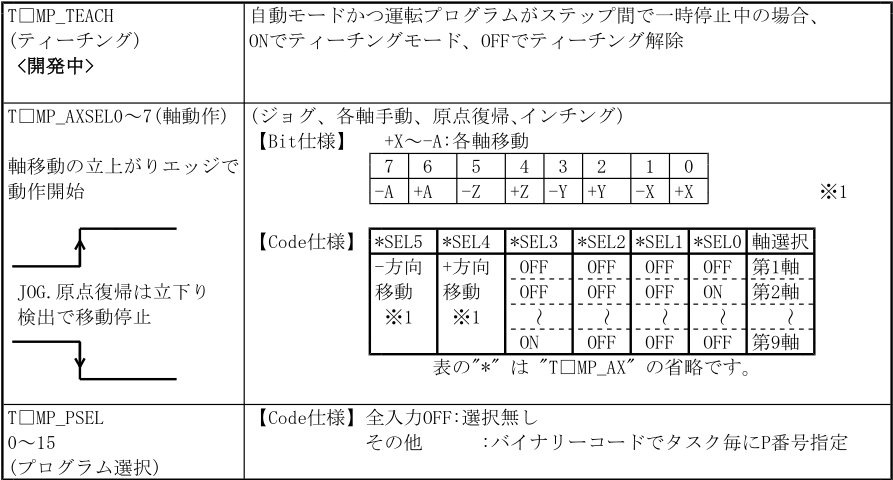

> **図の内容**
>
> | 信号 | 説明 |
> |---|---|
> | T□MP_TEACH (ティーチング) <開発中> | 自動モードかつ運転プログラムがステップ間で一時停止中の場合、ONでティーチングモード、OFFでティーチング解除 |
> | T□MP_AXSEL0～7 (軸動作) | (ジョグ、各軸手動、原点復帰、インチング)。軸移動の立上がりエッジで動作開始。JOG、原点復帰は立下り検出で移動停止 |
> | T□MP_PSEL 0～15 (プログラム選択) | 【Code仕様】全入力OFF: 選択無し。その他: バイナリーコードでタスク毎にP番号指定 |
>
> T□MP_AXSEL の【Bit仕様】（+X～-A: 各軸移動）:
> | ビット | 7 | 6 | 5 | 4 | 3 | 2 | 1 | 0 |
> |---|---|---|---|---|---|---|---|---|
> | 移動 | -A | +A | -Z | +Z | -Y | +Y | -X | +X |
>
> T□MP_AXSEL の【Code仕様】（表の"*"は "T□MP_AX" の省略）:
> | *SEL5 | *SEL4 | *SEL3 | *SEL2 | *SEL1 | *SEL0 | 軸選択 |
> |---|---|---|---|---|---|---|
> | -方向移動 ※1 | +方向移動 ※1 | OFF | OFF | OFF | OFF | 第1軸 |
> | | | OFF | OFF | OFF | ON | 第2軸 |
> | | | ～ | ～ | ～ | ～ | ～ |
> | | | ON | OFF | OFF | OFF | 第9軸 |

- 【Bit仕様】と【Code仕様】は､ROMSW設定ソフトにて各チャンネル毎に設定
- Bit仕様で複数Bitが同時にONのときは、無効(無視)
- 上記信号は、全て【レベル】入力です。

■「機械パネル有効T□MP_ENABLE」信号の意味

モード選択/オーバーライド選択等、機械パネル以外の操作(PC操作)でも変更できる選択では、機械パネルの選択が最優先されます。そのため、機械パネル以外の操作では変更できなくなります。動作モードを変更できないと、PCからパラメータのダウンロードをできなくなってしまいます。 (セッティングモードに変更できないため)

これを防ぐために「機械パネル有効」信号はON/OFFできるようにして下さい。

- ■【オーバライド】の種類

ROMSW設定ソフトで「共通オーバライド」と「3種別オーバライド」を選択出来ます。

「共通オーバライド」 : T□MP_OVR0～7が送り速度、主軸回転速度すべて共通の指定。

「3種別オーバライド」 : PTP、補間、主軸の各々のオーバライド設定が可能です。

- ※1■【各軸手動原点復帰】の軸移動方向

MPZRN(原点復帰)モードでMP_AXSELで軸方向を指定した場合、+/-の移動方向によって動作が変わります。サーボパラメータの「原点復帰方法」で示す方向と比較して、

- 同方向の場合:手動原点復帰動作
- 逆方向の場合:ジョグ動作
- となります。

#### 2-1-6.機械パネル入力の補足説明

- (1) T□MP_HSEL0～3(手動パルサ軸選択)

【検出条件】

パネル有効

ROMSWで手動パルサオプション有効

T□MPHNDLがON

手動(手動パルサ)OT無視(手動パルサ)

サーボON状態

移動中の軸が無い

各種シーケンス完

プログラム実行待機、またはシングルモード時、または一時停止時

手動モード/OT無視モード/自動モードのM0停止中

【動作結果】

手動パルサで移動する軸を選択します。軸コードと物理軸の対応は、ROMSW設定です。

【注意】

本入力が有効な時に、通信コマンドで手動パルサを有効にするとコマンド実行エラーになります。

- (2) T□MP_INCH0～3(手パ倍率/インチング送り量)

【検出条件】

パネル有効

【動作結果】

手パ倍率またはインチング送り量を設定します。

【注意】

本入力が有効な時に、通信コマンドから手パ倍率を変更するとコマンド実行エラーになります。

- (3) T□MP_OVR0～7(全体/PTPオーバライド)

【検出条件】

パネル有効

【動作結果】

オーバライドを設定します。ROMSWの設定で「全体/PTPのみ」を選択できます。

【注意】

本入力が有効な時に、通信コマンドから変更するとコマンド実行エラーになります。

- (4) T□MP_COVR0～7(補間オーバライド)

【検出条件】

パネル有効

【動作結果】

補間オーバライドを設定します。

【注意】

本入力が有効な時に、通信コマンドから変更するとコマンド実行エラーになります。

- (5) T□MP_MDSET～T□MP_MDOTDIS(モード選択)

【検出条件】

パネル有効

「2-1-7.機械パネル入力のモード選択」の組み合わせプログラム実行待機状態(プログラム運転中でない状態)

動作中の軸が無く

各種シーケンス完了

ただし、DNCモードへの切換時は、DNCオプションが有効

【動作結果】

モード選択入力変化時、それ以前のパネル操作で動作中(JOG、インチング、原点復帰)の軸は停止します。その後、上記検出条件を判定し、モードが切り替わります。

【注意】

本入力が有効な時に、通信コマンドから変更するとコマンド実行エラーになります。

- (6) T□MP_ENABLE(パネル有効)

【検出条件】

常時

【動作結果】

機械パネルIFの各入力信号が有効になります。

(7) T□MP_AXSEL0～7( 軸動作)

【検出条件】

パネル有効

サーボON状態

セッティングモードでなく

プログラム実行待機(プログラム運転中でない)/ティーチング中/M0停止中

手動パルサ無効

原点復帰が実行中でない

ホーム移動が実行中でない

【動作結果】

手動(原点復帰)モードの場合は

原点復帰方向であれば、原点復帰動作

原点復帰方向と逆方向でソフトリミットやOT方向でなければ、JOG動作手動モード(原点復帰以外)/OT無視/ティーチング中/M0停止中の場合は

ソフトリミットやOT方向でなければ

手動(JOG)であればインチング動作

手動(インチング)であればインチング動作

- (8) T□MP_PSEL0～15(プログラム選択)

【検出条件】

パネル有効

プログラム実行待機状態(プログラム運転中でない)

【動作結果】

選択中のプログラム番号が変わります。

本入力が有効な時に、通信コマンドから変更するとコマンド実行エラーになります。

#### 2-1-7.機械パネル入力のモード選択

無印:オフ

|           | モード選択 - MDSET   | モード選択 - MDAUTO   | モード選択 - MDDNC   | モード選択 - MDSNGL   | モード選択 - MDZRN   | モード選択 - MDJOG   | モード選択 - MDINCH   | モード選択 - MDHNDL   | モード選択 - MDOTDIS   |
|-----------|-----------------|------------------|-----------------|------------------|-----------------|-----------------|------------------|------------------|-------------------|
| セッティング    | ON              |                  |                 |                  |                 |                 |                  |                  |                   |
| 自動(連続運転)  |                 | ON               |                 |                  |                 |                 |                  |                  |                   |
| 自動(シングル)  |                 | ON               |                 | ON               |                 |                 |                  |                  |                   |
| DNC(連続運転) |                 |                  | ON              |                  |                 |                 |                  |                  |                   |
| DNC(シングル) |                 |                  | ON              | ON               |                 |                 |                  |                  |                   |
| 手動(原点復帰)  |                 |                  |                 |                  | ON              |                 |                  |                  |                   |
| 手動(JOG)   |                 |                  |                 |                  |                 | ON              |                  |                  |                   |
| 手動(インチング) |                 |                  |                 |                  |                 |                 | ON               |                  |                   |
| 手動(手パ)    |                 |                  |                 |                  |                 |                 |                  | ON               |                   |
| OT無視(JOG) |                 |                  |                 |                  |                 | ON              |                  |                  | ON                |
| OT無視(手パ)  |                 |                  |                 |                  |                 |                 |                  | ON               | ON                |

- ※ 上記パターン以外(全入力OFFも含む)や機械パネル有効信号がOFFの時は、通信コマンド(PC(Windows) /PLC(ProConOS))のモード選択が有効です。

### 2-2.出力信号の名称と機能

信号名の頭にT□が付く出力は、タスク毎にあります。 T□が付かない出力は、共通の出力でタスクの区別はありません。 □は0～7で、マルチタスク番号を示します。

【一般出力】

| 信号名称                 | 機能説明                                                                                                                                                                                                                                                                                              |
|----------------------|---------------------------------------------------------------------------------------------------------------------------------------------------------------------------------------------------------------------------------------------------------------------------------------------------|
| T□SVM (サーボ主電源制御)     | 【説明】・サーボの主電源制御用出力です。【ONする条件】 A.「システム起動時サーボオン」設定(ROMSW)の場合 (起動時 &#124; リセットON) & アラーム無し B.「ONSW有効設定」(ROMSW)の場合 (ONSWがON &#124; リセットON) & アラーム無し C.「その他一般の場合」リセットON & アラーム無し &#124; :OR条件 &:AND条件リセットON:リセット入力 &#124; コマンド【OFFする条件】 A.「ONSW有効設定」(ROMSW)の場合 ONSWがOFF &#124; アラーム発生 B.「その他一般の場合」 |
| T□READY (コントローラレディ) | アラーム発生【説明】・正常状態を示します。【ONする条件】・正常状態(アラームなし)                                                                                                                                                                                                                                                    |
| T□RUN (プログラム運転中)     | 【説明】・軸移動中(位置停止も含む)、各種シーケンス中を示します。【ONする条件】・プログラム運転の実行中(もしくは一時停止中) または移動コマンドによる軸移動中(もしくは一時停止中) または各種シーケンス中軸移動中(一時停止中を含む)                                                                                                                                                                         |
| T□ALARM (アラーム)       | 【ONする条件】・アラームが発生。【OFFする条件】・アラーム要因を解除して、リセット                                                                                                                                                                                                                                                    |
| T□INPOS (位置決完了)      | 【説明】・位置決め完了を示します。【ONする条件】全軸が以下の条件となったとき ■INPOS値(パラメータ)が設定してある軸・軌跡発生処理の残出力移動量がINPOS幅以下。・「偏差 + 加減速溜まり」がINPOS幅以下。 ■INPOS値がゼロ設定の軸:軌跡発生完了                                                                                                                                                         |
| T□PAUSE (途中停止中)      | 【説明】・自動運転が一時停止中であることを示します。【ONする条件】・シングル実行中で移動完了かつMコード中でない。またはプログラム運転の一時停止中または、汎用入力処理のSTOPもしくはWAIT中                                                                                                                                                                                           |

| 信号名称                        | 機能説明                                                                                                                               |
|-----------------------------|------------------------------------------------------------------------------------------------------------------------------------|
| T□PRGRDY (プログラム起動可)         | 【説明】・自動運転の開始条件が全て整った事を示します。【ONする条件】・アラームなし・軸移動中でない・プログラム実行待機状態(プログラム運転中でない) ・各種シーケンス完了・手動パルサ無効・自動モードで選択中プログラムが有効、もしくはDNCモード |
| T□MODOUT0 ～T□MOOUT2 (モード出力) | 【説明】 RTMC64の動作モードを出力します。【動作条件】動作モード MODOUT2 MODOUT1 MODOUT0 セッティングモード 0 0 0 手動モード 0 0 1 自動モード 0 1 0                              |
| T□SON0/1 (主軸出力)             | OT無視モード 0 1 1 DNC運転モード 1 0 0 0:OFF , 1:ON 信号出力主軸(オプション)時に主軸へ回転指令を指示する出力です。詳細は「5-16.主軸機能」を参照下さい。                                   |

【補助機能出力】

| 信号名称             | 機能説明                                                                                                                                                    |
|------------------|---------------------------------------------------------------------------------------------------------------------------------------------------------|
| T□M0～M7 (Mコード出力) | 【説明】・RTMC64コントローラから外部機器へ補助機能の実行を指示する際の機能コード(Mコード)を出力します。機能コードはM0～M7の8点の出力信号を使用して、8ビットバイナリーデータ形式で出力します。【動作条件】・Mコード実行時にMSTRBと同時にON。次のMコード実行まで状態保持。 |
| T□STRB (Mストローブ)  | 【説明】現在出力されているMコードが、有効であることを示します。【ONする条件】 Mコードシーケンス開始して、MFINのOFF確認後【OFFする条件】 Mコード実行中以外 MFIN受け取り時リセット (プログラムステップスキップ)(ティーチングモード未完成)                   |
| T□MZSTP (M00停止中) | 【説明】 M00/01停止中である事を示します。【ONする条件】運転プログラムにM00指定がある。またはM01指定があり、オプショナルストップ入力がON 【OFFする条件】プログラム再開/リセット/アラーム発生                                           |

【汎用出力】

| 信号名称            | 機能説明                                                                |
|-----------------|---------------------------------------------------------------------|
| Ro0～Ro63 (汎用出力) | 汎用出力命令(ONR/OFR命令)で使用できる出力信号です。汎用出力信号のON/OFFは、運転プログラムや通信コマンドで指令します。 |

### 2-3.入出力信号のアドレス表

◆1.2

#### 2-3-1.入力信号のアドレス

① 全タスク共通入力信号のアドレス

| アドレス            |               |         | オフセット     | 標準信号名           | 入力論理   | 補足   |
|-----------------|---------------|---------|-----------|-----------------|---------|------|
| Rio0000         | i#1600        | ビット D00 | 20544 D00 | Rio0000         | A       | 汎用入力 |
| Rio0001         | i#1600        | D01     | D01       | Rio0001         | A       | 〃    |
| Rio0002         | i#1600        | D02     | D02       | Rio0002         | A       | 〃    |
| Rio0003         | i#1600        | D03     | D03       | Rio0003         | A       | 〃    |
| Rio0004         | i#1600        | D04     | D04       | Rio0004         | A       | 〃    |
| Rio0005         | i#1600        | D05     | D05       | Rio0005         | A       | 〃    |
| Rio0006         | i#1600        | D06     | D06       | Rio0006         | A       | 〃    |
| Rio0007         | i#1600        | D07     | D07       | Rio0007         | A       | 〃    |
| Rio0008         | i#1600        | D08     | 20545 D00 | Rio0008         | A       | 〃    |
| Rio0009         | i#1600        | D09     | D01       | Rio0009         | A       | 〃    |
| Rio0010         | i#1600        | D10     | D02       | Rio0010         | A       | 〃    |
| Rio0011         | i#1600        | D11     | D03       | Rio0011         | A       | 〃    |
| Rio0012         | i#1600        | D12     | D04       | Rio0012         | A       | 〃    |
| Rio0013         | i#1600        | D13     | D05       | Rio0013         | A       | 〃    |
| Rio0014         | i#1600        | D14     | D06       | Rio0014         | A       | 〃    |
| Rio0015         | i#1600        | D15     | D07       | Rio0015         | A       | 〃    |
| Rio0016         | i#1601        | D00     | 20546 D00 | Rio0016         | A       | 汎用入力 |
| Rio0017         | i#1601        | D01     | D01       | Rio0017         | A       | 〃    |
| Rio0018         | i#1601        | D02     | D02       | Rio0018         | A       | 〃    |
| Rio0019         | i#1601        | D03     | D03       | Rio0019         | A       | 〃    |
| Rio0020         | i#1601 i#1601 | D04 D05 | D04 D05   | Rio0020 Rio0021 | A A     | 〃〃  |
| Rio0021         | i#1601        | D06     | D06       | Rio0022         | A       | 〃    |
| Rio0022 Rio0023 | i#1601        | D07     | D07       | Rio0023         | A       | 〃    |
| Rio0024         | i#1601        | D08     | 20547 D00 | Rio0024         | A       | 〃    |
| Rio0025         | i#1601        | D09     | D01       | Rio0025         | A       | 〃    |
| Rio0026         | i#1601        | D10     | D02       | Rio0026         | A       | 〃    |
| Rio0027         | i#1601        | D11     | D03       | Rio0027         | A       | 〃    |
| Rio0028         | i#1601        | D12     | D04       | Rio0028         | A       | 〃    |
| Rio0029         | i#1601        | D13     | D05       | Rio0029         | A       | 〃    |
| Rio0030         | i#1601        | D14     | D06       | Rio0030         | A       | 〃    |
| Rio0031         | i#1601        | D15     | D07       | Rio0031         | A       | 〃    |
| Rio0032         | i#1602        | D00     | 20548 D00 | Rio0032         | A       | 〃    |
| Rio0033         | i#1602        | D01     | D01       | Rio0033         | A       | 〃    |
| Rio0465         | i#1630        | D15     | 20605 D07 | Rio0465         | A       | 〃    |
| Rio0496         | i#1631        | D00     | 20606     | Rio0496         | A       | 汎用入力 |
| Rio0497         |               |         | D00       |                 |         |      |
| Rio0498         | i#1631        | D01 D02 | D01 D02   | Rio0497 Rio0498 | A A     | 〃〃  |
| Rio0499         | i#1631 i#1631 | D03     | D03       | Rio0499         | A       | 〃    |
| Rio0500         | i#1631        | D04     | D04       | Rio0500         | A       | 〃    |
| Rio0501         | i#1631        | D05     | D05       | Rio0501         | A       | 〃    |
| Rio0502 Rio0503 | i#1631        | D06     | D06       | Rio0502 Rio0503 | A A     | 〃    |
| Rio0504         | i#1631        | D07 D08 | 20607 D00 |                 |         | 〃    |
|                 | i#1631 i#1631 | D09     | D07       | Rio0504         | A       | 〃    |
| Rio0505 Rio0506 | i#1631        | D10     | D01 D02   | Rio0505 Rio0506 | A A     | 〃〃  |
| Rio0507         | i#1631        | D11     | D03       | Rio0507         | A       | 〃    |
| Rio0508         | i#1631        | D12     | D04       | Rio0508         | A       | 〃    |
| Rio0509         | i#1631        | D13     |           | Rio0509         | A       | 〃    |
| Rio0510         | i#1631        | D14     | D05 D06   | Rio0510         | A       | 〃    |
| Rio0511         | i#1631        | D15     | D07       | Rio0511         | A       | 〃    |

② 各物理軸毎入力信号のアドレス

| アドレス - Rio0512   | ビット i#1632    | D00     |   オフセット - 20608 | D00       | 標準信号名 - OTP01   | 入力論理 - A   | 補足 - 第01物理軸   | +側オーバトラベル           |
|------------------|---------------|---------|-----------------|-----------|-----------------|-------------|---------------|---------------------|
| Rio0513          | i#1632        | D01     |                 | D01       | OTP02           | A           | 第02物理軸        | +側オーバトラベル           |
| Rio0514          | i#1632        | D02     |                 | D02       | OTP03           | A           | 第03物理軸        | +側オーバトラベル           |
| Rio0515          | i#1632        | D03     |                 | D03       | OTP04           | A           | 第04物理軸        | +側オーバトラベル           |
| Rio0516          | i#1632        | D04     |                 | D04       | OTP05           | A           | 第05物理軸        | +側オーバトラベル           |
| Rio0517          | i#1632        | D05     |                 | D05       | OTP06           | A           | 第06物理軸        | +側オーバトラベル           |
| Rio0518          | i#1632        | D06     |                 | D06       | OTP07           | A           | 第07物理軸        | +側オーバトラベル           |
| Rio0519          | i#1632        | D07     |                 | D07       | OTP08           | A           | 第08物理軸        | +側オーバトラベル           |
| Rio0520          | i#1632        | D08     |           20609 | D00       | OTP09           | A           | 第09物理軸        | +側オーバトラベル           |
| Rio0521          | i#1632        | D09     |                 | D01       | OTP10           | A           | 第10物理軸        | +側オーバトラベル           |
| Rio0522          | i#1632        | D10     |                 | D02       | OTP11           | A           | 第11物理軸        | +側オーバトラベル           |
| Rio0523          | i#1632        | D11     |                 | D03       | OTP12           | A           | 第12物理軸        | +側オーバトラベル           |
| Rio0524          | i#1632        | D12     |                 | D04       | OTP13           | A           | 第13物理軸        | +側オーバトラベル           |
| Rio0525          | i#1632        | D13     |                 | D05       | OTP14           | A           | 第14物理軸        | +側オーバトラベル           |
| Rio0526          | i#1632        | D14     |                 | D06       | OTP15           | A           | 第15物理軸        | +側オーバトラベル           |
| Rio0527          | i#1632        | D15     |                 | D07       | OTP16           | A           | 第16物理軸        | +側オーバトラベル           |
| Rio0528          | i#1633        | D00     |           20610 | D00       | OTP17           | A           | 第17物理軸        | +側オーバトラベル           |
| Rio0529          | i#1633        | D01     |                 | D01       | OTP18           | A           | 第18物理軸        | +側オーバトラベル           |
| Rio0559          | i#1634        | D15     |                 | 20613 D07 | OTP48           | A           | 第48物理軸        | +側オーバトラベル           |
| Rio0560          | i#1635        | D00     |           20614 | D00       | OTP49           | A           | 第49物理軸        | +側オーバトラベル           |
| Rio0561          | i#1635        | D01     |                 | D01       | OTP50           | A           | 第50物理軸        | +側オーバトラベル           |
| Rio0562          | i#1635        | D02     |                 | D02       | OTP51           | A           | 第51物理軸        | +側オーバトラベル           |
| Rio0563          | i#1635        | D03     |                 | D03       | OTP52           | A           | 第52物理軸        | +側オーバトラベル           |
| Rio0564          | i#1635        | D04     |                 | D04       | OTP53           | A           | 第53物理軸        | +側オーバトラベル +側オーバトラベル |
| Rio0565          | i#1635        | D05     |                 | D05       | OTP54           | A           | 第54物理軸        |                     |
| Rio0566          | i#1635        | D06 D07 |                 | D06 D07   | OTP55 OTP56     | A A         | 第55物理軸第56物理軸 | +側オーバトラベル +側オーバトラベル |
| Rio0567          | i#1635        | D08     |                 | D00       | OTP57           | A           | 第57物理軸        | +側オーバトラベル           |
| Rio0568          | i#1635        | D09     |           20615 | D01       |                 |             | 第58物理軸        |                     |
| Rio0569          | i#1635        |         |                 |           | OTP58           | A           |               | +側オーバトラベル           |
| Rio0570 Rio0571  | i#1635 i#1635 | D10 D11 |                 | D02 D03   | OTP59           | A A         | 第59物理軸第60物理軸 | +側オーバトラベル +側オーバトラベル |
| Rio0572          | i#1635        | D12     |                 | D04       | OTP60 OTP61     | A           | 第61物理軸        | +側オーバトラベル           |
| Rio0573          | i#1635        | D13     |                 | D05       | OTP62           | A           | 第62物理軸        | +側オーバトラベル           |
| Rio0574          | i#1635        | D14     |                 | D06       | OTP63           | A           | 第63物理軸        | +側オーバトラベル           |
| Rio0575          | i#1635        |         |                 | D07       | OTP64           | A           | 第64物理軸        |                     |
|                  |               | D15     |                 |           |                 |             |               | +側オーバトラベル           |
| Rio0576 Rio0577  | i#1636        | D00     |           20616 | D00       | OTM01           | A           | 第01物理軸        | -側オーバトラベル           |
|                  | i#1636        | D01     |                 | D01       | OTM02           | A           | 第02物理軸        | -側オーバトラベル           |
| Rio0578          | i#1636        | D02     |                 | D02       | OTM03           | A A         | 第03物理軸第04物理軸 | -側オーバトラベル           |
| Rio0579          | i#1636        | D03     |                 | D03       | OTM04           |             |               | -側オーバトラベル           |
| Rio0580          | i#1636        | D04     |                 | D04       | OTM05           | A           | 第05物理軸        | -側オーバトラベル           |
| Rio0581          | i#1636        | D05     |                 | D05       | OTM06           | A           | 第06物理軸        | -側オーバトラベル           |
| Rio0582 Rio0583  | i#1636 i#1636 | D06 D07 |                 | D06 D07   | OTM07 OTM08     | A A         | 第07物理軸第08物理軸 | -側オーバトラベル -側オーバトラベル |
| Rio0584          | i#1636        | D08     |           20617 | D00       | OTM09           | A           | 第09物理軸        | -側オーバトラベル           |
| Rio0585          | i#1636        | D09     |                 | D01       |                 |             | 第10物理軸        |                     |
| Rio0586          | i#1636        | D10     |                 | D02       | OTM10           | A A         | 第11物理軸        | -側オーバトラベル -側オーバトラベル |
|                  |               | D11     |                 |           | OTM11           | A           | 第12物理軸        | -側オーバトラベル           |
| Rio0587          | i#1636        |         |                 | D03       | OTM12           |             |               |                     |
| Rio0588          | i#1636        | D12     |                 | D04       | OTM13           | A           | 第13物理軸        | -側オーバトラベル           |
| Rio0589 Rio0590  | i#1636        | D13     |                 | D05       | OTM14           | A           | 第14物理軸        | -側オーバトラベル           |
| Rio0591          | i#1636 i#1636 | D14 D15 |                 | D06 D07   | OTM15 OTM16     | A A         | 第15物理軸第16物理軸 | -側オーバトラベル -側オーバトラベル |

| アドレス - Rio0592   | ビット i#1637    | D00     |   オフセット - 20618 | オフセット - D00   | 標準信号名 - OTM17   | 入力 - 論理 A   | 補足 - 第17物理軸   | -側オーバトラベル   |
|------------------|---------------|---------|-----------------|---------------|-----------------|-------------|---------------|-------------|
| Rio0593          | i#1637        | D01     |                 | D01           | OTM18           | A           | 第18物理軸        | -側オーバトラベル   |
| Rio0623          | i#1638        | D15     |           20621 | D07           | OTM48           | A           | 第48物理軸        | -側オーバトラベル   |
| Rio0624          | i#1639        | D00     |           20622 | D00           | OTM49           | A           | 第49物理軸        | -側オーバトラベル   |
| Rio0625          | i#1639        | D01     |                 | D01           | OTM50           | A           | 第50物理軸        | -側オーバトラベル   |
| Rio0626          | i#1639        | D02     |                 | D02           | OTM51           | A           | 第51物理軸        | -側オーバトラベル   |
| Rio0627          | i#1639        | D03     |                 | D03           | OTM52           | A           | 第52物理軸        | -側オーバトラベル   |
| Rio0628          | i#1639        | D04     |                 | D04           | OTM53           | A           | 第53物理軸        | -側オーバトラベル   |
| Rio0629          | i#1639        | D05     |                 | D05           | OTM54           | A           | 第54物理軸        | -側オーバトラベル   |
| Rio0630          | i#1639        | D06     |                 | D06           | OTM55           | A           | 第55物理軸        | -側オーバトラベル   |
| Rio0631          | i#1639        | D07     |                 | D07           | OTM56           | A           | 第56物理軸        | -側オーバトラベル   |
| Rio0632          | i#1639        | D08     |           20623 | D00           | OTM57           | A           | 第57物理軸        | -側オーバトラベル   |
| Rio0633          | i#1639        | D09     |                 | D01           | OTM58           | A           | 第58物理軸        | -側オーバトラベル   |
| Rio0634          | i#1639        | D10     |                 | D02           | OTM59           | A           | 第59物理軸        | -側オーバトラベル   |
| Rio0635          | i#1639        | D11     |                 | D03           | OTM60           | A           | 第60物理軸        | -側オーバトラベル   |
| Rio0636          | i#1639        | D12     |                 | D04           | OTM61           | A           | 第61物理軸        | -側オーバトラベル   |
| Rio0637          | i#1639        | D13     |                 | D05           | OTM62           | A           | 第62物理軸        | -側オーバトラベル   |
| Rio0638          | i#1639        | D14     |                 | D06           | OTM63           | A           | 第63物理軸        | -側オーバトラベル   |
| Rio0639          | i#1639        | D15     |                 | D07           | OTM64           | A           | 第64物理軸        | -側オーバトラベル   |
| Rio0640          | i#1640        | D00     |           20624 | D00           | DEC01           | A           | 第01物理軸        | 原点信号        |
| Rio0641          | i#1640        | D01     |                 | D01           | DEC02           | A           | 第02物理軸        | 原点信号        |
| Rio0642          | i#1640        | D02     |                 | D02           | DEC03           | A           | 第03物理軸        | 原点信号        |
| Rio0643          | i#1640        | D03     |                 | D03           | DEC04           | A           | 第04物理軸        | 原点信号        |
| Rio0644          | i#1640        | D04     |                 | D04           | DEC05           | A           | 第05物理軸        | 原点信号        |
| Rio0645          | i#1640        | D05     |                 | D05           | DEC06           | A           | 第06物理軸        | 原点信号        |
| Rio0646          | i#1640        | D06     |                 | D06           | DEC07           | A           | 第07物理軸        | 原点信号        |
| Rio0647          | i#1640        | D07     |                 | D07           | DEC08           | A           | 第08物理軸        | 原点信号        |
| Rio0648          | i#1640        | D08     |           20625 | D00           | DEC09           | A           | 第09物理軸        | 原点信号        |
| Rio0649          | i#1640        | D09     |                 | D01           | DEC10           | A           | 第10物理軸        | 原点信号        |
| Rio0650          | i#1640        | D10     |                 | D02           | DEC11           | A           | 第11物理軸        | 原点信号        |
| Rio0651          | i#1640        | D11     |                 | D03           | DEC12           | A           | 第12物理軸        | 原点信号        |
| Rio0652          | i#1640        | D12     |                 | D04           | DEC13           | A           | 第13物理軸        | 原点信号        |
| Rio0583          | i#1640        | D13     |                 | D05           | DEC14           | A           | 第14物理軸        | 原点信号        |
| Rio0654          | i#1640        | D14     |                 | D06           | DEC15           | A           | 第15物理軸        | 原点信号        |
|                  |               | D15     |                 | D07           | DEC16           | A           | 第16物理軸        | 原点信号        |
| Rio0655          | i#1640        |         |                 |               |                 |             |               |             |
| Rio0656          | i#1641        | D00     |           20626 | D00           | DEC17           | A           | 第17物理軸        | 原点信号        |
| Rio0657 Rio0687  | i#1641 i#1643 | D01 D15 |           20629 | D01 D07       | DEC18 DEC48     | A A         | 第18物理軸第48物理軸 | 原点信号原点信号   |

| アドレス    | アドレス - ビット   | アドレス   |   オフセット |     | 標準信号名   | 入力論理    | 補足   |
|---------|--------------|--------|---------|-----|---------|----------|------|
| Rio0688 | i#1643       | D00    |   20630 | D00 | DEC49   | A 第49物理軸 | 原点信号 |
| Rio0689 | i#1643       | D01    |         | D01 | DEC50 A | 第50物理軸   | 原点信号 |
| Rio0690 | i#1643       | D02    |         | D02 | DEC51 A | 第51物理軸   | 原点信号 |
| Rio0691 | i#1643       | D03    |         | D03 | DEC52 A | 第52物理軸   | 原点信号 |
| Rio0692 | i#1643       | D04    |         | D04 | DEC53   | A 第53物理軸 | 原点信号 |
| Rio0693 | i#1643       | D05    |         | D05 | DEC54   | A 第54物理軸 | 原点信号 |
| Rio0694 | i#1643       | D06    |         | D06 | DEC55   | A 第55物理軸 | 原点信号 |
| Rio0695 | i#1643       | D07    |         | D07 | DEC56   | A 第56物理軸 | 原点信号 |
| Rio0696 | i#1643       | D08    |   20631 | D00 | DEC57 A | 第57物理軸   | 原点信号 |
| Rio0697 | i#1643       | D09    |         | D01 | DEC58 A | 第58物理軸   | 原点信号 |
| Rio0698 | i#1643       | D10    |         | D02 | DEC59 A | 第59物理軸   | 原点信号 |
| Rio0699 | i#1643       | D11    |         | D03 | DEC60 A | 第60物理軸   | 原点信号 |
| Rio0700 | i#1643       | D12    |         | D04 | DEC61 A | 第61物理軸   | 原点信号 |
| Rio0701 | i#1643       | D13    |         | D05 | DEC62 A | 第62物理軸   | 原点信号 |
| Rio0702 | i#1643       | D14    |         | D06 | DEC63 A | 第63物理軸   | 原点信号 |
| Rio0703 | i#1643       | D15    |         | D07 | DEC64 A | 第64物理軸   | 原点信号 |
| Rio0704 | i#1644       | D00    |   20632 | D00 |         | 予約       |      |
| Rio0705 | i#1644       | D01    |         | D01 |         | 〃        |      |
| Rio0831 | i#1651       | D15    |   20647 | D07 |         | 予約       |      |

- ③ 各タスク毎の入力信号のアドレス
- ※ 標準信号名で先頭に"T□"が付く信号はタスク0～タスク7までの各タスク別の信号になっています。信号の説明での"T□"の □ はタスク番号0から7まで8本の信号を表します。
- ※ 以下アドレス、オフセットで使用する"N"はタスク番号 0～7

| アドレス          | ビット        | ビット   | オフセット       |               | 標準信号名入力論理   | 補足              |
|---------------|------------|-------|-------------|---------------|---------------|-----------------|
| Rio0832+128*N | i#1652+8*N | D00   | 20648 +16*N | D00 T□EMS     | A             | 非常停止            |
| Rio0833+128*N | i#1652+8*N | D01   | 20648 +16*N | D01 T□ONSW    | A             | オンスイッチ          |
| Rio0834+128*N | i#1652+8*N | D02   | 20648 +16*N | D02 T□MFIN    | A             | Mコード読取完了        |
| Rio0835+128*N | i#1652+8*N | D03   | 20648 +16*N | D03 T□MOK     | A             | Mコード正常終了        |
| Rio0836+128*N | i#1652+8*N | D04   | 20648 +16*N | D04 T□RESET   | A             | リセット            |
| Rio0837+128*N | i#1652+8*N | D05   | 20648 +16*N | D05 T□START   | A             | 起動              |
| Rio0838+128*N | i#1652+8*N | D06   | 20648 +16*N | D06 T□STOP    | A             | 停止              |
| Rio0839+128*N | i#1652+8*N | D07   | 20648 +16*N | D07 T□EXTALMA | A             | 外部アラームA         |
| Rio0840+128*N | i#1652+8*N | D08   | 20649       | D00 T□EXTALMB | A             | 外部アラームB         |
| Rio0841+128*N | i#1652+8*N | D09   | +16*N       | D01 T□EXTALMC | A             | 外部アラームC         |
| Rio0842+128*N | i#1652+8*N | D10   | +16*N       | D02 T□OPT     | A             | オプショナルストップ      |
| Rio0843+128*N | i#1652+8*N | D11   | +16*N       | D03 T□RETURN  | A             | 原点復帰            |
| Rio0844+128*N | i#1652+8*N | D12   | +16*N       | D04 T□CRCLR   | A             | 原点設定            |
| Rio0845+128*N | i#1652+8*N | D13   | +16*N       | D05 T□REWND   | A             | リワインド           |
| Rio0846+128*N | i#1652+8*N | D14   | +16*N       | D06 T□VCAMSON | A             | 電子カムサイクル入力<開発中> |
| Rio0847+128*N | i#1652+8*N | D15   | +16*N       | D07           |               | 予約              |
| Rio0848+128*N | i#1653+8*N | D00   | 20650 20651 | D00           |               | 予約              |
| Rio0849+128*N | i#1653+8*N | D01   | +16*N       | D01           |               | 〃               |
| Rio0850+128*N | i#1653+8*N | D02   | +16*N       | D02           |               | 〃               |
| Rio0851+128*N | i#1653+8*N | D03   | +16*N       | D03           |               | 〃               |
| Rio0852+128*N | i#1653+8*N | D04   | +16*N       | D04           |               | 〃               |
| Rio0853+128*N | i#1653+8*N | D05   | +16*N       | D05           |               | 〃               |
| Rio0854+128*N | i#1653+8*N | D06   | +16*N       | D06           |               | 〃               |
| Rio0855+128*N | i#1653+8*N | D07   | +16*N       | D07           |               | 〃               |
| Rio0856+128*N | i#1653+8*N | D08   | +16*N       | D00           |               | 〃               |
| Rio0857+128*N | i#1653+8*N | D09   | +16*N       | D01           |               | 〃               |
| Rio0858+128*N | i#1653+8*N | D10   | +16*N       | D02           |               | 〃               |
| Rio0859+128*N | i#1653+8*N | D11   | +16*N       | D03           |               | 〃               |
| Rio0860+128*N | i#1653+8*N | D12   | +16*N       | D04           |               | 〃               |
| Rio0861+128*N | i#1653+8*N | D13   | +16*N       | D05           |               | 〃               |
| Rio0862+128*N | i#1653+8*N | D14   | +16*N       | D06           |               | 〃               |
| Rio0863+128*N | i#1653+8*N | D15   | +16*N       | D07           |               | 〃               |

④ 機械パネルの入力信号のアドレス(各タスク毎)

| アドレス                        | ビット                   | ビット     | オフセット   |         | 標準信号名                 | 入力 - 論理   | 補足              |
|-----------------------------|-----------------------|---------|---------|---------|-----------------------|-----------|-----------------|
| Rio0864+128*N               | i#1654+8*N            | D00     | 20652   | D00     | T□MP_ENABLE           | A         | パネル有効           |
| Rio0865+128*N               | i#1654+8*N            | D01     | +16*N   | D01     | T□MP_MDSET            | A         | セッティングモード       |
| Rio0866+128*N               | i#1654+8*N            | D02     |         | D02     | T□MP_MDAUTO           | A         | 連続運転モード         |
| Rio0867+128*N               | i#1654+8*N            | D03     |         | D03     | T□MP_MDDNC            | A         | DNCモード          |
| Rio0868+128*N               | i#1654+8*N            | D04     |         | D04     | T□MP_MDSNGL           | A         | シングルステップモード     |
| Rio0869+128*N               | i#1654+8*N            | D05     |         | D05     | T□MP_MDZRN            | A         | 原点復帰モード         |
| Rio0870+128*N               | i#1654+8*N            | D06     |         | D06     | T□MP_MDJOG            | A         | JOGモード          |
| Rio0871+128*N               | i#1654+8*N            | D07     |         | D07     | T□MP_MDINCH           | A         | インチングモード        |
| Rio0872+128*N               | i#1654+8*N            | D08     | 20653   | D00     | T□MP_MDHNDL           | A         | 手動パルサモード        |
| Rio0873+128*N               | i#1654+8*N            | D09     | +16*N   | D01     | T□MP_MDOTDIS          | A         | OT無視モード         |
| Rio0874+128*N               | i#1654+8*N            | D10     |         | D02     | T□MP_TEACH            | A         | ティーチング          |
| Rio0875+128*N               | i#1654+8*N            | D11     |         | D03     |                       |           | 予約              |
| Rio0876+128*N               | i#1654+8*N            | D12     |         | D04     |                       |           | 〃               |
| Rio0877+128*N               | i#1654+8*N            | D13     |         | D05     |                       |           | 〃               |
| Rio0878+128*N               | i#1654+8*N            | D14     |         | D06     |                       |           | 〃               |
| Rio0879+128*N               | i#1654+8*N            | D15     |         | D07     |                       |           | 〃               |
| Rio0880+128*N               | i#1655+8*N            | D00     | 20654   | D00     | T□MP_AXSEL0           | A         | MP:JOG/インチング軸選択 |
| Rio0881+128*N               | i#1655+8*N            | D01     | +16*N   | D01     | T□MP_AXSEL1           | A         | 〃               |
| Rio0882+128*N               | i#1655+8*N            | D02     |         | D02     | T□MP_AXSEL2           | A         | 〃               |
| Rio0883+128*N               | i#1655+8*N            | D03     |         | D03     | T□MP_AXSEL3           | A         | 〃               |
| Rio0884+128*N               | i#1655+8*N            | D04     |         | D04     | T□MP_AXSEL4           | A         | 〃               |
| Rio0885+128*N               | i#1655+8*N            | D05     |         | D05     | T□MP_AXSEL5           | A         | 〃               |
| Rio0886+128*N               | i#1655+8*N            | D06     |         | D06     | T□MP_AXSEL6           | A         | 〃               |
| Rio0887+128*N               | i#1655+8*N            | D07     |         | D07     | T□MP_AXSEL7           | A         | 〃               |
| Rio0888+128*N               | i#1655+8*N            | D08     | 20655   | D00     | T□MP_OVR0             | A         | MP:全体オーバーライド    |
| Rio0889+128*N               | i#1655+8*N            | D09     | +16*N   | D01     | T□MP_OVR1             | A         | 〃               |
| Rio0890+128*N               | i#1655+8*N            | D10     |         | D02     | T□MP_OVR2             | A         | 〃               |
| Rio0891+128*N               | i#1655+8*N            | D11     |         | D03     | T□MP_OVR3             | A         | 〃               |
| Rio0892+128*N               | i#1655+8*N            | D12     |         | D04     | T□MP_OVR4             | A         | 〃               |
| Rio0893+128*N               | i#1655+8*N            | D13     |         | D05     | T□MP_OVR5             | A         | 〃               |
| Rio0894+128*N               | i#1655+8*N            | D14     |         | D06     | T□MP_OVR6             | A         | 〃               |
| Rio0895+128*N               | i#1655+8*N            | D15     |         | D07     | T□MP_OVR7             | A         | 〃               |
| Rio0896+128*N               | i#1656+8*N            | D00     | 20656   | D00     | T□MP_COVR0            | A         | MP:補間オーバーライド    |
| Rio0897+128*N               | i#1656+8*N            | D01     | +16*N   | D01     | T□MP_COVR1            | A         | 〃               |
| Rio0898+128*N               | i#1656+8*N            | D02     |         | D02     | T□MP_COVR2            | A         | 〃               |
| Rio0899+128*N               | i#1656+8*N            | D03     |         | D03     | T□MP_COVR3            | A         | 〃               |
| Rio0900+128*N               | i#1656+8*N            | D04     |         | D04     | T□MP_COVR4            | A         | 〃               |
| Rio0901+128*N               | i#1656+8*N            | D05     |         | D05     | T□MP_COVR5            | A         | 〃               |
| Rio0902+128*N               | i#1656+8*N            | D06     |         | D06     | T□MP_COVR6            | A         | 〃               |
| Rio0903+128*N               | i#1656+8*N            | D07     |         | D07     | T□MP_COVR7            | A         | 〃               |
| Rio0904+128*N               | i#1656+8*N            | D08     | 20657   | D00     | T□MP_SOVR0            | A         | MP:主軸オーバーライド    |
| Rio0905+128*N Rio0906+128*N | i#1656+8*N i#1656+8*N | D09 D10 | +16*N   | D01 D02 | T□MP_SOVR1 T□MP_SOVR2 | A A       | 〃〃             |
| Rio0907+128*N               | i#1656+8*N            | D11     |         | D03     | T□MP_SOVR3            | A         | 〃               |
| Rio0908+128*N               | i#1656+8*N            | D12     |         | D04     | T□MP_SOVR4            | A         | 〃               |
| Rio0909+128*N               | i#1656+8*N            | D13     |         | D05     | T□MP_SOVR5            | A         | 〃               |
| Rio0910+128*N               | i#1656+8*N            | D14     |         | D06     | T□MP_SOVR6            | A         | 〃               |
| Rio0911+128*N               | i#1656+8*N            | D15     |         | D07     | T□MP_SOVR7            | A         | 〃               |

| アドレス                        | ビット                   | ビット     | オフセット   |         | 標準信号名                   | 入力論理   | 補足              |
|-----------------------------|-----------------------|---------|---------|---------|-------------------------|---------|-----------------|
| Rio0912+128*N               | i#1657+8*N            | D00     | 20658   | D00     | T□MP_PSEL00             | A       | MP:実行プログラム番号    |
| Rio0913+128*N               | i#1657+8*N            | D01     | +16*N   | D01     | T□MP_PSEL01             | A       | 〃               |
| Rio0914+128*N Rio0915+128*N | i#1657+8*N i#1657+8*N | D02 D03 |         | D02 D03 | T□MP_PSEL02 T□MP_PSEL03 | A A     | 〃〃             |
| Rio0916+128*N               | i#1657+8*N            | D04     |         | D04     | T□MP_PSEL04             | A       | 〃               |
| Rio0917+128*N               | i#1657+8*N            | D05     |         | D05     | T□MP_PSEL05             | A       | 〃               |
| Rio0918+128*N               | i#1657+8*N            | D06     |         | D06     | T□MP_PSEL06             | A       | 〃               |
| Rio0919+128*N               | i#1657+8*N            | D07     |         | D07     | T□MP_PSEL07             | A       | 〃               |
| Rio0920+128*N               | i#1657+8*N            | D08     | 20659   | D00     | T□MP_PSEL08             | A       | 〃               |
| Rio0921+128*N               | i#1657+8*N            | D09     | +16*N   | D01     | T□MP_PSEL09             | A       | 〃               |
| Rio0922+128*N               | i#1657+8*N            | D10     |         | D02     | T□MP_PSEL10             | A       | 〃               |
| Rio0923+128*N               | i#1657+8*N            | D11     |         | D03     | T□MP_PSEL11             | A       | 〃               |
| Rio0924+128*N               | i#1657+8*N            | D12     |         | D04     | T□MP_PSEL12             | A       | 〃               |
| Rio0925+128*N               | i#1657+8*N            | D13     |         | D05     | T□MP_PSEL13             | A       | 〃               |
| Rio0926+128*N               | i#1657+8*N            | D14     |         | D06     | T□MP_PSEL14             | A       | 〃               |
| Rio0927+128*N               | i#1657+8*N            | D15     |         | D07     | T□MP_PSEL15             | A       | 〃               |
| Rio0928+128*N               | i#1658+8*N            | D00     | 20660   | D00     | T□MP_INCH0              | A       | MP:手パ/インチング倍率選択 |
| Rio0929+128*N               | i#1658+8*N            | D01     | +16*N   | D01     | T□MP_INCH1              | A       | 〃               |
| Rio0930+128*N               | i#1658+8*N            | D02     |         | D02     | T□MP_INCH2              | A       | 〃               |
| Rio0931+128*N               | i#1658+8*N            | D03     |         | D03     | T□MP_INCH3              | A       | 〃               |
| Rio0932+128*N               | i#1658+8*N            | D04     |         | D04     | T□MP_HSEL0              | A       | MP:手パ軸選択        |
| Rio0933+128*N               | i#1658+8*N            | D05     |         | D05     | T□MP_HSEL1              | A       | 〃               |
| Rio0934+128*N               | i#1658+8*N            | D06     |         | D06     | T□MP_HSEL2              | A       | 〃               |
| Rio0935+128*N               | i#1658+8*N            | D07     |         | D07     | T□MP_HSEL3              | A       | 〃               |
| Rio0936+128*N               | i#1658+8*N            | D08     | 20661   | D00     |                         |         | 予約              |
| Rio0937+128*N               | i#1658+8*N            | D09     | +16*N   | D01     |                         |         | 〃               |
| Rio0938+128*N               | i#1658+8*N            | D10     |         | D02     |                         |         | 〃               |
| Rio0939+128*N               | i#1658+8*N            | D11     |         | D03     |                         |         | 〃               |
| Rio0940+128*N               | i#1658+8*N            | D12     |         | D04     |                         |         | 〃               |
| Rio0941+128*N               | i#1658+8*N            | D13     |         | D05     |                         |         | 〃               |
| Rio0942+128*N               | i#1658+8*N            | D14     |         | D06     |                         |         | 〃               |
| Rio0943+128*N               | i#1658+8*N            | D15     |         | D07     |                         |         | 〃               |
| Rio0944+128*N               | i#1659+8*N            | D00     | 20662   | D00     |                         |         | 予約              |
| Rio0945+128*N               | i#1659+8*N            | D01     | +16*N   | D01     |                         |         | 〃               |
| Rio0956+128*N               | i#1659+8*N            | D02     |         | D02     |                         |         | 〃               |
| Rio0957+128*N               | i#1659+8*N            | D03     |         | D03     |                         |         | 〃               |
| Rio0958+128*N               | i#1659+8*N            | D04     |         | D04     |                         |         | 〃               |
| Rio0959+128*N               | i#1659+8*N            | D05     |         | D05     |                         |         | 〃               |
| Rio0950+128*N               | i#1659+8*N            | D06     |         | D06     |                         |         | 〃               |
| Rio0951+128*N               | i#1659+8*N            | D07     |         | D07     |                         |         | 〃               |
| Rio0952+128*N               | i#1659+8*N            | D08     | 20663   | D00     |                         |         | 〃               |
| Rio0953+128*N               | i#1659+8*N            | D09     | +16*N   | D01     |                         |         | 〃               |
| Rio0954+128*N               | i#1659+8*N            | D10     |         | D02     |                         |         | 〃               |
| Rio0955+128*N               | i#1659+8*N            | D11     |         | D03     |                         |         | 〃               |
| Rio0956+128*N               | i#1659+8*N            | D12     |         | D04     |                         |         | 〃               |
| Rio0957+128*N               | i#1659+8*N            | D13     |         | D05     |                         |         | 〃               |
| Rio0958+128*N Rio0959+128*N | i#1659+8*N i#1659+8*N | D14 D15 |         | D06 D07 |                         |         | 〃〃             |

#### 2-3-2.出力信号のアドレス

① 全タスク共通の出力信号のアドレス

| アドレス            | ビット           |         |   オフセット |         | 標準信号名           | 出力 - 論理   | 補足     |
|-----------------|---------------|---------|---------|---------|-----------------|-----------|--------|
| Rio1856 Rio1857 | o#1716 o#1716 | D00 D01 |   20544 | D00 D01 | Rio1856 Rio1857 | ON ON     | 汎用出力〃 |
| Rio1858         | o#1716        | D02     |         | D02     | Rio1858         | ON        | 〃      |
| Rio1859         | o#1716        | D03     |         | D03     | Rio1859         | ON        | 〃      |
| Rio1860         | o#1716        | D04     |         | D04     | Rio1860         | ON        | 〃      |
| Rio1861         | o#1716        | D05     |         | D05     | Rio1861         | ON        | 〃      |
| Rio1862         | o#1716        | D06     |         | D06     | Rio1862         | ON        | 〃      |
| Rio1863         | o#1716        | D07     |         | D07     | Rio1863         | ON        | 〃      |
| Rio1864         | o#1716        | D08     |   20545 | D00     | Rio1864         | ON        | 〃      |
| Rio1865         | o#1716        | D09     |         | D01     | Rio1865         | ON        | 〃      |
| Rio1866         | o#1716        | D10     |         | D02     | Rio1866         | ON        | 〃      |
| Rio1867         | o#1716        | D11     |         | D03     | Rio1867         | ON        | 〃      |
| Rio1868         | o#1716        | D12     |         | D04     | Rio1868         | ON        | 〃      |
| Rio1869         | o#1716        | D13     |         | D05     | Rio1869         | ON        | 〃      |
| Rio1870         | o#1716        | D14     |         | D06     | Rio1870         | ON        | 〃      |
| Rio1871         | o#1716        | D15     |         | D07     | Rio1871         | ON        | 〃      |
| Rio1872         | o#1717        | D00     |   20546 | D00     | Rio1872         | ON        | 汎用出力   |
| Rio1873         | o#1717        | D01     |         | D01     | Rio1873         | ON        | 〃      |
| Rio1874         | o#1717        | D02     |         | D02     | Rio1874         | ON        | 〃      |
| Rio1875         | o#1717        | D03     |         | D03     | Rio1875         | ON        | 〃      |
| Rio1876         | o#1717        | D04     |         | D04     | Rio1876         | ON        | 〃      |
| Rio1877         | o#1717        | D05     |         | D05     | Rio1877         | ON        | 〃      |
| Rio1878 Rio1879 | o#1717 o#1717 | D06 D07 |         | D06 D07 | Rio1878 Rio1879 | ON ON     | 〃〃    |
| Rio1880         | o#1717        |         |   20547 | D00     | Rio1880         | ON        | 〃      |
| Rio1881         | o#1717        | D08 D09 |         | D01     | Rio1881         | ON        | 〃      |
| Rio1882         | o#1717        | D10     |         | D02     | Rio1882         | ON        | 〃      |
| Rio1883         | o#1717        | D11     |         | D03     | Rio1883         | ON        | 〃      |
| Rio1884         | o#1717        |         |         |         |                 |           |        |
|                 |               | D12     |         | D04     | Rio1884         | ON        | 〃      |
| Rio1885         | o#1717        | D13 D14 |         | D05     | Rio1885         | ON        | 〃      |
| Rio1886 Rio1887 | o#1717 o#1717 | D15     |         | D06 D07 | Rio1886         | ON ON     | 〃〃    |
| Rio1888         | o#1718        | D00     |         |         | Rio1887         |           | 〃      |
| Rio1889         | o#1718        | D01     |   20548 | D00 D01 | Rio1888 Rio1889 | ON ON     | 〃      |
|                 | o#1746        |         |         | D07     | Rio2351         | ON        | 〃      |
| Rio2351 Rio2352 |               | D15 D00 |   20605 |         |                 |           |        |
|                 | o#1747        |         |   20606 | D00     | Rio2352         | ON        | 汎用出力   |
| Rio2353         | o#1747        | D01     |         | D01     | Rio2353         | ON        | 〃      |
| Rio2354 Rio2355 | o#1747 o#1747 | D02 D03 |         | D02     | Rio2354         | ON        | 〃      |
| Rio2356         | o#1747        | D04     |         | D03 D04 | Rio2355         | ON ON     | 〃〃    |
| Rio2357         |               |         |         |         | Rio2356         |           | 〃      |
| Rio2358         | o#1747 o#1747 | D05 D06 |         | D05 D06 | Rio2357         | ON ON     | 〃      |
| Rio2359         | o#1747        | D07     |         | D07     | Rio2358 Rio2359 | ON        | 〃      |
| Rio2360         | o#1747        | D08     |   20607 | D00     | Rio2360         | ON        | 〃      |
| Rio2361         | o#1747        | D09     |         | D01     | Rio2361         | ON        | 〃      |
| Rio2362         | o#1747        | D10     |         | D02     | Rio2362         | ON        | 〃      |
| Rio2363         | o#1747        | D11     |         | D03     | Rio2363         | ON        | 〃      |
| Rio2364         | o#1747        | D12     |         | D04     | Rio2364         | ON        | 〃      |
| Rio2365         | o#1747        | D13     |         | D05     | Rio2365         | ON        | 〃      |
| Rio2366         | o#1747        | D14     |         | D06     | Rio2366         | ON        | 〃      |
| Rio2367         | o#1747        | D15     |         | D07     | Rio2367         | ON        | 〃      |

- ② 各タスク毎の出力信号のアドレス
- ※ 標準信号名で先頭に"T□"が付く信号はタスク0～タスク7までの各タスク別の信号になっています。信号の説明での"T□"の □ はタスク番号0から7まで8本の信号を表します。
- ※ 以下"N"はタスク番号 0～7

| アドレス                      | ビット                   | ビット     | オフセット   |         | 標準信号名     | 出力論理   | 補足        |
|---------------------------|-----------------------|---------|---------|---------|-----------|---------|-----------|
| Rio2368+64*N              | o#1748+4*N            | D00     | 20608   | D00     | T□READY   | ON      | READY     |
| Rio2369+64*N              | o#1748+4*N            | D01     | +8*N    | D01     | T□ALARM   | ON      | アラーム発生中   |
| Rio2370+64*N              | o#1748+4*N            | D02     |         | D02     | T□RUN     | ON      | 運転中       |
| Rio2371+64*N              | o#1748+4*N            | D03     |         | D03     | T□PAUSE   | ON      | 途中停止中     |
| Rio2372+64*N              | o#1748+4*N            | D04     |         | D04     | T□NPOS    | ON      | インポジション   |
| Rio2373+64*N              | o#1748+4*N            | D05     |         | D05     | T□PRGRDY  | ON      | P起動可      |
| Rio2374+64*N              | o#1748+4*N            | D06     |         | D06     | T□ZSTP    | ON      | M00/01停止中 |
| Rio2375+64*N              | o#1748+4*N            | D07     |         | D07     | T□MODOUT0 | ON      | 動作モード     |
| Rio2376+64*N              | o#1748+4*N            | D08     | 20609   | D00     | T□MODOUT1 | ON      | 〃         |
| Rio2377+64*N              | o#1748+4*N            | D09     | +8*N    | D01     | T□MODOUT2 | ON      | 〃         |
| Rio2378+64*N              | o#1748+4*N            | D10     |         | D02     | T□SVM     | ON      | サーボ主電源    |
| Rio2379+64*N              | o#1748+4*N            | D11     |         | D03     | T□SON1    | ON      | 主軸出力0     |
| Rio2380+64*N              | o#1748+4*N            | D12     |         | D04     | T□SON2    | ON      | 主軸出力1     |
| Rio2381+64*N              | o#1748+4*N            | D13     |         | D05     |           |         | 予約        |
| Rio2382+64*N              | o#1748+4*N            | D14     |         | D06     |           |         | 〃         |
| Rio2383+64*N              | o#1748+4*N            | D15     |         | D07     |           |         | 〃         |
| Rio2384+64*N              | o#1749+4*N            | D00     | 20610   | D00     | T□M0      | ON      | Mコード出力    |
| Rio2385+64*N              | o#1749+4*N            | D01     | +8*N    | D01     | T□M1      | ON      | 〃         |
| Rio2386+64*N              | o#1749+4*N            | D02     |         | D02     | T□M2      | ON      | 〃         |
| Rio2387+64*N              | o#1749+4*N            | D03     |         | D03     | T□M3      | ON      | 〃         |
| Rio2388+64*N              | o#1749+4*N            | D04     |         | D04     | T□M4      | ON      | 〃         |
| Rio2389+64*N              | o#1749+4*N            | D05     |         | D05     | T□M5      | ON      | 〃         |
| Rio2390+64*N              | o#1749+4*N            | D06     |         | D06     | T□M6      | ON      | 〃         |
| Rio2391+64*N              | o#1749+4*N            | D07     |         | D07     | T□M7      | ON      | 〃         |
| Rio2392+64*N              | o#1749+4*N            | D08     | 20611   | D00     | T□MSTRB   | ON      | MSTRB     |
| Rio2393+64*N              | o#1749+4*N            | D09     | +8*N    | D01     |           |         | 予約        |
| Rio2394+64*N              | o#1749+4*N            | D10     |         | D02     |           |         | 〃         |
| Rio2395+64*N              | o#1749+4*N            | D11     |         | D03     |           |         | 〃         |
| Rio2396+64*N              | o#1749+4*N            | D12     |         | D04     |           |         | 〃         |
| Rio2397+64*N              | o#1749+4*N            | D13     |         | D05     |           |         | 〃         |
| Rio2398+64*N              | o#1749+4*N            | D14     |         | D06     |           |         | 〃         |
| Rio2399+64*N              | o#1749+4*N            | D15     |         | D07     |           |         | 〃         |
| Rio2400+64*N              | o#1750+4*N            | D00     | 20612   | D00     |           |         | 予約        |
| Rio2401+64*N              | o#1750+4*N            | D01     | +8*N    | D01     |           |         | 〃         |
| Rio2402+64*N              | o#1750+4*N            | D02     |         | D02     |           |         | 〃         |
| Rio2403+64*N              | o#1750+4*N            | D03     |         | D03     |           |         | 〃         |
| Rio2404+64*N              | o#1750+4*N            | D04     |         | D04     |           |         | 〃         |
| Rio2405+64*N              | o#1750+4*N            | D05     |         | D05     |           |         | 〃         |
| Rio2406+64*N              | o#1750+4*N            | D06     |         | D06     |           |         | 〃         |
| Rio2407+64*N              | o#1750+4*N            | D07     |         | D07     |           |         | 〃         |
| Rio2408+64*N              | o#1750+4*N            | D08     | 20613   | D00     |           |         | 〃         |
| Rio2409+64*N              | o#1750+4*N            | D09     | +8*N    | D01 D02 |           |         | 〃         |
| Rio2410+64*N Rio2411+64*N | o#1750+4*N o#1750+4*N | D10 D11 |         |         |           |         | 〃         |
|                           |                       |         |         | D03     |           |         | 〃         |
| Rio2412+64*N Rio2413+64*N | o#1750+4*N o#1750+4*N | D12 D13 |         | D04 D05 |           |         | 〃〃       |
| Rio2414+64*N              | o#1750+4*N            | D14     |         | D06     |           |         | 〃         |
| Rio2415+64*N              | o#1750+4*N            | D15     |         | D07     |           |         | 〃         |

| アドレス         | アドレス - ビット     | オフセット     | 標準信号名   | 出力論理   | 補足   |
|--------------|----------------|-----------|---------|---------|------|
| Rio2416+64*N | o#1751+4*N D00 | 20614 D00 |         |         | 予約   |
| Rio2417+64*N | o#1751+4*N D01 | +8*N D01  |         |         | 〃    |
| Rio2418+64*N | o#1751+4*N D02 | D02       |         |         | 〃    |
| Rio2419+64*N | o#1751+4*N D03 | D03       |         |         | 〃    |
| Rio2420+64*N | o#1751+4*N D04 | D04       |         |         | 〃    |
| Rio2421+64*N | o#1751+4*N D05 | D05       |         |         | 〃    |
| Rio2422+64*N | o#1751+4*N D06 | D06       |         |         | 〃    |
| Rio2423+64*N | o#1751+4*N D07 | D07       |         |         | 〃    |
| Rio2424+64*N | o#1751+4*N D08 | 20615 D00 |         |         | 〃    |
| Rio2425+64*N | o#1751+4*N D09 | +8*N D01  |         |         | 〃    |
| Rio2426+64*N | o#1751+4*N D10 | D02       |         |         | 〃    |
| Rio2427+64*N | o#1751+4*N D11 | D03       |         |         | 〃    |
| Rio2428+64*N | o#1751+4*N D12 | D04       |         |         | 〃    |
| Rio2429+64*N | o#1751+4*N D13 | D05       |         |         | 〃    |
| Rio2430+64*N | o#1751+4*N D14 | D06       |         |         | 〃    |
| Rio2431+64*N | o#1751+4*N D15 | D07       |         |         | 〃    |

出力論理 ON = アドレスの値が"1"でアクティブ(正論理) OFF = アドレスの値が"0"でアクティブ(負論理)

### 2-4.入出力局の信号割り付け

◆1.3

M/E通信(MECHATROLINK/EtherCAT)に接続したM/Eスレーブ入出力局の通信データをRTMC64の論理入出力信号として割り付けることができます。

(PLC/Cから共有メモリの入出力信号を読み出し／書き込みしてRTMC64を運転・操作することもできます。) 「ROMSW設定ソフト」の「局設定」により、M/Eスレーブ入出力局の通信データをRTMC64の任意の論理信号に割り付けます。

詳細は、「ROMSW設定ソフト」<5-2-1.入力信号の局アドレスへの割り付け>、<5-2-2.出力信号の局アドレスへの割り付け>(TB00-1042)を参照下さい。

RTMC64-M3の場合

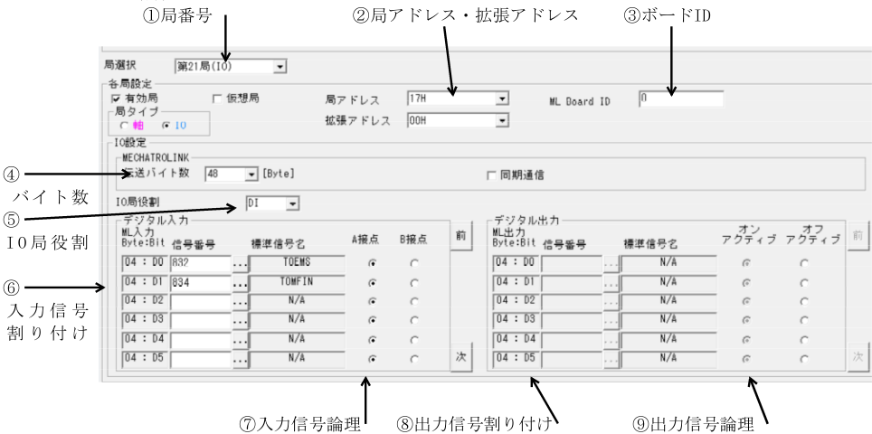

> **図の内容**
>
> ROMSW設定ソフトの画面例（局選択: 第21局(IO)）。番号は本文の説明に対応する。
> - ① 局番号（局選択）
> - ② 局アドレス・拡張アドレス（例: 17H、00H）
> - ③ ボードID（ML Board ID）
> - ④ バイト数（MECHATROLINK の伝送バイト数、例: 48 [Byte]）
> - ⑤ IO局役割（例: DI）
> - ⑥ 入力信号割り付け（デジタル入力。ML入力 Byte:Bit ごとに信号番号と標準信号名。例: 04:D0 に 832 TOEMS、04:D1 に 834 TOMFIN）
> - ⑦ 入力信号論理（A接点 / B接点）
> - ⑧ 出力信号割り付け（デジタル出力）
> - ⑨ 出力信号論理（オンアクティブ / オフアクティブ）

RTMC64-ECの場合

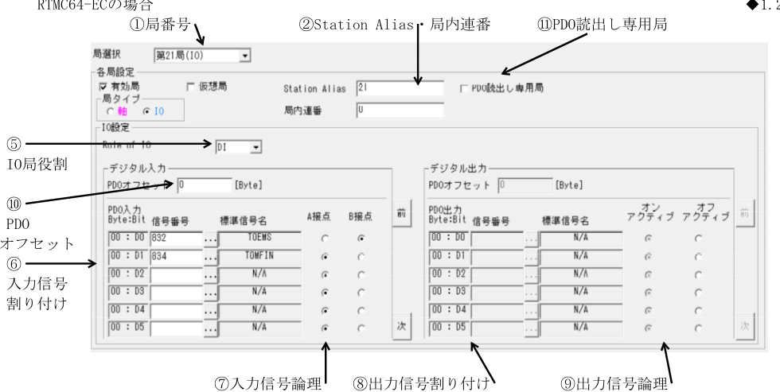

> **図の内容**
>
> ROMSW設定ソフトの画面例（RTMC64-ECの場合、局選択: 第21局(IO)）。番号は本文の説明に対応する。
> - ① 局番号（局選択）
> - ② Station Alias・局内連番（例: 21、0）
> - ⑤ IO局役割（例: DI）
> - ⑥ 入力信号割り付け（PDO入力 Byte:Bit ごとに信号番号と標準信号名。例: 00:D0 に 832 TOEMS、00:D1 に 834 TOMFIN）
> - ⑦ 入力信号論理（A接点 / B接点）
> - ⑧ 出力信号割り付け（デジタル出力）
> - ⑨ 出力信号論理（オンアクティブ / オフアクティブ）
> - ⑩ PDOオフセット [Byte]
> - ⑪ PDO読出し専用局

- ①信号を割り付ける入出力局の局番号を選択します
- ②入出力局の局アドレスを設定します
- ③ボードIDの番号を設定します [M3]のみ複数枚のMECHATROLINK通信ボードから、接続するボードを選択します。
- ④入出力局の仕様に合わせて、通信形態のバイト数を選択します [M3]のみ
- ⑤入出力局の役割を選択します(DIO、DI、DO、AD、DA、CNTから)(※DAは開発中)

![[M3]のみ マーク](TB00-1040D/images/image_000012_f0f7003af25f19f5ac63ab380745398e73ff0c6bdc332a8e43581a835cb43f11.png)

![[M3]のみ マーク](TB00-1040D/images/image_000013_ccb7fbed727a27b808acd68ac45fda3807f716e199c639636dbd1826d0744001.png)

◆1.2

- ⑥RTMC64の入力信号を割り付けます
- ⑦入力信号のA接点/B接点の論理を選択します
- ⑧RTMC64の出力信号を割り付けます
- ⑨出力信号のオンアクティブ/オフアクティブの論理を選択します
- ⑩信号情報が始まるバイトのオフセット数を設定します

[EC]のみ

- ⑪読み出し専用（書き込みをしない）局の場合にチェックを付けます。 [EC]のみ

入出力局の通信データを運転関連の論理入出力に割り付けることにより、M/Eスレーブの入出力局からの信号で、PLC/C無しでもRTMC64を運転・操作することができます。

## 3. 動作モード

RTMC64は以下のような動作モード(内部の動作状態)があります。

### 3-1. 各動作モードと主な機能

| モード名称          | モードの特徴                                                                               | 使用目的                                         | 通信コマンドで選択 (Windows/PLC)                                          | 機械パネルでの主な操作                                                        |
|----------------|--------------------------------------------------------------------------------------|----------------------------------------------|------------------------------------------------------------------|---------------------------------------------------------------------|
| 自動運転モード       | 運転プログラムを実行することにより、機械の自動運転を行うモードです。                                                | 通常運転ティーチングによるプログラム変更 ※電源投入直後は自動運転モードです。 | ・プログラム運転スタート/ストップ (メモリ運転、DNC運転) ・ティーチング操作・シングルステップ ※以下自動・手動ともに | ・プログラム運転スタート/ストップ (メモリ運転、DNC運転) ・シングルステップ・プログラム選択・ティーチング操作・リセット |
| DNC運転モード ◆1.2 | 運転プログラムを実行することにより、機械の自動運転を行うモードです。                                                | 通常運転ティーチングによるプログラム変更 ※電源投入直後は自動運転モードです。 | 可能・プログラム選択・全軸原点復帰・原点復帰                                        | ・プログラム運転スタート/ストップ (メモリ運転、DNC運転) ・シングルステップ・プログラム選択・ティーチング操作・リセット |
| 手動運転モード       | オペレータが直接指示を行うことにより機械の運転を行うモードです。                                                  | ・試運転・調整・段どり                                 | ・JOG送り・インチング送り                                                  | ・JOG送り・インチング送り・原点復帰・全軸原点復帰・リセット                                 |
| セッティングモード     | 各種パラメータの読出し/設定を行うモードです。本モードでは全ての運転操作がインタロックされます｡ ※ パラメータの読み出しは全てのモードで可能。     | パラメータ変更初期化                                  | ・リセット・リセット・バックアップデータ初期化・パラメータ読出し・書込み                        |                                                                     |
| OT無視モード       | ハードOTエラーからの復旧作業を行うモードです。本モードでは、ハードOTエラーの状態でもサーボ ONが出来ます。ジョグ移動はOTとは逆方向にのみ可能です。 | ・OT領域からの復旧操作                                | ・ジョグ送り・リセット                                                     | ・ジョグ送り・リセット                                                        |
