## 4.INtimeユーザ制御ソフト(PLC/C)とのインターフェース

本説明書ではRTMC64-M3とRTMC64-EC両機種の説明を行っています。共通した説明ではRTMC64と表記します。それぞれ異なる場合はRTMC64-M3を[M3]、RTMC64-ECを[EC]と表記します。

### 4-1．PLC/CとRTMC64-M3/ECの関係

◆1.3

INtime上のPLC/CとRTMC64は、共有メモリを経由して、全ての情報を送受信します。

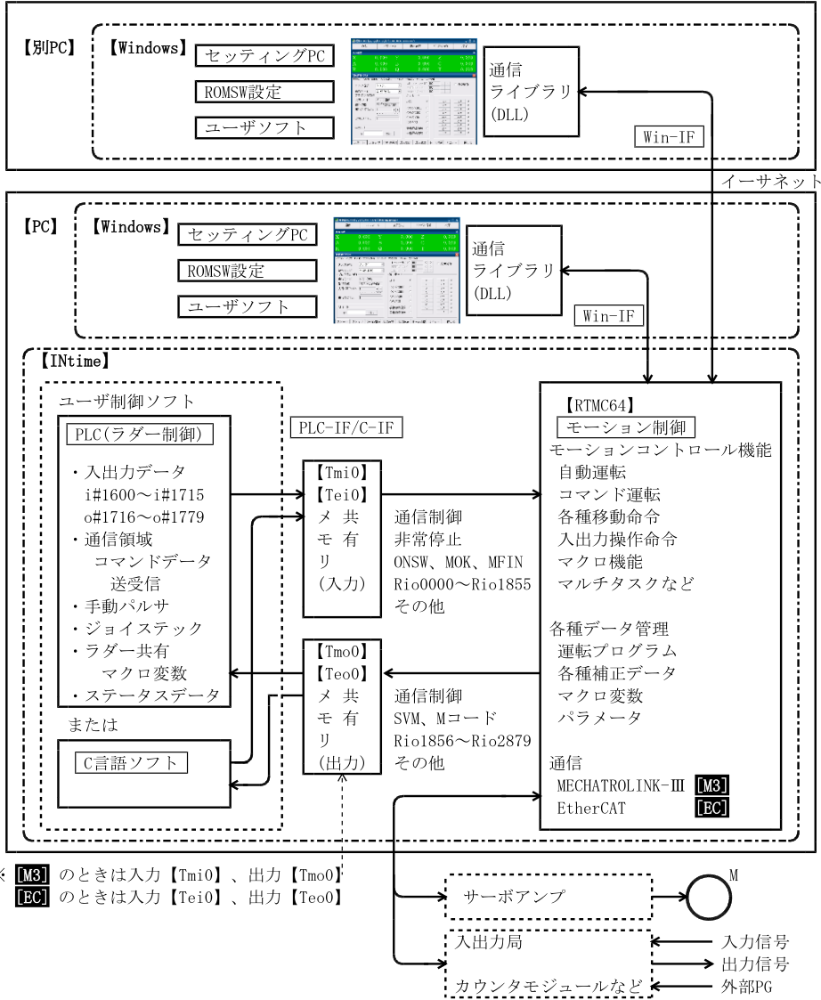

> **図の内容**
>
> - **【別PC】【Windows】**: セッティングPC、ROMSW設定、ユーザソフト → 通信ライブラリ(DLL)（Win-IF）。イーサネットで【RTMC64】につながる
> - **【PC】【Windows】**: セッティングPC、ROMSW設定、ユーザソフト → 通信ライブラリ(DLL)（Win-IF）→【RTMC64】
> - **【PC】【INtime】**
>   - **ユーザ制御ソフト**: 「PLC(ラダー制御)」または「C言語ソフト」
>     - PLC(ラダー制御)の扱うもの: 入出力データ（i#1600～i#1715、o#1716～o#1779）、通信領域（コマンドデータ送受信）、手動パルサ、ジョイステック、ラダー共有マクロ変数、ステータスデータ
>   - **PLC-IF/C-IF**: 共有メモリ
>     - 【Tmi0】【Tei0】共有メモリ(入力): ユーザ制御ソフト →【RTMC64】。通信制御、非常停止、ONSW、MOK、MFIN、Rio0000～Rio1855、その他
>     - 【Tmo0】【Teo0】共有メモリ(出力):【RTMC64】→ ユーザ制御ソフト。通信制御、SVM、Mコード、Rio1856～Rio2879、その他
>   - **【RTMC64】モーション制御**
>     - モーションコントロール機能: 自動運転、コマンド運転、各種移動命令、入出力操作命令、マクロ機能、マルチタスクなど
>     - 各種データ管理: 運転プログラム、各種補正データ、マクロ変数、パラメータ
>     - 通信: MECHATROLINK-Ⅲ [M3]、EtherCAT [EC]
> - RTMC64 の通信から: サーボアンプ → モータ(M)、入出力局／カウンタモジュールなど（入力信号、出力信号、外部PG）
>
> 注記: ※ [M3] のときは入力【Tmi0】、出力【Tmo0】。[EC] のときは入力【Tei0】、出力【Teo0】

※"Tmi0"、"Tmo0"[M3] ("Tei0"、"Teo0"[EC])の排他制御はユーザ側にて実施してください。 ※共有メモリ"Tmi0"、"Tmo0"("Tei0"、"Teo0")はRTMC64の初期化でRootProcessにカタログ(名前が登録)されます。ラダー制御、INtimeのC言語ソフトはカタログされた名前を探してマッピングして下さい。 ※ブロック図の詳細は<Ⅱ機能編 1-1-1.RTMC64全体ブロック図>(TB00-1040D)を参照下さい。

### 4-2．共有メモリインターフェース

共有メモリは、PLC/Cから読み出し/書き込みを行えます。

【TmoO】[M3] (【TeoO】[EC]) 出力(RTMC64 → PLC/C)

| オフセット [Byte]   | 名称                       | 内容                                                                                                                         |
|----------------|---------------------------|-----------------------------------------------------------------------------------------------------------------------------|
| 0～ 3439        | 通信領域                      | コマンドデータの送受信を通信方式でおこないます。 (通信領域&予約領域) 各種コマンド、運転プログラム、各種補正値、パラメータ、マクロ変数などの送受信                                                |
| 3440～ 4095     | 予約                        | 656byte                                                                                                                     |
| 4096～20479     | M/E通信レスポンス ※1             | 256byte * 64局                                                                                                               |
| 20480～20519    | 共有メモリ ※2 コンフィグレーション       | 40byte                                                                                                                      |
| 20520～20521    | RTC動作カウンタ                 | 制御周期毎にカウントアップします                                                                                                            |
| 20522～20523    | フォアグランド動作カウンタ             | 制御周期処理以外の処理(入出力の一部や通信処理)の周期毎にカウントアップします。 ※制御周期処理で余った時間を使用するため、RTC動作カウンタとは異なり、カウントアップの時間は不定です。                             |
| 20524～20543    | 予約                        | 20byte                                                                                                                      |
| 20544～20671    | 入力(PLCの)レジスタ (RTMC64→PLC) | 出力チャンネル o#1716 ～ o#1779 64ch * 2byte                                                                                        |
| 20672～20991    | 予約                        | 320byte                                                                                                                     |
| 20992～21191    | ラダー共有マクロ変数 (RTMC64→PLC)   | #1200 ～ #1299: WORD アクセス 200byte #5700 ～ #5799: LONG アクセス 200byte 詳細は<Ⅱ機能編 7-3-5.ラダー共有マクロ変数>(TB00-1040 F)を参照下さい。            |
| 21192～24575    | 予約                        | 3384byte                                                                                                                    |
| 24576～27919    | ステータスデータ                  | 全体情報 :全体ステータス、全体アラーム物理軸情報:各種座標、軸ステータス／アラーム等タスク情報：タスクステータス／アラーム、P実行情報等詳細は「送受信データ説明書」<4-1-6.ステータスデータ読出>(TB00-1044)を参照下さい。 |
| 27920～28671    | 予約                        | 752byte                                                                                                                     |

【Tmi0】[M3] (【TeiO】[EC]) 入力(PL/CC → RTMC64)

| オフセット [Byte]   | 名称                     | 内容                                                                                                            |
|----------------|-------------------------|----------------------------------------------------------------------------------------------------------------|
| 0～ 3439        | 通信領域                    | コマンドデータの送受信を通信方式でおこないます。各種コマンド、運転プログラム、各種補正値、パラメータ、マクロ変数などの送受信                                               |
| 3440～ 4095     | 予約                      | 656byte                                                                                                        |
| 4096～20479     | M/E通信コマンド ※3            | 256byte * 64局                                                                                                  |
| 20480～20543    | 予約                      | 64byte                                                                                                         |
| 20544～20765    | 出力(PLCの)レジスタ (PLC→RTMC) | 入力チャンネル i#1600 ～ i#1715 116ch * 2byte                                                                          |
| 20776～20807    | 手パカウンタ ※4               | 8 * 2 * 2byte                                                                                                  |
| 20808～20839    | ジョイスティックAD ※5           | 8 * 2 * 2byte                                                                                                  |
| 20840～20991    | 予約                      | 512byte                                                                                                        |
| 20992～21191    | ラダー共有マクロ変数 (PLC→RTMC64) | #1300 ～ #1399: WORD アクセス200byte #5800 ～ #5899: LONG アクセス200byte 詳細は<Ⅱ機能編 7-3-6.ラダー共有マクロ変数>(TB00-1040 F)を参照下さい。 |
| 21192～24575    | 予約                      | 3384byte                                                                                                       |

※1 M/E通信レスポンス

M/E通信の応答データのコピーです。

MECHATROLINKの場合は"レスポンス"、EtherCATの場合はRxPDO

| オフセット[Byte]   | データ内容   | データ内容    | サイズ     | 備考         |
|---------------|---------|----------|---------|-------------|
| 4096～ 4351    | 第1局     | レスポンスデータ | 256Byte | 先頭からの有効データ※ |
| 4352～ 4607    | 第2局     | レスポンスデータ | 256Byte | 〃           |
| 4608～ 4863    | 第3局     | レスポンスデータ | 256Byte | 〃           |
| :             | :       |          |         |             |
| 20224～20479   | 第64局    | レスポンスデータ | 256Byte | 〃           |

※ 各局のデータは最大256byteの領域に先頭から詰めて更新されます。

データの内容については、スレーブの機器のマニュアルにしたがって下さい。

※2 共有メモリコンフィグレーション

「通信データ」の領域サイズは、PLC/CとRTMC64間でデータ送受信を行う時に使用します。 "4-3-2．通信領域詳細"を参照して下さい。

| オフセット[Byte]   | データ内容              | サイズ   | 備考                                   |
|---------------|--------------------|-------|---------------------------------------|
| 20480～20481   | 「通信データ」の領域サイズ OUT側 | W     | PLCは起動時にこの領域を読み出して「通信データ」の大きさを判断します |
| 20482～20483   | 「通信データ」の領域サイズ IN側  | W     | 〃                                     |
| 20484～28485   | 予約                 | W     |                                       |
| :             | :                  |       |                                       |
| 20518～20519   | 予約                 | W     |                                       |

※3 M/E通信コマンド

M/E通信の指令データです。M/Eスレーブ出力局に直接指令することができます。

サーボには指令することはできません。（無視されます。）

MECHATROLINKの場合は"コマンド"、EtherCATの場合はTxPDO

| オフセット[Byte]   | データ内容        | サイズ     | 備考         |
|---------------|--------------|---------|-------------|
| 4096～ 4351    | 第1局コマンドデータ  | 256Byte | 先頭からの有効データ※ |
| 4352～ 4607    | 第2局コマンドデータ  | 256Byte | 〃           |
| :             | :            |         |             |
| 20224～20479   | 第64局コマンドデータ | 256Byte | 〃           |

※ 各局のデータは最大256byteの領域に先頭から詰めて指令します。

データの内容については、スレーブの機器のマニュアルにしたがって下さい。

※4 手パカウンタ

手動パルサのカウント値を書き込んで下さい。

| オフセット[Byte]   | データ内容        | サイズ   | 備考   |
|---------------|--------------|-------|-------|
| 20776～20777   | タスク0 手パ1カウンタ | W     |       |
| 20778～20779   | タスク0 手パ2カウンタ | W     |       |
| 20780～20781   | タスク1 手パ1カウンタ | W     |       |
| 20782～20783   | タスク1 手パ2カウンタ | W     |       |
| :             | :            |       |       |
| 20804～20805   | タスク7 手パ1カウンタ | W     |       |
| 20806～20807   | タスク7 手パ2カウンタ | W     |       |

※5 ジョイスティックAD

ジョイステックのAD値を書き込んで下さい。

| オフセット[Byte]   | データ内容   | データ内容      | サイズ   | 備考   |
|---------------|---------|------------|-------|-------|
| 20808～20809   | タスク0    | ジョイステック1AD | W     |       |
| 20810～20811   | タスク0    | ジョイステック2AD | W     |       |
| 20812～20813   | タスク1    | ジョイステック1AD | W     |       |
| 20814～20815   | タスク1    | ジョイステック2AD | W     |       |
| :             | :       | :          |       |       |
| 20836～20837   | タスク7    | ジョイステック1AD | W     |       |
| 20838～20839   | タスク7    | ジョイステック2AD | W     |       |

### 4-3．通信領域を使用した通信機能

#### 4-3-1．通信処理の概要

PLC/CとRTMC64間の大量のデータ送受信をするための機能です。

通信の詳細についてはサンプルラダープログラムを参照下さい。

サンプルラダーの一部は、そのままコピーして使用いただきます。また、使用するコマンドに応じて、サンプルを参考にユーザ殿で作成していただく部分もあります。

#### 4-3-2．通信領域詳細

【TmiO】[M3] (【TeiO】[EC]) 通信領域(PLC → RTMC64)

|   オフセット [Byte] | サイズ   | データ名称       | 内容                                                                                                                                                                                                                    |
|----------------|-------|-------------|------------------------------------------------------------------------------------------------------------------------------------------------------------------------------------------------------------------------|
|              0 | W     | 通信種別        | 通信内容を指定します。 1:データ書込 2:データ読出 3:動作指示                                                                                                                                                                                     |
|              2 | W     | 通信データタイプ    | 通信を行うデータ/コマンドの詳細を設定します。「通信種別」で指定した値により指定できる値が変わります。「送受信データ説明書」(TB00-1044)の各項目の"データタイプ"を参照下さい。                                                                                                                       |
|              4 | W     | タスク指定       | データ書込/読出時のタスク番号をしめします「送受信データ説明書」(TB00-1044)の各項目の"パラメータ"を参照下さい。                                                                                                                                                       |
|              6 | L     | 通信パラメータ     | データ書込/読出時のパラメータを示します「送受信データ説明書」(TB00-1044)の各項目の"パラメータ"を参照下さい。                                                                                                                                                        |
|             12 | L     | 全書込データサイズ   | WORD単位でデータのサイズを示します。全書込データサイズ:全体のデータサイズを示します合計データサイズ:今までに送ったデータのサイズを示します。今回データサイズ:今回「通信データ」へ設定したデータのサイズ                                                                                                             |
|             16 | L     | 合計書込データサイズ | WORD単位でデータのサイズを示します。全書込データサイズ:全体のデータサイズを示します合計データサイズ:今までに送ったデータのサイズを示します。今回データサイズ:今回「通信データ」へ設定したデータのサイズ                                                                                                             |
|             20 | W     | 今回書込データサイズ | を示します。 (「通信データ」のサイズより大きいデータの書込/読出時には、複数回に分けてデータを送ります。このとき、データをどこまで書込/読出したかを管理するために 3種類のデータサイズを使用します。) □□書込データサイズには、データ書込/動作指示の時は、書き込むデータ/動作指示コマンドのデータサイズを設定して下さい。データ読出の時は、0を設定して下さい。 (※ 上の□□は"全"/"合計"/"今回"を意味します。) |
|             22 | W     | 要求コマンド      | DComReq                                                                                                                                                                                                                |
|             24 | L     | 通信領域ロック要求   | LockReq                                                                                                                                                                                                                |
|             28 | B     | 予約          | 12byte                                                                                                                                                                                                                 |
|             40 | B     | 通信データ       | 書込/読出するデータの格納領域です。領域のサイズは"4-2．共有メモリインタフェース"の表の「共有メモリコンフィグレーション」を確認して下さい。「送受信データ説明書」(TB00-1044)の各項目の"データフォーマット"を参照下さい。最大バッファサイズ 3400byte                                                                           |

※ サイズ(データサイズ) B:バイト W:ワード L:ロングワード

【TmoO】[M3] (【TeoO】[EC]) 通信領域(RTMC64 → PLC)

|   オフセット [Byte] | サイズ   | データ名称       | 内容                                                                                                                                                                                                                                                                                                                                                    |
|----------------|-------|-------------|--------------------------------------------------------------------------------------------------------------------------------------------------------------------------------------------------------------------------------------------------------------------------------------------------------------------------------------------------------|
|              0 | L     | 全読出データサイズ   | WORD単位でデータのサイズを示します。全読出データサイズ:全体のデータサイズを示します合計データサイズ:今までに受け取るデータのサイズを示します。今回データサイズ:今回「通信データ」から読出すデータのサイズを示します。 (「通信データ」のサイズより大きいデータの書込/読出時には、複数回に分けてデータを送ります。このとき、データをどこまで書込/読出したかを管理するために 3種類のデータサイズを使用します。) □□読出データサイズには、RTMC64が書き込みます。「送受信データ説明書」(TB00-1044)の各項目の<<データフォーマット>>の"データサイズ"が"全書込データサイズ"に対応しています。 (※ 上の□□は"全"/"合計"/"今回"を意味します。) |
|              4 | L     | 合計読出データサイズ | WORD単位でデータのサイズを示します。全読出データサイズ:全体のデータサイズを示します合計データサイズ:今までに受け取るデータのサイズを示します。今回データサイズ:今回「通信データ」から読出すデータのサイズを示します。 (「通信データ」のサイズより大きいデータの書込/読出時には、複数回に分けてデータを送ります。このとき、データをどこまで書込/読出したかを管理するために 3種類のデータサイズを使用します。) □□読出データサイズには、RTMC64が書き込みます。「送受信データ説明書」(TB00-1044)の各項目の<<データフォーマット>>の"データサイズ"が"全書込データサイズ"に対応しています。 (※ 上の□□は"全"/"合計"/"今回"を意味します。) |
|              8 | W     | 今回読出データサイズ | WORD単位でデータのサイズを示します。全読出データサイズ:全体のデータサイズを示します合計データサイズ:今までに受け取るデータのサイズを示します。今回データサイズ:今回「通信データ」から読出すデータのサイズを示します。 (「通信データ」のサイズより大きいデータの書込/読出時には、複数回に分けてデータを送ります。このとき、データをどこまで書込/読出したかを管理するために 3種類のデータサイズを使用します。) □□読出データサイズには、RTMC64が書き込みます。「送受信データ説明書」(TB00-1044)の各項目の<<データフォーマット>>の"データサイズ"が"全書込データサイズ"に対応しています。 (※ 上の□□は"全"/"合計"/"今回"を意味します。) |
|             10 | W     | 通信結果ステータス   | 通信の実行結果を示します。 0:正常終了 2:パラメータエラー 7:読み出しデータが存在しない 8:データ書き込み不可状態 9:通信シーケンスエラー 10:プログラム受信中断 11:プログラムバッファフル 12:コマンド実行不可                                                                                                                                                                                                                                     |
|             12 | W     | 応答コマンド      | DComAck                                                                                                                                                                                                                                                                                                                                                |
|             14 | B     | 予約          | 2byte                                                                                                                                                                                                                                                                                                                                                  |
|             16 | L     | 通信領域ロック状態   | LockSts                                                                                                                                                                                                                                                                                                                                                |
|             20 | B     | 予約          | 20byte                                                                                                                                                                                                                                                                                                                                                 |
|             40 | W     | 通信データ       | 書込/読出するデータの格納領域です。領域のサイズは"4-2．共有メモリインタフェース"の表の「共有メモリコンフィグレーション」を確認して下さい。「送受信データ説明書」(TB00-1044)の各項目の"データフォーマット"を参照下さい。最大バッファサイズ 3400byte                                                                                                                                                                                                           |

※ サイズ(データサイズ) B:バイト W:ワード L:ロングワード

### 4-4．サンプルラダー

ラダー設計時には、テクノの提供するサンプルラダー(出荷時のCD内の devlp\Ladder\SmplLadd)を必ず利用してください。

サンプルラダーの詳細は、「RTMC64-M3/EC対応サンプルラダー説明書」(TB00-1047)、を参照下さい。 ※ 「サンプルラダー」と「サンプルラダー説明書」は準備中です。

#### 4-4-1．コピーして使う部分

サンプルラダーの"COMMAIN"ブロック内「通信メイン処理」は、通信処理の基本部分になります。コピーしてそのまま使用して下さい。

## 5.サーボ制御（一般仕様）

### 5-1．座標系

RTMC64-M3/ECでは、基本的に2種類の座標系を管理しています。

【機械座標系】

原点復帰位置を原点とします。ソフトリミットチェックなどはこの座標系でおこないます。

PTPB/LINB命令は、この座標系でのアブソ指令です。

【論理座標系】

原点設定(入力または操作)をした位置を、原点とします。 PTPB/LINBを除く全ての移動命令、運転プログラムは論理座標系での命令です。

原点復帰の完了時の論理座標系の設定方法は、以下から選択できます。

- 「論理原点 = 機械原点」とする方式
- 原点復帰前の「論理原点と機械原点のオフセット」を保持する方式
- 機械原点をサーボパラメータで指定した論理座標とする方式

詳細は、「ROMSW設定ソフトマニュアル」<5-1.基本パラメータ>(TB00-1042)を参照下さい。

### 5-2．アブソ指令とインクレ指令

移動命令の目標位置の指令方法には、「アブソ指令」と「インクレ指令」があります。

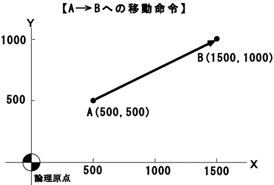

> **図の内容**
>
> X-Y 座標（原点は「論理原点」）上で、A(500, 500) から B(1500, 1000) へ向かう矢印。

■相対移動量

命令1ステップ毎の移動量です。

上記の命令の例では、A点からの移動量となります。

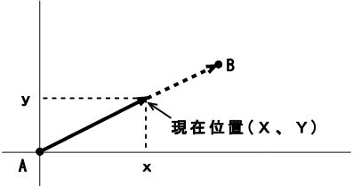

> **図の内容**
>
> A 点から B 点へ向かう線の途中に「現在位置(X、Y)」があり、A 点を基準にした x、y の距離が示されている。

- ■アブソ指令の表記 PTPA X1500 Y1000 目標位置を指令します。
- ■インクレ指令の表記 PTP X1000 Y500 移動量を指令します。
- (X、Y)は、論理原点からの距離 (論理座標)
- (x、y)は、A点からの距離 (相対移動量)

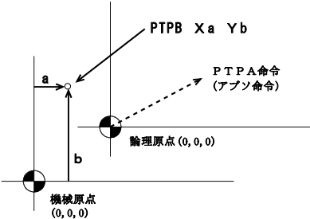

> **図の内容**
>
> 「機械原点(0, 0, 0)」と、そこから a、b ずれた位置にある「論理原点(0, 0, 0)」。
> 「PTPB Xa Yb」は機械原点を基準に (a, b) の点を指し、「PTPA命令(アブソ命令)」は論理原点を基準にした指令であることを示す（破線の矢印が論理原点から出ている）。

### 5-3．補間加減速 (指数形/直線形/S字)

補間指令(直線補間や円弧補間)に対しては、各軸に加減速制御(スムージング)がかかります。加減速時定数は、サーボパラメータの「補間加減速時定数」で指定します。スムージングが不要の場合、「補間加減速時定数」を0として下さい。

※ 以降速度単位の pulse/sec を pps と表します。

軸速度の様子

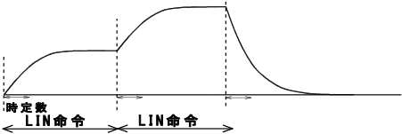

> **図の内容**
>
> LIN 命令が 2 つ続くときの軸速度。速度は指数関数的に上がって一定になり、次の LIN 命令でさらに上がり、最後は指数関数的に下がる。
> 横軸の区間: 「時定数」「LIN命令」「LIN命令」。

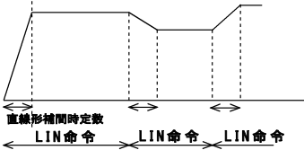

> **図の内容**
>
> LIN 命令が 3 つ続くときの軸速度。速度は直線的に上がり下がりし、命令の切り替わりで速度が変わる。
> 加減速にかかる区間に「直線形補間時定数」と書かれている。横軸の区間: 「LIN命令」「LIN命令」「LIN命令」。

【S 字加減速】＜オプション＞

補間加減速( 指数形／直線形) をさらにスムージングします。

直線形補間加減速と組み合わせて使用します。

速度の変化点でTs(ms) の平均化( フィルタリング) をします。

Ts はサーボパラメータで設定します。

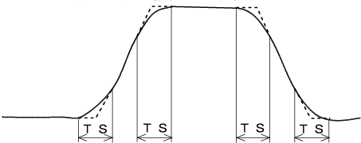

> **図の内容**
>
> 台形の速度（破線）の角を丸めた S 字の速度（実線）。加速の始めと終わり、減速の始めと終わりに、それぞれ「TS」の区間がある。

### 5-4．直線形加減速

PTPの移動指令の際には、直線形加減速制御をおこないます。

制御は各軸独立におこないます。PTP時定数(サーボパラメータ)は、ROMSWの選択により、以下のTとPtpTのいずれかを設定します。

詳細は、<Ⅲ 試運転調整編 4-1.送り速度、加減速などのパラメータ>(TB00-1040H)を参照下さい。

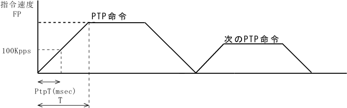

> **図の内容**
>
> 縦軸「指令速度 FP」、横軸は時間。「PTP命令」の速度は台形で、0 から「100Kpps」に達するまでの時間が「PtpT(msec)」、0 から指令速度 FP に達するまでの時間が「T」。
> 続いて「次のPTP命令」の台形がある。

T :加減速時間・・・ 0からPTP速度に到達するまでの時間

PtpT:PTP加減速時定数・・・ 0から100Kppsに到達するまでの時間

Ts : S字加減速時定数 (ms)

### 5-5．PTP制御(位置決め) PTP/G00

目標位置へ向かって、各軸独立に直線加減速制御により位置決めします。各軸の速度は、セッティングPC「サーボパラメータ」画面の「PTP速度」で指定します。加減速については、<5-4．直線形加減速>を参照下さい。各軸独立ですので、各軸の目標到達時間には、差が出ます。

PTP X1,Y1 の例

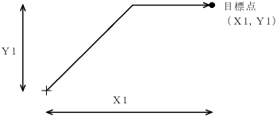

> **図の内容**
>
> 始点から「目標点(X1, Y1)」への動き。始めは斜めに進み、途中から X 方向だけに進んで目標点に着く（各軸が独立に動くため、移動量の少ない軸が先に止まる）。X1、Y1 は各軸の移動量。

### 5-6．直線補間 LIN/GO1

1軸～9軸同時の直線補間です。目標点への到達は全軸が同時です。速度指令は、直線補間命令で指定された全軸の合成速度です。下の図は、指数型の加減速の時の速度です。

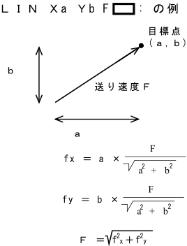

> **図の内容**
>
> 始点から「目標点(a, b)」へ「送り速度 F」で直線に進む。各軸の速度:
> - fx ＝ a × F ／ √(a² ＋ b²)
> - fy ＝ b × F ／ √(a² ＋ b²)
> - F ＝ √(fx² ＋ fy²)

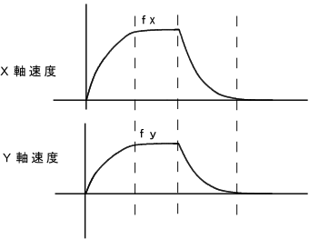

> **図の内容**
>
> 「X軸速度」は fx、「Y軸速度」は fy まで同時に上がり、同時に下がる（目標点への到達は全軸が同時）。

上記図の場合、Y軸は移動量が少ないため、 PTP速度に達する前に減速が始まっています。

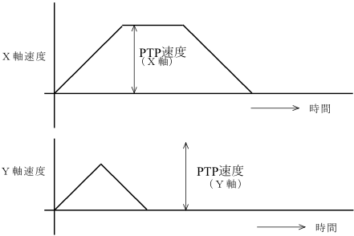

> **図の内容**
>
> 「X軸速度」は「PTP速度（X軸）」まで上がる台形。「Y軸速度」は移動量が少ないため、「PTP速度（Y軸）」に達する前に減速を始める三角形になる。横軸は「時間」。

### 5-7．円弧補間

CIRR、CIRL / G02、G03

2軸の円弧補間です。

円弧の指定には次の3つの方式可能です。

- ① 目標位置と中心座標値を設定します。
- ② 目標位置と半径を設定します。
- ③ 目標位置と円弧の途中通過点を設定します。

1周円以上の円弧動作を行う場合は、円弧補間命令を連続的に使用することで実現できます。

また、多回転の円運動には、多回転円弧指令もあります。(多回転指令はプリ解析方式には対応していません。)

速度指定Fは、円弧処理方式により以下のようになります。

プリ解析方式 : ヘリカル軸も含めた接線速度(3軸の合成速度)

内部方式

: 円弧2軸の合成速度(ヘリカル軸はこれに同期)

各円弧処理方式はセッティングPCの「ポジション表示形式設定画面」で選択できます。

各円弧処理方式については以下に記述します。

- ※ 基本的にボード内部方式を使用して下さい。

(プリ解析方式は旧機種との互換性のための機能です。)

#### 5-7-1．プリ解析方式

円弧を微小直線に展開するため実ステップ長が増えます。

詳細は、<6-4.プリ解析処理(テキスト→バイナリ変換)>(TB00-1040F)を参照下さい。

プリ解析方式の場合、連続した円弧命令を行うと、円弧の切り換わり時に速度が変動する場合があるのでご注意下さい。

- この方式では、アブソ指令(CIRRA/CIRLA)は使えません。

速度指令Fは、ヘリカル軸も含めた接線速度(3軸の合成速度)です。

#### 5-7-2．RTMC64内部方式

RTMC64内部で円弧解析を行う機能です。

速度指令Fは、円弧2軸の合成速度です。ヘリカル軸はこれに同期します。

### 5-8．手動送り

#### 5-8-1．ジョグ(JOG)送り

指定された方向へ軸を移動します。

速度は、セッティングPC「サーボパラメータ」画面の"JOG速度"(単位[pps])で設定します。加減速については、<5-4．直線形加減速> を参照下さい。

#### 5-8-2．インチング送り(手動)

指定された軸を一定のパルス量だけ送ります。

各軸の速度は、セッティングPC「サーボパラメータ」画面の「PTP速度」で指定します。加減速については、<5-4．直線形加減速> を参照下さい。

| 倍率   | 送り量     |
|-------|-----------|
| ×1    | 1パルス送り    |
| ×10   | 10パルス送り   |
| ×100  | 100パルス送り  |
| ×1000 | 1000パルス送り |

### 5-9．インポジションチェック

【概要】

以下の場合に、インポジションとなります。

INPOS量 ≧ ACCたまり + ER

- ER(偏差) = CR(指令位置) - PR(機械位置)
- ACCたまり = 補間加減速処理でのたまりパルス
- INPOS量は、セッティングPCの「サーボパラメータ」画面の「INPOS量」で設定します。

【INPOS量の設定の目安】

(1). 考え方

- a. 連続位置決めの時に、きっちり停止して次に移動したい場合・・・小さめの値
- b. 連続位置決めのタクトを高めたい。

完全に止まらないで、次の移動を始めたい場合。・・・大きめの値

(2). 設定値の目安

停止時に偏差があるかどうかをセッティングPCの「偏差量」画面で確認ください。 ACサーボによっては、停止時に数パルスの偏差が発生しています。

これをアンプ側でゼロにできれば良いのですが、解消できない場合もあります。 INPOS量の値は、停止時の偏差量の2倍以上の値にしてください。

【インポジションチェック動作比較表】

※1 補間

| 実行ステップ | 次ステップ | インポジションチェック無効 | インポジションチェック有効（デフォルト） |
|---|---|---|---|
| 補間以外 | 補間以外 | インポジションチェック無し | インポジションチェック有り |
| 補間 | 補間以外 | インポジションチェック無し | インポジションチェック有り |
| 補間以外 | 補間 | インポジションチェック無し | インポジションチェック有り |
| 補間 ※1 | 補間 | つなぎ(補間命令をなめらかに連続させる。) | つなぎ(補間命令をなめらかに連続させる。) |

補間：LIN命令、円弧命令

補間以外：PTP命令、TIM命令、マクロ変数演算等

※1の動作で停止させたい場合は、補間命令の間にドウェル(G04またはTIM/TM)を入れてください。

インポジションチェック有りインポジションチェック無しつなぎ

位置決め完了(インポジション) 軌跡発生終了後、ただちに次速度変動が起きないを待ってから､次ステップをステップを実行します。ように補正します。実行します。

F(速度)

ステップN ステップN+1 ステップN ステップN+1

①軌跡発生完了、②次命令開始、③INPOS待ち

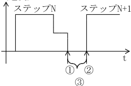

> **図の内容**
>
> 縦軸は速度、横軸は t。「ステップN」の速度が下がって 0 になった時点が ①、「ステップN+1」が始まる時点が ②。① と ② の間が ③。
> 本文: ①軌跡発生完了、②次命令開始、③INPOS待ち。

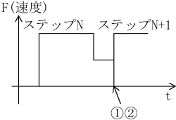

> **図の内容**
>
> 縦軸「F(速度)」、横軸 t。「ステップN」の速度が 0 になった時点で、すぐに「ステップN+1」が始まる（① と ② が同じ時点）。

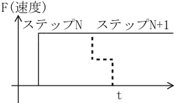

> **図の内容**
>
> 縦軸「F(速度)」、横軸 t。「ステップN」の終わりで速度が 0 まで下がらず（破線で、下がる場合の形を示す）、そのまま「ステップN+1」に移る。

※ インポジションチェックは、ステップとステップの間(次ステップを実行する前)にチェックを行います。

### 5-10．なめらかな送り制御(パス機能)

各ステップ(ブロック)の実行の間で、停止時間が有りません。 NCのブロック間停止ゼロ(パス機能)に当たります。このパス機能により微小連続送りでのなめらかな輪郭制御が実現できます。以下のような軌跡を、指定された接線速度でなめらかに送ります。

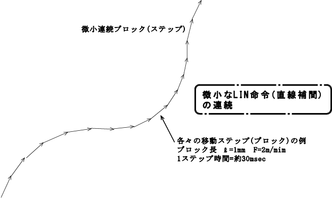

> **図の内容**
>
> 曲線を細かい矢印でつないだ図。
> - 「微小連続ブロック(ステップ)」
> - 「微小なLIN命令(直線補間)の連続」
> - 「各々の移動ステップ(ブロック)の例 ブロック長 ℓ＝1mm F＝2m/min 1ステップ時間＝約30msec」

### 5-11．シングルステップ動作

シングルステップモードでは運転プログラムの各ステップ毎に停止し、スタート信号により1ステップづつ進行します。

運転プログラムのセッティングやメンテナンス時に、動作確認のために使用します。

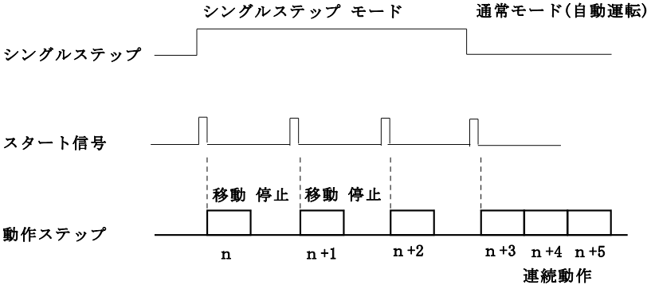

> **図の内容**
>
> - 「シングルステップ」信号: 「シングルステップ モード」の間 ON、「通常モード(自動運転)」で OFF
> - 「スタート信号」: シングルステップ モード中に 4 回パルスが入る
> - 「動作ステップ」: スタート信号ごとに n、n+1、n+2 を 1 つずつ実行して止まる（「移動 停止」）。通常モードでは n+3、n+4、n+5 を続けて実行する（「連続動作」）

### 5-12．サイクル運転

サイクル運転モードでは運転プログラムの繰り返し実行を行います。

RTMC64は、運転プログラムのENDステップ実行時、サイクル運転モードの場合自動的に運転プログラムの先頭から再実行を行います。

繰り返し実行中に、サイクル運転モードをOFFにすると、その回の最後まで実行した後、プログラム運転を終了します。

サイクル運転モードのON/OFFは、通信コマンドでおこないます。

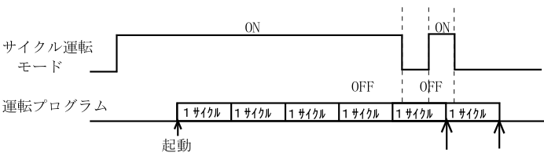

> **図の内容**
>
> - 「サイクル運転モード」: 起動の前から ON、途中で OFF になり、短く ON に戻り、また OFF になる
> - 「運転プログラム」: 「起動」から「1サイクル」をくり返す。モードが OFF になると、実行中の 1 サイクルが終わったところで止まる（矢印）

プログラム終了時サイクル運転ここではプログラム再開しない。

モードなのでプログラム再開

サイクル運転モードで、繰り返し実行する運転プログラムの先頭と最後のステップが補間移動の場合でも、最後のステップと先頭ステップのつなぎ処理は行いません。

ENDステップでは、1制御周期とインポジションチェックの時間(インポジションチェック有効時)は、停止します。

### 5-13．オーバーライド機能

送り速度を 0%～200%の比率で、動作中に変更できます。セッティングやメンテナンスでも使用します。

(機械操作パネルでは、25%刻みか1%刻みかを選択出来ます。)

### 5-14．ストロークリミット

機械の動作範囲外への移動を禁止するために、二重の安全対策を実施しています。

ソフトウェアストロークリミットソフトウェアにより、動作可能な範囲を規定します。

(ソフトOT)

指定位置がこの領域を越えるとRTMC64-M3/ECは「ソフトリミットエラー」になり移動を中断します。

この時の減速方法は、動作により異なります。

- 補間動作・・・減速停止します。
- 補間動作以外・即停止します。

(PTP/JOG/原点復帰等)

サーボ主電源は落ちません。そのまま手動操作(JOG)にてもどせます。 (戻した後、リセットにてソフトリミットエラーを解除して下さい。)

ハードウェアストロークリミットマシンエンドに配置したLS信号をサーボアンプへ入力(ハードOT)します。 (ハードOT) 一般はb接論理で入力し､これがOFFするとサーボは緊急停止します。 RTMC64は、サーボのステータスとして、OT発生を認識しアラームとなります。その結果、設定によっては、サーボ主電源を落とします。通常の使用状態では必ずソフトOTにより停止しますので、ハードOTが作動する可能性はほとんどありません。

ハードOTの処理

| OT時サーボOFF ※1 (ROMSW設定ｿﾌﾄの設定)   | 動作         | 復旧                                           |
|--------------------------------|-------------|-----------------------------------------------|
| する                             | 即停止後にサーボオフ | OT無視モードにして、リセット(サーボオン) ジョグでもどして、リセット。(アラーム解除) |
| しない                            | 即停止のみ       | そのままジョグでもどして、リセット(アラーム解除)                     |

※1 詳細は、「ROMSW設定ソフトマニュアル」<5-1.基本パラメータ>(TB00-1042)を参照下さい。

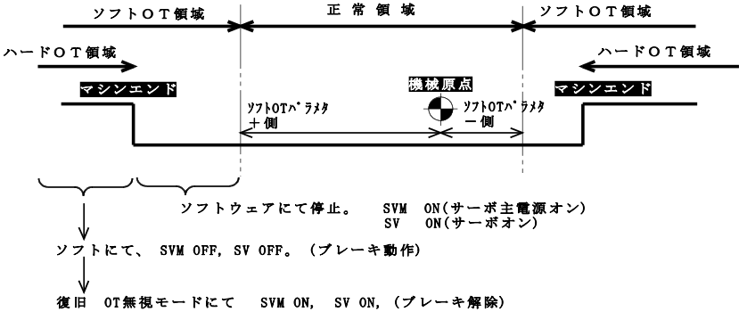

> **図の内容**
>
> - 中央が「正常領域」、その両側が「ソフトOT領域」、さらに外側が「ハードOT領域」。両端に「マシンエンド」
> - 正常領域の中に「機械原点」があり、機械原点から左右の境界までが「ｿﾌﾄOTﾊﾟﾗﾒﾀ ＋側」「ｿﾌﾄOTﾊﾟﾗﾒﾀ －側」（図ではこの向きに書かれている）
> - ソフトOT領域に入ったとき: 「ソフトウェアにて停止。SVM ON(サーボ主電源オン) SV ON(サーボオン)」
> - ハードOT領域に入ったとき: 「ソフトにて、SVM OFF，SV OFF。（ブレーキ動作）」→「復旧 OT無視モードにて SVM ON，SV ON，（ブレーキ解除）」

ソフトOTのパラメータは、マシン原点を基準に、+側と-側の各々に対して設定します。ソフトOTのパラメータ(ソフトリミット)については、

<Ⅲ 試運転・調整編 4-2.ストロークリミットのパラメータ>(TB00-1040H)を参照下さい。

- 【注】マシンエンドにおける、メカニカルストッパーは必ず設置して下さい。

高速動作している状態では、どのようなOT方式にしても、相当量の惰走距離は発生します。

ハードOT時の処理は安全性と復帰の操作性が絡み、サーボパラメータも含め充分な検討が必要です。以下にOTから復帰するときの状態を示します。

サーボパラメーPn001:□□0□ DB停止またはフリーラン

Pn001:□□1□ 非常停止時トルクで停止し、その後サーボロック

| OT状態    | RTMC64-M3/EC 状態/操作   | Pn001:□□0□      | Pn001:□□1□   |
|---------|----------------------|-----------------|--------------|
| OT入力ON  | サーボOFF               | モータフリー          | モータフリー       |
| OT入力ON中 | OT無視モードでサーボON        | モータフリー          | サーボロック       |
| OT入力ON中 | OT無視モードでJOG移動        | サーボロックし JOG移動 ※ | JOG移動        |
| OT入力ON中 | JOG移動停止(サーボらーON中)    | 移動停止後モータフリー    | サーボロック       |
| OT入力OFF | サーボON中               | サーボロック          | サーボロック       |

※JOG停止でモータフリーになるので、指令位置と機械位置がずれます。

### 5-15．軸制御に関するその他の機能

#### 5-15-1．周回処理(回転軸)

無限回転軸では、1周で同じ所にもどるので、座標値を1周内の値にもどす必要があります。座標値は以下の範囲となります。

-(メカ機構1回転パルス数) < 座標値 < メカ機構1回転パルス数

ROMSW設定ソフトでPG分周値やギア比などを全てを考慮した上での、「メカ機構1回転パルス数」を設定します。(0以外の値を設定した場合のみ、その値で各座標値の周回処理を実行)リジットタップやねじ切りオプション機能使用時の主軸及び、実回転数ステータスが必要な主軸に対しては必ず設定します。

#### 5-15-2．回転速度指令 SPIN/G120

定速回転を指令する命令です。無限回転軸(ROMSW設定)に対して有効です。回転速度[rpm]は、機械軸での回転数です。

(ROMSW設定ソフトで「メカ機構1回転パルス数」の設定が必要です。)

命令コード「SPIN」/「G120」につづいて、回転軸を指定します。軸指定には回転速度を0.1rpm単位で指定します。さらに「OVR1」を付加する事により、回転動作にオーバライドがかかります。

指定しない場合は、オーバライドはかかりません。（G120では、OVR1機能は有りません。）

【テクノコード】

SPIN Z1000;

SPIN Z1000 OVR1;

SPIN Z0;

100rpmでの定速回転(オーバライドは無効) 100rpmでの定速回転(オーバライドは有効) 定速回転の停止

【Gコード】

G120 Z1000;

Gコードでは、OVR1は対応していません。

定速回転動作の開始/停止時には、PTP時定数による直線加減速がかかります。移動中の軸に、回転指令をおこなうと「プログラム実行エラー」となります。また、回転動作中の軸に対しては、他の動作指令は「プログラム実行エラー」となります。回転動作停止後は、再び他の移動命令(位置決め)が可能となります。回転動作の実行中に再度回転指令を行い、回転速度を変更する事は可能です。

尚、回転動作の開始(または停止)指令時は、指令回転数への到達(または停止)を待たずに、次のステップが実行されるので、必要に応じてドウェル(タイマー)命令等を使用して下さい。

０°

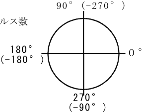

> **図の内容**
>
> 円の右が 0°、上が 90°（－270°）、左が 180°（－180°）、下が 270°（－90°）。左上に「(パ)ルス数」の文字の一部がある。

#### 5-15-3．ねじ切り機能(同期送り)

<オプション> (計画中)

位置ループ制御型主軸のフィードバックデータから、X/Y軸の送り量を計算して同期指令する事により、ねじ切り動作を行います。

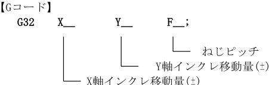

> **図の内容**
>
> 【Gコード】 G32 X＿ Y＿ F＿;
> - X＿: X軸インクレ移動量(±)
> - Y＿: Y軸インクレ移動量(±)
> - F＿: ねじピッチ

- XYどちらか一方の指令で平行ねじ、両方の指令でテーパーねじとなります。
- XY両軸動作の場合、ピッチ計算の基準軸は、移動量が大きい方の軸となります。
- ねじピッチFは、主軸1回転あたりの基準軸の移動量を指定します。
- G32命令の実行時は、あらかじめ主軸の回転動作が実行されているものとします。主軸停止状態でG32が指令された場合は、プログラムエラーとなります。
- X軸,Y軸の移動は、主軸のフィードバックに対する、比例分配制御によって行います。

また、動作開始のタイミングを、主軸のC(Z)相位置を基準にする事により、繰り返し時の切り込み位置を一定とします。ただしG32命令が連続する場合、2回目以降では主軸のC(Z)相検出はせずに前ブロックに継続して動作します。

- 同じねじ切りに対して、切り込み量を変えて繰り返しねじ切り動作を行う場合、その途中で主軸回転数 (S値)を変更してはいけません。
- ねじ切り動作中、一時停止は無効となります。
- 【注】フィードバック情報は、「M/E通信経由」と「ラダー経由」の二つの方式があります。

#### 5-15-4．同一指令2軸制御

<オプション>

選択した第n軸が第m軸の同期軸(従軸)として動作します。m軸に対する全ての動作指令 (プログラム指令、動作コマンド、手動操作)に対して、n軸がm軸と同期して動作します。通常は、平行軸などで使用します。

- ■選択 n軸:同期軸(従軸) ROMSW「軸設定」で「同期軸(従軸)」をチェック

m軸:基準軸(マスター軸) ROMSW「軸設定」で「基準軸」で選択

原点復帰の完了で、お互いの2軸が正確に平行になります。その後は、手動/自動ともに常に一緒に動きます。お互いのC(Z)相位置にずれがあっても、サーボパラメータの原点距離でそのように調整します。

<同一指令2軸の原点復帰>

原点復帰方式の選択では、FBラッチ(C(Z)相/EXT)の原点復帰方式を推奨します。

原点サーチやOTサーチでは、再現性に誤差が生じる可能性があります。

原点復帰動作時、C(Z)相信号については個々のモーターより検出しますので、サーボパラメータの"原点距離"は別々に設定してください。(試運転時要注意!)

尚、モーターを機械に組みつける際には、軸の回転位置(C(Z)相位置)をできるだけ合わせておく事をお勧めします。また、原点信号は通常、別々の信号を使用しますが、平行軸では一つのセンサー出力を2軸のサーボアンプに並列接続する方法も現実的です。

<Ⅲ 試運転・調整編 7-8-12.同一指令2軸での原点復帰>(TB00-1040H)も参照下さい。

<2軸の誤差の問題>

電源投入後から原点復帰が完了するまでは、同一指令2軸(平行軸)はお互いに多少のズレを持ってます。原点復帰動作をスムースにおこなうためには、機構に応じて以下をご注意下さい。

<2軸の機構連結が強い場合>

2軸の連結が強い場合は、お互いの誤差も少ないですが、誤差があると平行性が崩れて、異常摩擦が発生する危険性もあります。このような応用では、各軸の原点やC(Z)相を一致させておく方が無難です。また、アプローチ速度や原点復帰速度も低めが安全です。

理想的な条件では、電源投入時も平行が保たれており、原点復帰動作中や原点復帰の完了時も正確に平行を保ちます。

<2軸の機構連結が弱い場合>

お互いの軸の機構干渉が少ない場合は、お互いの原点やC(Z)相がずれていても、ほとんど問題はありません。

<同基軸無視の移動>

試験中など片軸のみ動かす必要があるときは"同期無視動作"も可能です。

#### 5-15-5．接線制御軸機能

<オプション>

生地や板のカッティングの場合、軌跡の方向に常に歯先を向ける必要があります。

本機能により無限回転軸であるm軸(選択)が、k/l軸(選択)の合成移動方向に、自動的に回転動作します。

- ■選択 m軸:接線制御軸 ROMSW設定ソフト「軸設定」で「接線制御軸」をチェック

(ROMSW設定ソフト「メカ機構1回転パルス数」の設定も必要)

k軸:基準軸1 ROMSW設定ソフト「軸設定」で「接線制御軸」の「基準軸1」で選択

l軸:基準軸2 ROMSW設定ソフト「軸設定」で「接線制御軸」の「基準軸2」で選択

運転プログラム(テクノコード/Gコード)で使う方法と通信コマンドで使用する方法があります。

- (1). 接線制御用指令コード
- ※1 接線制御有効/無効の設定はシステムモーダルです。(システム起動時は無効です。)◆1.2 接線制御有効/無効の設定はプログラム終了後も継続します。
- (2). 運転プログラム例

- G111/STND

接線制御無効 ※1

- G100/STNE

接線制御有効 ※1

- G112(P＿)/TURN(TIM＿)

m軸回転命令 P＿(TIM＿)は、回転後の待ち時間(秒)

- ＿のデータは 0.1～2147483.6秒

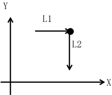

> **図の内容**
>
> X-Y 平面で、X 方向に L1 進み、その後 －Y 方向に L2 進む経路。

G01 X1000 ;

G04 P1.0 ; →位置決め完了待ちのWait ※2

G112 P0.1 ; →TURN命令

※3

G01 Y-1000;

※4

- ※2 TURN命令(G112)の前には、ドウエル(G04)を入れることを推奨します。
- ※3 サーボ系の遅れを考慮して、Wait(P指定)を入れることができます。
- ※4 TURN命令でm軸の移動位置を算出するため、TURN(G112)命令の直後にk/l軸の移動命令が必須となります。TURN(G112)命令の次にk/l軸関連の以下の命令がない場合は、プログラム実行エラーとなります。
- PTP/G91G00
- LIN/G91G01
- CIRR/G91G02(プリ解円弧)
- CIRL/G91G03(プリ解円弧)
- SLIN/G91G31

TURN命令の直後に上記命令を指定できない場合は、TURN命令にk/lを付加することにより接線を指定することができます。この機能によりTURN命令の直後に移動命令以外の命令を指定することもできます。

- ※5 m軸はサーボモータを使用下さい。

パルスモータの場合、動作がなめらかでない場合があります。

- (3). LIN命令(X/Y)に対するZ軸(3軸)の動作

LIN命令(G01)のX、Yのベクトル方向へZ軸(第3軸)を回転させます。

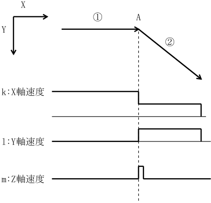

> **図の内容**
>
> 経路は ①（X 方向）から A 点で ②（斜め下）に向きを変える。
> - k:X軸速度: A 点で下がる
> - l:Y軸速度: A 点から上がる
> - m:Z軸速度: A 点で短いパルス状に動く（Z 軸を回転させて向きを合わせる）

- (4). ジョグ送り(手動送り)の時にも接線制御します。
- 例) +X キー

↓

Z軸 +X方向へ回転 X軸手動送り

- (5). 接線制御の有効(G110/STNE)/無効(G111/STND)

◆1.2

- G110/(STNE)の指令で接線制御有効(システムモーダル)となり、それ以降のk/l移動に対してm軸を自動追従させます。
- G111/(STND)の指令で接線制御を解除します。

(6). TURN命令 (G112)

直角に折れ曲がるようなカドの部分では、TURN命令を使います。

L1
  
A G01 X(L1);
  
G04 P＿;
  
L2 G112 (P＿);
  
G01 Y(L2)

k/l軌跡がなめらかに変化する軌跡であれば、上記機能は不要です。

(7). 関連するサーボパラメータ

m軸のサーボパラメータが特殊な意味になります。

| m軸サーボパラメータ (表示上の名称)   | サーボパラメータ名称 (正式名称)   | 意味                           |
|-----------------------|---------------------|-------------------------------|
| +方向ソフトリミット            | 接線制御上限速度            | 接線制御によるm軸回転速度α、上限値(pps)       |
| -方向ソフトリミット            | 接線制御基準位置            | kl平面にて+k方向へ動く時のm軸のアブソ位置(パルス) |

Z軸は、A点で「接線制御上限速度」 (サーボパラメータ)で回転します。

一般には位置ループの特性により速度の変化やZ軸の回転速度の変化は曲線になります。

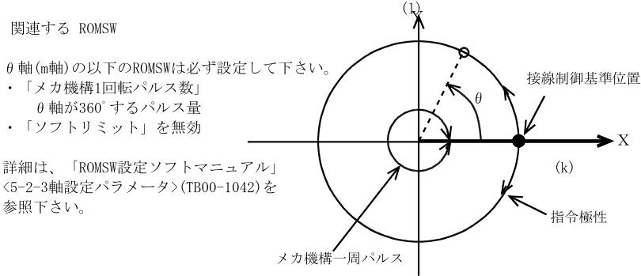

> **図の内容**
>
> 左の文:
> - 関連する ROMSW
> - θ軸(m軸)の以下のROMSWは必ず設定して下さい。
>   - 「メカ機構1回転パルス数」 θ軸が360°するパルス量
>   - 「ソフトリミット」を無効
> - 詳細は、「ROMSW設定ソフトマニュアル」<5-2-3軸設定パラメータ>(TB00-1042)を参照下さい。
>
> 右の図: 横軸 X（(k)）、縦軸 (j) の座標に円があり、「接線制御基準位置」から角度 θ を測る。「指令極性」の矢印、「メカ機構一周パルス」の表示がある。

- (9). 通信コマンドにおける使用方法

＜通信コマンド＞

Z軸接線制御ON/OFFコマンド"REQ_TLINE"を使用します。本コマンドにより、接線制御のON/OFFが切り換えられます。デフォルトは接線制御OFFとなっています。

ステータスデータ読出(DAT_STATUS)で得られる、"タスクステータス"にて、接線制御ON/OFFの状態を取得出来ます。

詳細は、「RTMC64-M3/EC 送受信データ説明書」<4-2-28.接線制御ON/OFFコマンド>、 <4-1-6.ステータスデータ読出>(TB00-1044)を参照下さい。

#### 5-15-6．センサーラッチ機能（スキップ機能） <オプション>

◆1.3

- (1). 対応サーボアンプ要件

**○RTMC64-M3：MECHATROLINK-Ⅲ対応サーボの場合[M3]**

MECHATROLINK-Ⅲ標準サーボプロファイルの「ラッチ機能」

に対応していること。

- ※「ラッチ機能」はMECHATROLINK-Ⅲの通信仕様として任意機能(対応が必須ではない機能)です。 MECHATROLINK-Ⅲ準拠の製品でも対応しているかどうか確認をしてください。

(安川電機社製Σ-VやΣ-7は対応しています。)

**○RTMC64-EC：EtherCAT対応サーボの場合[EC]**

CiA402サーボプロファイルの機能

「タッチプローブ機能(Touch probe function)」

に対応していること。

- ※「タッチプローブ機能(Touch probe function)」はCiA402サーボプロファイルの規約として必須対応ではないため、対応しているかどうかを確認してください。

(2). 事前設定

サーボアンプへの外部入力信号(EXT)の配線やIO割付はそれぞれ設定してください。それ以外については以下。

- ○RTMC64-M3：MECHATROLINK-Ⅲ対応サーボの場合[M3] 特になし。

**○RTMC64-EC：EtherCAT対応サーボの場合[EC]**

- 「タッチプローブ機能(Touch probe function)」を使用するために、ENIファイル作成時に以下のオブジェクトをマッピングする必要があります。

但し、使用する信号と、エッジの取得方法によって以下のようになります。

- ●Probe1(EXT1)をONエッジでラッチする場合

【RxPDO】

- Touch Probe Function (60B8h,00h)

【TxPDO】

- Touch Probe Status (60B9h,00h)
- Touch Probe Pos1 Positive Value (60BAh,00h)
- ●Probe1(EXT1)をOFFエッジでラッチする場合

【RxPDO】

- Touch Probe Function (60B8h,00h)

【TxPDO】

- Touch Probe Status (60B9h,00h)
- Touch Probe Pos1 Negative Value (60BBh,00h)
- ●Probe2(EXT2)をONエッジでラッチする場合

【RxPDO】

- Touch Probe Function (60B8h,00h)

【TxPDO】

- Touch Probe Status (60B9h,00h)
- Touch Probe Pos2 Positive Value (60BCh,00h)
- ●Probe2(EXT2)をOFFエッジでラッチする場合

【RxPDO】

- Touch Probe Function (60B8h,00h)

【TxPDO】

- Touch Probe Status (60B9h,00h)
- Touch Probe Pos2 Negative Value (60BDh,00h)

(3). 指令方法

本機能は特殊な直線補間を実行します。センサーラッチ信号(サーボアンプのEXT1)がONすると、その時点での機械位置とアブソ座標系を制御軸数分メモリーにセットします。

動作としては、以下の2通りが選択可能です。

- 同信号入力のONにより移動指令の残りを中止して次のステップへ進みます。(スキップ機能)
- スキップせず最後まで移動します。

センサーラッチ位置情報は、通信コマンドによって読み出す事ができます。通信コマンドの詳細は、

「RTMC64-M3/EC 送受信データ説明書」<4-1-10.センサーラッチ位置データ読出>

<4-2-22.高速センサーラッチインクレ補間位置決めコマンド>

<4-2-23.高速センサーラッチアブソ補間位置決めコマンド>(TB00-1044)

を参照下さい。

【注】ラッチ動作をさせない軸でも同一タスク内の軸には全て、センサーラッチ信号の配線が必要です。

<運転プログラムコード>

|         | テクノコード   | Gコード   |
|---------|----------|--------|
| スキップ    | SLIN     | G31    |
| スキップしない | SLINC    |        |

Gコードでは、スキップしない動作はできません。

基本的な動作方式及び制約事項は、テクノコードの"SLIN"は従来の"LIN"に、Gコードの"G31"は従来の"G01"に等価です。(ただしG31はノンモーダル指令となります。)

【注】ラッチ信号のOFF→ONのエッジで動作します。SLIN実行の始めからONしているとラッチしません。

#### 5-15-7．コンベア追従送り同調・同期送り <オプション> (計画中)

ベルトコンベア上などを移動するワークに対して、同調・同期制御が有効です。

同調送り(TUN) ベルトコンベア上のワークに対して、位置と速度を合わせます。同期追従送り(DLIN) ベルトコンベア上のワークに対して、同じ速度で動きます。

```c
    TUN X(lm) Y(LM);
```

無限回転軸であるY軸を、あらかじめSPIN命令により、回転動作させておきます。

TUN命令により、両軸の論理座標系機械位置が指定した(lm,LM)に到達する様に、Y軸のフィードバックに同調してX軸を動作させます。指定点を通過した時点で分配完了となり、次のステップへ進みます。尚、TUN命令を開始する時点で、既にX軸の座標が指定位置を越えていた場合、プログラム実行エラーとなります。

また、Y軸の座標が指定位置を越えていた場合は、Y軸が周回処理によって一度ラウンドアップした後、再度到達する指定位置をYの目標点として動作します。

DLIN X(lb) TIM＿ ONR＿ /OFR＿;

無限回転軸であるY軸を、あらかじめSPIN命令により、回転動作させておきます。

DLIN命令によりTIMで指定された時間だけ、Y軸のフィードバックに同期してX軸を移動させます。この間に論理座標系のX軸機械位置が、指定した座標値(lb)に

到達してしまったた場合は、プログラム実行エラーとなります。

また、同時に標準のONR/OFR命令による汎用出力信号制御を実行できます。

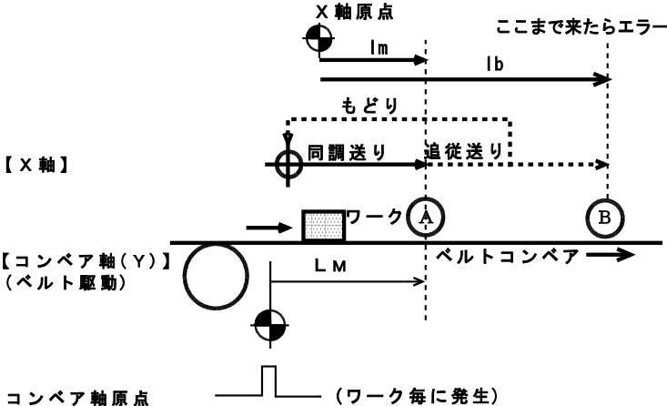

> **図の内容**
>
> - 【X軸】: 「X軸原点」から、「同調送り」「追従送り」で進み、「もどり」で戻る。原点から Ⓐ までが「lm」、Ⓑ（「ここまで来たらエラー」）までが「lb」
> - 【コンベア軸(Y)】(ベルト駆動): 「ベルトコンベア」上を「ワーク」が流れる。「コンベア軸原点」からワークの検出位置までが「LM」
> - 「コンベア軸原点」の信号はパルス状（「(ワーク毎に発生)」）

コンベア軸は、ワーク毎に原点パルスを出して下さい。一般には、回転軸座標として、コンベア軸の座標をワーク毎にセットアップします。

A点 : 同調を完了させるべき目標位置。(LM)

ここまでにX軸は加速して位置・速度を合わせます。

**使用例**

<運転プログラム例>

X軸のもどり位置でシリンダを上/下。(Rio1860出力:シリンダ ON/OFF)

追従区間でシリンダを上/下させます。 P01入力ONで終了。

PTPA X0

; X軸ホーム位置へ

SPIN Y600 OVR1

; ベルトコンベア起動(直線形加減速)

～

ONR1860 TIM0.1

; シリンダ下降(0.1秒)

TIM0.1

; 0.1秒

0FR1860 TIM0.1

; シリンダ上昇(0.1秒)

TUN X(lm) Y(LM)

; 同調

DLIN X(POSB) ONR1860 TIM0.1

; 同期追従シリンダ下降

DLIN X(POSB) TIM0.1

; 同期追従 0.1秒

DLIN X(POSB) OFR1860 TIM0.1

; 同期追従シリンダ上昇

PTPA X0

; X軸もどり

```c
    SPIN Y0 JNR0001
    ER0001
```

; Rio0001入力 ONの時コンベア停止

; Rio0001入力 ONの時強制終了

END (サイクル運転)

; サイクル運転(エンドレス)

#### 5-15-8．直径指令

<オプション>

旋盤等の機械で、X軸(切れ込み軸)の移動量をワークの直径値で指令するときに使用します。運転プログラム内の数値だけが直径指令として扱われます。

ワンショットPTPやサーボパラメータは半径値として扱われます。

現在位置表示画面の指令位置は直径指令値として表示され。

アブソ位置、機械位置、偏差量は半径指令値として表示されます。

例:X軸を直径指令とし、運転プログラム中で以下のような記述をした場合

PTP X100;

指令位置には100と表示され、アブソ位置、機械位置、(偏差量)には50と表示されます。ワンショットPTPでX軸に100と命令したときは、指令位置には200と表示され、アブソ位置、機械位置、 (偏差量)には100と表示されます。

#### 5-15-9．フレキシブル電子カム制御 <オプション> (計画中)

マスター軸の角度を基準として、複数軸をマスター軸に同期させる制御です。

マスター軸は「コントローラ内の仮想軸」で指定された速度で定速回転します。

各軸の動作の指定は、マスター軸の任意の角度(ただし2度ステップ)での各軸の位置を指定したテーブルにて行います。

テーブルは動作開始時、連続回転時、動作終了時を分けて定義できます。

(動作開始テーブル、動作終了テーブルは必須ではありません)

また連続回転時のテーブルは4パターン定義でき、動作中に各種条件により切り換えることができます。

本機能は、軸動作を行う別タスクと同時に使用することはできません。

パターン作成は、作成用のエクセルソフトで行い、最終的にTコードで作ります。

作成したTコードはセッティングPC等からダウンロードし実行します。

カム曲線(動作タイミングチャート)①

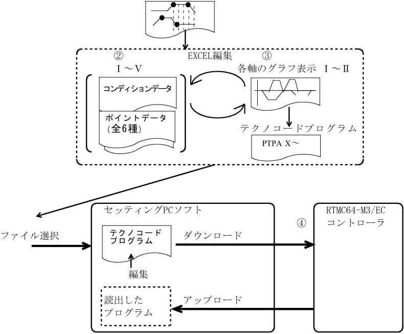

> **図の内容**
>
> 1. カム曲線（動作タイミングチャート）の図から、
> 2. 「EXCEL編集」: ②「Ⅰ～Ⅴ」の「コンディションデータ」と「ポイントデータ(全6種)」を作り、③「各軸のグラフ表示 Ⅰ～Ⅱ」で確かめ（②と③を行き来する）、「テクノコードプログラム」（PTPA X～）を作る
> 3. 「セッティングPCソフト」: 「ファイル選択」で読んだテクノコードプログラムを「編集」し、④「RTMC64-M3/EC コントローラ」へ「ダウンロード」する。コントローラから「アップロード」したものは「読出したプログラム」になる

詳細は「PLMC40フレキシブル電子カム制御(TB04-1238)」を参照下さい。

#### 5-15-10．巻線指令

<オプション>

- ◆1.2

(1).動作

フライヤー式、ボビン式等の巻線機を容易に制御できる巻線指令機能です。

主軸が指定された速度で回転し、トラバース軸は主軸指令に同期して往復動作します。

- 巻き線機の軸構成は以下の通りです。
- 巻線動作にはオーバーライド指定が反映されます。
- 主軸速度には、サーボパラメータの「PTP時定数」による加減速がかかります。
- トラバース移動は主軸指令に同期しますので主軸と同様の加減速がかかります。
- ※ トラバース軸独自の加減速はかかりません。

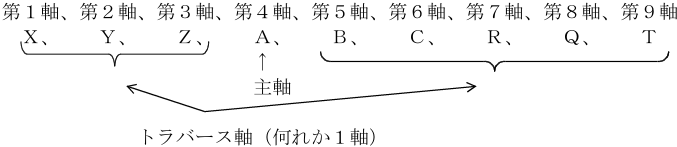

> **図の内容**
>
> 第1軸～第9軸の名前: X、Y、Z、A、B、C、R、Q、T。
> - A（第4軸）が「主軸」
> - X、Y、Z と B、C、R、Q、T のうち「トラバース軸（何れか1軸）」

（トラバース軸の加減速パラメータの「PTP時定数」「補間加減速時定数」は使用しません。）

- 全体の巻回数、1巻当たりのトラバース軸の移動量(ピッチ幅)、巻き取り主軸の回転速度、コイル巻き終わり時のトラバースの位置を指定することができます。

(2).巻線指令書式

【テクノコード】

REEL {X＿ Y＿ Z＿ B＿ C＿ R＿ Q＿ T＿} P＿ RN＿ S＿ [RE＿] ;

- ＿･･･数値指定(即値/マクロ変数)を示します。
- {X＿ Y＿ Z＿ B＿ C＿ R＿ Q＿ T＿}:トラバース移動量の指定[pulse]

任意の1軸をトラバース軸とし、往復幅を指定します。(いずれか1軸のみ指定)

A軸は主軸として使用するため、トラバース軸には使用できません。

トラバース幅が+の場合、最初に+方向に移動して、往復運動を行います。

-の場合、最初に-方向に移動して、往復運動を行います。

0の場合、トラバース軸は往復運動をせずに巻き取りのみ実行（主軸のみ回転）します。

【注】

通常の軸指定と同様に小数点を付けてプログラムを作ることも可能です。

（小数点あり：ｍｍ単位、小数点なし：パルス単位）

ただし、この場合は、後述するピッチ指定の単位と単位が異なる事になりますので、ご注意下さい。

- 例）少数点位置が3桁の時、以下はトラバース幅1000パルス、ピッチ10.0パルスです。
- X1000 P10
- X1000 P10.0
- X1.0 P10
- X1.0 P10.0

・P:ピッチ幅[pulse/rev]

主軸一回転当たりのトラバース軸の移動量をパルス単位で指定します。

最小で小数点以下0.01パルス単位で指定することができます。

（マクロ変数指定の場合は、0.01パルス単位になります。マクロ変数が100の場合は、1.00パルスが指定されたものとして動作します。）

しかし実際には、モータに対して1パルス未満の指令を行うことはできません。

そこで、1パルス未満部分を積算して1パルスになったところで指令することにより、小数点

以下の指定に対処します。

尚、巻線終了時に1パルス未満の端数が残っていた場合、端数は出力されません。

例) P100.25

```c
    // 1回転目：100 pulse 移動（端数0.25pulse）
    // 2回転目：100 pulse 移動（端数0.50pulse）
    // 3回転目：100 pulse 移動（端数0.75pulse）
    // 4回転目：101 pulse 移動（端数無し）
```

【注】

ピッチ指定の単位はパルスです。

（ピッチ指定の小数点は整数部がパルス単位で、小数部はパルス単位での端数になります。）トラバース指定の小数点とピッチ幅の小数点とは単位が異なりますので、ご注意下さい。詳細は、上述のトラバース幅指定の注記を参照下さい。

- RN:総巻数[主軸回転数]

主軸の回転回数を指定します。最小で小数点以下0.01回転で指定することができます。

（マクロ変数指定の場合は、0.01回転単位になります。マクロ変数が100の場合は、1.00回転が指定されたものとして動作します。）

総巻数指定が+の場合は正回転で巻き取り、-指定の場合は逆回転で巻き取ります。

0の場合、REEL命令は無効(何も実行せずステップ終了)になります。

- S:巻き取り速度(主軸速度)[rpm]

主軸の回転速度を指定します。

主軸速度には、サーボパラメータの「PTP時定数」による加減速がかかります。

- RE:巻き取り終了方向指定 [ 単位なし、0/1/2 ]（省略時は0）

巻き終わりのトラバースの位置の指定です。

設定内容は以下の通りです。

0：自然終了（デフォルト）

1：トラバース始端で終了

2：トラバース終端で終了

- (3).巻き終わり処理指定(RE指定)の詳細
- 巻き終わり時のピッチ調整

トラバース位置が巻き終わり指定側に到達したときに残巻数を確認して、残巻数に応じてトラバースのピッチを調整します。

- ① 1往復分の巻数 ≦ 残巻数

ピッチ調整をせずに命令で指定されたピッチのまま継続します。

（巻き終わり指定側に戻って来た際に再度ピッチ調整の判別を行います。）

- ② (片道分の巻数＋トラバース軸移動無し巻数÷2) ＜残巻数＜１往復分の巻数片道(巻き終わり指定の反対側)へはピッチ調整をせずに命令で指定されたピッチのまま移動して、反対側から巻き終わり指定側に戻るときにピッチ調整を行います。ピッチを命令で指定されたピッチより大きくすることにより巻き終わり時に巻き終わり指定側に到達

するようにします。

- ③トラバース軸移動無し巻数＜残巻数 ≦ (片道分の巻数＋トラバース軸移動無し巻数÷2) １往復分のピッチ調整を行います。

ピッチを命令で指定されたピッチより大きくすることにより巻き終わり時に巻き終わり指定側に到達するようにします。

- ④ 残巻数 ≦ トラバース軸移動無し巻数

トラバース移動を行わずに主軸のみ回転します。

本条件が成立した場合は、「最終層巻数異常警告」が発生します。詳細は後述する「トラバース軸移動無し巻数指定」を参照下さい。

巻き終わり指定の動作

- トラバース位置

仮にRE0で実行した場合に始端への移動中に巻線終了する設定 (トラバース軸移動無し巻数=0)

主軸角度(巻線開始位置が０°)

仮にRE0で実行した場合に終端への移動中に巻線終了する設定 (トラバース軸移動無し巻数=0)トラバース位置

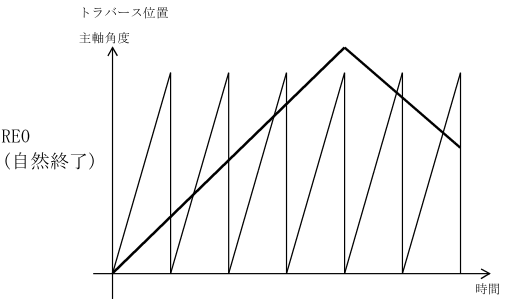

> **図の内容**
>
> 縦軸「トラバース位置」「主軸角度」、横軸「時間」。
> 主軸角度はのこぎり波（1 回転ごとに 0 に戻る）、トラバース位置は三角形に往復する。「RE0（自然終了）」では、トラバースが戻る途中で終了している。

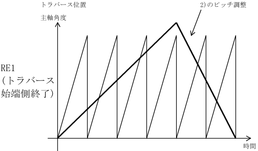

> **図の内容**
>
> 縦軸「トラバース位置」「主軸角度」、横軸「時間」。
> 「RE1（トラバース始端側終了）」では、トラバースが始端（0）に戻ったところで終了する。戻りの部分に「2)のピッチ調整」の矢印がある。

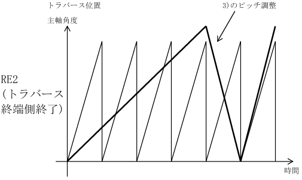

> **図の内容**
>
> 縦軸「トラバース位置」「主軸角度」、横軸「時間」。
> 「RE2（トラバース終端側終了）」では、始端に戻ったあと、もう一度終端まで進んで終了する。最後の往路に「3)のピッチ調整」の矢印がある。

度

時間トラバース位置

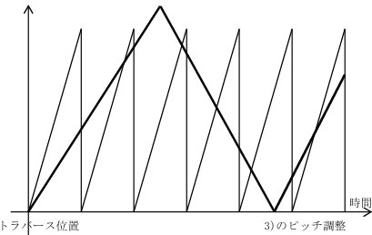

> **図の内容**
>
> 横軸「時間」、縦軸「トラバース位置」。主軸角度ののこぎり波と、トラバース位置の往復。最後の往路が「3)のピッチ調整」で、傾きが変わっている。

度

時間トラバース位置

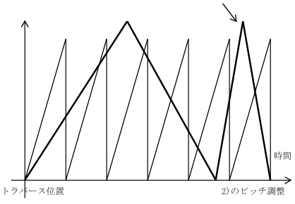

> **図の内容**
>
> 横軸「時間」、縦軸「トラバース位置」。トラバースが戻る部分が「2)のピッチ調整」で、傾きが急になっている（矢印）。

主軸角度

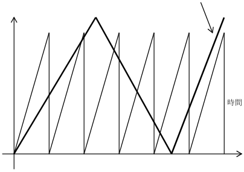

> **図の内容**
>
> 横軸「時間」。主軸角度ののこぎり波と、トラバース位置の往復。最後の往路の傾きが変わっている箇所を矢印が指している。

主軸角

主軸角

**○ トラバース軸移動無し巻数指定**

- 「ROMSW設定ソフト」の「基本」にて、「トラバース軸移動無し巻数」を設定する事ができます。 0～100の範囲で設定します。

設定や画面操作については、

「ROMSW設定ソフトマニュアル」<6-1.基本パラメータ>(TB00-1042) を参照して下さい。

- 巻き終わり指定側で残巻数が「トラバース軸移動無し巻数」以下だった場合は、ピッチ調整を行わずに、トラバース移動を停止します。（トラバース移動を行わずに主軸のみ回転します） ※ 前述の「巻き終わり時のピッチ調整」の ④ の動作です。
- この動作が発生した場合は、「最終層巻数異常警告」になります。 ※ エラーではありません。本警告が発生してもプログラム実行を継続します。

最終層巻数異常警告はリセットで解除する事ができます。又、プログラム実行開始時に自動的にクリアされます。

最終層巻数異常警告は通信コマンドの、ステータスデータやプログラム実行情報データにて読み出す事ができます。

詳細は、

「送受信データマニュアル」(TB00-1044) の <4-1-6.ステータスデータ読出 [DAT_STATUS(0x02)]> を参照下さい。

尚、本警告が発生するとセッティングＰＣでは「巻線最終層異常」と表示されます。

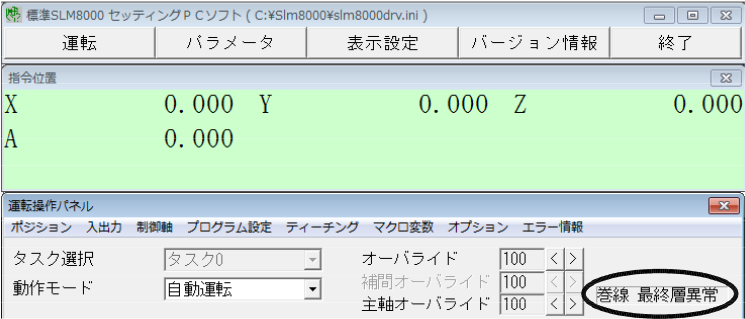

> **図の内容**
>
> セッティング PC ソフト（標準SLM8000）の運転操作パネル。タスク選択「タスク0」、動作モード「自動運転」、オーバライド 100、補間オーバライド 100、主軸オーバライド 100。
> 右側の表示「巻線 最終層異常」が丸で囲まれている。

- 巻き終わり指定時は、巻き終わり時にピッチ調整を行いトラバース軸が巻き終わり指定側で終了するようにします。このピッチ調整を行う際に「往復で調整」を行うか、「片道のみ調整」を行うかの判別にも「トラバース軸移動無し巻数」を使用します。

※ 前述の「巻き終わり時のピッチ調整」の ③ の動作です。

（ ② の動作か ③ の動作かの閾値に使用します。）

残巻数が片道分しかない場合だけでなく、片道分より少しだけ多い (トラバース軸移動無し巻数÷２以下)時にも往復でピッチ調整を行うようにします。

片道ではなく往復でピッチ調整を行うことで、トラバース軸の速度が速くなりすぎる事を防ぎます。

ピッチ調整後のトラバース軸の最大速度は以下の通りです。

最大速度[pps] ＝トラバース幅×2×主軸速度[RPM] ÷（トラバース軸移動無し巻数×60）

(4).注意点

- REEL命令を使用する際は、第4軸(A軸)が無限回転軸である必要があります。必ず「メカ機構1回転パルス数」を設定してください。（「ROMSW設定ソフト」の「軸設定」にて設定）
- 巻き線命令実行開始時に以下の条件が成立した場合は、正常に動作できません。この場合は「プログラム実行エラー」になり、プログラム実行をエラー中断します。

[条件]

- 主軸（第4軸）の「メカ機構1回転パルス数」が 0（無限回転軸でない）
- 主軸移動量異常（2147483647 ＜ PPR × RN）
- 主軸速度異常（最大速度＜ PPR × S ÷ 60）
- トラバース速度異常（最大速度＜ P × S ÷ 60）
- トラバース移動量異常（2147483647 ＜ P × RN）
- 片道移動時間異常（４制御周期＞ X ÷ (P × S ÷ 60 ÷ 1000) ）
- 巻き終わり指定が「トラバース終端で終了(RE2)」で、総巻数指定が「トラバース軸移動無し巻数」
- (ROMSW)の半分以下の場合、総巻数分巻き終わるまでにトラバース軸をトラバース終端まで移動します。（本来ならトラバース終端側からの１往復でピッチ調整する必要がありますが、巻数が足りないので

PPR ：主軸の「メカ機構1回転パルス数」（ROMSW設定）

S ：主軸速度[rpm] （巻線命令のS指定）

RN ：総巻数（巻線命令のRN指定）

P ：ピッチ（巻線命令のP指定）

X ：トラバース移動量（巻線命令の軸指定）

最大速度：2 Gpps

片道分だけで調整します。）

この場合は「トラバース軸移動無し巻数」による最大速度以上の速度になる可能性があります。ピッチ調整時のトラバース軸最大速度については、「(3).巻き終わり処理指定(RE指定)の詳細」を参照下さい。

#### 5-15-11．トルク指令

<オプション>

◆1.3

プレス、成型、ねじ締め、ドアの締め切りなど位置の制御でなく推力(トルク)制御が必要になることが有ります。

本機能によりトルク指令による制御が可能です。

本機能ではサーボアンプの推力(トルク)制御機能を用いるため、サーボアンプが機能に対応している必要があります。

また、ROMSW設定やサーボアンプパラメータやENIファイル等に事前に設定が必要です。

(1). 対応サーボアンプ要件

**○RTMC64-M3：MECHATROLINK-Ⅲ対応サーボの場合[M3]**

MECHATROLINK-Ⅲ標準サーボプロファイル用コマンドの

「トルク(推力)制御:TRQCTRL」

に対応していること。

※"TRQCTRL"はMECHATROLINK-Ⅲの通信仕様として任意コマンド(対応が必須ではないコマンド) です。MECHATROLINK-Ⅲ準拠の製品でも対応しているかどうか確認をしてください。 (安川電機社製Σ-VやΣ-7は対応しています。)

**○RTMC64-EC：EtherCAT対応サーボの場合[EC]**

CiA402サーボプロファイルの制御モード

「サイクリック同期トルク制御(cst)モード」に対応していること。

※"cst"モードはCiA402サーボプロファイルの規約として必須対応ではないため、対応しているかどうかを確認してください。

(2). 事前設定

**○RTMC64-M3：MECHATROLINK-Ⅲ対応サーボの場合[M3]**

- 推力(トルク)制御中に軸が空転すると、際限無く速度が速くなってしまいます。これを防ぐために、速度制限機能を用います。
- 【例】Σアンプの場合はユーザ定数Pn002の1桁目を"1"に設定する。

**○RTMC64-EC：EtherCAT対応サーボの場合[EC]**

- "cst"モードでトルク値を指令・モニタするために、ENIファイル作成時に以下のオブジェクトをマッピングする必要があります。

【RxPDO】

- Modes Of Operation (6060h,00h)
- Target Torque (6071h,00h)

【TxPDO】

- Modes Of Operation Display (6061h,00h)
- Torque Actual Value (6077h,00h)
- 推力(トルク)制御中に軸が空転すると、際限無く速度が速くなってしまいます。
- これを防ぐために、速度制限機能を用います。

トルク制御中の速度制限をするためのオブジェクトは製品によって異なるため、

ROMSW設定「トルク制御用速度制限オブジェクト」にIndex,Sub-index,単位を設定してください。 PDOへのマッピングが可能であれば、極力マッピングするようにしてください。以下、テクノにて評価実績のある主要な製品の設定を記載します。

| メーカー      | 製品          | オブジェクト                     | 単位   | PDO可   |
|-----------|-------------|----------------------------|------|--------|
| Panasonic | A5B,A6Bシリーズ | Max Motor Speed(6080h,00h) | rpm  | ○      |
| 安川電機      | Σ-7シリーズ     | トルク制御時の速度制限(2407h,00h)     | rpm  | ×      |
| OMRON     | R88D-1Sシリーズ | 最大プロファイル速度(607Fh,00h)      | pps  | ○      |
| 山洋電気      | RS2シリーズ     | 速度到達(2022h,00h) ※          | rpm  | ×      |
| 日機電装      | VPHシリーズ     | 最大プロファイル速度(607Fh,00h)      | pps  | ○      |

※速度到達は設定した速度に到達するとトルクを0とするため、一定の速度では動作しません。

(3). 指令単位

**○RTMC64-M3：MECHATROLINK-Ⅲ対応サーボの場合[M3]**

RTMC64-M3がMECHATROLINK-Ⅲ通信開始時にサーボアンプ側の単位設定を変更します。 RTMC64で指令する際の単位は以下に固定です。

- トルク値：定格トルクに対する[%]
- 速度制限値：[pls/sec]

**○RTMC64-EC：EtherCAT対応サーボの場合[EC]**

サーボの仕様によります。

- トルク値：サーボのトルク指令オブジェクト「TARGET_TORQUE(6071h,00h)」の仕様を確認

※通常、多くのサーボが0.1[%]単位です。

- 速度制限値：「(2).事前設定」で設定した製品毎の速度制限オブジェクトの仕様を確認

(4). 運転プログラム例

- ○トルク指令開始命令

TRQ (X＿ Y＿ Z＿ ... T＿ ) {FX＿ FY＿ FZ＿ ... FT＿};

- 軸指定 : X＿ Y＿ Z＿ ... T＿

軸毎のトルク指令を指定します。

マクロ変数指定が可能です。

(指定した軸のみ変更します。指定していない軸は変更しません。1行最大4軸までです。) 設定範囲は、-モータ最大トルク～ +モータ最大トルク(ROMSW設定ソフトで設定)です。

符号により回転方向が変わります。

範囲外の値を設定するとプログラム実行エラーになります。

- 速度制限指定 : FX_ FY_ FZ_ ... FT_ 軸毎の速度制限を指定します。マクロ変数指定が可能です。

設定範囲は、1 ～モータ最大速度(ROMSW設定ソフトで設定)です。

範囲外の値を設定するとプログラム実行エラーになります。

軸指定と速度制限は同じ軸に対して行って下さい。異なる軸に対して行った場合は、フォーマットエラーになります。

- ○トルク指令終了命令

TRQD (X＿ Y＿ Z＿ ... T＿ );

トルク指令を終了して、位置指令に戻す軸を指定します。数値指定は不要です。

(指定した軸のみ変更します。指定していない軸は変更しません。)

トルク指令終了命令の他に、エラー発生時、プログラムの終了やリセット時、電源OFF→ONにより位置制御モードに戻ります。

(5). 動作の詳細

**○RTMC64-M3：MECHATROLINK-Ⅲ対応サーボの場合[M3]**

- ①トルク指令開始命令実行時に、指定された軸にトルク制御コマンド(TRQCTRL)コマンドを発行します。

サーボアンプはトルク制御モードになり、指令したトルクを出力します。

再度トルク指令開始命令を実行すると、トルク制御モードのまま新しい指令トルクを出力します。

（新しい指令が発行されるまでは、前回指令トルクを出力し続けます。）

- ②トルク指令終了命令実行時に、位置決めコマンド(POSING)を発行し、即時中断することで、位置制御として減速停止をします。トルク終了命令実行後はそのまま位置制御モードです。トルク制御を一時停止する場合や、エラー等で中断する場合も同様に位置制御モードで停止します。

**○RTMC64-EC：EtherCAT対応サーボの場合[EC]**

- ①トルク指令開始命令実行時
- 速度制限値をバックアップ
- トルク制御終了後に元の値に戻せるようにバックアップします。 ※速度制限値は別の制御モードで使用される場合があります。
- 速度制限オブジェクトを指令値に設定
- 制御モードを位置制御モード(csp)→トルク制御モード(cst)に変更と、
- 指令トルクの指定を同時に実行することでトルク制御を開始再度、トルク指令開始命令を実行すると、指令トルクや速度制限等指令値だけを変更します。

（新しい指令が発行されるまでは、前回指令値を出力し続けます。）

- ②トルク指令終了命令実行時
- 速度制限値と、トルク指令値に0を指定することで軸停止を指令
- 実位置を監視して軸が静定するのを待機
- 制御モードをトルク制御モード(cst)→位置制御モード(csp)に変更
- 速度制限値をトルク指令開始前の値に戻す

トルク制御を一時停止する場合や、エラー等で中断する場合も同様の手順で停止します。

通信コマンドの詳細は、「RTMC64-M3/EC 送受信データ説明書」<4-2-63.トルク指令コマンド> (TB00-1044)を参照下さい。

※ トルク指令中の軸はサーボがトルクモードになっていますので、位置指令の実行できません。

### 5-16．主軸機能

<オプション>

◆1.3

主軸機能は、指令された一定速度でサーボモータやインダクションモータを回転してワーク軸やツール軸として使用する機能です。

オプション「主軸 ON/OFF(信号出力)」や「主軸サーボ」を購入した場合、ROMSW設定「基本」の「主軸機能選択」で"無し"、"ON/OFF(信号出力)"、"サーボ"を選択できます。

#### 5-16-1．ON/OFF(信号出力)主軸

ON/OFF(信号出力)制御主軸を使用する場合のGコード指令時、通信指令時のSON信号は下記になります。

| 方式 | 内容・特徴 | ハード | 指令方式 - Gコード | 指令方式 - Tコード |
|---|---|---|---|---|
| 2ビット出力信号制御方式（主軸 ON/OFF） | I/O 信号のみ、アナログI/F不要 | 汎用出力 SON1、SON2 | S0 停止、S1 速度 1、S2 速度 2、S3 速度 3 | （斜線: 該当なし） |

・Gコードプログラム

Gコード運転プログラムの主軸回転速度指令として、Sコードが有効となります。

書式は、Sに続けて0～3のコードを指定します。【例】S1;

S指令は、システムモーダルです。（一端指令すると記憶しています）

実際の主軸動作は、M03(正転)/M04(逆転)/M05(停止)の各命令により実行されます。

尚、主軸回転の開始(または停止)指令時は、指令回転数への到達(または停止)を待たずに、次のステップが実行されるので、必要に応じてドウェル命令等を使用して下さい。

・通信コマンド

通信コマンドREQ_SPREVSETの発行または、運転プログラムのM03/M04とS0～S3により専用信号(2ビット)の出力制御を行います。

M03(04)出力後に、S1→S2→S3などと指令することで主軸の速度を変えられます。

通信コマンドREQ_SPCMND(パラメータ=0)の発行時または、運転プログラムのM05指令時は、S0相当の出力となります。ただし、S1～S3の選択はシステムモーダルとして記憶されていますので、再度REQ_SPCMND (パラメータ=1または2)を指令すると記憶していたS□に対応する出力を行います。

| Gコードプログラム - Mコード | Gコードプログラム - Sコード | 通信コマンド - REQ_SPCMND | 通信コマンド - REQ_SPREVSET | SON2 | SON1 | 主軸動作指定 |
|---|---|---|---|---|---|---|
| M05 | S0 | パラメータ=0 | パラメータ=0 | OFF | OFF | 停止 |
| M03/M04 | S1 | パラメータ= 1:正転 2:逆転 | パラメータ=1 | OFF | ON | 速度1 |
| M03:正転 | S2 | パラメータ= 1:正転 2:逆転 | パラメータ=2 | ON | OFF | 速度2 |
| M04:逆転 | S3 | パラメータ= 1:正転 2:逆転 | パラメータ=3 | ON | ON | 速度3 |

#### 5-16-2．サーボ主軸

本機能ではサーボアンプの速度制御機能を用いるため、サーボアンプが機能に対応している必要があります。

(1). 対応サーボアンプ要件

**○RTMC64-M3：MECHATROLINK-Ⅲ対応サーボの場合[M3]**

MECHATROLINK-Ⅲ標準サーボプロファイル用コマンドの「速度制御:VELCTRL」

に対応していること。

※"VELCTRL"はMECHATROLINK-Ⅲの通信仕様として任意コマンド(対応が必須ではないコマンド) です。MECHATROLINK-Ⅲ準拠の製品でも対応しているかどうか確認をしてください。 (安川電機社製Σ-VやΣ-7は対応しています。)

**○RTMC64-EC：EtherCAT対応サーボの場合[EC]**

CiA402サーボプロファイルの制御モード

「サイクリック同期速度制御(csv)モード」

に対応していること。

※"csv"モードはCiA402サーボプロファイルの規約として必須対応ではないため、対応しているかどうかを確認してください。

(2). 事前設定

- ○RTMC64-M3：MECHATROLINK-Ⅲ対応サーボの場合[M3] 特になし。

**○RTMC64-EC：EtherCAT対応サーボの場合[EC]**

- "csv"モードでトルク値を指令・モニタするために、ENIファイル作成時に以下のオブジェクトをマッピングする必要があります。

【RxPDO】

| ・Modes Of Operation ・Target Velocity 【TxPDO】・Modes Of Operation   | (6060h,00h) (60FFh,00h) (6061h,00h)   |
|--------------------------------------------------------------------|---------------------------------------|

(3).サーボ主軸の指令

◆1.2

| 回転   | テクノコード             | Gコード - M命令   | Gコード - S命令   |   通信 - REQ_SPCMND | 通信 - REQ_SPREVSET   |
|------|--------------------|--------------|--------------|-------------------|---------------------|
| 正転   | SPIN S*** [0.1rpm] | M03          | 速度 [rpm]     |                 1 | 速度 [rpm]            |
| 逆転   | SPIN S-***         | M04          |              |                 2 |                     |
| 停止   | SPIN S0            | M05          |              |                 0 |                     |
| 指令範囲 | ±回転速度範囲*10         |              | ±回転速度範囲      |                   | ±回転速度範囲             |

【注】

- テクノコードの速度指令値は×0.1rpm単位、Gコードの速度指令、通信の速度指令はrpm単位です。・Gコード、通信指令の場合速度指定を"-"にすると回転方向が逆転します。
- 主軸停止指令の後次移動命令を実行するのに減速停止待ちのドウェルが必要なサーボもあります。
- S指令は、システムモーダルです。（一端指令すると記憶しています）

通信コマンドの詳細は、「RTMC64-M3/EC 送受信データ説明書」

<4-2-29.主軸回転ON/OFFコマンド>、<4-2-30.主軸回転数設定コマンド>(TB00-1044)を参照下さい。

### 5-17．補正機能

#### 5-17-1．バックラッシュ補正機能

機械系に、いわゆる「ガタ」(不感帯)がある場合には、サーボパラメータの「バックラッシュ補正量」に「ガタ」に相等するパルス量を設定して下さい。

【バックラッシュ補正の概念図】

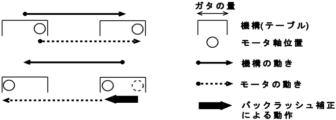

> **図の内容**
>
> 上段: 機構（テーブル）が右へ動くとき、モータも同じだけ動く。
> 下段: 左へ向きを変えるとき、モータは「ガタの量」だけ先に動き（「バックラッシュ補正による動作」の太い矢印）、その後で機構が動く。
> 凡例: ガタの量、機構(テーブル)、モータ軸位置、機構の動き（実線の矢印）、モータの動き（点線の矢印）、バックラッシュ補正による動作（太い矢印）。

バックラッシュ補正は、軸の移動方向が変わるたびに、その方向へ加わります。

<最初のバックラッシュ補正> ◆1.3

- ○インクレエンコーダの場合

原点復帰の完了後に、「原点復帰中の最後に原点に向かって動いた方向と逆の方向」に動いた時に、バックラッシュ補正がかかります。

原点復帰未完もしくは原点復帰無効の軸は、補正無効です。

- ○絶対値エンコーダの場合

サーボとのサイクリック通信確率後、１方向にバックラッシュ補正量以上動いた後、反対方向に動く時にバックラッシュ補正がかかります。

#### 5-17-2．工具長補正機能

<オプション>

指令コード

G43 H□□;/ THSET□□; 補正テーブル番号

工具長補正を実行します。

すでに補正がかかった状態で、新たな補正番号が指令された場合、現在の補正量と新たな補正量の差分で補正がかかり、常に最後に指令された補正番号の補正がかかった状態になります。

指令コード

G49;/ THOFF;

工具長補正をキャンセルします。

補正テーブル

| T No.   | 工具長補正量                   |
|---------|--------------------------|
| 0       | -1000000000 ～ 1000000000 |
| ・       | ・                        |
| ・       | ・                        |
| ・       | ・                        |
| 19      | -1000000000 ～ 1000000000 |

■工具長補正

指定された補正テーブル番号の工具長補正量を現在の論理座標値に加算します。軸の移動は行いません。

- 工具長補正量はシステムモーダルです。
- 工具補正が指定された状態で、原点復帰動作を行うと、動作完了時に論理座標値が再セットアップされます。
- 本補正を実行した後の最初の移動命令は必ずアブソ指令にして下さい。
- 工具長補正有効軸の選択は、ROMSW設定ソフトの「軸設定」画面で有効軸を選択します。

※複数の軸を有効にしないでください。全ての軸に同じ補正パラメータが反映されてしまいます。

工具長補正の運転プログラム例

- この例では、Z軸に対しROMSW設定ソフトの"工具長補正"を有効にしています。

- ① G90 G00 X0 Z0;
- ② G91 G01 X1000 Z1000 F1000;
- ③ G43 H0;
- ④ G90 G00 X2000 Z1000;
- ⑤ G43 H1;
- ⑥ G90 G00 X3000 Z1000;
- ⑦ G49 ;

例1

|   HNO. |   工具長補正 |
|--------|---------|
|      0 |    2000 |
|      1 |   -1000 |

| 動作 - ステップ   |   論理座標 - X |   論理座標 - Z |   アブソ座標(メカ) - X |   アブソ座標(メカ) - Z |
|-------------|------------|------------|-----------------|-----------------|
| ①           |          0 |          0 |               0 |               0 |
| ②           |       1000 |       1000 |            1000 |            1000 |
| ③           |       1000 |       3000 |            1000 |            1000 |
| ④           |       2000 |       1000 |            2000 |           -1000 |
| ⑤           |       2000 |      -2000 |            2000 |           -1000 |
| ⑥           |       3000 |       1000 |            3000 |            2000 |
| ⑦           |       3000 |       2000 |            3000 |            2000 |

例2

|   HNO. |   工具長補正 |
|--------|---------|
|      0 |       0 |
|      1 |       0 |

|    |   論理座標 - X |   論理座標 - Z |   アブソ座標(メカ) - X |   アブソ座標(メカ) - Z |
|----|------------|------------|-----------------|-----------------|
| ①  |          0 |          0 |               0 |               0 |
| ②  |       1000 |       1000 |            1000 |            1000 |
| ③  |       1000 |       1000 |            1000 |            1500 |
| ④  |       2000 |       1000 |            2000 |            1500 |
| ⑤  |       2000 |       1000 |            2000 |             500 |
| ⑥  |       3000 |       1000 |            3000 |             500 |
| ⑦  |       3000 |       1000 |            3000 |            1000 |

【注意】

工具長補正と同時に汎用入力制御を設定した場合でも、論理座標のセットアップには入力制御はききません。(座標のセットアップは即時行われます。)

座標のセットアップを行った後に汎用入力制御(Exit、スキップ、Wait、Stop)による処理を行います。

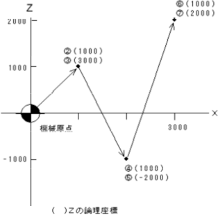

> **図の内容**
>
> 横軸 X（3000 まで）、縦軸 Z（-1000～2000）。機械原点から ①②③④⑤⑥⑦ の点を通る経路。
> 点の横に括弧付きの値がある（図の下の凡例「( )Zの論理座標」）: ②③「(1000)」「(3000)」、④⑤「(1000)」「(-2000)」、⑥⑦「(1000)」「(2000)」。

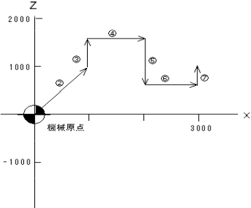

> **図の内容**
>
> 横軸 X（3000 まで）、縦軸 Z（-1000～2000）。機械原点から ②③ で上がり、④ で X 方向に進み、⑤ で下がり、⑥ で X 方向に進み、⑦ で上がる。

#### 5-17-3．工具径補正機能

<オプション>

◆1.2

##### 5-17-3-1.径補正指令コード

■ Gコード(G40、G41、G42)

【Gコード例】

G41 (G01) D＿ X＿ Y＿

;左側補正

～

G42 D＿ X＿ Y＿

;右側補正

～

G40

;径補正キャンセル

| G40   | 径補正キャンセル          |
|-------|-------------------|
| G41   | 径補正左側            |
| G42   | 径補正右側            |
| D     | 工具径補正テーブルNO.(2ケタ) |

- a). Dの値はプログラムモーダルです。 (省略可、プログラムモーダル※)
- b). Dの指定範囲は0～19です。
- c). 工具径補正テーブルの補正量(+値)は、あらかじめセットしておきます。
- d). 径補正は、ROMSW設定で選択されたX/Y平面にておこないます。(2次元)
- e). G40、G41、G42は、単独でも、またG00、G01と組み合わせても使用できます。
- f). 円弧指令ではアドレスDの値は第4軸中心指定です。径補正値の設定はできません。プログラムモーダルでの設定となります。
- ※ 前回のプログラム実行で指令したDの値は引き継ぎません。プログラム起動時は、デフォルト値(D00)になります。

■ テクノコード(DC、DL、DR)

【テクノコード例】

LIN X＿ Y＿ F＿ DL＿

;左側補正

～

LIN X＿ Y＿ F＿ DR＿

;右側補正

～

DC

;径補正キャンセル

| DC   | 径補正キャンセル                |
|------|-------------------------|
| DL   | 径補正左側+工具径補正テーブルNO.(2ケタ) |
| DR   | 径補正右側+工具径補正テーブルNO.(2ケタ) |

- a). DL/DRで工具径補正テーブルNO.を指定します。 (DL/DR指令時は必ず工具番号を指定して下さい。) 工具径補正テーブルNO.はプログラムモーダルです。
- b). DL/DRの指定範囲は0～19です。
- c). 工具径補正テーブルの補正量(+値)は、あらかじめセットしておきます。
- d). 径補正は、X/Y平面にておこないます。(2次元)
- e). DC、DL、DRは、単独でも、またPTP(A)、LIN(A)と組み合わせても使用できます。円弧指令との同時使用はできません。

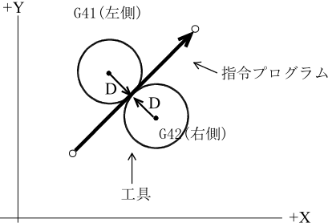

> **図の内容**
>
> 「指令プログラム」の直線に対し、進行方向の左側に工具（半径 D）が来るのが「G41(左側)」、右側に来るのが「G42(右側)」。座標は +X、+Y。

##### 5-17-3-2.使用上の条件

- a). 径補正を有効とする区間では、以下の指令は使えません。
- ① 移動指令や径補正D値に対するマクロ変数指定。
- ② マクロなどによる条件判断や分岐
- ③ JR指定
- ④ センサーラッチ（G31）
- ⑤ X/Y軸の論理座標設定指令（G92､CSET）
- ⑥ X/Y軸の回転軸回転指令（G120､SPIN）
- ⑦ X/Yのどちらかとその他の軸の円弧指令。
- ⑧ X/Yのどちらかがヘリカル円弧のヘリカル軸。 ※ X/Y軸が指定されていない円弧指令/ヘリカル円弧指令、及び X/Y軸両方が円弧軸に指定されて
- いる円弧指令/ヘリカル円弧指令は実行出来ます。
- b). 径補正を有効とする区間では、ティーチングは行えません。
- c). 指令位置、及び機械位置は、径補正後の座標値となります。
- d). 径補正モード(右/左/無効)の変更後、または工具径変更後の最初のX/Y軸移動は必ず、PTP位置決め指令、または直線補間指令で行って下さい。

（X/Y軸以外の軸の円弧補間指令は可能です。）

- e). 径補正を行うには、ROMSW設定により前もって径補正の対象軸を設定して下さい。（タスク毎に設定が必要です。）

対象軸を設定していないタスクで径補正開始(右側/左側)指令を実行すると、プログラム実行エラーになります。

※ 現状では径補正対象軸はX/Y軸固定です。

（ROMSW設定では、必ず「横軸＝論理軸第1軸(X軸)/縦軸＝論理軸第2軸(Y軸)」に設定して下さい。）

##### 5-17-3-3.径補正モードへの入り方

「DL」又は「DR」／「G41(42) G00」又は「G41(42) G01」の指令で径補正モードに入ります。径補正モード指令の前のステップはインポジション待ちを行います。径補正モード後、最初の移動（スタートアップステップ）時に径補正が加味された位置へ移動します。（スタートアップステップの目標位置が径補正が加味された位置に変わります。）スタートアップステップの目標位置は、スタートアップステップを法線方向に径補正分シフトした移動と、次の移動ステップを法線方向に径補正分シフトした移動の交点です。

（スタートアップステップを径補正中のステップと考えた場合の目標位置へ移動します。）

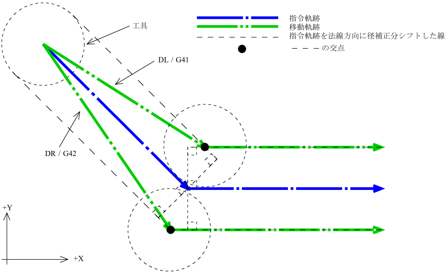

> **図の内容**
>
> 凡例: 青の一点鎖線「指令軌跡」、緑の一点鎖線「移動軌跡」、破線「指令軌跡を法線方向に径補正分シフトした線」、黒点「－－－の交点」。
> 指令軌跡は左上から右下へ進み、そこから +X 方向へ曲がる。「DL / G41」では移動軌跡が上側の交点を、「DR / G42」では下側の交点を通る。各交点に「工具」の円（破線）がある。

【注意点】

- 円弧命令では、径補正に入れません。（プログラム実行エラーになります。） ※ 径補正中の円弧命令は問題ありません。
- スタートアップステップの目標位置が上記説明の動作のため、スタートアップステップとその次の移動ステップの角度が180°未満の場合は、工具端面の軌跡が次の移動ステップの指令軌跡の最初の方を通らない（削り残し）場合があります。同様に、角度が180°より大きい場合は、工具端面の軌跡が次の移動ステップの指令軌跡の最初の方に重なる（削りすぎ）場合があります。これを防ぐには２通りの方法があります。
- ① スタートアップステップとその次の移動ステップの角度が180°になるようにして下さい。
- ② スタートアップステップの次の移動ステップを実際の加工より手前から始まるようにして下さい。

##### 5-17-3-4.径補正の終了

G40指令と同時又は直後のＸ／Ｙ指令(G00／G01)にて径補正を終了します。円弧命令では、径補正の終了は行えません。(エラーになります。)

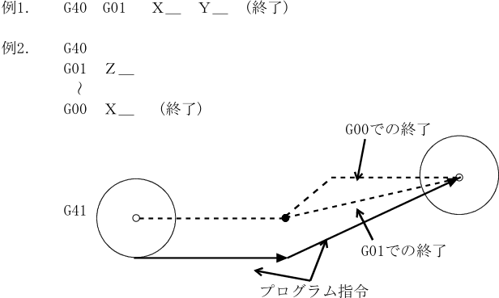

> **図の内容**
>
> - 例1. G40 G01 X＿ Y＿（終了）
> - 例2. G40 / G01 Z＿ / ～ / G00 X＿（終了）
>
> 図: G41 で補正していた工具の円が、「プログラム指令」の点へ向かう。「G01での終了」は直線で、「G00での終了」は各軸独立の折れ線（破線）で終点に着く。

「G40」指令の前のステップはインポジション待ちを行います。

(1).終了直前の補間指令の完了点

終了直前の移動の完了点は、単純に径補正量分を平行移動した点（Ａ）になります。以下の場合、いずれも図のような軌跡となります。

- （G41） G01 X□□□ Y□□□ ① 終了点Ａ
- G40 G01 X□□□ Y□□□ ②
- （G41） G01 X□□□ Y□□□ ① 終了点Ａ

G40

G01 X□□□ Y□□□ ②

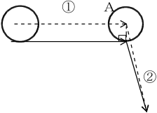

> **図の内容**
>
> 工具の円が ① で A 点まで右へ進み、② で斜め下へ向きを変える。破線は指令の経路。

点線：実際の軌跡

実線：指令の軌跡

上記を考慮して、径補正キャンセル時のツール軌跡を指令してください。特に、ワークに近づく軌跡で終了する場合は注意が必要です。

##### 5-17-3-5.補正モード中にX/Y移動のないステップ

補正モード(G41/G42)中にX/Y移動でない指令があった場合は、ステップを先読みして径補正軌跡を作成します。最大10ステップの先読みが可能です。

X/Y移動でない指令が連続して10ステップ以上あった場合は、「プログラム実行エラー」になります。

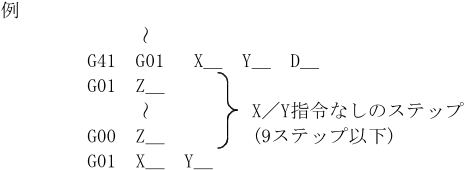

> **図の内容**
>
> 例:
> ```
> ～
> G41 G01 X＿ Y＿ D＿
> G01 Z＿
> ～
> G00 Z＿
> G01 X＿ Y＿
> ```
> G01 Z＿ から G00 Z＿ までが「X／Y指令なしのステップ(9ステップ以下)」。

サブプログラム呼び出しを行っている場合、先読みステップには、サブプログラムの呼び出しステップとサブプログラム内のステップが含まれます。

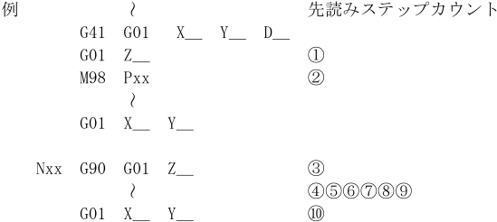

> **図の内容**
>
> 例（右は「先読みステップカウント」）:
> | プログラム | カウント |
> |---|---|
> | ～ | |
> | G41 G01 X＿ Y＿ D＿ | |
> | G01 Z＿ | ① |
> | M98 Pxx | ② |
> | ～ | |
> | G01 X＿ Y＿ | |
> | Nxx G90 G01 Z＿ | ③ |
> | ～ | ④⑤⑥⑦⑧⑨ |
> | G01 X＿ Y＿ | ⑩ |

##### 5-17-3-6.補正中の G00 の動作

G00指定のステップは、最終的なオフセット位置に向かって各軸独立に位置決めします。工具軌跡に注意を要します。

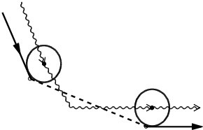

> **図の内容**
>
> 工具の円が、波線（実際の動き）でオフセット位置に向かう。G00 指定のステップは、最終的なオフセット位置に向かって各軸独立に動くので、経路は指令の直線（実線の矢印）からずれる。

波線:実際の軌跡

点線:G00指令

実線:G01指令

##### 5-17-3-7.工具径補正データ設定画面

セッティングPCの以下の画面で、工具径補正時に必要な補正パラメータの作成・設定を行います。

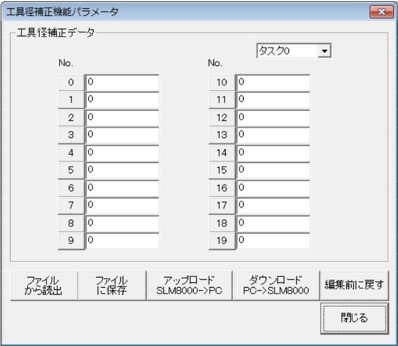

> **図の内容**
>
> ダイアログ「工具径補正機能パラメータ」。「工具径補正データ」のタスク選択（タスク0）と、No.0～19 の入力欄（すべて 0）。
> ボタン: 「ファイルから読出」「ファイルに保存」「アップロード SLM8000->PC」「ダウンロード PC->SLM8000」「編集前に戻す」「閉じる」。

- (1). ファイルから読出ボタン工具径補正データファイルを読み出します。
- (2). ファイルに保存ボタン

工具径補正データファイルに保存します。

- (3). アップロードボタン RTMC64に格納されている工具径補正データを読み出します。
- (4). ダウンロードボタン

工具径補正データをRTMC64に格納します。

- (5). 編集前に戻すボタン編集中に押すと編集前の状態にします。

No. 0～19に対応する工具の半径を指定します。単位はパルスです。

##### 5-17-3-8.マクロ変数

#3500～#3519：工具径補正データ（No.00 ～ 19）

工具径補正データをマクロ変数書き込みで値を変更した場合、一時的なワークメモリのみ変更し、同パラメータのバックアップメモリの数値は変更しません。

また、RTMC64は電源OFF → ON で、バックアップメモリから同パラメータを読み出します。

そのため、書き込んだ後も電源OFF → ONで元の値(パックアップメモリの値)に戻ります。

バックアップメモリのパラメータを変更するのは、セッティングPCソフト

<5-17-3-7.工具径補正データ設定画面>、またはユーザアプリケーションソフトから書き込む必要があります。

##### 5-17-3-9.角度一致閾値設定

ROMSW設定ソフト「基本」画面

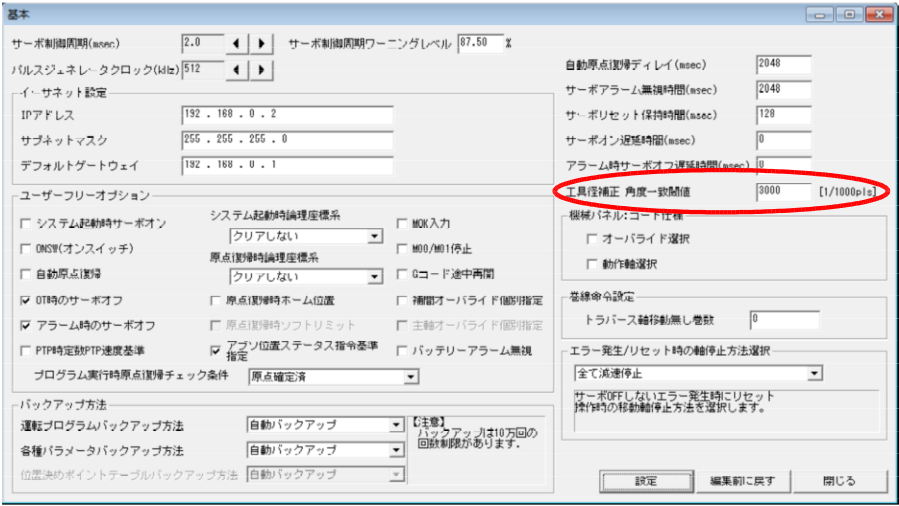

> **図の内容**
>
> ROMSW 設定ソフトの「基本」画面。「工具径補正 角度一致閾値 [3000] [1/1000pls]」が赤丸で囲まれている。
> 画面のほかの項目（表示されている値）:
> - サーボ制御周期(msec) 2.0、サーボ制御周期ワーニングレベル 87.50 %、パルスジェネレータクロック(kHz) 512
> - イーサネット設定: IPアドレス 192.168.0.2、サブネットマスク 255.255.255.0、デフォルトゲートウェイ 192.168.0.1
> - 自動原点復帰ディレイ(msec) 2048、サーボアラーム無視時間(msec) 2048、サーボリセット保持時間(msec) 128、サーボオン遅延時間(msec) 0、アラーム時サーボオフ遅延時間(msec) 0
> - ユーザーフリーオプション（チェックあり: OT時のサーボオフ、アラーム時のサーボオフ、アブソ位置ステータス指令基準指定）、システム起動時論理座標系「クリアしない」、原点復帰時論理座標系「クリアしない」、プログラム実行時原点復帰チェック条件「原点確定済」
> - 機械パネル:コード仕様（オーバライド選択、動作軸選択）、巻線命令設定（トラバース軸移動無し巻数 0）、エラー発生/リセット時の軸停止方法選択「全て減速停止」
> - バックアップ方法: 運転プログラム／各種パラメータとも「自動バックアップ」（【注意】バックアップは10万回の回数制限があります。）
> - ボタン: 設定、編集前に戻す、閉じる

- 工具径補正角度一致閾値[1/1000pls]

角度一致閾値を1/1000パルス単位で設定します。(1000で1パルスです。)

- ※ 工具径補正では、補正後の軌跡を求めるために、径補正後の交点を使用します。この際、演算誤差による誤判別を避けるため、角度一致の閾値を設定できるようにしています。

円弧指令を使用していると、交点が２つ出来てしまうため、使用する交点を判別する必要があります。デフォルト値(0:3000)で交点を誤判別するようでしたら調整してください。

円弧半径

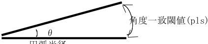

> **図の内容**
>
> 2 本の直線のなす角 θ と、「円弧半径」方向の開きが「角度一致閾値(pls)」であることを示す図。

円弧半径と角度一致閾値(pls)から角度θを求め、θを交点判別時の許容誤差にします。

- 尚、主な演算誤差の原因は以下の通りです。
- 動作プログラム作成時の離散誤差

(パルス単位で指令するための切り捨て／切り上げ)

- 浮動小数点演算による演算誤差

参考までに<5-17-3-13.注意事項>も参照して下さい。

##### 5-17-3-10.工具径補正情報画面

工具径補正の有効/無効状態と、現在選択中の工具径補正データ番号をモニタ出来ます。

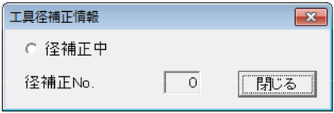

> **図の内容**
>
> ダイアログ「工具径補正情報」。「径補正中」のラジオ表示（OFF）、「径補正No. [0]」、「閉じる」ボタン。

径補正中

工具径補正実行中（DR□/DL□命令実行から、DC命令実行までの間）ONになります。

径補正No.

径補正実行中の工具番号を表示します。

（DC命令実行後も工具番号表示は残ります。プログラムスタート時に"0"になります。）

##### 5-17-3-11.工具径補正の詳細エラー情報

工具径補正の詳細エラー情報をモニタリングすることができます。

※工具径補正実行時、補正の軌跡の作成処理でエラーが発生すると、要因にかかわらず

「プログラム実行エラー」になります。この時、エラーの要因(詳細)を本画面で確認することができます。

(1).ＰＣ画面

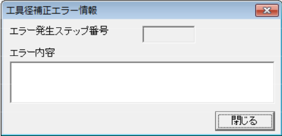

> **図の内容**
>
> ダイアログ「工具径補正エラー情報」。「エラー発生ステップ番号」の欄、「エラー内容」の欄、「閉じる」ボタン。

エラー発生ステップ番号

工具径補正実行時に発生したエラーのステップ番号を表示します。

エラー内容

発生したエラーの内容を表示します。

各エラー内容の種類は、<(2). エラーの種類>を参照して下さい。

(2).エラーの種類

エラー内容で表示されるエラーの種類と参照項目

| エラー内容             | 参照項目                                 |
|-------------------|--------------------------------------|
| 円弧指令での径補正モード変更エラー | <5-17-3-12.-(1).円弧指令での径補正モード変更エラー>   |
| 径補正中の禁止命令指定エラー    | <5-17-3-12.-(2).径補正中の禁止命令指定エラー>      |
| マクロ変数エラー          | <5-17-3-12.-(3).マクロ変数エラー>            |
| 径指定範囲外エラー         | <5-17-3-12.-(4).径指定範囲外エラー>           |
| 移動量なしエラー          | <5-17-3-12.-(5).移動量なしエラー>            |
| 円弧中心点演算エラー        | <5-17-3-12.-(6).円弧中心点演算エラー>          |
| 交点なしエラー(LIN→LIN)  | <5-17-3-12.-(7).-1)交点なしエラー(LIN→LIN)> |
| 交点なしエラー(LIN→CIR)  | <5-17-3-12.-(7).-2)交点なしエラー(LIN→CIR)> |
| 交点なしエラー(CIR→LIN)  | <5-17-3-12.-(7).-3)交点なしエラー(CIR→LIN)> |
| 交点なしエラー(CIR→CIR)  | <5-17-3-12.-(7).-4)交点なしエラー(CIR→CIR)> |
| 移動方向反転エラー(LIN)    | <5-17-3-12.-(8).-1)移動方向反転エラー(LIN)>   |
| 移動方向反転エラー(CIR)    | <5-17-3-12.-(8).-2)移動方向反転エラー(CIR)>   |

##### 5-17-3-12.各エラー内容

(1).円弧指令での径補正モード変更エラー

円弧指令の径補正中に、径補正モードを変更するとエラーになります。

<例>

```c
    F20000;
    DR1;
```

円弧指令では径補正に入れないのでエラー。

CIRL X40000 Y0 I20000 J0;

```c
    DC;
    END;
```

[対策]

PTP(G00)かLIN(G01)の指令時に、径補正モードを変更できます。

F20000;

LIN X10000 DR1; 「LIN」命令で径補正に入ります。

CIRL X40000 Y0 I20000 J0;

```c
    DC;
    END;
```

(2).径補正中の禁止命令指定エラー

径補正中に、以下の命令を使用するとエラーになります。

- Ｘ／Ｙ軸のセンサーラッチ命令(SLIN/G31)

<例> SLIN Y50000;

- Ｘ／Ｙ軸のどちらかと他の軸の円弧命令

<例> CIRR X10000 Z0 I5000 K0;

- Ｘ／Ｙ軸のどちらかがヘリカル軸のヘリカル指令

<例> CIRR Z10000 A0 X10000 K5000 D0;

※<5-17-3-2.使用上の条件>の使えない命令のうち、上記を使用した場合のみ、

「径補正中の禁止命令指定エラー」になります。他の禁止命令の場合は

「プログラム実行エラー」になるだけで、径補正エラー情報に情報が出てきません。

(内部処理の関係により、このような仕様にしています。)

(3).マクロ変数エラー

軸移動量指定に、マクロ変数を使用するとエラーになります。

<例>

```c
    F20000;
    DR1;
```

LIN X#1000 Y#1001; 移動量指定にマクロ変数を使用するとエラー

```c
    DC;
    END;
```

(4).径指定範囲外エラー

径指定(DL/DR/D)で、範囲外(０～１９以外)を指定するとエラーになります。

<例>

F20000;

LIN Y50000 DR20; 径指定が範囲外なのでエラー

```c
    DC;
    END;
```


(5).移動量なしエラー

径補正中に、Ｘ軸とＹ軸の移動量が０になる命令はエラーにします。

<例１>

F20000;

LINA Y40000 DL10;

CIRRA X40000 Y0 I0 J-40000;

```c
    LINA Y0; 移動量０なのでエラー
    DC;
    END;
```

<例２>

F20000;

LINA Y40000 DL10;

```c
    LINA X20000;
    LINA Y40000;
    DC;
    END;
```

移動量０なのでエラー

(6).円弧中心点演算エラー

1)円弧の半径指定の場合

- a).１周円命令の半径指定はエラーになります。１周円命令は必ず中心指定で記述して下さい。

<例>

LIN X30000 DL1;

CIRRA PXY X30000 Y0 R40000; １周円を半径指定しているのでエラー

[対策]


１周円は中心指定で記述します。

<例>

LIN X30000 DL1;

CIRRA X30000 Y0 I40000 J0; 中心指定に変更

- b).「始点-終点」間距離の1/2と、半径指定の差が1000パルス以上でエラーになります。

<例>

CIRR PXY X10000 Y0 R6500 F10000;

「始点-終点」間距離の1/2 = 5000

半径指定との差が1500パルスなのでエラーになります。

差が1000パルス未満の場合は、半径調整を行います。詳細は、

<5-17-3-13.(2).半径指定円弧の半径調整>を参照して下さい。

2)円弧の中心指定の場合

「始点-中心」間距離と「終点-中心」間距離の差が1000パルス以上でエラーになります。

<例>

CIRR X10000 Y0 I6500 J0 F10000;

「始点-中心」間距離 = 6500

「終点-中心」間距離 = 3500

差が3000パルスなのでエラーになります。

差が1000パルス未満の場合は、中心調整を行います。詳細は、 <5-17-3-13.(1).中心指定円弧の中心調整>を参照して下さい。

(7).交点無しエラー

1)交点無しエラー(ＬＩＮ→ＬＩＮ）

直線の逆方向への移動(同一軌跡の往復)は、交点が出来ないのでエラーになります。

<例>

交点が出来ないのでエラー

径補正量2000の場合

①LIN X30000 DL19;

②LIN X-30000 DC;

[対策]

<例>

①LIN X30000 DL19;

②LIN Y-2000;

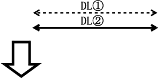

> **図の内容**
>
> 左右に往復する経路で、補正後の DL①（破線）と DL②（実線）が重なる向きに並んでいる。下に「⇩」。

ステップ間に直線を入れて交点が出来るようにする

直線を入れる。

③LIN X-30000;

2)交点無しエラー(ＬＩＮ→ＣＩＲ)

<例>

径補正量5000の場合 ①LIN Y40000 DL1;

②CIRL X80000 Y0 I40000 J0;

[対策]

<例>

①LIN Y40000 DL1;

②LIN X1000; 直線を入れる。

③CIRL X80000 Y0 I40000 J0;


> **図の内容**
>
> 細長い経路（実線）の外側を、補正後の DL①（斜めの破線）、DL②（縦の破線）、DL③（下の破線、左向き）が回っている。

交点が出来ないのでエラー


> **図の内容**
>
> 上向きの直線のあとに円弧が続く経路。補正後の DL①（直線の左の破線）と DL②（円弧の内側の破線）の間に交点ができない。下に「⇩」。

ステップ間に直線を入れて交点が出来るようにする


> **図の内容**
>
> 直線と円弧の間に短い直線を入れた経路。補正後の経路は DL①、DL②（入れた直線の上の破線）、DL③（円弧の内側）となり、交点ができる。

3)交点無しエラー(ＣＩＲ→ＬＩＮ)

交点が出来ないのでエラー

- <例> 径補正量5000の場合 ①CIRR X80000 Y0 I40000 J0; ②LIN Y30000;

[対策]


> **図の内容**
>
> 円弧のあとに上向きの直線が続く経路。補正後の DR①（円弧の内側の破線）と DR②（直線の右の破線）。下に「⇩」。左上に本文の一部「J0;」。

ステップ間に直線を入れて交点が出来るようにする

- ①CIRR X80000 Y0 I40000 J0;
- ②LIN X1000; 直線を入れる。
- ③LIN Y30000;

4)交点無しエラー(ＣＩＲ→ＣＩＲ)

<例>


> **図の内容**
>
> 円弧と直線の間に短い直線を入れた経路。補正後の経路は DR①（円弧の内側）、DR②（入れた直線の下）、DR③（直線の右）。

交点が出来ないのでエラー

- 径補正量2000の場合
- ①CIRL X40000 Y0 I20000 J0;
- ②CIRL X40000 Y0 I20000 J0;

[対策]

<例>

①CIRL X40000 Y0 I20000 J0; ②LIN X1000; 直線を入れる。

- ③CIRL X40000 Y0 I20000 J0;

J0;
  
J0;
  
DL① DL②

ステップ間に直線を入れて交点が出来るようにする


> **図の内容**
>
> 2 つの円弧の間に短い直線を入れた経路。補正後の経路は DL①（左の円弧の内側）、DL②（入れた直線の上）、DL③（右の円弧の内側）。

(8).移動方向反転エラー

基軌跡の移動方向と、補正後軌跡の移動方向が逆になる場合はエラーとなります。 (径よりも狭い場所の移動等)

尚、次ステップが確定しなければ、そのステップの移動が反転するかが判断できないため、径補正エラー情報画面の"エラー発生ステップ番号"には、実際に移動反転するステップの次ステップ番号が表示されます。

1) 移動方向反転エラー(ＬＩＮ)

<例１>

径補正量5000の場合

- ①LIN X20000 DR1;
- ②LIN Y-3000;
- ③LIN X-20000;
- "DR②"の移動方向が、"ステップ②"の移動方向と逆になるのでエラー


> **図の内容**
>
> 右へ進み、下へ折り返して左へ戻る経路。補正後の DR①（斜めの破線）、DR②（縦の破線）、DR③（上の破線、左向き）。下に「⇩」。
> 「※線「－－－－」は交点を出すための補助線」

[対策]

径が移動できるように変更

- ①LIN X20000 DR1;
- ②LIN Y-11000; 径が通れる
- ③LIN X-20000; ようにする

<例２>

径補正量5000の場合

①LIN X3000;

②LIN Y10000;

[対策]

※線「」は交点を出すための補助線


> **図の内容**
>
> コの字形の経路の内側で、DR①（斜めの破線）、DR②（交点付近の短い動き）、DR③（左向きの破線）。補助線（破線）で交点を求めている。

"DL①"の移動方向が、"ステップ①"の移動方向と逆になるのでエラー

径が移動できるように変更


> **図の内容**
>
> 右へ進んでから上へ曲がる経路で、補正後の DR①、DR②（上向きの破線）。DR② の向きがステップ② と逆になる。下に「⇩」。
> 「※線「－－－－」は交点を出すための補助線」

径補正量5000の場合

- ①LIN X6000; 径よりも大きい

②LIN Y10000; 移動にする


> **図の内容**
>
> ステップ② の移動量を大きくした経路（本文: ②LIN Y10000; 移動にする）。補正後の DR①、DR② が同じ向きになる。
> 「※線「－－－－」は交点を出すための補助線」

2) 移動方向反転エラー(ＣＩＲ)

<例１>

- 径補正量20000の場合
- ①CIRR X40000 Y-40000 I0 J-40000;
- ②CIRR X10000 Y0 I5000 J0;
- ③CIRR X40000 Y40000 I40000 J0;
- "DR②"の移動方向が、"ステップ②"の移動方向と逆になるのでエラー


> **図の内容**
>
> 2 つの円弧がつながる経路（補助線の大きな破線の円が 2 つ）。補正後の DL①、DL②（2 つの円弧の間で逆向きに戻る動き）、DL③。下に「⇩」。
> 「※線「－－－－」は交点を出すための補助線」

[対策]

- ①CIRR X40000 Y-40000 I0 J-40000;
- ②CIRR X40000 Y0 I20000 J0; 径が通れるようにする
- ③CIRR X40000 Y40000 I40000 J0;

径が移動できるように変更

※線「」は交点を出すための補助線


> **図の内容**
>
> 2 つの円弧がつながる経路で、補正後の DL①、DL②（短い弧）、DL③ が同じ向きにつながる。

<例２>

径補正量20000の場合

- ①LIN Y-80000;
- ②CIRL X-10000 Y26458 I-40000 J0;
- ③CIRL X-70000 Y-26458 I-30000 J-26458;

ステップ②と③の円弧は同じ軌跡です。

"DR②"の移動方向が、"ステップ②"の移動方向と逆になるのでエラー


> **図の内容**
>
> 下向きの直線のあとに大きな円弧が続く経路。補正後の DR①、DR②（逆向きの短い動き）、DR③（円弧の外側）。下に「⇩」。
> 「※線「－－－－」は交点を出すための補助線」

[対策]

円弧を分割している座標を、径の外側にずらす。

- ①LIN Y-80000;
- ②CIRL X-30000 Y38730 I-40000 J0; 分割している座標をずらす。
- ③CIRL X-50000 Y-38730 I-10000 J-38730;

ステップ②と③の円弧は同じ軌跡です。

※線「」は交点を出すための補助線


> **図の内容**
>
> 下向きの直線と大きな円弧の経路で、補正後の DR①、DR②、DR③ がつながる。左上に本文の一部「軌跡です。」。

<例３>

１つの円弧命令で、径補正後の軌跡が１周円以上になる場合はエラーになります。

径補正量20000の場合

①LIN Y-40000;

②CIRL X40000 Y-40000 I0 J-40000;

③LIN X20000;

[対策]

円弧命令を２つに分割し、１つの円弧命令での径補正後の軌跡が１周円以上にならないようにします。

①LIN Y-40000;

②CIRL X0 Y-80000 I0 J-40000; 円弧命令を２つに分割する

③CIRL X40000 Y40000 I0 J40000;

④LIN X20000;


> **図の内容**
>
> 直線から小さな円弧を回り、また直線に出る経路。補正後の DL①（下向き）、DL②（円弧の内側を回る）、DL④（右向き）。
> 左に「DL②軌跡」「DL③軌跡」の拡大図（小さく回る動き）。
> 「※線「－－－－」は交点を出すための補助線」

"DL②"は１周以上移動します。


> **図の内容**
>
> 同じ経路で、補正後の DL①（下向き）、DL②（円の内側を 1 周以上回る）、DL③（右向き）。本文: "DL②"は１周以上移動します。

※線「」は交点を出すための補助線


##### 5-17-3-13.注意事項

(1).中心指定円弧の中心調整

- 中心指定の円弧命令で指定された、「始点-中心」間距離と「終点-中心」間距離の差が1000パルス未満の時、「始点-中心」間距離と「終点-中心」間距離の平均の半径になるように中心を調整します。「始点-中心」間距離と「終点-中心」間距離の差が1000パルス以上の場合はエラーになります。詳細は、<5-17-3-12.-(6).-2)円弧の中心指定の場合>を参照して下さい。
- ※ 動作プログラム作成時の離散誤差(パルス単位で指令するための切り捨て／切り上げ)により、終点／中心指定が円弧上にない現象を防ぎます。


> **図の内容**
>
> 「始点」から「運転プログラムで指定された終点」への円弧。「運転プログラムで指定された中心」と「調整後の中心」が別の点として描かれている。

【注意】

上記のように、1000パルス未満の間違えであれば調整を行うため、運転プログラムの作成ミス等で異常な円弧(下記例を参照)を指定したときでも調整して動作してしまいます。ご注意下さい。

- <例> 中心指定が終点よりも外側に指定された場合 CIRR X800 Y0 I1000 J0 F1000;

半径Ｒ = (1000(始点-中心間距離) + 200(終点-中心間距離)) / 2 Ｒ = 600


> **図の内容**
>
> X 軸上に、「始点」(0, 0)、「運転プログラムで指定された終点」(800, 0)、「運転プログラムで指定された中心座標」(1000, 0)。

半径が600になるように中心を調整します。


> **図の内容**
>
> 「始点」(0, 0) から「運転プログラムで指定された終点」(800, 0) への円弧。「調整後の中心座標」は (400, 447)、半径は R600。

(2).半径指定円弧の半径調整

「始点-終点」間距離の1/2と、半径指定の差が1000パルス未満の場合は、「始点-終点」間距離の1/2に半径を調整します。

差が1000パルス以上の場合はエラーになります。

詳細は、<5-17-3-12.-(6).-1)円弧の半径指定の場合>を参照して下さい。


> **図の内容**
>
> 「始点」から「運転プログラムで指定された終点」への半円。始点からの距離として「運転プログラムで指定された半径」と「調整後の半径」の 2 つが示されている（中心の位置が違う）。

(3).交点が２つある場合の注意

交点が２つある場合は、補正前図形の終点に近い交点を選択して動作します。

<例１> CIR→CIR

径補正量20000の場合

- ①CIRR X75000 Y-19365 I40000 J0;
- ②CIRR X75000 Y19365 I35000 J19365;

例1の命令の場合、補正後の軌跡が交差してしまいます。


> **図の内容**
>
> 2 つの円弧（実線）が重なる経路と、補正後の経路（破線）。「補正前図形の終点」と「補正前図形の終点に近い補正後の交点」が示されている。左上に本文の一部「75000 Y19365 I35000 J19365;」。


[手前の交点を使用したい場合]

- 交点を２つ作らない命令にします。
- ①CIRR X75000 Y19365 I40000 J0;
- ②CIRR X75000 Y-19365 I35000 J-19365;

※線「」は交点を出すための補助線


> **図の内容**
>
> 2 つの円弧がつながる経路で、「補正後図形の交点」と「補正前図形の終点」が示されている。補助線は破線の円。

※線「」は交点を出すための補助線

- <例２> LIN→CIR

径補正量5000の場合

例2の命令の場合、補正後の軌跡が交差してしまいます。

- ①CIRR X78000 Y-12490 I40000 J0;
- ②LINA Y80000;

補正前図形の終点

補正前図形の終点に近い補正後の交点


> **図の内容**
>
> 円弧のあとに上向きの直線が続く経路。補正後の経路（破線）と補助線の円（破線）。2 つの矢印が、補正前の終点と補正後の交点を指している。左上に本文の一部「J0;」。

※線「」は交点を出すための補助線


[手前の交点を使用したい場合]

交点を２つ作らない命令にします。

- ①CIRR X60000 Y34641 I40000 J0;
- ②LINA Y80000;

※線「」は交点を出すための補助線


> **図の内容**
>
> 円弧のあとに上向きの直線が続く経路で、「補正後図形の交点」と「補正前図形の終点」が示されている。

#### 5-17-4．ピッチエラー補正機能

各軸毎に機械原点を基点とした、一定間隔の区間毎の補正データを、パラメータに記憶させ、そのデータに従って、ボールネジの誤差を自動的に補正する機能です。この機能は原点復帰の完了後、有効になります。原点復帰未完もしくは原点復帰無効のインクレ軸は補正無効です。無限回転軸に設定した軸には、ピッチエラー補正は無効です。

【基本仕様】

| 補正軸     | 全制御軸中の任意の指定軸         |
|---------|----------------------|
| 補正点の数   | 各軸で+/-方向合わせて520点Max. |
| 補正の基点   | 機械原点                 |
| 補正の間隔   | 1000～1000000パルス      |
| データ設定方式 | アブソリュート(機械原点からの補正量)  |
| 補正量     | 0～±127パルス            |
| 補正倍率    | ×10Max.              |

【注意事項】

- (1). 最大補正量は、基点に対して±1270パルスとなります。
- (2). 使用するサーボの応答性やサーボ調整により異なりますが、隣合う補正量の差が大きすぎると、急激な動作となる場合があります。
- (3). ピッチエラー補正を無効とする場合は、パラメータの補正倍率に、0を設定して下さい。
- (4). 補正量(補正量×補正倍率)が補正間隔以上の場合、ダウンロード時にパラメータエラーとなります。
- (5). 補正有効の状態でパラメータを変更した場合、ダウンロード後すぐに値を反映します。 (値によっては、急激な動作となる場合があります。)

【パラメータ】

|     | 項目     | 設定値           |
|-----|---------|-----------------|
| 各軸 | 補正倍率    | 0～10            |
| 各軸 | 補正間隔    | 1000～1000000パルス |
| 各軸 | -側補正区間数 | +/-側合わせて        |
| 各軸 | +側補正区間数 | 0～520           |
| 各軸 | 補正データ   | 0～±127パルス       |

【設定例】

下図の様なX軸の補正を設定する例を示します。


> **図の内容**
>
> 横軸「X軸座標」（－ ← 0 → ＋）、縦軸「ピッチエラー」（＋ 0 －）。「基点＝機械原点」を境に、－側に ①区間、②区間、③区間、＋側に ①区間～⑧区間がある。
> 曲線は「ピッチエラー計測誤差」。区間の幅は「補正間隔＝１０００００ﾊﾟﾙｽ」。


> **図の内容**
>
> X軸の設定:
> - 補正倍率: 1
> - 補正間隔: 100000
> - 補正データ先頭番号: 0
> - －側補正区間数: 3
> - ＋側補正区間数: 8
>
> 補正データ:
> | No. | 補正値 |
> |---|---|
> | 000 | 3 |
> | 001 | 2 |
> | 002 | 0 |
> | 003 | 0 |
> | 004 | -2 |
> | 005 | -3 |
> | 006 | -4 |
> | 007 | -5 |
> | 008 | -5 |
> | 009 | -6 |
> | 010 | -6 |
> | 011 | （空） |
> | 012 | （空） |
> | … | |
> | 519 | （空） |
>
> 000～002 が －側補正区間数、003～010 が ＋側補正区間数に対応する（矢印）。000～010 は「X軸で使用」、011～519 は「X軸の予備」。

#### 5-17-5．形状補正(高精度輪郭制御) <オプション>

高速・高精度な輪郭制御を要求するマシンでは、形状補正による軌跡精度の向上が有効です。これにより、サーボ系の遅れによる軌跡誤差を最小限に抑えることが可能となります。

(1). 形状補正機能の概要

- a. コーナ部の内回りを少くする
- b. 円弧の縮みをなくす


> **図の内容**
>
> 「指令」は直角に立ち上がる。「従来の軌跡」（破線）はゆっくり追いつき、「補正有の場合の軌跡」（実線）は指令にすばやく追いつく。


> **図の内容**
>
> 実線の円（指令）の内側に破線の円（実際の軌跡）がある。「この縮みを小さくします。」

(2). 形状補正の効果

サーボ系を1次遅れ系とみなして、その遅れ分を補償します。その結果、指令どおりの実軌跡となります。

速度ベクトルの変化がなめらかな場合には、最大限の効果が出ます。従って、速度変化が大きい場合は、「プリ解加減速」を利用するか「運転プログラムの各ステップ(ブロ

ック)を細分化して、速度Fがゆるやかに変化する」ようにして下さい。

(3). 形状補正機能の制限事項

また、理想的なサーボ系(1次系)と現実のサーボ系の差(機械系、速度ループ特性)から、効果の程度が

速度が急に変化する動きでは、充分な効果が上がらない場合もあります。変わることがあります。

(4). 使用方法 <オプション>

サーボパラメータの「形状補正係数」を設定して下さい。

形状補正係数:位置ループゲイン(Kp)の1.5倍～5倍

|   例 KP | 形状補正係数   |
|--------|----------|
|     40 | 60～200   |

0の時は制御なし。

初め5倍の値を設定して、すこしづつ小さくして下さい。(軌跡を確認しながら)1倍以下は、使用不可。

(5). 任意曲線における高精度輪郭制御の実例

【運転プログラム】

微小直線補間連続ブロック LIN X292 Y316 F50000; (全432ブロック)

【共通動作条件】

位置ループゲインKp=30 (XY軸共通)

形状補正なし

- 指数型加減速処理:有効 (時定数=30msec)
- プリ解加減速機能:未使用
- 形状補正制御 :無効

形状補正あり

- 指数型加減速処理:無効
- プリ解加減速機能:使用 (加減速時間=100msec)
- 形状補正機能 :有効 (形状補正係数=60)

LIN X339 Y367 F50000; LIN X339 Y367 F50000; LIN X359 Y347 F50000; LIN X386 Y318 F50000; LIN X410 Y286 F50000; LIN X432 Y252 F50000; LIN X451 Y216 F50000; LIN X467 Y179 F50000; LIN X480 Y141 F50000; LIN X85 Y21 F50000; LIN X240 Y220 F50000;

LIN X-250 Y-433 F50000; LIN X-232 Y-443 F50000; LIN X-213 Y-452 F50000; LIN X-195 Y-461 F50000; LIN X-175 Y-468 F50000; LIN X-155 Y-475 F50000; LIN X-135 Y-482 F50000; LIN X-116 Y-486 F50000; LIN X-95 Y-491 F50000; LIN X-74 Y-494 F50000; LIN X-42 Y-372 F50000;

END;


> **図の内容**
>
> 6 の字に似た複雑な形の経路。指令（実線）と実際の軌跡（破線）がずれている箇所を「指示と実軌跡のずれ」の矢印が指している。

（指令軌跡／実軌跡）


> **図の内容**
>
> 同じ形の経路で、「指令と実軌跡のずれなし」。

(6). 円弧における高精度輪郭制御の実例

プリ解加減速と形状補正を利用して、高精度輪郭制御を実現しました。

① プリ解析による加減速発生

通常、NCの内部処理では軌跡発生処理のあと、速度変化や機械のショックをやわらげるために各軸の指令に対して加減速をかけます。この加減速による遅れ要素と位置ループ系による偏差量が加わって、実際の軌跡が、コーナーの内側を回るなどの、大きな形状誤差が発生します。ただし、加減速処理を行わないと、指令の速度変化にサーボ系が追従できないという別の問題が生じます。そこで補間後の加減速処理を使用しないでも充分に追従できるようにプリ解析処理において加減速区間微小ブロックを発生させて、補間前加減速(自動コーナオーバライド)をおこないます。

【円弧動作での各軸の速度・通常】


> **図の内容**
>
> 「サーボ応答チェック FILE: サンプリング: 8msec」の画面。グラフが 2 つ（上下、各軸）。
> 縦軸 [PPS]（99875、49937.5、0、-49937.5、-99875）、横軸 0～5 [sec]（2.5 に目盛り）。
> どちらも正弦波状の速度（円弧動作）で、始めと終わりで速度が急に変わる。

【動作での各軸の速度・プリ解加減速】


> **図の内容**
>
> 「サーボ応答チェック FILE: サンプリング: 8msec」の画面。
> - 上のグラフ: 縦軸 [PPS]（100000、50000、0、-50000、-100000）、横軸 0～5 [sec]。正弦波状の速度で、始めと終わりがなめらかに上がり下がりする
> - 下のグラフ: 縦軸 [KPPS]（100、50、0、-50、-100）、横軸 0～5 [sec]。もう一方の軸の速度

プリ解加減速無し

補間時定数=30ms Kp=30 R=50000p F=100Kpps でのサーボ応答 (≒速度指令)

プリ解加減速有り

補間前加減速(自動コーナオーバライド) 補間時定数=0

Kp=30 R=50000p F=100Kpps でのサーボ応答 (≒速度指令)

② 形状補正の効果

プリ解加減速をおこなっても、位置ループ系による偏差量分の遅れのため、高速送り(位置偏差大)では軌跡誤差が顕著となります。これを0に近づける為に、コントローラ内でフィードフォワード的な補償制御をおこなうことで、位置偏差を小さくします。

当社モーションアナライザでの真円精度解析の例を示します。プリ解加減速と形状補正によって、円弧の縮小はゼロになっています。


> **図の内容**
>
> 「真円度チェック FILE: サンプリング: 8msec」の画面が 3 つ。どれも 3 重の円の目盛りで、X軸の目盛りは外側の円が「+100」、内側の円が「-100」（真ん中の円が 0、理想円）。赤い線が実際の軌跡。
>
> | 条件 | 補間時定数 | Kp | R | F | 結果 |
> |---|---|---|---|---|---|
> | プリ解加減速無し・形状補正無し | 30ms | 30 | 50000p | 100Kpps | 半径縮小=130p（130μm）。赤い線は内側の円の近くにある |
> | プリ解加減速有り・形状補正無し（補間前加減速(自動コーナオーバーライド)） | 0 | 30 | 50000p | 100Kpps | 半径縮小=70p（70μm） |
> | プリ解加減速有り・形状補正有り | 0 | 30 | 50000p | 100Kpps | 半径縮小=0。赤い線は真ん中の円に重なる |
>
> 1 つめの画面では、X軸の -100 側（左）で、軌跡が外へ飛び出している（開始点付近）。

(7). プリ解加減速(プリ解析における加減速ステップの発生) <オプション>

① プリ解加減速の意味

プリ解加減速は、直線補間や円弧補間(軌跡制御)に対してスタート区間(加速区間)と停止区間(減速区間)で段階的な加速/減速のステップを発生させます。

- a. 各軸の指令速度の変化を少なくして、形状補正の効果を最大限にします。
- b. 補間後の各軸の加減速をなくしても、オーバショートや振動がおきないようにします。

② プリ解加減速の使用上の注意

加速/減速を設定するブロック(ステップ)は必ず「プリ解加減速区間(時間)」よりも時間的に長いことが必要です。

【元の指令】

従って、加速/減速指令をするブロック(ステップ)では、以下を確認して下さい。ブロック処理時間(L/F) ≧ プリ解加減速区間(時間)


> **図の内容**
>
> - 【元の指令】: L1(F)、L2(F) の 2 つの直線。X速度・Y速度はそれぞれ Fx1→Fx2、Fy1→Fy2 と階段状に変わる
> - 【L1を加速した例】: L1 を L11、L12、L13 の「加速ステップに分解」する。X速度は Fx11、Fx12、Fx13、Fx2、Y速度は Fy11、Fy12、Fy13、Fy2 と段階的に上がる（「加速区間としてブロックを分解」）

③ 微小ブロックの処理

2項の条件式を満たさない微小な(短い)ブロックの場合は、CAD/CAMによるブロックの発生において、あらかじめ接線速度を加速/減速させることを推奨します。

この処理については、必須ではありませんが、高精度輪郭制御を効果的にするためには、必要です。


> **図の内容**
>
> - 【CAD/CAMによる加減速】（高精度輪郭制御の精度良好）: 経路を F1、F2、F3、F4 の短いブロックに分け、速度を F1→F2→F3→F4→F と階段状に上げる
> - 【加減速なし】: F1、F2、F3、F4、F がすぐに切り替わる

### 5-18．ティーチング (開発中)

#### 5-18-1．ティーチング

モーションコントローラ内に記憶している運転プログラムに対してティーチング (挿入/置換/削除等)を行い、運転プログラムの変更を行うことが出来ます。

ティーチングでは記憶している運転プログラムを直接変更するので、次回のプログラム実行でもティーチングした内容が反映されています。

尚、ティーチングした運転プログラムはPCでアップロードして保管(管理)して下さい。 (故障時などに復旧できるようにするため)

セッティングPCのティーチング画面を元にティーチング関連の動作を説明します。

ティーチング画面で使用している通信コマンドは、全てアプリケーション開発ライブラリで公開しているので、お客様も同等の画面を作成する事が出来ます。

参考までに、以下の表にセッティングPCの操作とそれに対応する通信コマンドを併記します。


> **図の内容**
>
> ダイアログ「ティーチング」の「プログラム」欄:
> ```
> 1: LIN X40000 Y20000 F40000;
> 2: LIN X40000 Y-20000 F40000;   （選択中）
> 3: LIN X-40000 Y-20000 F40000;
> 4: LIN X-40000 Y20000 F40000;
> 5: END;
> ```
> 操作: 「ステップ変更 ＋ －」、チェック「サイクル」「シングル」「ティーチング」、ボタン「逆行」「スキップ」「挿入」「置換」「原点シフト」「削除」「実行」「閉じる」、「ティーチング開始ステップ」の欄。

- ※ 現在"開発中"で次の機能以外は使用できません。
- サイクル
- シングル
- スキップ
- 削除
- 実行

各動作は以降の説明を参照下さい。

| セッティングPC表示 [通信コマンド]                       | 内容                                                                                                                 |
|-------------------------------------------|---------------------------------------------------------------------------------------------------------------------|
| プログラム表示 [DAT_ONEBLOCK]                    | 現在選択されている運転プログラムの内容を表示しています。モーションコントローラ内で記憶している運転プログラム情報を元に逆変換を行って表示しているため、実際にダウンロードしたプログラムとは見た目が異なっている可能性があります。 |
| 現在(強調表示) ステップ [DAT_STATUS] [DAT_TEACHSTS] | 現在実行中/実行予定のステップまたは、ティーチング対象のステップを強調表示しています。 (ティーチング中にステップ変更「+」「-」を行うと、このステップが前後します。)                             |
| ティーチング開始ステップ [DAT_TEACHSTS]              | ティーチングを開始したステップを表示しています。                                                                                            |

| セッティングPC操作 [通信コマンド]                 | 動作                                                                                                                                                        | 基本的条件                                              |
|-------------------------------------|------------------------------------------------------------------------------------------------------------------------------------------------------------|----------------------------------------------------|
| サイクル [ REQ_CYCLE ]                  | サイクル運転モードの設定/解除サイクル運転モードの時は、プログラムが終了したら自動的に最初から再開します。 (ティーチング操作では使用しません。)                                                                                | 常に実行可                                              |
| シングル [ REQ_SINGLE ]                 | シングルステップモードの設定/解除シングルステップモードの時は、「実行」を押す毎に1 ステップづつ実行します。 1ステップ実行して停止すると、「ステップ間停止」状態になっています。ほとんどのティーチング操作では「ステップ間停止」状態である必要があります。                         | 常に実行可                                              |
| ティーチング [ REQ_TEACH ] ※1             | ティーチングモードに設定します。ステップ間停止中のみ可能です。ステップ間停止にするには、シングルステップモードで実行するか、M00/M01停止を使用する必要があります。ティーチングモードを解除します。ティーチング移動を行っている場合は、「逆行」操作で、ティーチング開始位置まで戻る必要があります。 | ･ティーチングモードでない･ステップ間停止中･ティーチングモード中･ティーチング移動未実行 |
| ティーチングステップ変更 +/- [REQ_STEPCHG ] ※1 | ティーチング対象のステップを変更します。ステップを変更した後、ティーチング開始ステップ以外でティーチングモードを解除して再開すると、変更前と後の間のステップを実行しないで再開する事になります。注意して下さい。                                               | ･ティーチングモード中                                        |

※1 : 開発中です。

| セッティングPC操作 [通信コマンド]    | 動作                                                                                                                                              | 基本的条件                                               |
|------------------------|--------------------------------------------------------------------------------------------------------------------------------------------------|-----------------------------------------------------|
| 逆行 [ REQ_PRGREV ] ※1   | ティーチング開始位置への移動(戻り) 直前のステップの逆行。<オプション>                                                                                                            | ･ティーチングモード中･ティーチングモードでない･ステップ間停止中･PTP/LINステップのみ |
| スキップ [REQ_STEPSKIP]    | 現在ステップをスキップして、次ステップに実行ステップを移します。移動中のステップは中断します。                                                                                                 | ･ティーチングモードでない･停止中                                 |
| 挿入 [ REQ_PRGINS ] ※1   | 表示されているステップ番号以降の既存ステップが繰り下げられ、ティーチング移動した分の新たなPTP指令ステップが、表示されているステップ番号として登録されます。                                                               | ･ティーチングモード中･ティーチング開始ステップ                          |
| 置換 [ REQ_PRGALT ] ※1   | 表示されているステップの移動量が、ティーチングした移動量にさし変わります。この時、指定コードは元のステップより継承され、アブソ移動指令であった場合は、移動先の座標値が入ることになります。また、PTMAコードの場合も同様に、指定されているポイント番号の座標データに差し変わります。 | ･ティーチングモード中･移動命令のステップ                              |
| 原点シフト※1 [REQ_ZRNSHIFT] | ティーチング移動先の論理座標がティーチング開始時の論理座標と同じになるように、論理原点をシフトします。                                                                                            | ･ティーチングモード中                                         |
| 削除 [ REQ_PRGDEL ]      | 表示されているステップ番号のステップが削除され、それ以降の既存ステップが繰り上げられます。                                                                                                   | ･ティーチングモードでない･ステップ間停止中                            |
| 実行 [REQ_PROGSTRT]      | プログラム運転の開始/再開を行います。                                                                                                                              | ･ティーチングモードでない･プログラム未実行/ 停止中                       |

#### 5-18-2．「逆行」動作詳細

- (1). ティーチング開始位置への移動(戻り)

ティーチングで移動した分をキャンセルするPTP移動を行い、ティーチング開始位置へ戻ります。既にティーチング開始位置にいる場合は何もしません。

- ① A点にてステップ間停止 (現在ステップ表示はn)
- ② 「ティーチング」ティーチングモード設定
- ③ 各軸JOG、インチングなどを使って移動
- ④ 「逆行」 A点にPTP動作で戻る。
- ⑤ 「ティーチング」ティーチングモード解除
- (2). 直前のステップの逆行をします。<オプション>

ステップn-1


> **図の内容**
>
> ステップn で A から B へ向かう途中、「JOG/ｲﾝﾁﾝｸﾞ」で動かした太い経路と、「ティーチング移動量の戻り」（破線）で A へ戻る経路。

直前のステップを逆に移動して実行前の位置へ戻ります。

- ※ この動作はインクレ移動(PTP/LIN)のステップのみ可能です。
- ① B点にてステップ間停止 (現在ステップ表示はn)
- ② 「逆行」

A点へ逆移動します。 (現在ステップ表示はn-1)

ステップn-2


> **図の内容**
>
> A →（ステップn-1）→ B →（ステップn）→ C。「逆行」で B から A へ戻る。

#### 5-18-3．「スキップ」動作詳細

現在ステップをスキップして、次ステップに実行を移します。移動中のステップは中断します。

- ① A'点にて停止 (現在ステップ表示はn)
- ② 「スキップ」移動を中断して、次ステップに実行が移ります。 (現在ステップ表示はn+1)
- ③ 「実行」

次の移動命令がPTP/LIN(インクレ)の時は、 C′へ、PTPA(アブソ)の時は、Cへ移動

#### 5-18-4．「挿入」動作詳細

ステップn-1


> **図の内容**
>
> A から A' を経て、ステップn で B、ステップn+1 で C へ。破線は挿入後の経路で、ステップn+1 の行き先が C' になる。

現在ステップ(ティーチング対象のステップ)以降の既存ステップが繰り下げられ、ティーチング移動した分の新たなPTP指令ステップを、現在ステップに記憶(挿入)します。

- ① A点にてステップ間停止 (現在ステップ表示はn)
- ② 「ティーチング」ティーチングモードに入る。
- ③ 各軸JOG、オーバライドなどを使って D点へ移動。

ステップnにD点までのPTP命令が

- ④ 「挿入」挿入されます。

(現在ステップ表示はn+1に変る)

- ⑤ 「ティーチング」ティーチングモード解除
- ⑥ 「実行」次の移動命令(もとのステップn)がPTP/LIN(インクレ)の時は、B′へPTPA(アブソ)の時は、Bへ移動


> **図の内容**
>
> 「ステップn-1」で A に着いたあと、「挿入されたステップn」で D へ進み、「ステップn+1」で B' へ進む。もとの経路は「ステップn（もとのn）」で A から「B（元々の目標値）」へ向かう（破線）。

Ｃ

#### 5-18-5．「置換」動作詳細

現在ステップ(ティーチング対象のステップ)の移動量が、ティーチングした移動量にさし変わります。この時、指定コードは元の命令より継承され、アブソ移動指令であった場合は、移動先の座標値が入ることになります。また、PTMAコードの場合も同様に、指定されているポイント番号の座標データが移動先の座標に差し変わります。

- (1). 現在ステップ(次ステップ)の置換
- ※ 現在ステップが移動命令(PTP/PTPA/PTPB/LIN/LINA/LINB/PTMA)の時のみ可能な操作です。ただし、PTMAのポイント指定をマクロ変数で指定していた場合は実行できません。また、移動量/移動座標指定がマクロ変数指定だった場合は、マクロ変数指定が解除されます。

(数値指定になります)

- ① A点にてステップ間停止 (現在ステップ表示はn)
- ② 「ティーチング」ティーチングモード設定
- ③ 各軸JOG、インチングなどを使って B′へ移動
- ④ 「置換」ステップnをステップn'に置換して、

現在ステップ表示が n +1に変る。

- ⑤ 「ティーチング」ティーチングモード解除
- ⑥ 「実行」
- n +1ステップから実行を再開します。

(移動命令がPTP/LIN(インクレ)の時は、C'へ、PTPA(アブソ)の時はCへ移動)

ステップn-1


> **図の内容**
>
> A から「JOG/ｲﾝﾁﾝｸﾞ」で「B'（修正したい位置）」へ動かす。もとの「ステップn」は A から「B 元の目標値」へ、置換後の「ステップn'」は A から B' へ。その後の行き先は C と C' が示されている。

- (2). 直前に実行したステップの置換(目標位置のオフセット)
- ※ ティーチングを開始したステップの直前のステップで、インクレ移動命令(PTP/LIN)の時のみ可能な操作です。

(アブソ命令の場合は、次項の「任意のステップの置換」の処理になります。) ただし、移動量指定にマクロ変数を指定していて、その軸を移動させた場合は、実行出来ません。

- ① B点にてステップ間停止 (現在ステップ表示はn)
- ② 「ティーチング」ティーチングモードに入る。
- ③ ティーチングステップ「-」現在ステップ(ティーチングステップ)を戻します。
- ④ 各軸JOG、インチングなどを使って B′へ移動
- ⑤ 「置換」ステップn-1をステップn-1'に置換して、現在ステップ表示が n に変る。
- ⑥ 「ティーチング」ティーチングモード解除
- ⑦ 「実行」

ステップnから実行を再開します。

(移動命令がPTP/LIN(インクレ)の時はC'へ、アブソ命令の時はCへ移動)

(3). 任意のステップの置換(アブソ命令のみ)

- ※ アブソ命令[PTPA/PTPB/LINA/LINB/PTMA]のステップに対してのみ可能な操作です。ただし、PTMAのポイント指定をマクロ変数で指定していた場合は実行できません。また、移動座標指定がマクロ指定だった場合は、マクロ指定が解除されます。(数値指定になります)
- ① 任意のステップでステップ間停止
- ② 「ティーチング」ティーチングモードに入る。
- ③ ティーチングステップ「+」/「-」キーにより、現在ステップを変更
- ④ 「置換」ティーチングステップの目標座標を現在の座標に置換します。
- ⑤ 「ティーチング」

ティーチングモード解除

ステップn-2


> **図の内容**
>
> A から「ステップn-1」で B へ向かう代わりに、「JOG/ｲﾝﾁﾝｸﾞ」で「B'（修正したい位置）」へ動かす。破線の「ステップn-1'」は A から B' への置換後の経路。
> 続く「ステップn」は B から C（元）、または B' から C' へ。「B 元の目標値」。

#### 5-18-6．「原点シフト」動作詳細

ティーチング移動先の論理座標がティーチング開始時の論理座標と同じになるように、論理原点をシフトします。

- ① A点にてステップ間停止 (現在ステップ表示はn)
- ② 「ティーチング」ティーチングモード設定
- ③ 各軸JOG、インチングなどを使って A′へ移動
- ④ 「原点シフト」 A'点の座標がA点の座標と同じになるように論理原点をシフトします。
- ⑤ 「ティーチング」ティーチングモード解除
- ⑥ 「実行」

ステップnから実行を再開します。

#### 5-18-7．「削除」動作詳細

表示されているステップ番号のステップが削除され、それ以降の既存ステップが繰り上げられます。

- ① A点にてステップ間停止 (現在ステップ表示はn)
- ② 「削除」

ステップnが削除されて、n+1以降のステップが1つづつ前にシフトします。

- ③ 「実行」時は、C′へPTPA(アブソ)の時は、

次の移動命令がPTP/LIN(インクレ)の Cへ移動。


> **図の内容**
>
> 「ステップn-1」で A に着いたあと、「削除したステップ」（A から B）を飛ばし、「ステップn（元のn+1）」で C' へ進む（インクレの場合）。破線は元の経路（A → B → C）。

Ｃ'


> **図の内容**
>
> A(1000, 2000) から「JOG/ｲﾝﾁﾝｸﾞ」で A' へ動かし、「(1000, 3000) ↓ 座標シフト (1000, 2000)」として座標をシフトする。
> 元の「ステップn」は A から B(3000, 4000) を経て C へ（破線）、シフト後は A' から B'(3000, 4000) を経て C' へ（実線）。

ステップn-1

### 5-19．補間前加減速(自動コーナオーバライド)機能 <オプション>

#### 5-19-1．補間前加減速(自動コーナオーバライド)のメリット

- (1). コーナ内回りの軌跡誤差の最小化
- (2). 加速度(速度変化量)を自動判別して、必要に応じて加速度(速度変化量)を制限すべく自動的に減速。
- (3). 判定や減速度合いは、RTMC64-M3/ECの自動計算ですので、運転プログラム作成者が個別に計算する必要はありません。
- (4). 判定基準や補間前加減速時(自動コーナオーバライド)定数はあらかじめ自由に設定できます。
- (5). 判定区分は6段階で、かなり自由度がありますので、機構に応じて最適な設定が可能です。

#### 5-19-2．補間前加減速(自動コーナオーバライド)の概要

直線補間や円弧補間の連続点での加速度(速度変化量)を自動計算し、その大きさによって、適切な速度に減速/加速します。たとえば、2m/秒速度の直線から、0.5m/秒の円弧に進入するときに、直線補間の最後に減速してから、円弧に進入します。

RTMC64-M3/ECの内部処理を簡単に説明します。

軌跡発生(補間)の前に全体速度を加減速する機能を追加致します。

これによって、従来の(各軸)加減速の時定数を10msecのように小さくしても各軸のモータに対して、急激な加減速が発生しないようになります。


> **図の内容**
>
> 「加速度判定&補間前加減速(自動コーナオーバライド) 今回追加」→「軌跡発生（直線補間、円弧補間など）」→ X、Y それぞれの「加減速」→「X軸指令」「Y軸指令」。
> 右上: 「従来の各軸加減速(例:10msec)」は、軌跡発生のあとの各軸の加減速を指す。

補間命令のつなぎ目で、加速度(速度変化量)をチェックし、大きいときは、その補間の減速と次の補間の加速をおこないます。

(1). 加速度判定

補間時に、加速度(速度変化量)を計算し、その大きさを判定します。

(2). 補間前加減速

(自動コーナオーバライド) 加速度判定の結果、補間のつなぎの部分で、設定された減速と加速をいたします。

#### 5-19-3．補間前加減速(自動コーナオーバライド)をしているときの速度変化(オーバライド)の様子


> **図の内容**
>
> 「補間1」「補間2」「補間3」の速度の台形。① と ② のつなぎ目で、速度が「最小オーバライド」まで下がる。台形の傾きの幅が「補間前加減速(自動コーナオーバライド)時定数」。

- ①補間前加減速(自動コーナオーバライド)を必要とする補間連続点(速度変化がそれなりに大きい連続点) オーバーライド指定なので、ステップで指令速度が違う場合は速度変動が発生します。
- ②補間が連続しない点(ドウェルなど)
- この判定を6段階に分類し、その程度に応じて、送り速度全体を減速します。

#### 5-19-4．制限事項など

- (1). 判定値や時定数は、設計値である程度既定できますが、本来の最適値は、実際のサーボ系や機構系で再確認する必要があります。
- (2). 以下のような微小補間の場合は、減速が間に合わない場合があります。

例 ①直線補間 L1 F1 ;

②直線補間 L2 F2 ;(微小補間)

F1とF2の変化が小さいと①は減速せずに②へ移行します。この時、②の移動量が小さい微小補間の場合は、減速が間に合わず、急停止する事になります。

運転プログラムの作成時にご注意下さい。

- (3). サーボ系の位置ループ制御の影響による内回りは、発生します。ただし、これはかなり小さい値です。また、サーボのフィードフォワード制御などで、改善も期待できます。
- (4). 補間命令の間に IF, #＿, TIM などの補間命令以外の命令がある場合は、そのステップを速度0とみなして加速度判定します。その結果、減速/加速を行います。

#### 5-19-5．加速度(速度変化量)の算出方法

補間命令の場合は以下の様に、つなぎ目の加速度(速度変化量)を算出します。

加速度VA = V2 - V1


> **図の内容**
>
> 速度ベクトル V1 のあとに V2 が続く。V1 から V2 への変化分が VA（破線の矢印）。本文: 加速度VA ＝ V2 － V1。

- = (F2X-F1X) 2 + (F2Y-F1Y) 2 ・・・(F2A-F1A) 2

VA:加速度(速度変化量)

V1:実行するステップの補間移動ベクトル

(円弧の場合は、始点の接線ベクトル)

V2:次ステップの補間移動のベクトル

(円弧の場合は、終点の接線ベクトル)

F1X・・F1A:V1の各軸速度

F2X・・F2A:V2の各軸速度

以下の組み合わせで、補間命令の加速時/減速時の速度変化量VAを算出します。

加速時 : 前ステップと実行ステップ

減速時 : 実行ステップと次ステップ

- 前ステップが補間でない場合 :前ステップのベクトルを0としてVAを計算します。※
- 次ステップが補間でない場合 :次ステップのベクトルを0としてVAを計算します。※

- ※補間でないステップのベクトルは0として計算するため、実行ステップの速度そのものが加速度(速度変化量)となります。

#### 5-19-6．パラメータの設定について

セッティングPCの以下の画面で、関連のパラメータを設定します。


> **図の内容**
>
> ダイアログ「補間前加減速パラメータ」（タスク0）。
> - 「補間前加減速時定数 [0] msec」（0:補間前加減速無効）
> - 「最小オーバライド設定」: 加速度([pls/sec^2]) の範囲「□ ～ □」と、それに対応する「最小オーバライド [%]」の組が 7 行。上が「加速度小」、下が「加速度大」。表示されている値は加速度がすべて 0、最小オーバライドがすべて 100
> - 「※加速度は絶対値を設定して下さい。」
> - ボタン: 「ファイルから読出」「ファイルに保存」「アップロード」「ダウンロード」「編集前に戻す」「閉じる」

ファイルに保存ボタン設定したデータを拡張子 .acoのファイルとして保存します。

ファイルから読出ボタン保存した設定データを読み出して、設定します。

アップロードボタン RTMC64-M3/ECから現在の設定値を読み出します。

ダウンロードボタン RTMC64-M3/ECへこの画面の設定を書き込みます。

補間前加減速(自動コーナオーバライド)時定数

設定範囲 : 0msec～16383msec(0msecを設定すると、補間前加減速機能 (単位[msec]) は無効になります。)

補間前加減速(自動コーナオーバライド)が0%～100%に変化するまでの時間です。 (加速と減速の傾き(時間)は同じです。)

※ 傾き一定になるように変化させるので、実際の加減速時間は、その時の目標オーバーライドによって変わります。

加速度(速度変化量)設定範囲 : 0pps～2000000000pps 最小オーバーライド設定範囲:1%～100% 加速度(速度変化量)とそのときの最小オーバーライド(目標オーバーライド)

の関係のテーブルを設定します。


> **図の内容**
>
> 棒グラフ。中央の「オーバーライド(%)」が 100% で、左右に離れるほど（加速度が大きいほど）段階的に低くなり、「最小オーバライド」まで下がる。0% の目盛りがある。右上に「補間前加減速(自動コーナオーバライド)時定数」。

減速時は、最小オーバーライド(目標オーバーライド)にかかわらず、0%まで減速できる所から減速を開始します。(最小オーバーライドまで減速した後は、最小オーバーライドの速度で動作します。) そのため、移動の終点付近では一定速になります。

(減速を開始してからの時間は、補間前加減速(自動コーナオーバライド)時定数より短くなります。)

最小オーバライド設定

#### 5-19-7．動作例

セッティングPCの「補間前加減速(自動コーナオーバライド)パラメータ」画面で以下の設定をした時の動作例を記述します。

- 補間前加減速(自動コーナオーバライド)時定数 : 330msec

- 最小オーバライド

|   加速度(速度変化量[pulse/sec]) - (表示のみ) - 0 | 加速度(速度変化量[pulse/sec]) - 設定値 - ～ 500000   |   最小オーバライド - (無効:100%) |
|--------------------------------------|------------------------------------------|------------------------|
|                               500000 | ～ 700000                                 |                     80 |
|                               700000 | ～1000000                                 |                     70 |
|                              1000000 | ～1200000                                 |                     40 |
|                              1200000 | ～1500000                                 |                     20 |
|                              1500000 | ～2000000                                 |                     10 |
|                              2000000 | ～2500000                                 |                      5 |

以下の<例1>～<例3>は、全て同じ速度(F指定)で直線補間→円弧補間動作を実行した例です。速度は同じですが、直線補間→円弧補間の加速度(速度変化量)が違うため、選択される最小オーバーライドが異なります。

- <例1>右図の軌跡の運転プログラム
- ① LIN X500000 F1000000;
- ② CIRR X500000 Y500000 I500000 J0 F1000000;
- ③ END;
- ①と②の加速度(速度変化量):1414213 = (0-1000000) 2 + (1000000-0) 2
- ②と③の加速度(速度変化量):1000000 = (1000000) 2 + (0) 2
- <例2>右図の軌跡の運転プログラム
- ① LIN X500000 F1000000;
- ② CIRR X500000 Y-500000 I0 J-500000 F1000000;
- ③ END;
- ①と②の加速度(速度変化量):0 = (1000000-1000000) 2 + (0-0) 2
- ②と③の加速度(速度変化量):1000000 = (1000000) 2 + (0) 2


> **図の内容**
>
> V1（右向き）のあと、円弧を通って V2（上向き）へ曲がる経路。


> **図の内容**
>
> 縦軸「合成速度 [pps]」、横軸「時間」。① の区間の終わりで速度が「最小OVR20%」まで下がり、② の区間の終わりで「最小OVR40%」まで下がって止まる。


> **図の内容**
>
> V1（右向き）のあと、V2 の方向へ接するように円弧へ入る経路（破線は V2 の方向）。


> **図の内容**
>
> 縦軸「合成速度 [pps]」、横軸「時間」。① と ② のつなぎ目では速度が下がらない（「最小OVR100%」）。② の終わりで「最小OVR40%」まで下がって止まる。

- <例3>右図の軌跡の運転プログラム
- ① LIN X500000 F1000000;
- ② CIRR PXY X707107 Y0 CR500000 F1000000;
- ③ END;

①と②の加速度(速度変化量):707017 = (1000000-707107) 2 + (0-707107) 2 ②と③の加速度(速度変化量):1000000 = (1000000) 2 + (0) 2


> **図の内容**
>
> 縦軸「合成速度 [pps]」、横軸「時間」。① と ② のつなぎ目で速度が「最小OVR80%」まで下がり、② の終わりで「最小OVR40%」まで下がって止まる。

#### 5-19-8．パラメータの選定例

実運転時の最高速度 : 6m/分 = 100000P/秒 (1p=1μm)

仮に 6m/分の速度で急加速や急停止をおこなうときの加速/減速時間を0.04秒とします。

加速度(速度変化量) 100000pps - 0pps = 100000pps

設定例

補間前加減速(自動コーナオーバライド)時定数T 40msec 最小オーバライド

| 加速度(速度変化量[pps])   | 加速度(速度変化量[pps])   |           |
|-------------------|-------------------|-----------|
| (表示のみ)            | 設定値               | 最小オーバライド  |
| 0                 | ～ 20000           | (無効:100%) |
| 20000             | ～ 36000           | 84        |
| 36000             | ～ 52000           | 67        |
| 52000             | ～ 68000           | 50        |
| 68000             | ～ 84000           | 34        |
| 84000             | ～100000           | 17        |
| 100000            | ～150000           | 1         |

実際の確認

逆に問題なければ、補間前加減速(自動コーナオーバライド)を30msecや20msecとして、限界を探しま

- ① 補間前加減速(自動コーナオーバライド)時定数T:40msecの確認 6m/分(100000P/秒)で直角に曲がる部分で、軌跡形状を確認下さい。まだ、うねりがあれば、50～60msecなどにして再度トライしてください。す。
- ② その状態で、他の軌跡部を確認して、必要であれば加速度(速度変化量)の区分けや最小オーバライドを変更してください。

【注意事項】

- 注1 通常の補間加減速も多少設定する事を推奨します。

定時直線型補間加減速:5msec～数十msec

ただし、この数値に比例して、軌跡の内回りが発生します。

- 注2 補間前加減速(自動コーナオーバライド)を必要以上に使用すると以下の問題もあり得ます。
- ① 自由曲線などのコーナ部(微小な直線補間の連続)で不自然な減速/加速が発生しがたがたした動きになってしまう。
- ② 全体のタクトが下がる。減速と加速が入る分だけ、移動時間が遅くなるため。


> **図の内容**
>
> V1（右向き）のあと、斜め上（破線の方向）に向かって円弧で曲がる経路。

### 5-20．独立位置決め

◆1.3

サーボアンプの位置決め機能を使用することにより、RTMC64の移動/プログラム実行とは別(非同期)に移動を行えます。

PCアプリやラダーからの通信コマンド、運転プログラムの命令から指令することができます。

通信コマンドについては、「送受信データ説明書」<4-2-58.独立位置決めコマンド>(TB00-1044)を参照下さい。

- (1). 対応サーボアンプ要件

**○RTMC64-M3：MECHATROLINK-Ⅲ対応サーボの場合[M3]**

MECHATROLINK-Ⅲ標準サーボプロファイル用コマンドの

「位置決め:POSING」

を使用します。

※"POSING"はMECHATROLINK-Ⅲの通信仕様として必須コマンドです。 MECHATROLINK-Ⅲ準拠の製品は対応しています。

**○RTMC64-EC：EtherCAT対応サーボの場合[EC]**

- CiA402サーボプロファイルの制御モード「プロファイル位置決め(pp)モード」

に対応していること。

※"pp"モードはCiA402サーボプロファイルの規約として必須対応ではないため、対応しているかどうかを確認してください。

(2). 事前設定

**○RTMC64-M3：MECHATROLINK-Ⅲ対応サーボの場合[M3]**

- 特になし。

**○RTMC64-EC：EtherCAT対応サーボの場合[EC]**

- 「プロファイル位置決め(pp)モード」を使用するために、ENIファイル作成時に以下のオブジェクトをPDOにマッピングする必要があります。

【RxPDO】

- Modes Of Operation (6060h,00h)

【TxPDO】

- Modes Of Operation Display (6061h,00h)
- 「プロファイル位置決め(pp)モード」を使用する際、以下のオブジェクトにも設定を書込みます。

【RxPDO 又は SDO】

| ・Profile Velocity     | (6081h,00h)   |
|-----------------------|---------------|
| ・Profile Acceleration | (6083h,00h)   |
| ・Profile Deceleration | (6084h,00h)   |

(3). 基本仕様

- 手動/自動モードで、移動していない軸に対してコマンド発行が可能です。
- タスクを指定し、指定したタスクの軸(論理軸)に対し目標位置と速度を指定します。 (インクレ指令の場合は移動量、各座標系のアブソの場合は目標位置を指定。)
- 通信コマンドでは最大9軸、運転プログラムからは最大４軸まで同時指定可能です。 (指定したタスク内の論理軸から選択します。)
- 独立位置決め中の軸に対して、再度、独立位置決めを指令することにより、目標位置や速度が変更可能です。(インクレ指令を独立位置決め移動中の軸に対して発行した場合、

"新たな目標位置 = 現在位置 + 新たな指令値"となります。)

※RTMC64-EC：EtherCAT対応サーボの場合[EC]

サーボが目標位置の途中変更に対応している必要があります。

(4). エラー

- コマンド実行条件が成立している時のみ実行可能です。条件が成立していない場合は、以下の通りです。通信コマンド；通信エラー（E$CMDNOT：現在実行できません）
- 独立移動再開時、オーバライドが0%の場合は再開コマンドが通信エラー（E$CMDNOT）になります。プログラム実行エラーにはなりません。

運転プログラム：プログラム実行エラー＆プログラム実行中断

(5). 停止・再開

- 独立位置決めの停止はREQ_PROGSTOPコマンド、またはT□STOP入力で行います。（プログラム実行中の場合は、プログラムも停止します。また、独立位置決め以外の移動を行っていた場合は、その移動も停止します。）
- 再開時はREQ_RESTARTコマンドまたは、REQ_PROGSTARTコマンド/T□START入力にて再開します。 REQ_PROGSTARTコマンド/T□START入力にて再開：プログラム実行も開始/再開します。ただし、

新規に運転プログラムの起動を行う場合は、独立位置決めは停止中であっても再開しません。

(停止時に独立位置決め以外の移動も停止していた場合は、独立位置決め以外の移動も再開します。）

REQ_RESTARTコマンドにて再開：運転プログラムは開始/再開しません。

※T□**** の□はタスク番号0～7を表します。例)T0START、T7STOPなどの入力信号

- 独立位置決め移動中、内部では各軸の最後に指令された指令値を保持しています。再開時は、保存していた値を指令値として動作します。

(リセットやエラー、独立位置決めの完了にて保持データをクリアします。)

- 独立位置決めコマンド停止中の軸へ、運転プログラムから独立位置決め命令を指令した場合、プログラムから指定された目標位置・速度で独立位置決めを開始します。 (独立位置決め命令軸がプログラム停止で止まっている時に、独立位置決めコマンドを発行した場合も同様です。)
- 独立位置決め停止中の軸に対して、補間命令やPTP命令等、独立位置決め以外の移動命令を発行できます。この場合、独立位置決めはキャンセルし、発行された命令の動作を行います。

【ステータス】

- STATUS構造体の各軸ステータス（STATUS.ax[].AxStatus）へ独立位置決め中ステータスと独立位置決め停止中ステータスを追加します。

詳細は、「送受信データ説明書」<4-1-6.ステータスデータ読出>(TB00-1044)を参照下さい。


> **図の内容**
>
> 「STATUS.ax[].AxStatus：各物理軸(0～15)ステータス情報」の 16 ビット（左が MSB、右が LSB）。
> 右から数えたビットのうち 2 つに「独立位置決め中」と「独立位置決め停止中」が割り当てられている（図からは、どのビットかは読み取れない）。

：

- 独立位置決めの完了は、独立位置決め中ステータスにて確認可能です。
- 独立位置決め動作が停止すると独立位置決め停止中がONします。
- この時、独立位置決め中ステータスはONのままとなります。

独立位置決めステータス一覧

|                                 | 独立位置決め中 (0x10)   | 独立位置決め停止中 (0x20)   |
|---------------------------------|------------------|--------------------|
| 独立位置決め発行                        | OFF→ON           | OFF                |
| 独立位置決め停止                        | ON               | OFF→ON             |
| 独立位置決め移動完了                      | ON→OFF           | OFF                |
| 独立位置決め中のリセット                    | ON→OFF           | OFF                |
| 独立位置決め停止中のリセット                  | ON→OFF           | ON→OFF             |
| 独立位置決め中のエラー発生                   | ON→OFF           | ON→OFF             |
| 独立位置決め停止中のエラー発生                 | ON→OFF           | ON→OFF             |
| 独立位置決め中の軸へ独立位置決めを再度発行          | ON               | OFF                |
| 独立位置決め停止中の軸へ (独立位置決め以外の)移動命令を発行 | ON→OFF           | ON→OFF             |

【その他】

- オーバーライドは、コマンド発行時または再開時の値とします。

(移動中のオーバーライド変更は反映されません。)

- 加減速には、サーボアンプの加減速パラメータによります。
- 【例】Σサーボの場合はPn80A～80Fを使用します。

別途Σ-win等から設定して下さい。加減速の形はS字加減速とします。

- 独立位置決め中は、モード変更できません.(停止中や移動完了後はモード変更可)

### 5-21．手動パルサ/ジョイスティック <オプション>

手動パルサ（手パと略記します）やジョイスティックにより任意の軸を手動で動かすことができます。

#### 5-21-1．ハードウェアの準備

MECHATROLINK/EtherCATに"パルスカウンタ"や"A/D変換器"を準備し、手パからのパルス信号やジョイスティックからのアナログ電圧指令信号を読み込みます。

PLC/Cから手パからのパルスデータやジョイステックアナログ電圧データを書き込むことで、任意の軸を動かすこともできます。

#### 5-21-2．手動送り設定

- ROMSW設定の「オプション」で"手パ/ジョイスティック"がチェックされていることを確認して下さい。
- ROMSW設定の「手動パルサ」を選択して次の設定を行って下さい。
- 手パ/ジョイスティック使用数
- 手動パルサ信号の極性
- ジョイスティック電気条件(最大値、最小値、不感帯)
- 手パ/ジョイスティック「軸選択設定」で選択信号を設定してください。
- ※「ROMSW設定ソフト」<5-3.手動送り設定>(TB00-1042)を参照下さい。
- セッティングPCの「サーボパラメータ」で次の設定を行って下さい。
- 手動パルサやジョイスティックで動かす各軸の最大速度、加減速時定数
- ※「セッティングPC」<5-3-1.サーボパラメータ設定画面>(TB00-1041)を参照下さい。

#### 5-21-3．手パモードの選択

手パモードは機械パネルスイッチの信号による切り替えと、通信コマンドによる切り替えが可能です。

#### 5-21-4．手動運転の条件

手動パルサやジョイスティックで運転できるのは次の条件のときです。

| 条件                 | 機械パネル   | 通信   |
|--------------------|---------|------|
| 機械操作パネルI/Fが有効      | 必要      | 不要   |
| 手パ/ジョイスティックが有効     | 必要      | 不要   |
| 手動パルス倍率信号、軸選択信号が有効 | 必要      | 不要   |
| 軸停止中               | 必要      | 必要   |
| アラーム無し             | 必要      | 必要   |

#### 5-21-5．信号の流れ


> **図の内容**
>
> - 「手動パルサー」→「パルスカウンタ」
> - 「ジョイスティック」→「A/D変換器」
> - どちらも「MECHATROLINK / EtherCAT」を経て、「共有メモリ」と「PLC/C」を通り（破線）、「RTMC64」へ届く

### 5-22．原点復帰機能

◆1.3

「原点復帰」とは、原点信号やエンコーダ・リニアスケールのC(Z)相等を用いて、各軸の機械原点を検出する機能です。

- インクレエンコーダを用いたシステムの場合

電源投入時やメンテナンス後の復旧時に、原点復帰を行って機械原点を検出します。

- アブソエンコーダを用いたシステムの場合

通常の運用時には原点復帰はしません。ただ、機械の初期立上げ時に原点復帰機能を用いて原点を検出して原点設定をした場合は、エンコーダのバックアップエラー発生や、モータと機械部品の連結を外す等、メンテナンス後の復旧時には、再度、原点復帰が必要です。

原点出し治具等を用いて、機械的に原点を設定する方法がある場合は、原点復帰機能は不要です。

#### 5-22-1．各軸の原点復帰方式の選択

原点復帰方式は、各軸毎に、機構やサーボアンプの機能、原点信号等センサの配置・配線等、機械的・電気的な要素によって選択できる方式が決まります。

以下の表や、原点復帰方式の説明を参考に決めてください。

[ROMSW設定と原点復帰方式の関係]

| 原点復帰方式 | 原点復帰段数 | 特徴 - 速度 | 特徴 - 精度 | 想定される代表的な機構 | 要求機能※2 - ﾗｯﾁ機能 | 要求機能※2 - 原点信号 | 要求機能※2 - OT信号 |
|---|---|---|---|---|---|---|---|
| FBラッチ方式（原点信号あり） | 2段 | 高速 | 高精度 | ・ボールネジを使用した直動軸 ・ギヤ等で減速するターンテーブル | ○ | ○ | △ |
| FBラッチ方式（原点信号あり） | 1段 | 中速 | 高精度 | ・ボールネジを使用した直動軸（ベタドグの場合） | ○ | ○ | － |
| FBラッチ方式（原点信号なし） | 2段※1 1段※1 | 低速 | 高精度 | ・リニアスケールを使用する直動軸 ・ダイレクトドライブモータで回すターンテーブル | ○ | － | △ |
| DECサーチ方式 | 2段 | 高速 | △ | ・直動軸（ﾗｯﾁ機能が無い場合） ・ターンテーブル（ﾗｯﾁ機能が無い場合） | － | ○ | ○ |
| DECサーチ方式 | 1段 | 中速 | △ | ・直動軸(ベタドグの場合)（ﾗｯﾁ機能が無い場合） | － | ○ | － |
| FBラッチ方式（OT信号） | 2段※1 1段※1 | 中速 | 高精度 | ・直動軸（原点信号が無い場合） | ○ | － | ○ |
| OTサーチ原点復帰 | 2段※1 1段※1 | 低速 | △ | ・直動軸（ﾗｯﾁ機能・原点信号が無い場合） | － | － | ○ |

※1：1段/2段原点復帰のどちらに設定しても、同じ動きをします。

※2：要求機能の要否は以下です。

○：必要

－：不要

△：条件による

##### 5-22-1-1.《FBラッチ方式(原点信号あり)》

(1). ±2段原点復帰

原点信号を検出するまで高速で移動して、ラッチ信号を元に機械原点を決めるため、高速、且つ、高精度な原点復帰方法です。

下図のように、ストローク中に複数回のラッチ信号がONし、原点信号近傍のラッチ信号を検出するような軸を想定しています。


> **図の内容**
>
> -OT から +OT までのストローク。「開始位置」から ① で進み、DEC信号を検出して ②③ と動き、④ で「機械原点」に止まる。
> - 「DEC信号」は途中の一部だけ ON
> - 「ラッチ信号(C(Z)相、EXT1～3)」はストローク中に一定間隔で何回も出る
> - 最後のラッチ位置から機械原点までが「原点距離」

＜原点復帰手順＞

- ①原点信号がONするまで高速で移動
- ②減速し原点信号のOFFを検出
- ③原点信号がOFFしたら、ラッチ信号を検出
- ④ラッチ信号検出後、原点距離移動した位置まで移動し、そこを機械原点とします。

＜想定される機構＞

- 回転型モータにボールネジを連結した直動軸特にストローク中央に原点センサを設置する場合。
- ギヤやベルトで減速しているターンテーブル（無限回転軸）

＜要求される機能＞

- ラッチ機能
- 原点信号
- OT信号（直動軸の場合）

原点信号を超えた位置から原点復帰を開始するとOTに到達するので、OT信号の設置は必須です。原点復帰中にOTに到達した場合については、

<5-22-1-7.原点復帰未完でOTに到達した場合(原点信号あり)> を参照下さい。

(2). ±1段原点復帰

原点信号を検出するまで中速に動作し、その後ラッチ信号にて機械原点を検出するため、中速かつ高精度な原点復帰方法です。2段原点復帰と比べると、ラッチ信号を確実に検出するために原点信号を検出するための速度が少し遅くなる傾向があるため、速度を「中速」としています。下図のように、ストローク中に複数回のラッチ信号がONし、原点信号近傍のラッチ信号を検出するような軸を想定しています。


> **図の内容**
>
> 「-機械端」から「+機械端」まで。「開始位置」から ① で進み、DEC信号を検出して ②③ と動き、「機械原点」に止まる。DEC信号は +機械端の近くから ON。
> 「ラッチ信号(C(Z)相、EXT1～3)」と「原点距離」は前の図と同じ。

＜原点復帰手順＞

- ①原点信号がONするまで中速で移動
- ②減速し、ラッチ信号を検出
- ③ラッチ信号検出後、原点距離移動した位置まで移動し、そこを機械原点とします。
- ※もし、原点復帰開始時に既に原点信号がONしていたら、OFFするまで引き返します。引き返した後、上記の通常の手順で原点復帰します。

＜想定される機構＞

- 回転型モータにボールネジを連結した直動軸
- 特に、機械端近くに原点センサを設置したベタドグの場合。ベタドグについては、 <5-22-1-9.1段原点復帰でベタドグ(原点信号)のメリット> を参照下さい。

＜要求される機能＞

- ラッチ機能
- 原点信号

※ベタドグの場合OT信号は必須ではありません。

##### 5-22-1-2.《FBラッチ方式(原点信号無し)》

原点復帰開始直後からラッチ信号を探して機械原点を検出する原点復帰方法です。

最初からラッチ信号を探すため、原点復帰動作全体が低速です。

下図のように、ストローク中に１回のみラッチ信号がONするため、原点信号が無くてもラッチ信号を検出できるような軸を想定しています。


> **図の内容**
>
> -OT から +OT まで。「開始位置」から ① で進み、② で「機械原点」に止まる。「ラッチ信号(C(Z)相、EXT1～3)」はストローク中に 1 回だけ出る。ラッチ位置から機械原点までが「原点距離」。

＜原点復帰手順＞

- ①低速でラッチ信号を検出
- ②ラッチ信号検出後、原点距離移動した位置まで移動し、そこを機械原点とします。

＜想定される機構＞

- 直動軸でストローク中央にのみC相があるリニアスケールを用いる場合
- ダイレクトドライブモータに直結しているターンテーブル（無限回転軸）

＜要求される機能＞

- ラッチ機能
- OT信号（直動軸の場合）

原点信号を超えた位置から原点復帰を開始するとOTに到達するので、OT信号の設置は必須です。原点復帰中にOTに到達した場合については、

<5-22-1-8.原点復帰未完でOTに到達した場合(原点信号なし)> を参照下さい。

##### 5-22-1-3.《DECサーチ方式》

(1). ±2段原点復帰

原点信号を元に原点を決める方式です。

センサ精度及びセンサの経年劣化等のため、ラッチ方式に比べて精度が低いです。ラッチ機能が使えないモータの場合に使用します。

下図のように、ます原点信号を検出するまで高速に動作し、原点信号を通り過ぎた後に引き返して低速で信号のOFFエッジを探すことで極力精度を高めます。


> **図の内容**
>
> -OT から +OT まで。「開始位置」から ① で高速に進み、DEC信号を検出して ②③ で戻り、④⑤ で低速に進んで「機械原点」に止まる。
> DEC信号は途中から ON。DEC信号の切り替わり位置から機械原点までが「原点距離」。

＜原点復帰手順＞

- ①原点信号がONするまで高速で移動
- ②減速し原点信号のOFFを検出
- ③原点信号がOFFしたら、引き返して再度原点信号ONを検出
- ④原点信号がONしたら、再度引き返して、極低速で原点信号のOFFを検出
- ④原点信号OFF検出後、原点距離移動した位置まで移動し、そこを機械原点とします。

＜想定される機構＞

- 回転型モータにボールネジを連結した直動軸

特にストローク中央に原点センサを設置する場合。

- ギヤやベルトで減速しているターンテーブル（無限回転軸）

＜要求される機能＞

- 原点信号

原点信号を超えた位置から原点復帰を開始するとOTに到達するので、OT信号の設置は必須です。

- OT信号（直動軸の場合）原点復帰中にOTに到達した場合については、 <5-22-1-7.原点復帰未完でOTに到達した場合(原点信号あり)> を参照下さい。

(2). ±1段原点復帰

原点信号を元に原点を決める方式です。

センサ精度及びセンサの経年劣化等のため、ラッチ方式に比べて精度が低いです。ラッチ機能が使えないモータの場合に使用します。

下図のように、ます原点信号を検出するまで高速に動作し、原点信号がONしたら引き返して低速で信号のONエッジを探すことで極力精度を高めます。


> **図の内容**
>
> 「-機械端」から「+機械端」まで。「開始位置」から ① で進み、DEC信号を検出して ②③④ と動き、「機械原点」に止まる。DEC信号は +機械端の近くから ON。

＜原点復帰手順＞

- ①原点信号がONするまで高速で移動
- ②原点信号がONしたら、引き返して原点信号OFFを検出
- ③原点信号がOFFしたら、再度引き返して、極低速で原点信号のONを検出
- ④原点信号ON検出後、原点距離移動した位置まで移動し、そこを機械原点とします。

※もし、原点復帰開始時に既に原点信号がONしていたら、OFFするまで引き返します。引き返した後、上記の通常の手順で原点復帰します。

＜想定される機構＞

- 回転型モータにボールネジを連結した直動軸
- 特に、機械端近くに原点センサを設置したベタドグの場合。ベタドグについては、 <5-22-1-9.1段原点復帰でベタドグ(原点信号)のメリット> を参照下さい。

＜要求される機能＞

- 原点信号

※ベタドグの場合OT信号は必須ではありません。

##### 5-22-1-4.《FBラッチ方式(OT信号)》(1段/2段は、同じ動作)

OT信号を検出するまで低～中速に動作し、OT検出後、折り返してラッチ信号にて機械原点を検出するため、中速かつ高精度な原点復帰方法です。OT信号を検出した際には、即停止するため、高速で移動することはできませんが、原点はラッチ信号を元に検出するため高精度です。

ストローク中に原点信号が設置できない場合に使用します。

下図のように、ストローク中に複数回のラッチ信号がONし、OT信号近傍のラッチ信号を検出するような軸を想定しています。


> **図の内容**
>
> -OT から +OT まで。「開始位置」から ① で +OT まで進み、②③ で戻り、④⑤ と動いて「機械原点」に止まる。
> 「ラッチ信号(C(Z)相、EXT1～3)」はストローク中に何回も出る。ラッチ位置から機械原点までが「原点距離」。

＜原点復帰手順＞

- ①OT信号がONするまで低～中速で移動
- ②OT信号がONすると即停止します。

即停止後も多少は慣性で移動するためOTがONした状態で停止します。

※RTMC64-EC：EtherCAT対応サーボの場合[EC]

OT信号をサーボアンプに配線している場合、停止方法はサーボアンプの設定によります。各サーボのマニュアルをご確認下さい。

- ③低速で引き返して、OT信号のOFFを検出
- ④OT信号がOFFしたら、ラッチ信号を検出
- ⑤ラッチ信号検出後、原点距離移動した位置まで移動し、そこを機械原点とします。

＜想定される機構＞

- 回転型モータにボールネジを連結した直動軸原点センサが設置できない場合。

＜要求される機能＞

- ラッチ機能
- OT信号

##### 5-22-1-5.《OTサーチ原点復帰》(1段/2段は、同じ動作)

OT信号を検出するまで低～中速に動作し、OT検出後、低速で折り返してOT信号のOFFを検出します。 OT信号を元に原点を決めるため、センサ精度及びセンサの経年劣化等のため、ラッチ方式に比べて精度が低いです。

下図のように、ラッチ機能が使用できず、ストローク中に原点信号が設置できない場合に使用します。


> **図の内容**
>
> -OT から +OT まで。「開始位置」から ① で +OT まで進み、②③ で戻り、④ で「機械原点」に止まる。+OT から機械原点までが「原点距離」。

＜原点復帰手順＞

- ①OT信号がONするまで低～中速で移動
- ②OT信号がONすると即停止します。即停止後も多少は慣性で移動するためOTがONした状態で停止します。

※RTMC64-EC：EtherCAT対応サーボの場合[EC]

OT信号をサーボアンプに配線している場合、停止方法はサーボアンプの設定によります。各サーボのマニュアルをご確認下さい。

- ③低速で引き返して、OT信号のOFFを検出
- ④OT信号がOFFしたら、原点距離移動した位置まで移動し、そこを機械原点とします。

＜想定される機構＞

- 回転型モータにボールネジを連結した直動軸原点センサが設置できない場合。

＜要求される機能＞

- OT信号

##### 5-22-1-6.原点復帰動作時のオーバーライド

原点復帰動作中は、オーバーライド設定が無効です。（オーバーライド１００％として動作します。）原点復帰動作は、再現性が重要です。特に、センサのON/OFFを検出する際の精度は速度によって異なりますので、速度が変わると再現性が保てなくなります。

そのため、原点復帰動作中にはオーバーライドが効かない仕様としています。

※立上げ作業時、一度原点復帰が成功するまでは、セッティングPCの「手動原点復帰」等を用いて、慎重に動作させるように気をつけて下さい。

##### 5-22-1-7.原点復帰未完でOTに到達した場合(原点信号あり)

原点復帰を開始する位置によっては、原点(DEC)信号を検出する前にOTに到達する場合があります。以下の A の位置で開始した場合、以下のような手順で動作します。

- ①DEC信号が無いので+OTへ到達します。
- ②反転してDEC信号を検出しDEC信号がOFFするまで移動します。
- ③再度原点復帰動作をします。

またこの①②の動作は2段原点復帰/1段原点復帰とも共通です。


> **図の内容**
>
> 「開始位置 Ⓐ」から ① で +OT まで進み、② で -OT 側へ戻り、③ で DEC信号の位置を越えて「機械原点」へ向かう。DEC信号は機械原点の手前で ON。

##### 5-22-1-8.原点復帰未完でOTに到達した場合(原点信号なし)

原点復帰を開始する位置によっては、ラッチ信号を検出する前にOTに到達する場合があります。以下の A の位置で開始した場合、以下のような手順で動作します。

- ①ラッチ信号が検出できないまま+OTに到達
- ②逆方向に引き返してラッチ信号を確認
- ③再度、ラッチ信号をもとに原点復帰を実施


> **図の内容**
>
> 「開始位置 Ⓐ」から ① で +OT まで進み、② で戻り、③ で再び進んで「機械原点」へ向かう。「ラッチ信号」は途中で 1 回出る。

##### 5-22-1-9.1段原点復帰でベタドグ(原点信号)のメリット

ベタドグとは、下の図のように、原点信号と機械端の間において、原点信号のON/OFFが一定の状態のことを指します。（原点センサをどちらかの機械端の近傍に設置すると、ベタドグになり易いです。）


> **図の内容**
>
> 「-方向機械端」から「+方向機械端」まで。「原点(DEC)信号」は途中から +方向機械端まで ON のまま（ベタドグ）。
> 開始位置 Ⓐ（DEC信号の手前）と Ⓑ（DEC信号の範囲）のどちらから始めても、「機械原点」へ向かう。

原点(DEC)信号をベタドグとして1段原点復帰を選択すれば、どの位置にあっても原点復帰時に機械端へ到達してしまうことはありません。

例えば、 A の位置で原点復帰動作を開始した場合、既に原点信号がONしているので、原点センサと +方向機械端の間にあることがわかります。よって、一旦原点復帰方向とは逆方向に移動して、原点信号がOFFしてから原点復帰方向に向かって動作を行います。

※ベタドグの場合、「原点復帰逃げ動作」は必要ありません。

サーボパラメータの「原点復帰逃げ量」に０を設定して動作しないようにして下さい。

原点復帰逃げ動作については、

<5-22-2．原点復帰逃げ動作> を参照ください。

##### 5-22-1-10.原点復帰に要求される機能

- (1).ラッチ機能

FBラッチ方式(<5-22-1-1.><5-22-1-2.><5-22-1-4.>)は高精度で経年変化が無いため、 FBラッチ方式を推奨します。

使用できる要件は以下です。

- ①エンコーダやリニアスケールのC(Z)相信号がサーボアンプで検出可能であること

一般的に、モータとエンコーダが一体となった回転型のサーボモータの場合はC(Z)相は検出できる場合が多いです。

ステッピングモータや、アンプとモータのメーカが異なる場合等に、C(Z)相の配線が無く、検出できない場合があります。

外部リニアスケールを用いる場合は、スケールのC(Z)相を外部(EXT)信号に配線します。

- ②サーボアンプのソフト機能として、ラッチ機能に対応していること以下に、RTMC64-M3とRTMC64-ECそれぞれの場合の必要な機能について記載します。特に、RTMC64-ECについては、機能の対応だけではなく、ENIファイルの設定も必要なことに

ご注意ください。

**○RTMC64-M3：MECHATROLINK-Ⅲ対応サーボの場合[M3]**

MECHATROLINK-Ⅲ標準サーボプロファイルの

「ラッチ機能」

に対応していること。

- ※「ラッチ機能」はMECHATROLINK-Ⅲの通信仕様として任意機能(対応が必須ではない機能)です。 MECHATROLINK-Ⅲ準拠の製品でも対応しているかどうか確認をしてください。 (安川電機社製Σ-VやΣ-7は対応しています。)

**○RTMC64-EC：EtherCAT対応サーボの場合[EC]**

- CiA402サーボプロファイルの機能
- 「タッチプローブ機能(Touch probe function)」

に対応していること。

- ※「タッチプローブ機能(Touch probe function)」はCiA402サーボプロファイルの規約として必須対応ではないため、対応しているかどうかを確認してください。
- 「タッチプローブ機能(Touch probe function)」を使用するために、ENIファイル作成時に
- 以下のオブジェクトをマッピングする必要があります。但し、使用する信号と、エッジの取得方法によって以下のようになります。
- ●原点復帰「FBラッチ原点復帰」 - C相及びProbe1をONエッジでラッチする場合
- ●原点復帰「FBラッチ原点復帰」 - C相及びProbe1をOFFエッジでラッチする場合
- ●原点復帰「FBラッチ原点復帰」 - Probe2をONエッジでラッチする場合
- ●原点復帰「FBラッチ原点復帰」 - Probe2をOFFエッジでラッチする場合

【RxPDO】Touch Probe Function

(60B8h,00h)

【TxPDO】Touch Probe Status (60B9h,00h)

Touch Probe Pos1 Positive Value (60BAh,00h)

【RxPDO】Touch Probe Function

(60B8h,00h)

【TxPDO】Touch Probe Status (60B9h,00h)

Touch Probe Pos1 Negative Value (60BBh,00h)

【RxPDO】Touch Probe Function (60B8h,00h)

【TxPDO】Touch Probe Status

(60B9h,00h)

Touch Probe Pos2 Positive Value (60BCh,00h)

【RxPDO】Touch Probe Function

【TxPDO】Touch Probe Status

(60B8h,00h)

(60B9h,00h)

Touch Probe Pos2 Negative Value (60BDh,00h)

(2).原点信号

FBラッチ方式(原点信号あり)（<5-22-1-1.>）では、原点センサーを原点近傍に設置し、原点信号がONするとFBラッチを行って原点を探します。

DECサーチ方式（<5-22-1-3.>）では、原点センサの位置を基準にして原点を探します。

原点信号は、複数の配線の方法があります。

①サーボアンプに配線

別のモジュールやユーザアプリケーションの作成が不要のため、通常この方法で配線します。以下に、RTMC64-M3とRTMC64-ECそれぞれの場合の必要な機能について記載します。特に、RTMC64-ECについては、機能の対応だけではなく、ENIファイルの設定も必要なことにご注意ください。

**○RTMC64-M3：MECHATROLINK-Ⅲ対応サーボの場合[M3]**

MECHATROLINK-Ⅲ標準サーボプロファイルのサーボコマンド入力信号モニタ(SVCMD_IO)の「DEC(bit1)」に対応していること

- ※「DEC(bit1)」はMECHATROLINK-Ⅲの通信仕様として任意機能(対応が必須ではない機能)です。
- MECHATROLINK-Ⅲ準拠の製品でも対応しているかどうか確認をしてください。

(安川電機社製Σ-VやΣ-7は対応しています。)

**○RTMC64-EC：EtherCAT対応サーボの場合[EC]**

- CiA402サーボプロファイルのオブジェクト「デジタル入力(60FDh)」
- の「home switch(bit2)」に対応していること。

また、ENIファイル作成時に「デジタル入力(60FDh)」をマッピングすること。

- ※「デジタル入力(60FDh)」はCiA402サーボプロファイルの規約として必須対応ではないため、対応しているかどうかを確認してください。
- ②フィールドバスのデジタル入力スレーブに配線

MECHATROLINK-Ⅲ/EtherCATにデジタル入力スレーブを接続し、そこに原点信号を配線します。 ROMSW設定にてデジタル入力スレーブに原点信号(DEC**)を設定したうえで、フィールドバスに接続し通信ができれば、そこから原点信号を取り込むことができます。

- ③共有メモリ経由でユーザアプリケーションからON/OFFする

ソフトPLCやC言語アプリケーションにて共有メモリ上の原点信号(DEC**)のアドレスをON/OFF することで原点信号を取り込むことができます。

ユーザアプリケーションにて仲介することで、サーボのフィールドバス以外の方法で原点信号を取り込むことができます。

(3).OT信号

FBラッチ方式(OT信号)（<5-22-1-4.>）では、OT信号がONすると引き返してFBラッチを行って原点を探します。

OTサーチ原点復帰（<5-22-1-5.>）では、OTセンサの位置を基準にして原点を探します。

OT信号は、複数の配線の方法があります。

①サーボアンプに配線

OT信号に対する応答の早さや、フィールドバスの断線等、トラブル発生時にも確実に停止できるよう、OTの配線は極力サーボアンプに配線することを推奨します。

また、原点信号同様、別のモジュールやユーザアプリケーションの作成が不要のため、通常この方法で配線します。

以下に、RTMC64-M3とRTMC64-ECそれぞれの場合の必要な機能について記載します。特に、RTMC64-ECについては、機能の対応だけではなく、ENIファイルの設定も必要なことに

ご注意ください。

**○RTMC64-M3：MECHATROLINK-Ⅲ対応サーボの場合[M3]**

MECHATROLINK-Ⅲ標準サーボプロファイルのサーボコマンド入力信号モニタ(SVCMD_IO)の

「P_OT(bit2)」「N_OT(bit3)」はMECHATROLINK-Ⅲの通信仕様として必須機能です。 MECHATROLINK-Ⅲ準拠の製品であれば対応しています。

**○RTMC64-EC：EtherCAT対応サーボの場合[EC]**

- CiA402サーボプロファイルのオブジェクト「デジタル入力(60FDh)」
- の「negative limit switch(bit0)」「positive limit switch(bit1)」に対応していること。また、ENIファイル作成時に「デジタル入力(60FDh)」をマッピングすること。
- ※「デジタル入力(60FDh)」はCiA402サーボプロファイルの規約として必須対応ではないため、対応しているかどうかを確認してください。

②フィールドバスのデジタル入力スレーブに配線

MECHATROLINK-Ⅲ/EtherCATにデジタル入力スレーブを接続し、そこに原点信号を配線します。 ROMSW設定にてデジタル入力スレーブに+方向オーバートラベル(OTP**)、-方向オーバートラベル (OTM**)を設定したうえで、フィールドバスに接続し通信ができれば、そこから±方向オーバートラベル信号を取り込むことができます。

- ③共有メモリ経由でユーザアプリケーションからON/OFFする

ソフトPLCやC言語アプリケーションにて共有メモリ上の+方向オーバートラベル(OTP**)、 -方向オーバートラベル(OTM**)のアドレスをON/OFFすることで±方向オーバートラベル信号を

- 取り込むことができます。

ユーザアプリケーションにて仲介することで、サーボのフィールドバス以外の方法で±方向オーバートラベル信号を取り込むことができます。

#### 5-22-2．原点復帰逃げ動作

原点位置がわかっている時に、再度原点復帰動作を実行する場合に、OTに突入することを防いだり、無限回転軸の原点復帰動作の時間を短縮するため、原点復帰前に、決まった位置に移動する動作を、原点復帰逃げ動作と呼びます。以下の条件が揃っている場合、原点復帰動作の前に、原点復帰逃げ動作を行います。

- ①サーボパラメータ「原点復帰逃げ量」に０以外の値を設定すること

原点復帰逃げ動作をしない場合は０を設定してください。

※ベタドグで１段原点復帰をする場合は、逃げ動作はしない方が良いです。

ベタドグについては、

<5-22-1-9.1段原点復帰でベタドグ(原点信号)のメリット> を参照下さい。

②原点確定済み

電源投入後、インクレエンコーダで原点復帰を成功した場合、または、絶対値エンコーダの場合は、原点確定済みの状態です。

③原点付近に軸がある事

以下の図のように、機械原点から原点復帰方向の反対に「原点復帰逃げ量」分オフセットした位置を「原点復帰逃げ位置」とします。その「原点復帰逃げ位置」よりも原点側を原点付近（逃げ動作実施範囲）とします。

原点復帰逃げ位置


> **図の内容**
>
> - 中央が「正常領域」、両側が「ソフトOT領域」、両端に「マシンエンド」
> - 「機械原点」の左右に「ソフトOTパラメータ －側」「ソフトOTパラメータ ＋側」
> - 「原点付近（逃げ動作実施範囲）」は、ある位置（⇑）から右の範囲
> - 「逃げ動作」で機械原点より左へ「原点復帰逃げ量」だけ離れてから、「原点復帰」で機械原点へ向かう
> - 機械原点からソフトOTパラメータ ＋側までの距離が「A」

上図の場合、原点復帰開始時に「原点復帰逃げ位置」より右にある場合は、原点復帰逃げ動作により、一旦「原点復帰逃げ位置」に移動してから原点復帰動作を行います。原点復帰開始時に「原点復帰逃げ位置」より左にある場合には、原点復帰逃げ動作を行わず、すぐに、

原点復帰動作を開始します。

※原点復帰逃げ動作は、決まった位置に位置決めするだけなので、オーバーライド有効です。

#### 5-22-3．原点復帰時論理座標設定

全軸原点復帰の動作が完了すると、論理座標を設定します。

論理座標をどのように設定するかは、ROMSW設定の「原点復帰時論理座標系」によって異なります。

- ■クリアする : 機械原点と論理原点のオフセットをクリアして０とします。

つまり、機械原点を論理原点とします。

- ■クリアしない : 原点復帰前の機械原点～論理原点のオフセットを保持します。

■座標設定する : 機械原点～論理原点のオフセットをセッティングPCのサーボパラメータで設定した "原点復帰時論理座標"で設定します。

#### 5-22-4．全軸原点復帰

全軸原点復帰は以下のような手順で実行されます。


> **図の内容**
>
> 1. 全軸原点復帰開始
> 2. 「原点復帰順位」毎に各軸原点復帰を繰り返す（ここから「各軸原点復帰」）
>    1. 要逃げ動作？ 要 → 原点復帰逃げ動作（※オーバーライド有効）。不要 → 次へ
>    2. 原点復帰実行（※オーバーライド無効）
>    3. ROMSW設定「原点復帰時論理座標系」: クリアする・座標設定する → 論理座標設定。クリアしない → 次へ
> 3. 全軸の繰り返しが終わったら、ROMSW設定「原点復帰時ホーム位置」: 有効 → ホーム位置決め（※オーバーライド有効）。無効 → 次へ
> 4. 終了

##### 5-22-4-1.原点復帰順位

全軸原点復帰はタスク毎に実行します。実行すると全ての論理軸が原点復帰を行います。但し、サーボパラメータ項目内の「原点復帰順位」に設定した0～8の整数の小さい順に原点復帰をします。

同じ値の場合は、同時に原点復帰動作を開始します。

##### 5-22-4-2.原点復帰時ホーム位置決め

ROMSW設定の「原点復帰時ホーム位置」を有効としていると、原点復帰時論理座標設定後、

ホームポジション位置決めを行います。

ホームポジション位置決めの動作の内容は、

<5-23．ホームポジション位置決め機能>

を参照下さい。

##### 5-22-4-3.自動原点復帰

ROMSW設定の「自動原点復帰」を有効としていると、

- 「システム起動時サーボON」後
- 「ONSW」機能でのサーボON後

に「全軸原点復帰」を実行します。

### 5-23．ホームポジション位置決め機能

◆1.3

- 「ホームポジション位置決め」とは、サーボパラメータ項目内の「ホームポジション距離」に設定した機械座標系上の位置に、位置決め動作する機能です。
- ※実行時時点での機械座標系上で動作します。特にインクレエンコーダの場合、原点復帰前後で目標位置が変わるのでご注意ください。
- ホームポジション位置決めはタスク毎に実行します。実行すると全ての論理軸が位置決めを行います。但し、サーボパラメータ項目内の「ホームポジション順位」に設定した0～8の整数の小さい順に移動をします。
- 各軸の移動は、位置決め動作です。なので、サーボパラメータ項目内の「PTP速度」「PTP時定数」による位置決めを行います。
- 「ホームポジション位置決め」を実行する方法は、セッティングPCで「ホーム位置」ボタンを押すか、
- ホームポジション位置決めコマンド"REQ_HOME"を実行します。

セッティングPCの操作方法は、

「RTMC64-M3/EC セッティングPCマニュアル」<5-2．運転画面>(TB00-1041) を参照ください。

通信コマンドについては、

「RTMC64-M3/EC 送受信データ説明書」<4-2-45.ホームポジション位置決めコマンド>(TB00-1044) を参照下さい。
