# Ⅲ 試運転・調整編

改版時の主な修正箇所には「◆バージョン番号」マークが書いてあります。例）Ver0.1で改版した場合は「◆0.1」となります。

本説明書ではRTMC64-M3とRTMC64-EC両機種の説明を行っています。両機種に共通部分はRTMC64と表記します。それぞれ異なる場合はRTMC64-M3を[M3]、RTMC64-ECを[EC]と表記します。

## 1. 試運転の前に

- a. <Ⅰ導入編 2.初期導入作業> が完了していることを確認下さい。
2. ■ 員数チェック
3. ■ 出荷リストチェック
4. ■ PCソフトインストール「セッティングPCソフト」「ROMSW設定ソフト」
5. ■ テクノ認証デーモンの起動(Rt64m3DM_enc.exe[M3])または(Rt64ecDM_enc.exe[EC]))
6. ■ INtimeプロセスの起動(RT64M3.rta[M3])または(RT64EC.rta[EC]))
7. ■ ROMSWの設定
8. ■ パラメータ未設定エラーやバックアップエラーの解除

b. サーボアンプや入出力の回路設計・製作が完了していることを確認下さい。

- ■ 回路設計

アンプ～モータ/PG及びその周辺回路入/出力(センサやリレー) ※1 強電回路

その他の機器との接続

※1 入/出力の配線が一部未完でも動作させる方法はあります。

- c. 関連する図面・マニュアル・ツールソフトを準備下さい。
2. ■ RTMC64 関連マニュアル
3. ■ RTMC64-M3/EC ユーザーズマニュアル(TB00-1040)(本書)
4. ■ RTMC64-M3/EC セッティングPCマニュアル(TB00-1041)
5. ■ RTMC64-M3/EC ROMSW設定ソフトマニュアル(TB00-1042)
6. ■ 周辺回路図(ユーザ殿設計) ■ 展開接続図
7. ■ ケーブル図など
8. ■ 各社サーボのマニュアル・説明書・ツールソフト

【例】

| サーボメーカ    | 説明書           | ツールソフト              |
|-----------|---------------|---------------------|
| 安川電機      | Σサーボ説明書      | Sigma Win           |
| Panasonic | MINAS 説明書     | PANATERM            |
| OMRON     | OMNUC G5 説明書  | CX-Drive            |
| 山洋電気      | SANMOTION 説明書 | SETUP ソフトウェア        |
| 日機電装      | VCⅡシリーズ説明書    | Data Editing ソフトウェア |

## 2. 試運転・調整までの作業フロー(概略)

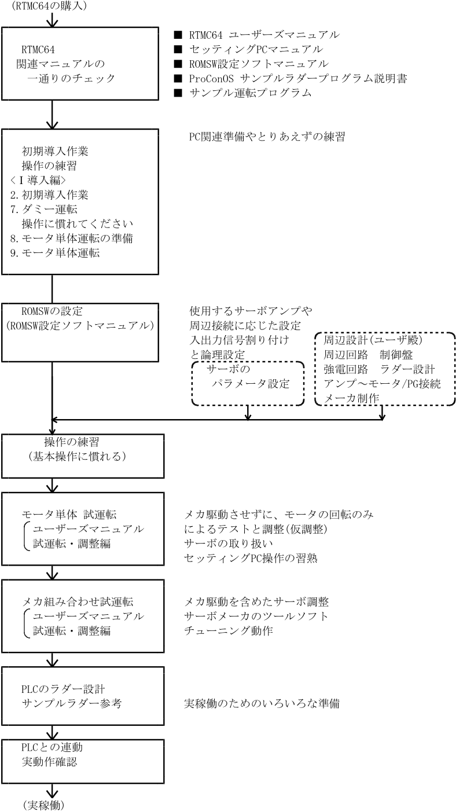

> **図の内容**
>
> （RTMC64の購入）から（実稼働）までの流れを箱と矢印で示した図。関連マニュアル（RTMC64 ユーザーズマニュアル、セッティングPCマニュアル、ROMSW設定ソフトマニュアル、ProConOS サンプルラダープログラム説明書、サンプル運転プログラム）の確認 → 初期導入作業 → ROMSWの設定 → 制御盤/モータ単体試運転 → メカ組合せ試運転 → PLCのラダー設計 → 実機での運転、の順。
> 縮小されていて、各箱の細かい文字は判読できず。

## 3. ROMSW(ロムスイッチ)の設定

セッティングPCの動作が確認できたら、ROMSW設定ソフトにより、「ユーザ設定ROMSW」を設定下さい。設定方法の詳細は、「ROMSW設定ソフトマニュアル」(TB00-1042)を参照下さい。

- 【注】ROMSWの基本画面で「仮想アンプ機能」をチェックすると、サーボアンプや入出力ユニットの接続がない状態でも、軸や信号を仮想的に動作できます。ユーザ開発ソフトやラダー単体のデバッグなどには有効な場合があります。

## 4. サーボパラメータ

- ◆1.2

RTMC64におけるサーボ(制御軸)に関するパラメータです。実機に応じて最適な値を設定します。セッティングPC「パラメータ画面」で設定します。

- 【注】 RTMC64のサーボパラメータとサーボアンプのパラメータとは、別物です。

サーボアンプのパラメータは各社のツールを使用して設定して下さい。

- 【例】安川電機Σサーボ: Σ-Win

Panasonic MINAS : PANATERM

サーボパラメータ設定画面

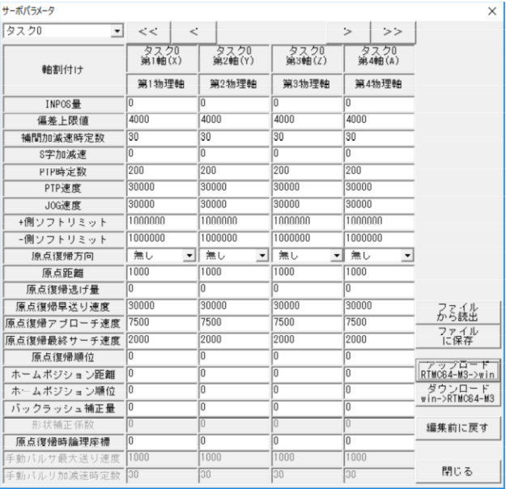

> **図の内容**
>
> 「サーボパラメータ」画面（タスク0、第1物理軸～第4物理軸＝タスク0 第1軸(X)～第4軸(A)）。項目: 軸割付け、INPOS量、偏差上限値、補間加減速時定数、S字加減速、PTP時定数、PTP速度、JOG速度、+側ソフトリミット、-側ソフトリミット、原点復帰方向、原点距離、原点復帰逃げ量、原点復帰早送り速度、原点復帰アプローチ速度、原点復帰最終サーチ速度、原点復帰順位、ホームポジション距離、ホームポジション順位、バックラッシュ補正量、形状補正係数（灰色）、原点復帰時論理座標、手動パルサ最大送り速度、手動パルサ加減速時定数。
> 表示されている値の例: 偏差上限値 4000、補間加減速時定数 30、PTP時定数 200、PTP速度・JOG速度 30000、ソフトリミット 1000000、原点距離 1000、原点復帰早送り速度 30000、アプローチ速度 7500、最終サーチ速度 2000。
> ボタン: ファイルから読出、ファイルに保存、アップロード RTMC64-M3->win、ダウンロード win->RTMC64-M3、編集前に戻す、閉じる。

### 4-1. 送り速度、加減速などのパラメータ

- ◆1.2
- ① PTP時定数

位置決め(PTP)、JOG動作の時の直線加減速の傾きを基準の速度に到達するまでの単位：[msec] 時間[msec]で設定します。

範囲：0～32767 ROMSWの「PTP時定数PTP速度基準」の設定により意味合いが変わります。

ROMSWの「PTP時定数PTP速度基準」:チェック無しの場合

- 0から100kppsに到達するまでの時間[msec]

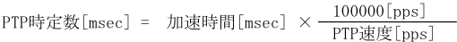

> **図の内容**
>
> PTP時定数[msec] ＝ 加速時間[msec] × 100000[pps] ／ PTP速度[pps]

PTP時定数[msec]

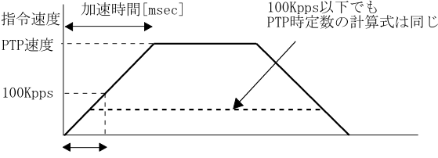

> **図の内容**
>
> 縦軸「指令速度」。台形の速度で、「PTP速度」まで上がる時間が「加速時間[msec]」。100Kpps に達するまでの時間を矢印で示している。「100Kpps以下でもPTP時定数の計算式は同じ」。

ROMSWの「PTP時定数PTP速度基準」: チェック有りの場合

- 0からサーボパラメータで設定するPTP速度に到達するまでの時間[msec] PTP時定数[msec]=加速時間[msec]

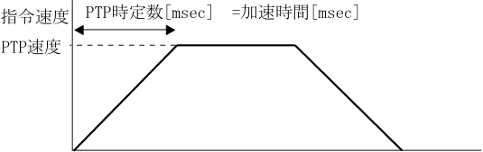

> **図の内容**
>
> 縦軸「指令速度」。台形の速度で、0 から「PTP速度」に達するまでの時間が「PTP時定数[msec] ＝加速時間[msec]」。

具体例:PTP速度 200Kpps を 100msec で立ち上げる時

「PTP時定数PTP速度基準」チェック無し:PTP時定数=50msec

「PTP時定数PTP速度基準」チェック有り:PTP時定数=100msec

PTP速度 50Kpps を 100msec で立ち上げる時

「PTP時定数PTP速度基準」チェック無し:PTP時定数=200msec

「PTP時定数PTP速度基準」チェック有り:PTP時定数=100msec

- ② PTP速度 PTP送りの速度
- ③ JOG速度 JOG送りの速度
- ※ 本マニュアルでの速度単位[pps]は[パルス/秒]です。

単位：[pulse/sec]

範囲：1～1000000000

単位：[pulse/sec]

範囲：1～1000000000

④ 補間時定数直線補間や円弧補間送りのときの加減速を指令速度に到達する時間[msec]で設定します。

指数形加減速 (補間送り)

範囲(指数)： 0～1000

単位：[msec] 一般的には、20～40msecを設定します。

軌跡精度を重視する場合は、なるべく小さな値にします。

この値を大きくすると、円弧補間の時に実際の半径が小さくなりますので注意下さい。

補間時定数(msec)

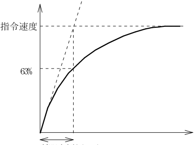

> **図の内容**
>
> 縦軸「指令速度」。指数関数的に上がる速度の曲線で、立ち上がりの接線と「指令速度」の線の交点までの時間が補間時定数。そのとき実際の速度は「63%」に達している。

マイナスの値を入れると、直線形の補間加減速をおこないます。<オプション>

指数形に比べて、円弧の半径縮小も小さく、コーナー部の軌跡誤差も軽減します。

|   制御周期[ms] |   上限[ms] |
|------------|----------|
|        0.5 |     1000 |
|        1.0 |     2000 |
|        2.0 |     4000 |
|        4.0 |     8000 |

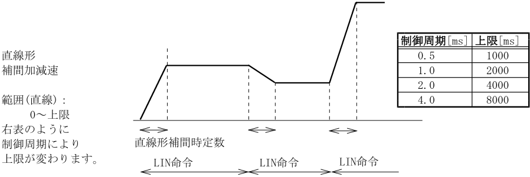

> **図の内容**
>
> - 左: 「直線形補間加減速」。範囲（直線）: 0～上限。右表のように制御周期により上限が変わります。
> - 中央: LIN命令が 3 つ続くときの速度。加減速の区間が「直線形補間時定数」
> - 右の表:
>   | 制御周期[ms] | 上限[ms] |
>   |---|---|
>   | 0.5 | 1000 |
>   | 1.0 | 2000 |
>   | 2.0 | 4000 |
>   | 4.0 | 8000 |

⑤ S字加減速(S字補間時定数) <オプション>

単位： [msec] 直線補間や円弧補間送りのときのS字補間の時定数を［msec］単位で設定します。

範囲：0～上限直線型補間加減速が前提です。

右表のように制御周期により上限が変わります。

S字の時定数は、直線型補間加減速の時定数の1/3以下と 1.0 してください。

直線補間加減速 + S字加減速

|   制御周期[ms] 上限[ms] |   制御周期[ms] 上限[ms] |
|-------------------|-------------------|
|               0.5 |               500 |
|               1.0 |              1000 |
|               2.0 |              2000 |
|               4.0 |              4000 |

Ts : S字加減速定数[ms]

Ta : 直線形補間時定数[ms]

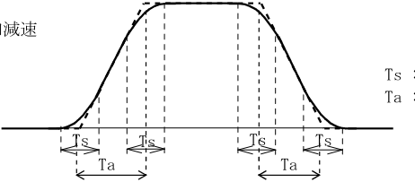

> **図の内容**
>
> 台形の速度（破線）の角を丸めた S 字の速度（実線）。加速と減速のそれぞれで、全体の時間が「Ta : 直線形補間時定数[ms]」、角を丸める区間が「Ts」（始めと終わりに 1 つずつ）。左端に本文の一部「…減速」。

詳細は<Ⅱ 機能編 5-3.補間加減速(指数形/直線形/S字形)>(TB00-1040E)を参照下さい。

### 4-2. ストロークリミットのパラメータ

◆1.2

① +側ソフトリミット

単位：[pls]

範囲：1～1000000000

② -側ソフトリミット

ソフトウェアにより、動作範囲を制限します。ソフトリミット値は[pls]単位で設定します。

この領域を越える移動指令があった場合、RTMC64は移動を停止して、アラームとなります。

この場合、サーボ主電源は落ちません。そのまま手動にてもどせます。

単位：[pls]

範囲：1～1000000000

ソフトリミットは、機械座標でチェックします。

設定できる最大値は1×109です。

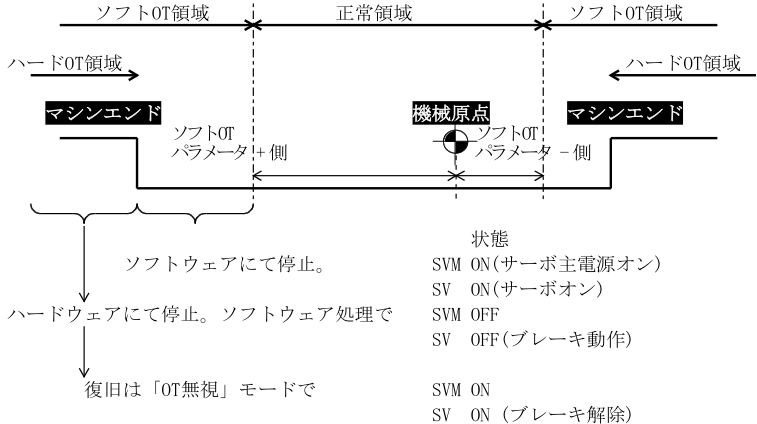

> **図の内容**
>
> - 中央が「正常領域」、両側が「ソフトOT領域」、さらに外側が「ハードOT領域」、両端に「マシンエンド」
> - 「機械原点」から左右の境界までが「ｿﾌﾄOTﾊﾟﾗﾒﾀ ＋側」「ｿﾌﾄOTﾊﾟﾗﾒﾀ －側」（図ではこの向きに書かれている）
> - ソフトOT領域: 「ソフトウェアにて停止。」状態 SVM ON(サーボ主電源オン)、SV ON(サーボオン)
> - ハードOT領域: 「ハードウェアにて停止。ソフトウェア処理で」状態 SVM OFF、SV OFF(ブレーキ動作)
> - 「復旧は「OT無視」モードで」SVM ON、SV ON（ブレーキ解除）


ハードウェアストロークリミットマシンエンドに配置したLS信号をサーボアンプへ入力(ハードOT)します。一般はB接論理で入力し､これがOFFするとサーボは緊急停止して、RTMC64 はサーボ主電源を落とします。

【注】

サーボアンプのソフトリミット機能は、RTMC64では通常は使いません。

### 4-3. 原点復帰の動作

◆1.3

関連パラメータの内容は、<7-8.原点復帰(メカ組み合わせ試運転)>を参照下さい。

原点復帰方式の選択は、ROMSWでの方式選択とサーボパラメータ「原点復帰方向」で選択します。詳細や原点復帰方式の選択については、

<Ⅱ機能編 5-22．原点復帰機能>(TB00-1040E) を参照下さい。

[ROMSW設定と原点復帰方式の関係]

| 原点復帰方式          | 特徴速度精度   | 特徴速度精度   | ROMSW設定原点復帰方式       | サーボパラメータ「原点復帰方向」   | 詳細説明         |
|-----------------|------------|------------|----------------------|---------------------|---------------|
| FBラッチ方式(原点信号あり) | 高速中速      | 高精度高精度    | FBラッチ原点復帰 (原点信号検出)   | 2段 ±方向 1段 ±方向       | 7-8-1. 7-8-2. |
| FBラッチ方式(原点信号なし) | 低速         | 高精度        | FBラッチ原点復帰 (原点信号検出なし) | 2段 ±方向※ 1段 ±方向※     | 7-8-3. 7-8-3. |
| DECサーチ方式        | 高速中速      | △ △        | DECサーチ原点復帰           | 2段 ±方向 1段 ±方向       | 7-8-4. 7-8-5. |
| FBラッチ方式(OT信号)   | 中速         | 高精度        | FBラッチ原点復帰 (OT信号検出)   | 2段 ±方向※ 1段 ±方向※     | 7-8-6. 7-8-6. |
| OTサーチ原点復帰       | 低速         | △          | OTサーチ原点復帰            | 2段 ±方向※ 1段 ±方向※     | 7-8-7. 7-8-7. |

※ 1段/2段原点復帰のどちらに設定しても、同じ動きをします。

FBラッチエンコーダのC相(Z相)とFB(フィードバック)パルス基準なので高精度で経年変化なし原点(DEC)信号 FBラッチとの組み合わせの時は、高速移動からの減速に使用。

DECサーチ方式では原点位置信号として使用

高速でDEC位置へ移動、その後減速してからラッチ信号やDECのエッジでサーチ比較的ゆっくりDEC信号へ向かって動き、最初のエッジを基準にラッチ信号やDECのエッジでサーチ

2段方式

1段方式

DECサーチ方式 C相(Z相)を使わない。DECのエッジの経年変化に注意が必要

OT信号

OT信号を基準位置とする。FBラッチ方式ではOT信号で反転してラッチ信号をサーチ OT原点復帰、OT信号FBラッチ方式のときはOT信号でエラーにせず、自動的に引き戻しします。

### 4-4. 全軸原点復帰の逃げ動作

- ◆1.2◆1.3
- ① 原点復帰逃げ量 (下図参照)

単位：[pls]

範囲：0(無効)

1000～1000000000

※原点復帰逃げ量は必ず減速LS、またはOTと原点との距離以上の充分な値 (2倍程度)として下さい。 (図のAの2倍)

全軸原点復帰時に原点付近（逃げ動作実施範囲）に軸がある場合は、原点からの逃げ動作 (正常領域内へ移動)を行い、その後で原点復帰を行います。

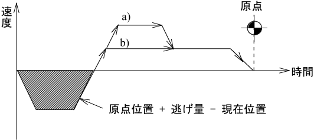

> **図の内容**
>
> 縦軸「速度」、横軸「時間」。最初に逆方向（下側、斜線の台形）へ「原点位置 + 逃げ量 － 現在位置」だけ動き、その後 a)、b) の速度で「原点」へ向かう。

原点復帰逃げ位置

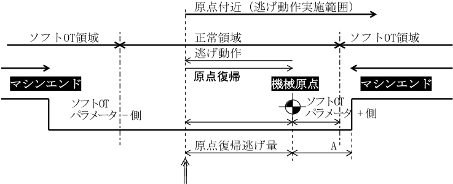

> **図の内容**
>
> - 中央が「正常領域」、両側が「ソフトOT領域」、両端に「マシンエンド」。機械原点の左右に「ソフトOTパラメータ －側」「＋側」
> - 「原点付近（逃げ動作実施範囲）」は、ある位置（⇑）から右の範囲
> - 「逃げ動作」で機械原点より左へ「原点復帰逃げ量」だけ離れてから、「原点復帰」で機械原点へ向かう
> - 機械原点からソフトOTパラメータ ＋側までが「A」

- 【注】名称は、「逃げ量」ですが、「逃げ位置」と考えてください。

「機械原点０からの逃げ位置までのオフセット量」を設定するため、逃げ量の値は、逃げるべき位置（座標）と同じ値を示しています。

原点復帰逃げ動作の詳細は、

<Ⅱ機能編 5-22-2．原点復帰逃げ動作>(TB00-1040E) を参照下さい。

### 4-5. 全軸原点復帰シーケンス(順位)

◆1.2◆1.3

①原点復帰順位

範囲：0～8

### 4-6. その他のパラメータ

◆1.2◆1.3

- ① INPOS量

全軸原点復帰の際に、数字の小さい順(0→1→2… )に原点復帰を行います。例) Z軸をまず原点復帰、その後でX,Yが同時に原点復帰開始 Zの順位 = 0 X, Yの順位 = 1

全軸原点復帰の詳細は、

<Ⅱ機能編 5-22-4．全軸原点復帰>(TB00-1040E) を参照下さい。

インポジションチェックを行う場合に設定して下さい。

単位：[pls]

範囲：0(無効)

1～1000000000

② 偏差量

詳細は、<Ⅱ機能編 5-9.インポジションチェック>(TB00-1040E)を参照下さい。

偏差がこの設定値を超えると「偏差過大エラー」になります。

単位：[pls]

範囲：1～1000000000

③ バックラッシュ補正量軸にバックラッシュがある場合に設定して下さい。

単位：[pls]

範囲：0～30000

詳細は、<Ⅱ機能編 5-17-1.バックラッシュ補正機能>(TB00-1040E)を参照下さい。

④ 形状補正係数<オプション> 軌跡形状補正を行う場合のパラメ-タです。

単位：[1/s]

使用しない場合は、ゼロにします。

範囲：0(無効)

1～30000

詳細は、<Ⅱ機能編 5-17-5. 形状補正(高精度輪郭制御)>(TB00-1040E)を参照下さい。

⑤ ホームポジション距離ホームポジション位置決めの目標値を機械座標系で指定します。単位：[pls] 詳細は、<Ⅱ機能編 5-23. ホームポジション位置決め機能>(TB00-1040E)を範囲：-1000000000 参照下さい。

～1000000000

⑦ 原点復帰時論理座標

単位：[pls]

範囲：-1000000000

～1000000000

⑥ ホームポジション順位ホームポジション位置決めを行う軸の順番を設定します。範囲：0～8 数字の小さい順に移動します。

詳細は、<Ⅱ機能編 5-23. ホームポジション位置決め機能>(TB00-1040E)を参照下さい。

原点復帰を完了した位置の論理座標をこの値にセットアップします。詳細は、<Ⅱ機能編 5-22. 原点復帰機能>(TB00-1040E)を参照ください。

⑧ 手動パルサ最大送り速度手動パルサで移動するときの速度制限を[pps]単位で指定します。

単位：[pps]

範囲：0～4000000

⑨ 手動パルサ加減速時定数手動パルサで移動するとき専用の指数形加減速の時定数です。単位：[msec] 指数形加減速の意味については、<4-1.送り速度、加減速などのパラメータ>

範囲：0～1000

を参照下さい。

## 5. セッティングPCでモータを回す

いよいよ実際の操作です。説明の流れに沿って、作業を進めて下さい。操作や機能の詳細は「セッティングPCマニュアル」を参照下さい。

- 【注】ROMSWの基本画面:「仮想アンプ機能」をチェックすると、サーボアンプの接続がない状態でも、軸を仮想的に動作できます。ユーザ開発ソフトやラダー単体のデバッグなどには有効な場合もあります。

### 5-1. 配線チェック

サーボや入出力回路の電源を入れる前には、必ず全ての配線をチェック(テスターチェック)して下さい。特に電源などの誤配線には充分気をつけて下さい。

### 5-2. RTMC64-M3/ECの起動

INtimeプロセス、テクノ認証デーモンが自動起動でない場合は立ち上げて下さい。

- ■ INtimeノード(NodeA)の手動起動

出荷時(インストール時)は自動起動に設定してあります。

1)Windowsタスクトレイに常駐しているINtimeのアイコンをクリックします。 2)メニューから「Start NodeA」をクリックします。

アイコンが黄色から紫色に変わります。

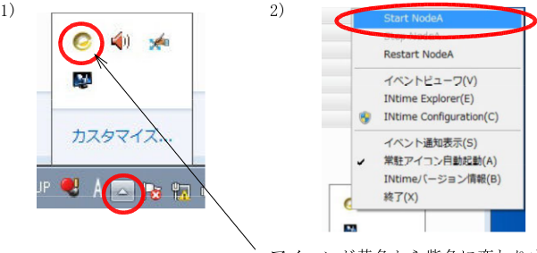

> **図の内容**
>
> 1) タスクトレイの「∧」を押して隠れたアイコンを表示し、INtime のアイコン（黄色）を選ぶ（赤丸）。
> 2) INtime のメニューで「Start NodeA」を選ぶ（赤丸）。メニュー: Start NodeA、Stop NodeA、Restart NodeA、イベントビューワ(V)、INtime Explorer(E)、INtime Configuration(C)、イベント通知表示(S)、常駐アイコン自動起動(A)、INtimeバージョン情報(B)、終了(X)。
> 本文: アイコンが黄色から紫色に変わります。

- ■ ライセンス認証デーモン(Rt64m3DM_enc.exe/Rt64ecDM_enc.exe)の手動起動インストール先の「RT64M3\Rt64m3DM_enc.exe」[M3] (「RT64EC\Rt64ecDM_enc.exe」[EC] )をダブルク

リックして実行してください。

【起動確認】

認証デーモン起動後は、Windowsタスクトレイにアイコンが表示されます。

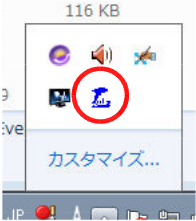

> **図の内容**
>
> タスクトレイの隠れたアイコン。認証デーモンのアイコン（青）が赤丸で囲まれている。上部に「116 KB」の表示がある。

### 5-3. セッティングPCの起動

- ■セッティングPCを起動します。 RT64M3DRV.EXE[M3] (RT64ECDRV.EXE[EC])のショートカットをダブルクリック
- 【運転画面】・運転画面を表示、ポジション表示が 0 になります。(正常状態)

### 5-4. セッティングPCソフトの練習

セッティングPCの機能や画面に慣れて下さい。(セッティングPCマニュアル参照) ただ、サーボ電源がオフなので、運転はまだできません。

「導入編 8.ダミー運転」も参照下さい。サーボなしでも「セッティングPC」の操作の練習ができます。

【運転画面】

RTMC64の内部情報(動作モード、動作状態、アラーム情報)や、RTMC64が制御する各軸ポジションのリアルタイム表示を行います。またRTMC64に対して、動作や状態変更の指令を行うこともできます。

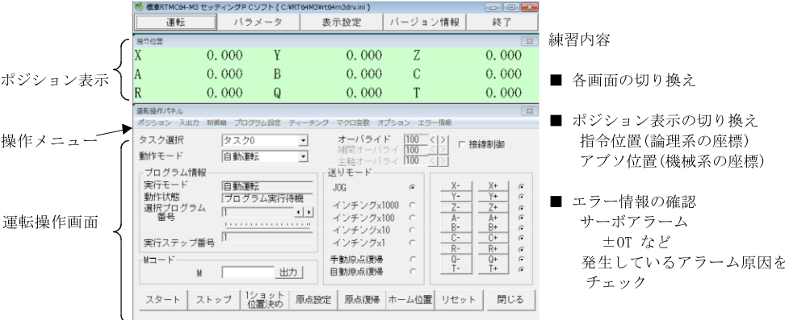

> **図の内容**
>
> セッティング PC の画面: 「ポジション表示」「操作メニュー」「運転操作画面」。練習内容:
> - ■ 各画面の切り換え
> - ■ ポジション表示の切り換え（指令位置（論理系の座標）、アブソ位置（機械系の座標））
> - ■ エラー情報の確認（サーボアラーム、±OT など、発生しているアラーム原因をチェック）

PLCのラダーまたはINtime上のC言語ソフト(IO処理)からも入出力信号の操作ができます。

- ※ 入出力信号はROMSWの「局設定」で信号を割り付ける必要があります。サンプルはテクノで提供しています。

【入出力モニタリング画面】

操作メニューの「入出力」「汎用入出力」をクリックすると以下の画面を表示します。 RTMC64の入出力の状態をリアルタイム表示します。また、入出力の状態を変更(強制設定)することもできます。


> **図の内容**
>
> 「入出力状態」画面。入力と出力それぞれに「ショートカット」（Rio、+OT、-OT、DEC、Task0～Task7）と、アドレス、チャンネル、標準信号名、ユーザー信号名の一覧。ON の信号が緑で表示されている。
> 細部は小さくて判読できず。

- ■ 入力信号の確認リミットSWなどが配線されていれば、ON/OFFさせて表示を確認して下さい。
- ■ 出力信号の確認 ONさせても安全な出力(リレーやソレノイド)であれば、強制出力

でON/OFFさせて下さい。

- ■ アラーム要因の排除 ±OT、非常停止などの入力を正常な状態にして下さい SWの配線や強制入力設定。
- ※ 「導入編 8.ダミー運転」も参照してください。

サーボアンプやモータ無しでも「セッティングPC」の操作や練習ができます。

### 5-5. RTMC64-M3/ECのバックアップ情報

RTMC64には、以下のようなバックアップ情報があります。

購入・導入直後の状態で、バックアップ情報の一部に破損があると、「バックアップエラー」になります。

ユーザが管理する情報

RTMC64により記憶する情報

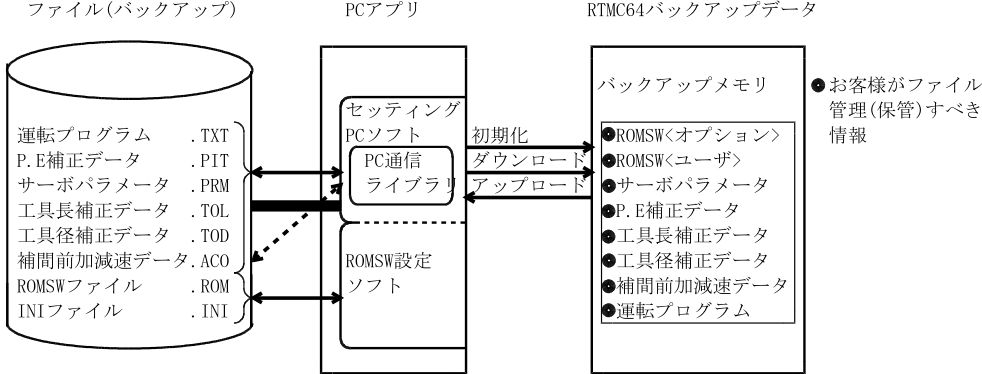

> **図の内容**
>
> - **ファイル(バックアップ)**: 運転プログラム .TXT、P.E補正データ .PIT、サーボパラメータ .PRM、工具長補正データ .TOL、工具径補正データ .TOD、補間前加減速データ .ACO、ROMSWファイル .ROM、INIファイル .INI
> - **PCアプリ**: 「セッティングPCソフト」（PC通信ライブラリ）と「ROMSW設定ソフト」
> - **RTMC64バックアップデータ**: 「バックアップメモリ」に ROMSW〈オプション〉、ROMSW〈ユーザ〉、サーボパラメータ、P.E補正データ、工具長補正データ、工具径補正データ、補間前加減速データ、運転プログラム
> - PCアプリ → RTMC64: 「初期化」「ダウンロード」、RTMC64 → PCアプリ: 「アップロード」
> - 「●お客様がファイル管理(保管)すべき情報」

■ パラメータ未設定エラー

セッティングPCからパラメータの「初期化」をおこなって､RTMC64のバックアップ情報がデフォルト値に初期化されているとき。

- ■ バックアップエラー

バックアップデータファイルの一部に破損があったとき。

### 5-6. バックアップエラー/パラメータ未設定エラーの解除

- a.「バックアップエラー」が生じた場合、セッティングPCの

パラメータバックアップデータ初期化

の操作で、「バックアップデータ初期化画面」を表示させます。

そこで、

パラメータ初期化プログラム初期化アブソポジション初期化マクロ変数初期化

を全ておこないます。

- ※本来は、消えた情報に対する初期化再設定で良いですが、初めの場合は、全てやり直す方法
- がわかりやすいです。
- b.初期化後は「パラメータ未設定エラー」となりますので、お客様があらかじめ保存しておいた

「サーボパラメータファイル」をダウンロードして下さい。

c.サーボパラメータのバックアップファイルがない場合万一、上記ファイルをなくしてしまったら、RTMC64内のデフォルトパラメータをアップロードしてください。アップロードしたままの情報をそのままダウンロードしても「パラメータ未設定エラー」は、解除できます。

- 【注】この場合、サーボパラメータは出荷時設定(デフォルト)になってしまいます。従ってメカ（システム）固有のサーボパラメータを新しく作り直す必要があります。

### 5-7. モータを回す

セッティングPCの機能や操作に慣れたら、いよいよモータを回します。

アラーム要因をクリアしておく必要があります。

最近のACサーボは、単独でも動作します。単独運転にてサーボアンプとモータ自体を事前にチェックして下さい。

#### 5-7-1.サーボ電源を入れる

「運転画面」が点滅している状態を確認して、サーボ電源を入れます。「運転画面」の「エラー情報」を開いて、全タスク選択でリセット → サーボオンします。

正常であれば、「サーボオン」し、モータがサーボロックします。

【サーボオンしない場合】

アラーム要因を調べます。

セッティングPCの「エラー情報」

- サーボアラーム
- → ・異常が発生している。
- ハードリミット(各軸OT) → ・B接入力でオープンになっている。
- 非常停止
- → ・B接入力でオープンになっている。
- 通信エラー
- → ・MECHATROLINK[M3](PDO[EC])通信エラー

【サーボが異常に動く】

急に回ったり、がたがた動く時は、サーボアンプやモータとの接続に問題があります。配線を再チェックして下さい。サーボの単独動作にて再確認して下さい。

<Ⅳメンテナンス編 1-6.サーボ関連の異常> を参照下さい。

### 5-8. 手動操作

【運転画面】にて、手動にてサーボを回します。「手動モード」にします。

【ジョグ送り】

X+ Y- などのキーを押します。

「送りモード」でJOG送りを選択

【インチング送り】

「送りモード」で×1、×10、×100などを選択操作は、ジョグ送りと同じです。

【オーバライド変更】 ▲ ▲ で%を変更

ジョグ送りの速さ(回転速度)が%に応じて増減します。

### 5-9. その他の基本的操作

運転画面リセットアラーム情報のクリア、サーボ電源投入。(選択されたタスク毎)

原点設定現在位置を論理系のゼロ(原点)とします。(選択されたタスク毎) 指令位置がゼロになります。

以上で「操作の練習」は終わりです!

押している間、モータは指定の方向に回ります。オーバライドを下げておきます。

## 6. サーボ系の制御性能

### 6-1. 機械の剛性の重要性

機械の剛性が高くなければ、高精度なサーボ系の調整は困難です。ユーザ(機械設計担当者)は、まず機械の剛性を高めることに努力して下さい。

| 機械の剛性                | 高(良)    | 低(悪)                  |
|----------------------|---------|-----------------------|
| 機械的「ガタ」              | ない      | ある                    |
| ねじりバネ要素              | 小 (かたい) | 大(やわらかい) 細くて長いボールネジなど |
| イナーシャ                | 小       | 大                     |
| ボールネジの張りタイミングベルトの張り | 強       | 弱                     |

### 6-2.制御系の良さ

制御系の良さとは、次のようなことです。

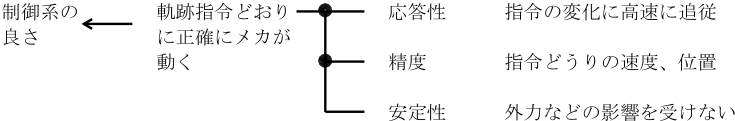

> **図の内容**
>
> 「制御系の良さ」←「軌跡指令どおりに正確にメカが動く」。その中身:
> - 応答性: 指令の変化に高速に追従
> - 精度: 指令どうりの速度、位置
> - 安定性: 外力などの影響を受けない

### 6-3. サーボ系の3重ループ

サーボ系は、図のような3重ループの制御になっています。

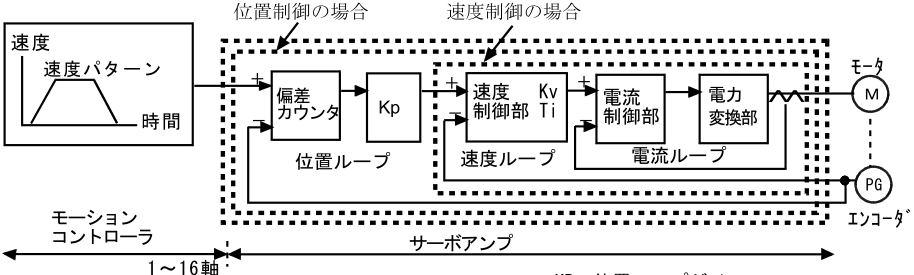

> **図の内容**
>
> 「速度パターン」から、「偏差カウンタ」→「Kp」（位置ループ）→「速度 Kv 制御部 Ti」（速度ループ）→「電流制御部」→「電力変換部」（電流ループ）→ モータ(M)。エンコーダ（PG）の信号が各ループに戻る。
> 点線の枠は「位置制御の場合」と「速度制御の場合」のサーボアンプ側の範囲。下に「モーションコントローラ（1～16軸）」と「サーボアンプ」の範囲。

位置制御型

サーボアンプ使用時

そのため、制御性能の責任は以下の順番で生じます。

サーボモータの特性サーボアンプの特性 PG(検出器の精度) > > メカ剛性

位置ループの特性電流ループ・速度ループサーボアンプまたはRTMC64 >

KP：位置ループゲイン

KV：速度ループゲイン

TI：積分時定数

### 6-4. RTMC64-M3/ECとサーボ系の関係

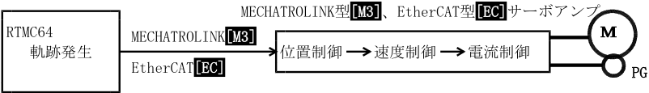

> **図の内容**
>
> 「RTMC64」の「軌跡発生」から「MECHATROLINK[M3]」または「EtherCAT[EC]」で「MECHATROLINK型[M3]、EtherCAT型[EC]サーボアンプ」へ。アンプの中は「位置制御」→「速度制御」→「電流制御」→ モータ(M)、PG。

### 6-5. サーボモータ応用時の一般的注意

#### 6-5-1. モータの選定

負荷イナーシャ、最高速度、加減速時間、1パルス移動量などの条件をもとに選定します。

(詳細は各サーボメーカの説明書を参照下さい。)

最近のACサーボは、加速性能は高いものの、定速回転(特に低速)での速度リップルが大きい傾向があります。サーボアンプの速度ループゲインを上げることで、このリップルを小さくします。

#### 6-5-2. 速度ループゲイン調整

- ① オートチューニング

最近のACサーボでは「オートチューニング」でも充分な調整が可能です。

まずは「オートチューニング」でトライしてみて下さい。

- ② マニュアルチューニング

サーボアンプのパラメータ調整にて、速度ループゲインを上げていきます。往復運転をしながら、速度ループゲインを上げていき、発振限界のゲインを探します。

メカのストロークに対して、中央/両端どの場所でも発振させない値にして下さい。

- 【注】 (1)発振させると、非常に大きな音が出て、メカ強度が不足(特にカップリングなど)している部分は、まれに壊れる可能性があります。発振が生じた場合は、すぐに速度ループゲインを大きく下げて発振を止めて下さい。
- (2)メカ調整(ボールネジ/ベルトの張りなど)により速度ループゲインの上限値は変わります。

#### 6-5-3. ACサーボの単体動作とパラメータ設定

6-3.サーボ系の３重ループ図に示したように、制御特性の調整はサーボアンプのパラメータ設定によりおこないます。

この場合、PCや設定器(各サーボアンプメーカ)による単体動作が基本です。

#### 6-5-4. 多軸のゲイン調整

複数軸で補間動作をさせ、軌跡精度を重視する応用では、以下のパラメータについては必ず同じ値を設定して下さい。

- ■ 位置ループゲイン
- ■ 補間加減速時定数(指数形/直線形)
- ■ Ｓ字加減速時定数

サーボアンプパラメータ

RTMC64のサーボパラメータ RTMC64のサーボパラメータ

#### 6-5-5. 設定・調整例

1)サーボアンプとRTMC64の分担

RTMC64とサーボアンプで同じ働きをする機能が有ります。同じ働きをする機能は基本的に下記の分担にします。

- モータ回転方向は、サーボアンプで設定する。
- OTは、サーボアンプのP-OT、N-OT、をB接(N.C)で使う。
- OT発生時は、DB停止
- サーボオフ時は、DB停止
- サーボアンプのソフトリミット機能は、使わない。(RTMC64の機能を使う)
- 原点信号DECをサーボアンプに取り込んでA接(N.O)で使う。
- ラッチ動作をさせる場合は、EXT1をA接(N.O)で使う。(通常は、使用しない)
- サーボアンプの加減速機能は、通常は使用しない。
- サーボアンプの原点復帰関連の機能は、使用しない。(RTMC64の機能を使う)
- ブレーキ制御が必要なときは、サーボアンプのBK出力をつかう。

2)安川電機Σサーボの設定・調整例

■マニュアルの準備

ΣⅤシリーズユーザーズマニュアルを必ず参照ください。

特に「設計・保守編」の3章「配線と接続」の「入出力信号の接続」、「入出力信号割り付け表」、 4章の「運転のための基本機能の設定」、「試運転」の項を充分にご確認下さい。

■ΣVのIO推奨設定 ○:標準的に使う △:必要な場合に使う

| 入力    | PIN   | 機能     |    | 出力    | PIN   | 機能     |    |
|-------|-------|--------|----|-------|-------|--------|----|
| P-OT  | 7     | OTP B接 | ○  | /BK   | 1,2   | ブレーキ出力 | △  |
| N-OT  | 8     | OTM B接 | ○  | /CLT  | 23,24 | トルク制限中 | △  |
| /DEC  | 9     | 原点     | ○  | /COIN | 25,26 | 位置決め完了 | △  |
| /EXT1 | 10    | ラッチ    | △  |       |       |        |    |
| /EXT2 | 11    | ラッチ    |    |       |       |        |    |
| /EXT3 | 12    | ラッチ    |    |       |       |        |    |
| /P-CL | 割付    | +電流制限  | △  |       |       |        |    |
| /N-CL | 割付    | -電流制限  | △  |       |       |        |    |

■パラメータの設定例

| パラメータ番号    | 名称          | 設定方法                                       |
|------------|-------------|--------------------------------------------|
| Pn000:0桁   | 回転方向        | 0:負荷側から見てCCWが正転 1:その逆                      |
| Pn001:1桁   | OT時の停止方法    | 1:OT時に減速停止後にサーボロック停止後に振動が発生する時はPn406を下げる  |
| Pn205      | マルチターンリミット | 絶対値エンコーダかつ無限回転軸のときに設定                      |
| Pn20E      | 電子ギヤ分子      | Bの値                                        |
| Pn212      | 電子ギヤ分母      | Aの値                                        |
| Pn50A:1□□□ |             | A:P-OT(CN1-7)B接 1881                       |
| Pn50B:□□□2 |             | B:N-OT(CN1-8)B接 8882 /P-CL、/N-CLを使う場合 6582 |
| Pn50E:□□□3 |             | /COIN出力(CN1-25,26) 0003                    |
| Pn50F:□1□2 |             | /BK(CN1-1,2)、/CLT(CN1-23,24) 0102          |
| Pn511:□□43 |             | DEC(CN1-9)でA接 EXT1(CN1-10)をA接 8843         |
| Pn801:□0□3 |             | ソフトリミットなし 0003                             |
| Pn80A～80F  |             | 独立位置決めの時の加減速                               |

※ □はパラメータの各一桁の数字を表します。

- ■Pn205 マルチターンリミットの設定【0】

絶対値エンコーダかつ無限回転軸の時、設定が必要です。

- モータm回転でメカ端n回転のとき、Σサーボのマルチターンリミットにm-1を設定ください (m,nは整数)。

nの値は、RTMC64-M3のROMSWの軸設定の「マルチターンリミット」に設定します。

■電子ギヤ

指令パルス × [B(分子)/A(分母)] = エンコーダ分解能

- ■絶対値エンコーダの場合

Σサーボのマニュアル「運転」「絶対値エンコーダ」を参照ください。

■調整

Σサーボのノーマルチューニングやアドバンスドチューニングを実施ください。

詳細は、同マニュアル「調整」を参照ください。

以下は、必ずご確認ください。また、必要であれば、マニュアルで再設定してください。

Pn100 速度ループゲイン往復動作時に発振しない範囲で、上限値

Pn101 速度ループ時定数発振しない範囲で、小さい値

Pn102 位置ループゲイン発振しない範囲で、上限値

多軸補間で軌跡制御する場合は、位置ループゲインをお互いに同じ値にする。

3)Σサーボ以外のサーボアンプの場合

「2)安川電機Σサーボ設定・調整例」を参考にして、各社のサーボマニュアルに従った調整を行ってださい。

- ■マニュアルの準備
- ■入出力信号の割り付け設定
- ■パラメータの設定(回転方向や停止時のDBなど)
- ■電子ギヤ設定
- ■絶対値エンコーダの設定、初期化
- ■絶対値エンコーダの場合のマルチターンリミットの設定
- ■ゲイン関係のパラメータ調整

## 7. 実際の試運転・調整(技術員、機械とりまとめの方へ)

RTMC64シリーズの試運転・調整は、以下の2段階でおこなって下さい。

■ 制御盤/モータ単体試運転メカ駆動なし。(モータのみ回転)

- ■ メカ組合せ試運転

メカ駆動ありの最終形。

また、使用するサーボアンプ・サーボモータの説明書についても充分理解された上で試運転を行って下さい。

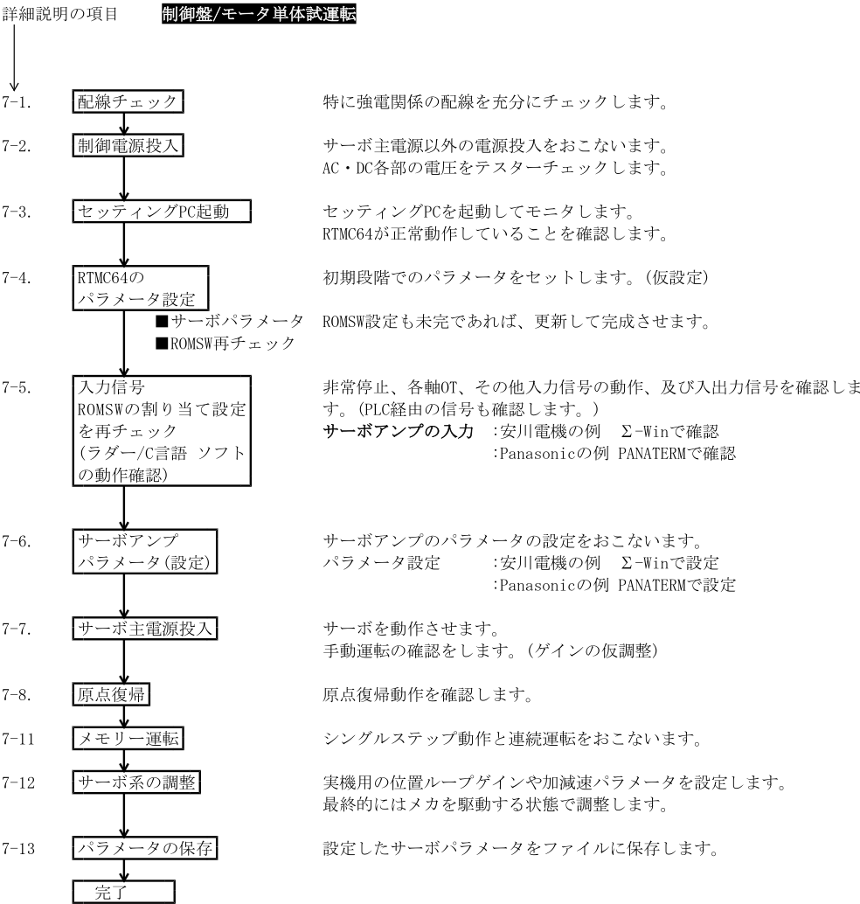

> **図の内容**
>
> 「詳細説明の項目」と「制御盤/モータ単体試運転」の手順。7-1 配線チェック、7-2 制御電源投入、7-3 セッティングPC起動、7-4 RTMC64のパラメータ設定、7-5 入力信号(ラダー動作確認)、7-6 サーボアンプのパラメータ設定、7-7 サーボ主電源投入、7-8 原点復帰、7-10 メモリー運転、7-12 サーボ系の調整、7-13 パラメータの保存、完了、の流れと、各項目の説明。
> 縮小されていて細かい説明文は判読できず。

メカ組合せ試運転

対象のマシンにより、各々詳細は異なります。ここでは代表的な例について説明します。リンク系のロボットや落下軸のあるマシンは、特にサーボオン/オフとブレーキのオフ/オンの関係に充分気をつけて下さい。

制御盤/モータ単体試運転が正常に完了していることを前提としています。

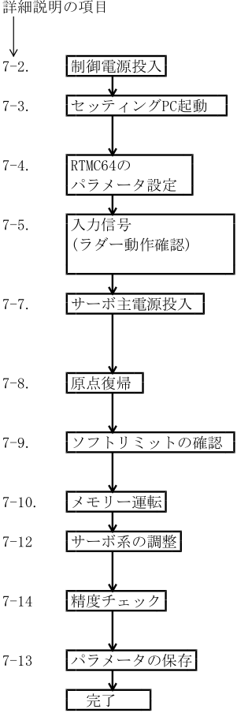

> **図の内容**
>
> 「詳細説明の項目」: 7-2 制御電源投入、7-3 セッティングPC起動、7-4 RTMC64のパラメータ設定、7-5 入力信号(ラダー動作確認)、7-7 サーボ主電源投入、7-8 原点復帰、7-9 ソフトリミットの確認、7-10 メモリー運転、7-12 サーボ系の調整、7-14 精度チェック、7-13 パラメータの保存、完了。
> 縮小されていて細かい文字は判読しにくい。

サーボ主電源以外の電源投入をおこないます。

セッティングPCを起動してモニタします。

RTMC64が正常動作していることを確認します。

- (確認) パラメータの確認をします。安全のため速度や(ゲイン)などは、最初は小さくします。

非常停止、各軸OT、その他入力信号の動作、及び入出力信号を確認します。

(PLCからの信号の確認を行います。)

サーボを動作させます。手動運転の確認をします。指令単位があっているか移動量を確認します。

(例 1p=1μmのとき100000pの移動指令で100mm動くかの確認)

原点復帰動作を確認します。

減速LS(DEC信号)とC(Z)相パルスの位置関係をチェックします。

ソフトリミットを設定します。

また、ハードOTとの位置関係もチェックします。

シングルステップ動作と連続運転をおこないます。

位置ループゲインや加減速パラメータを設定します。またモータの負荷電流などもチェックします。

当社モーションアナライザーTPCにより「サーボ応答」「軌跡精度」のチェックを行うことを推奨します。

設定したサーボパラメータをファイルに保存します。

### 7-1. 配線チェック(単体試運転)

配線チェックは大変重要ですので入念におこなって下さい。

信号ケーブル

強電配線

ケーブル製作時点で確実にチェックして下さい。特に混触や接触不良などは、試運転作業を大幅に遅らせる原因になります。必ず事前に充分なチェックをおこなって下さい。

電源関係の配線やリレー回路などは、配線ミスが焼損の原因になる場合があります。

必ず配線図と照合チェックして下さい。

また､線サイズ、端子カシメ、ネジ締めなどもチェックして下さい。

- 【注1】リレーコイルや電磁開閉器には、必ずサージサプレッサーを入れて下さい。
- 【注2】一般信号ケーブルと強電回路は配線経路を極力分離して下さい。
- 【注3】ケーブルのシールドは、アースプレートやクランプ用金具にて制御盤アースへ落として下さい。

### 7-2. 制御電源投入(単体試運転/メカ組合せ試運転)

サーボ主電源のMC(電磁開閉器)がONしないようにして下さい(7-6.までOFFのままです)。

また、非常停止スイッチもON(非常停止状態)させて下さい。

サーボ主電源以外(サーボ制御電源や入出力信号用電源など)の電源を投入します。

I/O用の電源のAC入力電圧及びDCの出力電圧などを確認して下さい。

### 7-3. セッティングPC起動(単体試運転/メカ組合せ試運転)

セッティングPCを起動して下さい。

通信エラーとなった場合はINtimeプロセス起動(Node A)を確認して下さい。(5-2.RTMC64-M3/ECの起動、 5-3.セッティングPCの起動を参照)

※ セッティングPCの使用方法は、「RTMC64-M3/ECセッティングPCマニュアル(TB00-1041)」を参照下さい。

### 7-4. RTMC64-M3/ECパラメータ設定(単体試運転/メカ組合せ試運転)

◆1.2

RTMC64の出荷時には、標準的なパラメータが設定されています(デフォルトパラメータ)。

セッティングPCの【パラメータ編集画面】にて確認下さい。

以下を参照して適切なパラメータを設定(ダウンロード)し、ファイルも保存して下さい

- 本マニュアル試運転調整編4.サーボパラメータ
- セッティングPCマニュアル

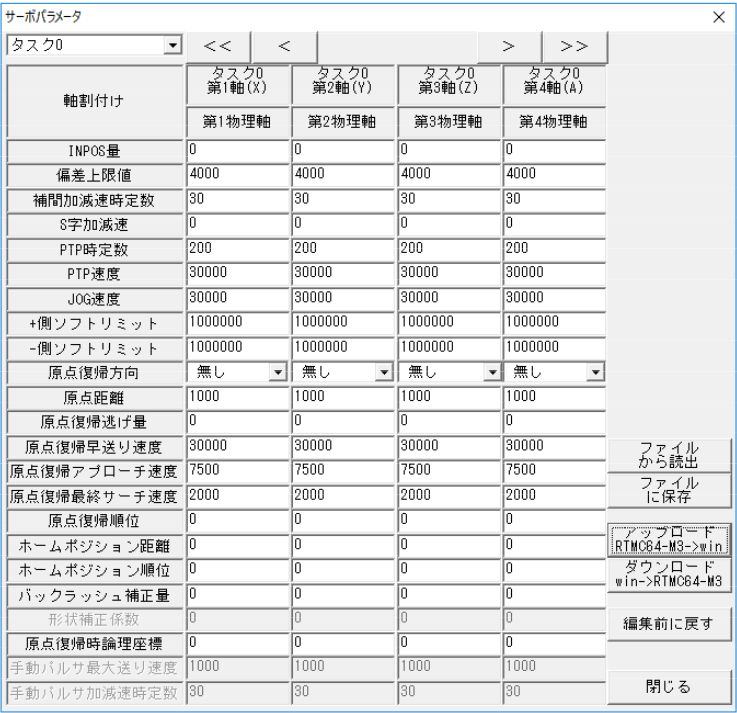

> **図の内容**
>
> 「サーボパラメータ」画面（タスク0、第1物理軸～第4物理軸）。4 章の画面と同じ項目と値（偏差上限値 4000、補間加減速時定数 30、PTP時定数 200、PTP速度・JOG速度 30000 など）。
> 細部は小さくて判読しにくい。

### 7-5. 入力信号の確認(単体試運転/メカ組合せ試運転)

#### 7-5-1. 信号モニタによるチェック

原点信号やOT信号をサーボアンプへ接続している場合は、各サーボメーカのツールソフト側で確認します。

【例】安川電機 Σサーボ : Σ-Winの【入力信号モニタ】や【出力信号モニタ】

Panasonic MINAS : PANATERMの【モニタ】

OMRON OMNUC G5

: CX-Drive

山洋電気 SANMOTION: SETUP S/W

日機電装 VCⅡ : Data Editing S/W【状態表示】

#### 7-5-2. ROMSW「局設定」の入出力信号割り付けの確認

M/Eスレーブの入出力信号はROMSW設定で論理信号に割り付ける必要があります。設計通りに割り付けられていることを確認して下さい。

#### 7-5-3. ソフトウェアPLCまたはINtime上のC言語ソフトの確認

ソフトウェアPLCまたはINtime上のC言語ソフトから入出力信号を操作することができます。

外部入出力信号との重複に注意してください。

サンプルを参照し、処理を作成・確認してください。

#### 7-5-4. 汎用入出力(セッティングPC)モニタ画面によるチェック

セッティングPCの「入出力情報」画面により、使用している入/出力が正常動作していることを確認します。

単体試運転で外部スイッチがない時は、端子台などでショート/オープンさせてチェックします。

メカ組合せ試運転ではLSや近接SWをオン/オフさせてモニタ画面の1/0でチェックします。

入出力モニタリング画面

操作メニューの「入出力」「汎用入出力」をクリックすると以下の画面を表示します。

RTMC64の入出力信号の状態をリアルタイム表示します。また、入出力の状態を変更(強制設定)する事もできます。

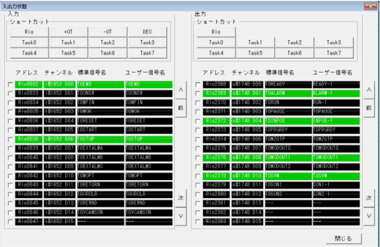

> **図の内容**
>
> 「入出力状態」画面。5-4 の画面と同じ構成（ショートカット、アドレス、チャンネル、標準信号名、ユーザー信号名。ON の信号は緑）。
> 細部は小さくて判読できず。

#### 7-5-5. 非常停止関係のチェック

「非常停止」や「OT入力」でサーボ主電源断(RTMC64からのSVM OFF) することをチェックします。単体試運転ではB接点のOT等は端子台でショートするか、強制入力設定などして正常状態として下さい。

非常停止入力を解除して電源投入します。サーボ主電源が投入されます。

サーボ主電源がONした状態で、「非常停止」及び「各OT入力」(B接点のショートなら、オープンにする) にて、主電源断になることを確認して下さい。

サーボ主電源が入らない場合は、他にアラーム要因があります。

セッティングPCのモニター画面にて、アラーム要因を確認して下さい。


<ブレーキ電源チェック>

上下軸の場合、ブレーキの動作チェックをします。サーボフリーのまま、ブレーキ解除しますので、落下防止の処置(材木などによる支え)をして下さい。

SVM ONにて、ブレーキ電圧が発生し、ブレーキは解除します。ブレーキ解除のディレータイムも長め(2～3秒)に設定して下さい。

### 7-6. サーボアンプのパラメータ設定

使用するサーボやパルスモータアンプの設定をおこないます。具体的設定方法は各アンプメーカの説明を参照下さい。

また、基本的な考え方は、本マニュアルの<6.サーボ系の制御性能><6-5-5.設定・調整例>を参照下さい。

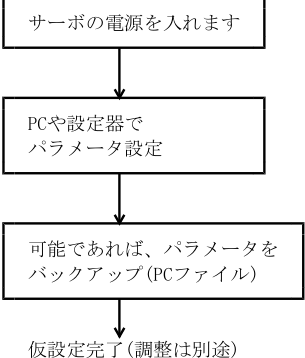

> **図の内容**
>
> 「サーボの電源を入れます」→「PCや設定器でパラメータ設定」→「可能であれば、パラメータをバックアップ(PCファイル)」→「仮設定完了(調整は別途)」

必要であれは、RTMC64の強制出力にて主電源回路ON

使用上の設定(<6-5-5.>参照)

速度ループゲイン/位置ループゲインは低め

### 7-7. サーボ主電源投入(単体試運転/メカ組合せ試運転)

非常停止やOTを解除して電源投入を行うとサーボ主電源が入ります。非常停止ボタンに手をおいて電源投入して下さい。

乱調や急な動作をした場合は、すぐに非常停止を押して下さい。

サーボロックを確認後、JOG操作により +方向、-方向に動かして様子を見ます。設定したストロークリミットを越えないように注意して下さい。

<指令単位の確認>

念のため指令単位に間違いがないか確認します。

例 1p = 1μm 100000pの送りで100mm移動

例 1p = 0.001ﾟ 90000pの送りで90ﾟ移動

異る場合メカ諸元(ギヤ比、ボールネジなど)を確認下さい。また、「電子ギヤ」(サーボアンプのパラメータ)の設定が必要な場合もあります。

<サーボが乱調したとき>

(単体試運転)

配線不良やサーボアンプのパラメータ設定不良の可能性があります。安川Σ-WinやPanasonicPANATERMなど、各社のサーボツールで、サーボモータ単体で動作させてください。

### 7-8. 原点復帰(メカ組合せ試運転)

- ◆1.2◆1.3

原点復帰方式は、ROMSWでの方式選択とサーボパラメータによる選択・調整があります。はじめは、1軸ずつで、早送り速度(PTP速度)・アプローチ速度などはなるべく低速に設定してテスト

して下さい。(安全のため)

※原点復帰機能は再現性を保つため、オーバーライドが効かない（１００％として動作する）仕様です。サーボパラメータで各種速度を変更しながら慎重に設定・動作確認をしてください。

原点ドグのエッジとC(Z)相パルス信号が充分離れている必要があります。図の距離(A)を確認して下さい。 Aの値(ドグとC相間の距離)は、原点復帰の完了時にセッティングPC「相対移動量」に表示されます。

この時表示される値は、任意分周や電子ギアを掛けていない値です。

アプローチ速度が速いと値のバラツキがありますので、何回おこなっても以下の条件を満足するように、原点ドグ位置やC(Z)相を調整下さい。

安全に動作する事を確認したら、速度関係のパラメータを変更し、効率的な原点復帰動作に設定ください。

■アブソエンコーダの軸の場合

設定などは、7-8-8.「絶対値エンコーダの軸の設定」を参照下さい。

ただし、以下の理由でアブソ仕様軸でも通常の機械原点復帰を先に確認しておく事を推奨します。アブソエンコーダのバックアップエラーなどで、再度アブソポジションクリアをして、機械原点を再設定する場合があります。以前と正確に同じ位置で設定するためには、機械原点復帰が必要です。

[ROMSW設定と原点復帰方式の関係]

| 原点復帰方式          | 特徴速度精度   | 特徴速度精度   | ROMSW設定原点復帰方式       | サーボパラメータ「原点復帰方向」   | 詳細説明         |
|-----------------|------------|------------|----------------------|---------------------|---------------|
| FBラッチ方式(原点信号あり) | 高速中速      | 高精度高精度    | FBラッチ原点復帰 (原点信号検出)   | 2段 ±方向 1段 ±方向       | 7-8-1. 7-8-2. |
| FBラッチ方式(原点信号なし) | 低速         | 高精度        | FBラッチ原点復帰 (原点信号検出なし) | 2段 ±方向※ 1段 ±方向※     | 7-8-3.        |
| DECサーチ方式        | 高速中速      | △ △        | DECサーチ原点復帰           | 2段 ±方向 1段 ±方向       | 7-8-4. 7-8-5. |
| FBラッチ方式(OT信号)   | 中速         | 高精度        | FBラッチ原点復帰 (OT信号検出)   | 2段 ±方向※ 1段 ±方向※     | 7-8-6.        |
| OTサーチ原点復帰       | 低速         | △          | OTサーチ原点復帰            | 2段 ±方向※ 1段 ±方向※     | 7-8-7.        |

※1段/2段原点復帰のどちらに設定しても、同じ動きをします。

FBラッチエンコーダのC相(Z相)とFB(フィードバック)パルス基準なので高精度で経年変化なし。原点(DEC)信号 FBラッチとの組み合わせの時は、高速移動からの減速に使用。

DECサーチ方式では原点位置信号として使用

2段方式

高速でDEC位置へ移動、その後減速してからラッチ信号やDECのエッジでサーチ

1段方式

比較的ゆっくりDEC信号へ向かって動き、最初のエッジを基準にラッチ信号やDECのエッジでサーチ

DECサーチ方式 C相(Z相)を使わない。DECのエッジの経年変化に注意が必要

OT信号

OT信号を基準位置とする。 FBラッチ方式ではOT信号で反転してラッチ信号をサーチ OT原点復帰、OT信号FBラッチ方式のときはOT信号でエラーにせず、自動的に引き戻しします。

[サーボパラメータ]

◆1.2◆1.3

① 原点復帰方向

原点復帰の方向と段数を選択します。

範囲：無し

±方向２段

±方向１段

② 原点距離

無しを選択することで、原点復帰を動作をしないようにします。

サーチするC(Z)相やDEC信号からの距離を[pls]単位で設定します。

単位：[pls]

範囲：-1000000000

～1000000000

③ 原点復帰早送り速度

原点復帰早送り速度を[pps]単位で設定します。

単位：[pps]

範囲：1～1000000000

④ 原点復帰アプローチ速度原点復帰アプローチ速度を[pps]単位で設定します。

単位：[pps]

範囲：1～1000000000

⑤ 原点復帰最終サーチ速度原点復帰最終サーチ速度を[pps]単位で設定します。

単位：[pps]

範囲：1～1000000000

[以降の図の表記]

a: 原点復帰早送り速度 (RTMC64のサーボパラメータ)

b: 原点復帰アプローチ速度 (RTMC64のサーボパラメータ)

- c: 原点復帰最終サーチ速度 (RTMC64のサーボパラメータ)
- S: 原点距離

(RTMC64のサーボパラメータ)

A: 原点信号～C(Z)相間距離原点復帰の直後にセッティングPC「相対移動量」に表示

[ラッチ信号]

ROMSWの軸設定「原点復帰FBラッチ信号」で、C(Z)相、EXT1、EXT2、EXT3(RTMC64-M3の場合)の信号の中からラッチ信号を選択。

(RTMC64-ECの場合はC(Z)相、EXT1、EXT2です。)

[原点復帰時の条件] 注意!

|OFS| < A < |PLS-OFS|

Aがこの範囲でない場合は、ドグ位置または、Z(C)相を再調整すべきです。

PLS : モータ1回転パルス数[pulse]

OFS < PLS ÷ 4

OFS = (FEED × RTC × 6) ÷ 1000

FEED: 原点復帰速度、アプローチ速度[pps]

RTC : RTC(制御)周期[msec]

A : 原点信号とC(Z)相間の距離[pulse]

#### 7-8-1. 《FBラッチ方式(原点信号あり) ±2段原点復帰》

7-8-2. 《FBラッチ方式(原点信号あり) ±1段原点復帰》

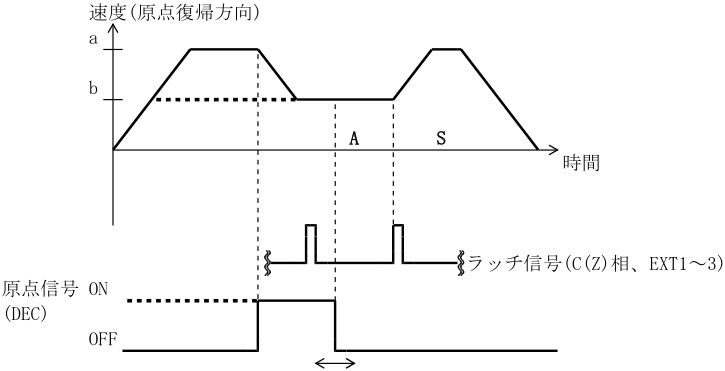

> **図の内容**
>
> 縦軸「速度(原点復帰方向)」（a、b の高さ）、横軸「時間」。速度 a で進み、原点信号（DEC）が ON になると b に下がり、OFF になったあと最初の「ラッチ信号(C(Z)相、EXT1～3)」から距離 A、S を動いて止まる。破線は 1 段原点復帰の場合の速度。

速度(原点復帰方向)

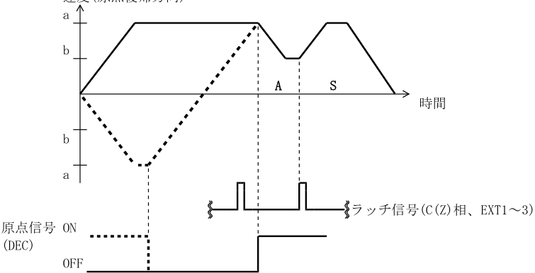

> **図の内容**
>
> 速度 a で原点復帰と逆の方向（下側、破線）へ動いて原点信号（DEC）の外に出てから、原点復帰方向へ a で進み、b に下がり、ラッチ信号のあと A、S を動いて止まる。縦軸の上下に a、b の目盛りがある。

#### 7-8-3. 《FBラッチ方式(原点信号無し)》

※1段/2段原点復帰のどちらに設定でも、同じ動きをします。

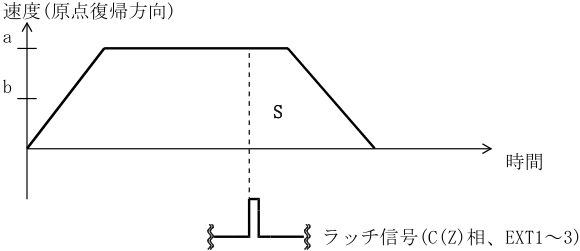

> **図の内容**
>
> 縦軸「速度(原点復帰方向)」（a、b）。速度 a まで上がって進み、「ラッチ信号(C(Z)相、EXT1～3)」のあと S を動いて止まる。

#### 7-8-4. 《DECサーチ方式 ±2段原点復帰》

7-8-5. 《DECサーチ方式 ±1段原点復帰》

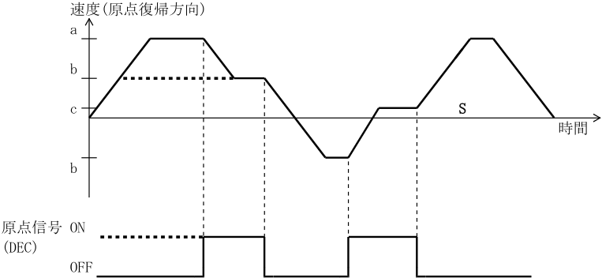

> **図の内容**
>
> 縦軸「速度(原点復帰方向)」（a、b、c）。速度 a で進み、原点信号（DEC）が ON で b に下がり、OFF で逆方向へ戻り、再び ON になったら c で進んで、OFF のあと S を動いて止まる。破線は 1 段原点復帰の場合。

速度(原点復帰方向)

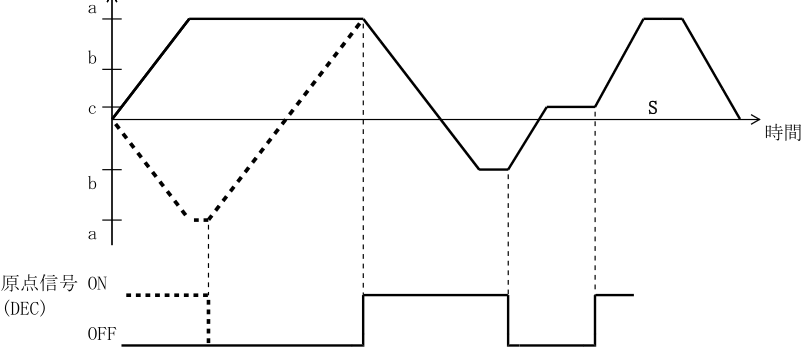

> **図の内容**
>
> 速度 a で逆方向（下側、破線）へ動いて原点信号（DEC）の外に出てから、原点復帰方向へ a で進み、DEC の ON/OFF に合わせて方向を変え、最後に S を動いて止まる。

#### 7-8-6. 《FBラッチ(OT信号)》(1段/2段は、同じ動作)

【注】 a:OTに突入するので、原点復帰早送り速度は、低めにして下さい。

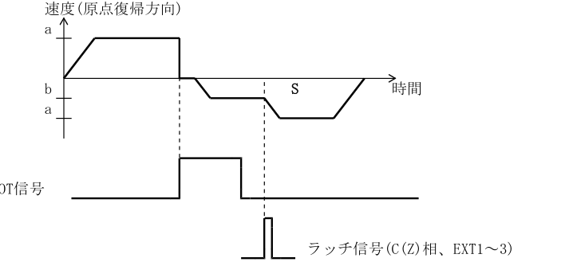

> **図の内容**
>
> 縦軸「速度(原点復帰方向)」（a、b）。速度 a で進んで OT信号が ON になると止まり、逆方向へ b で戻る。OT信号が OFF になったあとの「ラッチ信号(C(Z)相、EXT1～3)」から S を動いて止まる。
> 本文: 【注】a:OTに突入するので、原点復帰早送り速度は、低めにして下さい。

#### 7-8-7. 《OTサーチ原点復帰》(1段/2段は、同じ動作)

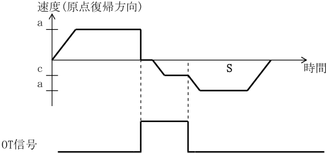

> **図の内容**
>
> 縦軸「速度(原点復帰方向)」（a、c）。速度 a で進んで OT信号が ON になると止まり、逆方向へ c で戻る。OT信号が OFF になったあと、さらに a の速度で S を動いて止まる。

- 【注1】 s: 原点距離は、原点復帰方向によらず、+の値で設定してください。

-値を設定すると異常な動作となります。OTサーチを繰り返して、動作が終了しません。

- 【注2】 a: OTに突入するので、原点復帰早送り速度は、低めにして下さい。

#### 7-8-8. 絶対値エンコーダの軸の設定 (安川電機製ΣVサーボの例)

- ◆1.3

絶対値エンコーダ(Σサーボのアブソエンコーダ)を使用する場合、以下の手順で設定下さい。

①絶対値エンコーダを有効とする設定

- ①-1.RTMC64のROMSWの設定

ROMSWの軸設定画面で"絶対値エンコーダ"にチェックし、ダウンロードします。

RTMC64再起動後に有効になります。設定後は必ずRTMC64を初期から再起動して下さい。

- ①-2.Σサーボの設定

Σ-WinにてPn002の2桁目を"1"に設定し、絶対値エンコーダを有効にします。

サーボアンプの再起動後有効になります。設定後は必ずサーボアンプの電源をOFF→ONしてください。

- ②絶対値エンコーダのセットアップ(Σサーボ)

以下の場合、絶対値エンコーダのセットアップ(初期化)が必要です。

- a. 機械の最初の立ち上げのとき(初回)
- b. 「エンコーダバックアップアラーム」が発生したとき(Σサーボの時は(A.810))
- c. 「エンコーダサムチェックアラーム」が発生したとき(Σサーボの時は(A.820))

サーボ各社のマニュアルに従ってエンコーダのセットアップを行って下さい。

(例:Σサーボの時はΣ-Winもしくはディジタルオペレータからセットアップ)

詳細は、各社のサーボのマニュアルを参照下さい。

- ③原点復帰&アブソポジションクリア
- ③-1.絶対値エンコーダ使用軸以外の軸も含め)全軸、原点復帰を完了してください。絶対値エンコーダ使用軸で原点復帰ができない(原点信号やOTが無い)軸は、原点復帰方法(※)

を"無効"にし、機械原点とする位置へ移動して下さい。

- ③-2.全軸が機械原点にいる状態で、セッティングPCからアブソポジションクリアを行います。 (アブソエンコーダの位置とRTMC64の座標との関係を記憶します。) アブソポジションクリアは、セッティングPCの【バックアップデータ初期化画面】で"アブソポジション初期化"ボタンを押します。
- ③-3.以後、絶対値エンコーダ使用軸は原点復帰が不要です。

絶対値エンコーダ使用軸の原点復帰方向(※)を"無効"に設定して下さい。

- 【注】以下の場合は、再度③-1からの手順が必要です。
- a. RTMC64の"バックアップエラー"
- b. 誤って、RTMC64の"アブソポジションクリア"を行った場合
- c. Σサーボの"エンコーダバックアップアラーム
- ※ 原点復帰方向は、セッティングPCの【サーボパラメータ画面】から設定します。
- ■アブソ仕様軸での原点信号の準備

アブソエンコーダのバックアップエラーなどで、再度アブソポジションクリアーをして、機械原点を再設定する場合があります。以前と正確に同じ位置で設定するためには、機械原点復帰が正常に動作できる事が重要です。

そのため、アブソ仕様の軸でも、原点信号を準備して、通常の機械原点復帰を可能としておくことを推奨します。

- 【注】上記は安川電機のΣVの例です。他社のサーボアンプを使用されているときは、項①-2、項②はサーボメーカ各社の手続きに従って絶対値エンコーダの設定を行って下さい。

#### 7-8-9. 同一指令2軸制御での原点復帰

◆1.3

同一指令2軸制御(平行軸)の原点復帰では、2軸のDEC信号やZ相パルスの発生位置に注意ください。方式によっては、両軸での発生位置を合わせる必要もあります。

| 原点復帰方式                  | 原点復帰方式   | 2軸の各信号の位置合わせの必要性 - 原点(DEC)/OT   | 2軸の各信号の位置合わせの必要性 - Z(C)相/EXT1～3 ※   | 同一指令2軸への適用        |
|-------------------------|----------|---------------------------------|-------------------------------------|--------------------|
| FBラッチ                   | 2段       | DEC ①                           | ②                                   | 推奨                 |
| (原点信号あり) FBラッチ (原点信号なし) | 1段 2段 1段 | DEC ① 使用せず                      | ② ラッチ前後で同じ速度なので、位置が異なっても問題なし。     | 推奨(安全) 推奨          |
| FBラッチ (OT信号)            | 2段 1段    | OT エッジが同じ位置                     | ②                                   | 推奨                 |
| DECサーチ                  | 2段       | DEC 両エッジとも同じ位置                  | 使用せず                                | 不向き。 Z相(EXT)基準でな   |
| OTサーチ                   | 1段 2段 1段 | ONエッジのみ同じ位置 OT エッジが同じ位置         | 使用せず                                | 同一指令2軸には、いと精度が悪い。 |

① 原点(DEC)信号

両軸の原点信号(DEC)の前のエッジ位置があっている方がベターです。

(1段では前のエッジのみです。2段では前後の両エッジがありますが、後ろのエッジの位置は多少ずれていても問題なしです。)

前のエッジ位置が異なる場合サーボパラメータの「原点復帰早送り速度a」と「原点復帰アプローチ速度b」が同じであれば、問題ありません。

- ② Z相(またはEXT)

両軸のZ相(またはEXT)の位置があっているのがベターです。

異なる場合

「原点復帰早送り速度a」と「原点復帰アプローチ速度b」が同じであれば、問題ありません。

- ■原点距離(サーボパラメータ)の調整

両軸の原点距離(サーボパラメータ)は、原点復帰の完了で正確に平行になるように調整下さい。

- ■平行軸のOT信号位置

お互いの軸のOT発生位置をできるだけ合わせてください。

起動時にOTでの折り返しによる原点復帰を行う場合があります。

また、万一OTとなる場合、片軸だけでなく両軸ともOT発生となる方が自然です。

- ■DEC/OT信号の並列入力

上記の理由からDECやOTは、同じセンサーの信号を両軸用として並列配線する方法が現実的です。

- ※ RTMC64-M3(MECHTROLINK)の場合は、EXT1～EXT3の信号が選択できます。

RTMC64-EC(EtherCAT) の場合は、EXT1、EXT2の信号が選択できます。

### 7-9. ソフトリミットの設定(メカ組合せ試運転)

全軸が原点復帰した位置にて、最終的なソフトウェアストロークリミット（ソフトリミット）のパラメータを設定してください。


- その位置(機械座標値)より、すこし内側に+(-)ソフト
- +(-)OTになるまでゆっくりと移動。リミットを設定。
- ※ 機械原点位置を変更した場合には、ソフトリミットの再設定が必要です。

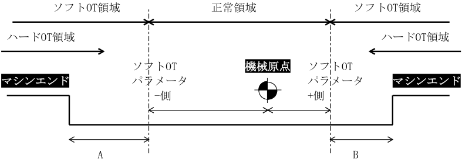

> **図の内容**
>
> 中央が「正常領域」、両側が「ソフトOT領域」、外側が「ハードOT領域」、両端に「マシンエンド」。「機械原点」の左右に「ソフトOTパラメータ －側」「＋側」。マシンエンドからソフトOTの境界までが A（左）、B（右）。

AやBの値は、大きい方が安全ですが、その分正常領域が狭くなります。

<ハードOT領域>

ハードOTから実際のマシンエンドまでの距離も大きい方が安全ですが、現実には数10mmが一般的です。

ある程度の高速でハードOTに入った場合は、惰走でマシンエンドにぶつかる可能性があります。マシン設計においては、物理的な安全策(メカダンパーなど)を必ずおこなって下さい。

### 7-10. メモリー運転(単体試運転/メカ組合せ試運転)

代表的な運転プログラムを作成し、運転して下さい。また「出力制御」や「入力処理」についても、各々の機械仕様に合せて作成して下さい。

<概略手順>

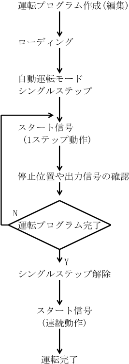

> **図の内容**
>
> 1. 運転プログラム作成（編集）
> 2. ローディング
> 3. 自動運転モード、シングルステップ
> 4. スタート信号（1ステップ動作）
> 5. 停止位置や出力信号の確認
> 6. 運転プログラム完了？ N なら 4 に戻る。Y なら次へ
> 7. シングルステップ解除
> 8. スタート信号（連続動作）
> 9. 運転完了

#### 7-10-1. サーボ調整用運転プログラム

サーボ調整用としては、1軸毎の往復動作でPTP動作(直線形加減速)と直線補間(指数形加減速)で作成して下さい。

例 PTPA X0;

CALL SUB L100;

```c
    CALL SUB L100;  /* 100往復 */
    END;
```

:SUB

LIN X100000 F100000;

TIM0.1;

※1

LIN X-100000;

TIM0.1;

※1

END;

- ※1 サーボアンプの速度ループゲインの上限値(発振限界)の確認では、往復での折り返し時に、少しタイマーを入れる事を推奨します。

停止/折り返しによって、静止摩擦と動摩擦の両方の影響が確認ができます。

#### 7-10-2. メモリー運転の注意事項

<ソフトリミットエラー>

操作ミス等でソフトリミットになると停止します。手動モードでは、戻す方向には操作できます。

<ハードOTエラー>

(メカ組合せ試運転)

ハードOTを越えた場合は以下のように対処して下さい。

- a. 機械が手でもどる場合は、もとの位置にもどします。
- d. 「OT無視モード」にして、リセット入力するとアラームは消えます。安全を充分に確認してジョグ送りにて戻して下さい。

復旧後は「OT無視モード」をすみやかに解除(正常なモードに戻す)して下さい。

<安全な位置への移動>

(メカ組合せ試運転)

ジョグ動作した軸については、機械構造や周囲との関係、他の軸との関係から最も安全と思われる位置に移動して、他の軸のチェックへ移行して下さい。

<落下軸の注意> (メカ組合せ試運転)

正常なサーボロックを確認するまで、落下防止機構ははずさないで下さい。

<ゲインの仮調整>

ジョグ動作でなめらかにモータが回転するように、速度ループゲインや位置ループゲインを仮調整して下さい。
