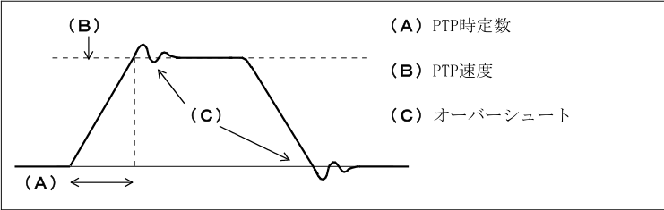
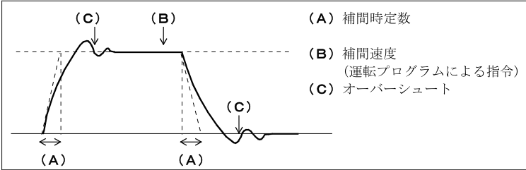
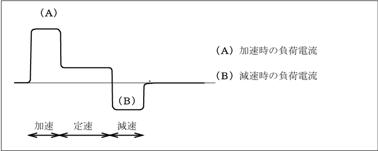
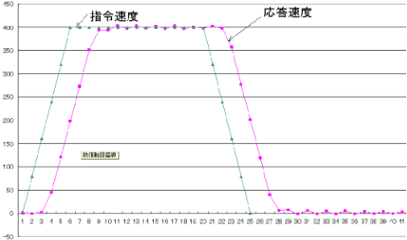
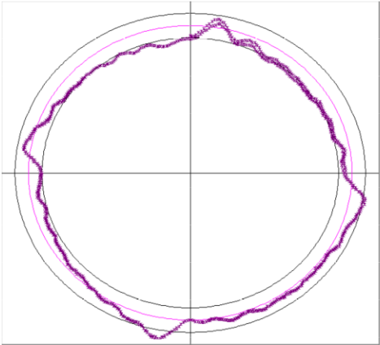

7

### 7-11.サーボ系の調整(単体試運転/メカ組合せ試運転)

実際の運転に応じた位置ループゲインや加減速定数を設定します。 <7-10-1.サーボ調整用運転プログラム>を使います。

| 分類 | 分類（細目） | 調整箇所 | 第1～9軸 | 説明 |
|---|---|---|---|---|
| 制御性の調整 | 速度ループ | サーボアンプの調整(パラメータ設定) | 速度ループゲイン(上限値) | 使用上の設定は、本マニュアル6.サーボ系の制御性能・各社サーボメーカマニュアルを参照 |
| 制御性の調整 | 位置ループ | サーボアンプの調整(パラメータ設定) | 位置ループゲイン(最適値) | (全軸同一) |
| 指令系の調整 | 指令系の調整 | RTMC 加速度 | PTP時定数 | なめらかな早送りを可能とする最小値 |
| 指令系の調整 | 指令系の調整 | RTMC 加速度 | 補間時定数 | なめらか補間送りを可能とする最小値 |
| 指令系の調整 | 指令系の調整 | RTMC 送り速度 | PTP速度 | 早送り速度 |
| 指令系の調整 | 指令系の調整 | RTMC 送り速度 | JOG速度 | 手動送り速度 |
| 指令系の調整 | 指令系の調整 | RTMC 送り速度 | 原点復帰速度 | 原点復帰の早送り速度 |
| 指令系の調整 | 指令系の調整 | RTMC 軌跡形状補正 | 形状補正係数 <オプション> | 軌跡形状を特に改善したい場合。形状補係数 ≧位置ループゲイン |

#### 7-11-1. サーボ応答の確認(メカ組合せ試運転)

実際には、送り速度、加減速定数、位置ループゲイン(Kp)の関係でオーバーシュートや発振が発生する場合があります。

実際の動きに対してオーバーシュートのないサーボ応答にする必要があります。

【例】

| サーボメーカ    | 説明書           | ツールソフト              |
|-----------|---------------|---------------------|
| 安川電機      | Σサーボ説明書      | Sigma Win           |
| Panasonic | MINAS 説明書     | PANATERM            |
| OMRON     | OMNUC G5 説明書  | CX-Drive            |
| 山洋電気      | SANMOTION 説明書 | SETUP ソフトウェア        |
| 日機電装      | VCⅡシリーズ説明書    | Data Editing ソフトウェア |

サーボ応答の観測方法は、「当社モーションアナライザTPCを用いる方法」、「TPCデータロギング機能とEXCELによる解析」、「サーボアンプの速度モニタ(各社ソフト)」などがあります。モーションアナライザTPCやEXCEL解析ソフトを用いれば、サーボ応答だけでなく、軌跡精度や実動作の局所的動作も詳細にチェックできます。

<PTPの速度モニタ>

(C)の値がなくなるか、許容の大きさになるように(A)PTP時定数やKpを調整します。一般に(B)については、仕様面から決められます。

> **図の内容**
>
> PTP 移動の速度波形（横軸: 時間、縦軸: 速度）の模式図。
> - 速度は台形状に立ち上がり、一定速度で進んだあと下がって 0 に戻る。
> - (A) PTP時定数: 立ち上がり始めから、速度が (B) に達するまでの時間（両矢印で示す）。
> - (B) PTP速度: 一定速度の部分の高さ（破線で示す）。
> - (C) オーバーシュート: 立ち上がり直後に (B) を超えて波打つ部分と、停止直後に 0 を下回って波打つ部分（2 か所を矢印で示す）。

<直線補間の速度モニタ>

PTP同様に(C)の大きさを見ながら(A)補間時定数や位置ループゲインKpを調整します。

> **図の内容**
>
> 直線補間の速度波形（横軸: 時間、縦軸: 速度）の模式図。
> - 実線: 実際の速度。破線: 指令の速度（台形）。実線は破線より遅れて立ち上がり、遅れて下がる。
> - (A) 補間時定数: 加速の始めと、減速の始めの 2 か所に両矢印で示す。
> - (B) 補間速度（運転プログラムによる指令）: 一定速度の部分の高さ。
> - (C) オーバーシュート: 立ち上がり直後に (B) を超えて波打つ部分と、停止直後に 0 を下回って波打つ部分。

#### 7-11-2. 負荷電流の確認(メカ組合せ試運転)

特に1号機の場合、サーボアンプの電流モニタにて、モータ負荷電流のチェックをおこなって下さい。一般には、加速時と減速時に最も大きい電流が発生します。この電流がサーボアンプ/モータの最大負荷電流を越えないように加減速パラメータなどで調整して下さい。

> **図の内容**
>
> モータ負荷電流の波形（横軸: 時間）の模式図。横軸の下に「加速」「定速」「減速」の区間を示す。
> - (A) 加速時の負荷電流: 加速の区間で正の大きな値になる。
> - 定速の区間では、(A) より小さい正の一定値になる。
> - (B) 減速時の負荷電流: 減速の区間で負の値になる。
> - 本文: (A)、(B) ≦ 最大負荷電流 となるように調整する。

(A) (B) ≦ 最大負荷電流

- 【注1】機械の摩擦やイナーシャ及びモータ/サーボアンプ選定によっては、期待された加速が得られないこともあります。
- 【注2】最近のサ-ボでは、サーボツールソフトやデジタルオペレ-タパネルなどにより、負荷トルクを読み出すことができます。

### 7-12.パラメータの保存(単体試運転/メカ組合せ試運転)

設定したパラメータは機械に対して最適調整した大事なデータです。セッティングPCにて必ずファイルにセーブして保存して下さい。

ファイル名としては、機械の名称などに合わせて管理しやすい名称として下さい。

ファイルに保存しておけば、他の部分の調整などのときパラメータを誤って変更してしまった場合でも簡単に再ロードして復元できます。

### 7-13.TPCによる精度チェック(メカ組合せ試運転)

RTMCも含めたテクノ製モーションコントローラには、軌跡/サーボ応答解析のための位置ロギング機能 (TPCロギング)があります。TPCロギングしたデータを専用のEXCELソフト「TPC-EXCEL」(テクノ製)で解析することで、モーションの精度解析やサーボ系の最適調整が可能です。

バックラッシュ、異常な摩擦、振動、オ-バシュ-トなどが定量的に測定できます。

詳細は「モーションアナライザ TPC Excel 説明書」(TB04-1478)を参照下さい。

- ■ 精度解析処理(EXCEL/TPC処理ソフト) <オプション> 時系列データファイルをEXCEL専用ソフトで解析・グラフィック表示します。詳細は、テクノHPを参照下さい。

サーボ応答解析各軸の速度カーブ

軌跡解析

2軸の合成軌跡

直線精度解析理想直線との誤差分を拡大

真円精度解析理想円弧との誤差分を拡大

■ サーボ応答解析

> **図の内容**
>
> TPC-Excel のサーボ応答解析の出力例。
> - 横軸: データ番号 1〜41。縦軸: 速度（目盛 -50〜450、50 刻み。単位の表示なし）。
> - 「指令速度」（緑の三角）: データ番号 1 から直線的に上がり、6 付近で 400 に達する。21 付近から下がり、25 付近で 0 になる。
> - 「応答速度」（赤紫の四角）: 指令速度より 2〜3 点遅れて上がり、9 付近で 400 前後に達する。23 付近から下がり、28 付近で 0 になる。一定速度の部分と停止後に、小さな揺れがある。
> - グラフ中央にある小さな文字の枠は（判読できず）。

■ 真円精度解析

> **図の内容**
>
> TPC-Excel の真円精度解析の出力例。
> - 中心で交わる縦横の軸の上に、同心円が描かれている。黒の円 2 本（外側と内側）と、その間の赤紫の円 1 本（理想円と見られる）。
> - 赤紫の点の列（測定した軌跡のずれを拡大したもの）が、理想円の周りを波打ちながら一周している。
> - 上（12 時の少し右）と下（6 時の少し左）に、軌跡が大きく外側・内側に飛び出す箇所がある。

### 7-14.現地でのサーボ立ち上げ手順例

事例として、以下の想定をします。

Y軸(第2軸):水平軸、 X/A軸(第1/第4軸):上下軸で同期軸

#### 7-14-1. 全体的な作業項目

| | 大項目 | 作業項目 | 内容　補足資料　注意点 | 必要な資料・道具 |
|---|---|---|---|---|
| 1 | 制御盤 | 設置・配線 | モータ関連つなぎ込み、I/O関連つなぎ込み、電源ショートチェック | 展開接続図、テスタ |
| 2 | 制御電源投入 | 電源オン | PC電源ON(INtime、デーモン※1、RTMCの立ち上げ)。その他制御電源オンの確認。サーボ主電源オフ、サーボオフ | 同上 |
| 3 | サーボのパラメータ | パラメータローディング | サーボのツールソフト接続。準備したパラメータファイルを書き込む | サーボツールソフト Σ-Win、 PANATERM |
| 4 | RTMC ROMSW パラメータ | パラメータ ROMSW | テクノPCソフトの起動 ※2。RTMCのパラメータ、ROMSWの設定 (RTMCには、設定済み) | パラメータファイル、ROMSWファイル |
| 5 | I/Oチェック | PLC 入出力配線チェック | セッティングPCやMULTIPROG※3(ラダー)による入出力信号のON/OFFチェック。特に非常停止、±OTなど | セッティングPC、MULTIPROG、テスター |
| 6 | サーボ関係（詳細は、7-14-2.を参照） | サーボ電源 | サーボ主電源を入れる。アラーム無し、リセット操作 | サーボマニュアル、ツールソフト (Σ-Win、PANATERM) |
| 6 | サーボ関係（詳細は、7-14-2.を参照） | アラーム確認 | 非常停止、OTでサーボオフになる事の確認 | サーボマニュアル、ツールソフト (Σ-Win、PANATERM) |
| 6 | サーボ関係（詳細は、7-14-2.を参照） | 水平軸動作 | 通常軸のサーボ動作確認 | サーボマニュアル、ツールソフト (Σ-Win、PANATERM) |
| 6 | サーボ関係（詳細は、7-14-2.を参照） | 上下軸動作 | 上下軸、ブレーキ付き軸の動作確認 | サーボマニュアル、ツールソフト (Σ-Win、PANATERM) |
| 6 | サーボ関係（詳細は、7-14-2.を参照） | 機械原点設定 | 機械原点の設定 | サーボマニュアル、ツールソフト (Σ-Win、PANATERM) |
| 6 | サーボ関係（詳細は、7-14-2.を参照） | 運転プログラム | 連続運転 | サーボマニュアル、ツールソフト (Σ-Win、PANATERM) |
| 7 | サーボ系の調整 | サーボゲイン調整 | サーボアンプ オートチューニング、マニュアルチューニング、速度ループゲイン、位置ループゲイン | サーボマニュアル |
| 7 | サーボ系の調整 | RTMC | 補間時定数など | 試運転マニュアル |
| 8 | TPC精度解析 | | TPC-EXCELによる軌跡精度解析など | |

※1 デーモン

: ライセンス認定デーモンです

Rt64m3DM_enc.exe[M3] (又はRt64ecDM_enc.exe[EC])

※2 テクノPCソフト : セッティングPCソフトやROMSW設定ソフトです

- ※3 MULTIPROG

: ソフトPLC「ProConOS」のツールソフト(KW-Software)

#### 7-14-2. サーボ関係の動作確認

##### 7-14-2-1. 一般的な注意点

(A) サーボアンプのトルク制限の利用

- サーボアンプでは、トルク制限が掛けられます。

はじめの動作が不安な場合は、サーボアンプのパラメータで「最大トルク」を小さくしておくことをお勧めします。

- ■水平軸であれば、20%～30%程度。
- ■上下軸では、50%程度。
- もともと、摩擦や荷重があると、動かない状態でもモータのトルクが必要になります。

特に上下軸で重力を受けている場合、トルク制限で力不足となって、落下することもあります。

(B) サーボアンプのアラーム履歴

サーボアンプでは、一般的に電源オフしても最近のアラーム要因を10個程度記憶しています。サーボアラームになった場合、後からでも要因が判ります。

- (C) サーボアンプメーカのツールソフト(安川電機Σ-Win、Panasonic PANATERMなど)

サーボ調整では、「使用するサーボアンプに適したツールソフト」を使用してください。サーボパラメータの一覧表示、修正、一括読み出しや書き込み、ファイル保存など便利です。動作モニタでは、速度モニタ(指令/FB)、トルクモニタなどグラフィック表示します。

(D) サーボアンプのOT入力など

サーボアンプの入力信号でOTや非常停止関係でB接入力指定するものがあります。これを未配線にしているとサーボのアラームが解除できません。使わない場合は、パラメータで

「使用せず」の設定をします。

##### 7-14-2-2. 水平軸の動作確認

(A) 準備

使用しない上下軸は、サーボオフでブレーキ作動のままとします。

普通にサーボONすると全軸(他の軸)がONしてしまうので要注意です。

セッティングPCソフトの「軸設定画面」で第1軸と第4軸(上下同期軸)にサーボオフ軸の指定をしてください。(先ず水平軸(Y軸)のみの動作とする)

(ROMSWの「軸設定」の「有効物理軸選択」で動作確認軸のみ有効にしておくと他の軸が主電源OFF、 SVOFFで、１軸のみの動作が可能です。ROMSW設定変更後はRTMCの再起動のため、PCの再起動が必要です。)

(B) JOG動作

はじめは、サーボパラメータのジョグ速度を低めにして下さい。

正常な動作を確認してから、ジョグ(JOG)速度を適当な値に上げてください。

(オーバライドでもジョグ速度は変わります)

- (1) +、-の方向確認。違っていたら、ROMSWの「軸設定」画面の指令出力極性を変更。
- (2) ±OTの確認。 OTでサーボオフするかの確認。OTからの引き戻しは、OT無視モードで行います。

OTでアラーム → OT無視モード → リセット(アラーム解除・サーボON)

- → JOGで内側に引き戻す → 正常位置でOT無視モードから手動モードに切り替え。
- (3) モータの振動や異常動作があった場合

サーボアンプのパラメータを確認。サーボアンプ各社のマニュアルを参照

(C) 移動距離の確認

指定の移動量を指令して、実際の移動距離を量ります。(とりあえずは、目視でもOK)

例:まず 10mm分の指令 → 実際に約10mm 移動することの確認

次に 100mm分の指令 → 実際に約100mm 移動することの確認

単位系の桁数を間違うと非常に大きく動いてしまうことがあります。小さい値から始めます。

- (1) 移動量が違っていたら

サーボアンプのパラメータ「電子ギヤ」を確認

RTMCのパラメータ「電子ギヤ」を確認

(D) 最大ストロークチェック

- (1) +OTの仮の座標を記録
- (2) -OTの仮の座標を記録
- (3) (1)の座標-(2)の座標でストローク距離を確認(予定どおり?) → ストロークが不足ならOTセンサの取り付け位置を修正

##### 7-14-2-3. 上下軸のサーボ

上下軸(落下あり)で平行軸(同一指令2軸)と仮定します。

(例: ROMSWのオプション設定で「同期軸制御(同一指令制御)」にチェックが有り、

基準軸:第1物理軸で第1論理軸、従属軸:第4物理軸で第4論理軸の場合)

- (A) メカ連結をはずせる場合(2つの軸をそれぞれ動作)

(a) 準備

- (1) サーボオフで確実にブレーキで保持できていることを確認。
- (2) 危ない場合は、落下を防ぐため「あて木」の様な緩衝材で機構を支持する。
- (3) メカ連結を取り外す。
- (4) ROMSWの軸設定で従属軸の「同期軸(従軸)基準軸」のチェックを消し、独立軸にします。 ROMSW変更後(ローディング)、RTMCの再起動
- (5) 基準軸と従属軸は、それぞれ個別に通常どおり下記(b)の動作確認。(第1軸:X 第4軸:A)
6. (b) 個別の軸の通常動作確認
- (1) サーボON

サーボONで、サーボロック(モータの保持力で停止)し「ブレーキ解除」するはず。

- 【注1】ブレーキが作動していてもモータの力によって、動いてしまうことがあります。

この場合、ブレーキを傷めます。

- (2) ブレーキ解除しないとき
2. ブレーキ電源に関係するラダーロジックや配線などを再確認してください。
- (3) ジョグなど

通常にサーボロックしたら、水平軸と同様に確認。

ジョグ確認 → 移動距離の確認 → ストロークチェック

(B) メカ連結をはずせない場合

(a) 準備

- (1) ROMSWのオプションで「同期軸制御(同一指令制御)」有り、と軸設定で「同期軸(従軸)基準軸」の設定を確認してください。

従属軸には常に基準軸と同じ指令がでます。

- (2) ブレーキ保持や落下防止の準備
- (3) サーボONして、サーボロックとブレーキ解除の確認
3. (b) 微少距離動かして確認
- (1) 平行軸を1パルスずつ動かして見ます。(インチング ×1)

同じ方向に動けば、OK。

違う方向の場合 → いずれかの軸の指令極性が違ってます。

移動量が違う → 電子ギヤなどの設定

片方が動かない→ その軸の配線サーボアンプの設定など

- (2) 1パルスずつでは、よくわからない場合 → ×10で10パルスずつ操作。

【注1】

機構には、多少遊びがあります。その範囲で動く場合は、機構にストレスはあリません。ただ、遊びが少ない機構で連結している場合は、要注意です。

【注2】

機構をあて木で支持しておいて、サーボのトルク制限を掛けておこなう方法もよいかもしれません。

##### 7-14-2-4. 仮の機械原点の設定

- セッティングPCの「バックアップデータ初期化」でアブソポジション初期化ボタンを押します。
- (1) 適当な位置で以下の操作をして、その位置を機械原点として下さい。これで、その位置を機械座標系の原点とします。指令位置や機械位置が、ゼロクリアされます。
- (2) その後で、各軸のソフトリミットを設定してください。各軸のOT近くまで動作→その位置を記録

その位置を参考にサーボパラメータのソフトリミットの値を設定してください。

- (3) サーボパラメータの「ホーム位置」の利用定位置に位置決めをしたいときに便利です。

##### 7-14-2-5. 運転プログラムで連続動作

簡単な運転プログラムを作成し、軸の連続運転などをおこなって、様子を見てください。はじめは、オーバライドで速度を下げておく方が安全です。運転プログラムの作成方法は、「サンプル運転プログラム」(TB04-0422)を参照下さい。ガイドや機構に異常が無いかを確認します。特に振動や異音には要注意です。また、一定量を数十回往復動作させて、位置ズレが発生しないことも確認してください。

マニュアルでサーボのゲイン調整をするときには、以下の様な運転を繰り返します。 +方向へ一定量/一定速度 → 0.2秒程度停止 → -方向へ一定量/一定速度 → 0.2秒程度停止これで、発振しない限界の速度ループゲインや位置ループゲインを探します。

##### 7-14-2-6. サーボ系のゲイン調整

各社サーボメーカのマニュアルに従って、ゲインを確認して下さい。はじめは、オートチューニングをお勧めします。速度ループゲインは、発振しない範囲で高くしてください。サーボ剛性を確保します。

位置ループゲインも高い方が軌跡精度がよくなります。特に、合成軌跡精度が必要な軸では、同じ値に設定する必要があります。

RTMCの補間時定数をゼロにして、調整する方が正確です。補間時定数の値が、大きくなると軌跡精度を劣化させます。
