# Ⅴ メンテナンス編

改版時の主な修正箇所には「◆バージョン番号」マークが書いてあります。例）Ver0.1で改版した場合は「◆0.1」となります。

保守や疑問点については、テクノHPのFAQ(良くある質問)も合わせてご覧下さい。 HPについては、日々更新しますので、詳しい情報を記載している可能性があります。

本説明書ではRTMC64-M3とRTMC64-ECの両機種の説明を行っています。両機種に共通部分はRTMC64と表記します。それぞれ異なる場合はRTMC64-M3を[M3]、RTMC64-ECを[EC]と表記します。

## 1. 異常時の処理(RTMC64-M3/EC 側)

### 1-1. 基本動作に関する異常

| 異常状態                                                                          | 推定される原因                                                               | 処置                                                                                                                              | 詳細説明                                         |
|-------------------------------------------------------------------------------|-----------------------------------------------------------------------|---------------------------------------------------------------------------------------------------------------------------------|----------------------------------------------|
| 1 RTMC64が起動しない "INtime"のアイコンが黄色のまま紫にならない "INtime Explorer"上でRTMC64の表示が出ない | ドングルキーが正常に装着されていない自動起動になっていない                                       | キーの確認 "INtimeのRestart Node A" PCの再起動                                                                                            |                                              |
| 2 セッティングPCの通信エラー                                                             | RTMC64が起動していない Nodeの選択違い                                              | 上記 PC側設定の再チェック動作ノードの不一致                                                                                                        |                                              |
| 3 操作入力全ての入力が不可一部の入力が不可                                                      | ROMSW設定での信号割り付けミスソフトウェアPLCやC言語ソフトが正常動作していない入出力信号用の24Vの供給不良外部配線不良 | セッティングPC汎用入出力情報で入力信号を確認 ROMSWの局設定をチェックソフトウェアPLC/C言語ソフトの動作チェック (INtimeExplorerでProConOS の動作確認、不動なら起動) 入出力電源 24Vをチェック、異常あれば修正 | メンテナンス編 3-1.                                 |
| 4 出力信号出力が出ない一部の出力が不可                                                        | ROMSW設定での信号割り付けミスソフトウェアPLCやC言語ソフトが正常動作していない入出力信号用の24Vの供給不良外部配線不良 | セッティングPC汎用入出力情報で出力信号を確認 ROMSWの局設定を再確認ソフトウェアPLC/C言語ソフトの動作チェックと起動入出力電源 24Vをチェックし異常があれば修正または交換出力配線をチェックし不良が有れば修正            | 機能編(TB00-1040 D)標準入出力チャンネル表詳細メンテナンス編 3-2. |

【注】RTMC64の動作状況


> **図の内容**
>
> タスクトレイの INtime のアイコン（黄色）。本文: (黄色): 待機中。

(黄色): 待機中


> **図の内容**
>
> タスクトレイの INtime のアイコン（紫色）。本文: (紫色): 運転中。

(紫色): 運転中

### 1-2. アラーム表示をともなう異常(全体エラー)

| 異常状態                                                                                       | 推定される原因                                                                                                                                                   | 処置                                                                                                                                                                                                                                                  | 詳細説明                                       |
|--------------------------------------------------------------------------------------------|-----------------------------------------------------------------------------------------------------------------------------------------------------------|------------------------------------------------------------------------------------------------------------------------------------------------------------------------------------------------------------------------------------------------------|--------------------------------------------|
| 1 非常停止                                                                                     | 入力信号割り付けミス ROMSW設定の修正非常停止スイッチが作動中非常停止スイッチの解除非常停止スイッチの配線ミススイッチの配線・ラダーの回非常停止入力(B接OFF等)ラダー路で正常時は入力信号がOFFになるようにする                                      |                                                                                                                                                                                                                                                      |                                            |
| 2 バックアップエラー                                                                               | 上の論理回路ミスバックアップメモリーが消えている                                                                                                                                | 全バックアップデータをクリアして再設定する                                                                                                                                                                                                                               | 試運転･調整編詳細                                 |
| 3 パラメータ未設定エラー                                                                             | パラメータ初期化後、有効なパラメータを設定（ダウンロー〃                                                                                                                            |                                                                                                                                                                                                                                                      | メンテナンス編 3-4.                               |
| 4 ROMSWバックアップエラー                                                                          | ド）していないソフトバージョンアップ(ソフト書換) により、ROMSWも更新する必要が発生した                                                                                                        | 新しいROMSWをダウンロードする(RTMC64内のROMSWデータはデフォルトになっています)                                                                                                                                                                                                   |                                            |
| 5 初期化エラー                                                                                   | 設定した制御周期や通信設定では有効軸数と通信できない                                                                                                                               | ROMSWで下記設定の見直し ■基本画面サーボ制御周期(長くする) 通信設定 ■軸設定有効物理軸のみの選択にする                                                                                                                                                                                           | ROMSW設定ソフトマニュアル (TB00-1042)               |
| RTMC64-M3の場合                                                                               | ハード(通信用IC)異常サーボ側の設定がROMSWの設定とあっていない                                                                                                                     | (テクノにて詳細調査) サーボと伝送周期、バイト数、C2マスタ、局アドレスの整合をとる (伝送周期=サー                                                                                                                                                                                               | 各社サーボマニュアル                                |
| RTMC64-ECの場合初期化時に表示されるコンソールメッセージ "mst_init ==> x" によって原因が異なります。 (正常終了の場合"0x0" と表示されます。) | "mst_init ==> 0xF001"の場合は RTMC64-ECがEtherCAT通信マスタースタックのAPIを検出できません。                                                                                     | ボ周期) [INtime Node Management]→ [System Wideタブ]→[RSL検索パス]にAPIを配置するパスを登録する必要があります。以下は、通常のインストール先です。 AlgoEtherCATの場合： "C:\Program Files\ALGOSYSTE M\AlgoEtherCAT\ACMst.rsl" RSI-ECAT-Masterの場合： "C:\Program Files\Micronet\ RSI-ECAT\bin\EhApi.rsl" | 導入編「3．RTMC64-M3/EC のインストール」「4．パラメータの設定」 |
|                                                                                            | "mst_init ==> 0xF002"の場合は ROMSWに設定した有効局が見つかりません。 ROMSWに設定した局が無い。 ROMSWに設定したStation Alias と実際の局のStation Aliasが異なっている。 ROMSWに設定した軸のStation Al iasがIO局である。 | ※マスタースタックのインストーラが自動で登録するため、通常は設定不要です。 ROMSW設定、ENIファイル、実際のEtherCATスレーブ構成のいずれかが異なる時に発生します。いずれかを見直して下さい。                                                                                                                                          |                                            |
|                                                                                            | "mst_init ==> 0xF003"の場合は ENIファイル上のPDOマッピングと実際のスレーブのPDOマッピングが異なります。                                                                                     | 正しいENIファイルを用いる、又は、ENIファイルを再度作成して下さい。                                                                                                                                                                                                               |                                            |
|                                                                                            | "mst_init ==> 0xF004"の場合は EtherCAT通信マスタースタックが起動していません。 ◆1.2                                                                                              | [INtime Node Management]→ [AutoLoadタブ]にてEtherCAT 通信マスタースタックの自動                                                                                                                                                                                       |                                            |

|                                |                                                                                         | 起動設定が有効になっているか確認してください。 AlgoEtherCATの場合： "ACatProc" RSI-ECAT-Masterの場合： "RSI-ECAT" ※依存関係が登録されている場合に登録されているプロセスが自動起動するか確認して                                                                                                                           |                  |
|--------------------------------|-----------------------------------------------------------------------------------------|---------------------------------------------------------------------------------------------------------------------------------------------------------------------------------------------------------------------------------------------------------|------------------|
|                                | "mst_init ==> 0xF005"の場合はカーネルティックとサイクルタイムが不整合を起こしています。 ◆1.2                          | ください。 eniファイルに設定したサイクルタイムは、[INtime Node Ma nagement]→[Kernelタブ]→ [カーネルティック]に設定したカーネルティック値の整数倍である必要があります。エラー例）サイクルタイム：250us カーネルティック：100us ※カーネルティックを125usに変更するとエラーは発生しません。                                                                       |                  |
|                                | "mst_init ==> 0xF006"の場合はマスタースタックのサイクルタイムとENIファイルに設定したスレーブのサイクルタイムが一致していません。 ◆1.2   | スレーブのサイクルタイムを変更する場合は、ENIファイルを再作成してください。 ENIファイル作成時に一部のサーボだけ異なる通信周期の設定にしている場合は、全てのサーボを同じ周期にして下さい。マスタースタックのサイクルタイムを変更する場合 AlgoEtherCATの場合： "ACMst.ini"の"BusCycleTime" を変更してください。 RSI-ECAT-Masterの場合： [INtime Node Management]→ [AutoLoadタブ]にて実行時引 |                  |
|                                | "mst_init ==> 0xf008"の場合は DC無効サーボ検出 (ENIファイル作成時のDC設定のミス)                               | 数に"-cycle=eni"を設定してください。全てのサーボのDCを有効としてENIファイルを再度作成してください。                                                                                                                                                                                          |                  |
|                                | "mst_init ==> 0xFFFF"の場合は上記以外のエラー。マスタースタックが起動していない、EtherCATスレーブが接続されていない(又は電源OFF)等。 | EtherCATスレーブの配線や電源が正しいことや、マスタースタック・RTMC64-ECの起動順序が正しいことを確認し、INt imeを再起動する。コネクタ挿入修正ケーブル交換 (テクノにて詳細調査)                                                                                                                                               |                  |
| 6 全体通信エラー                      | ケーブル接続異常(コネクタの挿入不確実) ハード(通信用IC)異常サーボ側の応答がない                                           | サーボ側主電源とアラーム状態を確認                                                                                                                                                                                                                                      | サーボマニュアル         |
| RTMC64-M3の場合 MECHATROLINK ◆1.2 | サーボ側の応答がない                                                                              | Σ-Winで確認、サーボマニュアルに従ったメカトロリンク初期化エラーの処置をする                                                                                                                                                                                                              | Σ-Winなど各社サーボツール |
| RTMC64-ECの場合 EtherCAT          | サーボ側の応答がない                                                                              | サーボマニュアルに従った処置をする                                                                                                                                                                                                                                      | 各社サーボツール         |

| 7 メカトロリンクインバータエラー RTMC64-M3の場合のみ   | インバータが以下の状態主電源OFF アラーム発生ワーニング発生                                                    | インバータの前面のLEDでエラー要因を確認しインバータマニュアルに従った処置をする                                                                                                          |                                                                                   |
|-------------------------------------|--------------------------------------------------------------------------------------|------------------------------------------------------------------------------------------------------------------------------------------------------|-----------------------------------------------------------------------------------|
| 8 システムエラー                           | ハードウェアの異常 (プロテクト処理で異常検出)                                                             | 条件や状況を連絡下さい。 (テクノにて詳細調査)                                                                                                                             |                                                                                   |
| 9 制御周期負荷ワーニングまたは、制御周期負荷過大         | 制御周期が短すぎるサーボ制御処理時間の最大値と ROMSWで設定したサーボ制御周期の比が ■87.5%以上制御周期負荷ワーニング ■100%以上制御周期負荷過大 | ROMSW設定ソフト「基本」画面の「サーボ制御周期」を長くする制御周期負荷ワーニング、制御周期負荷過大の解除はセッティングPCの「オプション」- 「制御周期モニタ」で「RTC」を選択し、「計測値クリア」ボタンを押します (または、REQ_TIMERRESETコマンドを発行します) | ・RTMC64-M3の場合はROMSWで制御周期を設定できます・RTMC64-ECの場合はEtherCATのマスタースタックで制御周期を変更します |
| 10 システムエラー ◆1.2                     | ドングルキーが見つからない Windowsが正常にドングルキーを認識している場合、ドングルキーのLEDが"点灯"します。異常がある場合、点滅します。        | 正しくドングルキーを装着する。ドングルキーのLEDが"点滅"している場合、別のUSBポートに挿入したり、Windowsのデバイスマネージャでドライバを削除した後に再度認識させる等してWindowsから正常に認識できるようにしてください。                       | 起動から約2分でエラーになる                                                                   |
|                                     | ライセンス認証デーモンが起動していない。 [M3]：Rt64m3DM_enc.exe [EC]：Rt64ecDM_enc.exe                    | ライセンス認証デーモンを起動する。自動起動する設定をする。                                                                                                                      | 導入編ライセンス認証デーモン自動起動設定                                                           |

### 1-3. アラーム表示をともなう異常(タスク別エラー)

| 異常状態                                | 推定される原因                                                                                       | 処置                                                                                | 詳細説明                                      |
|-------------------------------------|-----------------------------------------------------------------------------------------------|------------------------------------------------------------------------------------|-------------------------------------------|
| 1 プログラム実行エラー                       | 運転プログラムの表記またはデータ上の矛盾などオプションが無効                                                              | ティーチング画面でエラー発生時の運転プログラムを確認し、単独ステップでも発生か、前ステップとの関連で発生か、など異常発生時の条件から不具合を追求する    | 機能編テキストプログラム                            |
| 2 Mコード実行エラー                         | ROMSWのMOK入力有効の設定で MFIN検出エッジでMOK入力がOFF エラー発生時 MOKがON: MOKの立ち上がりが遅れている MOKがOFF:MOK信号が入力されていない | リセット入力で解除｡ラダー論理でMFINONの前にMOK がONするようにする信号線割付けと配線を入出力状態画面で確認して修正ラダーを見直して修正      | 機能編 Mコード出力 ROMSW信号割り付けのチェックラダーのチェック ※1 |
| 3 割り付け軸エラー 4 FG内部演算エラー              | 発生しないはず発生しないはず                                                                               |                                                                                    |                                           |
| 5 サーボOFFエラー                         | ROMSWで起動時サーボオフを設定している(不具合ではない)                                                               | リセット入力で解除                                                                          |                                           |
|                                     | 【リセット操作でONしない】 OT入力非常停止入力【一度ONしてすぐに落ちる】サーボアラーム                                             | OT、非常停止、アラーム信号を入出力状態画面で確認し不良信号の原因を修正するサーボ単体で動作させサーボアンプ/モ－タ関係の異常を調べる (主電源強制ON) |                                           |
|                                     | サーボがつながっていない                                                                                  | サーボアンプとの接続を確認                                                                      | サーボマニュアル                                 |
| 6 外部アラーム Aエラー外部アラームBエラー外部アラームCエラー | 外部アラーム□信号がONした □:A～C                                                                          | リセット入力で解除外部アラーム信号をONさせている要因を入出力状態画面で確認し、配線、ラダーを修正する                             | 機能編入力信号と機能                               |

### 1-4. アラーム表示をともなう異常(各軸エラー)

| 異常状態                                           | 推定される原因                                                                                                                       | 処置                                                                                                              | 詳細説明                                             |
|------------------------------------------------|-------------------------------------------------------------------------------------------------------------------------------|------------------------------------------------------------------------------------------------------------------|--------------------------------------------------|
| 1 偏差過大エラー □軸+方向偏差過大エラー □軸-方向偏差過大エラー          | モータが動かないトルク無し:トルク制限トルク有り:機械干渉位置ループゲイン(Kp)が小さいサ-ボパラメータ偏差上限値が小さ過ぎる速度指令が速すぎる・補間命令(LIN等)で発生 →                              | サーボアンプのトルク確認トルク制限指令、パラメータを修正する機械の干渉を無くす可能範囲でkpを上げる偏差上限値を大きくする F値(補間速度)を遅くする                                 | サーボマニュアル詳細メンテナンス編 3-3. セッティングPC マニュアル運転プログラム |
| 2 サーボアラーム □軸サーボアラ-ム                            | ・位置決め(PTP等)で発生 → ・ジョグ移動中 → サーボアンプのアラームサーボ主電源不良                                                                               | パラメ-タのPTP速度を下げるパラメ-タのジョグ速度を下げるサーボツールでアラーム内容を確認しサーボマニュアルに従った処置                                                | サーボマニュアル                                        |
| 3 ソフトリミット □軸+方向ソフトリミット □軸-方向ソフトリミット          | ソフトリミットのパラメータ値不良 RTMC64のアブソPOS.(位置)が異常な値になっている                                                                              | サーボアンプ/モータの単体動作にして再度アラーム内容を確認 (サ-ボのデジタルオペレータでもアラーム要因トレ-スが可能) パラメータ値を修正原点復帰を行い、原点を再設定                          |                                                  |
| 4 ハードリミット □軸+方向ハードリミット □軸-方向ハード               |                                                                                                                               | するまたは、バックアップデータの初期化で「アブソPOS.」をクリア(「アブソPOS.」をクリアすると、その位置が原点となります) ジョグでリミット内に戻すセッティングPC入出力状態とOT 動作を調べ不具合箇所を修正 | 試運転・調整編セッティングPC マニュアル                           |
| リミット                                           | 運転中のソフトリミット OT入力がON 配線不良 B接入力がオープン運転中のハードリミット後の立ち上げソフトリミットで止まらずOT位置まで行った原因の確認・ソフトリミットがOTより外側・送り速度が速いとソフトリミットを越してOTまで行く | OT無視モードにしてリミット内へ戻すソフトリミット/OT間の距離と送り速度の関係を見直しソフトリミット値を修正                                                      | サーボ、入出力ユニット試運転・調整編                             |
| 5 パルス発生過大 □軸+方向または □軸-方向パルス発生過大エラー 6 サーボ主電源オフ | 現在RTMC64では、発生しないはずです                                                                                                         | サーボのエラー履歴を確認、要                                                                                                   |                                                  |
| □軸サーボ主電源オフ 7 サーボ通信エラー □軸通信エラー                  | サーボアンプの主電源がOFF サーボの他のエラー発生で主電源をOFFしていることもある                                                                                  | 因が有れば、サーボマニュアルに従って処置する非常停止などでサーボの主電源をOFFしていないか確認しその原因修正する                                                    |                                                  |
| ・MECHATROLINK ・EtherCAT                        | サーボ通信(MECHATROLINK、Ethe rCAT)のエラーデータ受信エラーウォッチドグエラータイムアウトエラー多重コマンドエラー                                                      | ケーブル接続状態を確認・長過ぎ・引き回し(周辺のノイズ) ケーブル交換異常発生時の条件を記録 (テクノ調査) 異常発生時の条件を記録                                            |                                                  |
| 8 多重コマンドエラー □軸多重コマンドエラー                        | 多重コマンドエラー                                                                                                                     | (テクノ調査)                                                                                                          |                                                  |

### 1-5. 動作や操作に伴う異常

| 異常状態                     | 推定される原因                                      | 処置                                                                    | 詳細説明                         |
|--------------------------|----------------------------------------------|------------------------------------------------------------------------|------------------------------|
| 1 原点復帰しない                | サーボパラメータで「原点復帰なし」の指定になっている                  | パラメータを適宜変更                                                             | 試運転・調整編 7-8.参照               |
| 2 原点復帰が完了しない            | 原点信号が入らない(サーボ) 原点復帰関係サーボパラメータが意図した動作と異なっている | 原点信号を変化させ、入力変化が正しくなるよう修正(サーボツールで原点信号をチェック) 原点復帰関係パラメータを(方式 /設定値)修正   | 試運転・調整編 7-8.参照サーボアンプのマニュアル |
| 3 原点位置がずれる (モータ1回転分ずれる) | 原点信号のエッジとPGのC相が重なっている原点ドグの論理逆              | ドグ位置を調整(メカ) 信号の論理を修正                                                   | 試運転・調整編 7-8.原点復帰 Aの値に注意      |
| 4 プログラム運転がスタートしない       | 運転プログラムがダウンロードされてない                         | 運転プログラムをダウンロード (タスク、PNO. 注意)                                           |                              |
| 5 Mコード出力で止まったまま         | 自動運転モードになっていない MFINが返らない                     | モード変更、「自動運転」ラダーのMFIN出力をチェック ROMSWの入出力信号設定チェック PLCのラダーの信号を調べ不具合があれば修正 |                              |

※ ラダーやPCアプリでの操作上のトラブルの時は、まずセッティングPCで同じ操作を確認下さい。

### 1-6. サーボ関連の異常

|                      | 異常状態                                                                        | 推定される原因                                                                             | 処置                                                                                                               | 詳細説明              |
|----------------------|-----------------------------------------------------------------------------|-------------------------------------------------------------------------------------|-------------------------------------------------------------------------------------------------------------------|-------------------|
| 1 入らない               | サーボ主電源がアラーム発生 OT入力非常停止入力サーボ主電源回路の不良入出力状態画面でSVMのbitはON するが、主電源リレーが動作しない | 入出力状態画面でOTや非常停止入力をチェックし不具合修正サーボ主電源回路の不良を修正強制出力でオンする場合は、アラームなど再確認配線、割り付けを調べ不良箇所 | 強制出力でONしない場合はSVMのを修正                                                                                             |                   |
| 2 サーボ主電源が ONしてすぐに落ちる |                                                                             | ラダーが正しくないサーボアンプのサーボアラーム主電源OFF→ONのインターバル不足 (数秒以上サーボアンプの特性)                       | ラダー回路を修正サーボアラーム履歴を調べ、サーボマニュアルに従って修正サーボアンプ/モータの単体動作 (アンプ/モータ間の接続修正)                                             | サーボマニュアル         |
| 3                    | 低速で回るサーボロックしない                                                             | サーボアンプ/モータ側の異常サーボアンプの設定不良                                                          | サーボアンプ/モータの単体動作で状態を確認し、サーボマニュアルに従って原因を修正                                                                        | サーボマニュアル         |
| 4                    | 発振するがたがた動く暴走する偏差過大になる                                                    | 速度ループゲインが大きすぎるサーボアンプ/モータ側の異常サーボアンプの設定不良                                           | サーボの位置ループ、速度ループのゲインを下げる単体動作で正常に動作するように、サーボマニュアルに従って配線不良の修正、パラメータを修正する                                        | サーボマニュアル 3-3.参照  |
| 5                    | オーバシュートするサーボアンプの位置ループゲインKpが高すぎる(メカ剛性不足) RTMC64の加減速時定数の不良モータの力不足          | 機構の不良サーボアンプ設定不良を下げる)                                                              | ガタ、引っかかり、滑り修正サーボの「速度ループゲイン」をサーボマニュアルに従って調整する位置ループゲインを下げる加減速時定数を適宜設定(加速度サーボツールでトルクを確認し                       | サーボマニュアル試運転・調整編 |
| 6                    | 速度ムラ低速送りのリップル                                                              | サーボアンプ速度ループゲインが低い(メカ剛性不足) 機構の摩擦                                                    | トルク不足なら原因を調べ、修正する(モータ容量、負荷重量、負荷慣性、減速機など) 速度ループゲインを上げる異常な摩擦がないか調べるサーボツールでトルクを観測しながら運転し、リップル発生状況から原因を突き止め修正する | サーボマニュアル         |
| 7                    | 位置ズレする                                                                      | セッティングPCの指令表示上で・指令がずれている場合・指令がずれていない場合モータ軸端もずれている機構の問題か                         | ティーチング画面でプログラムステップを確認しずれるステップの運転プログラムをチェックサーボ単体で往復動作し確認サーボマニュアルに従い対処機構を確認し原因修正                               | メンテナンス編 3-3.参照    |

※ サーボ動作の異常の場合は、サーボ単体動作(サーボツールソフト)での確認をお願いします。原因の切り分け(サーボ側/RTMC64側)に有効です。

## 2. PCソフト側(Windows側)の異常

### 2-1. 通信処理

|                     | エラーメッセ-ジ                                         | 推定される原因                                                                                                        | 処置                                          | 詳細説明             |
|---------------------|--------------------------------------------------|----------------------------------------------------------------------------------------------------------------|----------------------------------------------|------------------|
| 1                   | 通信パラメータエラー                                      | 初期設定ファイルとROMSWの設定内容が異なる                                                                                       | ROMSW設定ソフトでROMの設定内容を読み出し初期設定ファイルを更新する      | ROMSW設定ソフトマニュアル |
| 2 通信異常(TO/RO/R R)です | RTMC64が正常に起動していない INtimeの動作Node設定と通信Nod eが異なっている | RTMC64の起動                                                                                                      | INtimeのNodeとセッティング PCの通信ノード名を確認              | セッティングPC マニュアル   |
| 3 指定のデータが存在しません    |                                                  | RTMC64の運転プログラムがダウンロードされてない運転プログラムを初期化した                                                                      | 運転プログラムを再ダウンロード                             |                  |
| 4                   | 指定のデータを書き込めません                                  | 運転プログラムダウンロード・指定した番号のプログラムを実行中パラメータ/ROMSWデータのダウ                                                             | 運転が終了してからダウンロードする                           | セッティングPC マニュアル   |
|                     |                                                  | ンロード・セッティングモードになっていない                                                                                        | セッティングモードに変更する機械パネル:無効とすべき                 | 機能編機械パネルIF      |
| 5 ん                 | 現在実行できませ                                         | アラーム発生中にコマンドを発行指定したコマンドを実行できるモードになっていない他のコマンドの動作中                                                          | アラーム要因のクリアモードの変更他のコマンドの実行が終了するのを待つか、終了させる |                  |
| 6 通信処理にてが発生しました    | 正体不明のエラー                                         | 通信設定で指定した内容が間違っている                                                                                            | 通信設定を正しく再設定                                  |                  |
| 7                   | 通信ライブラリの初期化エラーです                                | 「共有メモリ」の場合・RTMC64が正常に起動していない・INtimeの動作Node設定と通信Nodeが異なっている「イーサネット通信」の場合以下、「イーサネット通信」が接続できない場合の調査方法を参照 | RTMC64の起動 INtimeのNodeとセッティング PCの通信ノード名を確認    |                  |

- ■「イーサネット通信」が接続できない場合の調査方法
- ①イーサネット設定が正常であることの判別方法

セッティングPCを実行している別PCからpingコマンドを発行します。

【操作方法】

まず、コマンドプロンプトを起動

- Windows7の場合

[スタートメニュー]→[全てのプログラム]→[アクセサリ]→[コマンドプロンプト]

- Windows10の場合

[スタートメニュー]→[Windowsシステムツール]→[コマンドプロンプト]

pingコマンドの発行

例) ping 192.168.0.100

正常の場合は以下のように応答(バイト数、時間)が返ります。

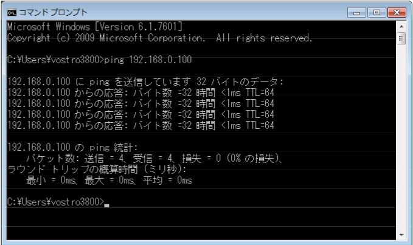

> **図の内容**
>
> コマンドプロンプトで `ping 192.168.0.100` を実行した画面。
> ```
> 192.168.0.100 に ping を送信しています 32 バイトのデータ:
> 192.168.0.100 からの応答: バイト数 =32 時間 <1ms TTL=64   （4 回）
> 192.168.0.100 の ping 統計:
>     パケット数: 送信 = 4、受信 = 4、損失 = 0 (0% の損失)、
> ラウンド トリップの概算時間 (ミリ秒):
>     最小 = 0ms、最大 = 0ms、平均 = 0ms
> ```

- 正常な応答の場合

バイト数や時間が応答される場合、イーサネット設定は正常です。

イーサネット設定が正常で、セッティングPCが通信できない場合は、セッティングPCに設定した IPアドレスに誤りがある、又は、RTMC64の起動ができていません。

- 正常に応答しない場合

応答に

「宛先ネットワークに到達できません。」

「宛先ホストに到達できません。」

「要求がタイムアウトしました。」

等のメッセージが表示される場合、イーサネット設定に不備があります。

様々な設定不備が考えられますので、以下の内容を確認ください。

- ②IPアドレスが正しいことの確認

イーサネット通信のためにIPv4アドレスを以下の箇所設定します。

(A)FAPC上のNetwork設定

※設定方法は、「導入編Ⅰ 5-2-2.」を参照

- (B)別PC上のWindowsネットワークデバイス設定 ※設定方法は、「導入編Ⅰ 5-2-3.」を参照

(C)別PC上のセッティングPCの通信設定

※設定方法は、「導入編Ⅰ 5-2-4.」を参照

これらの設定が正しいことを確認してください。

例えば、

- (A)と(C)は同じIPアドレスを設定する必要があります。
- (A)と(B)は異なるIPアドレスを設定する必要があります。
- 一般的に使用できないIPアドレスは使えません。

ネットワークの先頭(例:192.168.0.1)や末尾(例:192.168.0.255)のIPアドレス等。

③FAPC上のNetwork設定の確認

もしも、Network設定にて、「インターフェース種類」に、存在しないインターフェースを選択していた場合、FAPC上に以下のようコンソールが自動的に表示されます。

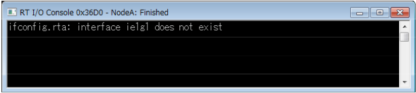

> **図の内容**
>
> ウィンドウ「RT I/O Console 0x36D0 - NodeA: Finished」に「ifconfig.rta: interface ie1g1 does not exist」と表示されている。

設定を確認するためには、FAPC上のコマンドプロンプトで、以下のコマンドを実行してください。

piperta "%INTIME%network7\ifconfig"

以下のように、FAPC上のNetworkインターフェースの設定が表示されます。

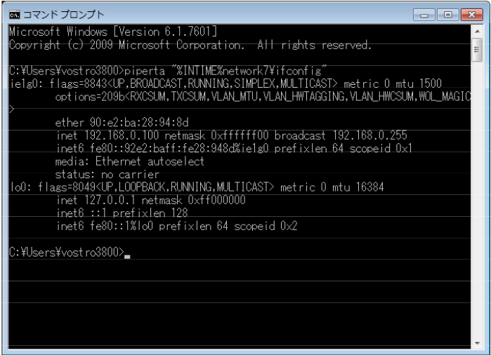

> **図の内容**
>
> コマンドプロンプトで `piperta "%INTIME%network7\ifconfig"` を実行した画面。
> - ie1g0: flags=8843<UP,BROADCAST,RUNNING,SIMPLEX,MULTICAST> metric 0 mtu 1500、ether 90:e2:ba:28:94:8d、inet 192.168.0.100 netmask 0xffffff00 broadcast 192.168.0.255、media: Ethernet autoselect、status: no carrier
> - lo0: flags=8049<UP,LOOPBACK,RUNNING,MULTICAST> metric 0 mtu 16384、inet 127.0.0.1 netmask 0xff000000
> 一部の行（inet6 など）は細かくて読みにくい。

FAPC上のNetwork設定に不備がある場合、「導入編Ⅰ 5-2-2.」を参照して再度設定を見なおして下さい。

- ④別PC上のWindowsネットワークデバイス設定の確認

設定を確認するためには、別PC上のコマンドプロンプトで、以下のコマンドを実行してください。

ipconfig

以下のように、Windowsネットワーク設定が表示されます。

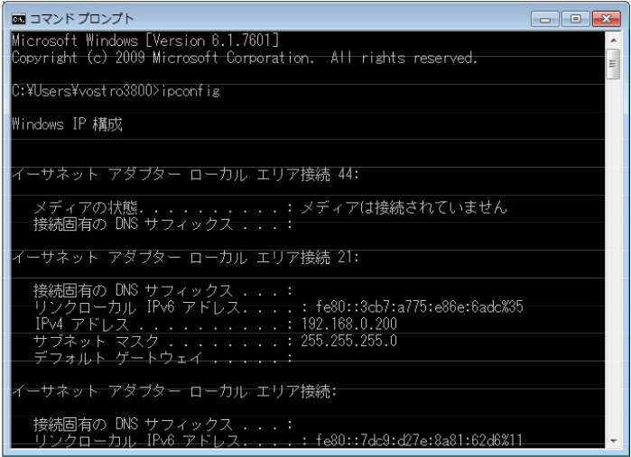

> **図の内容**
>
> コマンドプロンプトで `ipconfig` を実行した画面。「イーサネット アダプター ローカル エリア接続 44:」はメディアが接続されていない。「イーサネット アダプター ローカル エリア接続 21:」は IPv4 アドレス 192.168.0.200、サブネット マスク 255.255.255.0。ほかのアダプターの情報が続く。

別PC上のWindowsネットワーク設定に不備がある場合、「導入編Ⅰ 5-2-3.」を参照して再度設定を見なおして下さい。

### 2-2. プログラム変換処理

| エラーメッセ-ジ           | 推定される原因                                         | 処置                                                                                                          | 詳細説明                    |
|--------------------|-------------------------------------------------|--------------------------------------------------------------------------------------------------------------|-------------------------|
| 1 プログラムバファオーバ-フロー | 運転プログラムのステップ数が多すぎる円弧命令(CIR□)のプリ解析処理でステップ数が増加 | RTMC64では1本の運転プログラムの最大ステップ数は1860 ステップ、198ラベルです(32 ブロックに相当) 上記容量にあわせてステップ数を減らす円弧精度を荒くする DNC機能を用いる「内部円弧」を指定 | セッティングPC 説明書表示設定画面で選択 |
| 2 プログラムフォーマットエラー  | 運転プログラムの表記の間違い                                  | 運転プログラムの表示されたステップの内容をチェック                                                                                   | 機能編テキストプログラム           |

### 2-3. アプリケ-ション起動時

| エラーメッセ-ジ                                                                                                                                             | 推定される原因                                      | 処置                                                                    | 詳細説明              |
|------------------------------------------------------------------------------------------------------------------------------------------------------|----------------------------------------------|------------------------------------------------------------------------|-------------------|
| 1 初期設定ファイルがありませんデフォルト情報で実行しますか。                                                                                                                    | カレントディレクトリにINI ファイルが存在しない                    | セッティングPCの通信設定後、 ROMSW設定ソフトでROMSWの内容をアップロードする                          | 導入編 5-1.5-2. 7-1. |
| 2 □□ライブラリが見つかりません。                                                                                                                                  | カレントディレクトリまたは PATHの通ったディレクトリに DLLが存在しない      | ・必要なDLLのコピー・再インストール (再インスト-ルは、<Ⅰ導入編 10-4.ソフトウェアバージョンアップ>を参照)         | セッティングPC説明書      |
| 3 □□のソフトウェアバージョンが違っています。バージョン不整合による問題が発生する可能性があります。ボードと対応するPCソフトウェアを使用してください。                                                                 | 表示されているファイルのバージョンが異なる                       | ・再インストール (再インスト-ルは、<Ⅰ導入編 10-4.ソフトウェアバージョンアップ>を参照) その後も発生する場合は、テクノに連絡 |                   |
| 4 バージョン情報ファイルがありません。 [オープンできません] [壊れています] ソフトウェアバージョンチェックが実行できませんでした。バージョン不整合による問題が発生する可能性があります。PC ソフトウェアCDのファイルVersion.sysを、フォルダにコピーしてください。 | バージョン確認用ファイル (Version.sys)が壊れているもしくは、見つからない | ・再インストール (再インスト-ルは、<Ⅰ導入編 10-4.ソフトウェアバージョンアップ>を参照) その後も発生する場合は、テクノに連絡 |                   |
| 5 □□ライブラリ内に必要な関数が見つかりません。                                                                                                                          | DLLのバ-ジョンが異なる                                | ファイルの構成ファイルの日付(バージョン)を確認                                             |                   |

## 3. 詳細チェック手順

### 3-1. 一部の入力が不可の時の調査方法

| チェック箇所            | チェック内容                                                                                                                               | 推定される不具合                                                                     | その他            |
|-------------------|--------------------------------------------------------------------------------------------------------------------------------------|------------------------------------------------------------------------------|----------------|
| ROMSW設定ソフトソフト    | 必要な論理入力が正しい入力チャンネルに割付られていること入出力情報が正しくRTMC64側に伝わっているかの確認入力をOFF/ONさせたときにラダーの入出力モニタが変化すること                                         | 入力チャンネルの割付を間違えているラダー/C言語ソフトの論理ミスセンサー不良、ケーブル断線コネクター接触不良やショート入力の割付を間違っている |                |
| ラダーまたはC言語 ※1      | ラダーの入力割付に誤りは無いか                                                                                                                      |                                                                              | MULTIPROG      |
| セッティングPC 入出力モニタ   | 入出力チャンネルの割付に誤りは無いか                                                                                                                  | 割付ミス                                                                         | セッティング PC入出力状態 |
| ※A:中継端子台          | 配線不良、誤配線、ショート、ゆるみ                                                                                                                    | 組み立ての不具合                                                                     |                |
| ※B:入出力ユニット入力コネクタ | コネクタや端子台の接触不良サーボアンプへ接続した ±OTやDECはサーボツールの入力信号モニタでチェック                                                                              | 配線、外部機器の不具合                                                                  |                |
| 入力が時々 ONする OFFする  | ケーブルをゆすって入力信号が変化しないかの再現性の確認入出力状態の入力が変化するか? (表示リフレッシュが遅いので見えない可能性あり) 中継端子台にて、ON/OFFの電圧レベルをチェック ON :2V以下 ※2 OFF :20V以上センサー自体が正常か? | コネクタや端子台のカシメや締め付け不良センサーの残留電圧や、OFF時のリーク電圧などセンサー不良電源が中途半端に低下              |                |

- ※1 ラダーの信号チェックはProConOSのラダーツール"KW-Software MULTIPROG"を使用して下さい。
- ※2 オープンコレクタ信号は、負荷抵抗（プルアップ）が無いと電圧測定はできません。

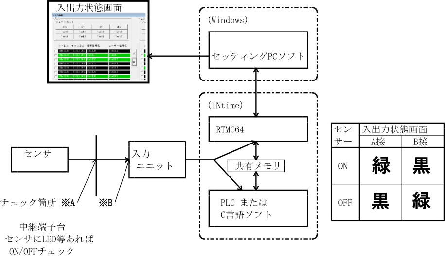

> **図の内容**
>
> - 「センサ」→ 中継端子台 →「入力ユニット」→【INtime】の「共有メモリ」→「RTMC64」→【Windows】の「セッティングPCソフト」の「入出力状態画面」。共有メモリには「PLC または C言語ソフト」もつながる
> - チェック箇所: ※A（センサと中継端子台の間）、※B（中継端子台と入力ユニットの間）。「中継端子台 センサにLED等あれば ON/OFFチェック」
> - 表: センサーが ON のとき入出力状態画面は A接 緑・B接 黒、OFF のとき A接 黒・B接 緑

### 3-2. 一部の出力が不可の時の調査方法

| チェック箇所                    | チェック内容                                                   | 推定される不具合                                                | その他                 |
|---------------------------|----------------------------------------------------------|---------------------------------------------------------|---------------------|
| ROMSW設定ソフト                | 必要な論理出力が正しい出力信号に割付られていること                               | 出力信号の割付を間違えている                                          |                     |
| ラダーまたはC言語ソフト             | ラダーで正常に出力情報が伝わっていることラダーの出力割付                           | ラダー/C言語ソフトの論理ミス出力の割付を間違っている                            |                     |
| セッティングPC強制出力             | セッティングPCの強制出力機能を使い、ラダーに信号が伝わっている事をを確認                  | 出力チャンネルの割付を間違えている                                      |                     |
| ラダーの強制出力 ※                | MULTIPROGの強制出力機能を使い、該当する出力を強制ON/OFFさせ動作を確認             | 出力が変化しない ONしない→ケーブル断線コネクタの接触不良 OFFしない→ケーブルショート (ONのまま) | セッティング PC入出力状態画面参照 |
| ※A:中継端子台                  | 配線不良、誤配線、ショート、ゆるみ                                        | 組み立ての不具合                                                |                     |
| ※B:入出力ユニットコネクタ           | コネクターの接触不良 →コネクターを抜き差ししてみる (無理に挿入していないか?)                | ピンの曲がり、カシメ不良コネクタの接続作業が不適切                              |                     |
| 操作していないのに、出力が時々 ON/OFFする | ケーブルをゆすってみて、出力が変化しないかの再現性の確認                            | ケーブルのカシメ不良やショート                                        |                     |
| 操作していないのに、出力が時々 ON/OFFする | リレーやコイルの駆動電流は充分か? リレー・コイルの定格(電流/電圧)をチェック入出力用の電源の電圧チェック | 駆動容量(電流/電圧)不足電源選択が不適切リレーなどの器具選択が不適切動作時の電源低下          |                     |

- ※ ProConOSのPLCの場合はラダーの信号チェック、強制出力はProConOSのラダーツール"KW-Software MULTIPROG"を使用して下さい。

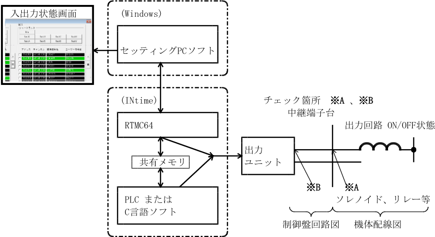

> **図の内容**
>
> - 【Windows】の「セッティングPCソフト」の「入出力状態画面」→【INtime】の「RTMC64」→「共有メモリ」（「PLC または C言語ソフト」）→「出力ユニット」→ 中継端子台 →「ソレノイド、リレー等」
> - チェック箇所: ※A、※B（中継端子台の前後）。「出力回路 ON/OFF状態」。「制御盤回路図」「機体配線図」

### 3-3. サーボ関連異常の調査方法(サーボの単体動作)

- (1) サーボアンプの電源を入れます。 RTMC64のSVM出力による電源シーケンス回路を組んでいる場合には、強制SVMで電源を入れて下さい。
- (2) サーボアンプのオペレーションパネルかPC(ツールソフト)により、サーボON状態にします。
- (3) 同様に、オペレーションパネル/ツールソフトよりJOG操作を行い、軸が正しく動作する否かを確認します。 ※サーボアンプ単体による動作を行う場合は、サーボアンプのパラメータの確認を必ずおこなって下さい。

(JOGの移動速度等)詳細は、各社のサーボアンプのマニュアルを参照して下さい。速度、トルクの波形確認も試運転では必要です。

【注意！】チェックの際は送り速度を下げる等、安全に注意して下さい。

※サーボ支援ツール例

| サーボメーカ    | 説明書           | ツールソフト              |
|-----------|---------------|---------------------|
| 安川電機      | Σサーボ説明書      | Sigma Win           |
| Panasonic | MINAS 説明書     | PANATERM            |
| OMRON     | OMNUC G5 説明書  | CX-Drive            |
| 山洋電気      | SANMOTION 説明書 | SETUP ソフトウェア        |
| 日機電装      | VCⅡシリーズ説明書    | Data Editing ソフトウェア |

### 3-4. バックアップエラー時の対処

下記状況以外では一般に発生することはありません。

- 初期インストール時
- バージョンアップ時

パラメータの初期化を実行し、記録されているファイルを再書き込みしてください。

## 4. システムのバージョンアップ

機能追加等、システム（RTMC64/PCのソフトウェア）のバージョンアップを行うための説明です。別途、当社からご提供するバージョンアップ用のファイルを使用してバージョンアップを行います。（お客様のご都合によるバージョンアップは、別途バージョンアップ費を申し受けます。）

尚、以下の説明では、インストール済みで現在使用しているソフトを「現ソフト」、新しくインストールするソフトを「新ソフト」と呼びます。

### 4-1. バージョンアップ手順

テクノからご提供した新ソフトを準備してください。（まだインストールは行いません。）テクノから新ソフトをご提供する方法には、CDでご提供する場合と、圧縮ファイルでご提供するときがあります。

- CDでご提供した場合：

CDドライブへCDを挿入して下さい。

※ AutoRunによりインストーラが起動し、「新ソフト」を上書きします。

- メールの添付ファイル等で圧縮ファイル(zip)でご提供した場合：

圧縮ファイルを任意のフォルダに解凍して下さい。

ソフトウェアバージョンは Ver1.0.0A の様に数字部分(1.0.0)と英字部分(A)に分かれています。この数字部分と英字部分の違いにより、作業手順を判断して下さい。

- 現ソフトと新ソフトのバージョンの数字部分が違う

RTMC64-M3/ECのモーション制御プログラムのバージョンアップです。

- → 「4-1-2.RTMC64の起動/停止」も実行してください。
- 現ソフトと新ソフトのバージョンの数字部分が同じで、英字部分が違う。（上記以外）
- PC(Windows)プログラムのバージョンアップです。 → 「4-1-2.RTMC64の起動/停止」を実行する必要はありません。

#### 4-1-1.バージョンアップの前準備

- ①．各種パラメータ／運転プログラムのバックアップ

セッティングPCソフトを起動して、以下の画面にて、「アップロード」→「ファイル保存」を行い、ファイルに保存して下さい。

（オプションの画面はオプション未購入時は表示されません。バックアップは不要です。）

- サーボパラメータ画面
- プログラム管理画面（運転プログラム）
- ②．標準付属ファイルの待避バックアップ

- ピッチエラーパラメータ画面：オプション
- 補間前加減速パラメータ画面：オプション
- 工具長補正パラメータ画面：オプション
- 工具径補正パラメータ画面：オプション

もし出荷時CDに入っていたサンプルデータファイル(Default.rom / L_*.txt / G_*.txt / L_*.pnt 等) をお客様で変更されている場合はインストール前にファイル名を変更しておいてください。インストール時に上書きしてしまいます。

③．「新ソフト」の準備

- CDでご提供した場合：

CDドライブへCDを挿入して下さい。

※ AutoRunによりインストーラが起動し、「新ソフト」を上書きします。

- メールの添付ファイル等で圧縮ファイル(zip)でご提供した場合：

圧縮ファイルを任意のフォルダに解凍して下さい。

#### 4-1-2.RTMC64の起動/停止

ファームウェアのバージョンアップのときはRTMC64の運転を停止してください。

- INtimeの実行を停止してください。 "Stop NodeA" をクリックします。

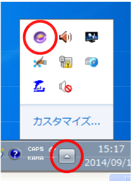

> **図の内容**
>
> タスクトレイの隠れたアイコンを表示したところ。INtime のアイコン（紫色）と、通知領域を開く「∧」ボタンが赤丸で囲まれている。

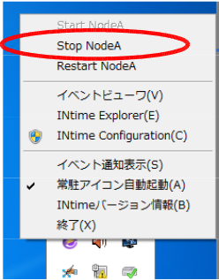

> **図の内容**
>
> INtime のアイコンを右クリックしたメニュー: Start NodeA（灰色）、Stop NodeA（赤丸で囲み）、Restart NodeA、イベントビューワ(V)、INtime Explorer(E)、INtime Configuration(C)、イベント通知表示(S)、常駐アイコン自動起動(A)（チェックあり）、INtimeバージョン情報(B)、終了(X)。

#### 4-1-3.プログラムのバージョンアップ

- ① Setup.exeを実行してください。
- ② 現ソフトをインストールしているフォルダを指定して、 OK ボタンをクリックして下さい。選択したフォルダにファイルがコピーされます。

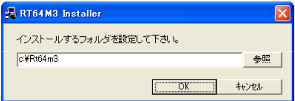

> **図の内容**
>
> ダイアログ「RT64M3 Installer」。「インストールするフォルダを設定して下さい。」、フォルダ「c:¥Rt64m3」、ボタン: 参照、OK、キャンセル。

【注意！】現ソフトをインストールしているフォルダには、インストール後に作成された設定ファイル(*.ini)が存在します。

そのファイルを新ソフトでも流用するため、同じフォルダにインストールする事をお勧め致します。

尚、異なるフォルダにインストールしても設定ファイル(*.ini)をコピーすれば、問題ありません。

- ③ PCの再起動をおこなってください。

以下の手順でもRTMC64の再起動は可能ですが、PCの再起動が可能な時はPCの再起動を推奨します。

INtimeの"Restart NodeA"を実行してください。

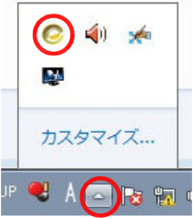

> **図の内容**
>
> タスクトレイの隠れたアイコンを表示したところ。INtime のアイコン（黄色）と、「∧」ボタンが赤丸で囲まれている。

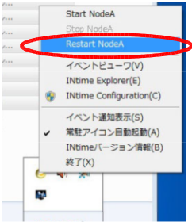

> **図の内容**
>
> INtime のアイコンを右クリックしたメニュー: Start NodeA、Stop NodeA（灰色）、Restart NodeA（選択中、赤丸で囲み）、イベントビューワ(V)、INtime Explorer(E)、INtime Configuration(C)、イベント通知表示(S)、常駐アイコン自動起動(A)（チェックあり）、INtimeバージョン情報(B)、終了(X)。
