# 標準PCベースファインモーションコントローラ[RTMC64-M3/RTMC64-EC]

セッティングPC マニュアル

お願い

このマニュアルの記載内容について、まちがいや不明な点がありましたら、お手数ですがFAXまたはメールにてテクノへお知らせ下さい。今後さらに改善していきます。

株式会社テクノ〒358-0011 埼玉県入間市下藤沢1304-5 TEL 04-2964-3677 FAX 04-2964-3322 E-mail mail@open-mc.com

Ver1.1

2020.7.3

－目次－

- 1.概要
- 2.用途
- 3.製品構成/動作環境
  - 3-1．製品構成(ファイル構成)
  - 3-2．動作環境
  - 3-3．インストール
  - 3-4．関連資料
- 4.概略機能
  - 4-1．画面ツリー
- 5.運転画面
  - 5-1．メインメニュー
  - 5-2．運転画面
    - 5-2-1.運転操作画面
    - 5-2-2.ポジション表示メニュー
    - 5-2-3.入出力モニタリングメニュー
    - 5-2-4.制御軸メニュー
    - 5-2-5.プログラム管理画面
    - 5-2-6.プログラムティーチング画面
    - 5-2-7.マクロ変数メニュー <オプション>
    - 5-2-8.オプションメニュー
    - 5-2-9.エラー表示画面
  - 5-3．パラメータ画面
    - 5-3-1.サーボパラメータ設定画面
    - 5-3-2.ピッチエラー補正データ設定画面 <オプション>
    - 5-3-3.工具長補正データ設定画面 <オプション>
    - 5-3-4.工具径補正データ設定画面 <オプション>
    - 5-3-5.補間前加減速パラメータ設置画面 <オプション>
    - 5-3-6.バックアップデータ初期化画面
  - 5-4．表示設定画面
    - 5-4-1.インタフェース
    - 5-4-2.ポジション表示形式設定画面
    - 5-4-3.入出力表示設定画面
  - 5-5．バーション表示画面

## 1.概要

セッティングPCは、64軸制御PCベースファインモーションコントローラ(RTMC64-M3またはRTMC64-EC)の各タスク毎の運転・試運転を行うソフトです。

RTMC64-M3またはRTMC64-ECが動作する同じPC(Windows)上で動作します。 64軸制御PCベースファインモーションコントローラは次の2種類です。

- RTMC64-M3 ・・・・・・・・ MECHATROLINK-Ⅲ
- RTMC64-EC ・・・・・・・・ EtherCAT

以降の説明で2種類の共通部分はRTMC64と表記します。

また、Windows上のPC部(セッティングPCやユーザ作成ソフトなど)はPCアプリと表記します。 RTMC64-M3のみの説明には[M3]、RTMC64-ECのみの説明には[EC]を付けて区別します。

## 2.用途

モニタリング (1) 設定、保守･･････････････････････････････マニュアル操作パラメータ変更

プログラムダウン・アップロード (2) 運転プログラムの作成･･･････････････････プログラムファイルライト・リードプログラム簡易編集機能(64KB以下) チィーチング

自動運転(プログラム運転)

(3) 運転････････････････････････････････････手動運転

DNC運転

## 3.製品構成/動作環境

### 3-1．製品構成(ファイル構成)

3-1-1.RTMC64-M3(MECHATROLINK)の場合

RT64M3DRV.EXE ･･･････････････････････････セッティングPCソフト実行プログラム

RT64M3COMNT.DLL ･････････････････････････通信ライブラリ

RT64M3TCNV.DLL ･･････････････････････････テクノコードプログラム変換ライブラリ

RT64M3GCNV.DLL ･･････････････････････････ Gコードプログラム変換ライブラリ

RT64M3SWSET.EXE ･････････････････････････ ROMSW設定ソフト実行プログラム

VERSION.SYS ･････････････････････････ソフトウェアバージョン情報ファイル

- 3-1-2.RTMC64-EC(EtherCAT)の場合

RT64ECDRV.EXE ･･･････････････････････････セッティングPCソフト実行プログラム

RT64ECCOMNT.DLL ･････････････････････････通信ライブラリ

RT64ECTCNV.DLL ･･････････････････････････テクノコードプログラム変換ライブラリ

RT64ECGCNV.DLL ･･････････････････････････ Gコードプログラム変換ライブラリ

RT64ECSWSET.EXE ･････････････････････････ ROMSW設定ソフト実行プログラム

VE64RSION.SYS ･････････････････････････ソフトウェアバージョン情報ファイル

### 3-2．動作環境

セッティングPCソフトは、RTMC64が動作しているPCのWindows上で動作します。

```c
    OS
    RTOS
```

: Windows 7 / Windows 10

: INtime 4.2 ～ INtime 6.*

対応パソコン : CPU INtimeが動作するIntel CPU

画像解像度 1034×768 以上

### 3-3．インストール

「PCベースファインRTMC64-M3/EC ユーザーズマニュアル」<Ⅰ 導入編>(TB00-1040A)を参照下さい。

### 3-4．関連資料

| 「RTMC64-M3/EC ユーザーズマニュアル」               | (TB00-1040)    |
|-----------------------------------------|----------------|
| 「RTMC64-M3/EC セッティングPCマニュアル」            | (TB00-1041) 本書 |
| 「RTMC64-M3/EC ROMSW設定ソフトマニュアル」          | (TB00-1042)    |
| EtherCATのコンフィグレーションの手順書                 |                |
| 「ENIファイル作成手順書(RSI-ECAT-Master用)」        | (TB00-1058)    |
| 「ENIファイル作成手順書(AlgoEtherCAT"TwinCAT3"用)」 | (TB00-1149)    |
| 「ENIファイル作成手順書(AlgoEtherCAT"ET9000"用)」   | (TB00-1059)    |
| PCアプリ/INtime上のソフト開発の資料                  |                |
| 「RTMC64-M3/EC 通信ライブラリリファレンスマニュアル」       | (TB00-1043)    |
| 「RTMC64-M3/EC 送受信データマニュアル」              | (TB00-1044)    |
| 「RTMC64-M3/EC Tコード変換ライブラリリファレンスマニュアル    | (TB00-1045)    |
| 「RTMC64-M3/EC Gコード変換ライブラリリファレンスマニュアル    | (TB00-1046)    |
| PLCからラダー制御する場合の参考資料                     |                |
| 「RTMC64-M3/EC サンプルラダープログラム説明書」          | (TB00-1047)    |

## 4.概略機能

(1) モニタリング

ポジションモニタリング（指令位置、機械位置、アブソ位置、偏差量、相対移動量）

入出力モニタリング

動作状態モニタリング

アラームモニタリング

タスク機能モニタリング

マクロ変数モニタリング

(2) 運転

手動送り(JOG、インチング、1ショット位置決め、独立位置決め)

原点復帰(軸個別、全軸同時)

原点設定

自動運転(メモリ運転、プログラム選択、プログラム転送・編集、DNC運転<オプション>) ティーチング(パソコンティーチング)[開発中]

モード変更

オーバーライド変更(0～200%)

リセット

入出力状態強制設定

主軸操作<オプション>

(3) 運転プログラム設定

運転プログラム編集・ダウンロード/アップロードブロック番号指定

(4) パラメータ設定

以下のパラメータやデータの編集・ダウンロード/アップロードサーボパラメータ

ピッチエラー補正データ<オプション>

工具長補正データ<オプション>

工具径補正データ<オプション>

補間前加減速データ<オプション>

位置決めポイントテーブル

バックアップデータ初期化(パラメータ、運転プログラム、アブソポジション、マクロ変数データ) 運転プログラムバックアップの方式

(5) 表示設定

通信設定(ノード設定、通信エラーロギング設定) セッティングPCソフト設定(表示位置、運転プログラム条件設定) ポジション表示設定(軸名称、小数点位置、円弧解析精度、送り速度単位) 入出力表示設定(表示有/無、入出力ユーザ信号名)

(6) データファイル操作

ファイルの読み出し :保存してあるファイルを読み出し

ファイルの保存 :データをファイルに保存

ダウンロード

:セッティングPCソフトからRTMC64へデータをダウンロード

アップロード

:RTMC64からセッティングPCソフトへデータをアップロード

サーボパラメータファイル (拡張子".prm") ピッチエラー補正データファイル (拡張子".pit") 工具長補正データファイル (拡張子".tol") 工具径補正データファイル (拡張子".tod") 補間前加減速パラメータファイル (拡張子".aco") 運転プログラムファイル (拡張子".txt") マクロ変数ファイル (拡張子".mcr") 位置決めポイントテーブルファイル (拡張子".pnt") TPCログファイル ※ (拡張子".csv")

※ ファイルの保存のみ

### 4-1．画面ツリー

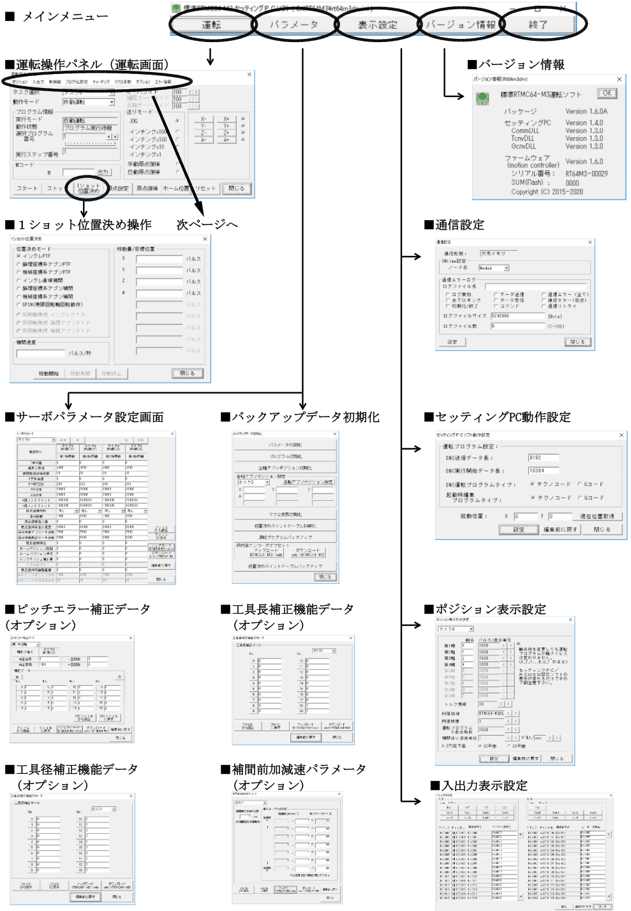

> **図の内容**
>
> セッティングPCの画面の構成図。メインメニュー（運転、パラメータ、表示設定、バージョン情報、終了）から、運転画面（運転操作パネル）、サーボパラメータ設定、ピッチエラー補正データ、工具長補正データ、工具径補正データ、補間前加減速パラメータ、バックアップデータ初期化、通信設定、セッティングPC動作設定、ポジション表示形式設定、入出力表示設定、バージョン情報の各画面へ分かれる。縮小図のため、細かい文字は判読できない。

■ 操作メニュー

運転画面の操作メニュー

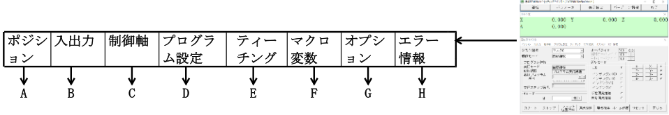

> **図の内容**
>
> 運転画面の操作メニューのボタンと、この節の記号の対応: ポジション(A)、入出力(B)、制御軸(C)、プログラム設定(D)、ティーチング(E)、マクロ変数(F)、オプション(G)、エラー情報(H)。

- A ポジション表示

■指令位置

- ■機械位置

■偏差量


> **図の内容**
>
> ポジション表示のメニュー項目: 指令位置、機械位置、偏差量、アブソ位置、相対移動量、トルク情報。

B 入出力

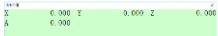

> **図の内容**
>
> 指令位置の表示画面。X、Y、Z、A 軸の値（0.000）を緑の背景で表示する。

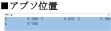

> **図の内容**
>
> 「■アブソ位置」の見出しと、X、Y、Z、A 軸の値（0.000）を青の背景で表示する画面。

■汎用入出力


> **図の内容**
>
> 入出力のメニュー項目: 汎用入出力。

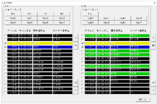

> **図の内容**
>
> 入力と出力の一覧（アドレス、チャンネル、標準信号名、ユーザー信号名）と、ショートカットのボタンが並ぶ画面。詳細は 5-2-3-1。

- C 制御軸(RTMC64-M3の場合) ■軸設定

■各軸ステータス

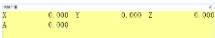

> **図の内容**
>
> X、Y、Z、A 軸の値（0.000）を黄色の背景で表示する画面。

- ■相対移動量
- ■トルク情報

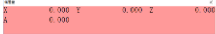

> **図の内容**
>
> X、Y、Z、A 軸の値（0.000）を赤の背景で表示する画面。

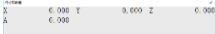

> **図の内容**
>
> X、Y、Z、A 軸の値（0.000）を灰色の背景で表示する画面。

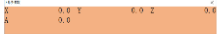

> **図の内容**
>
> X、Y、Z、A 軸の値（0.0）をオレンジの背景で表示する画面。

■サーボステータスモニタ

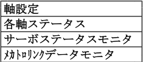

> **図の内容**
>
> 制御軸のメニュー項目: 軸設定、各軸ステータス、サーボステータスモニタ、メカトロリンクデータモニタ。

制御軸(RTMC64-ECの場合)

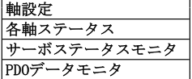

> **図の内容**
>
> 制御軸のメニュー項目: 軸設定、各軸ステータス、サーボステータスモニタ、PDOデータモニタ。

D プログラム設定

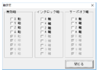

> **図の内容**
>
> 無効軸、インタロック軸、サーボオフ軸を軸ごとにチェックする画面。詳細は 5-2-4-1。

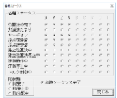

> **図の内容**
>
> 軸ごとのステータス（位置決め完了、サーボオン、原点復帰済など）を表示する画面。詳細は 5-2-4-2。

- ■メカトロリンクデータモニタ(RTMC64-M3)
- ■PDOデータモニタリング(RTMC64-EC)

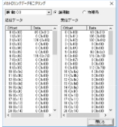

> **図の内容**
>
> 軸を選び、送信データと受信データを Offset と Data の表で表示する画面。詳細は 5-2-4-4。

■プログラム設定

E ティーチング

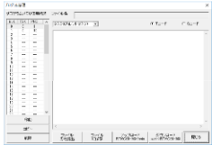

> **図の内容**
>
> 運転プログラムの一覧と編集欄がある画面。詳細は 5-2-5。

■ティーチング

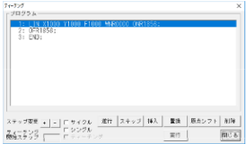

> **図の内容**
>
> プログラム（例: LIN X1000 Y1000 F1000 WNR0000 ONR1856; OFR1856; END;）を表示し、ステップ変更や挿入・削除などのボタンがある画面。詳細は 5-2-6。

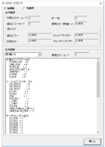

> **図の内容**
>
> 全体情報、軸ごとのエラーコード、信号の状態の一覧を表示する画面。詳細は 5-2-4-3。

F マクロ変数

■一般レジスタ表示

■マクロ変数書き込み

一般レジスタ表示マクロ変数書き込み

G オプション

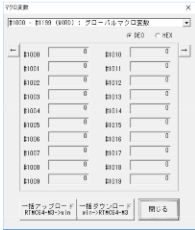

> **図の内容**
>
> マクロ変数（#1000～#1199 (WORD)：グローバルマクロ変数）の値を一覧で表示し、一括アップロード・一括ダウンロードのボタンがある画面。詳細は 5-2-7-1。

■主軸操作

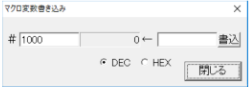

> **図の内容**
>
> マクロ変数番号（# 1000）に値を書き込む画面。DEC / HEX を選ぶ。詳細は 5-2-7-2。

■TPCロギング

■手動パルサモード

| 主軸操作             |
|------------------|
| TPCロギング          |
| 手動パルサーモード        |
| センサーラッチモニタ       |
| 工具長補正情報          |
| 工具径補正情報          |
| 独立位置決め           |
| 制御周期モニタ          |
| 工具径補正エラー情報       |
| 位置決めポイントテーブル作成  |
| 位置決めポイントテーブルモニタ |

H エラー情報

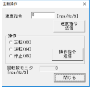

> **図の内容**
>
> 速度指令、操作（正転(M3)、逆転(M4)、停止(M5)）、回転数モニタがある画面。詳細は 5-2-8-1。

位置決めポイントテー ■センサーラッチモニタ ■工具長補正情報

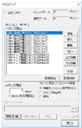

> **図の内容**
>
> TPCロギング画面の 64CH タブを表示したもの。画面の項目は 5-2-8-2 の図と同じ（ロギング中、バッファデータ、保存データ、ロギング設定の一覧、ロギング周期、ファイル保存(アップロード)方法、ロギングファイル、開始・停止のボタン）。

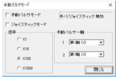

> **図の内容**
>
> 手動パルサモード、ジョイスティックモード、倍率（X1、X10、X100、X1000）、手動パルサー軸を設定する画面。詳細は 5-2-8-3。

■工具径補正情報

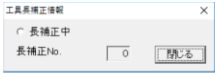

> **図の内容**
>
> 長補正中の表示と長補正No. を表示する画面。

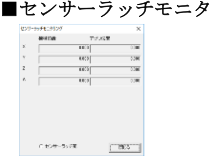

> **図の内容**
>
> 「■センサーラッチモニタ」の見出しと、軸ごとの機械位置・アブソ位置のラッチ値を表示する画面。

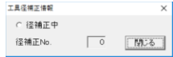

> **図の内容**
>
> 径補正中の表示と径補正No. を表示する画面。

- ■独立位置決め ◆1.1 ■制御周期モニタ ■工具径補正エラー情報

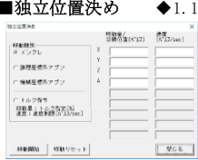

> **図の内容**
>
> 「■独立位置決め ◆1.1」の見出しと、移動種別（インクレ、論理座標系アブソ、機械座標系アブソ、トルク指令）、軸ごとの移動量/目標位置と速度を入力する画面。

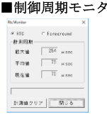

> **図の内容**
>
> 「■制御周期モニタ」の見出しと、RtcMonitor 画面（計測周期の最大値・平均値・現在値 [μsec]）。詳細は 5-2-8-8。

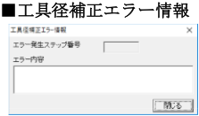

> **図の内容**
>
> 「■工具径補正エラー情報」の見出しと、エラー発生ステップ番号、エラー内容を表示する画面。

■位置決めポイントテーブル作成 ◆1.1 ■位置決めポイントテーブルモニタ ◆1.1

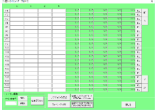

> **図の内容**
>
> ポイント（P1～）ごとの各軸の値を入力する表の画面。詳細は 5-2-8-10。

■エラー情報

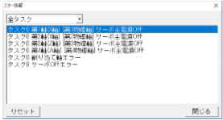

> **図の内容**
>
> タスクと軸ごとのエラー（例: タスク0 第1軸(X軸) [第1物理軸] サーボ主電源OFF）を一覧で表示する画面。詳細は 5-2-9。

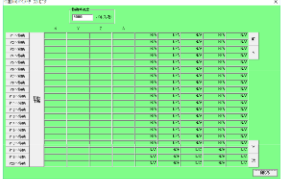

> **図の内容**
>
> ポイントごとの各軸の値と移動のボタンが並ぶ画面。詳細は 5-2-8-11。

## 5.運転画面

### 5-1．メインメニュー

- このメニューの各ボタンをクリックするとそれぞれの画面を表示します

(1). RTMC64-M3の場合

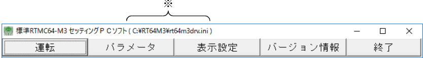

> **図の内容**
>
> タイトル「標準RTMC64-M3 セッティングP Cソフト ( C:¥RT64M3¥rt64m3drv.ini )」。ボタン: 運転、パラメータ、表示設定、バージョン情報、終了。タイトルの括弧内（※）が、参照している INI ファイル名。

- ※ セッティングPCが参照しているINIファイルのファイル名を表示します。詳細は「RTMC64-M3/ECユーザーズマニュアル」<Ⅰ導入編>(TB00-1040A)を参照下さい。

(2). RTMC64-ECの場合

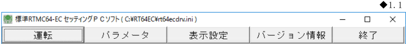

> **図の内容**
>
> タイトル「標準RTMC64-EC セッティングP Cソフト ( C:¥RT64EC¥rt64ecdrv.ini )」。ボタン: 運転、パラメータ、表示設定、バージョン情報、終了。◆1.1

### 5-2．運転画面

RTMC64の内部情報（動作モード/動作状態/アラーム情報）のモニタや、各種操作を行うことができます。運転画面で選択されているタスクに対するモニタ/指令です。

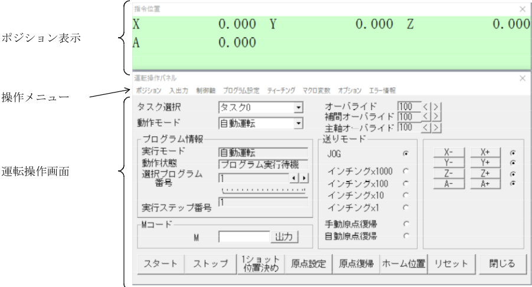

> **図の内容**
>
> 運転画面は、上から「ポジション表示」（X、Y、Z、A の値）、「操作メニュー」、「運転操作画面」（運転操作パネル）で構成される。

#### 5-2-1.運転操作画面

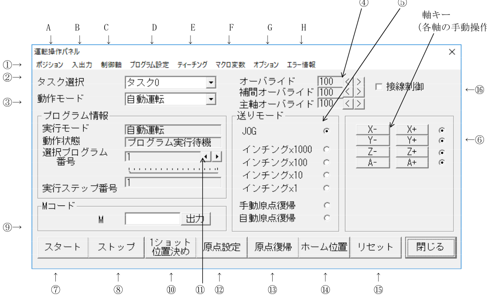

> **図の内容**
>
> 運転操作パネル。本文の番号と記号に対応する。
> - 上部: 操作メニュー（A ポジション ～ H エラー情報）
> - ① タスク選択、② 動作モード、③ プログラム情報（実行モード、動作状態、選択プログラム番号、実行ステップ番号）
> - ④⑤ オーバライド、補間オーバライド、主軸オーバライド、⑯ 接線制御
> - ⑥ 軸キー（各軸の手動操作。X-、X+、Y-、Y+、Z-、Z+、A-、A+）、送りモード（JOG、インチング×1000、×100、×10、×1、手動原点復帰、自動原点復帰）
> - ⑨ Mコード（M、出力）
> - 下部のボタン: スタート⑦、ストップ⑧、1ショット位置決め⑩、原点設定⑪⑫、原点復帰⑬、ホーム位置⑭、リセット⑮、閉じる

① 操作メニュー

操作メニューをクリックすることで画面を切り換えたり、必要な画面を表示させることができます。

A. ポジション表示メニュー（5-2-2.を参照下さい）

- ├ 指令位置
- ├ 機械位置
- ├ 偏差量
- ├ アブソ位置
- ├ 相対移動量
- └ トルク情報
- B. 入出力モニタリングメニュー（5-2-3.を参照下さい）

汎用入出力

- C. 制御軸メニュー

（5-2-4.(1)、(2)を参照下さい）

- (1). RTMC64-M3の場合

(2). RTMC64-ECの場合

- ├ 軸設定
- ├ 軸設定
- ├ 各軸ステータス
- ├ 各軸ステータス
- ├ サーボステータスモニタ
- ├ サーボステータスモニタ
- └ メカトロリンクデータモニタ
- └ PDOデータモニタ
- D. プログラム設定メニュー（5-2-5.を参照下さい）
- E. ティーチングメニュー（5-2-6.を参照下さい）
- F. マクロ変数メニュー

（5-2-7.を参照下さい）

一般レジスタ表示

- マクロ変数書き込み

④ ⑤

G. オプションメニュー

（5-2-8.を参照下さい）

主軸操作

- TPCロギング
- 手動パルサモード
- センサーラッチモニタ-
- 工具長補正情報
- 工具径補正情報
- 独立位置決め
- 制御周期モニタ
- 工具径補正エラー情報
- 位置決めポイントテーブル作成
- 位置決めポイントテーブルモニタ

H. エラー情報メニュー

（5-2-9.を参照下さい）

② タスク選択セッティングPCで監視・操作するタスクを選択してください。(タスク0～7) 基本的には、セッティングPCの操作は選択中の1つのタスクに対して行います。

同時進行している複数のタスクは、タスク選択ボタンで表示を切り替えて、監視・操作をしてください。

タスク選択の切替は常時実行できます。

セッティングPC上のタスク選択の切り替えは各タスクの運転に全く影響しません。

③ 動作モード変更操作

▼ ボタンを押すとメニュ－が出ますので動作モードを選択してください。各々の動作モードでは、以下の操作が可能です。

× ※1

○：実行可、×：実行不可

| モード操作   | セッティングモード   | 手動運転モード   | 自動運転モード   | OT無視モード ※4   | DNC運転モード   |
|-------------|--------------|------------|------------|---------------|-------------|
| 送りオーバーライド変更 | ○            | ○          | ○          | ○             | ○           |
| ＪＯＧ送り       | ×            | ○          | ○          | ○             | ○           |
| インチング送り     | ×            | ○          | ○          | ×             | ○           |
| １ショット位置決め   | ×            | ○          | ○          | ×             | ○           |
| 原点復帰        | ×            | ○          | ○          | ×             | ○           |
| プログラム選択     | ○            | ○          | ○          | ○             | - ※2        |
| プログラムスタート   | ×            | ×          | ○※3        | ×             | ○           |
| プログラムストップ   | ×            | ×          | ○※3        | ×             | ○           |
| リセット        | ○            | ○          | ○          | ○             | ○           |
| 原点設定        | ○            | ○          | ○          | ○             | ○           |
| プログラムダウンロード | ○            | ○          | ○          | ○             | ×           |
| プログラムアップロード | ○            | ○          | ○          | ○             | ×           |
| パラメータダウンロード | ○            | ×          | ×          | ×             | ×           |
| パラメータアップロード | ○            | ○          | ○          | ○             | ○           |

- ※1 実行中のプログラムに対しては、書き込みはできません。
- ※2 選択ボタンでプログラムファイル名を選択します。
- ※3 ティーチングも可能です。[開発中]
- ※4 OT無視モード使用時(OTからの復旧)の動作については、「RTMC64-M3/ECユーザーズマニュアル」<Ⅱ 機能編 5-14.ストロークリミット>(TB00-1040E)を参照下さい。

- ④ オーバーライド変更操作（オーバライド、補間オーバライド、主軸オーバライド）

＜＞ボタンによりオーバーライド設定を変更します。

ROMSW設定ソフトの「基本」画面で、「補間オーバライド個別指定」と、「主軸オーバライド個別指定」が設定できます。

対応するオーバーライドは以下の通りです。

| 移動種別 ＼ ROMSW設定 | ROMSWオーバライド個別指定 ※ - 有効 | ROMSWオーバライド個別指定 ※ - 無効 |
|---|---|---|
| 補間送り | 補間オーバライド | 通常オーバライド |
| S指令/ SPIN指令 | 主軸オーバライド | 通常オーバライド |
| それ以外の移動指令 | 通常オーバライド | 通常オーバライド |

- ※ 補間送りに対応するオーバライド :ROMSW設定ソフト「基本画面」の「補間オーバライド個別指定」主軸/SPIN命令に対応するオーバライド :ROMSW設定ソフト「基本画面」の「主軸オーバライド個別指定」
- 主軸回転指令に対しオーバライドを反映させるにはROMSW設定ソフト「基本」画面の "主軸機能選択" で「主軸オーバライド」を有効にする必要があります。
- ※「主軸オーバライド」と「主軸オーバライド個別指定」は意味が異なります。
- 詳細は、「RTMC64-M3/EC ROMSW設定ソフトマニュアル」<5-1.基本パラメータ>(TB00-1042)を参照下さい。

⑤ 手動送りモード

ラジオボタン( )をクリックして、手動送りモードを選択します。

a ジョグ送り(JOG)

軸キーを押している間、一定速度で移動を続けます。移動速度は、パラメータ(JOG速度)にて設定します。

b インチング送り(×1000、×100、×10、×1)

軸キーをクリックする毎に、軸が指定された量移動します。

移動量は×1000､×100､×10､×1選択に応じて、それぞれ1000パルス、100パルス、10パルス、1パルスになります。

c 各軸手動原点復帰

各軸キーを押している間、逃げ動作をしない原点復帰を行います。(軸キーの+/- はどちらでも同じ動作です。区別しません。)

d 各軸自動原点復帰

各軸キーをクリックすると、逃げ動作を行った後、原点復帰を行います。(軸キーの+/- はどちらでも同じ動作です。区別しません。)

電源投入後、一度も原点復帰を完了していない場合は、逃げ動作を行いません。

逃げ動作については、「RTMC64-M3/ECユーザーズマニュアル」<Ⅲ 試運転調整編 4-4.全軸原点復帰の逃げ動作>(TB00-1040H)を参照下さい。

- ※ 原点復帰の詳細は、「RTMC64-M3/EC ユーザーズマニュアル」<Ⅲ 試運転調整編 4-3.原点復帰の動作> (TB00-1040H)を参照下さい。

⑥ 原点復帰完了表示ボタン

原点復帰が完了している軸はこのボタン表示がＯＮになります。

- ⑦ プログラム運転開始（スタートボタン）

プログラム運転を開始します。

⑧ プログラム運転停止（ストップボタン）

プログラム運転を一時停止します。スタートボタンによりプログラム運転を再開できます。

⑨ マニュアルMコード( 出力ボタン)

エディットボックスに入力した数値をMコードとして出力します。

入力できる値の範囲は0～255です。範囲外の値を設定し、「出力」ボタンを押すと、Mコードは出力されず、表示は前回設定値に戻ります。

⑩ 1ショット位置決め操作画面

操作画面の1ショット位置決めボタンを押すと、以下の画面を表示します。各軸の座標値や移動量を入力して、位置決めを行います。

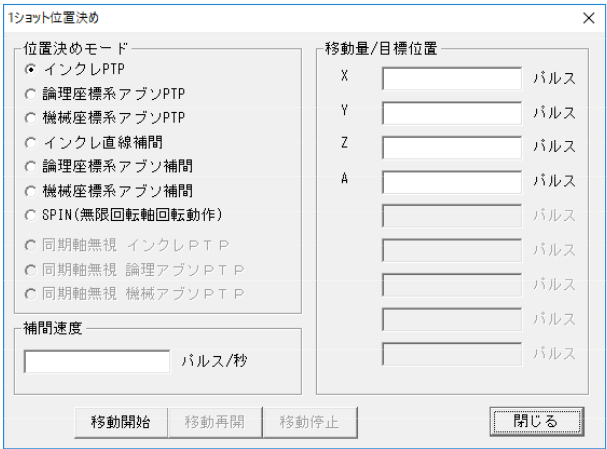

> **図の内容**
>
> - 位置決めモード: インクレPTP、論理座標系アブソPTP、機械座標系アブソPTP、インクレ直線補間、論理座標系アブソ補間、機械座標系アブソ補間、SPIN(無限回転軸回転動作)、同期軸無視 インクレPTP、同期軸無視 論理アブソPTP、同期軸無視 機械アブソPTP
> - 移動量/目標位置: 軸（X、Y、Z、A ほか）ごとに入力 [パルス]
> - 補間速度 [パルス/秒]
> - ボタン: 移動開始、移動再開、移動停止、閉じる

位置決めの方式としては、PTP移動(早送り移動)と補間移動とSPIN回転(無限回転)があります。 PTP移動と補間移動は、ポジションの指定方式として、インクリメンタル指定(移動量)とアブソリュート指定(目標位置)があります。

補間移動の場合は、ポジション指定と同時に、送り速度の指定が必要です。

補間移動の送り速度は指定された全軸の合成速度です。

SPIN回転の場合は、移動量/目標位置が回転速度指定となります。

SPIN回転動作は、軸設定パラメータで、「メカ1回転パルス数」が"0"以外の数値が設定されている軸のみ可能です。

同期軸無視「同一指令2軸制御」オプションが有効で、同期軸(従軸)が設定されているときのみ可能です。同期軸無視PTPを選択すると、同期主軸と同期従軸のみが設定可能になります。

「RTMC64-M3/ECユーザーズマニュアル」の以下のマニュアルを参考にして下さい。

- 論理座標系、機械座標系について : <Ⅱ 機能編 5-1.座標系>(TB00-1040E)
- アブソ指令、インクレ指令について : <Ⅱ 機能編 5-2.アブソ指令とインクレ指令>(TB00-1040E)
- 補間移動送りの合成速度について : <Ⅱ 機能編 5-6.直線補間>(TB00-01040E)

⑪ プログラム選択 ( Ï Ì ボタン)

自動運転時、プログラム番号を選択します。(プログラムメモリ上の PNo) DNC運転時、プログラムファイルを選択します。

- 【注】運転プログラムをRTMC64へダウンロード(ローディング)する時に、ブロック番号(BLK)、タスク番号(TSK)、プログラム番号(PNo)を指定してください。詳細は、「5-2-5. プログラム管理画面」を参照ください。

⑫ 原点設定操作 ( 原点設定ボタン)

現在位置を論理座標系の原点(運転プログラムの原点)にします。

⑬ 原点復帰操作 ( 原点復帰ボタン)

全軸原点復帰を行います。各軸の原点復帰パラメータ(速度、復帰方向、順位)は、サーボパラメータ設定で指定します。

詳細は、「RTMC64-M3/ECユーザーズマニュアル」<Ⅲ 試運転・調整編 4.サーボパラメータ>(TB00-1040H) を参照下さい。

⑭ ホームポジション位置決め操作( ホーム位置ボタン)

サーボパラメータ項目内の「ホームポジション距離」で設定された位置に位置決めを行います。(各軸のホームポジション距離、順位は、サーボパラメータで設定できます。)

「ホームポジション距離」は機械座標系で設定します。

詳細は、「RTMC64-M3/ECユーザーズマニュアル」<Ⅲ 試運転・調整編 4.サーボパラメータ>(TB00-1040H) を参照下さい。

⑮ リセット操作 ( リセットボタン)

RTMC64のアラームやプログラム運転のリセットを指令します。

また、アラーム要因のクリアーとサーボ電源投入を同時に行います。

但し、ONSW機能有効時はサーボ電源投入は行いません。

詳細は、以下を参照下さい。

- 「ROMSW設定ソフトマニュアル」<5-1-11.サーボON動作の補足説明>(TB00-1042)
- 「RTMC64-M3/ECユーザーズマニュアル」<Ⅱ 機能編 2-1-1.一般入力>(TB00-1040D)

⑯ 接線制御 (オプション)

ROMSW設定ソフトで接線制御オプションが有効の時に表示されます。

チェックすると接線制御が有効になります。

#### 5-2-2.ポジション表示メニュー

① 指令位置画面（画面色：緑）

論理原点を0点として各軸へ出力した指令から算出した現在位置を表示します。

操作画面の操作メニューの「ポジション」で"指令位置"を選択することにより表示します。


> **図の内容**
>
> 「指令位置」画面。X、Y、Z、A の値（0.000）を緑の背景で表示する。

② 機械位置画面（画面色：黄）

論理原点を0点として各軸のエンコーダフィードバック（以降FB）から算出した現在位置を表示します。 (ROMSW設定ソフトで"仮想アンプ機能"を有効にしている軸の現在位置は、指令位置と同じになります。)※ 操作画面の操作メニューの「ポジション」から"機械位置"を選択することにより表示します。

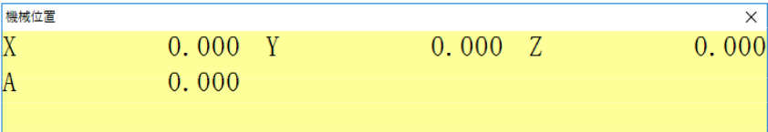

> **図の内容**
>
> 「機械位置」画面。X、Y、Z、A の値（0.000）を黄色の背景で表示する。

③ アブソ位置画面（画面色：青）

機械座標系（機械原点を0点とした座標系）の、A「指令した位置」または B「エンコーダFB位置」を表示します。A/Bは、ROMSW設定（基本画面の「アブソ位置ステータス指令基準」設定）で選択します。ただし、ROMSW設定ソフトで"仮想アンプ機能"※を有効にしている軸は、設定によわらずAを表示します。操作画面の操作メニューの「ポジション」から"アブソ位置"を選択することにより表示します。

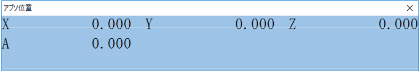

> **図の内容**
>
> 「アブソ位置」画面。X、Y、Z、A の値（0.000）を青の背景で表示する。

④ 偏差量画面（画面色：赤）

モータの遅れ量（指令位置－機械位置）を表示します。

操作画面の操作メニューの「ポジション」から"偏差量"を選択することにより表示します。

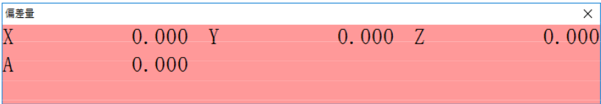

> **図の内容**
>
> 「偏差量」画面。X、Y、Z、A の値（0.000）を赤の背景で表示する。

⑤ 相対移動量画面（画面色：灰色）

各種移動命令１ステップ毎の移動量を表示します。

(C(Z)相原点復帰終了時はドグからC(Z)相までの距離を表示します。ドグ～C(Z)相間距離のチェック用) 操作画面の操作メニューの「ポジション」から"相対移動量"を選択することにより表示します。

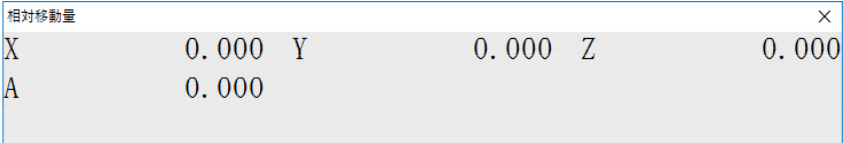

> **図の内容**
>
> 「相対移動量」画面。X、Y、Z、A の値（0.000）を灰色の背景で表示する。

⑥ トルク情報（画面色：オレンジ）<オプション>

現在の実トルク値を表示します。

操作画面の操作メニューの「ポジション」から"トルク情報"を選択することにより表示します。

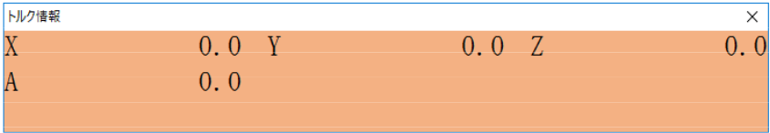

> **図の内容**
>
> 「トルク情報」画面。X、Y、Z、A の値（0.0）をオレンジの背景で表示する。

- ※ "仮想アンプ機能"については「RTMC64-M3/EC ROMSW設定ソフトマニュアル<5-1.基本パラメータ>」 (TB00-1042)を参照下さい。

#### 5-2-3.入出力モニタリングメニュー

##### 5-2-3-1.汎用入出力画面

操作メニューの「入出力」をクリックし、「汎用入出力」を選択すると以下の画面を表示します。 RTMC64の入出力の状態をリアルタイム表示します。また、入出力の状態を変更(強制設定)することもできます。

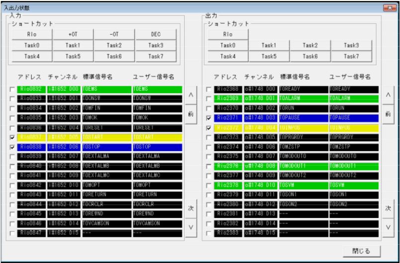

> **図の内容**
>
> 「入出力状態」画面。左が入力、右が出力。
> - ショートカット: Rio、+OT、-OT、DEC、Task0～Task7（入力）。Rio、Task0～Task7（出力）
> - 一覧の列: アドレス、チャンネル、標準信号名、ユーザー信号名（例: 入力 Rio0832 = T0EMS、出力 Rio2368 = T0READY）。信号の ON/OFF を色で表示する。

- 前、次ボタン信号表示が、1点ずつ前または次になります。
- ∧、∨ ボタン信号表示が、16点(1チャンネル)ずつ前または次にまります。

強制設定したい入出力のチェックボックスをチェック( )します。その後信号名称をクリックしてON状態/OFF状態を設定します。

ON/OFF状態は以下のように表示されます。

| 信号の種類・状態   | ON状態   | OFF状態   |
|------------|--------|---------|
| 強制設定中の信号   | 黄      | 青       |
| その他の信号     | 緑      | 黒       |

上図は入力信号Rio0837を強制ON、Rio0838を強制OFF、出力信号Rio2371を強制OFF、Rio2372を強制ON状態にした図です。

ON,OFF状態は交互(トグル)に切り替わります。

強制設定

入力信号の強制設定実際の入力のON/OFFに関わらず、強制設定のON/OFFを入力状態として見なします。

- (例)・ B接OT信号が未接続の場合に、それを強制設定でOFFすることにより、
- アラームを発生しないようにする。
- 運転プログラムの判別処理の動作確認(デバッグ)を行いたい場合、その入
- 力を強制設定する。

出力信号の強制設定任意の出力信号の状態を強制的に変更することができます。

- (例)・アラーム発生中においてもサーボ主電源を投入させる。
- 強制的に外部のソレノイドやシリンダーを動作させる。

強制入出力をしながら運転させることは、例外的状況(アラームや保護機能を無効にする等)ですので、細心の注意が必要です。

- 【注】・入出力信号の名称や機能については「RTMC64-M3/EC ユーザーズマニュアル」<Ⅱ 機能編
- 2.入出力機能>(TB00-1040D)を参照ください。
- 各信号のアドレス、ビットについては「RTMC64-M3/EC ユーザーズマニュアル」<Ⅱ 機能編
- 2-3.入出力信号のアドレス表>(TB00-1040D)を参照ください。

MECHATROLINKやEtherCATの入出力ユニットからの信号はROMSW設定での割り付けが必要です。 PLC入出力の動作は、INtime上のユーザ制御ソフト(PLC/C言語ソフト)が正常動作していることが前提です。

以下を参照下さい。

- 「RTMC64-M3/EC ユーザーズマニュアル」<Ⅱ 機能編 2.入出力機能>(TB00-1040D)
- 「RTMC64-M3/EC サンプルラダー説明書」<4.ラダー処理>(TB00-1047)

#### 5-2-4.制御軸メニュー

(1). RTMC64-M3の場合

操作メニューの「制御軸」をクリックすると

- ■軸設定
- ■各軸ステータス
- ■サーボステータスモニタ
- ■メカトロリンクデータモニタ

が選択できます。

(2). RTMC64-ECの場合

操作メニューの「制御軸」をクリックすると

- ■軸設定
- ■各軸ステータス
- ■サーボステータスモニタ
- ■PDOデータモニタ

が選択できます。

##### 5-2-4-1.軸設定画面

操作メニューの「制御軸」をクリックし、「軸設定」を選択すると以下の画面を表示します。各軸の無効軸、インタロック軸、サーボオフ軸としての状態の表示・変更を行う画面です。

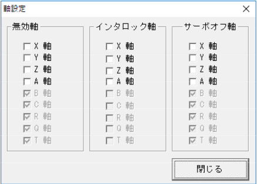

> **図の内容**
>
> 「軸設定」画面。無効軸、インタロック軸、サーボオフ軸の 3 つの枠に、X 軸、Y 軸、Z 軸、A 軸、B 軸、C 軸、R 軸、Q 軸、T 軸のチェックボックスがある。ボタン: 閉じる。

設定変更したい軸のチェックボックスをチェック( )する事によりON状態/OFF状態を設定します。 ON,OFF状態は交互(トグル)に切り替わります。

無効軸・・・・・・・各軸に対する指令を無効にします。

無効軸は、運転プログラムによる移動命令やJOG操作の指令を無視します。

- インタロック軸・・・各軸に対する指令をインタロックします。

インタロック軸に、運転プログラムによる移動命令を指令すると「プログラム実行エラー」になります。

- サーボオフ軸・・・・強制的にサーボオフします。

サーボオフ軸設定をON状態にすると、同じ論理軸のインタロック軸設定が自動的にON状態になります。

この状態からサーボオフ軸設定をOFF状態にしても、インタロック軸設定は自動的にOFF状態にはなりません。必要に応じてインタロック軸をOFFして下さい。

##### 5-2-4-2.軸ステータス画面

操作メニューの「制御軸」をクリックし、「各軸ステータス」を選択すると、以下の画面を表示します。

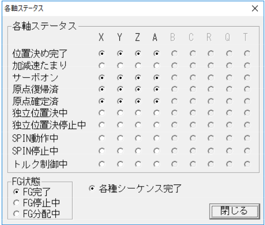

> **図の内容**
>
> 「各軸ステータス」画面。軸（X、Y、Z、A、B、C、R、Q、T）ごとに、位置決め完了、加減速たまり、サーボオン、原点復帰済、原点確定済、独立位置決中、独立位置決停止中、SPIN動作中、SPIN停止中、トルク制御中を表示する。FG状態（FG完了、FG停止中、FG分配中）、各種シーケンス完了の表示もある。

・各軸ステータス

- 位置決め完了・・・位置決め完了時に、ON( )の表示になります。各軸の偏差量(指令位置と機械位置の差)がサーボパラメータのINPOS量以下の時、位置決め完了とします。

加減速たまり・・・(指数型、定時直線型、S字)補間加減速による遅れが発生しているときに、 ON( )の表示になります。

サーボON・・・・・各軸がサーボONしているときに、ON( )の表示になります。

原点復帰済・・・・各軸の原点復帰が完了しているときに、ON( )の表示になります。原点復帰無効の軸は、常にONとなります。

独立位置決中・・独立位置決め指令で移動中にON( )となります。

独立位置決停止中・独立位置決め指令の途中停止でON( )となります。

SPIN動作中・・・・SPIN指令で回転動作中にON( )となります。

SPIN停止中・・・・SPIN指令の途中停止でON( )となります。

トルク指令中・・・トルク指令中でON( )となります。

・FG状態(FG:軌跡発生)

FG完了・・・・・・各軸の移動指令出力が完了しているときに、ON( )の表示になります。

FG停止中・・・・・各軸の移動指令出力が一時停止しているときに、ON( )の表示になりす。

FG分配中・・・・・各軸の移動指令出力を行っているときに、ON( )の表示になります。

各FG状態のタイミングについては、

「RTMC64-M3/EC ユーザーズマニュアル」<Ⅱ 機能編 7-3-8-3.タスク情報>(TB00-1040F)の "FGステータスタイミングチャート"を参照下さい。

画面上の表示と、タイミングチャート内の用語の対応は以下のとおりです。

FG完了・・・・・軌跡発生完了

FG停止中・・・・途中停止中

FG分配中・・・・軌跡発生中

・各種シーケンス完了

以下のRTMC64内部シーケンスを実行していないときに、ON( )の表示になります。 (実行中はOFFの表示になります。)

汎用入出力制御処理、Mコード出力処理、自動原点復帰処理、ホーム位置決め処理

##### 5-2-4-3.サーボステータス画面

(1). RTMC64-M3の場合サーボステータスモニタ

操作メニューの「制御軸」をクリックし、「サーボステータスモニタ」を選択すると、以下の画面を表示します。

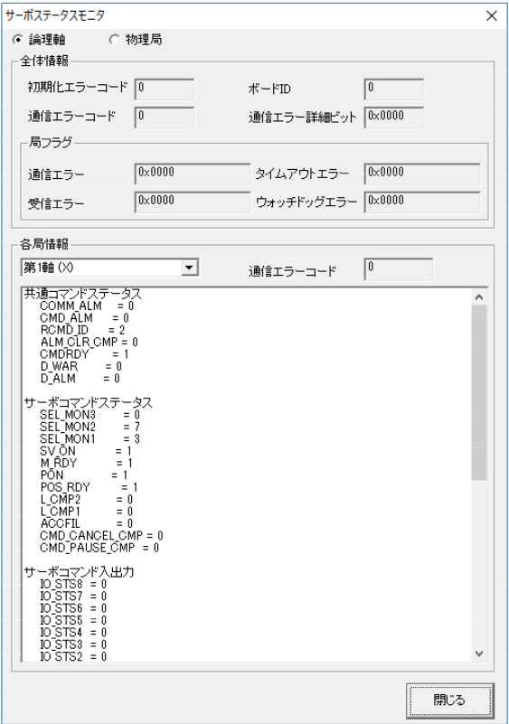

> **図の内容**
>
> 「サーボステータスモニタ」画面。論理軸/物理軸の選択、全体情報（初期化エラーコード、通信エラー詳細ビットなど）、軸ごとの情報（通信エラーコード、共通モニタのステータスなど）を表示する。

全体情報のエラー

メカトロリンク通信のエラーです。エラー発生時は、メカトロリンクケーブルを確認/交換して、再度確認ください。

エラーが解消しない場合は、テクノへ連絡ください。

各局情報

サーボアンプ内の情報です。

詳細はサーボのマニュアルを参照下さい。

(2). RTMC64-ECの場合サーボステータスモニタ

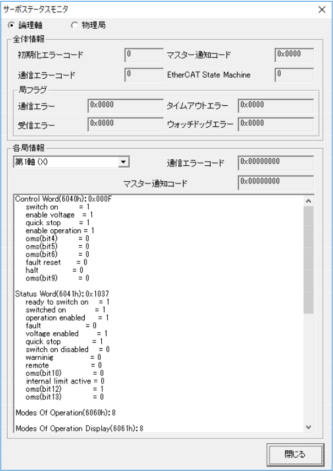

> **図の内容**
>
> 「サーボステータスモニタ」画面（RTMC64-EC）。全体情報（初期化エラーコード、マスター通知コード、EtherCAT State Machine など）と、軸ごとの Control Word、Status Word のビット、Modes Of Operation を表示する。

全体情報のエラー

EtherCAT通信のエラーです。エラー発生時は、ケーブルを確認/交換を行って再度確認ください。エラーが解消しない場合は、テクノへ連絡ください。

各軸情報

サーボアンプ内の情報です。

詳細はサーボのマニュアルで確認してください。

◆1.1

##### 5-2-4-4.通信モニタ

(1). RTMC64-M3の場合メカトロリンクデータモニタリング

操作メニューの「制御軸」をクリックし、「メカトロリンクデータモニタ」を選択すると、以下の画面を表示します。

軸(局)の選択は運転画面で設定したタスクの論理軸、またはタスク選択に関係しない物理局番号でも選択できます。

詳細はサーボのマニュアルを参照下さい。

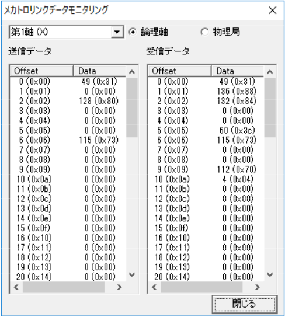

> **図の内容**
>
> 「メカトロリンクデータモニタリング」画面。軸（第1軸 (X)）と論理軸/物理軸を選び、送信データと受信データを Offset（0 (0x00)～）と Data の表で表示する。

(2). RTMC64-ECの場合 PDOデータモニタリング

操作メニューの「制御軸」をクリックし、「PDOデータモニタ」を選択すると、以下の画面を表示します。

各軸毎に送信データ/受信データを確認できます。

◆1.1

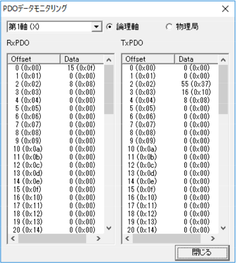

> **図の内容**
>
> 「PDOデータモニタリング」画面（RTMC64-EC）。軸（第1軸 (X)）と論理軸/物理軸を選び、RxPDO と TxPDO を Offset（0 (0x00)～）と Data の表で表示する。◆1.1

#### 5-2-5.プログラム管理画面

操作メニューの「プログラム設定」をクリックすると、プログラム管理画面を表示します。運転プログラムのRTMC64内への配置状況の確認、及び運転プログラムのアップロード/ダウンロードが可能です。

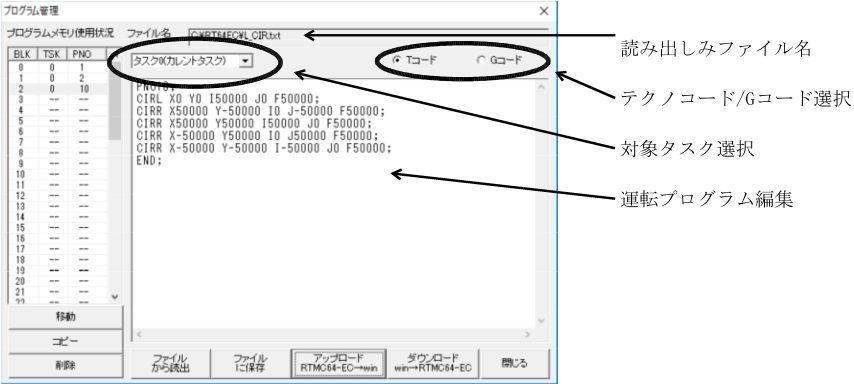

> **図の内容**
>
> プログラム管理画面。注記つき:
> - 読み出しみファイル名（ファイル名の欄）
> - テクノコード/Gコード選択
> - 対象タスク選択
> - 運転プログラム編集（編集欄。例: CIRL X0 Y0 I50000 J0 F50000; CIRR X50000 Y-50000 I0 J-50000 F50000; … END;）
> - 下部のボタン: ファイルから読出、ファイルに保存、アップロード、ダウンロード、閉じる

・プログラムメモリ使用状況

プログラムメモリ(全64ブロック)の使用状況を表示します。

```c
    BLK
    TSK
    PNO
```

:プログラムブロック番号

:タスク番号

:プログラム番号

※ 運転プログラムは、ダウンロード時に「対象タスク選択」指定されているタスクでのみ実行可能です。

（画面の「TSK」欄で、指定されたタスクを確認することができます。）

本画面での各種操作(移動/コピー/削除/アップロード/ダウンロード)は、ここで選択されているブロックに対して行われます。

上記の画面は、以下のダウンロードを完了した状態です。

P10 をBLOCK1からタスク0用としてダウンロード。(59～116ステップのプログラム)

P3 をBLOCK5からタスク1用としてダウンロード。(58ステップ以下)

P100 をBLOCK6からタスク2用としてダウンロード。(117～174ステップのプログラム)

プログラムメモリの容量や番号管理については、以下を参照下さい。

「RTMC64-M3/EC ユーザーズマニュアル」<Ⅱ 機能編6-1-1. 運転プログラムの容量>、

<Ⅱ 機能編6-1-2. 運転プログラムの番号管理>(TB00-1040F)

・移動ボタン

「プログラムメモリ使用状況」で選択されているブロックが含まれているプログラムを任意のブロックに移動します。

・コピーボタン

「プログラムメモリ使用状況」で選択されているブロックが含まれているプログラムを任意のブロックにコピーします。(移動先のタスク番号/プログラム番号を指定します)

・削除ボタン

「プログラムメモリ使用状況」で選択されているブロックが含まれているプログラムを削除します。

・ファイル名

「ファイルから読出」「ファイルに保存」した際に選択したファイル名を表示します。

- Tコード(テクノコード)/Gコード選択

編集している運転プログラムの種別を選択します。

「アップロード」した場合は、自動的にアップロードしたプログラムの種別に変わります。

・対象タスク選択

編集している運転プログラムの対象タスクを選択します。指定したタスク以外のタスクで実行する事はできません。

「アップロード」した場合は、自動的にアップロードしたプログラムのタスクに変わります。

・ファイルから読出ボタン

任意のファイルから運転プログラムを読み込みます。

（運転プログラムは通常のテキストファイルですので、テキストエディタ等で作成する事が出来ます。）

・ファイルに保存ボタン

表示している（編集している）運転プログラムを任意のファイルに保存します。

（運転プログラムは通常のテキストファイルですので、テキストエディタ等で編集する事が出来ます。）

- アップロード RTMC64→win ボタン (RTMC64-M3/EC → セッティングPC)

「プログラムメモリ使用状況」で選択されているブロックが含まれているプログラムをRTMC64からアップロードして表示します。

- ダウンロード win→RTMC64 ボタン (セッティングPC → RTMC64-M3/EC)

編集中の運転プログラムを、「プログラムメモリ使用状況」で選択されているRTMC64のブロックへダウンロードします。

#### 5-2-6.プログラムティーチング画面

操作メニューの「ティーチング」をクリックすると以下の画面を表示します。

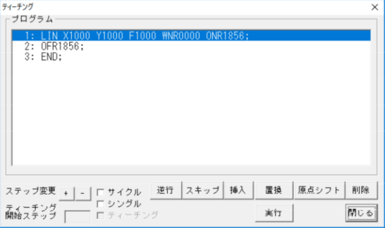

> **図の内容**
>
> 「ティーチング」画面。プログラム（1: LIN X1000 Y1000 F1000 WNR0000 ONR1856; 2: OFR1856; 3: END;）を表示する。ボタン: ステップ変更(+/-)、サイクル、シングル、ティーチング、逆行、スキップ、挿入、置換、原点シフト、削除、実行、閉じる。ティーチング開始ステップの入力欄がある。

①ティーチング開始ステップ[開発中]

ティーチングモードに入った時のステップNOを表示します。但し、ティーチング操作(挿入,置換等) をした時はそのステップNOに変わります。

②各ボタンの説明

| ボタン           | 機能                                                                                                                              | 条件                                  |
|---------------|----------------------------------------------------------------------------------------------------------------------------------|--------------------------------------|
| サイクルシングル     | サイクル運転モードになります。シングルステップモードになります。                                                                                                |                                      |
| ティーチング ※1     | ティーチングモードになります。                                                                                                                  | ・ステップ間停止                             |
| スッテプ変更 ※1     | ティーチング対象のステップ(カーソルが反転表示しているステップ)を変更します。 (但し運転プログラムの実行は伴いません。) + : ティーチング対象ステップを次のステップに移動します。 - : ティーチング対象ステップを直前のステップに移動します。 | ・ティーチングモード・ティーチング移動中でない             |
| 逆行 ※1 <オプション> | 直前のステップがPTP、LINの時、直前ステップ実行前の位置へ戻ります。                                                                                            | ・ティーチングモードでない・ステップ間停止               |
| スキップ ※1       | 現在ステップをスキップして次のステップに移ります。                                                                                                       | ・プログラム実行停止・ティーチングモードでない            |
| 挿入 ※1         | ティーチング対象のステップ以降のステップが繰り下げられ、ティーチング移動した分の新たなPTP指令ステップがティーチング対象のステップとして新たに登録されます。                                                | ・ティーチングモード・ステップ間停止                  |
| 置換 ※1         | ティーチング対象のステップが、ティーチング移動した PTP指令に差し変わります。                                                                                         | ・ティーチングモード・ステップ間停止                  |
| 原点シフト ※1      | ティーチングで移動した量原点をシフトします。 (移動した後の位置が移動前の位置に設定される)                                                                                   | ・ティーチングモード・ステップ間停止                  |
| 削除 ※1         | ティーチング対象のステップが削除され、それ以降の既存ステップが繰り上げられます。                                                                                        | ・ティーチングモードでない・ステップ間停止               |
| 実行            | プログラム運転を開始/再開します。                                                                                                                | ・運転プログラムが存在・原点復帰完了・アラーム無し・自動運転モード |

- ※ ティーチング機能の詳細については、「RTMC64-M3/EC ユーザーズマニュアル」<Ⅱ 機能編 5-18. ティーチング>(TB00-1040E)を参照下さい。

※１これらの機能は、開発中です。

- 【注】ティーチング画面でのプログラム編集は、そのままででは保存されません。

RTMC64 内に保存させるには、一度、運転プログラム管理画面を表示して、PCへアップロードして、再度ダウンロードしてください。

#### 5-2-7.マクロ変数メニュー <オプション>

##### 5-2-7-1.マクロ変数表示画面

RTMC64内部のマクロ変数をモニタリング表示します


> **図の内容**
>
> 「マクロ変数」画面。範囲（#1000 - #1199 (WORD) : グローバルマクロ変数）を選び、DEC/HEX を選んで #1000～#1019 の値を表示する。ボタン: 一括アップロード RTMC64-M3->win、一括ダウンロード win->RTMC64-M3、閉じる。

- ① 10進(DEC)ラジオボタン

ONすると、変数表示が10進数になります。

- ② 16進(HEX)ラジオボタン

ONすると、変数表示が16進数になります。

- 一括アップロードボタン選択中のマクロ変数を一括でセッティングPCへアップロードします。マクロ変数ファイル(.mcr)へ保存します。
- 一括ダウンロードボタンマクロ変数ファイル(.mcr)選択ダイアログを表示します。選択したマクロ変数ファイルをRTMCへダウンロードします。
- ←、→ ボタンマクロ表示のマクロ番号が-8または+8されます。

※マクロ機能の詳細については、「RTMC64-M3/ECユーザーズマニュアル」 <Ⅱ 機能編 7-3.マクロ機能>(TB00-1040F)を参照下さい。

##### 5-2-7-2.マクロ変数書き込み画面

マクロ変数へ任意の数値を書き込む事ができます。同時に現在値のモニタリングも行います。


> **図の内容**
>
> 「マクロ変数書き込み」画面。# 1000 の現在値（0）と、書き込む値の入力欄、書込ボタン。DEC / HEX の選択、閉じるボタン。

※書き込み可/不可につては、「RTMC64-M3/ECユーザーズマニュアル」 <Ⅱ 機能編 7-3.マクロ機能> (TB00-1040F)を参照下さい。

#### 5-2-8.オプションメニュー

各種オプション機能用の画面を表示します。操作メニューの「オプション」をクリックするとオプションの一覧を表示します。次のオプションから選択してください。

- ■主軸操作
- ■TPCロギング
- ■手動パルサモード
- ■センサーラッチモニタ
- ■工具長補正情報
- ■工具径補正情報
- ■独立位置決め
- ■制御周期モニタ
- ■工具径補正エラー情報
- ■位置決めポイントテーブル作成
- ■位置決めポイントテーブルモニタ

##### 5-2-8-1.主軸操作画面 <オプション>


> **図の内容**
>
> 「主軸操作」画面。速度指令 [rpm/Hz/%] と速度指令送信ボタン、操作（正転(M3)、逆転(M4)、停止(M5)）と操作指令送信ボタン、回転数モニタ [rpm/Hz/%]、閉じるボタン。

① 速度指令

主軸の回転速度を設定します。(Sコード)

速度指令送信ボタンを押すことで、現在表示中の速度をRTMC64へ指令します。

I/O主軸の場合、0～3を指令し、SOUT出力を操作します。

インバータ主軸の場合、指令単位は、インバータ側で設定します。

② 操作

主軸の回転動作を指令します。(M03～M05)

ラジオボタン( )をクリックして、主軸の動作を選択します。

操作指令送信ボタンを押すことで、現在選択されている動作を開始します。

③ 回転数モニタ

主軸の現在速度をモニタリングします。インバータ主軸時のみ有効です。

- ※主軸機能の詳細については、「RTMC64-M3/EC ユーザーズマニュアル」<Ⅱ 機能編 5-16. 主軸機能> (TB00-1040E)を参照下さい。

◆1.1

##### 5-2-8-2.TPCロギング画面

- ① ロギングデータの選択

TPCロギングデータは2ch(ポジション)形式と64ch形式があります。

- 2ch(ポジション)形式


> **図の内容**
>
> 「TPCロギング」画面の「ポジション」タブ。
> - 上部: 「ロギング中」の表示、バッファデータ [ポイント]、保存データ [ポイント]（どちらも 0）
> - タブ: ポジション、64CH
> - ポジションタブ: 2 つのデータそれぞれに、軸番号（1、◀▶ で変更）と、指令位置 / 機械位置の選択（例では両方とも機械位置）
> - ロギング周期: 0 msec（注記「0msec:制御周期毎」）
> - ファイル保存(アップロード)方法: 手動([ファイルに保存]ボタン)（選択）、ロギング停止時、常時
> - ロギングファイル: ファイル名の欄と参照ボタン
> - ボタン: 開始(新規)、開始(追加)、停止、ファイルに保存、閉じる

2ch形式ロギングでは軸番号(1～9軸)とデータ種類(指令位置/機械位置)を選択することができます。タスクは「運転操作」画面で選択されたタスクになります。

・64ch形式


> **図の内容**
>
> 「TPCロギング」画面の「64CH」タブ。
> - 上部: 「ロギング中」の表示、バッファデータ [ポイント]、保存データ [ポイント]（どちらも 0）
> - ロギング設定の一覧（例）:
>   - CH01:指令位置(DEC) [TASK0;AX1] ～ CH04:指令位置(DEC) [TASK0;AX4]
>   - CH05:機械位置(DEC) [TASK0;AX1] ～ CH08:機械位置(DEC) [TASK0;AX4]
>   - CH09:トルク情報(DEC) [TASK0;AX1] ～ CH12:トルク情報(DEC) [TASK0;AX4]
> - 一覧の右のボタン: 追加...、挿入...、編集...、コピー、上に移動、下に移動、削除
> - 一覧の下のボタン: 設定読出、設定保存
> - ロギング周期: 0 msec（注記「0msec:制御周期毎」）
> - ファイル保存(アップロード)方法: 手動([ファイルに保存]ボタン)（選択）、ロギング停止時、常時
> - ロギングファイル: ファイル名の欄と参照ボタン
> - ボタン: 開始(新規)、開始(追加)、停止、ファイルに保存、閉じる

・64ch形式

ロギング項目設定

- コンボックスで表示されるデータの中からロギングしたいデータを選択します。

(指令位置、機械位置、軸ステータス、入力信号など)

- CSV Out Type

csvファイルに文字列を出力する際の形式を選択します。

位置情報等はDEC(10進数)、ステータス情報はHEX(16進数)が表計算ソフトで扱い易いです。

- ロギングしたいデータのタスクを選択します。

「運転操作」画面で選択されたタスクには依存しません。

- モータのデータの時はタスク内の論理軸番号で軸選択をします。

ロギング項目の選択用に追加、編集、挿入、コピー、削除ボタンがあります。データの順序入れ替え用に上に移動、下に移動ボタンがあります。

② ロギング周期

TPCロギングを行う周期をmsec単位で設定します。(1～32767)

"0"を設定すると制御周期毎にロギングを行います。

制御周期以下の値を設定した場合は、制御周期毎にロギングを行います。

- ③ ファイル保存

手動

: ファイルに保存ボタンの操作でアップロードします。

ロギング停止時 : ロギング停止時(停止ボタンまたはバッファフル)の時に自動的にアップロードします。

常時

: バッファにたまったデータを常時アップロードします。

但し、ロギング周期が2msec 以下の場合、アップロードが間に合わず途中でロギングが停止することがあります。

保存ファイルのアトリビュートは (*.csv) 形になります。

TPCについての詳細は以下を参照下さい。

- 「RTMC64-M3/EC ユーザーズマニュアル」<Ⅲ 試運転・調整編 7-13.TPCによる精度チェック> (TB00-1040I)
- 「TPC-EXCELマニュアル」(TB04-1478)


> **図の内容**
>
> 「ロギング項目設定」画面。
> - ロギング項目: 指令位置（ドロップダウンで選ぶ）
> - CSV Out Type: DEC（選択）、HEX、TIME
> - 軸項目設定: タスク番号（タスク0）、論理軸番号（第1軸）
> - ボタン: OK、キャンセル

##### 5-2-8-3.手動パルサ(手パ)モード画面 <オプション>


> **図の内容**
>
> 「手動パルサモード」画面。手動パルサモード、ジョイスティックモードのチェック、状態表示（手パ/ジョイスティック 無効）、倍率（X1、X10、X100、X1000）、手動パルサー軸（1: 第1軸 (X)、2: 第1軸 (X)）、閉じるボタン。

手動パルサモードの有効・無効、ジョイスティックモードの有効・無効、倍率(手動パルサの)、手動パルサ軸(2軸)を設定します。

##### 5-2-8-4.センサーラッチモニタリング画面 <オプション>


> **図の内容**
>
> 「センサーラッチモニタリング」画面。X、Y、Z、A 軸ごとに、ラッチした機械位置とアブソ位置（0.000）を表示する。センサーラッチ完の表示と閉じるボタン。

センサーラッチ状態のモニタリングを行います。

※センサーラッチ機能の詳細については、「RTMC64-M3/EC ユーザーズマニュアル」

<Ⅱ 機能編 5-15-6.センサーラッチ機能(スキップ機能)>(TB00-1040E)を参照下さい。

##### 5-2-8-5.工具長補正情報 <オプション>

工具長補正の有効/無効状態と、現在選択中の工具長補正データ番号をモニタ出来ます。


> **図の内容**
>
> 「工具長補正情報」画面。長補正中の表示、長補正No.（0）、閉じるボタン。

##### 5-2-8-6.工具径補正情報 <オプション>

工具径補正の有効/無効状態と、現在選択中の工具径補正データ番号をモニタ出来ます。


> **図の内容**
>
> 「工具径補正情報」画面。径補正中の表示、径補正No.（0）、閉じるボタン。

##### 5-2-8-7.独立位置決め


> **図の内容**
>
> 「独立位置決め」画面。
> - 移動種別: インクレ（選択）、論理座標系アブソ、機械座標系アブソ、トルク指令（移動量：トルク指定[%]、速度：速度制限[パルス/sec]）
> - 軸（X、Y、Z、A ほか）ごとの 移動量/目標位置[パルス] と 速度[パルス/sec] の入力欄
> - ボタン: 移動開始、移動リセット、閉じる

移動種別

インクレ、論理座標系アブソ、機械座標系アブソ、トルク指令を選択

移動量/目標位置パルス単位で設定(トルク指令の場合はトルク指令値)

速度

pps(パルス/秒)で設定(トルク指令の場合は速度制限値)

※RTMC64-ECはサーボメーカにより速度制限値の指令単位が異なります。 ◆1.1

移動開始ボタン "移動種別"で選択した動作を開始します。

移動リセットボタン移動を中断します。

- ※ 移動種別で"トルク指令"を選択した場合は、設定項目の意味が下記のように変わります。

移動量/目標位置 : トルク指定[%]

速度

: 速度制限指定[rpm]

- 【注】トルク指令の場合は「トルク指令」、「速度制限指定」は指令の数値のままサーボに指令します。サーボの指令単位の設定により、単位が異なることがありますので注意して下さい。

トルク指令は、オプションです。トルク指令オプションが有効でないと、"移動種別"のトルク指令は選択できません。(灰色表示)

- ※ 独立位置決め機能の詳細は、「RTMC64-M3/EC ユーザーズマニュアル」<Ⅱ 機能編 5-20.独立位置決め>(TB00-1040E)を参照下さい。

◆1.1

##### 5-2-8-8.制御周期モニタ


> **図の内容**
>
> 「RtcMonitor」画面。RTC / Foreground の選択（RTC を選択）。計測周期: 最大値 254 μsec、平均値 73 μsec、現在値 70 μsec。ボタン: 計測値クリア、閉じる。

割り込み処理の実行時間です。制御周期以下である必要があります。実行時間が制御周期を越えると「制御周期負荷過大」になります。

実行時間が制御周期のワーニングレベルを越えると「制御周期負荷ワーニング」になります。(ROMSW設定「基本」のワーニングレベル:デフォルトは87.5%)

RTC

Foreground その他の処理時間です。あまり遅いとPLCやPCとの通信の応答性が下がるなどの問題が発生します。

計測クリアーボタン最大値を一端クリアーし、計測を再開します。

##### 5-2-8-9.工具径補正エラー情報 <オプション>


> **図の内容**
>
> 「工具径補正エラー情報」画面。エラー発生ステップ番号、エラー内容の表示欄、閉じるボタン。

工具径補正実行中に、図形によっては指定の補正が不可能な場合が発生する可能性があります。このときは、「プログラム実行エラー」になりますが、エラーの詳細をこの画面で確認することができます。

##### 5-2-8-10.位置決めポイントテーブル作成 <オプション>


> **図の内容**
>
> 位置決めポイントテーブル作成画面。ポイント P1～P20 ごとに X、Y、Z、A ほかの値を入力する表。テーブル編集（ポイント番号、挿入、削除、全表示クリア）、ファイルから読出、ファイルに保存、全ポイントアップロード、全ポイントダウンロード、閉じるのボタン。

- ① P* ボタン
- 該当のポイント番号に現在の指令位置をコピーします。
- ② DL ボタン

該当のポイント番号のみダウンロードします。

③ テーブル編集

ポイント番号を選択して、挿入ボタンを押すと、そのポイント番号に空欄のポイントデータを挿入します。指定したポイント番号以降は一つずつポイント番号が後ろにずれます。ポイント番号を選択して、削除ボタンを押すと、そのポイント番号のポイントデータが削除されます。指定したポイント番号以降は一つずつポイント番号が前にずれ、ポイントNo.400は空欄になります。

- ④ 前、＜、＞、次ボタン

ポイントテーブル画面のスクロールします。ポイントはタスク毎に400点あります。

- ⑤ ファイルから読出ボタン

サーボパラメータファイルを読み出します。

- ⑥ ファイルに保存ボタン

サーボパラメータファイルに保存します。

- ⑦ 全ポイントアップロードボタン

RTMC64に格納されている400点のポイント全てを読み出します。

- ⑧ 全ポイントダウンロードボタン

400点のポイント全てをRTMC64に格納します。

##### 5-2-8-11.位置決めポイントテーブルモニタ <オプション>


> **図の内容**
>
> 位置決めポイントテーブルモニタ画面。移動時速度 [パルス/秒] の入力欄と、ポイント P1～P20 ごとの各軸の値と「P□へ移動」ボタンが並ぶ。

- ① 移動時速度 ②でポイント移動する際の補間速度を指定します。
- ② P*へ移動ボタン

該当のポイント番号にポイント直線補間移動します。

- ③ 移動中断ボタン

②でポイント移動している時に移動を中断します。

- ④ 前、＜、＞、次ボタンポイントテーブル画面のスクロールします。ポイントはタスク毎に400点あります。

#### 5-2-9.エラー表示画面

操作メニューの「エラー情報」をクリックすると以下の画面を表示します。発生している各種エラーを表示する画面です。


> **図の内容**
>
> 「エラー情報」画面。対象（全タスク）を選び、エラーを一覧で表示する（例: タスク0 第1軸(X軸) [第1物理軸] サーボ主電源OFF、… 第4軸(A軸) [第4物理軸] サーボ主電源OFF、タスク0 割り当て軸エラー、タスク0 サーボOFFエラー）。ボタン: リセット、閉じる。

タスク指定

全タスク :全てのタスクで発生しているエラーを表示

タスク□ :そのタスクで発生しているエラーを表示(□はタスク番号)

リセットボタン

原因を取り除いた上で、このボタンを押すとエラーは解除されます。ボタンを押すとアラーム要因のクリアとサーボ電源投入を同時に行います。

ONSW機能有効時は、サーボ電源投入は行いません。

- リセットは選択されているタスクのみに機能します。「全タスク」が選択されているときは全てのタスクがリセットされます。

詳細は、以下を参照下さい。

- 「ROMSW設定ソフトマニュアル」<5-1-11.サーボON動作の補足説明>(TB00-1042)
- 「RTMC64-M3/ECユーザーズマニュアル」<Ⅱ 機能編 2-1-1.一般入力>(TB00-1040D)

### 5-3．パラメータ画面

軸制御に必要な各種パラメータの編集、設定を行います。またバックアップデータの初期化を行います。

メインメニューのパラメータボタンを押すと、以下に示す画面を表示します。

- サーボパラメータ設定画面
- ピッチエラー補正データ設定画面<オプション>
- 工具長補正データ設定画面<オプション>
- 工具径補正データ設定画面<オプション>
- 補間前加減速パラメータ<オプション>
- バックアップデータ初期化画面

※ パラメータ等の設定画面は全て、設定を押してください。設定を押す前に閉じるを押すと編集したデータが無効になります。

#### 5-3-1.サーボパラメータ設定画面

軸制御に必要なサーボパラメータの作成・設定を行う画面です。

- ① タスク選択

タスク毎の各論理軸のサーボパラメータを設定します。始めにタスクを選択してください。

- ② ＜、＞ボタン

論理軸番号が、1軸分前または次を表示します。

- ③ 〈〈、〉〉ボタン

論理軸番号が、4軸分前または次を表示します。

- ④ ファイルから読出ボタン

サーボパラメータファイルを読み出します。

- ⑤ ファイルに保存ボタン

サーボパラメータファイルに保存します。

- ⑥ アップロードボタン

RTMC64に格納されているサーボパラメータを読み出します。

- ⑦ ダウンロードボタンサーボパラメータをRTMC64に格納します。
- ⑧ 編集前に戻すボタン

編集中に押すと編集前の状態にします。

- ※ サーボパラメータの詳細については「RTMC64-M3/EC ユーザーズマニュアル」 <Ⅲ 試運転・調整編 4.サーボパラメータ>(TB00-1040H)を参照下さい。

#### 5-3-2.ピッチエラー補正データ設定画面 <オプション>

ピッチエラー補正時に必要な補正パラメータの作成・設定を行う画面です。本画面は、ピッチエラー補正オプションが有効の時のみ、表示されます。


> **図の内容**
>
> 「ピッチエラー補正データ」画面。物理軸（第1物理軸）の選択、軸割り当て（タスク0 第1軸(X)）、補正倍率、補正間隔（1000）、-区間数、+区間数、補正データ No.0～19 の入力欄。ボタン: 前、次、CSVファイルから読出、CSVファイルに保存、ファイルから読出、ファイルに保存、アップロード RTMC64-M3->win、ダウンロード win->RTMC64-M3、編集前に戻す、閉じる。

① 物理軸選択

ピッチエラー補正は物理軸毎に行います。

補正データの編集を行う物理軸を選択してください。

- ② 前、次ボタン補正データの番号が、20点ずつ前または次を表示します。

③ CSVファイルから読出ボタン

ピッチエラー補正データはファイルで直接編集もできます。 CSV形式のピッチエラー補正データファイル(*.csv)から読み出します。 CSV形式ファイルは物理軸毎に保存/読出を行います。

- ④ CSVファイルに保存ボタン

CSV形式のピッチエラー補正データファイル(*.csv)へ保存します。

- ⑤ ファイルから読出ボタン

ピッチエラー補正データファイル(*.pit)を読み出します。

- ⑥ ファイルに保存ボタン

ピッチエラー補正データファイル(*.pit)に保存します。

- ⑦ アップロードボタン

RTMC64に格納されているピッチエラー補正データを読み出します。

- ⑧ ダウンロードボタン

ピッチエラー補正データをRTMC64に格納します。

- ⑨ 編集前に戻すボタン

編集中に押すと編集前の状態にします。

- ※ ピッチエラー補正機能の詳細については、「RTMC64-M3/EC ユーザーズマニュアル」 <Ⅱ 機能編 5-17-4.ピッチエラー補正機能>(TB00-1040E)を参照下さい。

#### 5-3-3.工具長補正データ設定画面 <オプション>

工具長補正時に必要な補正パラメータの作成・設定を行う画面です。本画面は、工具長補正オプションが有効の時のみ、表示されます。


> **図の内容**
>
> 「工具長補正機能パラメータ」画面。タスク（タスク0）を選び、工具長補正データ No.0～19 を入力する。ボタン: ファイルから読出、ファイルに保存、アップロード RTMC64-M3->win、ダウンロード win->RTMC64-M3、編集前に戻す、閉じる。

- ① タスク番号選択工具長補正データの編集をおこなうタスクを選択してください。
- ② ファイルから読出ボタン

工具長補正データファイルを読み出します。

- ③ ファイルに保存ボタン工具長補正データファイルに保存します。
- ④ アップロードボタン

RTMC64に格納されている工具長補正データを読み出します。

- ⑤ ダウンロードボタン

工具長補正データをRTMC64に格納します。

- ⑥ 編集前に戻すボタン

編集中に押すと編集前の状態にします。

- ※ 工具長補正機能の詳細については、「RTMC64-M3/EC ユーザーズマニュアル」 <Ⅱ 機能編 5-17-2.工具長補正機能>(TB00-1040E)を参照下さい。

#### 5-3-4.工具径補正データ設定画面 <オプション>

工具径補正時に必要な補正パラメータの作成・設定を行う画面です。本画面は、工具径補正オプションが有効の時のみ、表示されます。


> **図の内容**
>
> 「工具径補正機能パラメータ」画面。タスク（タスク0）を選び、工具径補正データ No.0～19 を入力する。ボタンは工具長補正データ設定画面と同じ。

① タスク番号選択

工具径補正データの編集をおこなうタスクを選択してください。

- ② ファイルから読出ボタン

工具径補正データファイルを読み出します。

- ③ ファイルに保存ボタン

工具径補正データファイルに保存します。

- ④ アップロードボタン

RTMC64に格納されている工具径補正データを読み出します。

- ⑤ ダウンロードボタン工具径補正データをRTMC64に格納します。
- ⑥ 編集前に戻すボタン

編集中に押すと編集前の状態にします。

- ※ 工具径補正機能の詳細については、「RTMC64-M3/EC ユーザーズマニュアル」 <Ⅱ 機能編 5-17-3.工具径補正機能>(TB00-1040E)を参照下さい。

#### 5-3-5.補間前加減速パラメータ設置画面 <オプション>


> **図の内容**
>
> 「補間前加減速パラメータ」画面。タスクの選択、補間前加減速時定数 [msec]（0: 補間前加減速無効）、最小オーバライド設定（加速度 [pls/sec^2] の範囲ごとの最小オーバライド [%]、加速度小から大へ 7 段）。注記「※加速度は昇順で設定して下さい。」。ボタン: ファイルから読出、ファイルに保存、アップロード、ダウンロード、編集前に戻す、閉じる。

- ① タスク番号選択

補間前加減速パラメータの編集をおこなうタスクを選択してください。

- ② ファイルに保存ボタン設定したデータを拡張子 .acoのファイルとして保存します。
- ③ ファイルから読出ボタン

保存した設定データを読み出して、設定します。

- ④ アップロードボタン RTMC64から現在の設定値を読み出します。
- ⑤ ダウンロードボタン

RTMC64へこの画面の設定を書き込みます。

- ⑥ 編集前に戻すボタン

編集中に押すと編集前の状態にします。

補間前加減速(自動コーナオーバライド)時定数

設定範囲 : 0msec～16383msec(0msecを設定すると、補間前加減速機能

(単位[msec]) は無効になります。)

補間前加減速(自動コーナオーバライド)が0%～100%に変化するまでの時間です。 (加速と減速の傾き(時間)は同じです。)

※ 傾き一定になるように変化させるので、実際の加減速時間は、その時の目標オーバーライドによって変わります。

最小オーバライド設定

加速度(速度変化量)設定範囲 : 0pps～2000000000pps 最小オーバーライド設定範囲:1%～100% 加速度(速度変化量)とそのときの最小オーバーライド(目標オーバーライド)

の関係のテーブルを設定します。

詳細は、「RTMC64-M3/EC ユーザーズマニュアル」<Ⅱ 機能編 5-19.補間前加減速機能>(TB00-1040E)を参照下さい。

#### 5-3-6.バックアップデータ初期化画面

バックアップデータの初期化を行う画面です。

また、ポイント位置決めテーブルのアップロード/ダウンロードや運転プログラムの手動バックアップも、この画面で行います。


> **図の内容**
>
> 「バックアップデータ初期化」画面。ボタン: パラメータ初期化、プログラム初期化、全軸アブソポジション初期化、各軸アブソポジション設定（タスクと X、Y、Z、A の値）、マクロ変数初期化、位置決めポイントテーブル初期化、運転プログラムバックアップ、絶対値エンコーダオフセット（アップロード、ダウンロード）、位置決めポイントテーブルバックアップ、閉じる。

##### 5-3-6-1.バックアップデータ初期化(初期化ボタン)

□□□初期化ボタンは通常使用しないで下さい。

「バックアップエラー」の時のみ全てのデータの初期化を行って下さい。

この「初期化」を行った直後、RTMC64は「パラメータ未設定エラー」となります。 PC上に保存しているファイルから以下の②～⑥をダウンロードして下さい。 (使用してないオプション機能のデータは不要です)

RTMC64がバックアップするデータは以下の通りです。

また、(*.□□□)は、関連のファイルの拡張子です。

- ① ROMSW(*.rom)
- ② サーボパラメータ(*.prm)
- ③ ピッチエラーパラメータ(*.pit)
- ④ 補間前加減速パラメータ(*.aco)
- ⑤ 工具径補正パラメータ(*.tod)
- ⑥ 工具長補正パラメータ(*.tol)
- ⑦ 絶対位置オフセット(サーボアンプ側座標とRTMC64内アブソ位置とのオフセット)

(アブソモータ使用時のみ)

- ⑧ 運転プログラム(方式によってバックアップする/しない)
- ⑨ 位置決めポイントテーブル(方式によってバックアップする/しない)

※ バックアップデータの詳細については次を参照下さい。

「ユーザーズマニュアル」<機能編1-1-2.RTMC64内の各部の役割(3)データ管理>(TB00-1040D)

「ROMSW設定ソフトマニュアル」<2.RTMC64のパラメータ>(TB00-1042)

「ROMSW設定ソフトマニュアル」<5-1-4.バックアップ方法>(TB00-1042)

パラメータ初期化ボタン

上記の②～⑥を全てクリアー（初期化/デフォルト化）します。

プログラム初期化ボタン

RTMC64内部の⑧の運転プログラムをクリアーします。

全軸アブソポジション初期化ボタン

現在の長補正値（モーダル値）、加減速溜まり、論理座標オフセット、全ての座標系をゼロにします。

アブソエンコーダの軸は、⑦絶対位置オフセット(サーボアンプ側座標と差分)を再設定します。

各軸アブソポジション設定ボタン

指定されたタスクでの、座標値を書き込まれた軸のみ、現在位置を指令された座標位置を設定します。空白のままの軸は座標値の変更は行いません。

アブソエンコーダの軸は、⑦絶対位置オフセット(サーボアンプ側座標と差分)を再設定します。

マクロ変数初期化ボタン

グローバルマクロ変数を0にします。

位置決めポイントテーブル初期化ボタン

位置決めポイントテーブルを全て初期値(NULLデータ)にします。

運転プログラムバックアップボタン

運転プログラムのバックアップ方式が「手動バックアップ」の場合、このボタンを押した時に運転プログラムをバックアップします。

絶対値エンコーダオフセット

⑦絶対位置オフセット(サーボアンプ側座標と差分)を、読出（アップロード）、書込（ダウンロード）できます。

パラメータを別システムに移行する場合に用います。

位置決めポイントテーブルバックアップボタン

位置決めポイントテーブルのバックアップ方式が「手動バックアップ」の場合、このボタンを押した時に位置決めポイントテーブルをバックアップします。

##### 5-3-6-2.位置決めポイントテーブル(手動)バックアップ

ROMSW設定ソフトの"位置決めポイントテーブル保存方法"の選択により、動作が変わります。

- ■自動バックアップ"の場合

自動バックアップなので、このボタンでのバックアップは行いません。

すぐに"データ反映完了"ダイアログを表示します。

- ■手動バックアップ"の場合

このボタン操作で、位置決めポイントテーブルをバックアップします。

全タスクのポイントテーブルバックアップします。

位置決めポイントテーブルの書き込み中は、エラーになります。

("現在実行できません"ダイアログを表示します。)

- ■バックアップ無し"の場合

バックアップは行いません。

常にエラーになります。("現在実行できません"ダイアログを表示します。)

"位置決めポイントテーブル保存方法"については、

「ROMSW設定ソフトマニュアル」<5-1.基本パラメータ>(TB00-1042)

を参照下さい。

- ※ 送受信コマンド「FLASHROMへポイントテーブル反映指令」によって、PCソフトやソフトウェア PLCラダーからバックアップ動作を指示することも可能です。

##### 5-3-6-3.運転プログラム(手動)バックアップ

ROMSW設定ソフトの"運転プログラム保存方法"の選択により、動作が変わります。

- ■自動バックアップ"の場合

自動バックアップなので、このボタンでのバックアップは行いません。

- すぐに"データ反映完了"ダイアログを表示します。
- ■手動バックアップ"の場合
- このボタン操作で、運転プログラムをバックアップします。

全運転プログラム格納領域(384KByte)をバックアップします。数秒掛かります。

運転プログラム書き込み中やプログラム実行中は、エラーになります。

("現在実行できません"ダイアログを表示します。)

- ■バックアップ無し"の場合

バックアップは行いません。

常にエラーになります。("現在実行できません"ダイアログを表示します。)

"運転プログラム保存方法"については、

「ROMSW設定ソフトマニュアル」<5-1.基本パラメータ>(TB00-1042)

を参照下さい。

- ※ 送受信コマンド「FLASHROMへ運転プログラム反映指令」によって、PCソフトやソフトウェアPLC からバックアップ動作を指示することも可能です。

### 5-4．表示設定画面

通信/プログラム変換パラメータ、ポジションの表示形式や、入出力名等を設定する画面です。メインメニューの表示設定ボタンを押すと、以下に示す画面を表示します。

- 通信設定画面
- セッティングPC動作設定画面
- ポジション表示設定画面
- 入出力表示設定画面
- ※ 設定を変更した後設定ボタンを押すと変更内容が有効になります。(INIファイル書き込み) 設定を押さずに閉じるボタンを押すと、変更内容は無効になります。(全画面共通)

#### 5-4-1.インタフェース

##### 5-4-1-1.通信設定画面

PCアプリとRTMC64との通信の設定を行う画面です。


> **図の内容**
>
> 「通信設定」画面。
> - 通信形態: 共有メモリ
> - INtime設定: ノード名（NodeA）
> - 通信エラーログ: ログファイル名、チェック（ログ無効、全てロギング、初期化/終了、データ送信、データ受信、コマンド、通信エラー（全て）、通信エラー（伝送）、通信リトライ）、ログファイルサイズ 5242880 [Byte]、ログファイル数 6 (1-100)
> - ボタン: 設定、閉じる

通信形態

"共有メモリ"固定です。

INtime設定ノード INtimeのRTMC64-M3/EC実行ノードを設定してください。

(インストール時は"NodeA")

通信エラー

通信ログファイル名

ログファイル名 RTMC64との通信ログをとる場合にログファイル名を指定します。

通常は、空欄(ログ無効)にして下さい。

一つのログファイルのサイズを指定します。

ログファイル数の上限を設定し、上限以上のファイルを出力する場合、古いファイルを自動で削除します。

##### 5-4-1-2.セッティングPC動作設定画面

DNC送信や変換プログラムタイプ等のセッティングPC上の処理に関する設定を行います。


> **図の内容**
>
> 「セッティングPCソフト動作設定」画面。運転プログラム設定: DNC送信データ長（8192）、DNC実行開始データ長（16384）、DNC運転プログラムタイプ（テクノコード / Gコード）、起動時編集プログラムタイプ（テクノコード / Gコード）。起動位置 X、Y（0、0）と現在位置取得ボタン。ボタン: 設定、編集前に戻す、閉じる。

DNC送信データ長「DNC運転」オプション有効で、DNC運転を行っている時のプログラムデータのバッファリング量(1回当たりの送信量)を指定します。このデータを大きくすることにより、微少ブロックの実行性能が向上します。但し、余り大きくすると表示の更新等が遅くなります。

DNC実行開始データ長「DNC運転」オプション有効でDNC運転を行う時、運転開始タイミングを指定します。

このデータを大きくすると処理能力の低いパソコンでも微少ブロック実行時のブロック間停止がおきにくくなります。(DNC運転の実行がデータ転送に追いつきにくくなります)

但し、あまり大きくし過ぎると、運転開始操作( スタートボタン)から、実運転までのタイムラグが大きくなります。

また、大容量データの場合は本データを最大(196608)にしてもあまり効果はありません。

DNC運転プログラム DNC運転時のプログラムタイプをテクノコード・Gコードから選択します。

タイプ

起動時編集プログラセッティングPC起動時に運転画面のプログラム設定メニューを開いたときムタイプに選択されているプログラムタイプをテクノコード・Gコードから選択します。

起動位置

セッティングPCの起動時の画面上の位置を設定することができます。

(起動時表示位置) 現在位置取得ボタンを押すと現在のセッティングPCの表示位置を取得することができます。

出荷時の表示位置は画面左上を(0,0)とする座標値です。

#### 5-4-2.ポジション表示形式設定画面

ポジション表示時の軸名称/小数点位置の設定およびプログラム変換処理の設定を行う画面です。


> **図の内容**
>
> 「ポジション表示形式設定」画面。タスクの選択。第1軸～第9軸ごとに軸名称（X、Y、Z、A、B、C、R、Q、T）と パルス/表示単位（1000）。トルク情報（10）、円弧処理（RTMC64-M3内）、円弧精度（1）、運転プログラム小数点桁数（1000）、補間送り速度単位（1 パルス/sec）、X-Z円弧平面（XZ平面 / ZX平面）。注記「※ 軸名称を変更しても運転プログラムの軸アドレスは変わりません。(X,Z,Y,…R,Q,T のまま) セッティングPC/ROMSW設定ソフトの表示が変わりますので御注意下さい。」。ボタン: 設定、編集前に戻す、閉じる。

タスク選択

この画面で設定するタスクを選択して下さい。

軸名称

軸名称として設定できる文字列は、全角2文字(半角4文字)までです。

パルス/表示

パルス/表示と小数点位置の関係は下表の通りです。

|   パルス/表示 |   小数点位置 |
|----------|---------|
|   100000 | 0.00001 |
|    10000 |  0.0001 |
|     1000 |   0.001 |
|      100 |    0.01 |
|       10 |     0.1 |
|        1 |       1 |

また、本設定は運転プログラムでの各軸移動量/座標の小数点にも反映されます。例えば、X軸のパルス/表示に1000と指定して、運転プログラムでX1.0と指定すると「X1000」と認識されます。

円弧処理

円弧精度

円弧補間の処理の仕方(プリ解析/RTMC64内部)を選びます。(通常は、「RTMC64内部」) プリ解析ではプログラム長が長くなりダウンロードに時間がかかります。

RTMC64内部だとプログラム長が短くダウンロードもすぐ終わります。

RTMC64内部の場合、円弧ステップの始めと終わりで、微妙な速度変動が生じる場合があります。詳しくは「RTMC64-M3/ECユーザーズマニュアル」<Ⅱ機能編 5-7.円弧補間> (TB00-1040E)を参照下さい。

プリ解析処理にて、円弧を直線ステップに分解する際に円弧と直線ベクトルの許容誤差を指定します。単位はパルスです。通常1～10で使用下さい。

円弧精度と分割数の関係については、「RTMC64-M3/ECユーザーズマニュアル」<Ⅱ機能編 6章最後の補足資料1.円弧プリ解析処理(ステップ数/処理時間)>(TB00-1040F)を参照下さい。

運転プログラム運転プログラムで円弧半径に小数点を指定した時にパルス数へ変換するための倍率を小数点桁数設定します。

例えば本設定に1000と指定して、運転プログラムでCR1.0と指定すると、「CR1000」と認識します。

※ 各軸の移動量/座標は「5-4-2. ポジション表示形式設定画面」の設定が反映されます。

補間送り速度単位自動運転プログラムの補間指令(LIN、CIR等)の送り速度の単位を指定します。

- ①と②の設定の組み合わせにより単位を決定します。
- ①は1、10、100、1000、10000と設定できます。
- ②はmin、secと設定できます。

以下に設定例を示します。


> **図の内容**
>
> | 設定 | 速度単位 |
> |---|---|
> | ①:1 ②:sec | pps(pulse/sec) |
> | ①:1000 ②:min | 1000p/min |

速度指定の小数点は以下のようになります。

「F1.25」指定の場合

速度単位 pulse/secの時 :1 pulse/sec

速度単位10 pulse/secの時 :12 pulse/sec

速度単位100 pulse/secの時 :125 pulse/sec

運転プログラムでX/Z軸の円弧を指定した時の動き方を設定します。動き方は以下の通りです。


> **図の内容**
>
> - XZ平面（横軸 +X、縦軸 +Z）: G03/CIRL は反時計回り、G02/CIRR は時計回り。
> - ZX平面（横軸 +Z、縦軸 +X）: G03/CIRL は反時計回り、G02/CIRR は時計回り。

- 【注】テクノ言語の半径指定の円弧命令では、命令中に平面指定(PXZ、PZX)がありますので、本機能は無効です。

XZ円弧平面

#### 5-4-3.入出力表示設定画面

入出力表示の有無、ユーザ信号名の設定を行う画面です。


> **図の内容**
>
> 「入出力表示設定」画面。入力と出力それぞれに、ショートカット（Rio、+OT、-OT、DEC、Task0～Task7）と、アドレス、チャンネル、標準信号名、ユーザー信号名の一覧（例: Rio0000 i#1600 000 Rio0000）。ボタン: 設定、編集前に戻す、閉じる。

ユーザー信号名は変更が可能です。ユーザー信号名として設定できるのは、全角7文字(半角14文字)までです。テクノ出荷時は、標準の名称が設定されています。

専用名をつけたい時に入力して下さい。

ショートカット

入力信号は予備も含めて全部で1856点、出力信号は1024点あります。

前 / 次のボタンで目的の信号に達するのは手間が掛かりますので、ショートカットで各機能グループの先頭に飛ぶことができます。

入力信号は Rio 、+OT 、-OT 、DEC 、Task0 、Task1 、Task2 、Task3 ～ Task7 のグルーブがあります。

出力信号は Rio 、Task0 、Task1 、Task2 、Task3 ～ Task7 のグループがあります。

前、次ボタン

信号表示を16点(1チャンネル)ずつ前、次にします。

- ※ ここで設定したユーザー信号名は初期設定ファイル(INIファイル)に記憶されます。またROMSW設定ソフトにも自動的に反映します。

### 5-5．バーション表示画面

セッティングPCソフト等のPC(Windows)上のソフトと、RTMC64内のファームウェアのバージョンと、

RTMC64のシリアルナンバーの確認のための表示を行う画面です。メインメニューのバージョン情報ボタンを押すと、以下に示す画面を表示します。

ROMソフトのSUM値もここで確認することができます。

(1). RTMC64-M3の場合


> **図の内容**
>
> 「バージョン情報(Rt64m3drv)」画面。標準RTMC64-M3運転ソフト。
> - パッケージ Version 1.6.0A
> - セッティングPC Version 1.4.0、CommDLL Version 1.3.0、TcnvDLL Version 1.3.0、GcnvDLL Version 1.3.0
> - ファームウェア (motion controller) Version 1.6.0
> - シリアル番号: RT64M3-00029、SUM(Flash): 0000
> - Copyright (C) 2015-2020

(2). RTMC64-ECの場合

◆1.1


> **図の内容**
>
> 「バージョン情報(Rt64ecdrv)」画面。標準RTMC64-EC運転ソフト。
> - パッケージ Version 2.2.0A
> - セッティングPC Version 1.4.0、CommDLL Version 1.3.0、TcnvDLL Version 1.2.0、GcnvDLL Version 1.2.0
> - ファームウェア (motion controller) Version 2.2.0
> - シリアル番号: RT64EC-00036、SUM(Flash): 0000
> - Copyright (C) 2016-2020

トラブルなどで当社へ連絡/質問される場合には、上記の画面でセッティングPCとファームウェアのバージョン番号を確認し、御連絡下さい。
