# 標準PCベースファインモーションコントローラ[RTMC64-M3/RTMC64-EC] ROMSW 設定ソフトマニュアルロムスイッチ

Ver.1.1 2020.7.2

試運転前に、ROMSW(ロムスイッチ)設定ソフトを使用してユーザ設定パラメタ「ROMSWパラメータ」をお客様にて設定して下さい。

RTMC64-M3、RTMC64-ECの導入作業については、

「RTMC64-M3/EC ユーザーズマニュアル導入編(TB00-1040A)」をご覧下さい。

お願い

このマニュアルの記載内容について、まちがいや不明な点がありましたら、お手数ですがFAXまたはメールにてテクノへお知らせ下さい。今後さらに改善していきます。

株式会社テクノ

〒358-0011 埼玉県入間市下藤沢1304-5

TEL 04-2964-3677 FAX 04-2964-3322

－目次－

- 1.概要
- 2.関連資料
- 3.RTMC64のデータ
  - 3-1.RTMC64で記憶しているデータ
  - 3-2.ROMSW(ロムスイッチ)の目的
  - 3-3.ROMSW設定ソフトの使用上の注意
- 4.操作
  - 4-1.作業の手順
- 5.メインメニュー
- 6.各画面とＲＯＭＳＷパラメータの内容
  - 6-1.基本パラメータ
    - 6-1-1 サーボ制御周期・通信設定
    - 6-1-1-1 RTMC64-M3(MECHATROLINK-Ⅲ)の場合の画面
    - 6-1-1-2 サーボ制御周期
    - 6-1-1-3 MECHATROLINK通信設定
    - 6-1-1-5 仮想モード制御周期
    - 6-1-3 機械パネル:コード仕様
    - 6-1-4 バックアップ方法
    - 6-1-5 主軸機能選択 <オプション>
    - 6-1-6 巻線命令設定
    - 6-1-7 エラー発生/リセット時の軸停止方法選択
    - 6-1-8 自動原点復帰ディレイ(msec) 【2048】
    - 6-1-9 工具径補正角度一致閾値 (1/1000pls) 【3000】
    - 6-1-10 サーボ主電源OFF無視時間【2048】
    - 6-1-11 サーボON動作の補足説明
  - 6-2.局設定
    - 6-2-1.入力信号の割り付け
    - 6-2-2.出力信号の割り付け
    - 6-2-3.軸設定パラメータ
    - 6-2-4.各項目の設定
  - 6-3.手動パルサ/ジョイステック設定<オプション>
  - 6-4.オプション

## 1.概要

ROMSW(ロムスイッチ)設定ソフトは、64軸制御のPCベースファインモーションコントローラ(RTMC64-M3または RTMC64-EC)のROMSWを設定するソフトです。

RTMC64-M3またはRTMC64-ECが動作する同じPC(Windows)上で動作します。

対象の機械に応じてサーボ軸数、原点復帰の方式、入出力信号割り付けなどを設定できます。 64軸制御PCベースファインモーションコントローラは次の2種類です。

- RTMC64-M3 ・・・・・・・・ MECHATROLINK-Ⅲ
- RTMC64-EC ・・・・・・・・ EtherCAT

以降の説明で2種類の共通部分はRTMC64と表記します。

また、Windows上のPC部(セッティングPCやユーザ作成ソフトなど)はPCアプリと表記します。 RTMC64-M3のみの説明には[M3]、RTMC64-ECのみの説明には[EC]を付けて区別します。

## 2.関連資料

| 「RTMC64-M3/EC ユーザーズマニュアル」               | (TB00-1040)   |    |
|-----------------------------------------|---------------|----|
| 「RTMC64-M3/EC セッティングPCマニュアル」            | (TB00-1041)   |    |
| 「RTMC64-M3/EC ROMSW設定ソフトマニュアル」          | (TB00-1042)   | 本書 |
| EtherCATのコンフィグレーションの手順書                 |               |    |
| 「ENIファイル作成手順書(RSI-ECAT-Master用)」        | (TB00-1058)   |    |
| 「ENIファイル作成手順書(AlgoEtherCAT"TwinCAT3"用)」 | (TB00-1149)   |    |
| 「ENIファイル作成手順書(AlgoEtherCAT"ET9000"用)」   | (TB00-1059)   |    |
| PCアプリ/INtime上のソフト開発の資料                  |               |    |
| 「RTMC64-M3/EC 通信ライブラリリファレンスマニュアル」       | (TB00-1043)   |    |
| 「RTMC64-M3/EC 送受信データマニュアル」              | (TB00-1044)   |    |
| 「RTMC64-M3/EC Tコード変換ライブラリリファレンスマニュアル    | (TB00-1045)   |    |
| 「RTMC64-M3/EC Gコード変換ライブラリリファレンスマニュアル    | (TB00-1046)   |    |
| PLCからラダー制御する場合の参考資料                     |               |    |
| 「RTMC64-M3/EC サンプルラダープログラム説明書」          | (TB00-1047)   |    |

## 3.RTMC64のデータ

### 3-1.RTMC64で記憶しているデータ

RTMC64で記憶しているデータは、以下のとおりです。これらは、全てPCアプリ側でも管理して下さい。

| 記憶している情報            | 設定者   | 設定方法                           | 内容                                                  | win側ファイル拡張子   |
|---------------------|-------|--------------------------------|------------------------------------------------------|----------------|
| ROMSW<オプション> ロムスイッチ | テクノ   | ROMSW設定ソフト                     | オプション機能の有無。                                          | .OSW           |
| ROMSW<ユーザ> ロムスイッチ   | ユーザ   | ROMSW 設定ソフト                    | 軸数、指令極性、信号論理などメカ/システムに合わせた設定(設計レベル)                 | .ROM           |
| サーボパラメータ            | ユーザ   | セッティングPC                       | 加減速や速度などメカ諸元やメカ個体差に応じた設定(調整レベル)                     | .PRM           |
| 初期化ファイル INI(イニ)ファイル | ユーザ   | ROMSW設定 (終了時) セッティングPC (入出力名称) | RTMC64個体のオプション情報や入出力名称を記憶しておき、セッティングPCの表示内容を設定する情報 | .INI           |
| 運転プログラム             | ユーザ   | セッティングPC 汎用エディター               | 運転プログラムテクノ言語/G言語                                    | .TXT           |
| ピッチエラー補正データ         | ユーザ   | セッティングPC                       | P.E補正<オプション>用のデータ ※1                                 | .PIT           |
| 工具長補正データ            | ユーザ   | セッティングPC                       | 工具長補正<オプション>用のデータ                                    | .TOL           |
| 工具径補正データ            | ユーザ   | セッティングPC                       | 工具径補正<オプション>用のデータ                                    | .TOD           |
| 補間前加減速パラメータ         | ユーザ   | セッティングPC                       | 補間前加減速<オプション>用のパラメータ                                 | .ACO           |
| 位置決めポイントデータ         | ユーザ   | セッティングPC                       | ポイント位置決め、ポイント補間移動 <オプション>用のポイントデータ                   | .PNT           |
| 絶対位置オフセット           | ユーザ   | セッティングPC                       | アブソエンコーダ座標との差分                                       | .AEO           |

※1 P.E補正はピッチエラー補正を表します。

RTMC64のモーション制御で必要な上記データはRTMC64からの指示で、ファイルに記憶します。

PC電源OFF→ON後RTMC64が再起動したときに上記データは自動的に復帰します。

設定操作ミスやPCのトラブルやPCの置き換え時などで破損・消滅する可能性もあります。

現状のデータに復元できるように、上記データはPCアプリ(Windows)側または外部メモリでもバックアップデータとして保存管理して下さい。

自動バックアップに付いては<6-1-4バックアップ方法>を参照下さい。

ユーザが管理する情報

RTMC64がファイルに記憶する情報

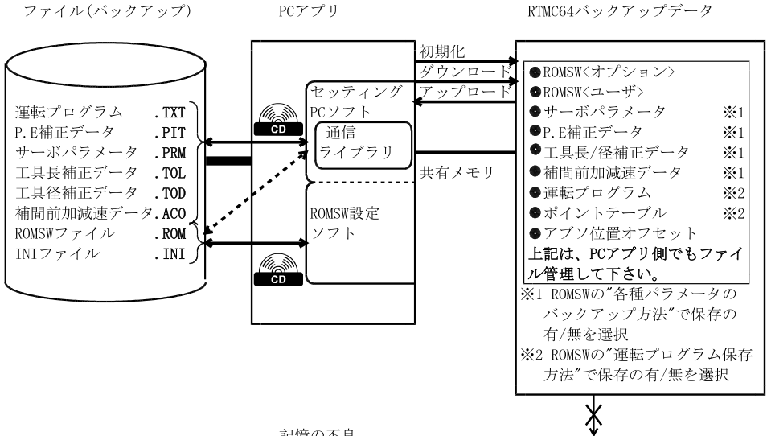

> **図の内容**
>
> - **ファイル(バックアップ)**: 運転プログラム .TXT、P.E補正データ .PIT、サーボパラメータ .PRM、工具長補正データ .TOL、工具径補正データ .TOD、補間前加減速データ .ACO、ROMSWファイル .ROM、INIファイル .INI
> - **PCアプリ**: 「セッティングPCソフト」（通信ライブラリを含む）と「ROMSW設定ソフト」（どちらも CD で提供）。運転プログラム～補間前加減速データはセッティングPCソフト、ROMSWファイルと INIファイルは ROMSW設定ソフトが読み書きする
> - **RTMC64バックアップデータ**: ROMSW〈オプション〉、ROMSW〈ユーザ〉、サーボパラメータ ※1、P.E補正データ ※1、工具長/径補正データ ※1、補間前加減速データ ※1、運転プログラム ※2、ポイントテーブル ※2、アブソ位置オフセット。「上記は、PCアプリ側でもファイル管理して下さい。」
> - PCアプリ → RTMC64: 「初期化」「ダウンロード」、RTMC64 → PCアプリ: 「アップロード」。PCアプリと RTMC64 の間は「共有メモリ」
> - ※1 ROMSWの"各種パラメータのバックアップ方法"で保存の有/無を選択
> - ※2 ROMSWの"運転プログラム保存方法"で保存の有/無を選択
> - RTMC64 の下に「記憶の不良」（× の付いた矢印）

□ パラメータ未設定エラー

- □ バックアップエラー

セッティングPCからパラメータの「初期化」をおこなって､バックアップデータががクリアされている時

### 3-2.ROMSW(ロムスイッチ)の目的

ROMSWを設定することで多様な周辺設計(センサーや入出力の論理)にも柔軟に対応できます。機械の諸元や使用するサーボアンプなどのいろいろな条件に合わせてRTMC64を設定できます。軸構成や形態が変わっても現場で変更できます。

主なROMSW

- ■基本パラメータ
- ■局設定パラメータ(各局)
- サーボ通信設定 MECHATROLINK-Ⅲ [M3] (EtherCAT [EC]) 仮想アンプ機能機械パネル関係主軸機能

有効局局アドレスタスク指定論理軸割り当て絶対値エンコーダソフトリミット有原点復帰方式入出力の割付け入出力信号の論理 (A接/B接)

- ■ユーザーフリーオプション
- 起動時サーボオン ONSW有効自動原点復帰 OT時サーボオフ有り無し原点復帰時の論理座標原点復帰時のホーム位置決め

MOK使用 M00/M01有り

- ■手動パルサ/ジョイステック手動パルサ極性ジョイスティック極性 AD特性設定軸選択信号設定

バックアップデータの一部に破損があった時

記憶の不良

### 3-3.ROMSW設定ソフトの使用上の注意

- a. システム運転前に、必ずこのマニュアルに従い「ROMSW」パラメータを設定して下さい。
- b. 導入手順は「ユーザーズマニュアル導入編(TB0-1040A)」に記載している手順に従って下さい。
- c. ROMSW( .ROM)、サーボパラメータ( .PRM)、INIファイル( .INI)は必ず、ファイル保存して下さい。
- d. 「ROMSW設定ソフト」の使用環境
5. ROMSW設定ソフトは、RTMC64が動作しているPCのWindows上で動作します。
6. 【注】全ての関連ファイルは、必ずお客様で別のメディアにバックアップしてください。 PCの故障などで交換する際には、再設定が必要です。

## 4.操作

### 4-1.作業の手順

- (1) ソフトウェアインストール作業 (初回のみ)

購入いただいたCDから、使用するパソコンへソフトウェアをインストールして下さい。

実際の操作は、「RTMC64-M3/ECユーザーズマニュアル」<Ⅰ 導入編>(TB00-1040A)を参照下さい。購入後、はじめて「ROMSW設定ソフト」を使用する際は、<Ⅰ 導入編>の手順に従って下さい。

- (2) PCアプリとRTMC64の通信

ROMSW設定ソフトはRTMC64と同一のPCにインストールし、ROMSW設定ソフトとRTMC64との通信はPC上の共

- 有メモリを中継して実行します。アップロード/ダウンロードができない場合は、「RTMC64-M3/ECユーザーズマニュアル」

<Ⅳ メンテナンス編 2.PCソフト側(Windows側)の異常> (TB00-1040J)を参照下さい。

- (3) ROMSW設定ソフトを起動。
- (4) ROMSWパラメータの「アップロード」または「ファイル読出し」を必ずおこなって下さい。 RTMC64導入直後の初回は、必ずアップロードしてください。

- RTMC64-M3 の場合 Rt64m3swset.exe
- RTMC64-EC の場合 Rt64ecswset.exe

当社の出荷時のパラメータ(ROMSWオプション)を読み出す必要があります。

- (5) 各々のROMSWパラメータを編集。(5.メインメニュー(各画面の操作)を参照下さい)
- (6) ファイル保存をおこなって下さい。
- (7) RTMC64へダウンロードして下さい。
- (8) 終了する時にINIファイル(PCソフトの設定ファイル)に反映するか聞いてきます。 "はい"を選択して下さい、ROMSWの内容を反映してカレントディレクトリのINIファイルを更新します。

INIファイルが存在しない時は自動で作成します。

- (9) 設定したROMSWパラメータを有効にするためには必ずPC(またはINtime)の再起動を実行して下さい。 INtimeの再起動は、「RTMC64-M3/ECユーザーズマニュアル」<Ⅰ導入編 3-9.ROMSW設定変更時のINtime プロセス再起動>(TB00-1040A)を参照下さい。

◆1.1

## 5.メインメニュー

使用しているINIファイル名を表示します。 ※

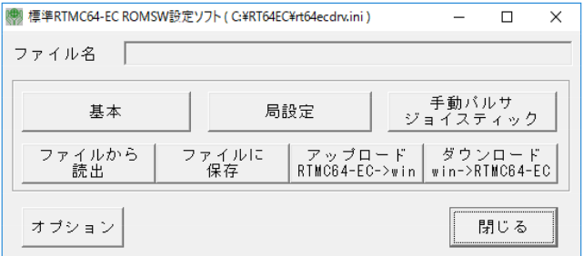

> **図の内容**
>
> ウィンドウ「標準RTMC64-EC ROMSW設定ソフト（C:¥RT64EC¥rt64ecdrv.ini）」。
> 「ファイル名」の欄、ボタン: 基本、局設定、手動パルサ ジョイスティック、ファイルから読出、ファイルに保存、アップロード RTMC64-EC->win、ダウンロード win->RTMC64-EC、オプション、閉じる。

- ※ 詳細は「RTMC64-M3/ECユーザーズマニュアル」<Ⅰ導入編>(TB00-1040A)を参照下さい。

基本局設定の全てのユーザパラメータの設定が必要です。

オプションの「手動パルサ/ジョイステック」が有効の時は、手動パルサのユーザパラメータの設定が必要です。

あらかじめデフォルト設定してありますので、変更点のみ入力して下さい。

オプションは、別途購入されたオプションの確認にご使用ください。

ファイルから読出ボタンあらかじめ保存しているファイル「*.ROM」を選択して読み出します。

* はファイル名称、 .ROM はファイル名の拡張子

ファイルに保存ボタン ROMSWファイルを名称をつけて保存します。

アップロードボタン RTMC64からROMSW情報を読み出します。

ダウンロードボタン RTMC64へROMSW情報(このソフトで設定・更新した情報)を書き込みます。

オプションボタン別途購入されたオプションはあらかじめ設定されています。

オプションボタンでオプションを確認してください。

オプションの設定は、お客様では変更きません。

「ファイルから読出」で読み出したファイル名、または「ファイルに保存」で保存したファイル名が表示されます。

ファイル名

## 6.各画面とＲＯＭＳＷパラメータの内容

### 6-1.基本パラメータ

基本パラメータの通信設定は、RTMC64-M3とRTMC64-ECで画面が異なります。 ※パラメータ説明の項の【】の数字または有効/無効はデフォルト値を表します。

#### 6-1-1 サーボ制御周期・通信設定

#### 6-1-1-1 RTMC64-M3(MECHATROLINK-Ⅲ)の場合の画面

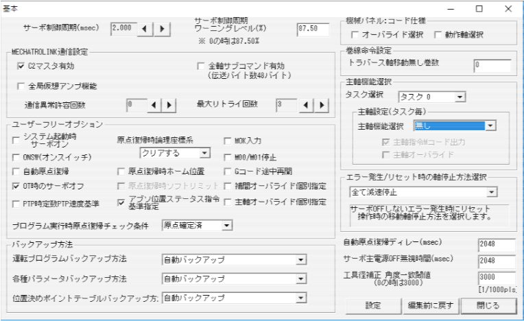

> **図の内容**
>
> - サーボ制御周期(msec) 2.000、サーボ制御周期ワーニングレベル(%) 87.50（※ 0の時は87.50%）
> - MECHATROLINK通信設定: C2マスタ有効（チェックあり）、全軸サブコマンド有効（伝送バイト数48バイト）、全局仮想アンプ機能、通信異常許容回数 0、最大リトライ回数 3
> - ユーザーフリーオプション: システム起動時サーボオン、ONSW(オンスイッチ)、自動原点復帰、OT時のサーボオフ（チェックあり）、PTP時定数PTP速度基準、原点復帰時論理座標系「クリアする」、原点復帰時ホーム位置、原点復帰時ソフトリミット（灰色）、アブソ位置ステータス指令基準指定（チェックあり）、MOK入力、M00/M01停止、Gコード途中再開、補間オーバーライド個別指定、主軸オーバーライド個別指定、プログラム実行時原点復帰チェック条件「原点確定済」
> - バックアップ方法: 運転プログラム・各種パラメータ・位置決めのポイントテーブルとも「自動バックアップ」
> - 機械パネル:コード仕様（オーバライド選択、動作軸選択）、巻線命令設定（トラバース軸移動無し巻数 0）、主軸機能選択（タスク選択 タスク 0、主軸機能選択「無し」、主軸指令Mコード出力・主軸オーバライドは灰色）
> - エラー発生/リセット時の軸停止方法選択「全て減速停止」（サーボOFFしないエラー発生時にリセット操作時の移動軸停止方法を選択します。）
> - 自動原点復帰ディレー(msec) 2048、サーボ主電源OFF無視時間(msec) 2048、工具径補正 角度一致閾値 3000 [1/1000pls]（0の時は3000）
> - ボタン: 設定、編集前に戻す、閉じる

#### 6-1-1-2 サーボ制御周期

① サーボ制御周期(msec) 【2】

MECHATROLINKの伝送周期を設定します。

伝送周期（制御周期）とスレーブ局数（軸数）との関係(48バイト時)

| 軸(局)数            | 5       | 10       | 18       | 27    | 47    | 62    |
|------------------|---------|----------|----------|-------|-------|-------|
| MECHATROLINK 1系統 | 0.125ms | 0.25ms   | 0.5ms    | 1.0ms | 2.0ms | 4.0ms |
| 軸(局)数            | 15(5×3) | 30(10×3) | 54(18×3) | 64    |       |       |
| MECHATROLINK 3系統 | 0.125ms | 0.25ms   | 0.5ms    | 1.0ms |       |       |
| 軸(局)数            |         |          | 16       | 32    | 48    | 64    |
| EtherCAT         |         |          | 0.25ms   | 0.5ms | 1.0ms | 1.0ms |

※局数と制御周期の目安です。PCの性能にも依存します。

- ※ 伝送バイト数は「基本」画面で設定します。
- ※ C2マスタ無効時は利用可能局数が１つ増えます。（C2マスタ有効/無効は「基本」画面で設定します）
- ※ 上記は、あくまで目安です。PC・IFポート・タスク数・オプション選択などで局数の上限は変わります。

② サーボ制御周期ワーニングレベル(%) 【87.5】

サーボ制御周期毎に実行するソフト処理時間が、設定された「サーボ制御周期」の一定時間比率を超えたときに、ソフト処理が間に合わなくなりそうだという警告を出します。このときの時間比率を任意に設定することができます。

何も設定しないとき(デフォルト)または"0"を設定したときは87.5%の設定になります。

#### 6-1-1-3 MECHATROLINK通信設定

① C2マスタ有効【有効】

C2マスタ(SigmaWin+のMECHATROLINK-Ⅲ I/F等)を使えるようにします。

② 全軸サブコマンド有効(伝送バイト数48バイト)【有効】

MECHATROLINKⅢのサブコマンドの有効/無効を選択します。

サブコマンド有効:MECHATROLINK-Ⅲの伝送バイト数48バイト仕様です。サブコマンド無効:MECHATROLINK-Ⅲの伝送バイト数32バイト仕様です。

本設定はサーボアンプの設定と合わせる必要があります。

(Σサーボの場合 S3:bit1=OFF,bit2=ON)

※ 現状ではサブコマンドは使用していませんが、Σサーボの出荷時設定が48バイトです。

全軸サブコマンド有効にすると、「局設定」画面の各局の「サブコマンド有効」または「伝送バイト数」の設定に関わらず、全局の伝送バイト数は"48"バイトになります。

伝送バイト数が48バイトでない局が混在する時はこのチェックを消し、「局設定」画面で各局毎に「サブコマンド有効」または「伝送バイト数」を設定して下さい。

③ 全局仮想アンプ機能【無効】

このチェックを有効にすると全ての局をMECHATROLINKやEtherCAT接続なしに、仮想的に局の動作が可能です。

RTMC64単体(サーボや入出力ユニット無し)とPCアプリやPLCのソフトデバッグができます。

各局毎に設定する場合は、このチェックを外し、「局設定」画面で各局毎に設定して下さい。このチェックを有効にすると、「局設定」画面での設定にかかわらず、全局仮想(仮想アンプ/仮想入

出力ユニット)となります。

④ 通信異常許容回数【0】

連続して許容回数より多い回数の通信エラーが発生するまで、エラーを無視します。

⑤ 最大リトライ回数【3】

通信エラーが発生したとき同一通信をリトライします。最大リトライ回数以上エラーが続くと通信異常とします。

6-1-1-4 RTMC64-EC(EtherCAT)の場合の画面

◆1.1

※【】の数字はデフォルト値

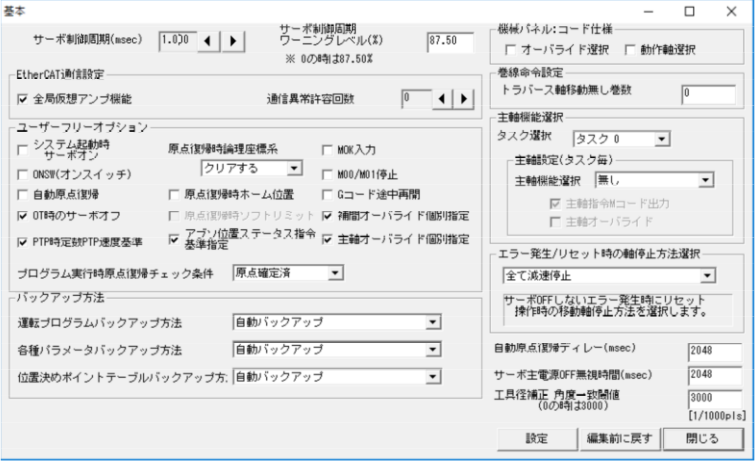

> **図の内容**
>
> RTMC64-M3 の画面との違い:
> - サーボ制御周期(msec) 1.000（表示値）、サーボ制御周期ワーニングレベル(%) 87.50
> - 「MECHATROLINK通信設定」の代わりに「EtherCAT通信設定」: 全局仮想アンプ機能（チェックあり）、通信異常許容回数 0
> - ユーザーフリーオプション: OT時のサーボオフ、PTP時定数PTP速度基準、アブソ位置ステータス指令基準指定、補間オーバーライド個別指定、主軸オーバーライド個別指定にチェックあり
> そのほかの項目と値は RTMC64-M3 の画面と同じ。
> 本文（6-1-1-5）: EtherCATの通信周期はEtherCATのマスタースタックの設定で変更します。

#### 6-1-1-5 仮想モード制御周期

① 仮想モード制御周期(msec) 【2.00】

仮想アンプ(全局共通)が設定されているときのみ、制御周期を設定することができます。

※EtherCATの通信周期はEtherCATのマスタースタックの設定で変更します。

② 制御周期ワーニングレベル(%) 【87.5】

制御周期毎に実行するソフト処理時間が、EtherCATの通信周期の一定時間比率を超えたときに、ソフト処理が間に合わなくなりそうだという警告を出します。このときの時間比率を任意に設定することができます。

何も設定しないとき(デフォルト)または"0"を設定したときは87.5%の設定になります。

6-1-1-6 EtherCATサーボ通信設定

◆1.1

① 仮想アンプ機能(全軸共通)

このチェックを有効にすると全ての軸をEtherCAT接続なしに、仮想的に軸の動作が可能です。 RTMC64単体(サーボ無し)とラダー/PCソフトとのデバッグができます。

各軸毎に設定する場合は、このチェックを外し、「局設定」画面で各軸毎に設定して下さい。このチェックを有効にすると、「局設定」画面での設定にかかわらず、全軸仮想アンプとなります。

② 通信異常許容回数【0】

連続して許容回数より多い回数の通信エラーが発生するまで、エラーを無視します。

使用する機能を選択します。

- システム起動時サーボオン RTMC64の起動時に自動的にサーボオンします。
- ONSW(オンスイッチ)

ONSW有効の場合は、T□ONSW入力=ONでサーボオンさせます。

- 自動原点復帰
- OT時のサーボオフ

本機能は入力信号"ONSW"を使用します。この信号を入力信号に割付けて下さい。(T□ONSW信号は各タスク毎に割付けて下さい) (□はタスク番号) 詳細は、"6-1-11サーボON動作の補足説明"や「RTMC64-M3/ECユーザーズマニュアル」<Ⅱ 機能編 2-1-1.一般入力>(TB00-1040D)を参照下さい。

システム起動時サーボオン、またはONSW機能でサーボオン時に自動的に全軸原点復帰を行います。

OTエラー時に、自動的にサーボオフします。 OT時の動作については、「RTMC64-M3/ECユーザーズマニュアル」

<Ⅱ 機能編 5-14.ストロークリミット>(TB00-1040E)を参照下さい。

PTP時定数PTP速度基準チェック無し:100Kppsに到達するまでの時間チェック有り:PTP速度に到達するまでの時間詳細は「RTMC64-M3/ECユーザーズマニュアル」 <Ⅲ 試運転・調整編 4-1送り速度、加減速などのパラメータ> (TB00-1040H)を参照下さい。

- 原点復帰時ホーム位置全軸/各軸自動原点復帰完了後にセッティングPCのサーボパラメータで設定したホームポジション距離に自動的に位置決めします。
- 原点復帰時ソフトリミット全軸原点復帰時に、ソフトリミットチェックを有効にします。
- [開発中]

アブソ位置ステータス指令セッティングPCのアブソ位置表示を「指令した位置」で行います。

- 基準指定

チェック無しの場合は、「エンコーダFB位置」で表示します。

- MOK入力

また、ステータスデータ読み出し（通信コマンド）により取得するSTATUS データのアブソ位置（STATUS.ax[n].AbsReg）も本設定で変わります。

Mコードシーケンス実行にて、MFIN入力ON時にMOK入力をチェックします。

- M00/M01停止

MFIN入力ON時、MOK入力OFFの場合、Mコード実行エラーとしてプログラムを強制停止します。

本機能は入力信号"MOK"を使用します。この信号を入力ピンに割付けて下さい。

M00/M01停止機能を有効にします。

- Gコード途中再開

M00指令時･･･プログラム実行を停止します。

M01指令時･･･オプショナルスットプ入力(T□MOPT)ONの時プログラム実行停止します。

M00/M01共にMコード出力は行いません。

M01停止を行う場合は、"T□MOPT"を使用します。この信号を入力ピンに割付けて下さい。

Gコードプログラム途中再開機能を有効にします。

本機能を有効にすると、Gコードプログラムの実行をリセットやアラームで中断した後の再開時、最後に実行したシーケンス番号から実行を再開します。

ただし、電源断した後は最初から実行します。

補間オーバライド個別指定補間指令のみに反映される補間オーバライドを有効にします。

本機能が無効の時は、通常のオーバライドが補間指令に反映されます。

主軸オーバライド個別指定 S指令、SPIN命令のみに反映される主軸オーバライドを有効にします。本機能が無効の時は、通常のオーバライドがS指令/SPIN命令に反映されます。

この設定によらず、"6-1-5 の主軸オーバライドがオフの場合は、主軸回転に対しオーバライドは反映されません。

① 原点復帰時論理座標系【クリアする】

全軸/各軸自動原点復帰完了時の論理座標系の設定方法。

■クリアする : 機械原点を論理原点とします。

■クリアしない : 原点復帰前の機械原点～論理原点のオフセットを保持します。

■座標設定する : 機械原点～論理原点のオフセットをセッティングPCのサーボパラメータで設定した "原点復帰時論理座標"で設定します。

② プログラム実行時原点復帰チェック条件【原点確定済】

自動運転開始時の原点復帰状態の条件

- ■チェック無し: 原点復帰の状態に関係なく自動運転を実行できます。

■原点確定済 : 原点が確定していれば自動運転を実行できます。

■原点復帰済 : 原点復帰動作を終了しないと自動運転を実行できません。

#### 6-1-3 機械パネル:コード仕様

使用する機能を選択します。

オーバライド選択チェック無し: 8点の入力信号に対し25%間隔で25%~200%の選択ができます。

チェック有り: 8ビットのコード化信号で1%単位で選択することができます。

- 動作軸選択

チェック無し: 4点の入力信号でX軸からA軸までを信号対応で選択できます。

チェック有り: 4ビットのコード化信号でX軸からT軸までの選択ができます。

詳細は「RTMC64-M3/ECユーザーズマニュアル」<Ⅱ機能編 2-1-5.機械操作パネル入力>(TB00-1040D)を参照下さい。

#### 6-1-4 バックアップ方法

① 運転プログラムバックアップ方法【自動バックアップ】

- ■自動バックアップ

運転プログラムを自動的にバックアップします。

運転プログラム書き込み、運転プログラムの移動・コピー・削除時にバックアップを行います。一度、運転プログラムを書き込めば、電源投入毎に書き込む必要はありません。

■手動バックアップ

運転プログラムの自動バックアップは行いません。 "運転プログラムバックアップ"を押して、手動で運転プログラムをバックアップして下さい。

バックアップする場合は、セッティングPCの"バックアップデータ初期化"画面内、 (動作指示コマンドの「バックアップデータ反映コマンド」でも、バックアップします。) バックアップしない場合は、電源投入毎に必要に応じて書き込む必要があります。

■バックアップ無し

運転プログラムをバックアップしません。

電源投入毎に必要に応じて書き込む必要があります。

<バックアップ方式の比較(ご参考)>

| 方式        | メリット                                      | デメリット                                                                    |
|-----------|-------------------------------------------|--------------------------------------------------------------------------|
| 自動バックアップ | 電源投入毎に運転プログラムを書き込む必要が無い。                 | 運転プログラムの書込み※1の実行時間が長くなる。バックアップ処理時、他タスクへの影響(入力での動作要求や通信遅れ等)が発生する場合がある。 |
| 手動バックアップ | 運転プログラムの書込み※1の実行時間が短い。必要なときに、バックアップが可能。 | バックアップしていない運転プログラムは、再起動後、実行前に再書き込みが必要。                                 |
| バックアップなし | 運転プログラムの書込み※1の実行時間が短い。                   | 毎起動後、運転プログラム実行前に再書き込みが必要。                                               |

※1 運転プログラムの書込み:移動・コピー・削除なども含みます。

② 各種パラメータバックアップ方式【自動バックアップ】

- ■自動バックアップ

パラメータを自動的にバックアップします。パラメータ書き込み、パラメータのコピー・削除時にバックアップを行います。

- 一度、パラメータ書き込めば、電源投入毎に書き込む必要はありません。
- ■新規バックアップ無し

自動的なバックアップは行いません。

保存が必要なときは、「自動バックアップ」に設定してから各パラメータをダウンロードして下さい。 (ダウンロード後は必要に応じて「新規バックアップ無し」に戻して下さい。)

③ 位置決めポイントデータバックアップ方法【自動バックアップ】

運転プログラムバックアップ方法と同様

#### 6-1-5 主軸機能選択 <オプション>

- ■タスク選択

以下の主軸機能を設定するタスクを選択します。

■主軸機能選択

該当タスクでどの主軸機能を使用するかを選択します。

使用する機能を選択

主軸指令Mコード出力主軸回転指令(M03～M05)が指令されたときにMコードを出力します。

主軸オーバライド

主軸回転指令に対してオーバライドが反映されます。

#### 6-1-6 巻線命令設定

本設定は巻線オプションが設定されているときのみ有効になります。

「トラバース軸移動無し巻数」は巻き終わり処理指定がされているとき、残り巻数と移動有り／無しを指定するパラメータです。

※ 巻線機能の詳細は「TB00-0936巻線仕様書」を参照下さい。

#### 6-1-7 エラー発生/リセット時の軸停止方法選択

エラー発生時及びリセット時は移動中の全軸を停止しますが、停止のやり方の選択ができます。

- ■補間命令は減速停止、それ以外は即停止

補間軸に関しては軌跡ずれが少なくなるように考慮し、独立で動いている軸は即時に停止します。

- ■全て減速停止

衝撃が少ないように全ての動作軸を減速して停止します。

- ■全て即停止できるだけ早く停止するため全軸即時停止します。

#### 6-1-8 自動原点復帰ディレイ(msec) 【2048】

"6-1-2ユーザーフリーオプション"の「自動原点復帰」有効時は、サーボオンのあと、さらにこの時間後に全軸原点復帰を開始します。

#### 6-1-9 工具径補正角度一致閾値 (1/1000pls) 【3000】

角度一致閾値を1/1000パルス単位で設定します。(1000で1パルスです。)

- ※ 工具径補正では、補正後の軌跡を求めるために、径補正後の交点を使用します。円弧指令を使用していると、交点が2つ出来てしまうため、使用する交点を判別する必要があります。この際、演算誤差による誤判別を避けるため、角度一致の閾値を設定できるようにしています。デフォルト値(0:3000)で交点を誤判別するようでしたら調整してください。

> **図の内容**
>
> 2 本の直線のなす角 θ と「円弧半径」。開きの大きさが「角度一致閾値(pls)（判定は円弧の長さ）」。

円弧半径と角度一致閾値(pls)から角度θを求め、θを交点判別時の許容誤差にします。

尚、主な演算誤差の原因は以下の通りです。

- 運転プログラム作成時の離散誤差(パルス単位で指令するための切り捨て/切り上げ)
- 浮動小数点演算による演算誤差

#### 6-1-10 サーボ主電源OFF無視時間【2048】

サーボOFFが発生しても、移動中軸でなければこの時間はエラー発生としない。

特にシステム立ち上がり時、サーボが立ち上がるまでの余裕をみて設定してください。

#### 6-1-11 サーボON動作の補足説明

サーボON動作は以下の通りです。

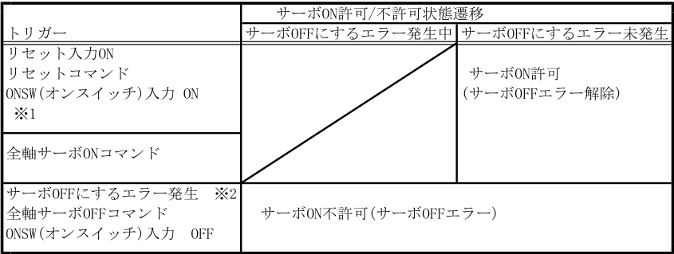

> **図の内容**
>
> | トリガー | サーボOFFにするエラー発生中 | サーボOFFにするエラー未発生 |
> |---|---|---|
> | リセット入力ON、リセットコマンド、ONSW(オンスイッチ)入力 ON ※1 | （斜線） | サーボON許可（サーボOFFエラー解除） |
> | 全軸サーボONコマンド | （斜線） | （同上の欄に含まれる） |
> | サーボOFFにするエラー発生 ※2、全軸サーボOFFコマンド、ONSW(オンスイッチ)入力 OFF | サーボON不許可（サーボOFFエラー） | サーボON不許可（サーボOFFエラー） |
>
> 見出しは「サーボON許可/不許可状態遷移」。

| 状 - 態    | SVM信号状態   | 各軸サーボON信号状態 - 各軸サーボON指定 ※3   | 各軸サーボON信号状態 - 各軸サーボOFF指定 ※3   |
|----------|-----------|------------------------------|-------------------------------|
| サーボON許可  | ON        | ON                           | OFF                           |
| サーボON不許可 | OFF       | OFF                          | OFF                           |

※1 エラー解除含む

- ※2 サーボOFFにするエラーはROMSWによって変わります。 (非常停止、サーボアラーム、偏差過大、±OT)
- ※3 セッティングPCソフト「軸設定」画面、または各軸サーボON/OFFコマンドで変更します。

### 6-2.局設定

「局設定」画面表示選択局がサーボ軸局の場合

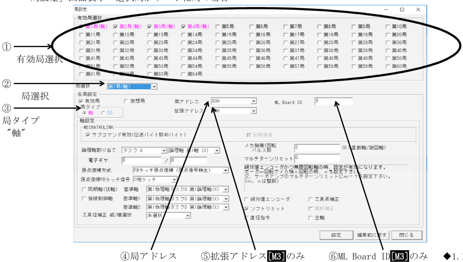

> **図の内容**
>
> 「局設定」画面。丸数字の指す箇所:
> - ① 有効局選択（上部の局のチェック欄。楕円で囲まれている）
> - ② 局選択
> - ③ 局タイプ "軸"
> - ④ 局アドレス、⑤ 拡張アドレス [M3]のみ、⑥ ML Board ID [M3]のみ（下部の矢印）
> 画面の細部（各軸設定の値）は小さくて判読できず。

「局設定」画面表示選択局が入出力ユニット局の場合

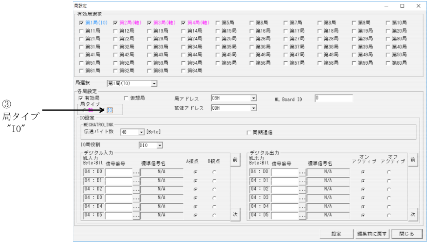

> **図の内容**
>
> 「局設定」画面で、③ 局タイプ "IO" を選んだ場合。下半分に「デジタル入力」「デジタル出力」の信号割り付けの表（Byte:Bit、信号番号、標準信号名など）がある。
> 画面の細部は小さくて判読できず。

- ① 有効局選択

使用する局を選択してください。

- ② 局選択（第1局～第64局）

以下の機能設定をどの局に対して行うか、このドロップダウンリストで選択します。

③ 局タイプ【軸】

- 「局タイプ」設定が"軸"の場合はサーボ軸の局となります。画面の下半分でサーボ軸の各種機能設定を行って下さい。

「6-2-3軸設定パラメータ」の手順で設定して下さい。

- 「局タイプ」設定が"IO"の場合は入出力ユニット局となります。画面の下半分で入出力ユニットの各種機能設定を行って下さい。

入力信号は「6-2-1入力アドレスへ信号の割り付け」の手順で設定して下さい。

出力信号は「6-2-2出力アドレスへ信号の割り付け」の手順で設定して下さい。

- ④ 局アドレス【第1局:03H、第2局:04H ･･･第64軸:44H】メカトロリンクの局を設定して下さい。

局アドレスはサーボ局、入出力ユニット局とも各局のアドレス設定に合わせる必要があります。

サーボ局の局アドレス設定は

- 安川Σサーボ

MECHATROLINKの場合はロータリスイッチ S1、S2 で設定(03～EF) 多軸のMECHATROLINK-Ⅲの場合は拡張アドレスが付くことがあります。

単軸の場合は"0"を設定して下さい。

- Panasonic MINAS

IDのロータリスイッチ MSD、LSD で設定 (01～EF)

- OMROMN

ADRのロータリスイッチ ×10、×1 で設定 (01～99)

- ⑤ 拡張アドレス【0】

[M3]のみ

◆1.1

安川電機の多軸サーボのMECHATROLINK-Ⅲの場合は拡張アドレスが付くことがあります。

- ⑥ ML Board ID

[M3]のみ

複数枚(1～6枚)のMECHATROLINK通信ボード(マスタ)の中から、接続する通信ラインのボードを選択をします。

(各MECHATROLINK通信ボードは4ビットのSWでID番号が設定されています。)

#### 6-2-1.入力信号の割り付け

RTMC64-M3の場合

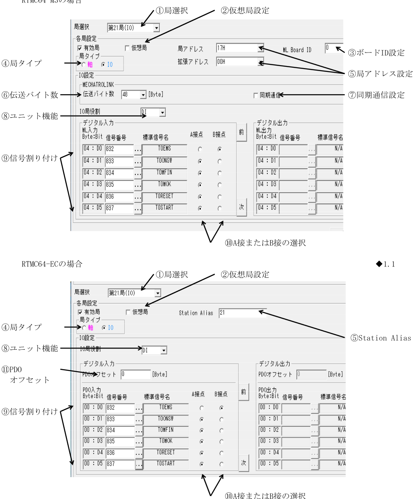

> **図の内容**
>
> 上が RTMC64-M3、下が RTMC64-EC の局設定画面（入出力局）。丸数字で、① 局選択、② 仮想局設定、③ ボードID設定、④ 局タイプ、⑤ 局アドレス設定（EC は Station Alias）、⑥ 伝送バイト数（EC は PDO オフセット）、⑦ 同期通信設定 / ユニット機能、⑧ 信号割り付けなどが示されている。
> 画面の細部は小さくて判読できず。

- ①局選択【第1局】 (第1局～第64局)

以下の機能設定をどの局に対して行うか、このドロップダウンリストで選択します。

- ②仮想局設定【無効】デバッグ時など該当局ユニットが無いときも仮想的に運転できます。
- ③ボードID設定【0】

[M3]のみ

複数枚(1～6枚)のMECHATROLINK通信ボードから、接続する通信ラインのボードを選択をします。

- ④局タイプ【軸】

入出力ユニットの場合は"IO"を選択して下さい。

- ⑤局アドレス・拡張アドレス・Station Alias

【第1局:03H、第2局:04H ･･･第64局:44H】

各局の局アドレス・拡張アドレスを設定します。

局アドレスの設定は各軸毎のサーボアンプの設定と合わせる必要があります。

【第1局:01、第2局:02 ･･･第64局:64 】

[EC]

◆1.1

各局のStation Aliasを設定します。

Station Aliasの設定は各軸毎のサーボアンプの設定及び、ENIファイルと合わせる必要があります。 RTMC64-ECでは拡張アドレスはありません。

⑥伝送バイト数【48】

該当入出力ユニットの伝送バイト数を設定して下さい

- ⑦同期通信設定

![「[M3]のみ」の印](TB00-1042/images/image_000014_d0795ab41b95029bf6f9794481f6b0faddf4cde416d7cedbe9cba57bd801a8f1.png)

[M3]のみ

一般の入出力信号は非同期です。(外部同期カウンタなどの時に同期通信を選択します。)

⑧ユニット機能【DIO】

該当入出力ユニットの機能を選択して下さい。 DIO/DI/DO/AD/DA/CNTの中から選択します。(AD/DA/CNTは開発中)

入力信号割り付けはDIO/DIユニットが可能です。

⑨信号割り付け【】

･･･スイッチを押すと下記画面が表示されます。

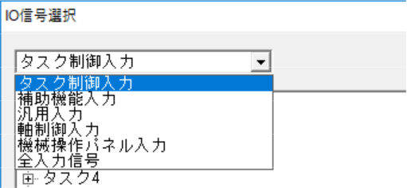

> **図の内容**
>
> 「IO信号選択」画面のドロップダウン。選べる種類: タスク制御入力、補助機能入力、汎用入力、軸制御入力、機械操作パネル入力、全入力信号。

信号グループを選択すると以下の画面が表示されます。

詳細表示の例(各信号グループの表示例)

信号を選択しクリックするとその信号が割り付けられます。

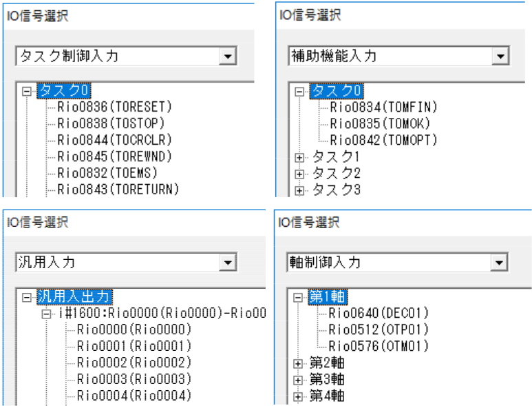

> **図の内容**
>
> - タスク制御入力 → タスク0: Rio0836(T0RESET)、Rio0838(T0STOP)、Rio0844(T0CRCLR)、Rio0845(T0REWND)、Rio0832(T0EMS)、Rio0843(T0RETURN)
> - 補助機能入力 → タスク0: Rio0834(T0MFIN)、Rio0835(T0MOK)、Rio0842(T0MOPT)。ほかにタスク1～3
> - 汎用入力 → 汎用入出力: i#1600:Rio0000(Rio0000)-Rio00…、Rio0000(Rio0000)～Rio0004(Rio0004)
> - 軸制御入力 → 第1軸: Rio0640(DEC01)、Rio0512(OTP01)、Rio0576(OTM01)。ほかに第2軸～第4軸

![「[M3]」の印](TB00-1042/images/image_000017_1ef3e0e2868f4ee300373bfd61f9146f3690ae24a91175ae70ce59d5d0c0f7b6.png)

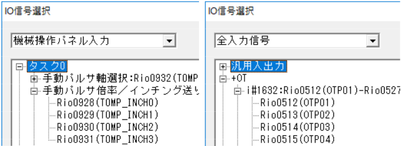

> **図の内容**
>
> - 機械操作パネル入力 → タスク0: 手動パルサ軸選択:Rio0932(T0MP…、手動パルサ倍率／インチング送り: Rio0928(T0MP_INCH0)、Rio0929(T0MP_INCH1)、Rio0930(T0MP_INCH2)、Rio0931(T0MP_INCH3)
> - 全入力信号 → 汎用入出力: +OT、i#1632:Rio0512(OTP01)-Rio0527、Rio0512(OTP01)～Rio0515(OTP04)

同一の標準入力を複数のBitに割付けることはできません。

標準入出力が重複して割付けられている場合、設定ボタンを押したときに以下の画面が表示されますので、割付けを変更してください。

※ 入力信号の詳細については

「RTMC64-M3/ECユーザーズマニュアル」<Ⅱ機能編 2-1.入力信号の名称と機能>(TB00-1040D)及び「RTMC64-M3/ECユーザーズマニュアル」<Ⅱ機能編 4.INtimeユーザ制御ソフト(PLC)とのインターフェース>(TB00-1040E)を参照下さい。

⑩A接またはB接の選択

論理(A接/B接)を設定できます。

A接 (正論理)

そのBitの値が"1"で論理入力がアクティブ(ON)になります。

B接 (負論理:論理を反転します)

そのBitの値が"0"で論理入力がアクティブ(ON)になります。

一般に非常停止等の信号は、B接にします。(フェイルセーフのため)

⑪PDOオフセットバイト数設定

[EC]のみ

◆1.1

信号情報が始まるバイトのオフセット数を設定します

前、次ボタン表示画面が、1点ずつ前、または次の信号に切り替わります。

#### 6-2-2.出力信号の割り付け

RTMC64-M3の場合

RTMC64-ECの場合

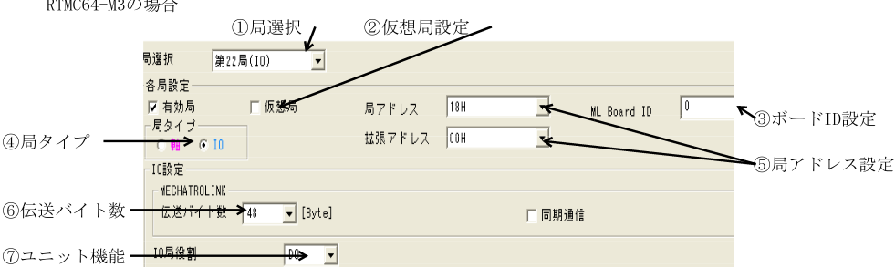

> **図の内容**
>
> 「RTMC64-M3の場合」の局設定画面。① 局選択（第22局(IO)）、② 仮想局設定、③ ボードID設定、④ 局タイプ（IO）、⑤ 局アドレス設定（局アドレス、拡張アドレス）、⑥ 伝送バイト数（48 [Byte]）、⑦ ユニット機能。

◆1.1

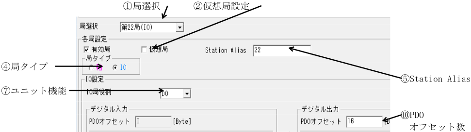

> **図の内容**
>
> RTMC64-EC の局設定画面。① 局選択（第22局(IO)）、② 仮想局設定、④ 局タイプ（IO）、⑤ Station Alias（22）、⑦ ユニット機能、⑩ PDO オフセット数（デジタル入力・デジタル出力の PDOオフセット [Byte]）。

⑨ONアクティブ/OFFアクティブの選択

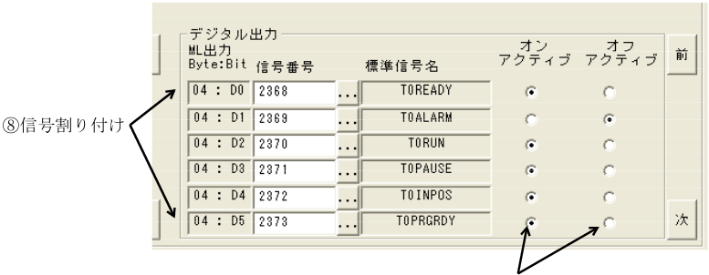

> **図の内容**
>
> ⑧ 信号割り付けの表（ML出力）:
> | Byte:Bit | 信号番号 | 標準信号名 | オンアクティブ | オフアクティブ |
> |---|---|---|---|---|
> | 04 : D0 | 2368 | T0READY | ● | |
> | 04 : D1 | 2369 | T0ALARM | | ● |
> | 04 : D2 | 2370 | T0RUN | ● | |
> | 04 : D3 | 2371 | T0PAUSE | ● | |
> | 04 : D4 | 2372 | T0INPOS | ● | |
> | 04 : D5 | 2373 | T0PRGRDY | ● | |
>
> ⑨ の矢印がオンアクティブ／オフアクティブの選択を指している。

- ①局選択【第1局】 (第1局～第64局)

以下の機能設定をどの局に対して行うか、このドロップダウンリストで選択します。

- ②仮想局設定【無効】

デバッグ時など該当局ユニットが無いときも仮想的に運転できます。

- ③ボードID設定(ML Board ID)【0】

![「[M3]のみ」の印](TB00-1042/images/image_000022_486066111821cd1e329757bc076aeb40f8de2ee2222bfb2d679f95a26953ad54.png)

複数枚(1～6枚)のMECHATROLINK通信ボードから、接続する通信ラインのボードを選択をします。

- ④局タイプ【軸】

入出力ユニットの場合は"IO"を選択して下さい。

- ⑤局アドレス・拡張アドレス・Station Alias

【第1局:03H、第2局:04H ･･･第64局:44H】

[M3]

各局の局アドレス・拡張アドレスを設定します。

局アドレスの設定は各軸毎のサーボアンプの設定と合わせる必要があります。

【第1局:01、第2局:02 ･･･第64局:64 】

各局のStation Aliasを設定します。

Station Aliasの設定は各軸毎のサーボアンプの設定及び、ENIファイルと合わせる必要があります。 RTMC64-ECでは拡張アドレスはありません。

![「[EC]」の印](TB00-1042/images/image_000023_76c1ba713731aac70db24f6acee2a1537b20bbf064c659e4f205e32178e4ba65.png)

◆1.1

⑥伝送バイト数【48】

該当入出力ユニットの伝送バイト数を設定して下さい

⑦ユニット機能【DIO】

該当入出力ユニットの機能を選択して下さい。 DIO/DI/DO/AD/DA/CNTの中から選択します。(DAは開発中) 出力信号はDIO/DOユニットが割り付け可能です。

⑧信号割り付け【】

･･･スイッチを押すと下記画面が表示されます。

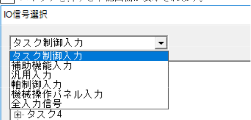

> **図の内容**
>
> 「IO信号選択」画面のドロップダウン。タスク制御入力、補助機能入力、汎用入力、軸制御入力、機械操作パネル入力、全入力信号。

信号グループを選択すると以下の画面が表示されます。

詳細表示の例(各信号グループの表示例)

信号を選択しクリックするとその信号が割り付けられます。

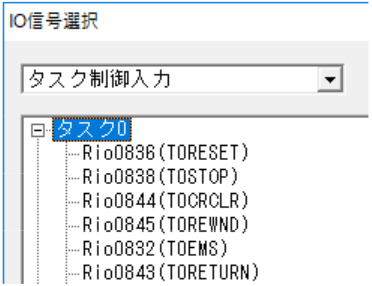

> **図の内容**
>
> タスク制御入力 → タスク0: Rio0836(T0RESET)、Rio0838(T0STOP)、Rio0844(T0CRCLR)、Rio0845(T0REWND)、Rio0832(T0EMS)、Rio0843(T0RETURN)

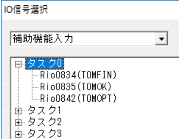

> **図の内容**
>
> 補助機能入力 → タスク0: Rio0834(T0MFIN)、Rio0835(T0MOK)、Rio0842(T0MOPT)。ほかにタスク1、タスク2、タスク3。

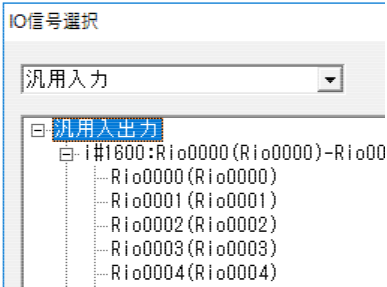

> **図の内容**
>
> 汎用入力 → 汎用入出力: i#1600:Rio0000(Rio0000)-Rio00…、Rio0000(Rio0000)、Rio0001(Rio0001)、Rio0002(Rio0002)、Rio0003(Rio0003)、Rio0004(Rio0004)

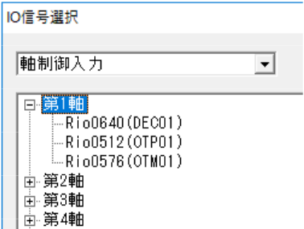

> **図の内容**
>
> 軸制御入力 → 第1軸: Rio0640(DEC01)、Rio0512(OTP01)、Rio0576(OTM01)。ほかに第2軸、第3軸、第4軸。

⑨ONアクティブ/OFFアクティブの選択

論理(ONアクティブ/OFFアクティブ)を設定できます。

また、RTMC64起動時は、出力OFFになります。

ONアクティブ (正論理)

論理出力がアクティブ(ON)で、割付けたBitの値が"1"になります。

OFFアクティブ (負論理:論理を反転します)

論理出力がアクティブ(ON)で、割付けたBitの値が"0"になります。

⑩PDOオフセットバイト数設定

信号情報が始まるバイトのオフセット数を設定します

![「[EC]のみ」の印](TB00-1042/images/image_000029_f4ea9a8694dea4d468c02ed6dfead6fa69f0da839cb678ac9177a6b86a25c61f.png)

![「[M3]のみ」の印](TB00-1042/images/image_000030_230152bc471d27e6a8525f084b7a60c62498a546d5af10a656117a64190c11c5.png)

前、次ボタン表示画面が、1点ずつ前、または次の信号に切り替わります。

※ 出力信号の詳細については、

「RTMC64-M3/ECユーザーズマニュアル」<Ⅱ機能編 2-2.出力信号の名称と機能> (TB00-1040D)及び「RTMC64-M3/ECユーザーズマニュアル」<Ⅱ機能編 4.INtimeユーザ制御ソフト(PLC)とのインターフェース>(TB00-1040E)を参照下さい。

#### 6-2-3.軸設定パラメータ

RTMC64-M3(MECHATROLINK)の場合

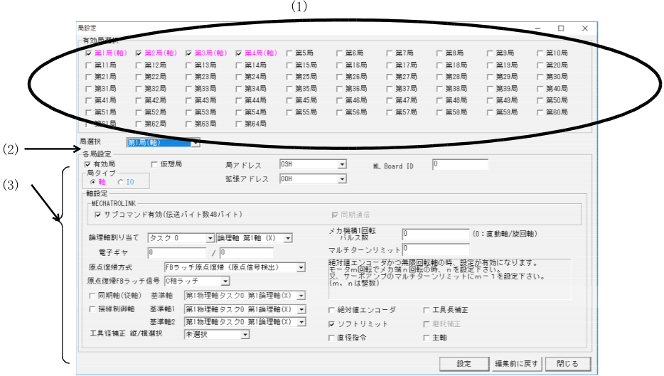

> **図の内容**
>
> 局設定画面（サーボ軸局）。(1) 有効局選択（楕円で囲まれた上部）、(2) 局選択、(3) 軸設定の欄。
> 画面の細部は小さくて判読できず。

RTMC64-EC(EtherCAT)の場合

◆1.1

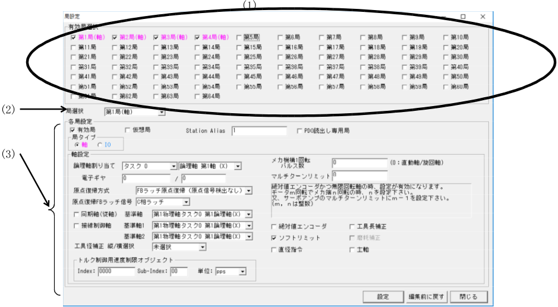

> **図の内容**
>
> RTMC64-EC の局設定画面（サーボ軸局）。(1) 有効局選択、(2) 局選択、(3) 軸設定の欄。下部に「トルク制御関連オブジェクト」（Index、Sub-Index、単位）の欄がある。
> 画面の細部は小さくて判読できず。

#### 6-2-4.各項目の設定

使用する軸に対して、各々設定して下さい。 ※ 以下、【】はデフォルト値です。

- (1) 有効局選択（第1局～第64局）

使用する局を選択してください。

- (2) 局選択（第1局～第64局）

以下の機能設定をどの局に対して行うか、このドロップダウンリストで選択します。

- (3) 各局設定(局毎に指定)

RTMC64-M3の場合

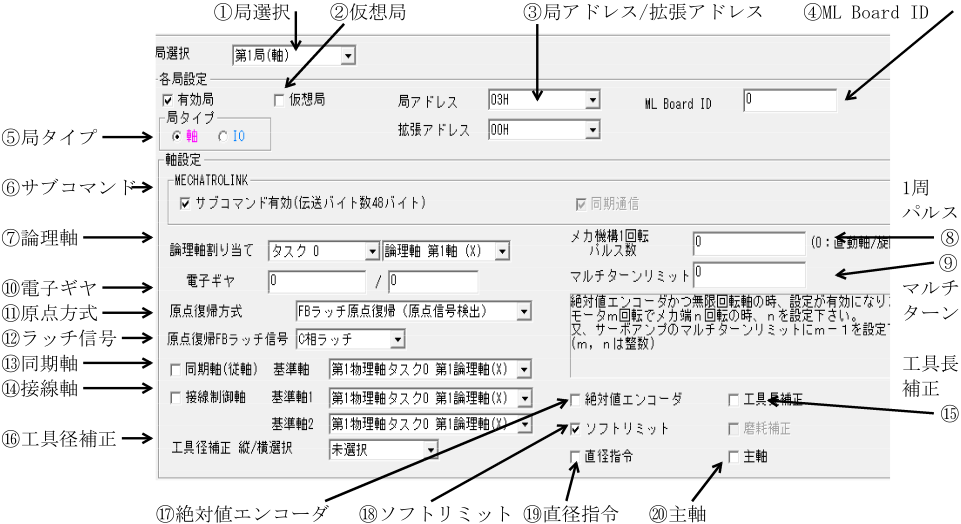

> **図の内容**
>
> サーボ軸局の局設定画面に、本文の項目番号が付いている: ①局選択、②仮想局、③局アドレス/拡張アドレス、④ML Board ID、⑤局タイプ、⑥サブコマンド、⑦論理軸、⑧電子ギヤ、⑨1周パルス、⑩原点方式、⑪マルチターン、⑫ラッチ信号、⑬同期軸、⑭接線軸、⑮工具長補正、⑯工具径補正、⑰絶対値エンコーダ、⑱ソフトリミット、⑲直径指令、⑳主軸。
> 画面の値は小さくて判読できず。

RTMC64-ECの場合

◆1.1

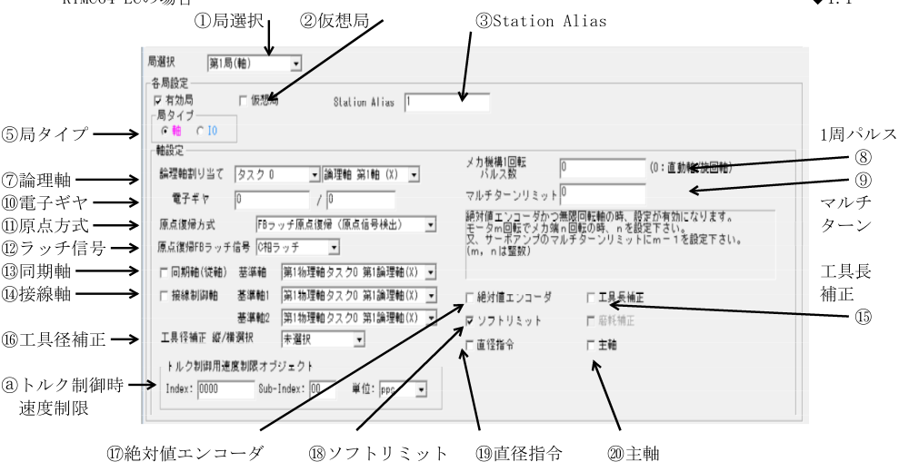

> **図の内容**
>
> RTMC64-EC のサーボ軸局の局設定画面に、本文の項目番号が付いている: ①局選択、②仮想局、③Station Alias、⑤局タイプ、⑦論理軸、⑧電子ギヤ、⑨原点方式、⑫ラッチ信号、⑬同期軸、⑭接線軸、⑮工具長補正、⑯工具径補正、⑰絶対値エンコーダ、⑱ソフトリミット、⑲直径指令、⑳主軸、㉑トルク制御時速度制限 などと、1周パルス、マルチターンの欄。
> 画面の値は小さくて判読できず。

- ① 局選択

サーボ軸または入出力ユニットを割り付ける局を選択します。

- ② 仮想局【無効】

MECHATROLINK接続なしに仮想的に軸の動作が可能です。

「基本」画面の「仮想アンプ(全軸共通)」をチェックした場合は、このチェックによらず全ての軸が仮想アンプとして動作します。

- ③ 局アドレス・拡張アドレス・Station Alias

【第1局:03H、第2局:04H ･･･第64局:44H】

[M3]

各局の局アドレス・拡張アドレスを設定します。

局アドレスの設定は各軸毎のサーボアンプの設定と合わせる必要があります。

【第1局:01、第2局:02 ･･･第64局:64 】

[EC]

◆1.1

各局のStation Aliasを設定します。

Station Aliasの設定は各軸毎のサーボアンプの設定及び、ENIファイルと合わせる必要があります。 RTMC64-ECでは拡張アドレスはありません。

- ④ ML Board ID【0】

[M3]のみ

複数枚(1～6枚)のMECHATROLINK通信ボードから、接続する通信ラインのボードを選択をします。

- ⑤ 局タイプ【軸】

サーボ軸として使用する局は"軸"を選択して下さい。

- ⑥ MECHATROLINK サブコマンド有効【有効】

[M3]のみ

MECHATROLINKのサブコマンドを使用するときは有効にします。

- ⑦ 論理軸割り当てタスク0～7:その物理軸を使用するタスク【未割当】・【未割当】

第1(X)～第9(T):タスクと論理軸番号を設定します。

- ⑧ メカ機構1回転パルス数【0】

無限回転をおこなう軸のみ設定します。この値で座標系をラウンドアップします。直動や有限回転をおこなう軸では、0を設定下さい。

- ⑨ マルチターンリミット【0】

絶対値エンコーダかつ無限回転軸の時、設定が有効になります。

モータm回転でメカ端 n 回転のとき、n を設定ください。

・Σサーボの時はマルチターンリミットに m-1 を設定ください(m , n は整数)。

- ⑩ 電子ギヤ【0】/【0】

移動指令値とサーボ系パルスの比率を変換することができます。どちらかの数値に"0"があるときは、 1:1となります。RTMC64-ECにおいて、1:1以外の設定の場合は、サーボアンプのパラメータ設定に

注意が必要です。詳細は、「RTMC64-M3/ECユーザーズマニュアル」<Ⅰ導入編 8-6.サーボアンプの

設定【例2】Panasonic MINAS-A5B>(TB00-1040A)を参照してください。

- ⑪ 原点復帰方式【FBラッチ(原点信号検出)】

「FBラッチ原点復帰(原点信号検出)」、「DECサーチ原点復帰」、「FBラッチ原点復帰(原点信号検出なし)」、「FBラッチ原点復帰(OT信号検出)」、「OTサーチ原点復帰」の選択。

詳細は「RTMC64-M3/ECユーザーズマニュアル」<Ⅲ試運転・調整編 7-8.原点復帰> (T00-1040H)を参照ください。

- ⑫ 原点復帰FBラッチ信号【C相ラッチ】

原点復帰時FBカウンタをラッチさせる信号を選択します。

- RTMC64-M3の場合

C(Z)相ラッチ,EXT1,EXT2,EXT3の選択です。

(EXT1～EXT3の信号はΣサーボのPn511:1～3桁で設定します。)

- RTMC64-ECの場合

C(Z)相ラッチ,EXT1,EXT2の選択です。

- ⑬ 同期軸(従軸)【無効】

チェックを入れると現在選択中の軸が同一指令2軸制御(同期軸)のスレーブ軸となります。基準軸:同機能のマスター軸を選択します。

◆1.1

詳細は、「RTMC64-M3/ECユーザーズマニュアル」<Ⅱ機能編 5-15-4.同一指令2軸制御>(TB00-1040E) を参照下さい。

- ⑭ 接線制御軸【無効】

チェックを入れると現在選択中の軸が接線制御の回転軸の選択となります。

基準軸1:同機能の軌跡評価の1軸目を選択します。

基準軸2:同機能の軌跡評価の2軸目を選択します。

各タスクで1組の接線制御(基準軸1/基準軸2/接線制御軸)が設定可能です。

詳細は、「RTMC64-M3/ECユーザーズマニュアル」<Ⅱ機能編 5-15-5.接線制御機能>(TB00-1040E)を参照下さい。

⑮ 工具長補正【無効】

工具長補正を有効にします。

複数の軸を有効にしないでください。同じ補正パラメータが、有効軸全てに反映されてしまいます。詳細は、「RTMC64-M3/ECユーザーズマニュアル」<Ⅱ機能編 5-17-2.工具長補正>

(TB00-1040E)を参照下さい。

- ⑯ 工具径補正縦/横軸選択【未選択】

径補正を反映させる1軸目(例:X軸)と2軸目(例:Y軸)を選択します。

詳細は、「RTMC64-M3/ECユーザーズマニュアル」<Ⅱ機能編 5-17-3.工具径補正機能>(TB00-1040E)を参照下さい。

- ⑰ 絶対値エンコーダ無効【無効】

サーボがアブソPGを使用する場合、有効にします。

サーボアンプのパラメータと合わせる必要があります。

詳細は、「RTMC64-M3/ECユーザーズマニュアル」<Ⅲ 試運転・調整編 7-8-11.絶対値エンコーダ軸の設定>(TB00-1040H)を参照下さい。

- ⑱ ソフトリミット【有効】

ソフトリミット機能を有効にします。

⑲ 直径指令【無効】

有効:旋盤のワーク径方向をイメージして、指令値を直径として与えることができます。

運転プログラム内の数値だけが直径指令(実移動量の2倍)として扱われます。

ワンショットPTPやサーボパラメータは半径値(実移動量)として扱われます。

また、ポジション表示の指令位置は直径指令値として表示され。

アブソ位置、機械位置、偏差量は半径指令値として表示されます。

無効:通常軸です。

例:X軸を直径指令とし、運転プログラム中で下記の記述をした命令を実行した場合 PTP X100;

指令位置には100と表示され、アブソ位置、機械位置には50と表示されます。

偏差量も半径指令単位で表示します。(移動が無いときの偏差量50)

1ショット位置決めではPTPでも補間でも、X軸に100と命令したときは、指令位置には 200と表示され、アブソ位置、機械位置、(偏差量)には100と表示されます。

⑳ 主軸【無効】

現在選択している軸を主軸として使用するとき設定します。

- ⓐ トルク制御用速度制限オブジェクト

[EC]のみ

◆1.1

トルク制御を実行する時の速度制限指令のパラメータを設定します。

トルク制御は「サイクリックトルク制御モード(cst mode)」で制御します。

サーボメーカのサイクリックトルク制御モード説明に従って速度制限パラメータを設定して下さい。 (例)

| サーボメーカ    | サーボシリーズ     | Index   |   Sub-Index | 単位   |
|-----------|-------------|---------|-------------|------|
| 安川電機      | SGD*        | 2407    |           0 | rpm  |
| Panasonic | M*DHT       | 6080    |           0 | rpm  |
| OMRON     | R88D        | 607F    |           0 | pps  |
| 山洋電気      | SANMOTION-R | 2022    |           0 | rpm  |
| 日機電装      | NCR-HD      | 607F    |           0 | pps  |

### 6-3.手動パルサ/ジョイステック設定<オプション>

手動パルサ/ジョイスティックを使用する場合は、設定して下さい。 (手動パルサ/ジョイステックオプションが必要です。)

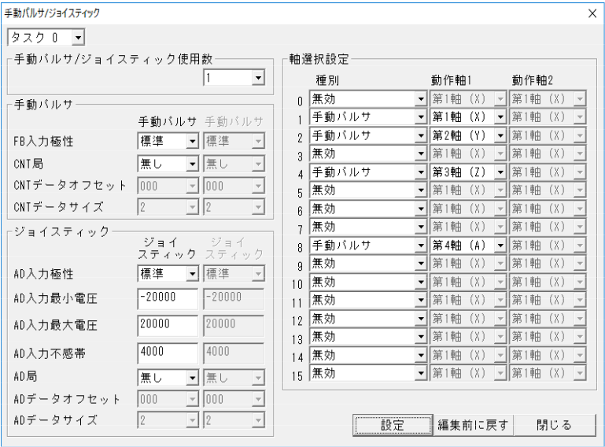

> **図の内容**
>
> 「手動パルサ/ジョイスティック」画面（タスク 0）。
> - 手動パルサ/ジョイスティック使用数: 1
> - 手動パルサ（手動パルサ1／手動パルサ2）: FB入力極性 標準、CNT局 無し、CNTデータオフセット 000、CNTデータサイズ 2
> - ジョイスティック（ジョイスティック1／2）: AD入力極性 標準、AD入力最小電圧 -20000、AD入力最大電圧 20000、AD入力不感帯 4000、AD局 無し、ADデータオフセット 000、ADデータサイズ 2
> - 軸選択設定（0～15）: 種別と動作軸1・動作軸2。表示されている例は、1: 手動パルサ 第1軸(X)、2: 手動パルサ 第2軸(Y)、4: 手動パルサ 第3軸(Z)、8: 手動パルサ 第4軸(A)、ほかは無効
> - ボタン: 設定、編集前に戻す、閉じる

(1) タスク【0】

タスク毎に、手動パルサ/ジョイステックの設定を行います。

手動パルサ/ジョイステックの設定を行うタスクを選択して下さい。

- (2) 手動パルサ/ジョイステック使用数【1】

手動パルサ/ジョイステックの使用数を設定します。

各タスク毎に2個の手動パルサ/ジョイステックを割り付けることができます。

- (3) 手動パルサ設定
2. ① FB入力極性【標準】

各手動パルサのFB入力の極性を設定します。

標準:+カウントで+方向へ進みます。

反転:+カウントで-方向へ進みます。

- ② CNT局設定【無し】

手動パルサ用カウンタ(入出力ユニット)の局アドレスを設定します。

局設定でIOの「CNT」を設定した局のみ選択できます。

- "無し"の場合は手動パルサとして使用できません。
- ③ CNTデータオフセット

MECHATROLINK/EtherCATの通信データ内で、先頭から何バイト目からカウンタデータが始まるかを設定します。

- ④ CNTデータサイズ

MECHATROLINK/EtherCATの通信データ内で、カウンタデータのバイト長を設定します。

- ※手動パルサで移動するときの最大速度は、セッティングPCの「サーボパラメータ」の"手動パルサ最大送り速度"です。pps単位で設定してください。手動パルサ速度の加減速は指数加減速で「サーボパラメータ」の"手動パルサ加減速時定数"です。msec単位で設定して下さい。

(指数加減速は「ユーザーズマニュアル」<4-1送り速度、加減速などのパラメータ>(TB00-1040H)を参照下さい。)

(4) ジョイスティック設定

- ① AD入力極性【標準】

各A/D入力の極性を設定します。

標準:基準値より大きい値で+方向へ進みます。

反転:基準値より大きい値で-方向へ進みます。

※ 基準値 : ジョイステック有効が立ち上がった時のA/D読み込み値の電圧データです。

- ② AD入力最小値【-20000】

A/D入力の最小値を設定します。ラダーからのデータです。読み込み値をそのまま10進表示します。

- ③ AD入力最大値【20000】

A/D入力の最大値を設定します。

- ④ AD入力不感帯【4000】

A/D入力の基準値を中心とした不感帯を設定します。4000は、±2000の事です。

⑤ AD局設定【無し】

手動パルサ用カウンタ(入出力ユニット)の局アドレスを設定します。

局設定でIOの「AD」を設定した局のみ選択できます。

"無し"の場合はジョイスティックとして使用できません。

- ⑥ ADデータオフセット

MECHATROLINK/EtherCATの通信データ内で、先頭から何バイト目からA/D入力データが始まるかを設定します。

- ⑦ ADデータサイズ

MECHATROLINK/EtherCATの通信データ内で、A/D入力データのバイト長を設定します。

ジョイスティックの電圧と速度の関係

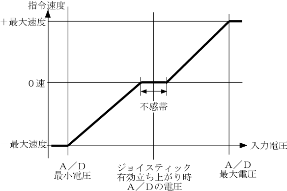

> **図の内容**
>
> 横軸「入力電圧」、縦軸「指令速度」。
> - 「A/D最小電圧」以下では「－最大速度」、「A/D最大電圧」以上では「＋最大速度」
> - 中央の「0速」の区間が「不感帯」
> - 「ジョイスティック有効立ち上がり時A/Dの電圧」が中央

※＋最大速度/－最大速度はセッティングPCの「サーボパラメータ」の"手動パルサ最大送り速度"です。 pps単位で設定してください。移動速度の加減速は指数加減速で「サーボパラメータ」の"手動パルサ加減速時定数"です。msec単位で設定して下さい。(指数加減速は「ユーザーズマニュアル」<4-1送り速度、加減速などのパラメータ>(TB00-1040H)を参照下さい。)

(5) 軸選択設定

① 種別【無効】

タスク毎に割り付けられた機械パネル入力信号の手動パルサ軸選択(T□MP_HSEL3～T□MP_HSEL0)信号のビットパターン(0000～1111 : 0～15)に対して手パ/ジョイスティックの有効/無効、及び動作する軸を選択します。

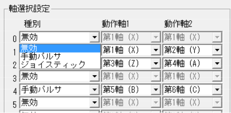

> **図の内容**
>
> 「軸選択設定」の表（種別、動作軸1、動作軸2）で、種別のドロップダウンを開いた状態。選べるもの: 無効、手動パルサ、ジョイスティック。
> 表示されている例: 1: 第1軸(X)・第2軸(Y)、2: 第3軸(Z)・第4軸(A)、4: 手動パルサ 第5軸(B)・第6軸(C)。

- "無効"を割り付けたパターンのときは手動パルサ/ジョイステックは無効です。
- "手動パルサ"を割り付けたパターンでは手動パルサ指令が有効になります。
- "ジョイステック"を割り付けたパターンではジョイステック指令が有効になります。

② 動作軸1【第1軸[X]】

軸選択の0～15に対し、手動パルサ1/ジョイスティック1の指令で動作する軸を選択します。

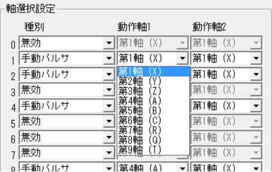

> **図の内容**
>
> 同じ表で、動作軸1のドロップダウンを開いた状態。選べるもの: 第1軸(X)、第2軸(Y)、第3軸(Z)、第4軸(A)、第5軸(B)、第6軸(C)、第7軸(R)、第8軸(Q)、第9軸(T)。

③ 動作軸2【第1軸[X]】

軸選択の0～15に対し、手動パルサ2/ジョイスティック2の指令で動作する軸を選択します。手動パルサ/ジョイステック使用数が"2"のときは動作軸2が有効になります。

④ 軸選択信号と0～15の関係

|   軸選択信号 - HSEL3 |   軸選択信号 - HSEL2 |   軸選択信号 - HSEL1 |   軸選択信号 - HSEL0 |
|-----------------|-----------------|-----------------|-----------------|
|               0 |               0 |               0 |               0 |
|               0 |               0 |               0 |               1 |
|               0 |               0 |               1 |               0 |
|               0 |               0 |               1 |               1 |
|               0 |               1 |               0 |               0 |
|               0 |               1 |               0 |               1 |
|               0 |               1 |               1 |               0 |
|               0 |               1 |               1 |               1 |
|               1 |               0 |               0 |               0 |
|               1 |               0 |               0 |               1 |
|               1 |               0 |               1 |               0 |
|               1 |               0 |               1 |               1 |
|               1 |               1 |               0 |               0 |
|               1 |               1 |               0 |               1 |
|               1 |               1 |               1 |               0 |
|               1 |               1 |               1 |               1 |

### 6-4.オプション

御購入いただいたオプション機能の有無を確認することができます。

- ※ 本画面はご注文頂いたオーダオプションを元に弊社にて設定をします。お客様では変更できません。

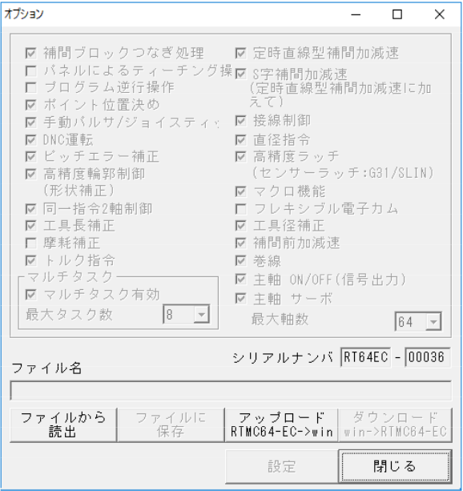

> **図の内容**
>
> 「オプション」画面。オプションのチェック欄（灰色で表示のみ）: 補間ブロックつなぎ処理、パネルによるティーチング操作、プログラム逆行操作、ポイント位置決め、手動パルサ/ジョイスティック、DNC運転、ピッチエラー補正、高精度輪郭制御(形状補正)、同一指令2軸制御、工具長補正、摩耗補正、トルク指令、マルチタスク（マルチタスク有効、最大タスク数 8）、定時直線型補間加減速、S字補間加減速、接線制御、直径指令、高精度ラッチ(センサーラッチ:G31/SLIN)、マクロ機能、フレキシブル電子カム、工具径補正、補間前加減速、巻線、主軸 ON/OFF(信号出力)、主軸 サーボ、最大軸数 64。
> 「ファイル名」、「シリアルナンバ RT64EC - 00036」。ボタン: ファイルから読出、ファイルに保存（灰色）、アップロード RTMC64-EC->win、ダウンロード（灰色）、設定（灰色）、閉じる。
> どれにチェックが入っているかは小さくて判読できず。

◆1.1
