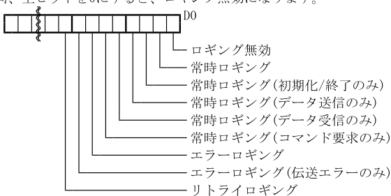
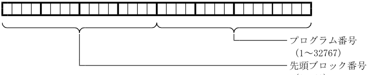
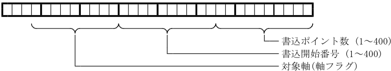
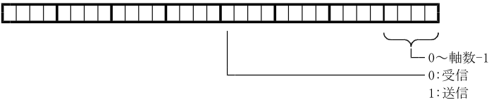
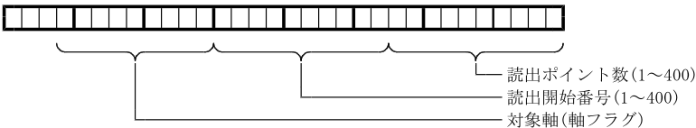

標準PCベースファインモーションコントローラ[RTMC64-M3/RTMC64-EC]

# 通信ライブラリリファレンスマニュアル

Ver1.1 2020.7.2

－目次－

- 1. 型式
- 2. 製品構成
- 3. 概要
- 4. 関連資料
- 5. 使用環境
- 6. インストール
- 7. ライブラリ使用上の注意事項
- 8. 関数使用例
  - 8-1. DLLロード関数による方法
  - 8-2. 関数呼び出し時の戻り値
- 9. 関数仕様
  - 9-1. 通信
    - InitCommProc
    - QuitCommProc
    - SendData
    - ReceiveData
    - SendCommand
    - ( DatEndianChange )
    - SetErrlog
  - 9-2. タイマー
    - SetTimeOut
    - CheckTimeOut

## 1. 型式

通信ライブラリは、64軸制御のPCベースファインモーションコントローラ(RTMC64-M3またはRTMC64-EC)と、 PCアプリ(Windows)間の情報を、共有メモリを経由して受け渡す通信ソフトです。

64軸制御PCベースファインモーションコントローラは次の2種類です。

- RTMC64-M3 ・・・・・・・・ MECHATROLINK-Ⅲ
- RTMC64-EC ・・・・・・・・ EtherCAT

以降、２種類の製品をRTMC64-M3/EC、またはRTMC64と表記します。

RTMC64-M3のみの説明には[M3]、RTMC64-ECのみの説明には[EC]を付けて区別しています。

通信ライブラリの型式

RTMC64-M3の場合は RT64M3COM-NT

RTMC64-ECの場合は RT64ECCOM-NT

## 2. 製品構成

(1) RTMC64-M3の場合

```c
    RT64M3COMNT
    RT64M3COMNT
    RT64M3COMNT
    RT64M3DATA
    SYNCDEF
    RT64M3COMAPI
```

.DLL ････････ダイナミックリンクライブラリファイル

.LIB ････････インポートライブラリファイル

.H ････････インクルードファイル(関数定義)

.H ････････インクルードファイル(構造体定義)

.H ････････インクルードファイル(マクロ定義)

.TXT ････････ VB用データ型･関数定義

(2) RTMC64-ECの場合

```c
    RT64ECCOMNT
    RT64ECCOMNT
    RT64ECCOMNT
    RT64ECDATA
    SYNCDEF
    RT64ECCOMAPI
```

.DLL ････････ダイナミックリンクライブラリファイル

.LIB ････････インポートライブラリファイル

.H ････････インクルードファイル(関数定義)

.H ････････インクルードファイル(構造体定義)

.H ････････インクルードファイル(マクロ定義)

.TXT ････････ VB用データ型･関数定義

## 3. 概要

通信ライブラリは、PCアプリ(Windows)とRTMC64(INtime)との間の通信処理をライブラリ化したものです。通信ライブラリの機能は、C言語の関数形式で呼び出して、利用できます。

通信ライブラリを利用して以下のような処理が行えます。

- データ送信
- データ受信
- 動作指示

各データの詳細は送受信データ説明書を参照下さい。

## 4. 関連資料

| 「RTMC64-M3/EC ユーザーズマニュアル」               | (TB00-1040)    |
|-----------------------------------------|----------------|
| 「RTMC64-M3/EC セッティングPCマニュアル」            | (TB00-1041)    |
| 「RTMC64-M3/EC ROMSW設定ソフトマニュアル」          | (TB00-1042)    |
| EtherCATのコンフィグレーションの手順書                 |                |
| 「ENIファイル作成手順書(RSI-ECAT-Master用)」        | (TB00-1058)    |
| 「ENIファイル作成手順書(AlgoEtherCAT"TwinCAT3"用)」 | (TB00-1149)    |
| 「ENIファイル作成手順書(AlgoEtherCAT"ET9000"用)」   | (TB00-1059)    |
| PCアプリ/INtime上のソフト開発の資料                  |                |
| 「RTMC64-M3/EC 通信ライブラリリファレンスマニュアル」       | (TB00-1043) 本書 |
| 「RTMC64-M3/EC 送受信データマニュアル」              | (TB00-1044)    |
| 「RTMC64-M3/EC Tコード変換ライブラリリファレンスマニュアル    | (TB00-1045)    |
| 「RTMC64-M3/EC Gコード変換ライブラリリファレンスマニュアル    | (TB00-1046)    |
| PLCからラダー制御する場合の参考資料                     |                |
| 「RTMC64-M3/EC サンプルラダープログラム説明書」          | (TB00-1047)    |

## 5. 使用環境

通信ライブラリは、RTMC64-M3/ECが動作するPCのWindows上で動作します。

## 6. インストール

DLLファイルをプログラム検索パスの通っているディレクトリ(フォルダ)に格納して下さい。

## 7. ライブラリ使用上の注意事項

RTMC64-M3/EC用通信ライブラリを使用して、アプリケーションを作成するときは、以下の事を注意して下さい。

- 運転プログラムデータの作成には、弊社テクノコード変換ライブラリかGコード変換ライブラリが必要です。

## 8. 関数使用例

- DLLロード関数を使用して関数をインポートする。

DLLロード関数を使用してDLLをメモリにロードし、関数アドレスを取得して関数を呼び出します。

- MS-VC++での簡易的な方法

MS-VC++では、インポートライブラリを使用して関数をインポートすることもできます。

ライブラリに付属のインポートライブラリをアプリケーションの作成時にリンクします。

この方法は、使用言語がMS-VC++ Ver6.0の時のみ有効です。

ただし、アプリケーション実行開始時にDLLが見つからないとWindowsにより実行中断されてしまいます。

(Windowsのエラーメッセージは表示されます。)

このため、DLLが見つからない時の処理を居プリケーションで作成することはできません。

前述のDLLロード関数を使用する方法でアプリケーションで対処することをおすすめします。

詳細は次項を参照下さい。

### 8-1. DLLロード関数による方法

1. DLLのロード (LoadLibrary()関数を使用) 2. DLL内の任意の関数のアドレス取得 (GetProcAddress()関数を使用) : : DLL内の関数の利用 : 3. DLLのアンロード (FreeLibrary()関数を使用)

関数アドレス取得時に指定する関数名/関数ポインタのデータ型は､Rt64m3excomnt.h[M3]

(Rt64eccomnt.h[EC])内で定義しています。

Rt64m3excomnt.h[M3](Rt64eccomnt.h[EC]) をインクルードする前にLOADLIBRARY_MCDLL を定義(define) することによってこれらの定義を使用できるようになります。

（LOADLIBRARY_MCDLLを定義しなかった場合はインポートライブラリを使用する設定になります。）

以下の例は、通信ライブラリの関数取得例を示します。

```c
#define LOADLIBRARY_MCDLL // テクノ製ライブラリ明示的リンク指定
#include "Rt64m3comnt.h" // RTMC64-M3の場合 // 通信ライブラリ宣言
    (または #include "Rt64eccomnt.h" // RTMC64-ECの場合)
    // グローバルデータ定義
    HINSTANCE hComInst;      /* 通信ライブラリハンドル */
    INITPROC *InitCommProc;  /* 通信初期化関数へのポインタ */
    QUITPROC *QuitCommProc;  /* 通信終了処理関数へのポインタ */
    // 通信ライブラリ関数ロード処理
    int LoadPlmComm(void)
    {
    // DLLのロード
    if(NULL == (hComInst = LoadLibrary(LNCOMDLL))){
    return 0;
}
    // DLLが正常にロードできた場合
    // DLL関数ポインタの取得
    InitCommProc = (INITPROC *)GetProcAddress(hComInst, FNINITPROC);
    QuitCommProc = (QUITPROC *)GetProcAddress(hComInst, FNQUITPROC);
    if((NULL == InitCommProc) || (NULL == QuitCommProc)){
    // 関数アドレス取得が失敗した場合
    // DLLの解放
    FreeLibrary(hComInst);
    return 0;
}
    return 1;
}
```

〔参考〕

関数アドレス取得時に指定する関数名は、本説明書(ヘッダーファイル)の関数名と異なります。アドレス取得時の関数名のフォーマットは、ヘッダーファイルの関数名の前に"_"(アンダーバー)を付け、関数名の後に@、その後に引数の数×4を付けます。具体的には以下の通りとなります。

_関数名@引数の数×4

- 例 InitCommProc(PSXDEF psxdef, int *phCom)の場合

関数名･････ _InitCommProc@8

### 8-2. 関数呼び出し時の戻り値

| E$OK          | :( 0)   | 正常終了               |
|---------------|---------|--------------------|
| E$DEVNRDY     | :( 1)   | デバイス未初期化           |
| E$PARAM       | :( 2)   | 通信パラメータ設定異常        |
| E$TIME        | :( 3)   | タイムアウト発生           |
| E$RTRY        | :( 4)   | リトライオーバー発生         |
| E$MLTRTRY     | :( 5)   | 多重リトライ発生           |
| E$HARDER      | :( 6)   | 通信ハードウェアエラー        |
| E$NEXIST      | :( 7)   | 要求データが存在しない        |
| E$PROTECT     | :( 8)   | 送信データ書込不可          |
| E$SEQ         | :( 9)   | 通信データフォーマットエラー     |
| E$PRGTERM     | :(10)   | 運転プログラム書込中断        |
| E$PRGBUFF     | :(11)   | 運転プログラムバッファオーバーフロー |
| E$CMDNOT      | :(12)   | コマンド実行不可           |
| E$EMPTYHANDLE | :(13)   | 空き通信ハンドル無し         |
| E$NOHANDLE    | :(14)   | 無効ハンドル             |
| E$BUSY        | :(15)   | 通信ビジー              |
| E$PRMWRITE    | :(16)   | パラメータ書き込みエラー       |
| E$ERR         | :(-1)   | 不明エラー              |

## 9. 関数仕様

### 9-1. 通信

#### InitCommProc

**機能**

通信インタフェースの初期化及び、通信処理の組み込みを実行します。

**プロトタイプ**

```c
#include "Rt64m3comnt.h" // RTMC64-M3の場合 関数宣言に必要なインクルードファイル
    (#include "Rt64eccomnt.h" // RTMC64-ECの場合)
    int WINAPI InitCommProc(PSXDEF psxdef, int *phCom);
    PSXDEF psxdef 通信定義構造体
```

通信定義構造体

```c
typedef struct {
    long nSize; // 通信初期化構造体サイズ
    short fComType; // 通信種別フラグ
    short fShare; // 共有フラグ
    long fLogging; // 通信ロギングフラグ
#ifdef _WIN64
    long alignment0;
#endif
    char *pLogFile; // 通信ロギングファイル名
    // INtime common
    char *pNodeName; // INtimeノード名
    long LogFileMaxSz; // ロギングファイル最大サイズ
#ifdef _WIN64
    long alignment1;
#endif
    short LogFileMaxNum; // ロギングファイル最大数
    short Reserved[3]; // 予約
} SXDEF, *PSXDEF;
```

通信処理の各種定義を行います。

各変数の内容は以下の通りです。

nSize 構造体サイズ

本構造体（通信定義構造体）のサイズを設定して下さい。

sizeof():VC++/ LenB():VB 関数でサイズを取得できます。

fComType 通信種別フラグ

【0】

共有メモリ通信：COMSHAREMEM (0) を設定してください。

fShare 共有フラグ

【1】

1を指定して下さい。

int

fLogging 通信ロギングフラグ

通信ロギングの設定を行います。内容は下記の通りです。上位の未定義ビットは全て0にして下さい。尚、全ビットを0にすると、ロギング無効になります。



> **図の内容**
>
> InitCommProc の通信定義構造体 SXDEF のメンバー fLogging のビット割り当て:
>
> | ビット | 内容 |
> |---|---|
> | D0 | ロギング無効 |
> | D1 | 常時ロギング |
> | D2 | 常時ロギング（初期化/終了のみ） |
> | D3 | 常時ロギング（データ送信のみ） |
> | D4 | 常時ロギング（データ受信のみ） |
> | D5 | 常時ロギング（コマンド要求のみ） |
> | D6 | エラーロギング |
> | D7 | エラーロギング（伝送エラーのみ） |
> | D8 | リトライロギング |
>
> 上位の未定義ビットはすべて0にする。全ビットを0にするとロギング無効になる。

pLogFile 通信ロギングファイル名

RTMC64-M3/ECとの通信のログを保存するファイル

名を指定します。

NULLを指定するとロギングが無効になります。

ファイル名を指定＆通信ロギングフラグ指定でログを有効にした場合、実行ファイルと同じディレクトリに以下のファイルが作成されます。

- 1.「通信ロギングファイル名」で指定したファイル
- 2.「通信ロギングファイル名」で指定したファイルのベースファイル名の最後に1～5の数字を付加したファイル

ログファイル(1のファイル)がロギングファイル最大サイズをこえると現ログファイルはリネームされて、履歴ファイルとなります。その後、新しいログファイルを作成してロギングを継続します。履歴ファイル名は、指定されたログファイル名のベースに履歴番号として1～最大数を付加した名前です。(ロギングファイル最大数まで保持)

例)ログファイル名として"TMP.LOG"を指定すると、

履歴ファイルとしてTMP1.LOG～TMP5.LOGが作成されます。

pNodeName NODE 名称

INtime上で、RTMC64-M3/ECを動作させるNODE名称を指定します。例） "NodeA"

LogFileMaxSz ロギングファイル最大サイズ

LogFileMaxNum ロギングファイル最大数

*phCom 通信ハンドル

**戻り値**

初期化が正常に終了した場合に、ハンドルを格納するデータのポインタを指定します。

通信処理実行ステータスとして以下の値を返します。

E$OK

：正常終了

E$EMPTYHANDLE ：ハンドル取得不可

E$PARAM ：パラメータ設定異常

E$ERR

：異常終了

正常に初期化が終了した場合、接続されたRTMC64-M3/ECコントローラを識別するためのハンドルをphCom の指し示すアドレスへ格納します。

【参考】

```c
    VB6.0使用時のログファイル名指定方法
    〔方法1〕
    SXDEFの初期化で
    sdf.pLogFile = StrPtr(StrConv("test.log", vbFromUnicode)) '通信ロギングファイル名と指定。
    〔方法2〕
    "Rt64m3coomapi.txt"[M3]("Rt64eccomapi.txt"[EC])のSXDEF構造体にあるpLogFileを
    pLogFile As String
    と変更し
    SXDEFの初期化で
    sdf.pLigFile = "test.log" '通信ロギングファイル名と指定。
```

#### QuitCommProc

**機能**

関数InitCommProcの実行によって組み込まれた通信処理を切り放し、組み込み前の状態に戻します。

**プロトタイプ**

```c
#include "Rt64m3comnt.h" // RTMC64-M3の場合 // 関数宣言に必要なインクルードファイル
    (#include "Rt64eccomnt.h" // RTMC64-ECの場合)
    int WINAPI QuitCommProc(int hCom);
    int hCom 通信ハンドル
    通信初期化処理で取得したハンドルを指定します。
```

**戻り値**

ステータスとして以下の値を返します。

E$OK

：正常終了

E$NOHANDLE ：無効ハンドル

E$ERR

：異常終了

#### SendData

**機能**

RTMC64-M3/ECコントローラに対して、各種データ設定を行います。

**プロトタイプ**

```c
#include "Rt64m3comnt.h" // RTMC64-M3の場合 // 関数宣言に必要なインクルードファイル
    (#include "Rt64eccomnt.h" // RTMC64-ECの場合)
    int WINAPI SendData(int hCom, short type, short task, long prm, DWORD size, LPVOID data);
```

int hCom

通信ハンドル

short type

通信初期化処理で取得したハンドルを指定します。

データタイプ

short task DAT_PARAMETER等、送信するデータのタイプを指定します。

タスク番号

long prm

設定対象のタスク番号(0～7)を指定します。

タスク指定が関係ない設定の場合は0を指定して下さい。

付加パラメータ

データタイプによって、指定する値が異なります。

送受信データ説明書の各データタイプの説明を参照して設定下さい。

（《パラメータ》の説明に応じて設定して下さい。ただし、本項に「なし」と記載されている場合は０を設定して下さい。）

例）

・DAT_PROGRAM:運転プログラム番号(D0～D15)、先頭ブロック番号(D16～D31) LSB

MSB



> **図の内容**
>
> データタイプ DAT_PROGRAM の付加パラメータ prm(32bit):
>
> | ビット | 内容 |
> |---|---|
> | D0～D15（下位16bit） | プログラム番号（1～32767） |
> | D16～D31（上位16bit） | 先頭ブロック番号（0～63） |

(0～63)

- DAT_DNCDATA ：先頭／継続フラグ０：先頭時、１：継続時
- DAT_MCRREG ：マクロ変数番号
- DAT_ACOPARAM ：0:1タスク分の受信、1:全タスク分の受信

・DAT_POINTTABLE：書込ポイント数(D0～D9)､書込開始番号(D10～D19)

軸フラグ(D20～D28)

MSB

LSB



> **図の内容**
>
> データタイプ DAT_POINTTABLE の付加パラメータ prm(32bit):
>
> | ビット | 内容 |
> |---|---|
> | D0～D9（10bit） | 書込ポイント数（1～400） |
> | D10～D19（10bit） | 書込開始番号（1～400） |
> | D20～D28（9bit） | 対象軸（軸フラグ） |

DWORD

size

送信データサイズ

LPVOID

data

0～65535バイト

送信データ格納バッファへのポインタ

本関数のデータタイプに指定できるデータについては、「標準RTMC64-M3/EC対応送受信データ説明書」の "データ送受信機能"を参照して下さい。

**戻り値**

通信処理実行ステータスとして以下の値を返します。

E$OK

：正常終了

E$DEVNRDY ：デバイス未初期化

E$PARAM ：通信パラメータ設定異常

E$TIME ：タイムアウト発生

E$RTRY ：リトライオーバー発生

E$MLTRTRY ：多重リトライ発生

E$HARDER ：通信ハードウェアエラー

E$PROTECT ：送信データ書込不可

E$SEQ

：通信データフォーマットエラー

E$PRGTERM ：運転プログラム書込中断

E$PRGBUFF ：運転プログラムバッファオーバーフロー

E$NOHANDLE ：無効ハンドル

#### ReceiveData

**機能**

RTMC64-M3/ECコントローラ内部の、各種データ読出を行います。

**プロトタイプ**

```c
#include "Rt64m3comnt.h" // RTMC64-M3の場合 // 関数宣言に必要なインクルードファイル
    (#include "Rt64eccomnt.h" // RTMC64-ECの場合)
    int WINAPI ReceiveData(int hCom, short type, long task, short prm, LPDWORD size, LPVOID data);
```

int hCom

通信ハンドル

short type

通信初期化処理で取得したハンドルを指定します。

データタイプ

short task DAT_PARAMETER等、受信するデータのタイプを指定します。

タスク番号

long prm

読出対象のタスク番号(0～7)を指定します。

タスク指定が関係ない読出の場合は0を指定して下さい。

付加パラメータ

◆1.1

データタイプによって、指定する値が異なります。

送受信データ説明書の各データタイプの説明を参照の上設定して下さい。（《パラメータ》の説明に応じて設定して下さい。ただし、本項に「なし」と記載されている場合は０を設定して下さい。）

例）

- DAT_PROGRAM : プログラム番号 1～32767

・DAT_ONEBLOCK : ステップ番号 0～最大ステップ番号

0:現在の実行ステップ番号

- DAT_MCRREG

: マクロ変数番号

・DAT_TPCDATA : 読み出しデータサイズ 0～65535

- DAT_ML_INFO : 軸番号

0～軸数-1 :軸指定(1軸分)

-1

:全軸指定

- DAT_ML_MON

MSB

LSB



> **図の内容**
>
> データタイプ DAT_ML_MON の付加パラメータ prm(32bit):
>
> | ビット | 内容 |
> |---|---|
> | D0～D3 | 軸番号（0～軸数-1） |
> | D15 | 送受信の選択（0: 受信、1: 送信） |
>
> 上記以外のビットは未使用。

- DAT_ACOPARAM
- DAT_POINTTABLE

: 0:1タスク分の受信、1:全タスク分の受信

: 書込ポイント数(D0～D9)､書込開始番号(D10～D19) 軸フラグ(D20～D28)

MSB

LSB



> **図の内容**
>
> データタイプ DAT_POINTTABLE の付加パラメータ prm(32bit):
>
> | ビット | 内容 |
> |---|---|
> | D0～D9（10bit） | 読出ポイント数（1～400） |
> | D10～D19（10bit） | 読出開始番号（1～400） |
> | D20～D28（9bit） | 対象軸（軸フラグ） |

```c
    LPDWORD size
    LPVOID data
```

受信データサイズ格納変数へのポインタ

受信データ格納バッファへのポインタ

本関数のデータタイプに指定できるデータについては、「標準RTMC64-M3/EC対応送受信データ説明書」の "データ送受信機能"を参照して下さい。

**戻り値**

通信処理実行ステータスとして以下の値を返します。

E$OK

：正常終了

E$DEVNRDY ：デバイス未初期化

E$PARAM ：通信パラメータ設定異常

E$TIME ：タイムアウト発生

E$RTRY ：リトライオーバー発生

E$MLTRTRY ：多重リトライ発生

E$HARDER ：通信ハードウェアエラー

E$NEXIST ：要求データが存在しない

E$SEQ

：通信データフォーマットエラー

E$NEXIST ：要求データが存在しない

E$NOHANDLE ：無効ハンドル

#### SendCommand

**機能**

RTMC64-M3/ECコントローラに対して、各種動作指示を行います。

**プロトタイプ**

```c
#include "Rt64m3comnt.h" // RTMC64-M3の場合 // 関数宣言に必要なインクルードファイル
    (#include "Rt64eccomnt.h" // RTMC64-ECの場合)
    int WINAPL SendCommand(int hCom, short cmnd, short task, LPVOID data);
```

int hCom

通信ハンドル

short cmnd

通信初期化処理で取得したハンドルを指定します。

動作指示コード

short task REQ_RESET等、動作指示のタイプを指定します。

タスク番号

LPVOID

data

動作指示対象のタスク番号(0～7)を指定します。

タスク指定が関係ない動作指示の場合は0を指定して下さい。

動作パラメータ格納バッファへのポインタ

本関数の動作指示コードに指定できるデータについては､「標準RTMC64-M3/EC対応送受信データ説明書」の "動作コマンド付加データ詳細"を参照して下さい。

**戻り値**

通信処理実行ステータスとして以下の値を返します。

E$OK

：正常終了

E$DEVNRDY ：デバイス未初期化

E$PARAM ：通信パラメータ設定異常

E$TIME ：タイムアウト発生

E$RTRY ：リトライオーバー発生

E$MLTRTRY ：多重リトライ発生

E$HARDER ：通信ハードウェアエラー

E$SEQ

：通信データフォーマットエラー

E$CMDNOT ：コマンド実行不可

E$NOHANDLE ：無効ハンドル

#### ( DatEndianChange )

**機能**

ダイナミックデータローディング(DDL)用のデータ変換処理を行います。多バイトデータをメモリ/ファイルに格納する際のデータの並び順(エンディアン) が異なる場合がます。この関数でデータの並び順を変更する事で、データを相互に使用できるようにします。

※ この関数は、PCベースファインモーションコントローラ内部(Windows、INtime)でのデータ通信では不要です。

#### SetErrlog

**機能**

RTMC64-M3/ECコントローラに対して、通信エラーログファイル名を指定します。

通信初期化処理で設定した項目と同じです。この関数によっても、エラーログファイルを指定できます。エラーログファイル名やフラグのみを変更する場合に使用します。

**プロトタイプ**

```c
#include "Rt64m3comnt.h" // RTMC64-M3の場合 // 関数宣言に必要なインクルードファイル
    (#include "Rt64eccomnt.h" // RTMC64-ECの場合)
    int WINAPI SetErrLog(int hCom, char *fname, short flg);
```

int hCom

通信ハンドル

char

通信初期化処理で取得したハンドルを指定します。

*fname 通信ロギングファイル名

short flg InitComProcのpLogFileの項をご参照下さい。

通信ロギングフラグ

InitComProcのfLoggingの項をご参照下さい。

**戻り値**

通信処理実行ステータスとして以下の値を返します。

E$OK

：正常終了

E$DEVNRDY ：デバイス未初期化

E$PARAM ：通信パラメータ設定異常

E$NOHANDLE ：無効ハンドル

E$ERR

：初期化処理異常終了

### 9-2. タイマー

Windowsが持つ､1msec間隔のインターバルタイマーをもとに､タイマーによる処理のディレイや同期､またタイムアウト処理などが可能となります。

「タイマーチェック起点関数」及び「タイムアウトチェック関数」によりアプリケーションにて通信処理以外の目的で､タイマー処理を行うことができます。

#### SetTimeOut

**機能**

タイムアウトチェックの起点設定を行います。

**プロトタイプ**

```c
#include "Rt64m3comnt.h" // RTMC64-M3の場合 // 関数宣言に必要なインクルードファイル
    (#include "Rt64eccomnt.h" // RTMC64-ECの場合)
    void WINAPI SetTimeOut(PDWORD origin);
    PDWORD origin タイムアウトチェック起点時間格納ポインタ
```

origin タイムアウトチェック起点時間格納ポインタ

#### CheckTimeOut

**機能**

タイムアウトの判定を行います。

**プロトタイプ**

```c
#include "Rt64m3comnt.h" // RTMC64-M3の場合 // 関数宣言に必要なインクルードファイル
    (#include "Rt64eccomnt.h" // RTMC64-ECの場合)
    BOOl WINAPI CheckTimeOut(DWORD origin, DWORD limit);
    DWORD origin 関数SetTimeOut()で取得したタイムアウトチェック起点時間
```

DWORD

origin 関数SetTimeOut()で取得したタイムアウトチェック起点時間 limit タイムリミット値(単位:1msec)

**戻り値**

FALSE:タイムアウトしていない

TRUE :タイムアウトしている

```c
#include <conio.h>
#include "Rt64m3comnt.h" // RTMC64-M3の場合
    (#include "Rt64eccomnt.h" // RTMC64-ECの場合)
    main()
    {
    int ch;
    DWORD StartTime;
    ch＝getch();                          /*キー入力 */
    SetTimeOut(&StartTime);               /*タイマーチェック起点設定 */
    While(!CheckTimeOut(StartTime,1100L));  /*1.1秒待ち */
    putch(ch);                            /*入力キーコード表示 */
}
```

このプログラムは､キー入力があってから1.1秒後に､入力キーを表示します。
