# 標準PCベースファインモーションコントローラ[RTMC64-M3/RTMC64-EC]

送受信データマニュアル

Ver1.2 2021.8.25

－目次－

- 1.概要
  - 1-1.PCベースファインモーションコントローラの種類と表記の説明
  - 1-2.PLC(INtime)との送受信の場合(共有メモリの通信領域を使用する場合)
  - 1-3.PC(Windows)との送受信の場合(通信ライブラリを使用する場合)
- 2.関連資料
- 3.表記
  - 3-1.PLCとの通信に使用する場合
  - 3-2.ＰＣアプリケーション（通信ライブラリを使用）との通信に使用する場合
- 4.通信データ詳細説明
  - 4-1.データ送受信機能詳細
    - 4-1-1.サーボパラメータ書込/読出 [DAT_PARAMETER / 16#00]
    - 4-1-2.運転プログラム書込/読出 [DAT_PROGRAM / 16#01)]
    - 4-1-3.DNCデータ書込 [DAT_DNCDATA / 16#0E] <オプション>
    - 4-1-4.ピッチエラー補正用データ書込/読出 [DAT_PITCHERR / 16#10] <オプション>
    - 4-1-5.工具長補正データ書込/読出 [DAT_TOOLHOFS / 16#12] <オプション>
    - 4-1-6.ステータスデータ読出 [DAT_STATUS / 16#02]
    - 4-1-7.入出力状態データ読出 [DAT_IODATA / 16#03]
    - 4-1-8.強制入出力状態データ読出 [DAT_FORCEIO / 16#13]
    - 4-1-9.DNCバッファ情報データ読出 [DAT_DNCBUFI / 16#0F] <オプション>
    - 4-1-10.センサーラッチ位置データ読出 [DAT_SENSEPOS / 16#11] <オプション>
    - 4-1-11.プログラム1ステップデータ読出 [DAT_ONEBLOCK / 16#30]
    - 4-1-12.ティーチング情報読出 [DAT_TEACHSTS / 16#18] <開発中>
    - 4-1-13.ROMバージョン情報読出 [DAT_VERSION / 16#27)]
    - 4-1-14.マクロ変数(一般レジスタ)書込/読出 [DAT_VARIABLE / 16#19] <オプション>
    - 4-1-15.TPCロギングデータ読出 [DAT_TPCDATA / 16#25)]
    - 4-1-16.TPCロギング情報読出 [DAT_TPCINFO / 16#24)]
    - 4-1-17.軸ネグレクト設定データ読出 [DAT_AXNEGLECT / 16#28]
    - 4-1-18.軸インタロック設定データ読出 [DAT_AXINTLOCK / 16#29]
    - 4-1-19.各軸サーボON/OFF設定データ読出 [DAT_AXSVONEN / 16#31]
    - 4-1-20.手動パルサー設定情報読出 [DAT_HANDLESTS / 16#32] <オプション>
    - 4-1-21.マクロ変数書込／読出 [DAT_MCRREG / 16#33] <オプション>
    - 4-1-22.工具径補正データ書込/読出 [DAT_TOOLDIA / 16#1A] <オプション>
    - 4-1-23.ＴＰＣロギング拡張情報読出 [DAT_TPCINFO_EX / 16#2A]
    - 4-1-24.サーボ通信情報読出 [DAT_**** / 16#34]
    - 4-1-25.サーボ通信送受信データ読出 [DAT_**** / 16#35]
    - 4-1-26.ポイントテーブル書込/読出 [DAT_POINTTABLE / 16#3B]
    - 4-1-27.プログラムブロック情報読出 [DAT_PRGBLKINFO / 16#1B]
    - 4-1-28.補間前加減速(自動ｺｰﾅｵｰﾊﾞｰﾗｲﾄﾞ)パラメータ書込/読出 [DAT_ACOPARAM / 16#37] <オプション>
    - 4-1-29.工具長補正設定情報読出 [DAT_TOOLHSTS / 16#39]
    - 4-1-30.工具径補正設定情報読出 [DAT_TOOLDSTS / 16#3A]
    - 4-1-31.軸割り当て情報読出 [DAT_ASSAXISTBL / 16#3C]
    - 4-1-32.制御周期内処理時間計測データ読出 [DAT_RTC / 16#21]
    - 4-1-33.フォアグランド周期計測データ読出[DAT_FORGROUND / 16#90]
    - 4-1-34.工具径補正エラー情報読出[DAT_TOOLDERR / 16#3D]
    - 4-1-35.主軸回転数読出[DAT_SPREV / 16#41]
    - 4-1-36.絶対値エンコーダオフセット書込/読出 [DAT_ABSENCOFS / 16#1C]
    - 4-1-37.EtherCATオブジェクト選択情報読出/書込 [DAT_ECOBJSEL / 16#A0]
    - 4-1-38.EtherCATオブジェクト値読出/書込 [DAT_ECOBJVAL / 16#A1]
  - 4-2.動作指示コマンド詳細
    - 4-2-1.バックアップメモリ初期化コマンド [REQ_GENE / 16#14]
    - 4-2-2.動作モード変更コマンド [REQ_MODECHG / 16#10]
    - 4-2-3.軸移動停止コマンド [REQ_STOP / 16#13]
    - 4-2-4.軸移動再開コマンド [REQ_RESTART / 16#1B]
    - 4-2-5.JOG移動コマンド [REQ_JOGSTART / 16#11]
    - 4-2-6.各軸原点復帰コマンド [REQ_ZRNSTART / 16#12､ REQ_AXAUTOZRN / 16#33]
    - 4-2-7.インクレPTP位置決めコマンド [REQ_PTPSTART / 16#15]
    - 4-2-8.アブソＰＴＰ位置決めコマンド [REQ_PTPASTART / 16#16､ REQ_PTPBSTART / 16#34]
    - 4-2-9.同期軸無視インクレＰＴＰ位置決めコマンド [REQ_SYNEGPTPSTART / 16#49]
    - 4-2-10.同期軸無視アブソＰＴＰ位置決めコマンド [REQ_SYNEGPTPASTART / 16#4A､ REQ_SYNEGPTPBSTART / 16#4B]
    - 4-2-11.インクレ直線補間位置決めコマンド [REQ_LINSTART / 16#17]
    - 4-2-12.アブソ直線補間位置決めコマンド [REQ_LINASTART / 16#18､ REQ_LINBSTART / 16#35]
    - 4-2-13.リセットコマンド [REQ_RESET / 16#1A]
    - 4-2-14.原点設定コマンド [REQ_ORGSET / 16#19)]
    - 4-2-15.汎用出力直接制御コマンド [REQ_OUTPUT / 16#1D]
    - 4-2-16.サーボ電源ONコマンド [REQ_SERVOON / 16#1E] <開発中>
    - 4-2-17.サーボ電源OFFコマンド [REQ_SERVOOFF / 16#1F] <開発中>
    - 4-2-18.プログラム運転開始コマンド [REQ_PROGSTRT / 16#20)]
    - 4-2-19.プログラム運転停止コマンド [REQ_PROGSTOP / 16#21]
    - 4-2-20.運転プログラム選択コマンド [REQ_PROGSLCT / 16#22]
    - 4-2-21.全軸原点復帰開始コマンド [REQ_ALLZRN / 16#24]
    - 4-2-22.高速センサーラッチインクレ補間位置決めコマンド [REQ_SLINSTART / 16#28] <オプション>
    - 4-2-23.高速センサーラッチアブソ補間位置決めコマンド [REQ_SLINASTART / 16#29] <オプション>
    - 4-2-24.汎用入力強制制御コマンド [REQ_COMPINPUT / 16#2A]
    - 4-2-25.汎用出力強制制御コマンド [REQ_COMPOUTPUT / 16#2B]
    - 4-2-26.汎用入出力ビット強制制御コマンド、汎用出力ビット直接制御コマンド [REQ_COMPIOBIT / 16#2C､ REQ_OUTPUTBIT / 16#44]
    - 4-2-27.送りオーバーライド%変更コマンド
    - 4-2-28.接線制御ON/OFFコマンド [REQ_TLINE / 16#54] <オプション>
    - 4-2-29.主軸回転ON/OFFコマンド [REQ_SPCMND / 16#50] <オプション>
    - 4-2-30.主軸回転数設定コマンド [REQ_SPREVSET / 16#51] <オプション>
    - 4-2-31.シングルステップモード設定コマンド [REQ_SINGLE / 16#60]
    - 4-2-32.ティーチング設定コマンド [REQ_TEACH / 16#61] <開発中>
    - 4-2-33.プログラムステップ挿入コマンド [REQ_PRGINS / 16#62] <開発中>
    - 4-2-34.プログラムステップ置換コマンド [REQ_PRGALT / 16#63] <開発中>
    - 4-2-35.プログラムステップ削除コマンド [REQ_PRGDEL / 16#64] <開発中>
    - 4-2-36.プログラムステップ逆行コマンド [REQ_PRGREV / 16#65] <開発中>
    - 4-2-37.プログラムステップ変更コマンド [REQ_STEPCHG / 16#66] <開発中>
    - 4-2-38.プログラムステップスキップコマンド [REQ_STEPSKIP / 16#67] <開発中>
    - 4-2-39.マルチタスクプログラム開始コマンド [REQ_TASKSTART / 16#80] <オプション>
    - 4-2-40.マルチタスクプログラム停止コマンド [REQ_TASKSTOP / 16#81] <オプション>
    - 4-2-41.マルチタスクプログラムリセットコマンド [REQ_TASKRESET / 16#82] <オプション>
    - 4-2-42.回転軸回転動作コマンド [REQ_SPINAX / 16#52]
    - 4-2-43.TPCデータ選択コマンド [REQ_TPCSEL / 16#31]
    - 4-2-44.論理原点シフトコマンド [REQ_ZRNSHIFT / 16#30]
    - 4-2-45.ホームポジション位置決めコマンド [REQ_HOME / 16#83]
    - 4-2-46.座標系設定コマンド [REQ_COORDSET / 16#37]
    - 4-2-47.軸インタロック設定コマンド [REQ_AXISINTLK / 16#38]
    - 4-2-48.軸ネグレクト設定コマンド [REQ_AXISNEG / 16#39]
    - 4-2-49.各軸サーボON/OFFコマンド [REQ_SVONOFF / 16#3A]
    - 4-2-50.手動パルサーモードON/OFF設定コマンド [REQ_HANDLE / 16#5C] <オプション>
    - 4-2-51.手動パルサー倍率設定コマンド [REQ_HANDLEKP / 16#5D] <オプション>
    - 4-2-52.手動パルサー有効軸設定コマンド
    - 4-2-53.TPCロギング開始コマンド [REQ_TPCLOG / 16#32]
    - 4-2-54.Mコード出力コマンド [REQ_MCDOUT / 16#3D]
    - 4-2-55.サイクル運転モード設定コマンド [REQ_CYCLE / 16#36]
    - 4-2-56.マクロ変数書込コマンド [REQ_MCRREG / 16#84] <オプション>
    - 4-2-57.TPCデータ選択拡張コマンド [REQ_TPCSEL_EX / 16#3E]
    - 4-2-58.独立位置決めコマンド [REQ_AXMV* / 16#68～16#6A]
    - 4-2-59.プログラムブロック移動コマンド [REQ_PRGBLKMV / 16#6B]
    - 4-2-60.プログラムブロックコピーコマンド [REQ_PRGBLKCPY / 16#6C]
    - 4-2-61.プログラムブロック削除コマンド [REQ_PRGBLKDEL / 16#6D]
    - 4-2-62.周期計測値クリアコマンド [REQ_TIMERRESET / 16#42]
    - 4-2-63.トルク指令コマンド [REQ_TRQCMD / 16#46] <オプション>
    - 4-2-64.トルク制限モード変更コマンド [REQ_TRQLIMCHG / 16#3B] <開発中>
    - 4-2-65.アブソ座標設定コマンド [REQ_MABSCOORDSET / 16#90]
    - 4-2-66.Flashメモリへのプログラム反映コマンド [REQ_REFMEM / 16#6E]
    - 4-2-67.Flashメモリへのポイントデータ反映コマンド [REQ_REFPOINT / 16#6F]
    - 4-2-68.ポイント直線補間位置決めコマンド [REQ_LIMASTART / 16#47]
    - 4-2-69.EtherCATパラメータ保存コマンド [REQ_ECPRMSAVE / 16#A0]

## 1.概要

送受信データマニュアルは、64軸制御のPCベースファインモーションコントローラ(RTMC64-M3またはRTMC64EC)と、PC(Windows)間、またRTMC64-M3(またはRTMC64-EC)とPLC(INtime上のProConOS/C言語ソフト)間の送受信データの説明です。

RTMC64-M3(またはRTMC64-EC)とPCアプリの間は通信ライブラリを使用し、RTMC64とPLCの間は共有メモリの通信領域でデータを送受信します。

### 1-1.PCベースファインモーションコントローラの種類と表記の説明

64軸制御のPCベースファインモーションコントローラは2種類です。

- RTMC64-M3 ・・・・・・・・ MECHATROLINK-Ⅲ
- RTMC64-EC ・・・・・・・・ EtherCAT

以降の説明で2種類の共通部分はRTMC64と表記します。

また、Windows上のPC部(セッティングPCやユーザ作成ソフトなど)はPCアプリと表記します。

INtime上のProConOSでのラダー制御またはユーザ作成のC言語ソフトはPLCと表記します。

RTMC64-M3のみの説明には[M3]、RTMC64-ECのみの説明には[EC]を付けて区別します。

この説明書ではデータ・動作コマンドの詳細を説明します。

PLCとRTMC64のインターフェースの詳細については「RTMC64-M3/EC ユーザーズマニュアルⅡ 機能編 4.ラダー (PLC)インターフェース」(TB00-1040E)を参照下さい。

通信ライブラリの詳細については、「RTMC64-M3/EC 通信ライブラリリファレンスマニュアル」(TB00-1043) を参照下さい。

### 1-2.PLC(INtime)との送受信の場合(共有メモリの通信領域を使用する場合)

通信コマンド(例:"サーボパラメータ書込/読出 / 16#00"など)を使用する場合の関数と本説明書の項番号の関係は以下の通りです。(通信種別 : 通信領域内の「通信種別」指定) (※ 16#は16進数表記を表します。)

データ書込

「4-1.送受信データ詳細」に記述しているデータの内、～書込となっているデータを書き込みます。

データ読出

「4-1.送受信データ詳細」に記述しているデータの内、～読出となっているデータを読み出します。

動作指示コマンド

「4-2.動作指示コマンド詳細」に記述しているコマンドを送信します。

### 1-3.PC(Windows)との送受信の場合(通信ライブラリを使用する場合)

通信ライブラリを使用する場合の関数と本説明書の項番号の関係は以下の通りです。

SendData(...) : データ送信関数

「4-1.送受信データ詳細」に記述しているデータの内、～書込となっているデータを書き込みます。

ReceiveData(...) : データ受信関数

「4-1.送受信データ詳細」に記述しているデータの内、～読出となっているデータを読み出します。

SendCommand(...) : 動作指示コマンド関数

「4-2.動作指示コマンド詳細」に記述しているコマンドを送信します。

本説明書に記載されているデータ構造体/データタイプは、通信ライブラリに付属のC言語ヘッダーファイル "RTMC64M3DATA.H"[M3] ("RTMC64ECDATA.H"[EC])と"SYNCDEF.H"で定義してます。

## 2.関連資料

「RTMC64-M3/EC ユーザーズマニュアル」

(TB00-1040)

「RTMC64-M3/EC セッティングPCマニュアル」

(TB00-1041)

「RTMC64-M3/EC ROMSW設定ソフトマニュアル」

(TB00-1042)

EtherCATのコンフィグレーションの手順書

「ENIファイル作成手順書(RSI-ECAT-Master用)」

(TB00-1058)

「ENIファイル作成手順書(AlgoEtherCAT"TwinCAT3"用)」

(TB00-1149)

「ENIファイル作成手順書(AlgoEtherCAT"ET9000"用)」

(TB00-1059)

PCアプリ/INtime上のソフト開発の資料

「RTMC64-M3/EC 通信ライブラリリファレンスマニュアル」

(TB00-1043)

「RTMC64-M3/EC 送受信データマニュアル」

(TB00-1044) 本書

「RTMC64-M3/EC Tコード変換ライブラリリファレンスマニュアル

(TB00-1045)

「RTMC64-M3/EC Gコード変換ライブラリリファレンスマニュアル

(TB00-1046)

PLCからラダー制御する場合の参考資料「RTMC64-M3/EC サンプルラダープログラム説明書」

## 3.表記

本書では『RTMC64とPLCの通信』、『RTMC64とPCアプリの通信』の2種類の説明を兼ねています。それぞれの通信に合わせて「4.通信データ詳細説明」の表記の仕方を説明いたします。 PLCとRTMC64の通信は共有メモリの通信領域を経由して行います。通信を行う前にPLC側のラダー(またはC言語ソフト)は共通の構造を持ったデータを準備する必要があります。直接ラダーが操作するこのデータを"データレジスタ"と呼びます。

### 3-1.PLCとの通信に使用する場合

以下の説明は「RTMC64-M3/EC ユーザーズマニュアル機能編 4-4-2.通信領域詳細」 (TB00-1040E)と共にお読み下さい。

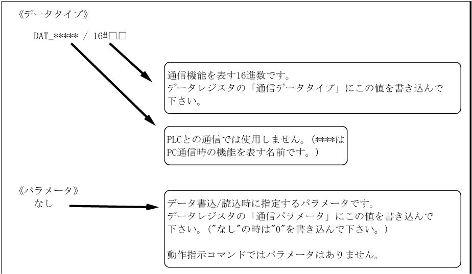

> **図の内容**
>
> PLC(ProConOS/C言語ソフト)との通信時の、各項目の読み方。
> - 《データタイプ》`DAT_***** / 16#□□`
>   - `16#□□`: 通信機能を表す16進数。データレジスタの「通信データタイプ」にこの値を書き込む。
>   - `DAT_*****`: PLCとの通信では使用しない（PC通信時の機能を表す名前）。
> - 《パラメータ》: データ書込/読込時に指定するパラメータ。データレジスタの「通信パラメータ」に書き込む（"なし"の時は"0"を書き込む）。動作指示コマンドではパラメータはない。

(TB00-1047)

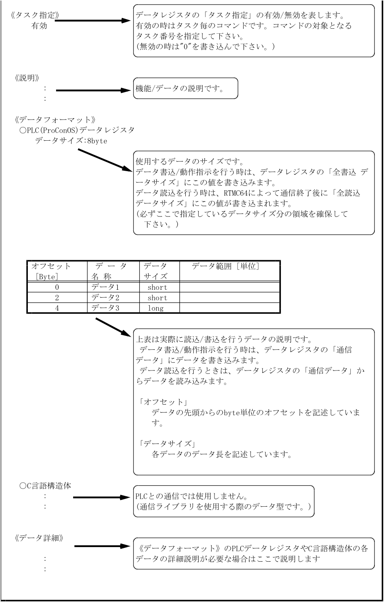

> **図の内容**
>
> - 《タスク指定》: データレジスタの「タスク指定」の有効/無効を表す。有効の時はタスク毎のコマンドで、対象タスク番号を指定する（無効の時は"0"を書き込む）。
> - 《説明》: 機能/データの説明。
> - 《データフォーマット》○PLC(ProConOS)データレジスタ
>   - 「データサイズ:8byte」: 使用するデータのサイズ。データ書込/動作指示時はデータレジスタの「全書込データサイズ」にこの値を書き込む。データ読込時は通信終了後にRTMC64が「全読込データサイズ」にこの値を書き込む。必ずこのサイズ分の領域を確保すること。
>   - 表（オフセット[Byte]／データ名称／データサイズ／データ範囲[単位]、例: 0 データ1 short、2 データ2 short、4 データ3 long）: 実際に読込/書込を行うデータ。書込/動作指示時はデータレジスタの「通信データ」に書き込み、読込時は「通信データ」から読み込む。「オフセット」はデータ先頭からのbyte単位のオフセット、「データサイズ」は各データのデータ長。
> - ○C言語構造体: PLCとの通信では使用しない（通信ライブラリ使用時のデータ型）。
> - 《データ詳細》: PLCデータレジスタやC言語構造体の各データの詳細説明が必要な場合に記述する。

### 3-2.ＰＣアプリケーション（通信ライブラリを使用）との通信に使用する場合

以下の説明は「通信ライブラリリファレンスマニュアル(TB00-1043)」と共にお読み下さい。

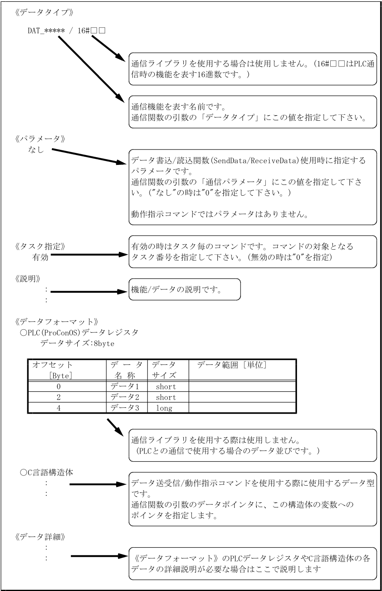

> **図の内容**
>
> 通信ライブラリを使用するPCアプリでの、各項目の読み方。
> - 《データタイプ》`DAT_***** / 16#□□`
>   - `DAT_*****`: 通信機能を表す名前。通信関数の引数「データタイプ」にこの値を指定する。
>   - `16#□□`: 通信ライブラリ使用時は使用しない（PLC通信時の機能を表す16進数）。
> - 《パラメータ》: データ書込/読込関数(SendData/ReceiveData)使用時に指定するパラメータ。通信関数の引数「通信パラメータ」に指定する（"なし"の時は"0"）。動作指示コマンドではパラメータはない。
> - 《タスク指定》: 有効の時はタスク毎のコマンドで、対象タスク番号を指定する（無効の時は"0"を指定）。
> - 《説明》: 機能/データの説明。
> - 《データフォーマット》○PLC(ProConOS)データレジスタ: 通信ライブラリ使用時は使用しない（PLC通信で使用する場合のデータ並び）。
> - ○C言語構造体: データ送受信/動作指示コマンドで使用するデータ型。通信関数の引数のデータポインタに、この構造体変数へのポインタを指定する。
> - 《データ詳細》: PLCデータレジスタやC言語構造体の各データの詳細説明が必要な場合に記述する。

## 4.通信データ詳細説明

### 4-1.データ送受信機能詳細

データ送受信機能は、PLCやPCアプリよりRTMC64に各種データの設定/読出を行う機能です。 PLCとの通信はPLCデータレジスタを使用してRTMC64へ送信(書込)/受信(読出)を行います。 PCアプリとの通信は通信ライブラリのSendData()/ReceiveData()関数を使用して、RTMC64へ送信(書込)/受信(読出)を行います。

#### 4-1-1.サーボパラメータ書込/読出 [DAT_PARAMETER / 16#00]

**《データタイプ》**

DAT_PARAMETER / 16#00

**《パラメータ》**

なし

**《タスク指定》**

無効

**《説明》**

RTMC64にサーボパラメータ書込/読出を行います。

サーボパラメータ書込は、RTMC64の動作モードがセッティングモードの時に実行できます。

**《書き込み実行条件》**

・全タスクセッティングモード

- 《読み出し実行条件》

常に実行可能です。

**《データフォーマット》**

○PLCデータレジスタ

データサイズ:9080byte(4540WORD)

| オフセット [Byte]   | データ名称   | データサイズ   | データ範囲 [単位]   |
|----------------|-------------|-----------|--------------|
| 0～ 139         | 第1軸サーボパラメータ | 140byte   | -            |
| 140～ 279       | 第2軸サーボパラメータ | 140byte   | -            |
| 280～ 419       | 第3軸サーボパラメータ | 140byte   | -            |
| 420～ 559       | 第4軸サーボパラメータ | 140byte   | -            |
| 560～ 699       | 第5軸サーボパラメータ | 140byte   | -            |
| 700～ 839       | 第6軸サーボパラメータ | 140byte   | -            |
| 840～ 979       | 第7軸サーボパラメータ | 140byte   | -            |
| 980～1119       | 第8軸サーボパラメータ | 140byte   | -            |
| 1120～1259      | 第9軸サーボパラメータ | 140byte   | -            |

次ページに続く

| オフセット [Byte]   | データ名称    | データサイズ   | データ範囲 [単位]   |
|----------------|--------------|-----------|--------------|
| 1260～1399      | 第10軸サーボパラメータ | 140byte   | -            |
| :              | :            |           | -            |
| :              | :            |           | -            |
| :              | :            |           | -            |
| 8260～8399      | 第60軸サーボパラメータ | 140byte   | -            |
| 8400～8539      | 第61軸サーボパラメータ | 140byte   | -            |
| 8540～8679      | 第62軸サーボパラメータ | 140byte   | -            |
| 8680～8819      | 第63軸サーボパラメータ | 140byte   | -            |
| 8820～8959      | 第64軸サーボパラメータ | 140byte   | -            |
| 8960～9079      | 予備           | 120byte   | -            |

各軸のサーボパラメータのフォーマットは以下です。

| オフセット [Byte]   | データ名称           | データサイズ   | データ範囲         |        | [単位]             |             |
|----------------|---------------------|-----------|---------------|--------|------------------|-------------|
| 0+140*N        | INPOS量              | long      | 0             | ～      | 10000            | [pulse]     |
| 4+140*N        | 偏差上限値               | long      | 100           | ～      | 100000           | [pulse]     |
| 8+140*N        | MPOS偏差上限値 (予備)      | long      | 100           | ～      | 100000           | [pulse]     |
| 12+140*N       | 補間時定数               | long      | -2000×RTC周期   | ～      | 1000             | [msec]      |
| 16+140*N       | S字加減速時定数            | long      | 0             | ～      | 1000×RTC周期[msec] |             |
| 20+140*N       | PTP時定数              | long      | 0             | ～      | 6400             | [msec]      |
| 24+140*N       | PTP速度               | long      | 1000÷RTC周期    | ～      | 1000000000       | [pulse/sec] |
| 28+140*N       | JOG送り速度             | long      | 1000÷RTC周期    | ～      | 1000000000       | [pulse/sec] |
| 32+140*N       | +側ソフトリミット           | long      | 1             | ～      | 1000000000       | [pulse]     |
| 36+140*N       | -側ソフトリミット           | long      | 1             | ～      | 1000000000       | [pulse]     |
| 40+140*N       | 原点復帰方向              | long      | 0:無, 1:+2段,   |        | 2:-2段,           | 3:+1段,4:-1段 |
| 44+140*N       | 原点距離                | long      | -1000000000   | ～      | 1000000000       | [pulse]     |
| 48+140*N       | 原点復帰逃げ量             | long      | 1000          | ～      | 1000000000       | [pulse]     |
| 52+140*N       | 原点復帰早送り速度           | long      | 1000÷RTC周期    | ～      | 1000000000       | [pulse/sec] |
| 56+140*N       | 原点復帰アプローチ速度        | long      | 1000÷RTC周期    | ～      | 1000000000       | [pulse/sec] |
| 60+140*N       | 原点復帰最終サーチ速度        | long      | 1000÷RTC周期    | ～      | 1000000000       | [pulse/sec] |
| 64+140*N       | 原点復帰順位              | long      | 0～軸数-1        | 0～軸数-1 | 0～軸数-1           | 0～軸数-1      |
| 68+140*N       | ホームポジション            | long      | -1000000000 ～ |        | 1000000000       | [pulse]     |
| 72+140*N       | ホームポジション位置決め順位     | long      | 0～軸数-1        | 0～軸数-1 | 0～軸数-1           | 0～軸数-1      |
| 76+140*N       | バックラッシュ補正量          | long      | 0 ～           |        | 30000            | [pulse]     |
| 80+140*N       | 形状補正係数              | long      | 0             | ～      | 30000            | [pulse]     |
| 84+140*N       | 原点復帰時論理座標           | long      | -1000000000   | ～      | 1000000000       | [pulse]     |
| 88+140*N       | ジョイステック/ハンドル最大送り速度 | long      | 1             | ～      | 4000000          | [pulse/sec] |
| 92+140*N       | ジョイステック/ハンドル加減速時定数 | long      | 0 ～           |        | 1000 [ms]        |             |
| 96+140*N       | 予備                 | byte*44   | -             | -      | -                | -           |

※1 Nは(軸番号-1)です。(第1軸:N=0 ～第64軸:N=63)

単位

**○C言語構造体**

```c
/************************************************************************/
/* パラメータデータ構造体(9080バイト固定長) */
/************************************************************************/
typedef struct {                   /* 各軸独立パラメータ構造体(140バイト固定長) */
    long InPos;                    /* ＩＮＰＯＳ量 [pls] */
    long ErMax;                    /* 偏差上限値 [pls] */
    long MPosErMax;                /* ＭＰＯＳ偏差上限値 [pls] */
    long Ka;                       /* 補間時定数 [msec] */
    long SKa;                      /* Ｓ字補間時定数 [msec] */
    long Dx;                       /* ＰＴＰ時定数 [msec] */
    long PtpFeed;                  /* ＰＴＰ速度 [pls/sec] */
    long JogFeed;                  /* ＪＯＧ送り速度 [pls/sec] */
    long SoftLimP;                 /* ソフトリミット＋側 [pls] */
    long SoftLimM;                 /* ソフトリミット－側 [pls] */
    long OrgDir;                   /* 原点復帰方向 */
    long OrgOfs;                   /* 原点距離 [pls] */
    long OrgPos;                   /* 原点復帰逃げ位置 [pls] */
    long OrgFeed;                  /* 原点復帰早送り速度 [pls/sec] */
    long AprFeed;                  /* 原点復帰アプローチ速度 [pls/sec] */
    long SrchFeed;                 /* 原点復帰最終サーチ速度 [pls/sec] */
    long OrgPri;                   /* 原点復帰順位 */
    long Homepos;                  /* ﾎｰﾑﾎﾟｼﾞｼｮﾝ位置 [pls] */
    long Homepri;                  /* ﾎｰﾑﾎﾟｼﾞｼｮﾝ順位 */
    long BackL;                    /* バックラッシュ補正量 [pls] */
    long Revise;                   /* 形状補正係数 */
    long OrgCsetOfs;               /* 原点復帰時論理座標 */
    long handle_max;               /* ｼﾞｮｲｽﾃｨｯｸ/ﾊﾝﾄﾞﾙ最大送り速度 */
    long handle_ka;                /* ｼﾞｮｲｽﾃｨｯｸ/ﾊﾝﾄﾞﾙ加減速時定数 */
    unsigned char Reserved[44];    /* 未使用 */
} AXIS_PARAMETER;
typedef struct {                   /* 特殊パラメータ共用体(120バイト) */
    unsigned char Reserved[120];   /* 特殊パラメータ未定義 */
} ADD_PARAMETER;
typedef struct {                   /* (1720バイト) */
    AXIS_PARAMETER AxisParam[64];  /* 各軸パラメータ */
    ADD_PARAMETER adp;             /* 特殊パラメータ */
} PARAMETER_DATA;
```

[pls]: パルス

[msec]: 秒/1000

[pls/sec]: パルス/秒

次のオプションを使用するときはパラメータの一部が専用の設定になります。「①位置制御パラメータ」と同時に次の章も参照下さい。

| 使用するオプション   | 参照する章       |
|-------------|-------------|
| 同一指令2軸制御    | ②同期軸パラメータ   |
| 接線制御        | ③接線制御軸パラメータ |

**《データ詳細》**

※ サーボパラメータ詳細については「RTMC64-M3/ECユーザーズマニュアル」<Ⅲ試運転・調整編 4.サーボパラメータ(TB00-1040H)を参照ください。

① サーボパラメータ

- (1) INPOS量

インポジションの範囲を、パルス単位の絶対値量で指定します。

- (2) 偏差上限値

偏差の絶対量の上限値を指定します。

エラーパルスレジスタ(ER)が本設定値を越えた場合、偏差過大アラームとなります。

- (3) MPOS偏差上限値
- (4) 補間時定数

- ※ RTMC64-M3 : 将来用です。現在使用していません。

RTMC64-EC : このパラメータはありません。(unsigned char Resered0[4]になっています)

補間移動時の指数型加減速の時定数を指定します。

直線加減速オプション有りの時、マイナスの値を入れることで、直線加減速時定数になります。

- (5) S字加減速時定数 <オプション>

S字加減速の時定数を設定します。

S字加減速の詳細については「RTMC64-M3/EC ユーザーズマニュアル(TB00-1040E)」<Ⅱ 機能編 5-3.補間加減速>を参照下さい。

- (6) PTP時定数

PTP移動時、及びJOG移動時の直線加減速の時定数を指定します。

移動速度 100K[pls/sec] に達するまでの時間、またはPTP速度(PARAMETER_DATA.AxisParam[n].PtpFeed) に達するまでの時間で設定します。

100K[pls/sec] に達するまでの時間かPTP速度に達するまでの時間かの選択はROMSWで設定します。（ROMSW設定ソフトの基本画面の「PTP時定数PTP速度基準」にて設定して下さい。）

- (7) PTP速度

PTP移動時の速度を指定します。

- (8) JOG速度

JOG移動時の速度を指定します。

- (9) ±ソフトリミット

ソフトウェアストロークリミットを、各方向(+/-)別に指定します。

ポジション値が本設定値を越えた場合、ソフトリミットアラームとなります。

- (10) 原点復帰方向

原点復帰動作の有無、及び有りの場合の原点復帰方向を指定します。

- (11) 原点距離

C(Z)相パルス位置から機械原点までのオフセット量を指定します。(原点距離設定値が+の場合は原点復帰

方向、－の場合は原点復帰と逆方向に最終移動を行います。)

- (12) 原点復帰逃げ量

全軸原点復帰時の、機械原点位置からの逃げ量を指定します。

- (13) 原点復帰早送り速度

原点復帰処理にて、原点LSまでの速度を指定します。

- (14) 原点復帰アプローチ速度

原点復帰処理にて、原点LSを通過して、原点へアプローチを行う際の速度を指定します。

- (15) 原点復帰最終サーチ速度原点復帰処理にて、原点LSの確認後の原点信号を探す際の速度を指定します。
- (16) 原点復帰順位

全軸原点復帰を行う際の原点復帰順位を指定します。

- (17) ホームポジション

ホームポジションを指定します。(機械座標系の位置で指定して下さい。)

- (18) ホームポジション位置決め順位ホームポジション位置決めする順番を0からの連番で設定します。
- (19) バックラッシュ補正量

モータ回転方向変化時の、バックラッシュの補正量を指定します。

- (20) 形状補正係数 <オプション>

詳細は「RTMC64-M3/ECユーザーズマニュアル」<Ⅱ機能編 5-17-5.形状補正(高精度輪郭制御)>

- 形状補正(サーボアンプの遅れの補正)のゲインを設定します。 (TB00-1040D)を参照ください。
- (21) 原点復帰時論理座標原点復帰完了時に設定する論理座標を指定します。
- (22) ｼﾞｮｲｽﾃｨｯｸ/ﾊﾝﾄﾞﾙ最大送り速度

手動パルス送り時の最大速度を指定します。

- (23) ｼﾞｮｲｽﾃｨｯｸ/ﾊﾝﾄﾞﾙ加減速時定数

手動パルス送り時の加速/減速の時定数を指定します。

② 同期軸(従軸) <オプション(同一指令2軸制御)> の場合

同期軸従軸は「INPOS量」「±ソフトリミット」「原点距離」「バックラッシュ補正量」のパラメータ設定だけ反映されて、それ以外のパラメータは基準軸のパラメータを使用します。 ※ 使用されないパラメータに関しても範囲チェックを行いますので、基準軸と同じ値を設定する

ようにして下さい。

同一指令2軸制御の時は、「原点距離」は原点復帰完了時に基準軸と従軸が同じ場所に来るように調整し

て下さい。

上記以外のパラメータについては、「①位置制御軸パラメータ」を参照して下さい。

③ 接線制御軸 <オプション> の場合

以下のパラメータは特別な意味を持ちます。

- (1) +方向ソフトリミット

接線制御軸の接線速度上限速度を指定します。

設定値は、1000～1000000000[pulse/sec]です。

- (2) -方向ソフトリミット

接線制御軸の接線制御基準位置を指定します。

設定値は、0～メカ機構1回転パルス数[パルス]です。

#### 4-1-2.運転プログラム書込/読出 [DAT_PROGRAM / 16#01)]

**《データタイプ》**

DAT_PROGRAM / 16#01

**《パラメータ》**

読み出し時はプログラム番号を指定します。

（プログラム番号：1～32767）

書き込み時はプログラム番号と書き込む先頭ブロック番号を指定します。

（先頭ブロック番号：0～63、プログラム番号：1～32767）

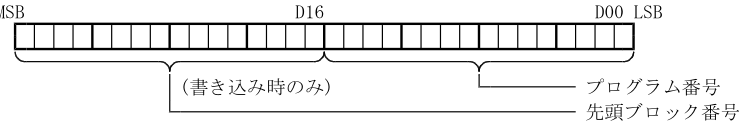

> **図の内容**
>
> パラメータ(32bit)の構成:
>
> | ビット | 内容 |
> |---|---|
> | D00～D15（下位16bit） | プログラム番号 |
> | D16～D31（上位16bit） | 先頭ブロック番号（書き込み時のみ） |

**《タスク指定》**

有効

**《説明》**

運転プログラムを、RTMC64のプログラムメモリに書込/読出します。

書込/読出する運転プログラムは、テクノ独自フォーマットのバイナリデータです。お客様が使用するテキストプログラム ←→ バイナリデータ間の変換には、プログラム変換ライブラリを使用する必要があります。(※テクノコード変換ライブラリとGコード変換ライブラリがあります。両方さしてプログラム変換ライブラリと呼びます。)

- プログラム書き込み時

[テキストプログラム] → プログラム変換ライブラリ → [バイナリデータ]

- → 通信ライブラリ(運転プログラム書込コマンド) → RTMC64
- → 通信ライブラリ(運転プログラム読出コマンド) → [バイナリデータ]
- → プログラム変換ライブラリ → [テキストプログラム]

尚、プログラム書き込み時は上記《パラメータ》にて先頭ブロック番号を指定する必要があります。

先頭ブロック番号、プログラムメモリの容量や番号管理については、「RTMC64-M3/EC ユーザーズマニュ

アル(TB00-1040F) <Ⅱ 機能編 6-1．運転プログラムの保存の仕組み> 」を参照下さい。

**《書き込み実行条件》**

- 指定したプログラム番号が未実行
- 《読み出し実行条件》

常に実行可能です。

**《データフォーマット》**

**○PLCデータレジスタ**

データサイズ:最大98304WORD(196608byte)

|   オフセット [Byte] | データ名称    | データサイズ       | データ範囲 [単位]   |
|----------------|--------------|---------------|--------------|
|              0 | バイナリデータバッファ | 最大 196608byte | -            |

- ○C言語構造体構造体定義はありません。

**《データ詳細》**

- (1) 運転プログラムバイナリデータバッファ

バイナリデータサイズはプログラムステップ数により変わりますが、最大容量分確保して下さい。

- プログラム読み出し時 RTMC64

#### 4-1-3.DNCデータ書込 [DAT_DNCDATA / 16#0E] <オプション>

**《データタイプ》**

DAT_DNCDATA / 16#0E

**《パラメータ》**

先頭/継続フラグ(0:先頭、1:継続)

**《タスク指定》**

有効

**《説明》**

DNC運転プログラムを、RTMC64のプログラムメモリに書き込みます。 DNCデータ書込コマンドの実行には、DNC運転オプションが必要です。 DNCデータ書込コマンドで書き込む運転プログラムはテクノ独自フォーマットのバイナリーデータです。テキストフォーマットの運転プログラムは「テクノコード変換ライブラリ」か「Gコード変換ライブラ

リ」のプログラム変換ライブラリを利用して、テキスト運転プログラムからテクノ独自フォーマットのバ

イナリーデータにして下さい。

**《書き込み実行条件》**

- DNC運転モード
- データサイズがDNCバッファの空き容量以下

**《読み出し実行条件》**

読み出し不可

**《データフォーマット》**

「4-1-2. 運転プログラム書込/読出」と同様です。

#### 4-1-4.ピッチエラー補正用データ書込/読出 [DAT_PITCHERR / 16#10] <オプション>

**《データタイプ》**

DAT_PITCHERR / 16#10

**《パラメータ》**

なし

**《タスク指定》**

無効

**《説明》**

ピッチエラー補正用データの書込/読出を行います。

ピッチエラー補正用データ書込/読出コマンドの実行には、ピッチエラー補正オプションが必要です。

**《書き込み実行条件》**

- 全タスクセッティングモード

**《読み出し実行条件》**

常に実行可能です。

**《データフォーマット》**

○PLCデータレジスタ

データサイズ:34560byte(17280WORD)

| オフセット [Byte]   | オフセット [Byte]   | データ名称   | データサイズ   | データ範囲 [単位]   |
|----------------|----------------|-------------|-----------|--------------|
| 0～19           | 0～19           | 第 1軸補正用データ  | 20byte    | -            |
| 20～39          | 20～39          | 第 2軸補正用データ  | 20byte    | -            |
| 40～59          | 40～59          | 第 3軸補正用データ  | 20byte    | -            |
| 60～79          | 60～79          | 第 4軸補正用データ  | 20byte    | -            |
| 80～99          | 80～99          | 第 5軸補正用データ  | 20byte    | -            |
| 100～119        | 100～119        | 第 6軸補正用データ  | 20byte    | -            |
| 120～139        | 120～139        | 第 7軸補正用データ  | 20byte    | -            |
| 140～159        | 140～159        | 第 8軸補正用データ  | 20byte    | -            |
| 160～179        | 160～179        | 第 9軸補正用データ  | 20byte    | -            |
| 180～199        | 180～199        | 第10軸補正用データ  | 20byte    | -            |
| :              | :              | :           |           | -            |
| 1180～          | 599            | 第60軸補正用データ  | 20byte    | -            |
| 1200～          | 609            | 第61軸補正用データ  | 20byte    | -            |
| 1220～          | 619            | 第62軸補正用データ  | 20byte    | -            |
| 1240～          | 629            | 第63軸補正用データ  | 20byte    | -            |
| 1260～          | 639            | 第64軸補正用データ  | 20byte    | -            |
| 1280～34559     | 1280～34559     | 補正用データ      | 33280byte | -            |

各軸補正用データのフォーマットは以下の通りです。

| オフセット番号 [Byte]   | データ名称   | データサイズ   | データ範囲 [単位]          |
|------------------|-------------|-----------|---------------------|
| 0+20*N           | 補正倍率        | long      | 0～10                |
| 4+20*N           | 補正間隔        | long      | 1000～1000000[pulse] |
| 8+20*N           | 補正データ先頭番号   | long      | 0～8319              |
| 12+20*N          | -側補正区間数     | long      | 0～8320              |
| 16+20*N          | +側補正区間数     | long      | 0～8320              |

補正用データのフォーマットは以下の通りです。

| オフセット [Byte]   | データ名称   | データ長サイズ   | データ範囲 [単位]   |
|----------------|-------------|------------|--------------|
| 1280           | 補正データ1      | byte       | -127～127     |
| 1281           | 補正データ2      | byte       | -127～127     |
| ～              | ～           | ～          | ～            |
| 34558          | 補正データ33279  | byte       | -127～127     |
| 34559          | 補正データ33280  | byte       | -127～127     |

**○Ｃ言語構造体**

```c
/************************************************************************/
/* ピッチエラー補正用パラメータ情報構造体（34560バイト固定長） */
/************************************************************************/
typedef struct {               /* 各軸補正用パラメータ（20バイト） */
    unsigned long RevMagnify;  /* 補正倍率 */
    unsigned long RevSpace;    /* 補正間隔 */
    unsigned long RevTopNo;    /* 補正データ先頭番号 */
    unsigned long RevMCnt;     /* -側補正区間数 */
    unsigned long RevPCnt;     /* +側補正区間数 */
} REV_AX;
typedef struct {               /* ピッチエラー補正用パラメータ */
    REV_AX RevAx[64];          /* 各軸補正用パラメータ */
    char RevDt[33280];         /* 補正データ */
} PITCH_ERR_REV;
```

#### 4-1-5.工具長補正データ書込/読出 [DAT_TOOLHOFS / 16#12] <オプション>

**《データタイプ》**

DAT_TOOLHOFS / 16#12

**《パラメータ》**

0 : 《タスク指定》で指定された1タスク分のみ書込/読出

1 : 全タスク(8タスク)分書込/読出

**《タスク指定》**

1 タスク分書込/読出時:有効

全タスク分書込/読出時:無効

**《説明》**

工具長補正用データの書込/読出を行いますす。

工具長補正用データ書込/読出コマンドの実行には、工具長補正オプションが必要です。

**《書き込み実行条件》**

・セッティングモード（全タスク分書込時は全タスク）

**《読み出し実行条件》**

常に実行可能です。

**《データフォーマット》**

○PLCデータレジスタ

データサイズ:80byte(40WORD)（１タスク分）

|   オフセット [Byte] | データ名称   | データサイズ   | データ範囲 [単位]                     |
|----------------|-------------|-----------|--------------------------------|
|              0 | 補正用データ0     | long      | -1000000000～1000000000 [pulse] |
|              4 | 補正用データ1 ：   | long      | -1000000000～1000000000 [pulse] |
|             72 | ：補正用データ18  | long      | -1000000000～1000000000 [pulse] |
|             76 | 補正用データ19    | long      | -1000000000～1000000000 [pulse] |

データサイズ:640byte(320WORD)（全タスク分）

| オフセット号 [Byte]   | デー   | タ名称   | データサイズ   | データ範囲 [単位]   |
|------------------|-------|---------|-----------|--------------|
| 0～ 79            | タスク0用 | 補正データ   | 80byte    | －            |
| 80～159           | タスク1用 | 補正データ   | 80byte    | －            |
| 160～239          | タスク2用 | 補正データ   | 80byte    | －            |
| 240～319          | タスク3用 | 補正データ   | 80byte    | －            |
| 320～399          | タスク4用 | 補正データ   | 80byte    | －            |
| 400～479          | タスク5用 | 補正データ   | 80byte    | －            |
| 480～559          | タスク6用 | 補正データ   | 80byte    | －            |
| 560～639          | タスク7用 | 補正データ   | 80byte    | －            |

**○Ｃ言語構造体**

```c
/************************************************************************/
/* 工具長補正用パラメータ情報構造体 */
/************************************************************************/
typedef struct {
    long h[20];  /* 工具長補正データ */
} TOOL_H;
```

※ 全タスク分の時は、TOOL_H の要素数8の配列で定義して下さい。

#### 4-1-6.ステータスデータ読出 [DAT_STATUS / 16#02]

**《データタイプ》**

DAT_STATUS / 16#02

**《パラメータ》**

なし

**《説明》**

RTMC64の動作状態(アラーム状態を含む)や各軸の現在値などのデータを読み出します。有効軸以外の軸のデータは無効データです。

**《読み出し実行条件》**

常に実行可能です。

**《データフォーマット》**

○PLCデータレジスタ

データサイズ:3344BYTE(1672WORD)

| オフセット [Byte]   | データ名   | 称データサイズ   | データ範囲 [単位]   |
|----------------|-----------|-------------|--------------|
| 0～ 15          | 全体情報      | 16byte      | -            |
| 16～ 63         | 第 1軸情報    | 48byte      | -            |
| 64～ 111        | 第 2軸情報    | 48byte      | -            |
| 112～ 159       | 第 3軸情報    | 48byte      | -            |
| 160～ 207       | 第 4軸情報    | 48byte      | -            |
| 208～ 255       | 第 5軸情報    | 48byte      | -            |
| 256～ 303       | 第 6軸情報    | 48byte      | -            |
| 304～ 351       | 第 7軸情報    | 48byte      | -            |
| 352～ 399       | 第 8軸情報    | 48byte      | -            |
| 400～ 447       | 第 9軸情報    | 48byte      | -            |
| 448～ 595       | 第10軸情報    | 48byte      | -            |
| :              | :         | :           | -            |
| 2848～1447      | 第60軸情報    | 48byte      | -            |
| 2896～1471      | 第61軸情報    | 48byte      | -            |
| 2944～1495      | 第62軸情報    | 48byte      | -            |
| 2992～1519      | 第63軸情報    | 48byte      | -            |
| 3040～1543      | 第64軸情報    | 48byte      | -            |
| 3088～3119      | タスク0情報    | 32byte      | -            |
| 3120～3151      | タスク1情報    | 32byte      | -            |
| 3152～3183      | タスク2情報    | 32byte      | -            |
| 3184～3215      | タスク3情報    | 32byte      | -            |
| 3216～3247      | タスク4情報    | 32byte      | -            |
| 3248～3279      | タスク5情報    | 32byte      | -            |
| 3280～3311      | タスク6情報    | 32byte      | -            |
| 3312～3343      | タスク7情報    | 32byte      | -            |

第1軸～第64軸は、物理軸の番号です。

全体情報のフォーマットは以下の通りです。

| オフセット [Byte]   | データ名称   | データサイズ   | データ範囲 [単位]   |
|----------------|-------------|-----------|--------------|
| 0              | 全体ステータス     | long      | -            |
| 4              | 全体アラーム      | long      | -            |
| 8～15           | 予約          | byte*8    | -            |

物理第(N+1)軸情報のフォーマットは以下の通りです。

| オフセット [Byte]   | データ名称    | データサイズ   | データ範囲 [単位]                    |
|----------------|--------------|-----------|-------------------------------|
| 16+48*N        | 軸ステータス       | long      | -                             |
| 20+48*N        | 軸アラーム        | long      | -                             |
| 24+48*N        | 指令位置         | long      | -1000000000～1000000000[pulse] |
| 28+48*N        | 機械位置         | long      | -1000000000～1000000000[pulse] |
| 32+48*N        | 偏差量          | long      | -1000000000～1000000000[pulse] |
| 36+48*N        | 最新ブロック払出量 ※1 | long      | -1000000000～1000000000[pulse] |
| 40+48*N        | 絶対位置 ※2      | long      | -1000000000～1000000000[pulse] |
| 44+48*N        | トルク          | long      | -200～ 200[%]                  |
| 48～63+48*N     | 予約           | byte*16   | -                             |

Nは軸番号-1です。(第1軸:0 ～第64軸:63)

- ※1 原点復帰の完了時は、「原点ドグ」と「C(Z)相位置」との距離(パルス)が返ります。
- ※2 モータへの指令座標を読み出すのか、モータからのFB座標を読み出すのかをROMSW設定ソフトで選択します。

タスクN情報のフォーマットは以下の通りです。

| オフセット [Byte]         | データ名称     | データサイズ   | データ範囲 [単位]   |
|----------------------|---------------|-----------|--------------|
| 3088+32*N            | タスクステータス      | long      | -            |
| 3092+32*N            | タスクアラーム       | long      | -            |
| 3096+32*N            | 送りオーバーライド     | short     | 0～200[%]     |
| 3098+32*N            | 補間オーバーライド     | short     | 0～200[%]     |
| 3100+32*N            | 主軸オーバーライド     | short     | 0～200[%]     |
| 3102+32*N            | 実行プログラム番号     | short     | 1～32767[-]   |
| 3104+32*N            | 実行プログラムステップ番号 | long      | 1～3300[-]    |
| 3108+32*N ～3119+32*N | 予約            | byte*12   | -            |

Nはタスク番号です。(タスク0 ～タスク7)

- (注)本データはPLCのラダーから固定領域Readが可能です。

アドレス(オフセット)等の詳細は、

「RTMC64-M3/EC ユーザーズマニュアル Ⅱ 機能編(TB00-1040E)」<4.ラダー(PLC)インタフェイス>を参照下さい。

**○C言語構造体**

```c
/************************************************************************/
/* アンサーステータス情報構造体(3344バイト) */
/************************************************************************/
typedef struct {           /* 全体情報構造体 １６バイト */
    long Status;           /* 全体ステータス */
    long Alarm;            /* 全体アラーム */
    char Reserved[8];      /* 予約 */
} MCSTATUS;
typedef struct {           /* 各軸情報構造体 ４８バイト */
    long AxStatus;         /* 軸ステータス */
    long AxAlarm;          /* 軸アラーム */
    long ComReg;           /* 指令位置 */
    long PosReg;           /* 機械位置 */
    long ErrReg;           /* 偏差量 */
    long BlockSeg;         /* 最新ブロック払い出し量 */
    long AbsReg;           /* 絶対位置 */
    long Trq;              /* トルク */
    char Reserved[16];     /* 予約 */
} AXSTATUS;
typedef struct {           /* タスクス情報構造体３２バイト */
    long TaskStatus;       /* タスクステータス */
    long TaskAlarm;        /* タスクアラーム */
    short Override;        /* 送りオーバーライド設定 */
    short COverride;       /* 補間オーバーライド設定 */
    short SOverride        /* 主軸オーバーライド設定 */
    short ProgramNo;       /* 選択・実行プログラム番号 */
    unsigned long StepNo;  /* 実行ステップ番号 */
    char Reserved[12];     /* 予約 */
} TASKSTATUS;
typedef struct {           /* アンサーステータス情報構造体 */
    MCSTATUS mc;           /* 全体情報 */
    AXSTATUS ax[64];       /* 各軸情報 */
    TASKSTATUS task[8];    /* タスク情報 */
} STATUS;
```

**《データ詳細》**

(1) 全体情報

① 全体ステータス

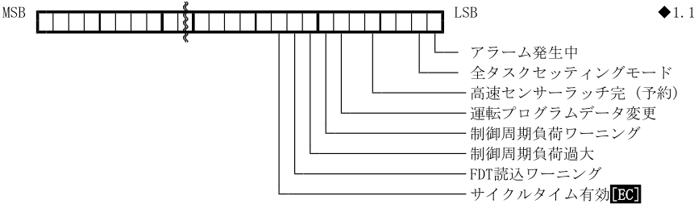

> **図の内容**
>
> 全体ステータス(long)のビット割り当て（図中の◆1.1は改訂マーク）:
>
> | ビット | 内容 |
> |---|---|
> | D0 | アラーム発生中 |
> | D1 | 全タスクセッティングモード |
> | D4 | 高速センサーラッチ完（予約） |
> | D6 | 運転プログラムデータ変更 |
> | D7 | 制御周期負荷ワーニング |
> | D8 | 制御周期負荷過大 |
> | D9 | FDT読込ワーニング |
> | D10 | サイクルタイム有効 [EC] |
>
> 上記以外のビットは未使用。

**《全体ステータス詳細》**

- アラーム発生中

全タスクの全軸の中で、何らかのアラームが1つでも発生しているとONします。

- 全タスクセッティングモード

全タスクがセッティングモードになっているとONします。

- 高速センサーラッチ完 (予約) 旧システムで使用していた情報です。本システムでは対応していません。

本システムでは後述のタスクステータスの高速センサーラッチ完(D24)を使用して下さい。

- 運転プログラムデータ変更

運転プログラムが更新（ダウンロード/移動/削除/ティーチング）されるとON→OFFします。

（更新された直後のSTATUSデータ読み出し(ステータスデータ読込コマンド)のみONします。一度STATUSデータ読み出しを行うと、自動的にOFFします。）

- ※ PLCのデータレジスタへステータスデータ(オフセット24576～27919)では、本ビットはONしません。

通信ライブラリ及びラダー通信機能経由のSTATUSデータ読み出しでのみONします。

**○ 制御周期負荷ワーニング**

制御周期(MECHATROLINK-Ⅲ[M3](EtherCAT[EC])通信周期)の処理時間がROMSW設定（基本画面の「サーボ制御周期ワーニングレベル(%)」で設定）で設定された時間を超えるとONします。

後述の「制御周期負荷過大」とは異なり、制御周期を超えた訳ではないので、正常に動作しています。

ただし、制御周期の処理時間(負荷)は処理内容やタイミングにより増減しますので、余裕が少ないと制御周期に間に合わなくなってしまう可能性があります。

本ワーニングが発生したら制御周期を見直す（大きくする）事をお勧め致します。

制御周期(MECHATROLINK-Ⅲ[M3](EtherCAT[EC])通信周期)の処理時間が制御周期を超えると ONします。本ビットがONしたら制御周期を見直し（大きくする）して下さい。尚、本ビットがONした場合は、同時にMECHATROLINK-Ⅲ[M3](EtherCAT[EC])通信関連のエラーや

- 制御周期負荷過大サーボアンプのアラームが発生する可能性が高くなります。

○ FDT読込ワーニング FDTファイルデータの読み込みエラーが発生しました。自動修復が可能なエラーなので、自動的に修復しました。

② 全体アラーム

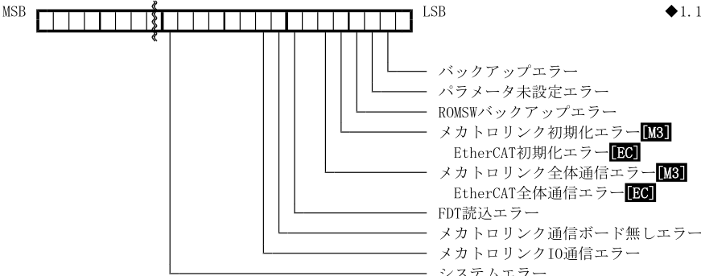

> **図の内容**
>
> 全体アラーム(long)のビット割り当て（図中の◆1.1は改訂マーク）:
>
> | ビット | 内容 |
> |---|---|
> | D1 | バックアップエラー |
> | D2 | パラメータ未設定エラー |
> | D3 | ROMSWバックアップエラー |
> | D4 | メカトロリンク初期化エラー [M3] ／ EtherCAT初期化エラー [EC] |
> | D5 | メカトロリンク全体通信エラー [M3] ／ EtherCAT全体通信エラー [EC] |
> | D7 | FDT読込エラー |
> | D8 | メカトロリンク通信ボード無しエラー |
> | D9 | メカトロリンクIO通信エラー |
> | D15 | システムエラー |
>
> 上記以外のビット（D0を含む）は未使用。

**《全体アラーム詳細》**

- バックアップエラーバックアップデータ（ROMSW設定以外の各種パラメータ/運転プログラム/各軸の原点の絶対値

エンコーダ座標）が消えてしまった場合に発生するエラーです。

- パラメータ未設定エラーパラメータ初期化を行うと発生するエラーです。（RTMC64ご購入時も発生しています。）
- ROMSWバックアップエラー ROMSW設定が消えてしまった場合に発生するエラーです。
- メカトロリンク初期化エラー[M3](EtherCAT初期化エラー[EC]) MECHATROLINK-Ⅲ(またはEtherCAT)通信の接続エラーが起きたときに発生するエラーです。
- メカトロリンク全体通信エラー[M3](EtherCAT全体通信エラー[EC]) 制御周期毎のMECHATROLINK-Ⅲ(またはEtherCAT)通信処理でエラーが起きたときに発生するエラーです。
- システムエラー通常は発生しないエラーです。

このエラーが発生した時はテクノまでご連絡下さい。

- FDT読込エラー

FDTファイルの読み込みエラーです。

RTMC64のプログラムが正常にインストールされていません。

- メカトロリンク通信ボード無しエラーメカトロリンク通信通信ボードがありません。
- メカトロリンクIO通信エラー

メカトロリンク通信の入出力ユニットの通信エラーです。

システムエラー

(2) 各軸情報

① 軸ステータス

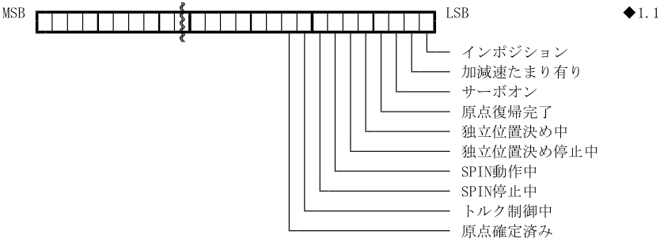

> **図の内容**
>
> 軸ステータス(long)のビット割り当て（図中の◆1.1は改訂マーク）:
>
> | ビット | 内容 |
> |---|---|
> | D0 | インポジション |
> | D1 | 加減速たまり有り |
> | D2 | サーボオン |
> | D3 | 原点復帰完了 |
> | D4 | 独立位置決め中 |
> | D5 | 独立位置決め停止中 |
> | D6 | SPIN動作中 |
> | D7 | SPIN停止中 |
> | D8 | トルク制御中 |
> | D9 | 原点確定済み |
>
> 上記以外のビットは未使用。

**《軸ステータス詳細》**

- インポジション

「軌跡発生完了/停止」かつ「偏差（指令位置－機械位置）がサーボパラメータの「INPOS量」以下」になった場合にONします。

詳細は後述の＜FG(軌跡関数発生)ステータスタイミングチャート＞を参照下さい。

※ INPOS量が"0"の場合はインポジションチェックは無効です。

インポジションチェックが無効の時は軌跡発生完了/停止と同時にONします。

**○ 加減速たまり有り**

補間加減速の加減速たまり(残移動量)があるとONします。

詳細は後述の＜FG(軌跡関数発生)ステータスタイミングチャート＞を参照下さい。

- サーボオン

サーボオン状態でONします。

**○ 原点復帰完了**

サーボオン後、原点復帰が完了するとONします。

サーボOFFまたは原点復帰開始時にOFFします。

(原点復帰無効時は常時ONしています。)

- ※ 原点復帰が完了したかどうかの履歴です。原点位置である事を示す訳ではありません。

ONした後は、どこへ移動してもONしたままです。

- 独立位置決め中

独立位置決め移動中にONします。

- 独立位置決め停止中

独立位置決め一時停止中にONします。(移動完了/中断時はONしません。)

**○ SPIN動作中**

SPIN移動中(回転速度指令中)にONします。

- SPIN動作中
- SPIN停止中(回転速度指令停止中)にONします。(移動完了/中断時はONしません。)
- トルク制御中トルク指令中にONします。

**○ 原点確定済み**

MECHATROLINK-ⅢまたはEtherCAT通信確立後、一度でも原点復帰が完了するとONします。 MECHATROLINK-ⅢまたはEtherCAT通信エラー発生時にOFFします。

(原点復帰無効時は常時ONしています。)

- ※ 原点復帰が完了したかどうかの履歴です。原点位置である事を示す訳ではありません。

ONした後は、どこへ移動してもONしたままです。

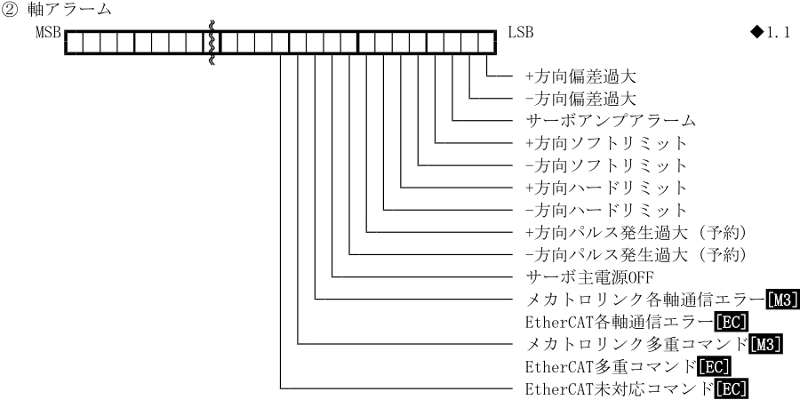

> **図の内容**
>
> 軸アラーム(long)のビット割り当て（図中の◆1.1は改訂マーク）:
>
> | ビット | 内容 |
> |---|---|
> | D0 | +方向偏差過大 |
> | D1 | -方向偏差過大 |
> | D2 | サーボアンプアラーム |
> | D3 | +方向ソフトリミット |
> | D4 | -方向ソフトリミット |
> | D5 | +方向ハードリミット |
> | D6 | -方向ハードリミット |
> | D7 | +方向パルス発生過大（予約） |
> | D8 | -方向パルス発生過大（予約） |
> | D9 | サーボ主電源OFF |
> | D10 | メカトロリンク各軸通信エラー [M3] ／ EtherCAT各軸通信エラー [EC] |
> | D11 | メカトロリンク多重コマンド [M3] ／ EtherCAT多重コマンド [EC] |
> | D12 | EtherCAT未対応コマンド [EC] |
>
> 上記以外のビットは未使用。

**《軸アラーム詳細》**

- +方向偏差過大/-方向偏差過大

偏差(指令位置-機械位置)がサーボパラメータの「偏差上限値」を超えると発生するエラーです。

- サーボアンプアラームサーボアンプのアラームが発生すると発生するエラーです。アラームの内容/原因/対策はサーボアンプのマニュアルをご参照下さい。
- +方向ソフトリミット/-方向ソフトリミット機械座標系の指令位置がサーボパラメータの「ソフトリミット」を超えると発生するエラーです。 ※ FG位置ではなく、指令位置でチェックします。

ただし、以下の何れかの条件に当てはまる場合はチェックしません。(OR条件)

- ソフトリミットチェック無効(ROMSW設定の軸設定画面の「ソフトリミット」設定)
- 主軸
- 原点復帰中のタスクに割り当てられている軸
- 原点復帰有効軸で原点未確定(前述の軸ステータスの原点確定済みフラグOFF)
- +方向ハードリミット/-方向ハードリミットハードリミット(OT:オーバートラベル)入力がONすると発生するエラーです。 ※ サーボアンプに入力しているハードリミット入力と、RTMC64のハードリミット入力（OTP/ OTM入力）のOR条件です。ただし、特別な理由がない場合はサーボアンプに入力して下さい。 ※ サーボアンプのハードリミット入力はMECHATROLINK-Ⅲ[M3](EtherCAT[EC])通信経由で
- 取得しています。（SVCMD_IO.P-OT / SVCMD_IO.N-OT ビット）
- +方向パルス発生過大/-方向パルス発生過大 (予約) 本システムでは発生しないエラーです。
- ※ サーボアンプの主電源入力ステータスはMECHATROLINK-Ⅲ[M3](EtherCAT[EC])通信経由で
- サーボ主電源OFF サーボアンプの主電源入力ステータスがOFFすると発生するエラーです。取得しています。（SVCMD_STAT.PONビット）
- メカトロリンク各軸通信エラー[M3](EtherCAT各軸通信エラー[EC]) MECHATROLINK-Ⅲ(またはEtherCAT)の各軸の通信エラーが発生すると発生するエラーです。

- メカトロリンク多重コマンド[M3](EtherCAT多重コマンド[EC])

RTMC64からサーボアンプに対するMECHATROLINK-Ⅲ[M3](またはEtherCAT[EC])コマンドの送信要求が複数起きると発生するエラーです。

通常は発生しないエラーですので、もし発生したらテクノまでご連絡下さい。（原因解明のため発生状況も詳しくご連絡ください。）

- ③ 物理第1軸～第64軸指令位置

論理座標系(※)における、RTMC64からサーボへ出力した指令位置です。

- ④ 物理第1軸～第64軸機械位置

論理座標系(※)における、サーボからのエンコーダFB値を積算した位置情報です。

- (※) 論理座標系は、原点設定コマンドにより、原点セットされます。
- ⑤ 物理第1軸～第64軸偏差量

指令位置と機械位置の差分です。

- ⑥ 物理第1軸～第64軸最新ステップ払出量

最新の移動指令で出力した移動量です。

- ※ 原点復帰完了時には、「原点ドグ」と「C(Z)相位置」との距離(パルス)が返ります。原点ドグ位置の調整に使用します。

「RTMC64-M3/EC ユーザーズマニュアルⅢ 試運転・調整編 7.実際の試運転・調整」 (TB00-1040H)を参照下さい。

- ⑦ 物理第1軸～第64軸絶対位置

機械座標系(機械原点を"0"点とした座標系)における、「指令した位置」または「エンコーダFB位置」です。

指令した位置かエンコーダFB位置なのかは、ROMSW設定（基本画面の「アブソ位置ステータス指令基準」設定）により選択します。

(3) タスク情報

- ① タスクステータス

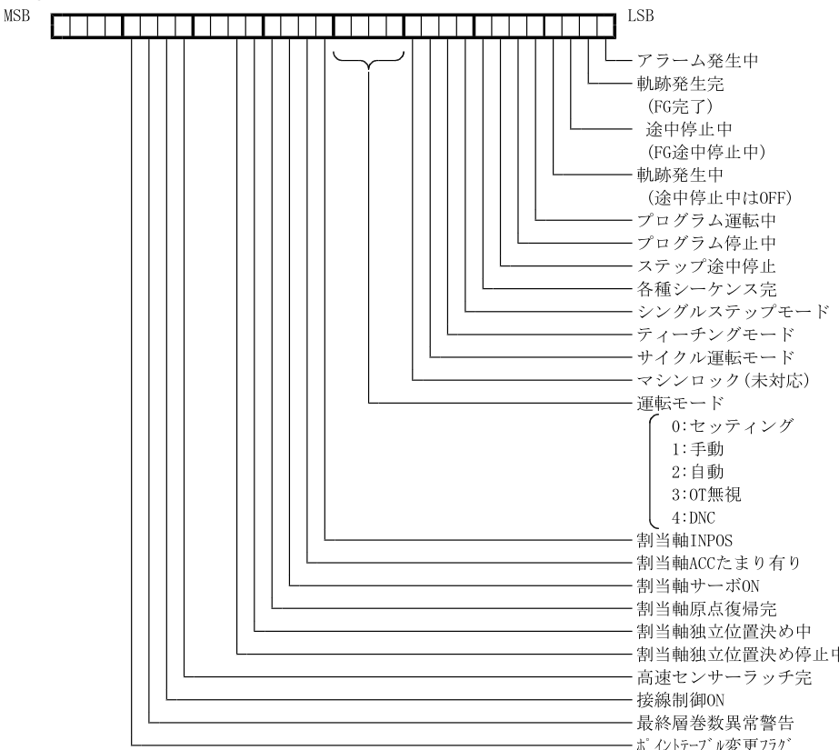

> **図の内容**
>
> タスクステータス(long)のビット割り当て:
>
> | ビット | 内容 |
> |---|---|
> | D0 | アラーム発生中 |
> | D1 | 軌跡発生完（FG完了） |
> | D2 | 途中停止中（FG途中停止中） |
> | D3 | 軌跡発生中（途中停止中はOFF） |
> | D4 | プログラム運転中 |
> | D5 | プログラム停止中 |
> | D6 | ステップ途中停止 |
> | D7 | 各種シーケンス完 |
> | D8 | シングルステップモード |
> | D9 | ティーチングモード |
> | D10 | サイクル運転モード |
> | D11 | マシンロック（未対応） |
> | D12～D15 | 運転モード（4bitの値: 0=セッティング、1=手動、2=自動、3=OT無視、4=DNC） |
> | D16 | 割当軸INPOS |
> | D17 | 割当軸ACCたまり有り |
> | D18 | 割当軸サーボON |
> | D19 | 割当軸原点復帰完 |
> | D20 | 割当軸独立位置決め中 |
> | D21 | 割当軸独立位置決め停止中 |
> | D24 | 高速センサーラッチ完 |
> | D25 | 接線制御ON |
> | D26 | 最終層巻数異常警告 |
> | D27 | ポイントテーブル変更フラグ |
>
> 上記以外のビット（D22、D23、D28～D31）は未使用。

**《タスクステータス詳細》**

- アラーム発生中
- タスク内でアラームが発生しているとONします。（タスクに割り当てられている軸がエラーになっている場合も含みます。）
- 軌跡発生完（FG完了）

PTP/LIN/CIR等の軌跡発生処理を行っていない（完了している）時にONします。

※ 途中停止中はOFFのままです。

また、軌跡発生完了後の補間加減速による減速中はONします。

詳細は後述の＜FG(軌跡関数発生)ステータスタイミングチャート＞を参照下さい。

- 途中停止中（FG途中停止中）

PTP/LIN/CIR等の軌跡発生処理を一時停止している時にONします。

※ 一時停止要求による停止中の時のみONします。

目標位置到達による移動終了／リセットやエラー発生による移動中断ではONしません。詳細は後述の＜FG(軌跡関数発生)ステータスタイミングチャート＞を参照下さい。

- 軌跡発生中（FG移動中） PTP/LIN/CIR等の軌跡発生処理中にONします。 ※ 途中停止中はOFFします。詳細は後述の＜FG(軌跡関数発生)ステータスタイミングチャート＞を参照下さい。
- プログラム運転中

プログラム運転実行中にONします。

ﾎﾟｲﾝﾄﾃｰﾌﾞﾙ変更ﾌﾗｸﾞ

- プログラム停止中

プログラム運転一時停止中にONします。

- ※ 一時停止要求や汎用入力待ち/停止命令（WRxx/WNRxx/SRxx/SNRxx）による停止中の時のみ ONします。

運転プログラムを最後まで実行した事による終了/リセットやエラー発生による中断では ONしません。

- ※ PCソフトやラダーからの一時停止要求がなくても、動作プログラムの汎用入力待ち/停止命令（WRxx/WNRxx/SRxx/SNRxx）による入力待ちでも本フラグがONしますのでご注意下さい。

**○ ステップ途中停止**

プログラム運転一時停止中で、かつプログラムのステップの途中（移動途中等）で停止している時にONします。

※ 動作プログラムの汎用入力待ち/停止命令（WRxx/WNRxx/SRxx/SNRxx）による入力待ちでも本フラグがONします

**○ 各種シーケンス完**

原点復帰等の各種シーケンス処理が実行されていないときにONします。

以下の条件が成立しているときにONします。(AND条件)

- FG完
- Mコード出力シーケンス未実行
- 原点復帰未実行
- ホーム位置決め未実行
- シングルステップモードシングルステップモード中にONします。
- ティーチングモードティーチングモード中にONします。
- サイクル運転モードサイクル運転モード中にONします。
- マシンロック（未対応）予約です。本システムではONしません。

**○ モード情報**

RTMC64の動作モードを4bitバイナリデータで示します。

|   D15 |   D14 |   D13 |   D12 |   値 | 動作モード     |
|-------|-------|-------|-------|-----|-----------|
|     0 |     0 |     0 |     0 |   0 | セッティングモード |
|     0 |     0 |     0 |     1 |   1 | 手動モード     |
|     0 |     0 |     1 |     0 |   2 | 自動モード     |
|     0 |     0 |     1 |     1 |   3 | OT無視モード   |
|     0 |     1 |     0 |     0 |   4 | DNCモード    |

- 割り当て軸インポジション

タスクに割り当てられている全ての軸がインポジション状態の時にONします。(AND条件)

- 割り当て軸加減速たまり有り

タスクに割り当てられている軸の内、１軸でも加減速たまり状態の時にONします。(OR条件)

- 割り当て軸サーボON

タスクに割り当てられている全ての軸がサーボON状態の時にONします。(AND条件)

- 割り当て軸原点復帰完了

タスクに割り当てられている全ての軸が原点復帰完了状態の時にONします。(AND条件)

- 割り当て軸独立位置決め中タスクに割り当てられている軸の内、１軸でも独立位置決め中の時にONします。(OR条件)
- 割り当て軸独立位置決め停止中

タスクに割り当てられている軸の内、１軸でも独立位置決め停止中の時にONします。(OR条件)

- 高速センサーラッチ完＜オプション＞高速センサーラッチ(SLIN)移動で、センサーラッチが完了したらONします。本フラグは次の高速センサーラッチ(SLIN)移動を開始するときにOFFします。 ※ センサーラッチ入力がONせずに移動が完了した場合はOFFのままです。 ※ センサーラッチ入力はタスクに割り当てられている全ての軸に対して必要です。（全軸のセンサーラッチが完了するまで、移動は完了しません。）
- Z軸接線制御ON <オプション>

Z軸接線制御モードのときにONします。

巻線命令にて、巻き終わり時のピッチ調整でトラバース軸の移動量が多すぎて動けなかった時に

- 最終層巻数異常警告(巻線) ＜オプション＞ ONします。本フラグはプログラム運転開始/巻線命令開始/リセット時にOFFします。

＜FG(軌跡関数発生)ステータスタイミングチャート＞

*：サーボパラメータのINPOS量に応じてONするタイミングが変わります。

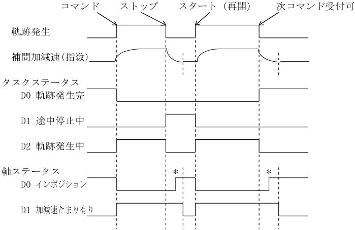

> **図の内容**
>
> 軸移動コマンド → ストップ（軸移動停止）→ スタート（再開）→ 移動完了、の各時点での信号の変化。
>
> | 信号 | コマンド受付時 | ストップ時 | スタート（再開）時 | 移動完了（次コマンド受付可）時 |
> |---|---|---|---|---|
> | 軌跡発生 | ON | OFF | ON | OFF |
> | 補間加減速（指数） | 指数関数的に加速 | 指数関数的に減速 | 再び加速 | 減速 |
> | タスクステータス D0 軌跡発生完 | OFF | OFFのまま | OFFのまま | ON |
> | タスクステータス D1 途中停止中 | OFF | ON | OFF | OFF |
> | タスクステータス D2 軌跡発生中 | ON | OFF | ON | OFF |
> | 軸ステータス D0 インポジション | OFF | 減速後に偏差がINPOS量以内でON(*) | OFF | 減速後に偏差がINPOS量以内でON(*) |
> | 軸ステータス D1 加減速たまり有り | ON | 減速が終わるとOFF | ON | 減速が終わるとOFF |
>
> *: インポジションがONするタイミングはサーボパラメータのINPOS量によって変わる。
> 次のコマンドは、タスクステータス D0 軌跡発生完 がONになった時点から受け付け可能。

- ※ 独立位置決め/SPIN回転/主軸回転/トルク指令による移動は軌跡発生処理による移動には含まれません。

これらの移動を行っていても、軌跡発生関連のフラグ（軌跡発生完/途中停止中/軌跡発生中）には反映されません。

- ※ 加減速たまりはLIN/CI移動R等の補間移動の時の補間加減速によるたまり(遅れ)がある時にON します。

PTP/JOG/原点復帰移動等、位置決め移動ではONしません。

尚、これらの位置決め移動では独自の加減速を行っています。上記タイミングチャートとは異なり減速完了まで軌跡発生完了になりません。

＜移動完了の確認条件＞

移動完了を確認する場合は、以下の条件を全て満たしているか確認してください。

必須条件

| 状態        | 条件             |
|------------|-----------------|
| プログラム運転未実行 | タスクステータスのD4がOFF |
| 軌跡発生完了     | タスクステータスのD1がON  |
| 各種シーケンス完了  | タスクステータスのD7がON  |

目的に応じてチェックする条件

| 状態     |         | 条件           |      |
|---------|---------|---------------|------|
| インポジション | インポジション | 軸ステータスのD0がON  | (軸毎) |
| 補間加減速完了 | 補間加減速完了 | 軸ステータスのD1がOFF | (軸毎) |
| 独立位置決め中 | ＊       | 軸ステータスのD4がON  | (軸毎) |
| SPIN動作中 | ＊       | 軸ステータスのD6がON  | (軸毎) |
| トルク制御中  | ＊       | 軸ステータスのD8がON  | (軸毎) |

- ＊：動作中でも軌跡発生完了/各種シーケンス完了ステータスはOFFしません。

これらはPTP移動/LIN移動等の軌跡発生とは別処理で、並列動作が可能です。

- ※ 移動途中のリセット操作やエラー発生により、移動完了状態でも目標位置に達していない場合があります。

必要に応じて、移動完了後に目標位置と現在位置を比較して、目標位置に達しているか判別して下さい。

② タスクアラーム

MSB

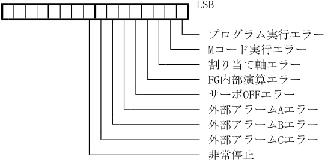

> **図の内容**
>
> タスクアラーム(long)のビット割り当て:
>
> | ビット | 内容 |
> |---|---|
> | D0 | プログラム実行エラー |
> | D1 | Mコード実行エラー |
> | D2 | 割り当て軸エラー |
> | D3 | FG内部演算エラー |
> | D4 | サーボOFFエラー |
> | D5 | 外部アラームAエラー |
> | D6 | 外部アラームBエラー |
> | D7 | 外部アラームCエラー |
> | D8 | 非常停止 |
>
> 上記以外のビットは未使用。

**《タスクアラーム詳細》**

- プログラム実行エラー

運転プログラムで不正な命令を実行した時に発生するエラーです。

詳細は、「RTMC64-M3/ECユーザーズマニュアル(TB00-1040)Ⅱ 機能編 7-4.運転プログラムフォーマットエラー/実行エラー」を参照下さい。

- 例）円弧命令で中心指定が中心でない場合や、マクロ変数指定で存在しないマクロ変数番号を指定された時などに発生します。
- Mコード実行エラー

MOK入力を有効（ROMSW設定ソフトの基本画面の「MOK入力」で設定）にした状態でMコード出力を行った時に、MFIN入力ON時にMOK入力がONしていなかった場合に発生するエラーです。

詳細は、「RTMC64-M3/ECユーザーズマニュアル(TB00-1040F)Ⅱ 機能編 7-1-9-1．MOUT : Mコード出力 / 7-2-5-1．M : Mコード出力」を参照下さい。

- 割り当て軸エラー

タスクに割り当てられている軸の内、何れかの軸でエラーが発生していると発生するエラーです。

- FG内部演算エラー

本システムでは発生しないエラーです。

- サーボOFFエラー

電源投入時/重大エラー発生時等、サーボONしていない時に発生するエラーです。

- ※ 電源投入時サーボON設定(ROMSW設定ソフトの基本画面の「システム起動時サーボオン」で設定)でない場合は、他にエラーが発生していない状態でも本エラーが発生しています。 (エラー状態で起動します。)
- ※ 本書の「4-2-49.各軸サーボON/OFFコマンド」により、タスクに割り当てられている全軸をサーボOFFしても本エラーは発生しません。

外部アラームA入力(T□EXTALMA)/外部アラームB入力(T□EXTALMB)/外部アラームC入力(T□EX

- 外部アラームAエラー/外部アラームBエラー/外部アラームCエラー TALMC）がONした時に発生するエラーです。

詳細は、「RTMC64-M3/ECユーザーズマニュアル(TB00-1040D) 機能編 2-1.入力信号の名称と機能」を参照下さい。

- 非常停止中

非常停止入力(EMS入力)がONすると発生するエラーです。

- ③ 送りオーバーライド現在のPTP/JOG移動のオーバーライドの%値(指定された速度に対する実速度の割り合い)です。
- ④ 補間オーバーライド

現在の補間移動のオーバーライドの%値(指定された速度に対する実速度の割り合い)です。

- ⑤ 主軸オーバーライド

現在の主軸のオーバーライドの%値(指定された速度に対する実速度の割り合い)です。

- ⑥ 選択・実行プログラム番号ステータスがプログラム運転実行中でない場合 → 選択プログラム番号

ステータスがプログラム運転実行中の場合 → 実行プログラム番号

- ⑦ 待機・実行ステップ番号

ステップ実行中でない場合

ステップ実行中の場合

- → 待機ステップ番号
- → 実行ステップ番号

#### 4-1-7.入出力状態データ読出 [DAT_IODATA / 16#03]

- 《データタイプ》

DAT_IODATA / 16#03

**《パラメータ》**

なし

**《タスク指定》**

無効

- 《説明》 RTMC64の汎用入出力の状態です。
- 《読み出し実行条件》

常に実行可能です。

**《データフォーマット》**

○PLCデータレジスタ

データサイズ:360byte(180WORD)

※ 本データはPLCのラダーから固定領域のRead/Writeが可能です。

| オフセット [Byte]   | データ名           | 称データサイズ                     | データ範囲 [単位]   |
|----------------|-------------------|-------------------------------|--------------|
| 0 231          | 入力1パターン入力116パターン | (i#0000) short (i#0115) short |              |
| 232 359        | 出力1パターン出力64パターン  | (o#0116) short (o#0179) short |              |

**○C言語構造体**

```c
/************************************************************************/
/* 汎用入出力情報構造体 */
/************************************************************************/
typedef struct {
    unsigned short Input[116];  /* 汎用入力 */
    unsigned short Output[64];  /* 汎用出力 */
} IODATA;
```

**《データ詳細》**

- (1) 各入出力のデータは下記の通りになっています。

MSB

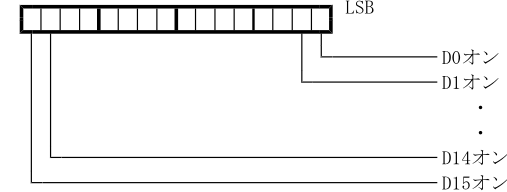

> **図の内容**
>
> 各入出力データ(16bit)は、ビットDn(n=0～15)が入出力信号Dnの状態を表す（1=オン）。
> D0=D0オン、D1=D1オン、…、D14=D14オン、D15=D15オン。

#### 4-1-8.強制入出力状態データ読出 [DAT_FORCEIO / 16#13]

**《データタイプ》**

DAT_FORCEIO / 16#13

**《パラメータ》**

なし

**《タスク指定》**

無効

**《説明》**

通信コマンド等で設定したRTMC64の強制入出力の状態を読み出します。

**《読み出し実行条件》**

常に実行可能です。

**《データフォーマット》**

**○PLCデータレジスタ**

データサイズ:360byte(180WORD)

| オフセット [Byte]   | データ名           | 称データサイズ                     | データ範囲 [単位]   |
|----------------|-------------------|-------------------------------|--------------|
| 0 231          | 入力1パターン入力116パターン | (i#0000) short (i#0115) short |              |
| 232 359        | 出力1パターン出力64パターン  | (o#0116) short (o#0179) short |              |

**○C言語構造体**

```c
/************************************************************************/
/* 汎用入出力情報構造体 */
/************************************************************************/
typedef struct {
    unsigned short Input[116];  /* 汎用入力 */
    unsigned short Output[64];  /* 汎用出力 */
} IODATA;
```

**《データ詳細》**

- (1) 各入出力のデータは下記の通りになっています。

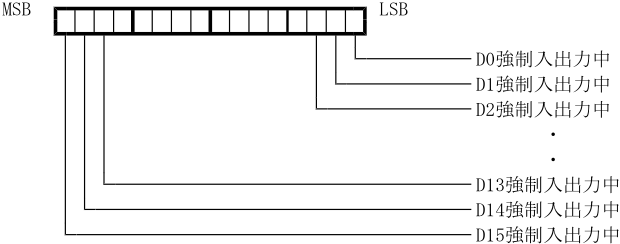

> **図の内容**
>
> 各入出力データ(16bit)は、ビットDn(n=0～15)が入出力信号Dnの強制入出力中を表す（1=強制入出力中）。
> D0=D0強制入出力中、D1=D1強制入出力中、D2=D2強制入出力中、…、D13、D14、D15=D15強制入出力中。

※各入出力の割付については、「RTMC64-M3/EC ユーザーズマニュアル(TB00-1040D) <機能編> 2-3入出力信号のアドレス表」を参照して下さい。

#### 4-1-9.DNCバッファ情報データ読出 [DAT_DNCBUFI / 16#0F] <オプション>

**《データタイプ》**

DAT_DNCBUFI / 16#0F

**《パラメータ》**

なし

**《タスク指定》**

有効

**《説明》**

現在のDNCバッファの状態です。データのフォーマットは以下の通りです。 DNCバッファ情報データ読み出しの実行にはDNC運転オプションが必要です。

**《読み出し実行条件》**

常に実行可能です。

**《データフォーマット》**

○PLCデータレジスタ

データサイズ:8byte(4WORD)

|   オフセット [Byte] | データ名称   | データサイズ   | 設定値   |
|----------------|-------------|-----------|---------|
|              0 | バッファ使用容量    | long      |         |
|              4 | バッファ空き容量    | long      |         |

**○C言語構造体**

```c
/************************************************************************/
/* DNCバッファ情報構造体 */
/************************************************************************/
typedef struct {
    long Size;  /* バッファ使用容量（バイト） */
    long Free;  /* バッファ空き容量（バイト） */
} DNCBUFI;
```

#### 4-1-10.センサーラッチ位置データ読出 [DAT_SENSEPOS / 16#11] <オプション>

**《データタイプ》**

DAT_SENSEPOS / 16#11

**《パラメータ》**

なし

**《タスク指定》**

有効

**《説明》**

センサーラッチ入力があった時の各軸の位置情報です。データのフォーマットは以下の通りです。有効軸以外の軸のデータは、無効データです。

**《読み出し実行条件》**

常に実行可能です。

**《データフォーマット》**

○PLCデータレジスタ

データサイズ:72byte(36WORD)

|   オフセット [Byte] | データ名称   | データサイズ   | データ範囲 [単位]                    |
|----------------|-------------|-----------|-------------------------------|
|              0 | 第1軸論理座標     | long      | -1000000000～1000000000[pulse] |
|              4 | 第2軸論理座標     | long      | -1000000000～1000000000[pulse] |
|              8 | 第3軸論理座標     | long      | -1000000000～1000000000[pulse] |
|             12 | 第4軸論理座標     | long      | -1000000000～1000000000[pulse] |
|             16 | 第5軸論理座標     | long      | -1000000000～1000000000[pulse] |
|             20 | 第6軸論理座標     | long      | -1000000000～1000000000[pulse] |
|             24 | 第7軸論理座標     | long      | -1000000000～1000000000[pulse] |
|             28 | 第8軸論理座標     | long      | -1000000000～1000000000[pulse] |
|             32 | 第9軸論理座標     | long      | -1000000000～1000000000[pulse] |
|             36 | 第1軸アブソ座標    | long      | -1000000000～1000000000[pulse] |
|             40 | 第2軸アブソ座標    | long      | -1000000000～1000000000[pulse] |
|             44 | 第3軸アブソ座標    | long      | -1000000000～1000000000[pulse] |
|             48 | 第4軸アブソ座標    | long      | -1000000000～1000000000[pulse] |
|             52 | 第5軸アブソ座標    | long      | -1000000000～1000000000[pulse] |
|             56 | 第6軸アブソ座標    | long      | -1000000000～1000000000[pulse] |
|             60 | 第7軸アブソ座標    | long      | -1000000000～1000000000[pulse] |
|             64 | 第8軸アブソ座標    | long      | -1000000000～1000000000[pulse] |
|             68 | 第9軸アブソ座標    | long      | -1000000000～1000000000[pulse] |

**○C言語構造体**

```c
/************************************************************************/
/* センサーラッチ位置情報構造体 */
/************************************************************************/
typedef struct {
    long SenPos[9];   /* センサーラッチポジション（論理座標系） */
    long SenPosA[9];  /* センサーラッチポジション（アブソ座標系） */
} SENSEPOS;
```

#### 4-1-11.プログラム1ステップデータ読出 [DAT_ONEBLOCK / 16#30]

**《データタイプ》**

DAT_ONEBLOCK / 16#30

**《パラメータ》**

ステップ番号(0～最大ステップ番号)

※ "0"を指定すると現在の実行ステップ番号を指定した事になります。

**《タスク指定》**

有効

**《説明》**

現在選択されているプログラム番号の任意のステップのデータを読み出します。運転プログラムのバイナリフォーマットは非公開です。読み出したデータは、ヘッダ情報(プログラムボリュームラベル構造体)の後に付加して、プログラム変換ライブラリにて、テキスト形式のデータへ

変換して下さい。

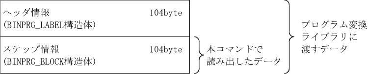

> **図の内容**
>
> プログラム変換ライブラリに渡すデータは、次の2つを連続して並べたもの（計208byte）。
>
> | 順 | 内容 | サイズ | 備考 |
> |---|---|---|---|
> | 1 | ヘッダ情報（BINPRG_LABEL構造体） | 104byte | 呼び出し側で初期化して用意する |
> | 2 | ステップ情報（BINPRG_BLOCK構造体） | 104byte | 本コマンド（DAT_ONEBLOCK）で読み出したデータ |

※プログラム変換ライブラリを呼び出す前に、ヘッダ情報を下記の通り初期化してください。

- BlockNumber メンバに "1" を設定
- ProgramType メンバに受信したステップ情報のPrgTypeメンバの値をコピー
- 他のメンバは全て "0" を設定

尚、テクノコード/Gコードのどちらの変換ライブラリを呼び出すかは、受信したステップ情報の PrgTypeメンバの値によって選択してください。

**《読み出し実行条件》**

- 選択されているプログラム番号に運転プログラムダウンロード済み

**《データフォーマット》**

○PLCデータレジスタ

データサイズ:104byte(52WORD)

|   オフセット [Byte] | データ名   | 称データサイズ   | データ範囲 [単位]   |
|----------------|-----------|-------------|--------------|
|              0 | ステップデータ   | 104byte     | －            |

**○C言語構造体**

```c
/************************************************************************/
/* プログラムボリュームラベル構造体(104バイト固定長) */
/************************************************************************/
typedef struct {
    unsigned char Reserved1[2];   /* 予約 */
    unsigned short BlockNumber;   /* 有効ブロック長 */
    unsigned char Reserved2[22];  /* 予約 */
    unsigned short ProgramType;   /* プログラムコードタイプ(0:T､ 1:G) */
    unsigned char Reserved3[76];  /* 未使用 */
} BINPRG_LABEL;
/************************************************************************/
/* プログラム１ブロックデータ構造体(104バイト固定長) */
/************************************************************************/
typedef struct {
    unsigned char Reserved1[101];  /* 予約 */
    unsigned char PrgType;         /* プログラムコードタイプ(0:T､ 1:G) */
    unsigned char Reserved2[2];    /* 未使用 */
} BINPRG_BLOCK;
```

**《データ詳細》**

予約領域は全て"0"にし、有効ブロック長に"1"にして下さい。その後プログラムコードタイプに読み出し

- (1) 運転プログラムヘッダデータたデータのプログラムコードタイプをコピーしてください。
- (2) 運転プログラムの1ステップバイナリデータ

プログラム1ステップデータ読出コマンドで、RTMC64から受け取ったデータです。

#### 4-1-12.ティーチング情報読出 [DAT_TEACHSTS / 16#18] <開発中>

**《データタイプ》**

DAT_TEACHSTS / 16#18

**《パラメータ》**

なし

**《タスク指定》**

有効

- 《説明》ティーチングの状態を読み出します。
- 《読み出し実行条件》常に実行可能です。

**《データフォーマット》**

**○PLCデータレジスタ**

データサイズ:16byte(8WORD)

|   オフセット [Byte] | データ名称    | データサイズ   | データ範囲 [単位]   |
|----------------|--------------|-----------|--------------|
|              0 | ティーチングステータス  | long      | -            |
|              4 | 実行ステップ番号     | long      | -            |
|              8 | ティーチングステップ番号 | long      | -            |
|             12 | 未使用          | long      | -            |

**○C言語構造体**

```c
/************************************************************************/
/* ティーチング情報用パラメータ情報構造体 */
/************************************************************************/
typedef struct {
    unsigned long Status;     /* ティーチングステータス */
    unsigned long StepNo;     /* 実行ステップ番号 */
    unsigned long TchStepNo;  /* ティーチングステップ番号 */
    unsigned long Reserved;   /* 未使用 */
} TEACHSTS;
```

**《データ詳細》**

- (1) ティーチングステータス
- (2) 実行ステップ番号現在のステップ番号です。
- (3) ティーチングステップ番号

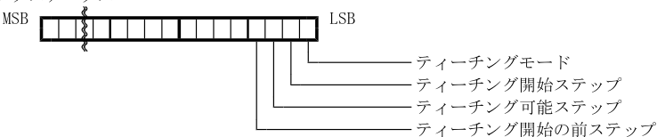

> **図の内容**
>
> ティーチングステータスのビット割り当て:
>
> | ビット | 内容 |
> |---|---|
> | D0 | ティーチングモード |
> | D1 | ティーチング開始ステップ |
> | D2 | ティーチング可能ステップ |
> | D3 | ティーチング開始の前ステップ |
>
> 上記以外のビットは未使用。

ティーチングを開始したステップ番号です。

#### 4-1-13.ROMバージョン情報読出 [DAT_VERSION / 16#27)]

**《データタイプ》**

DAT_VERSION / 16#27

**《パラメータ》**

なし

**《タスク指定》**

無効

**《説明》**

システムのバージョン情報を読み出します。

**《読み出し実行条件》**

常に実行可能です。

**《データフォーマット》**

**○PLCデータレジスタ**

データサイズ:64byte(32WORD)

| オフセット [Byte]   | データ名称       | データサイズ   | データ範囲 [単位]   |
|----------------|-----------------|-----------|--------------|
| 0              | バージョン文字列        | 16byte    | －            |
| 16             | PROM SUM (EVEN) | short     | －            |
| 18             | PROM SUM (ODD)  | short     | －            |
| 20             | FLASH SUM       | short     | －            |
| 22             | FLASH使用フラグ      | short     | 0:未使用、1:使用   |
| 24             | 機種ID            | long      | －            |
| 28             | シリアルID          | long      | －            |
| 32             | プロダクトID         | long      | －            |
| 36～63          | 予約              | byte*28   | －            |

**○C言語構造体**

```c
/************************************************************************/
/* ROMバージョン情報構造体 */
/************************************************************************/
typedef struct {
    char Version[16];         /* バージョン文字列 */
    unsigned short EvenSum;   /* SUM:even (rom) */
    unsigned short OddSum;    /* SUM:odd (rom) */
    unsigned short FlashSum;  /* SUM:SH内部FLASH */
    short FlashFlg;           /* SH内部FLASH使用フラグ */
    unsigned long KindID;     /* 機種ID */
    unsigned long SerialID;   /* シリアルID */
    unsigned long ProductID;  /* プロダクトID */
    char Reserved[28];        /* 予約 */
} ROMVERSION;
```

#### 4-1-14.マクロ変数(一般レジスタ)書込/読出 [DAT_VARIABLE / 16#19] <オプション>

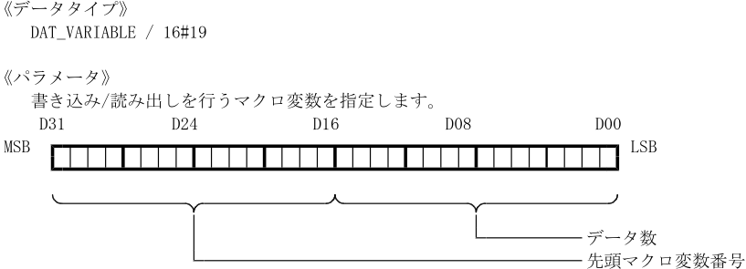

> **図の内容**
>
> - 《データタイプ》`DAT_VARIABLE / 16#19`
> - 《パラメータ》書き込み/読み出しを行うマクロ変数を指定する(32bit)。
>
> | ビット | 内容 |
> |---|---|
> | D00～D15（下位16bit） | データ数 |
> | D16～D31（上位16bit） | 先頭マクロ変数番号 |

- ① 先頭マクロ変数番号

書き込み/読み出しを行う先頭マクロ変数を指定します。

② データ数

書き込み/読み出しを行うデータ数を指定します。

※ マクロ変数により、数え方のWORD/LONG単位が変わります。御注意下さい。

**《タスク指定》**

有効/無効(ローカルマクロ変数指定時のみ有効)

**《関連項目》**

4-1-21.マクロ変数読出

4-2-56.マクロ変数書込コマンド

**《説明》**

一般レジスタの値の書き込み/読み出しを行います。

マクロ変数の詳細については、「RTMC64-M3/ECユーザーズマニュアルⅡ 機能編(TB00-1040F)」 <7-3. マクロ機能>を参照下さい。

パラメータ指定により、書き込み/読み出しを行う先頭マクロ変数番号とデータ数を指定します。パラメータに"0"を指定した時は、先頭マクロ変数番号に1000/データ数に"200"を指定したものとして動作します。

書き込み/読み出しを行うデータ数は、パラメータ指定により可変長になります。通信処理(PCアプリでのSendData()/ReceiveData()呼び出し・ラダーの通信処理)を行う際は御注意下さい。特に、書き込み時のデータサイズ指定は、実際に書き込むデータサイズ(Byte)を指定する必要があります。データサイズがパラメータのデータ数指定と食い違っていると通信エラｰ(E$PARAM)になります。

先頭マクロ変数番号とデータ数に指定できる値は以下の通りです。

※ データ数は、WORD単位の領域ではshort単位/DWORD単位の領域ではlong単位で指定します。

| マクロ変数範囲 | 最大データ数 | 単位 | 説明 |
|---|---|---|---|
| #1000～#1199 | 200 | WORD (short) | グローバルマクロ変数 |
| #1200～#1299 | 100 | WORD (short) | ラダー共有マクロ変数(RTMC64->PLC) |
| #1300～#1399 | 100 | WORD (short) | ラダー共有マクロ変数(RTMC64<-PLC) |
| #1400～#1499 | 100 | WORD (short) | ローカルマクロ変数 |
| #5500～#5699 | 100 | DWORD (long) | グローバルマクロ変数 |
| #5700～#5799 | 50 | DWORD (long) | ラダー共有マクロ変数(RTMC64->PLC) |
| #5800～#5899 | 50 | DWORD (long) | ラダー共有マクロ変数(RTMC64<-PLC) |
| #5900～#5999 | 50 | DWORD (long) | ローカルマクロ変数 |

パラメータ指定には、異なる範囲にまたがるような指定をする事はできませんので御注意下さい。 (「先頭マクロ番号=1180/データ数=30」のような指定はできません。範囲内に収まるようにデータ数を指定して下さい。)

書き込み/読み出しの際のデータバッファの割り当ては、1WORD目が先頭マクロ変数で指定したマクロのデータになり、以後順番に格納されています。

書き込み/読み出しデータバッファ

| 1WORD目      | 先頭マクロ変数番号          | のデータ   |
|-------------|--------------------|--------|
| 2WORD目      | 先頭マクロ変数番号+1        | のデータ   |
| 3WORD目      | 先頭マクロ変数番号+2        | のデータ   |
| :           | :                  |        |
| :           | :                  |        |
| データ数-1WORD目 | 先頭マクロ変数番号 + データ数-2 | のデータ   |
| データ数 WORD目  | 先頭マクロ変数番号 + データ数-1 | のデータ   |

尚、WORD領域とDWORD領域は、それぞれ同じデータに割り当てられています。運転プログラム中でマクロ変数を使用する際にshort/longでアクセスするためにマクロ変数番号を別にしています。そのため、PC アプリやラダーから使用する際はどちらを使用しても同じです。

(WORD領域を指定して読み書きするデータに対してDWORDデータとして読み書き可能です。そのためWORDデータ領域のみで指定する事をお勧めします。)

DWORD領域を指定した際でもデータバッファの使い方はWORD単位です。連続した2WORDを結合してDWORDとしてご使用下さい。その際は、下位WORD/上位WORDの順で並んでいると考えて下さい。

例)

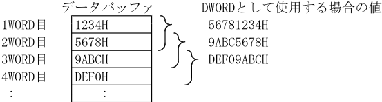

> **図の内容**
>
> データバッファはWORD単位で、連続した2WORDを結合してDWORDとして扱う（下位WORDが先、上位WORDが後）。
>
> | データバッファ | 値 |
> |---|---|
> | 1WORD目 | 1234H |
> | 2WORD目 | 5678H |
> | 3WORD目 | 9ABCH |
> | 4WORD目 | DEF0H |
>
> DWORDとして使用する場合の値（図では隣り合う2WORDずつを1WORDずらして結合している）:
> - 1WORD目+2WORD目 → 56781234H
> - 2WORD目+3WORD目 → 9ABC5678H
> - 3WORD目+4WORD目 → DEF09ABCH

- 《書き込み実行条件》

常に実行可能です。

- 《読み出し実行条件》

常に実行可能です。

**《データフォーマット》**

○PLCデータレジスタ

データサイズ:最大400byte(200WORD)(可変長)

|   オフセット [Byte] | データ名称    | データサイズ   | データ範囲 [単位]   |
|----------------|--------------|-----------|--------------|
|              0 | 1WORD目のデータ   | short     | －            |
|              2 | 2WORD目のデータ   | short     | －            |
|            396 | 199WORD目のデータ | short     | －            |
|            398 | 200WORD目のデータ | short     | －            |

**○C言語構造体**

```c
/************************************************************************/
/* マクロ変数データ */
/************************************************************************/
typedef short VARIABLE[200];
```

#### 4-1-15.TPCロギングデータ読出 [DAT_TPCDATA / 16#25)]

**《データタイプ》**

DAT_TPCDATA / 16#25

**《パラメータ》**

読み出しデータバイト数

※必ずTPCデータ1点分のサイズ(後述)の整数倍で指定してください。

但し、"0" を指定するとロギング内の全データ(最大65536byte)を読み出します。

**《タスク指定》**

無効

**《説明》**

RTMC64でロギングしたTPCデータを読み出します。

TPCロギングデータ読出コマンドはロギング実行中でも実行可能です。

本機能によりTPCデータを読み出すと、読み出した分のロギングバッファを解放します。(次ページ参照) 「常時」TPCデータを読み出すことにより、ロギングバッファのサイズ以上にロギングすることが可能です。読み出したロギングデータはPCアプリまたはPLCで保存してください。

TPCデータの読み出しが間に合わずにロギングバッファが一杯になるとロギングが停止します。読み出したデータを以下の形式のテキストファイル(.CSV)で保存すると、弊社の「TPC EXCEL」を利用し

てサーボ応答精度や軌跡精度を解析することができます。

1点目の第1軸座標

2点目の第1軸座標

1点目の第2軸座標

2点目の第2軸座標

:

:

n点目の第1軸座標

n点目の第2軸座標

尚、パラメータの読み出しデータバイト数指定が、ロギングバッファに格納済みのデータ数より大きい場合は、格納済みのデータのみ読み出します。

**《読み出し実行条件》**

- ロギングデータあり

**《関連項目》**

- 4-1-16.TPCロギング情報読出
- 4-1-23.TPCロギング拡張情報読出
- 4-2-43.TPCデータ選択コマンド
- 4-2-53.TPCロギング開始コマンド
- 4-2-57.TPCデータ選択拡張コマンド

**《データフォーマット》**

○PLCデータレジスタ

- (1)2ch(ポジション)の場合

データサイズ:16byte(8WORD)

|   オフセット [Byte] | データ名称   | データサイズ   | データ範囲 [単位]                    |
|----------------|---------|-----------|-------------------------------|
|              0 | 第１軸機械位置 | long      | -1000000000～1000000000[pulse] |
|              4 | 汎用入力１状態 | short     | －                             |
|              6 | 汎用出力１状態 | short     | －                             |
|              8 | 第２軸機械位置 | long      | -1000000000～1000000000[pulse] |
|             12 | 汎用入力２状態 | short     | －                             |
|             14 | 汎用出力２状態 | short     | －                             |

**○C言語構造体**

```c
/************************************************************************/
/* TPCデータ構造体 */
/************************************************************************/
typedef struct {
    long pr1;            /* 第1軸機械位置 */
    unsigned short hi1;  /* 汎用入力1状態 */
    unsigned short ho1;  /* 汎用出力1状態 */
    long pr2;            /* 第2軸機械位置 */
    unsigned short hi2;  /* 汎用入力2状態 */
    unsigned short ho2;  /* 汎用出力2状態 */
} TPCDAT_POS;
typedef TPCDAT_POS TPC;
```

(2)64ch(64CH)の場合

データサイズ:256byte(最大)

4byte/チャンネル

| オフセット [Byte]   | データ名称       | データサイズ   | データ範囲 [単位]                                              |
|----------------|-------------|-----------|---------------------------------------------------------|
| 0              | 第1チャンネルデータ  | long      | -1000000000～1000000000[pulse] フラグは 0～0xffffffffffffffff |
| 4              | 第2チャンネルデータ  | long      | 〃                                                       |
| 8              | 第3チャンネルデータ  | long      | 〃                                                       |
| :              | :           |           | :                                                       |
| 248            | 第64チャンネルデータ | long      | 〃                                                       |
| 252            | 第64チャンネルデータ | long      | 〃                                                       |

**○C言語構造体**

構造体定義はありません。

※ TPCデータのリングバッファのイメージ図

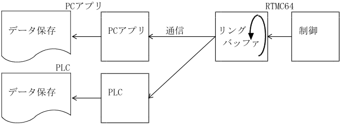

> **図の内容**
>
> TPCデータの流れ:
> 1. RTMC64の「制御」がTPCデータをRTMC64内の「リングバッファ」に書き込む（リングバッファは循環して使われる）。
> 2. リングバッファのデータは、次のどちらかが読み出す。
>    - PCアプリ: 通信（通信ライブラリ）で読み出し、PCアプリ側でデータを保存する。
>    - PLC: 読み出して、PLC側でデータを保存する。
>
> 読み出した分のバッファは解放される。読み出しが間に合わずバッファが一杯になるとロギングは停止する（4-1-15の《説明》参照）。

#### 4-1-16.TPCロギング情報読出 [DAT_TPCINFO / 16#24)]

**《データタイプ》**

DAT_TPCINFO / 16#24

**《パラメータ》**

なし

**《タスク指定》**

無効

**《説明》**

RTMC64の現在のTPCデータのロギング情報を読み出します。

**《読み出し実行条件》**

常に実行可能です。

**《関連項目》**

- 4-1-15.TPCロギングデータ読出
- 4-1-23.TPCロギング拡張情報読出
- 4-2-43.TPCデータ選択コマンド
- 4-2-53.TPCロギング開始コマンド
- 4-2-57.TPCデータ選択拡張コマンド

**《データフォーマット》**

○PLCデータレジスタ

データサイズ:4byte(2WORD)

|   オフセット [Byte] | データ名称           | データサイズ   | データ範囲 [単位]   |
|----------------|-----------------|-----------|--------------|
|              0 | TPCデータロギングフラグ   | short     | 0:未実行、1:実行中  |
|              2 | TPCデータロギングポイント数 | short     | 0～4095       |

**○C言語構造体**

```c
/************************************************************************/
/************************************************************************/
typedef struct {
    short Log;  /* TPCデータロギングフラグ */
    short Num;  /* TPCデータロギングポイント数 */
} TPCINFO;
```

#### 4-1-17.軸ネグレクト設定データ読出 [DAT_AXNEGLECT / 16#28]

**《データタイプ》**

DAT_AXNEGLECT / 16#28

**《パラメータ》**

なし

**《タスク指定》**

有効

**《説明》**

各軸の軸指令の有効/無効状態を取得します。

**《読み出し実行条件》**

常に実行可能です。

**《関連項目》**

4-2-48.軸ネグレクト設定コマンド

**《データフォーマット》**

○PLCデータレジスタ

データサイズ:4byte(2WORD)

|   オフセット [Byte] | データ名称   | データサイズ   | データ範囲 [単位]   |
|----------------|-------------|-----------|--------------|
|              0 | ネグレクト軸フラグ   | long      | －            |

**○C言語構造体**

構造体定義はありません。

DWORDデータ(long)として定義して下さい。

**《データ詳細》**

- (1) ネグレクト軸フラグ各軸のネグレクト設定を示します。ネグレクト設定の軸に対応するビットに1が設定されます。

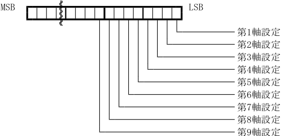

> **図の内容**
>
> ネグレクト軸フラグは、ビットDn が第(n+1)軸の設定を表す（1=ネグレクト設定）。
> D0=第1軸、D1=第2軸、…、D8=第9軸（以降も同様に1ビット1軸）。

#### 4-1-18.軸インタロック設定データ読出 [DAT_AXINTLOCK / 16#29]

**《データタイプ》**

DAT_AXINTLOCK / 16#29

**《パラメータ》**

なし

**《タスク指定》**

有効

**《説明》**

各軸のインタロックの有効/無効状態を取得します。

**《読み出し実行条件》**

常に実行可能です。

**《関連項目》**

4-2-47.軸インタロック設定コマンド

**《データフォーマット》**

○PLCデータレジスタ

データサイズ:4byte(2WORD)

|   オフセット [Byte] | データ名称   | データサイズ   | データ範囲 [単位]   |
|----------------|-------------|-----------|--------------|
|              0 | インタロック軸フラグ  | long      | －            |

**○Ｃ言語構造体**

構造体定義はありません。

DWORDデータ（long）として使用下さい。

**《データ詳細》**

- (1) インタロック軸フラグ各軸のインタロック設定を示します。インタロック設定の軸に対応するビットに1が設定されます。

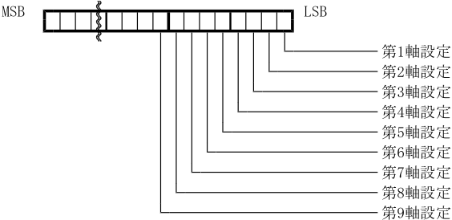

> **図の内容**
>
> インタロック軸フラグは、ビットDn が第(n+1)軸の設定を表す（1=インタロック設定）。
> D0=第1軸、D1=第2軸、…、D8=第9軸（以降も同様に1ビット1軸）。

#### 4-1-19.各軸サーボON/OFF設定データ読出 [DAT_AXSVONEN / 16#31]

**《データタイプ》**

DAT_AXSVONEN / 16#31

**《パラメータ》**

なし

**《タスク指定》**

有効

- 《説明》各軸のサーボON/OFF設定状態を取得します。

**《読み出し実行条件》**

常に実行可能です。

- 《関連項目》

4-2-49.各軸サーボON/OFFコマンド

- 《データフォーマット》 ○PLCデータレジスタ
- ○Ｃ言語構造体

データサイズ:4byte(2WORD)

|   オフセット [Byte] | データ名   | 称データサイズ   | データ範囲 [単位]   |
|----------------|-----------|-------------|--------------|
|              0 | サーボON軸フラグ | long        | -            |

構造体定義はありません。

DWORDデータ（long）として使用下さい。

**《データ詳細》**

- (1) サーボON軸フラグ各軸のサーボON設定を示します。サーボON設定の軸に対応するビットに1が設定されます。

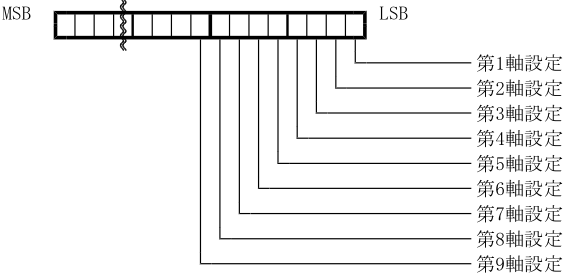

> **図の内容**
>
> サーボON軸フラグは、ビットDn が第(n+1)軸の設定を表す（1=サーボON設定）。
> D0=第1軸、D1=第2軸、…、D8=第9軸（以降も同様に1ビット1軸）。

#### 4-1-20.手動パルサー設定情報読出 [DAT_HANDLESTS / 16#32] <オプション>

**《データタイプ》**

DAT_HANDLESTS / 16#32

**《パラメータ》**

なし

**《タスク指定》**

有効

**《説明》**

手動パルサーの設定状態を取得します。

**《読み出し実行条件》**

常に実行可能です。

**《関連項目》**

4-2-50.手動パルサーモードON/OFF設定コマンド

4-2-51.手動パルサー倍率設定コマンド

4-2-52.手動パルサー有効軸設定コマンド

**《データフォーマット》**

○PLCデータレジスタ

データサイズ:8byte(4WORD)

|   オフセット [Byte] | データ名称       | データサイズ   | データ範囲 [単位]    |
|----------------|-------------|-----------|---------------|
|              0 | 手動パルサー有効フラグ | short     | 0:無効、 1:有効    |
|              2 | 手動パルサー倍率    | short     | 1,10,100,1000 |
|              4 | 手動パルサー第1軸   | short     | 軸番号(0～軸数)     |
|              6 | 手動パルサー第2軸   | short     | 軸番号(0～軸数)     |

**○C言語構造体**

```c
/************************************************************************/
/* 手パ操作情報構造体 */
/************************************************************************/
typedef struct {
    short handle_mode;  /* 手パ有効フラグ */
    short kp;           /* 手パ設定倍率 */
    short ax1;          /* 手パ第1軸 */
    short ax2;          /* 手パ第2軸 */
} HANDLESTS;
```

**《データ詳細》**

- (1) 手動パルサー有効フラグ

手動パルサーの有効/無効状態を示します。

- (2) 手動パルサー倍率

手動パルサーの倍率(手動パルサー1パルスあたりの軸移動量)を示します。

- (3) 手動パルサー第1軸手動パルサー第1軸にて、移動する軸を示します。
- (4) 手動パルサー第2軸

手動パルサー第2軸にて、移動する軸を示します。

#### 4-1-21.マクロ変数書込／読出 [DAT_MCRREG / 16#33] <オプション>

**《データタイプ》**

DAT_MCRREG / 16#33

**《パラメータ》**

マクロ変数番号

**《タスク指定》**

有効

**《説明》**

パラメータで指定された番号のマクロ変数に対する書き込み/読み出しを行います。書き込み不可のマクロ変数の書き込みはできません。

読み出し不可のマクロ変数の読み出しはできません。

マクロ変数書込/読出コマンドの実行には、マクロ機能オプションが必要です。

マクロ変数詳細については、「RTMC64-M3/ECユーザーズマニュアル(TB00-1040F)Ⅱ 機能編 7-3.マクロ機能」を参照下さい。

- 《書き込み実行条件》常に実行可能です。
- 《読み出し実行条件》

常に実行可能です。

**《関連項目》**

4-1-14.マクロ変数(一般レジスタ)読出

4-2-56.マクロ変数書込コマンド

**《データフォーマット》**

- PLCデータレジスタ

データサイズ:4byte(2WORD)

|   オフセット [Byte] | データ名称   | データサイズ   | データ範囲 [単位]                   |
|----------------|-------------|-----------|------------------------------|
|              0 | マクロ変数値      | long      | -2147483647 ～ 2147483647 [-] |

**○ C言語構造体**

```c
/************************************************************************/
/* マクロ変数データ構造体 */
/************************************************************************/
typedef struct {
    long Val;  /* マクロ変数値 */
} MCRREG;
```

#### 4-1-22.工具径補正データ書込/読出 [DAT_TOOLDIA / 16#1A] <オプション>

**《データタイプ》**

DAT_TOOLDIA / 16#1A

**《パラメータ》**

0 : 《タスク指定》で指定された1タスク分のみ書込/読出

1 : 全タスク(8タスク)分書込/読出

**《タスク指定》**

1タスク分書込/読出時：有効

全タスク分書込/読出時：無効

**《説明》**

工具径補正用データの書き込み/読み出しを行います。

工具径補正データ書込/読出コマンドの実行には、工具径補正オプションが必要です。

**《書き込み実行条件》**

・セッティングモード（全タスク分書込時は全タスク）

**《読み出し実行条件》**

常に実行可能です。

**《データフォーマット》**

○PLCデータレジスタ

データサイズ:80byte(40WORD)

| オフセット [Byte]   | データ名   | 称データサイズ   | データ範囲 [単位]             |
|----------------|-----------|-------------|------------------------|
| 0              | 補正用データ0   | long        | -1000000000～1000000000 |
| 4              | 補正用データ1   | long        | -1000000000～1000000000 |
| ：：            | ：：       |             |                        |
| 72             | 補正用データ18  | long        | -1000000000～1000000000 |
| 76             | 補正用データ19  | long        | -1000000000～1000000000 |

データサイズ:640byte（全タスク分）

| オフセット [Byte]   | データ       | 名称データサイズ   | データ範囲 [単位]   |
|----------------|-------------|---------------|--------------|
| 0～ 79          | タスク0用補正データ | 80byte        | －            |
| 80～159         | タスク1用補正データ | 80byte        | －            |
| 160～239        | タスク2用補正データ | 80byte        | －            |
| 240～319        | タスク3用補正データ | 80byte        | －            |
| 320～399        | タスク4用補正データ | 80byte        | －            |
| 400～479        | タスク5用補正データ | 80byte        | －            |
| 480～559        | タスク6用補正データ | 80byte        | －            |
| 560～639        | タスク7用補正データ | 80byte        | －            |

**○C言語構造体**

```c
/************************************************************************/
/* ツール径補正用パラメータ情報構造体 */
/************************************************************************/
typedef struct {
    long d[20];  /* ツール径補正データ */
} TOOL_D;
```

※ 全タスク分の時は、TOOL_D の要素数8の配列で定義して下さい。

#### 4-1-23.ＴＰＣロギング拡張情報読出 [DAT_TPCINFO_EX / 16#2A]

**《データタイプ》**

DAT_TPCINFO_EX / 16#2A

**《パラメータ》**

なし

**《タスク指定》**

無効

**《説明》**

現在のTPCデータのロギング情報を読み出します。

**《読み出し実行条件》**

常に実行可能です。

**《関連項目》**

- 4-1-15.TPCロギングデータ読出
- 4-1-16.TPCロギング情報読出
- 4-2-43.TPCデータ選択コマンド
- 4-2-53.TPCロギング開始コマンド
- 4-2-57.TPCデータ選択拡張コマンド

**《データフォーマット》**

○PLCデータレジスタ

データサイズ:12byte(6WORD)

|   オフセット [Byte] | データ名称         | データサイズ   | データ範囲 [単位]   |
|----------------|---------------|-----------|--------------|
|              0 | TPCデータロギングフラグ | short     | 0:未実行、 1:実行中 |
|              2 | 予約            | short     | 0            |
|              4 | バッファ使用容量(バイト) | long      | 0～65536      |
|              8 | バッファ空き容量(バイト) | long      | 0～65536      |

**○C言語構造体**

```c
/************************************************************************/
/************************************************************************/
typedef struct {
    short Log;       /* ロギング中フラグ */
    short Reserved;  /* 予約 */
    long Size;       /* バッファ使用容量（バイト） */
    long Free;       /* バッファ空き容量（バイト） */
} TPCINFOEX;
```

#### 4-1-24.サーボ通信情報読出 [DAT_**** / 16#34]

- (A)(RTMC64-M3の場合) メカトロリンクΣサーボ(または入出力ユニット)情報読出 [DAT_ML_INFO / 16#34]
- 《データタイプ》

DAT_ML_INFO / 16#34

**《パラメータ》**

-1

0 ～軸数-1

: 全軸分の情報読み出し

: 指定された1軸のみ読み出し

**《タスク指定》**

-1

: 物理軸の情報読み出し

0 ～タスク番号: 指定されたタスクの論理軸

略記号

Ｗ hole Ａ xiss


> **図の内容**
>
> 略記号。Ｗ = Whole（全軸指定）、Ａ = Axis（各軸指定）。以降のデータフォーマットで、どちらの指定の場合かを示すために使われる。

Ｐ higical Ｌ ogical


> **図の内容**
>
> 略記号。Ｐ = Physical（物理軸）、Ｌ = Logical（論理軸）。

**《説明》**

指定された論理軸のΣサーボのMECHATROLINK-Ⅲ通信情報を取得します。 (基本的にテクノデバッグ用の情報です。) 詳細はΣサーボのMECHATROLINK-Ⅲ通信仕様を参照下さい。

- 《読み出し実行条件》

常に実行可能です。

**《データフォーマット》**

○PLCデータレジスタ

データサイズ:112byte(56WORD)(各軸指定(Ａ))

| オフセット [Byte]   | データ名称    | データサイズ   | データ範囲 [単位]   |
|----------------|----------|-----------|--------------|
| 0～ 87          | 全体ステータス  | 88byte    | －            |
| 88～111         | 指定軸ステータス | 24byte    | －            |

タスク指定有り(Ｌ)で軸指定無し(Ｗ)の場合


> **図の内容**
>
> 略記号Ｗ（全軸指定）の場合を示す印。

データサイズ:304byte(152WORD)(全論理軸指定)

| オフセット [Byte]   | データ名称      | データサイズ   | データ範囲 [単位]   |
|----------------|------------|-----------|--------------|
| 0～ 87          | 全体ステータス    | 88byte    | －            |
| 88～111         | 第1論理軸ステータス | 24byte    | －            |
| 112～135        | 第2論理軸ステータス | 24byte    | －            |
| 136～159        | 第3論理軸ステータス | 24byte    | －            |
| 160～183        | 第4論理軸ステータス | 24byte    | －            |
| 184～207        | 第5論理軸ステータス | 24byte    | －            |
| 208～231        | 第6論理軸ステータス | 24byte    | －            |
| 232～255        | 第7論理軸ステータス | 24byte    | －            |
| 256～279        | 第8論理軸ステータス | 24byte    | －            |
| 280～303        | 第9論理軸ステータス | 24byte    | －            |


> **図の内容**
>
> 略記号Ｗ（全軸指定）の場合を示す印。

| オフセット [Byte]   | データ名称       | データサイズ   | データ範囲   | [単位]   |
|----------------|-------------|-----------|---------|--------|
| 0～ 87          | 全体ステータス     | 88byte    | －       |        |
| 88～ 111        | 第1物理軸ステータス  | 24byte    | －       |        |
| 112～ 135       | 第2物理軸ステータス  | 24byte    | －       |        |
| 136～ 159       | 第3物理軸ステータス  | 24byte    | －       |        |
| 160～ 183       | 第4物理軸ステータス  | 24byte    | －       |        |
| 184～ 207       | 第5物理軸ステータス  | 24byte    | －       |        |
| 208～ 231       | 第6物理軸ステータス  | 24byte    | －       |        |
| 232～ 255       | 第7物理軸ステータス  | 24byte    | －       |        |
| 256～ 279       | 第8物理軸ステータス  | 24byte    | －       |        |
| 280～ 303       | 第9物理軸ステータス  | 24byte    | －       |        |
| 304～ 327       | 第10物理軸ステータス | 24byte    | －       |        |
|                | :           |           |         |        |
| 1504～1527      | 第60物理軸ステータス | 24byte    | －       |        |
| 1528～1551      | 第61物理軸ステータス | 24byte    | －       |        |
| 1552～1575      | 第62物理軸ステータス | 24byte    | －       |        |
| 1576～1599      | 第63物理軸ステータス | 24byte    | －       |        |
| 1600～1623      | 第64物理軸ステータス | 24byte    | －       |        |

全体ステータス

| オフセット [Byte]   | データ名称            | データサイズ   | データ範囲 [単位]                              |
|----------------|------------------|-----------|-----------------------------------------|
| 0～ 11          | 通信ドライバ初期化エラー     | short*6   | －                                       |
| 12～ 23         | 通信ドライバ全体エラー      | short*6   | －                                       |
| 24～ 47         | 通信ドライバ全体ステータス    | long *6   | －                                       |
| 48～ 55         | 通信ドライバエラー発生軸フラグ  | longlong  | 0x0000000000000000 ～ 0xffffffffffffffff |
| 56～ 63         | データ受信エラー発生軸フラグ   | longlong  | 0x0000000000000000 ～ 0xffffffffffffffff |
| 64～ 71         | タイムアウトエラー発生軸フラグ  | longlong  | 0x0000000000000000 ～ 0xffffffffffffffff |
| 72～ 79         | ウォッチドッグエラー発生軸フラグ | longlong  | 0x0000000000000000 ～ 0xffffffffffffffff |
| 80～ 87         | 予備               | 8byte     | －                                       |

各軸ステータス

| データ位置番号オフセット   | データ名称                 | データサイズ   | データ範囲 [単位]   |
|-----------------|-----------------------|-----------|--------------|
| 88+24*N         | JLアクセスドライバ各軸エラーコード    | short     | －            |
| 90+24*N         | 受信共通コマンドステータス情報      | short     | －            |
| 92+24*N         | 受信サーボコマンドステータス情報     | long      | －            |
| 96+24*N         | 受信サーボコマンドＩ／Ｏ情報       | long      | －            |
| 100+24*N        | サブコマンドステータス情報         | long      | －            |
| 104+24*N        | MLボードID(ディップスイッチの設定値) | long      | －            |
| 108+24*N        | MLボードデバイスインデックス       | long      | －            |

**○C言語構造体**

```c
/************************************************************************/
/* メカトロリンクテータス情報構造体 */
/************************************************************************/
typedef struct{                      /* ８８バイト */
    short jl_init_errc[6];           /* JLアクセスドライバ初期化エラーコード */
    short jl_whcom_errc[6];          /* JLアクセスドライバ全体エラーコード */
    unsigned long jl_whcom_stsc[6];  /* JLアクセスドライバ全体ステータスビット*/
/*（エラー発生時） */
/* jl_init_errc,jl_whcom_errc,jl_whcom_stsc */
/* はDulIdx順の配列です。 */
    _int64 jl_axcom_err;             /* JLアクセスドライバエラー発生軸フラグ */
    _int64 no_rcv_err;               /* データ受信エラー発生軸フラグ */
    _int64 time_out_err;             /* タイムアウトエラー発生軸フラグ */
    _int64 watchdog_err;             /* WDTエラー発生軸フラグ */
    char Reserved[8];                /* 予約 */
} ML_WHOLESTATUS;
typedef struct{                      /* ２４バイト */
    short jl_axcom_errc;             /* JLアクセスドライバ各軸エラーコード */
    unsigned short CmdStat;          /* 受信 共通コマンドステータス情報 */
    unsigned long SvCmdStat;         /* 受信 サーボコマンドステータス情報 */
    unsigned long SvCmdIo;           /* 受信 サーボコマンドＩ／Ｏ情報 */
    unsigned long SubStat;           /* 受信 サブコマンドステータス情報 */
    unsigned long jl_boardID;        /* MLボードID(ディップスイッチの設定値) */
    unsigned long DulIdx;            /* MLボードデバイスインデックス */
/* ※システムが検出した順 */
} ML_AXSTATUS;
typedef struct{ // 軸指定有り(Ａ)コマンドの時のアンサーデータ構造
    ML_WHOLESTATUS WholeStat;
    ML_AXSTATUS AxStat;
} ML_INFOAX;
typedef struct{ // 軸指定無し(Ｗ)でタスク指定有り(Ｌ)時のアンサーデータ構造
    ML_WHOLESTATUS WholeStat;
    ML_AXSTATUS AxStat[9];
} ML_INFOALL;
typedef struct{ // 軸指定無し(Ｗ)でタスク指定無し(Ｐ)時のアンサーデータ構造
    ML_WHOLESTATUS WholeStat;
    ML_AXSTATUS AxStat[64];
} ML_INFO64ALL;
```

**《データ詳細》**

○全体ステータス

(1) JLアクセスドライバ初期化エラーコード(MLボード毎の情報です)

MECHATROLINK-Ⅲ通信の初期化エラーコードです。

0 : 正常

それ以外: エラー(非公開)

(2) JLアクセスドライバ全体エラーコード(MLボード毎の情報です)

MECHATROLINK-Ⅲ通信の通信エラーコードです。

0 : 正常

それ以外: エラー(非公開)

- (3) JLアクセスドライバ全体ステータスビット(MLボード毎の情報です)

MECHATROLINK-Ⅲ通信の全体通信エラー発生時のステータスフラグです。

0 : 正常

それ以外: エラー(非公開)

- (4) JLアクセスドライバエラー発生軸フラグ

MECHATROLINK-Ⅲ通信の各軸通信エラー発生軸フラグです。

※1 エラー発生軸フラグ割り付け

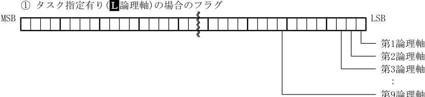

> **図の内容**
>
> ① タスク指定有り（Ｌ: 論理軸）の場合のフラグ（64bit）。ビットDn が第(n+1)論理軸を表す（1=エラー発生）。
> D0=第1論理軸、D1=第2論理軸、D2=第3論理軸、…、D8=第9論理軸。

② タスク指定無し(Ｐ物理軸)の場合のフラグ

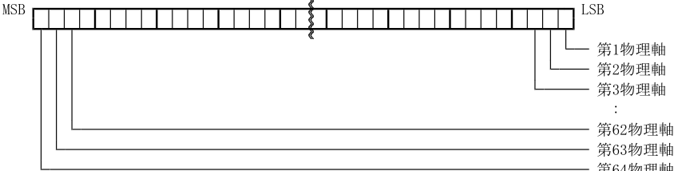

> **図の内容**
>
> ② タスク指定無し（Ｐ: 物理軸）の場合のフラグ（64bit）。ビットDn が第(n+1)物理軸を表す（1=エラー発生）。
> D0=第1物理軸、D1=第2物理軸、D2=第3物理軸、…、D61=第62物理軸、D62=第63物理軸、D63=第64物理軸。

- (5) データ受信エラー発生軸フラグ MECHATROLINK-Ⅲ通信のデータ受信エラー発生軸フラグです。

軸フラグの並びは(4)の※1と同じです

- (6) タイムアウトエラー発生軸フラグ MECHATROLINK-Ⅲ通信のタイムアウトエラー発生軸フラグです。

軸フラグの並びは(4)の※1と同じです

- (7) WDTエラー発生軸フラグ MECHATROLINK-Ⅲ通信のウォッチドッグエラー発生軸フラグです。軸フラグの並びは(4)の※1と同じです
2. ○各軸ステータス
- (1) 通信ドライバ各軸エラーコード MECHATROLINK-Ⅲ通信の初期化エラーコードです。

0 : 正常

それ以外: エラー(非公開)

- (2) 受信共通コマンドステータス情報

Σサーボから読み出した共通ステータスフラグです。

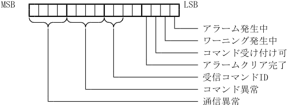

> **図の内容**
>
> Σサーボから読み出した共通ステータスフラグ(16bit)のビット割り当て:
>
> | ビット | 内容 |
> |---|---|
> | D0 | アラーム発生中 |
> | D1 | ワーニング発生中 |
> | D2 | コマンド受け付け可 |
> | D3 | アラームクリア完了 |
> | D4～D5 | 未使用 |
> | D6～D7 | 受信コマンドID（2bit） |
> | D8～D11 | コマンド異常（4bit） |
> | D12～D15 | 通信異常（4bit） |

第9論理軸

第64物理軸

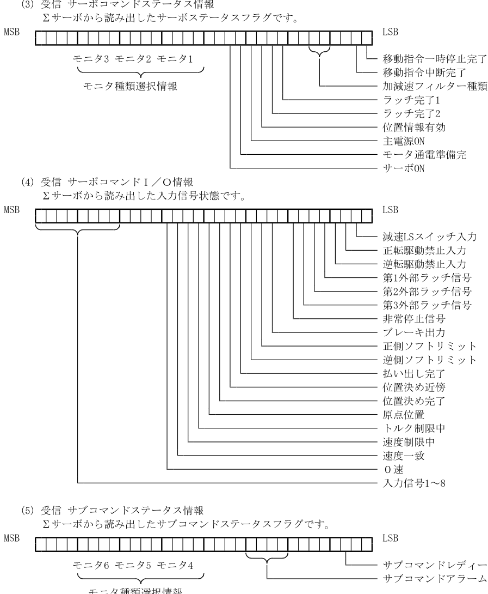

> **図の内容**
>
> **(3) 受信サーボコマンドステータス情報**（Σサーボから読み出したサーボステータスフラグ、32bit）
>
> | ビット | 内容 |
> |---|---|
> | D0 | 移動指令一時停止完了 |
> | D1 | 移動指令中断完了 |
> | D4～D5 | 加減速フィルター種類（2bit） |
> | D8 | ラッチ完了1 |
> | D9 | ラッチ完了2 |
> | D10 | 位置情報有効 |
> | D11 | 主電源ON |
> | D12 | モータ通電準備完 |
> | D13 | サーボON |
> | D16～D19 | モニタ1（モニタ種類選択情報） |
> | D20～D23 | モニタ2（モニタ種類選択情報） |
> | D24～D27 | モニタ3（モニタ種類選択情報） |
>
> **(4) 受信サーボコマンドI/O情報**（Σサーボから読み出した入力信号状態、32bit）
>
> | ビット | 内容 |
> |---|---|
> | D1 | 減速LSスイッチ入力 |
> | D2 | 正転駆動禁止入力 |
> | D3 | 逆転駆動禁止入力 |
> | D4 | 第1外部ラッチ信号 |
> | D5 | 第2外部ラッチ信号 |
> | D6 | 第3外部ラッチ信号 |
> | D7 | 非常停止信号 |
> | D9 | ブレーキ出力 |
> | D10 | 正側ソフトリミット |
> | D11 | 逆側ソフトリミット |
> | D12 | 払い出し完了 |
> | D13 | 位置決め近傍 |
> | D14 | 位置決め完了 |
> | D15 | 原点位置 |
> | D16 | トルク制限中 |
> | D17 | 速度制限中 |
> | D18 | 速度一致 |
> | D19 | 0速 |
> | D24～D31 | 入力信号1～8 |
>
> **(5) 受信サブコマンドステータス情報**（Σサーボから読み出したサブコマンドステータスフラグ、32bit）
>
> | ビット | 内容 |
> |---|---|
> | D2 | サブコマンドレディー |
> | D8～D11 | サブコマンドアラーム（4bit） |
> | D16～D19 | モニタ4（モニタ種類選択情報） |
> | D20～D23 | モニタ5（モニタ種類選択情報） |
> | D24～D27 | モニタ6（モニタ種類選択情報） |
>
> 各表に記載のないビットは未使用。

モニタ種類選択情報

(B)RTMC64-ECの場合

EtherCAT情報読出 [DAT_ECT_INFO / 16#34]

**《データタイプ》**

DAT_ECT_INFO / 16#34

**《パラメータ》**

-1

0 ～軸数-1

: 全論理軸分の情報読み出し

: 指定された論理軸(1軸)のみ読み出し

**《タスク指定》**

有効

**《説明》**

指定された論理軸のサーボからEtherCAT通信情報を取得します。 (基本的にテクノデバッグ用の情報です。) 詳細は各社サーボのEtherCAT通信仕様を参照下さい。

**《読み出し実行条件》**

常に実行可能です。

**《データフォーマット》**

○PLCデータレジスタ

データサイズ:112byte(56WORD)(各軸指定)

| オフセット [Byte]   | データ名称    | データサイズ   | データ範囲 [単位]   |
|----------------|----------|-----------|--------------|
| 0～ 87          | 全体ステータス  | 88byte    | －            |
| 88～111         | 指定軸ステータス | 24byte    | －            |

データサイズ:304byte(152WORD)(全軸指定)

| オフセット [Byte]   | データ名称    | データサイズ   | データ範囲 [単位]   |
|----------------|----------|-----------|--------------|
| 0～ 87          | 全体ステータス  | 88byte    | －            |
| 88～111         | 第1軸ステータス | 24byte    | －            |
| 112～135        | 第2軸ステータス | 24byte    | －            |
| 136～159        | 第3軸ステータス | 24byte    | －            |
| 160～183        | 第4軸ステータス | 24byte    | －            |
| 184～297        | 第5軸ステータス | 24byte    | －            |
| 208～231        | 第6軸ステータス | 24byte    | －            |
| 232～255        | 第7軸ステータス | 24byte    | －            |
| 256～279        | 第8軸ステータス | 24byte    | －            |
| 280～303        | 第9軸ステータス | 24byte    | －            |

◆1.1

|   オフセット [Byte] | データ名称                  | データサイズ   | データ範囲 [単位]      |
|----------------|------------------------|-----------|-----------------|
|              0 | マスター初期化エラーコード          | short     |                 |
|              2 | EtherCAT State Machine | short     |                 |
|              4 | マスター通知コード              | long      |                 |
|              8 | マスター全体エラーコード           | long      |                 |
|             12 | マスターエラー発生軸フラグ          | short     | 0x0000 ～ 0x01ff |
|             14 | データ受信エラー発生軸フラグ         | short     | 0x0000 ～ 0x01ff |
|             16 | タイムアウトエラー発生軸フラグ        | short     | 0x0000 ～ 0x01ff |
|             18 | ウォッチドッグエラー発生軸フラグ       | short     | 0x0000 ～ 0x01ff |

各軸ステータス

※1 Nは(軸番号-1)です。第1軸:N=0 ～第9軸:N=8

| オフセット [Byte]   | データ名称                               | データサイズ   | データ範囲 [単位]   |
|----------------|-------------------------------------|-----------|--------------|
| 20+24*N        | マスター通知コード                           | long      |              |
| 24+24*N        | マスター通知エラーコード                        | long      |              |
| 28+24*N        | ControlWord(6040h)                  | short     |              |
| 30+24*N        | StatusWord(6041h)                   | short     |              |
| 32+24*N        | Modes0fOpe+Modes0fOpeDisp(6060,61h) | short     |              |
| 34～35+24*N     | 予約[2char]                           | byte*2    |              |
| 36+24*N        | Touch Probe Func(60B8h)             | short     |              |
| 38+24*N        | Touch Probe Stat(60B9h)             | short     |              |
| 40+24*N        | ディジタル入力信号(60FDh)                    | long      |              |

**○C言語構造体**

```c
/************************************************************************/
/* EtherCATステータス情報構造体 */
/************************************************************************/
typedef struct{
    short mst_init_errc;             /* EtherCATマスター初期化エラーコード */
    short mst_ESM;                   /* EtherCAT ESM(EtherCAT State Machine) */
    unsigned long mst_NotifiCode;    /* EtherCATマスター通知コード */
    unsigned long mst_whcom_errc;    /* EtherCATマスター全体エラーコード */
    short mst_axcom_err;             /* EtherCATマスターエラー発生軸フラグ */
    short no_rcv_err;                /* データ受信エラー発生軸フラグ */
    short time_out_err;              /* タイムアウトエラー発生軸フラグ */
    short watchdog_err;              /* WDTエラー発生軸フラグ */
} ECT_WHOLESTATUS;
typedef struct{
    unsigned long mst_axNotifiCode;  /* EtherCATマスター通知コード */
    unsigned long mst_axcom_errc;    /* EtherCATマスター通知エラーコード */
    unsigned short ControlWord;      /* ControlWord(6040h) */
    unsigned short StatusWord;       /* StatusWord(6041h) */
    char ModesOfOpe;                 /* ModesOfOperation(6060h) */
    char ModesOfOpeDisp;             /* ModesOfOperationDisplay(6061h) */
    char Reserved[2];                /* 予約 */
    unsigned short TouchProbeFunc;   /* TouchProbeFunction(60B8h) */
    unsigned short TouchProbeStat;   /* TouchProbeStatus(60B9h) */
    unsigned long DigitalInputs;     /* Digital inputs(60FDh) */
} ECT_AXSTATUS;
typedef struct{
    ECT_WHOLESTATUS WholeStat;
    ECT_AXSTATUS AxStat;
} ECT_INFOAX;
typedef struct{
    ECT_WHOLESTATUS WholeStat;
    ECT_AXSTATUS AxStat[9];
} ECT_INFOALL;
```

**《データ詳細》**

**○全体ステータス**

- (1) EtherCATマスター初期化エラーコード

EtherCAT通信の初期化エラーコードです。

0 : 正常

それ以外: エラー(非公開)

- (2) EtherCAT Stat Machine

EtherCAT通信の状態の情報です

1 : Init

2 : Pre-Operational

4 : Safe-Operational

8 : Operational

- (3) EtherCATマスター通知コード EtherCATマスターが実行している通信の状態(エラー・ワーニング含む)を示すコードです。
2. (4)EtherCAT全体エラーコード

EtherCAT通信の全体通信エラー発生時のステータスフラグです。

0 : 正常

それ以外: エラー(非公開)

- (5)EtherCATマスターエラー軸フラグ

エラーが発生した軸に対応するビット情報です。

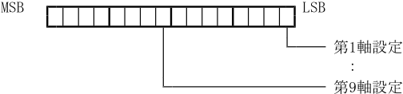

> **図の内容**
>
> ビットDn が第(n+1)軸を表す（1=エラー発生）。D0=第1軸設定、…、D8=第9軸設定。

- (6)データ受信エラー発生軸フラグエラーが発生した軸に対応するビット情報です。
- (7)通信タイムアウトエラー発生軸フラグ

エラーが発生した軸に対応するビット情報です。

- (8)ウォッチドッグエラー発生軸フラグ

エラーが発生した軸に対応するビット情報です。

#### 4-1-25.サーボ通信送受信データ読出 [DAT_**** / 16#35]

(A)(RTMC64-M3の場合)

メカトロリンク送受信データ読出 [DAT_ML_MON / 16#35]

**《データタイプ》**

DAT_ML_MON / 16#35

**《パラメータ》**

![サーボ通信送受信データ読出 [M3] のパラメータのビット構成](TB00-1044/images/image_000030_0daa18a36be2f0c86bf4d4c138f20c7bfda288024028caf6dc915d9975075d98.png)

> **図の内容**
>
> DAT_ML_MON のパラメータ(32bit):
>
> | ビット | 内容 |
> |---|---|
> | D00～D03 | 軸番号 |
> | D15 | 送信データフラグ |
>
> 上記以外のビットは未使用。

送信データフラグ

0:受信データ

1:送信データ

**《タスク指定》**

無効

**《説明》**

MECHATROLINK-Ⅲ通信の実際の送受信データを取得します。 (基本的にテクノデバッグ用の情報です。)

詳細はΣサーボのMECHATROLINK-Ⅲ通信仕様を参照下さい。

**《読み出し実行条件》**

常に実行可能です。

**《データフォーマット》**

○PLCデータレジスタ

データサイズ:64byte(32WORD)

|   オフセット [Byte] | データ名称                  | データサイズ   | データ範囲   | [単位]   |
|----------------|------------------------|-----------|---------|--------|
|              0 | MECHATROLINK-Ⅲ通信送受信データ | 64byte    | －       |        |

**○C言語構造体**

```c
/************************************************************************/
/* メカトロリンク受信データ構造体 */
/************************************************************************/
typedef struct{
    char dat[64];
} ML_MON;
```

(B)(RTMC64-ECの場合)

PDO送受信データ読出 [DAT_ML_MON / 16#35]

**《データタイプ》**

DAT_ECT_MON / 16#35

**《パラメータ》**

![サーボ通信送受信データ読出 [EC] のパラメータのビット構成](TB00-1044/images/image_000031_e26232aca64ce75bd7e7d7ddd469be9465b2c27e31c65a83da75ea79886f8534.png)

> **図の内容**
>
> DAT_ECT_MON のパラメータ(32bit):
>
> | ビット | 内容 |
> |---|---|
> | D00～D03 | 軸番号 |
> | D15 | 送信データフラグ（0: 受信データ、1: 送信データ） |
>
> 上記以外のビットは未使用。

**《タスク指定》**

無効

**《説明》**

EtherCAT通信の実際の送受信データを取得します。 (基本的にテクノデバッグ用の情報です。) EtherCAT通信仕様を参照下さい。

- 《読み出し実行条件》

常に実行可能です。

- 《データフォーマット》 ○PLCデータレジスタ

データサイズ:64byte(32WORD)

|   オフセット [Byte] | データ名称            | データサイズ   | データ範囲   | [単位]   |
|----------------|------------------|-----------|---------|--------|
|              0 | EtherCAT通信送受信データ | 64byte    | －       |        |

**○C言語構造体**

```c
/************************************************************************/
/* EtherCAT送受信データ構造体 */
/************************************************************************/
typedef struct{
    char dat[64];
} ECT_MON;
```

◆1.1

#### 4-1-26.ポイントテーブル書込/読出 [DAT_POINTTABLE / 16#3B]

**《データタイプ》**

DAT_POINTTABLE / 16#3B

**《パラメータ》**

軸指定、書込/読出開始ポイント番号指定、書込/読出ポイント数を指定します。

```c
    D20 D10 D00
    MSB
```

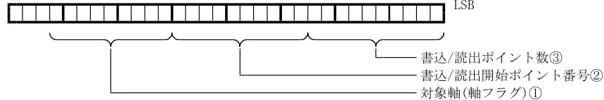

> **図の内容**
>
> パラメータ(32bit):
>
> | ビット | 内容 |
> |---|---|
> | D00～D09（10bit） | ③ 書込/読出ポイント数（1～400） |
> | D10～D19（10bit） | ② 書込/読出開始ポイント番号（1～400） |
> | D20～D28（9bit） | ① 対象軸（軸フラグ） |
>
> 例: 0x01b4b003 → 対象軸=0x01b（X/Y/A/B）、開始ポイント=0x12c(300)、ポイント数=0x003(3)。

① 対象軸(軸フラグ)

ダウンロード/アップロード対象の軸を指定します。

"1"を設定した軸に対してダウンロード/アップロードを行います。

D28 D20

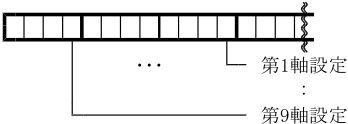

> **図の内容**
>
> 対象軸（軸フラグ）は D20～D28 の9bitで、D20=第1軸設定、…、D28=第9軸設定（1=ダウンロード/アップロード対象）。

② 書込/読出開始ポイント番号

ダウンロード/アップロードを行うポイント番号の開始値を指定します。 1～400の間で指定して下さい。

③ 書込/読出ポイント数

ダウンロード/アップロードを行うポイント数を指定します。 1～400の間で指定して下さい。

**《タスク指定》**

- 有効

**《書き込み実行条件》**

- 対象タスクがプログラム運転未実行

**《読み出し実行条件》**

- 常に実行可能です。

**《説明》**

- ポイント位置決め用のポイントテーブルを書込(ダウンロード)/読出(アップロード)します。
- ポイントテーブルはバックアップしていません。

電源投入時の初期値は、全ポイント/全軸無効状態です。

- この状態でポイント位置決めを行うと、何もしません。

電源投入時は毎回ポイントテーブルのダウンロードを行って下さい。

- パラメータの「開始ポイント番号&ポイント数」指定は、以下の範囲で指定して下さい。範囲外の時は、通信パラメータエラー(E$PARAM)になります。

1 ≦開始ポイント番号

開始ポイント番号+ポイント数 ≦ 400

- ポイントテーブルのデータは、軸指定で有効な軸のみを前詰めで設定します。
- タスクで有効な軸に対して、軸指定で指定しなかった場合は、その軸は移動しません。
- タスクで無効な軸に対して、軸指定で指定した場合は、その軸は無視されます。(移動しません)
- 位置指定に"0x80000000"を設定した軸は移動しません。

**《データフォーマット》**

**○PLCデータレジスタ**

データサイズ:「書込/読出ポイント数」*「対象軸数」* 4byte(2WORD)

| オフセット [Byte]   | データ名称         | データサイズ   | データ範囲 [単位]             |
|----------------|-------------------|-----------|------------------------|
| 0              | 第nポイント第p軸目標位置     | long      | -1000000000～1000000000 |
|                | ：                 |           |                        |
|                | ：                 |           |                        |
| (m-1)×軸数×4     | 第n+m-1ポイント第q軸目標位置 | long      | -1000000000～1000000000 |

- n : 書込/読出開始ポイント番号
- m : 書込/読出ポイント数
- p : 対象軸指定の最初の対象軸
- q : 対象軸指定の最後の対象軸

**○C言語構造体**

なし。(要素数「書込/読出ポイント数」*「対象軸数」以上のlongの配列)

**《データ設定/動作例》**

- 対象タスクの割り当て軸:0x17(X/Y/Z/B)
- ダウンロード時のパラメータ指定:0x01b4b003
- ※ 対象軸=0x01b(X/Y/A/B)、

開始ポイント=0x12c(300)、

ポイント数=0x003(3)

- → 特殊な動作例としてタスクの割り当て軸と対象軸を変えてあります。通常は同じ設定でご使用下さい。

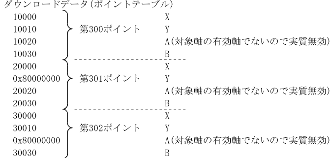

> **図の内容**
>
> ダウンロードデータ（ポイントテーブル）の例。対象軸 X/Y/A/B、開始ポイント300、ポイント数3。
> データは「ポイントごとに対象軸の順（X, Y, A, B）」で long を並べる。
>
> | ポイント | X | Y | A | B |
> |---|---|---|---|---|
> | 第300ポイント | 10000 | 10010 | 10020 | 10030 |
> | 第301ポイント | 20000 | 0x80000000 | 20020 | 20030 |
> | 第302ポイント | 30000 | 30010 | 0x80000000 | 30030 |
>
> A軸は対象タスクの有効軸（割り当て軸）でないため、実質無効。

・運転プログラム & 動作説明

```c
    PTMA P1;    /*→ポイントテーブルをダウンロードしていないので */
/* 無効データになっているため何もしません。 */
    PTMA P300;  /*→X10000、Y10010、B10030 へ移動します。 */
/* Z軸は目標位置をダウンロードしていないので移動しません。 */
/* A軸はタスクに割り当てられていないので移動しません。 */
    PTMA P301;  /*→X20000、B20030 へ移動します。 */
/* Y軸は目標位置に無効値を設定しているので移動しません。 */
/* Z軸は目標位置をダウンロードしていないので移動しません。 */
/* A軸はタスクに割り当てられていないので移動しません。 */
    PTMA P302;  /*→X30000、Y30010、B30030 へ移動します。 */
/* Z軸は目標位置をダウンロードしていないので移動しません。 */
/* A軸はタスクに割り当てられていないので移動しません。 */
/* (目標位置に無効値を設定していますが、元々割り当てられて */
/* いない軸なので特に意味はありません。) */
    END;
```

#### 4-1-27.プログラムブロック情報読出 [DAT_PRGBLKINFO / 16#1B]

**《データタイプ》**

DAT_PRGBLKINFO / 16#1B

**《パラメータ》**

なし

**《タスク指定》**

無効

**《説明》**

現在の各プログラムブロック情報を読み出します。

**《読み出し実行条件》**

常に実行可能です。

**《データフォーマット》**

○PLCデータレジスタ

データサイズ:256byte(128WORD)

|   オフセット [Byte] | データ名称     | データサイズ   | データ範囲 [単位]   |
|----------------|-----------|-----------|--------------|
|              0 | 第1ブロック情報  | 4byte     | -            |
|                | :         |           |              |
|            252 | 第64ブロック情報 | 4byte     | -            |

各ブロック情報

|   オフセット [Byte] | データ名称   | データサイズ   | データ範囲 [単位]   |
|----------------|---------|-----------|--------------|
|              0 | プログラム番号 | short     | 1～32767      |
|              2 | タスク番号   | short     | 0～7          |

**○C言語構造体**

```c
/************************************************************************/
/* プログラムブロック情報構造体 */
/************************************************************************/
typedef struct {   /* (256バイト) */
struct{
    short PrgNo;   /* プログラム番号 */
    short TaskNo;  /* タスク番号 */
} inf[64];
} PRGBLK_INF;
```

#### 4-1-28.補間前加減速(自動ｺｰﾅｵｰﾊﾞｰﾗｲﾄﾞ)パラメータ書込/読出 [DAT_ACOPARAM / 16#37] <オプション>

**《データタイプ》**

DAT_ACOPARAM / 16#37

**《パラメータ》**

0 : 《タスク指定》で指定された1タスク分のみ書込/読出

1 : 全タスク(8タスク)分書込/読出

**《タスク指定》**

1 タスク分書込/読出時:有効

全タスク分書込/読出時:無効

**《説明》**

補間前加減速のパラメータを設定します。

補間前加減速パラメータ書込/読出コマンドを実行するには、補間前加減速オプションが必要です。

**《書き込み実行条件》**

- 指定したタスクの軸が移動中でない。

**《読み出し実行条件》**

- 常に実行可能です。

**《データフォーマット》**

**○PLCデータレジスタ**

データサイズ:48byte(24WORD)(1タスク分)

| オフセット [Byte]   | データ名称                       | データサイズ   | データ範囲 [単位]                |
|----------------|-----------------------------|-----------|---------------------------|
| 0              | 補間前加減速(自動コーナオーバライド)時定数     | long      | 0～16384 [msec]            |
| 4              | 補間前加減速(自動コーナオーバライド)切換加速度1  | long      | 0～2000000000 [pulse/sec2] |
| ：              | ：                           | ：         | ：                         |
| 28             | 補間前加減速(自動コーナオーバライド)切換加速度7  | long      | 0～2000000000 [pulse/sec2] |
| 32             | 補間前加減速(自動コーナオーバライド)オーバライド1 | short     | 0～100 [%]                 |
| :              | :                           | :         | :                         |
| 44             | 補間前加減速(自動コーナオーバライド)オーバライド7 | short     | 0～100 [%]                 |
| 46             | 予約                          | short     | -                         |

データサイズ:384byte(192WORD)（全タスク分）

| オフセット [Byte]   | デー   | タ名称       | データサイズ   | データ範囲 [単位]   |
|----------------|-------|-------------|-----------|--------------|
| 0～ 47          | タスク0用 | 補間前加減速パラメータ | 48byte    | －            |
| 48～ 95         | タスク1用 | 補間前加減速パラメータ | 48byte    | －            |
| 96～143         | タスク2用 | 補間前加減速パラメータ | 48byte    | －            |
| 144～191        | タスク3用 | 補間前加減速パラメータ | 48byte    | －            |
| 192～239        | タスク4用 | 補間前加減速パラメータ | 48byte    | －            |
| 240～287        | タスク5用 | 補間前加減速パラメータ | 48byte    | －            |
| 288～335        | タスク6用 | 補間前加減速パラメータ | 48byte    | －            |
| 336～383        | タスク7用 | 補間前加減速パラメータ | 48byte    | －            |

**○C言語構造体**

```c
/************************************************************************/
/* プログラムブロック情報構造体 */
/************************************************************************/
typedef struct {              /* (48バイト) */
    long aco_acot;            /* 補間前加減速時定数 [msec] */
    long aco_accdat[7];       /* 補間前加減速切換加速度 [pulse/sec2] */
    short aco_ovrdat[7];      /* 補間前加減速オーバライドデータ [%] */
    unsigned short Reserved;  /* 未使用 */
} ACO_PRM;
```

- ※ 全タスク分の時は、ACO_PRM の要素数8の配列で定義して下さい。

**《データ詳細》**

- (1) 補間前加減速(自動コーナオーバライド)時定数現状の速度から仮に速度"0"まで減速する時間[msec]を設定します。 (速度"0"から指定の速度まで加速するまでの時間と同じです)
- (2) 補間前加減速(自動コーナオーバライド)切換加速度、補間前加減速オーバライド以下の各加減速範囲における最小オーバライドを設定します。

```c
    補間前加減速の切換加速度1～補間前加減速の切換加速度2 => 補間前加減速のオーバライド2
    補間前加減速の切換加速度2～補間前加減速の切換加速度3 => 補間前加減速のオーバライド3
    補間前加減速の切換加速度3～補間前加減速の切換加速度4 => 補間前加減速のオーバライド4
    補間前加減速の切換加速度4～補間前加減速の切換加速度2 => 補間前加減速のオーバライド5
    補間前加減速の切換加速度5～補間前加減速の切換加速度2 => 補間前加減速のオーバライド6
    補間前加減速の切換加速度6～補間前加減速の切換加速度7 => 補間前加減速のオーバライド7
```

※補間前加減速のオーバライド1は使用しません。"100"を設定して下さい。

#### 4-1-29.工具長補正設定情報読出 [DAT_TOOLHSTS / 16#39]

**《データタイプ》**

DAT_TOOLHSTS / 16#39

**《パラメータ》**

なし

**《タスク指定》**

有効

**《説明》**

現在の工具長補正情報を読み出します。

**《読み出し実行条件》**

常に実行可能です。

**《データフォーマット》**

○PLCデータレジスタ

データサイズ:4byte(2WORD)

|   オフセット [Byte] | データ名称   | データサイズ   | データ範囲 [単位]      |
|----------------|---------|-----------|-----------------|
|              0 | 補正有効フラグ | short     | 0:長補正未実行、1:長補正中 |
|              2 | 選択中補正No | short     | 0～19            |

**○C言語構造体**

```c
/************************************************************************/
/* 工具長補正情報構造体 */
/************************************************************************/
typedef struct {
    short toolh_en;  /* 補正有効フラグ */
    short toolh_no;  /* 選択中補正No */
} TOOLHSTS;
```

#### 4-1-30.工具径補正設定情報読出 [DAT_TOOLDSTS / 16#3A]

**《データタイプ》**

DAT_TOODHSTS / 16#3A

**《パラメータ》**

なし

**《タスク指定》**

有効

**《説明》**

現在の工具径補正情報を読み出します。

**《読み出し実行条件》**

常に実行可能です。

**《データフォーマット》**

○PLCデータレジスタ

データサイズ:4byte(2WORD)

|   オフセット [Byte] | データ名称   | データサイズ   | データ範囲 [単位]      |
|----------------|---------|-----------|-----------------|
|              0 | 補正有効フラグ | short     | 0:径補正未実行、1:径補正中 |
|              2 | 選択中補正No | short     | 0～19            |

**○C言語構造体**

```c
/************************************************************************/
/* 工具径補正情報構造体 */
/************************************************************************/
typedef struct {
    short toold_en;  /* 補正有効フラグ */
    short toold_no;  /* 選択中補正No */
} TOOLDSTS;
```

#### 4-1-31.軸割り当て情報読出 [DAT_ASSAXISTBL / 16#3C]

- 《データタイプ》

DAT_ASSAXISTBL / 16#3C

**《パラメータ》**

なし

**《タスク指定》**

無効

- 《説明》

現在の各軸タスク割り付け情報を読み出します。

- 《読み出し実行条件》

常に実行可能です。

**《データフォーマット》**

○PLCデータレジスタ

データサイズ:136byte(68WORD)

|   オフセット [Byte] | データ名称        | データサイズ   | データ範囲 [単位]   |
|----------------|--------------|-----------|--------------|
|              0 | 有効軸フラグ       | longlong  | －            |
|              8 | 第1軸割り当てテーブル  | short     | －            |
|                | ：            |           |              |
|            132 | 第63軸割り当てテーブル | short     |              |
|            134 | 第64軸割り当てテーブル | short     | －            |

**○C言語構造体**

```c
/************************************************************************/
/* 軸割り当て情報構造体 */
/************************************************************************/
typedef struct {
    char tsk;               /* タスク番号 */
    char axn;               /* 論理軸番号 */
} ASS_AXIS;
typedef struct {
    _int64 axis_en;         /* 有効軸フラグ */
    ASS_AXIS ass_axis[64];  /* 軸割り当てテーブル */
} ASSAXISTBL;
```

**《データ詳細》**

- (1) 有効軸フラグ(64ビット)

どの物理軸が有効かを示します。

有効軸に対応するビットに1が設定されます。

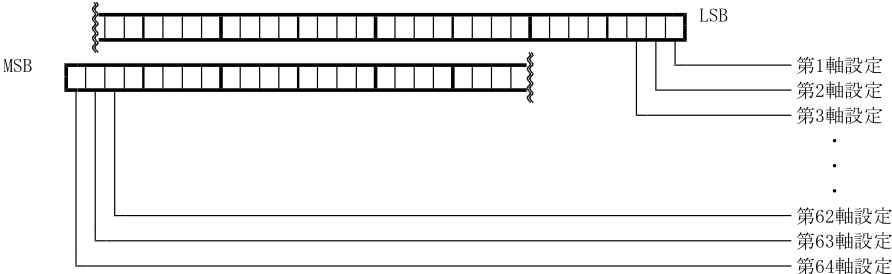

> **図の内容**
>
> 有効軸フラグ(64bit)。ビットDn が第(n+1)物理軸を表す（1=有効軸）。
> D0=第1軸設定、D1=第2軸設定、D2=第3軸設定、…、D61=第62軸設定、D62=第63軸設定、D63=第64軸設定。

(2) 第ｎ軸割り当てテーブル

物理軸第n軸が割り付けたタスクとそのタスクでの論理軸番号を示します。

- タスク番号:0～7
- 論理軸番号:0～8

※PLCデータレジスタ上では、以下の様なデータ構造になります。

MSB

LSB

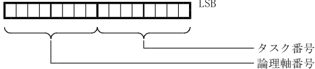

> **図の内容**
>
> 第n軸割り当てテーブルの各要素(16bit、ASS_AXIS構造体):
>
> | ビット | 内容 |
> |---|---|
> | D0～D7（下位バイト、tsk） | タスク番号 |
> | D8～D15（上位バイト、axn） | 論理軸番号 |

#### 4-1-32.制御周期内処理時間計測データ読出 [DAT_RTC / 16#21]

**《データタイプ》**

DAT_RTC / 16#21

**《パラメータ》**

なし

**《タスク指定》**

無効

**《説明》**

内部にて制御周期毎の内部処理にかかっている時間を実測します。実測した値を制御周期内処理時間測定データ読出コマンドで読み出します。

読み出した値は、x86のRDTSC命令(※2)で読み出した値から計算しています。

- 《読み出し実行条件》

常に実行可能です。

**《データフォーマット》**

○PLCデータレジスタ

データサイズ:8byte(4WORD)

|   オフセット [Byte] | データ名称   | データサイズ   | データ範囲 [単位]   |
|----------------|---------|-----------|--------------|
|              0 | 最大処理時間  | long      | ０～4294967295 |
|              4 | 現在処理時間  | long      | ０～4294967295 |

**○C言語構造体**

```c
/************************************************************************/
/* RTC処理時間格納構造体 */
/************************************************************************/
typedef struct {
    unsigned long RtcMax;  /* 最大処理時間 */
    unsigned long RtcNow;  /* 現在処理時間 */
} RTCTIME;
#define TIMERCLOCK 1       /* 処理時間ｶｳﾝﾄｸﾛｯｸINtimeの場合、
```

us単位で情報取得(MHx) */

- ※1 処理時間カウントクロックで割ることにより、時間単位[μsec]になります。

max[μsec] = (long)(RtcMax / TIMERCLOCK);

now[μsec] = (long)(RtcNow / TIMERCLOCK);

※2 x86のRDTSC命令 : パソコンのタイムスタンプカウンタ読み出し命令

#### 4-1-33.フォアグランド周期計測データ読出[DAT_FORGROUND / 16#90]

**《データタイプ》**

DAT_FORGROUND / 16#90

**《パラメータ》**

なし

**《タスク指定》**

無効

**《説明》**

内部にてフォアグランドループの処理にかかっている時間を実測します。実測した値をフォアグランド周期測定データ読出コマンドで読み出します。

読み出した値は、x86のRDTSC命令(※2)で読み出した値から計算しています。

**《読み出し実行条件》**

常に実行可能です。

**《データフォーマット》**

○PLCデータレジスタ

データサイズ:8byte(4WORD)

|   オフセット [Byte] | データ名称   | データサイズ   | データ範囲 [単位]   |
|----------------|---------|-----------|--------------|
|              0 | 最大処理時間  | long      | ０～4294967295 |
|              4 | 現在処理時間  | long      | ０～4294967295 |

**○C言語構造体**

```c
/************************************************************************/
/* フォアグランド処理時間格納構造体 */
/************************************************************************/
typedef struct {
    unsigned long ForMax;  /* 最大処理時間 */
    unsigned long ForNow;  /* 現在処理時間 */
} FORTIME;
```

※1 処理時間ｶｳﾝﾄｸﾛｯｸで割ることにより、時間単位[μsec]になります。

max[μsec] = (long)(ForMax / TIMERCLOCK);

now[μsec] = (long)(ForNow / TIMERCLOCK);

※2 x86のRDTSC命令 : パソコンのタイムスタンプカウンタ読み出し命令

#### 4-1-34.工具径補正エラー情報読出[DAT_TOOLDERR / 16#3D]

**《データタイプ》**

DAT_TOOLDERR / 16#3D

**《パラメータ》**

なし

**《タスク指定》**

有効

**《説明》**

工具径補正実行中にプログラム運転を続行できなくなる条件が発生したとき、その原因をビットコードにして通知します。

- 《読み出し実行条件》常に実行可能です。

**《データフォーマット》**

○PLCデータレジスタ

データサイズ:16byte(8WORD)

| オフセット [Byte]   | データ名称   | データサイズ   | データ範囲 [単位]   |
|----------------|-------------|-----------|--------------|
| 0              | エラー発生ステップ番号 | long      | 1～32767      |
| 4              | エラーコード      | long      | 1～8191       |
| 8～15           | 予約          | byte * 8  | －            |

**○C言語構造体**

```c
/************************************************************************/
/* 工具径補正エラー情報構造体 */
/************************************************************************/
typedef struct {
    unsigned long StepNo;       /* エラー発生ステップ番号 */
    long ErrCode;               /* エラーコード */
    unsigned char Reserved[8];  /* 未使用 */
} TOOLDERR;
```

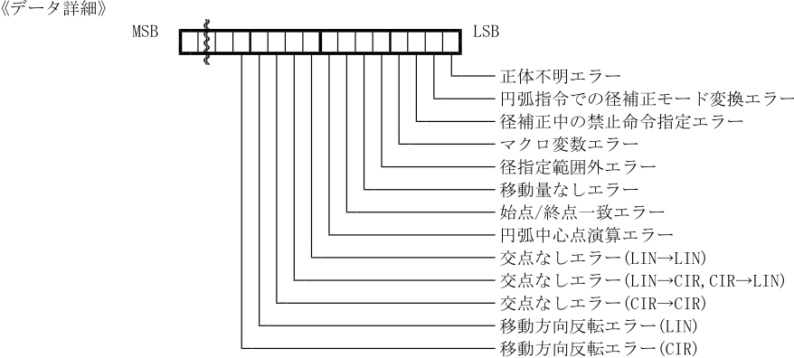

> **図の内容**
>
> 工具径補正エラー情報（エラーコード）のビット割り当て:
>
> | ビット | 内容 |
> |---|---|
> | D0 | 正体不明エラー |
> | D1 | 円弧指令での径補正モード変換エラー |
> | D2 | 径補正中の禁止命令指定エラー |
> | D3 | マクロ変数エラー |
> | D4 | 径指定範囲外エラー |
> | D5 | 移動量なしエラー |
> | D6 | 始点/終点一致エラー |
> | D7 | 円弧中心点演算エラー |
> | D8 | 交点なしエラー（LIN→LIN） |
> | D9 | 交点なしエラー（LIN→CIR, CIR→LIN） |
> | D10 | 交点なしエラー（CIR→CIR） |
> | D11 | 移動方向反転エラー（LIN） |
> | D12 | 移動方向反転エラー（CIR） |
>
> 上記以外のビットは未使用。

#### 4-1-35.主軸回転数読出[DAT_SPREV / 16#41]

**《データタイプ》**

DAT_SPREV / 16#41

**《パラメータ》**

なし

**《タスク指定》**

有効

**《説明》**

主軸の現在の回転数を参照します。

**《読み出し実行条件》**

常に実行可能です。

**《データフォーマット》**

○PLCデータレジスタ

データサイズ:8byte(4WORD)

|   オフセット [Byte] | データ名称   | データサイズ   | データ範囲 [単位]             |
|----------------|-------------|-----------|------------------------|
|              0 | 主軸指令回転数     | long      | -2147483648～2147483647 |
|              4 | 主軸実回転数      | long      | -2147483648～2147483647 |

**○C言語構造体**

```c
/************************************************************************/
/* 主軸回転数情報構造体 */
/************************************************************************/
typedef struct {
    long ComSpRevo;  /* 主軸指令回転数 */
    long ActSpRevo;  /* 主軸実回転数 */
} SPREVDAT;
```

#### 4-1-36.絶対値エンコーダオフセット書込/読出 [DAT_ABSENCOFS / 16#1C]

**《データタイプ》**

DAT_ABSENCOFS / 16#1C

**《パラメータ》**

なし

**《タスク指定》**

なし

**《説明》**

絶対値エンコーダオフセットの書込/読出を行いますす。

**《書き込み実行条件》**

- 全タスクセッティングモード
- 《読み出し実行条件》

常に実行可能です。

- 《データフォーマット》 ○PLCデータレジスタ

データサイズ:256byte(128WORD)

| オフセット [Byte]   | データ名称              | データサイズ   | データ範囲 [単位]                     |
|----------------|------------------------|-----------|--------------------------------|
| 0              | 第１物理軸絶対値ｴﾝｺｰﾀﾞｵﾌｾｯﾄ    | long      | -2147483648～2147483647 [pulse] |
| 4              | 第２物理軸絶対値ｴﾝｺｰﾀﾞｵﾌｾｯﾄ    | long      | -2147483648～2147483647 [pulse] |
| ：              | ：                      | ：         | ：                              |
| 248            | ：第６３物理軸絶対値ｴﾝｺｰﾀﾞｵﾌｾｯﾄ | long      | -2147483648～2147483647 [pulse] |
| 252            | 第６４物理軸絶対値ｴﾝｺｰﾀﾞｵﾌｾｯﾄ   | long      | -2147483648～2147483647 [pulse] |

**○Ｃ言語構造体**

```c
/************************************************************************/
/* 絶対値エンコーダオフセット構造体 */
/************************************************************************/
typedef struct{
    long ofs[64];
} ABSENCOFS;
```

#### 4-1-37.EtherCATオブジェクト選択情報読出/書込 [DAT_ECOBJSEL / 16#A0]

**《データタイプ》**

DAT_ECOBJSEL / 16#A0

**《パラメータ》**

論理軸番号:0～8

物理局番号:0～63

**《タスク指定》**

有効論理軸指定：0～7

物理局指定：-1

**《説明》**

「4-1-38.EtherCATオブジェクト値読出/書込」にて、読出/書込するオブジェクトを選択する情報を読出/書込します。

本データで書き込んだ情報は、RTMC64-ECが実行されている間はメモリ上に保持されます。

**《書き込み実行条件》**

常に実行可能です。

**《読み出し実行条件》**

常に実行可能です。

**《データフォーマット》**

**○PLCデータレジスタ**

データサイズ:12byte

|   オフセット [Byte] | データ名称          | データサイズ   | データ範囲 [単位]   |
|----------------|----------------|-----------|--------------|
|              0 | オブジェクトIndex    | WORD      | 0～65535      |
|              2 | オブジェクトSubindex | BYTE      | 0～255        |
|              3 | オブジェクトサイズ      | BYTE      | 0～255 [Byte] |

**○C言語構造体**

```c
/************************************************************************/
/* EtherCATオブジェクト選択情報 */
/************************************************************************/
typedef struct {
    short Index;    /* オブジェクトIndex */
    char Subindex;  /* オブジェクトSubindex */
    char Size;      /* オブジェクトサイズ[Byte] */
} ECTOBJSEL;
```

#### 4-1-38.EtherCATオブジェクト値読出/書込 [DAT_ECOBJVAL / 16#A1]

- 《データタイプ》

DAT_ECOBJVAL / 16#A1

**《パラメータ》**

論理軸番号:0～8

物理局番号:0～63

**《タスク指定》**

有効論理軸指定：0～7

物理局指定：-1

**《説明》**

「4-1-37.EtherCATオブジェクト選択情報読出/書込」にて選択した、オブジェクトを実スレーブ局から読出/書込します。

- 《書き込み実行条件》

常に実行可能です。

- 《読み出し実行条件》常に実行可能です。
- 《データフォーマット》 ○PLCデータレジスタ

データサイズ:256byte

|   オフセット [Byte] | データ名称   | データサイズ   | データ範囲 [単位]   |
|----------------|---------|-----------|--------------|
|              0 | オブジェクト値 | 256Byte   | ------       |

**○C言語構造体**

```c
/************************************************************************/
/* EtherCATオブジェクト値 */
/************************************************************************/
typedef union {
    char bt;        /* BYTE(1byte)アクセス */
    short wd;       /* WORD(2byte)アクセス */
    long dw;        /* DWORD(4byte)アクセス */
    char str[256];  /* 文字列(最大256byte)アクセス */
} ECTOBJVAL;
```

### 4-2.動作指示コマンド詳細

動作指示コマンドは、PLCやPCアプリからRTMC64に各種動作の指示を行う機能です。 PLCとの通信はPLCデータレジスタを使用してRTMC64へ動作指示を行います。 PCアプリとの通信は通信ライブラリのSendCommand()関数を使用して、RTMC64へ動作指示を行います。以降の《説明》の記述は、動作指示コマンドをRTMC64が受信した時のRTMC64の動作の説明です。

#### 4-2-1.バックアップメモリ初期化コマンド [REQ_GENE / 16#14]

**《データタイプ》**

REQ_GENE / 16#14

**《タスク指定》**

無効

**《説明》**

RTMC64のバックアップメモリのデータを初期化します。バックアップされているデータは以下の通りです。

- パラメータ・・・「4-1-1.サーボパラメータデータ」

「4-1-4.ピッチエラー補正パラメータデータ」

「4-1-5.工具長補正データ」

「4-1-22.工具径補正データ」

「4-1-28.補間前加減速パラメータデータ」

- 運転プログラム・・・「4-1-2.プログラムデータ」
- アブソポジション・・・・・絶対値エンコーダの基準値として記憶
- ポイントテーブル・・・・・「4-1-26.ポイントテーブル」

パラメータを初期化すると、RTMC64はパラメータ未設定エラーになります。

パラメータ未設定エラーは、各パラメータを再設定する事により解除できます。 (無効のオプションに対する設定は不要です。)

**《コマンド実行条件》**

- 全タスクセッティングモード

**《データフォーマット》**

○PLCデータレジスタ

データサイズ:2byte(1WORD)

|   オフセット [Byte] | データ名称   | データサイズ   | データ範囲 [単位]   |
|----------------|-------------|-----------|--------------|
|              0 | 初期化データ選択フラグ | short     |              |

**○C言語構造体**

```c
/************************************************************************/
/* バックアップメモリ初期化コマンド付加データ構造体 */
/************************************************************************/
typedef struct {
    unsigned short InitCmnd;  /* 初期化データ選択フラグ */
} GENERATION;
```

**《データ詳細》**

- (1) 初期化データ選択フラグ初期化を行うデータの種別を指定します。種別に対応するビットに"1"を設定するとそのデータが初期化されます。

MSB


> **図の内容**
>
> 初期化データ選択フラグのビット割り当て（"1"を設定した種別のデータを初期化する）:
>
> | ビット | 内容 |
> |---|---|
> | D0 | 各種パラメータ初期化指定 |
> | D1 | 運転プログラム初期化指定 |
> | D2 | アブソ座標初期化指定 |
> | D3 | マクロ変数初期化指定 |
> | D4 | ポイントテーブル初期化指定 |
>
> 上記以外のビットは未使用。

#### 4-2-2.動作モード変更コマンド [REQ_MODECHG / 16#10]

**《データタイプ》**

REQ_MODECHG / 16#10

**《タスク指定》**

有効

**《説明》**

動作モードを設定します。

RTMC64の電源投入後のデフォルト動作モードは、自動運転モードです。

**《コマンド実行条件》**

- プログラム運転実行中でない
- 移動中の軸がない
- 原点復帰中でない
- ホーム戻り中でない
- 独立位置決め中の軸がない
- トルク指令中の軸がない
- 機械パネルで動作モード選択中でない

**《データフォーマット》**

○PLCデータレジスタ

データサイズ:2byte(1WORD)

|   オフセット [Byte] | データ名称   | データサイズ   | データ範囲 [単位]   |
|----------------|-------------|-----------|--------------|
|              0 | 動作モード       | short     | 0～4          |

**○C言語構造体**

```c
/************************************************************************/
/* 動作モードデータ変更コマンド付加データ構造体 */
/************************************************************************/
typedef struct {
    short mode;  /* 動作モード */
} MODECHG;
```

**《データ詳細》**

- (1) 動作モード

設定する動作モードを指定します。

※DNC運転オプション有りの時のみ指定可

|   設定値 | モード       |
|-------|-----------|
|     0 | セッティングモード |
|     1 | 手動運転モード   |
|     2 | 自動運転モード   |
|     3 | OT無視モード   |
|     4 | DNC運転モード  |

#### 4-2-3.軸移動停止コマンド [REQ_STOP / 16#13]

**《データタイプ》**

REQ_STOP / 16#13

**《タスク指定》**

有効

- 《説明》プログラム運転実行または移動コマンド発行によって移動中の軸を停止させます。軸移動停止は、動作モードや動作状態に関わらず実行可能です。
- 《コマンド実行条件》

常に実行可能です。

**《データフォーマット》**

コマンド付加データは有りません。

#### 4-2-4.軸移動再開コマンド [REQ_RESTART / 16#1B]

**《データタイプ》**

REQ_RESTART / 16#1B

**《タスク指定》**

有効

**《説明》**

軸移動停止コマンドにより停止中になっている軸の、移動を再開させます。軸移動再開は、以下のような移動を軸移動停止コマンドで停止させた場合に実行可能です。

**《コマンド実行条件》**

- サーボON状態
- インクレPTP位置決めコマンドによる軸移動が停止中
- アブソPTP位置決めコマンドによる軸移動が停止中
- インクレ補間位置決めコマンドによる軸移動が停止中
- アブソ補間位置決めコマンドによる軸移動が停止中

※このコマンドは使用条件が複雑です。このコマンドをお使いになる場合はテクノに問い合わせてください。

**《データフォーマット》**

コマンド付加データは有りません。

#### 4-2-5.JOG移動コマンド [REQ_JOGSTART / 16#11]

**《データタイプ》**

REQ_JOGSTART / 16#11

**《タスク指定》**

有効

**《説明》**

指定した軸のJOG移動を開始します。

有効軸以外の軸指定は、無効です。

JOGで移動中の軸が有る場合は、新たに他の軸へのJOG動作を実行できません。 ※ 軸移動停止コマンド[REQ_STOP($13)]でJOG動作を中断します。

**《コマンド実行条件》**

- サーボON状態
- 動作モードが手動運転モードか自動運転モードかOT無視モード
- プログラム運転未実行またはティーチング中または"M0"停止中
- 移動中の軸がない
- 原点復帰中でない
- ホーム戻り中でない
- 手動パルサー選択無効
- 指定軸が回転速度指令中(SPIN中)でない

**《データフォーマット》**

**○PLCデータレジスタ**

データサイズ:4byte(2WORD)

|   オフセット [Byte] | データ名称   | データサイズ   | データ範囲 [単位]   |
|----------------|-------------|-----------|--------------|
|              0 | 移動軸選択フラグ    | short     |              |
|              2 | 軸移動方向フラグ    | short     |              |

**○C言語構造体**

```c
/************************************************************************/
/* JOG移動開始コマンド付加データ構造体 */
/************************************************************************/
typedef struct {
    unsigned short AxisFlag;  /* 移動軸選択フラグ */
    unsigned short JogVect;   /* 軸移動方向フラグ */
} JOGSTART;
```

**《データ詳細》**

- (1) 移動軸選択フラグ

JOG移動コマンドで動かす軸を指定します。

各軸に対応するビットに"1"を設定するとその軸が移動しす。

MSB

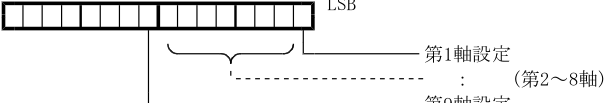

> **図の内容**
>
> ビットDn が第(n+1)軸を表す（1=その軸が移動する）。D0=第1軸設定、D1～D7=第2～8軸、D8=第9軸設定。

(2) 軸移動方向フラグ

JOG移動コマンドで動かす軸の移動方向を指定します。

各軸に対応するビットに"1"を設定するとその軸が-方向へ、"0"を設定すると+方向へ移動します。

MSB

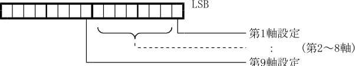

> **図の内容**
>
> ビットDn が第(n+1)軸の移動方向を表す（1=-方向、0=+方向）。D0=第1軸設定、D1～D7=第2～8軸、D8=第9軸設定。

LSB

第9軸設定

第9軸設定

#### 4-2-6.各軸原点復帰コマンド [REQ_ZRNSTART / 16#12､ REQ_AXAUTOZRN / 16#33]

**《データタイプ》**

REQ_ZRNSTART / 16#12

REQ_AXAUTOZRN / 16#33

**《タスク指定》**

有効

**《説明》**

REQ_ZRNSTART :各軸手動原点復帰指定(逃げ動作を行いません)

REQ_AXAUTOZRN:各軸自動原点復帰指定(逃げ動作を行います)

指定した軸の原点復帰を開始します。

有効軸以外の軸指定は無効です。

サーボパラメータの「原点復帰方向」が"無し"の軸は無効です。

**《コマンド実行条件》**

- サーボON状態
- 動作モードが手動運転モードか自動運転モード
- プログラム運転未実行
- 移動中の軸がない
- 原点復帰中でない
- ホーム戻り中でない
- 手動パルサー選択無効
- 指定軸が独立位置決め中でない
- 指定軸がトルク指令中でない
- 指定軸が回転速度指令中(SPIN中)でない

**《関連項目》**

4-2-21.全軸原点復帰開始コマンド

**《データフォーマット》**

- ○PLCデータレジスタ

データサイズ:2byte(1WORD)

|   オフセット [Byte] | データ名称   | データ長   | データ範囲 [単位]   |
|----------------|-------------|--------|--------------|
|              ０ | 原点復帰軸選択フラグ  | short  |              |

**○C言語構造体**

```c
/************************************************************************/
/* 原点復帰移動開始コマンド付加データ構造体 */
/************************************************************************/
typedef struct {
    unsigned short AxisFlag;  /* 移動軸選択フラグ */
} ZRNSTART;
```

**《データ詳細》**

- (1) 原点復帰軸選択フラグ

原点復帰コマンドで動かす軸を指定します。

各軸に対応するビットに"1"を設定するとその軸が原点復帰を行います。

MSB

LSB

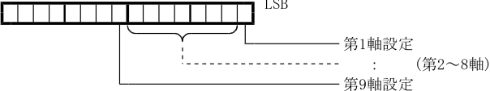

> **図の内容**
>
> ビットDn が第(n+1)軸を表す（1=原点復帰を行う）。D0=第1軸設定、D1～D7=第2～8軸、D8=第9軸設定。

#### 4-2-7.インクレPTP位置決めコマンド [REQ_PTPSTART / 16#15]

**《データタイプ》**

REQ_PTPSTART / 16#15

**《タスク指定》**

有効

**《説明》**

インクレモードのPTP位置決めを行います。有効軸以外の軸指定は無効です。

**《コマンド実行条件》**

- サーボON状態
- 動作モードが手動運転モードか自動運転モード
- プログラム運転未実行またはティーチング中
- 移動中の軸がない
- 原点復帰中でない
- ホーム戻り中でない
- 手動パルサー選択無効
- 指定軸が独立位置決め中でない
- 指定軸がトルク指令中でない
- 指定軸が回転速度指令中(SPIN中)でない

**《データフォーマット》**

**○PLCデータレジスタ**

データサイズ:40byte(20WORD)

|   オフセット [Byte] | データ名称     | データサイズ   | データ範囲 [単位]                    |
|----------------|---------------|-----------|-------------------------------|
|              0 | 移動軸選択フラグ      | long      |                               |
|              4 | 第1軸インクリメント移動量 | long      | -1000000000～1000000000[pulse] |
|              8 | 第2軸インクリメント移動量 | long      | -1000000000～1000000000[pulse] |
|             12 | 第3軸インクリメント移動量 | long      | -1000000000～1000000000[pulse] |
|             16 | 第4軸インクリメント移動量 | long      | -1000000000～1000000000[pulse] |
|             20 | 第5軸インクリメント移動量 | long      | -1000000000～1000000000[pulse] |
|             24 | 第6軸インクリメント移動量 | long      | -1000000000～1000000000[pulse] |
|             28 | 第7軸インクリメント移動量 | long      | -1000000000～1000000000[pulse] |
|             32 | 第8軸インクリメント移動量 | long      | -1000000000～1000000000[pulse] |
|             36 | 第9軸インクリメント移動量 | long      | -1000000000～1000000000[pulse] |

**○C言語構造体**

```c
/************************************************************************/
/* PTP移動開始コマンドパラメータ構造体 */
/************************************************************************/
typedef struct {
    unsigned long AxisFlag;  /* 移動軸選択フラグ */
    long IncAxis[9];         /* 各軸インクリメント移動量 */
} PTPSTART;
```

**《データ詳細》**

- (1) 移動軸選択フラグ

移動コマンドで動かす軸を指定します。

各軸に対応するビットに"1"を設定するとその軸が移動を行います。

MSB

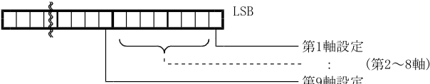

> **図の内容**
>
> ビットDn が第(n+1)軸を表す（1=その軸が移動する）。D0=第1軸設定、D1～D7=第2～8軸、D8=第9軸設定。

第9軸設定

- (2) 第1軸～第9軸インクリメント移動量各軸の現在位置からの移動量を指定します。設定単位は[pulse]です。

#### 4-2-8.アブソＰＴＰ位置決めコマンド [REQ_PTPASTART / 16#16､ REQ_PTPBSTART / 16#34]

**《データタイプ》**

REQ_PTPASTART / 16#16

REQ_PTPBSTART / 16#34

**《タスク指定》**

有効

**《説明》**

REQ_PTPASTART / 16#16 : 論理座標系アブソ指定

REQ_PTPBSTART / 16#34 : 機械座標系アブソ指定

アブソモードのPTP位置決め行います。有効軸以外の軸指定は無効です。

**《コマンド実行条件》**

- サーボON状態
- 動作モードが手動運転モードか自動運転モード
- プログラム運転未実行またはティーチング中
- 移動中の軸がない
- 原点復帰中でない
- ホーム戻り中でない
- 手動パルサー選択無効
- 指定軸が独立位置決め中でない
- 指定軸がトルク指令中でない
- 指定軸が回転速度指令中(SPIN中)でない

**《データフォーマット》**

**○PLCデータレジスタ**

|   オフセット [Byte] | データ名称   | データサイズ   | データ範囲 [単位]                    |
|----------------|-------------|-----------|-------------------------------|
|              0 | 移動軸選択フラグ    | long      |                               |
|              4 | 第1軸目標位置     | long      | -1000000000～1000000000[pulse] |
|              8 | 第2軸目標位置     | long      | -1000000000～1000000000[pulse] |
|             12 | 第3軸目標位置     | long      | -1000000000～1000000000[pulse] |
|             16 | 第4軸目標位置     | long      | -1000000000～1000000000[pulse] |
|             20 | 第5軸目標位置     | long      | -1000000000～1000000000[pulse] |
|             24 | 第6軸目標位置     | long      | -1000000000～1000000000[pulse] |
|             28 | 第7軸目標位置     | long      | -1000000000～1000000000[pulse] |
|             32 | 第8軸目標位置     | long      | -1000000000～1000000000[pulse] |
|             36 | 第9軸目標位置     | long      | -1000000000～1000000000[pulse] |

**○C言語構造体**

```c
/************************************************************************/
/* PTP移動開始コマンドパラメータ構造体(ABSO) */
/************************************************************************/
typedef struct {
    unsigned long AxisFlag;  /* 移動軸選択フラグ */
    long PosAxis[9];         /* 各軸位置決めポジション */
} PTPASTART;
```

**《データ詳細》**

- (1) 移動軸選択フラグ

移動コマンドで動かす軸を指定します。

各軸に対応するビットに"1"を設定するとその軸が移動を行います。

MSB

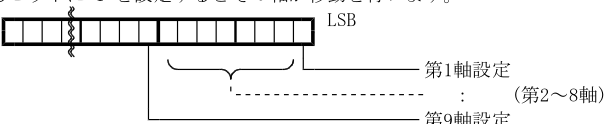

> **図の内容**
>
> ビットDn が第(n+1)軸を表す（1=その軸が移動する）。D0=第1軸設定、D1～D7=第2～8軸、D8=第9軸設定。

- (2) 第1軸～第9軸目標位置

各軸の位置決め目標位置を指定します。設定単位は[pulse]です。

第9軸設定

#### 4-2-9.同期軸無視インクレＰＴＰ位置決めコマンド [REQ_SYNEGPTPSTART / 16#49]

**《データタイプ》**

REQ_SYNEGPTPSTART / 16#49

**《タスク指定》**

有効

**《説明》**

同一指令2軸制御の同期軸で、基準軸または従属軸を同期軸指定を無視して、独立にインクレモードの PTP位置決めを行います。有効軸以外の軸指定は無効です。

**《コマンド実行条件》**

- サーボON状態
- 動作モードが手動運転モードか自動運転モード
- プログラム運転未実行またはティーチング中
- 移動中の軸がない
- 原点復帰中でない
- ホーム戻り中でない
- 手動パルサー選択無効
- 指定軸が独立位置決め中でない
- 指定軸がトルク指令中でない
- 指定軸が回転速度指令中(SPIN中)でない

**《データフォーマット》**

- ○PLCデータレジスタ

データサイズ:40byte(20WORD)

|   オフセット [Byte] | データ名称     | データサイズ   | データ範囲 [単位]                    |
|----------------|---------------|-----------|-------------------------------|
|              0 | 移動軸選択フラグ      | long      |                               |
|              4 | 第1軸インクリメント移動量 | long      | -1000000000～1000000000[pulse] |
|              8 | 第2軸インクリメント移動量 | long      | -1000000000～1000000000[pulse] |
|             12 | 第3軸インクリメント移動量 | long      | -1000000000～1000000000[pulse] |
|             16 | 第4軸インクリメント移動量 | long      | -1000000000～1000000000[pulse] |
|             20 | 第5軸インクリメント移動量 | long      | -1000000000～1000000000[pulse] |
|             24 | 第6軸インクリメント移動量 | long      | -1000000000～1000000000[pulse] |
|             28 | 第7軸インクリメント移動量 | long      | -1000000000～1000000000[pulse] |
|             32 | 第8軸インクリメント移動量 | long      | -1000000000～1000000000[pulse] |
|             36 | 第9軸インクリメント移動量 | long      | -1000000000～1000000000[pulse] |

**○C言語構造体**

```c
/************************************************************************/
/* PTP移動開始コマンドパラメータ構造体 */
/************************************************************************/
typedef struct {
    unsigned long AxisFlag;  /* 移動軸選択フラグ */
    long IncAxis[9];         /* 各軸インクリメント移動量 */
} PTPSTART;
```

**《データ詳細》**

- (1) 移動軸選択フラグ

移動コマンドで動かす軸を指定します。

各軸に対応するビットに"1"を設定するとその軸が移動を行います。

MSB

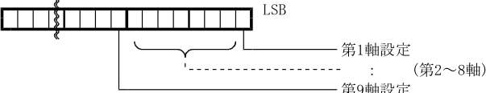

> **図の内容**
>
> ビットDn が第(n+1)軸を表す（1=その軸が移動する）。D0=第1軸設定、D1～D7=第2～8軸、D8=第9軸設定。

第9軸設定

- (2) 第1軸～第9軸インクリメント移動量各軸の現在位置からの移動量を指定します。設定単位は[pulse]です。

#### 4-2-10.同期軸無視アブソＰＴＰ位置決めコマンド [REQ_SYNEGPTPASTART / 16#4A､ REQ_SYNEGPTPBSTART / 16#4B]

**《データタイプ》**

REQ_SYNEGPTPASTART / 16#4a

REQ_SYNEGPTPBSTART / 16#4b

**《タスク指定》**

有効

**《説明》**

REQ_SYNEGPTPASTART:論理座標系アブソ指定

REQ_SYNEGPTPBSTART:機械座標系アブソ指定

同一指令2軸制御の同期軸で、基準軸または従属軸を同期軸指定を無視して、独立にアブソモードのPTP位置決めを行います。有効軸以外の軸指定は無効です。

**《コマンド実行条件》**

- サーボON状態
- 動作モードが手動運転モードか自動運転モード
- プログラム運転未実行またはティーチング中
- 移動中の軸がない
- 原点復帰中でない
- ホーム戻り中でない
- 手動パルサー選択無効
- 指定軸が独立位置決め中でない
- 指定軸がトルク指令中でない
- 指定軸が回転速度指令中(SPIN中)でない

**《データフォーマット》**

○PLCデータレジスタ

データサイズ:40byte(20WORD)

|   オフセット [Byte] | データ名称   | データサイズ   | データ範囲 [単位]                    |
|----------------|-------------|-----------|-------------------------------|
|              0 | 移動軸選択フラグ    | long      |                               |
|              4 | 第1軸目標位置     | long      | -1000000000～1000000000[pulse] |
|              8 | 第2軸目標位置     | long      | -1000000000～1000000000[pulse] |
|             12 | 第3軸目標位置     | long      | -1000000000～1000000000[pulse] |
|             16 | 第4軸目標位置     | long      | -1000000000～1000000000[pulse] |
|             20 | 第5軸目標位置     | long      | -1000000000～1000000000[pulse] |
|             24 | 第6軸目標位置     | long      | -1000000000～1000000000[pulse] |
|             28 | 第7軸目標位置     | long      | -1000000000～1000000000[pulse] |
|             32 | 第8軸目標位置     | long      | -1000000000～1000000000[pulse] |
|             36 | 第9軸目標位置     | long      | -1000000000～1000000000[pulse] |

**○C言語構造体**

```c
/************************************************************************/
/* PTP移動開始コマンドパラメータ構造体(ABSO) */
/************************************************************************/
typedef struct {
    unsigned long AxisFlag;  /* 移動軸選択フラグ */
    long PosAxis[9];         /* 各軸位置決めポジション */
} PTPASTART;
```

**《データ詳細》**

- (1) 移動軸選択フラグ移動コマンドで動かす軸を指定します。

各軸に対応するビットに"1"を設定するとその軸が移動を行います。

MSB

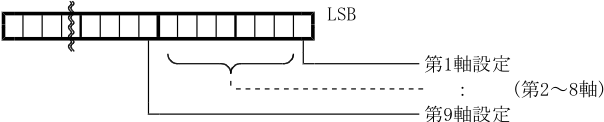

> **図の内容**
>
> ビットDn が第(n+1)軸を表す（1=その軸が移動する）。D0=第1軸設定、D1～D7=第2～8軸、D8=第9軸設定。

(2) 第1軸～第9軸目標位置

各軸の位置決め目標位置を指定します。設定単位は[pulse]です。

#### 4-2-11.インクレ直線補間位置決めコマンド [REQ_LINSTART / 16#17]

**《データタイプ》**

REQ_LINSTART / 16#17

**《タスク指定》**

有効

**《説明》**

インクレモードの補間位置決めを行います。有効軸以外の軸指定は無効です。

**《コマンド実行条件》**

- サーボON状態
- 動作モードが手動運転モードか自動運転モード
- プログラム運転未実行またはティーチング中
- 移動中の軸がない
- 原点復帰中でない
- ホーム戻り中でない
- 手動パルサー選択無効
- 指定軸が独立位置決め中でない
- 指定軸がトルク指令中でない

**《データフォーマット》**

○PLCデータレジスタ

データサイズ:44byte(22WORD)

|   オフセット [Byte] | データ名称     | データ   | データ範囲 [単位]                    |
|----------------|---------------|-------|-------------------------------|
|                |               | サイズ   |                               |
|              0 | 移動軸選択フラグ      | long  |                               |
|              4 | 第1軸インクリメント移動量 | long  | -1000000000～1000000000[pulse] |
|              8 | 第2軸インクリメント移動量 | long  | -1000000000～1000000000[pulse] |
|             12 | 第3軸インクリメント移動量 | long  | -1000000000～1000000000[pulse] |
|             16 | 第4軸インクリメント移動量 | long  | -1000000000～1000000000[pulse] |
|             20 | 第5軸インクリメント移動量 | long  | -1000000000～1000000000[pulse] |
|             24 | 第6軸インクリメント移動量 | long  | -1000000000～1000000000[pulse] |
|             28 | 第7軸インクリメント移動量 | long  | -1000000000～1000000000[pulse] |
|             32 | 第8軸インクリメント移動量 | long  | -1000000000～1000000000[pulse] |
|             36 | 第9軸インクリメント移動量 | long  | -1000000000～1000000000[pulse] |
|             40 | 補間送り速度        | long  | 1～1000000000[pulse/sec]       |

**○C言語構造体**

```c
/************************************************************************/
/* 補間移動開始コマンドパラメータ構造体 */
/************************************************************************/
typedef struct {
    unsigned long AxisFlag;  /* 移動軸選択フラグ */
    long IncAxis[9];         /* 各軸インクリメント移動量 */
    long Feed;               /* 補間送り速度 */
} LINSTART;
```

**《データ詳細》**

(1) 移動軸選択フラグ

移動コマンドで動かす軸を指定します。

各軸に対応するビットに１を設定するとその軸が移動を行います。

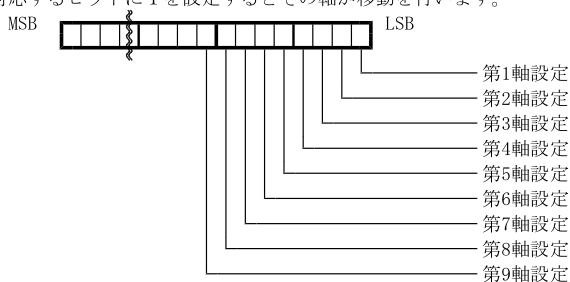

> **図の内容**
>
> ビットDn が第(n+1)軸を表す（1=その軸が移動する）。D0=第1軸設定、D1=第2軸設定、…、D8=第9軸設定。

- (2) 第1軸～第9軸インクリメント移動量

各軸の現在位置からの移動量を指定します。設定単位は[pulse]です。

(3) 補間送り速度

補間送り速度を指定します。設定単位は[pps](パルス/秒)です。指定する速度は、指定した軸の合成速度です。

【例:2軸移動の場合】


> **図の内容**
>
> 2軸（第1軸・第2軸）を直線補間で移動する例。横軸=第1軸の移動、縦軸=第2軸の移動。
> 原点から（第1軸, 第2軸）の位置決め座標まで直線の軌跡で移動し、「補間送り速度」はこの軌跡上の速度（指定した軸の合成速度）として指定する。

#### 4-2-12.アブソ直線補間位置決めコマンド [REQ_LINASTART / 16#18､ REQ_LINBSTART / 16#35]

**《データタイプ》**

REQ_LINASTART / 16#18

REQ_LINBSTART / 16#35

**《タスク指定》**

有効

**《説明》**

REQ_LINASTART / 16#18 : 論理座標系アブソ指定 REQ_LINBSTART / 16#35 : 機械座標系アブソ指定アブソモードの補間位置決めを行います。

有効軸以外の軸指定は、無効です。

**《コマンド実行条件》**

- サーボON状態
- 動作モードが手動運転モードか自動運転モード
- プログラム運転未実行またはティーチング中
- 移動中の軸がない
- 原点復帰中でない
- ホーム戻り中でない
- 手動パルサー選択無効
- 指定軸が独立位置決め中でない
- 指定軸がトルク指令中でない
- 指定軸が回転速度指令中(SPIN中)でない

**《データフォーマット》**

○PLCデータレジスタ

データサイズ:44byte(22WORD)

|   オフセット [Byte] | データ名称   | データサイズ   | データ範囲 [単位]                    |
|----------------|-------------|-----------|-------------------------------|
|              0 | 移動軸選択フラグ    | long      |                               |
|              4 | 第1軸目標位置     | long      | -1000000000～1000000000[pulse] |
|              8 | 第2軸目標位置     | long      | -1000000000～1000000000[pulse] |
|             12 | 第3軸目標位置     | long      | -1000000000～1000000000[pulse] |
|             16 | 第4軸目標位置     | long      | -1000000000～1000000000[pulse] |
|             20 | 第5軸目標位置     | long      | -1000000000～1000000000[pulse] |
|             24 | 第6軸目標位置     | long      | -1000000000～1000000000[pulse] |
|             28 | 第7軸目標位置     | long      | -1000000000～1000000000[pulse] |
|             32 | 第8軸目標位置     | long      | -1000000000～1000000000[pulse] |
|             36 | 第9軸目標位置     | long      | -1000000000～1000000000[pulse] |
|             40 | 補間送り速度      | long      | 1～1000000000[pulse/sec]       |

**○C言語構造体**

```c
/************************************************************************/
/* 補間移動開始コマンドパラメータ構造体(ABSO) */
/************************************************************************/
typedef struct {
    unsigned long AxisFlag;  /* 移動軸選択フラグ */
    long PosAxis[9];         /* 各軸位置決めポジション */
    long Feed;               /* 補間送り速度 */
} LINASTART;
```

**《データ詳細》**

(1) 移動軸選択フラグ

移動コマンドで動かす軸を指定します。

各軸に対応するビットに１を設定するとその軸が移動を行います。

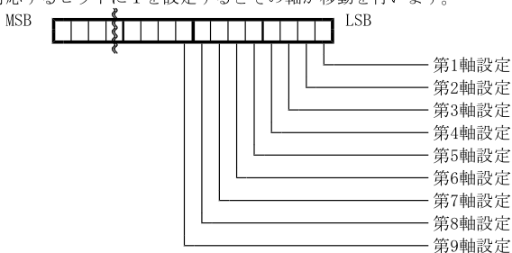

> **図の内容**
>
> ビットDn が第(n+1)軸を表す（1=その軸が移動する）。D0=第1軸設定、D1=第2軸設定、…、D8=第9軸設定。

- (2) 第1軸～第9軸目標位置

各軸の位置決め目標位置を指定します。設定単位は[pulse]です。

補間送り速度を指定します。設定単位は［pps］(パルス/秒)です。

- (3) 補間送り速度指定した速度は、指定した軸の合成速度です。

【例:2軸移動の場合】

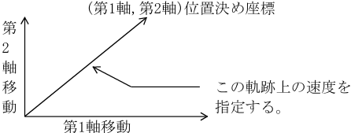

> **図の内容**
>
> 2軸（第1軸・第2軸）を直線補間で移動する例。横軸=第1軸の移動、縦軸=第2軸の移動。
> 原点から（第1軸, 第2軸）の位置決め座標まで直線の軌跡で移動し、「補間送り速度」はこの軌跡上の速度（指定した軸の合成速度）として指定する。

#### 4-2-13.リセットコマンド [REQ_RESET / 16#1A]

**《データタイプ》**

REQ_RESET / 16#1A

**《タスク指定》**

有効

**《説明》**

指定されたタスクをリセットします。リセット処理で以下の動作を行います。

- ○リセット動作
- プログラム運転実行中の場合は、プログラム運転を終了します。
- 移動中の軸がある場合は、移動を終了します。
- アラーム発生中の場合は、アラーム解除しサーボONを指令します。 (但し、アラーム要因が解除されていない場合、再びアラームになります。)

**《コマンド実行条件》**

常に実行可能です。

**《データフォーマット》**

コマンド付加データは有りません。

#### 4-2-14.原点設定コマンド [REQ_ORGSET / 16#19)]

**《データタイプ》**

REQ_ORGSET / 16#19

**《タスク指定》**

有効

**《説明》**

現在の軸指令位置を指令座標の原点として設定します。

原点設定は、全ての軸が停止しているときのみ実行可能です。

**《コマンド実行条件》**

- サーボON状態
- 動作モードが手動運転モードか自動運転モード
- プログラム運転未実行またはティーチング中
- 移動中の軸がない
- 原点復帰中でない
- ホーム戻り中でない
- 手動パルサー選択無効
- 指定軸が独立位置決め中でない
- 指定軸がトルク指令中でない
- 指定軸が回転速度指令中(SPIN中)でない

**《データフォーマット》**

コマンド付加データは有りません。

#### 4-2-15.汎用出力直接制御コマンド [REQ_OUTPUT / 16#1D]

**《データタイプ》**

REQ_OUTPUT / 16#1D

**《タスク指定》**

無効

**《説明》**

汎用出力を直接ON/OFFします。変更出来る出力は汎用出力(Rio1856～Rio2367)です。但し、運転プログラムの出力命令を実行すると変更されます。

(後に指定された方が有効になります。)

**《コマンド実行条件》**

常に実行可能です。

**《関連項目》**

4-2-24.汎用入力強制制御コマンド

4-2-25.汎用出力強制制御コマンド

4-2-26.汎用入出力ビット強制制御コマンド、汎用出力ビット直接制御コマンド

**《データフォーマット》**

- ○PLCデータレジスタ

データサイズ:128byte(64WORD)

| オフセット [Byte]   | データ名称                           | データサイズ   | データ範囲 [単位]   |
|----------------|-------------------------------------|-----------|--------------|
| 0 127          | 出力 1パターン (o#0116) 出力64パターン (o#0179) | long long |              |

**○C言語構造体**

```c
/************************************************************************/
/* 汎用出力直接制御コマンドパラメータ構造体 */
/************************************************************************/
typedef struct {
    unsigned short OutputPat[64];  /* 汎用出力 */
} OUTPUTPAT;
```

**《データ詳細》**

(1) 出力パターン

各ビットに"1"を設定した場合、そのビットに対応する出力がONになります。 "0"を設定した場合、OFFになります。

MSB

LSB

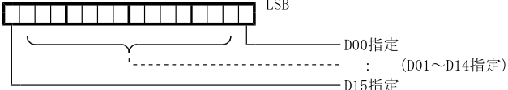

> **図の内容**
>
> 出力パターン(16bit)。ビットDn が汎用出力Dnの指定を表す。D0=D00指定、D1～D14=D01～D14指定、D15=D15指定。

- ※ 汎用出力直接制御コマンドは全ての汎用出力を一斉に制御します。運転プログラムで使用している汎用出力指令と干渉しないように注意が必要です。

なるべく任意の信号のみを制御できる「4-2-24.汎用出力ビット直接制御」(REQ_OUTPUTBIT) コマンドを使用してください。

#### 4-2-16.サーボ電源ONコマンド [REQ_SERVOON / 16#1E] <開発中>

**《データタイプ》**

REQ_SERVOON / 16#1E

**《タスク指定》**

無効

**《説明》**

サーボ電源ON指令をだします。

サーボ電源ONコマンドは、サーボ電源OFF状態の時のみ実行可能です。

**《データフォーマット》**

コマンド付加データは有りません。

#### 4-2-17.サーボ電源OFFコマンド [REQ_SERVOOFF / 16#1F] <開発中>

- 《データタイプ》

REQ_SERVOOFF / 16#1F

**《タスク指定》**

無効

**《説明》**

サーボ電源OFF指令をだします。

サーボ電源OFFコマンドは、サーボ電源ON状態の時のみ実行可能です。

**《データフォーマット》**

コマンド付加データは有りません。

#### 4-2-18.プログラム運転開始コマンド [REQ_PROGSTRT / 16#20)]

**《データタイプ》**

REQ_PROGSTRT / 16#20

**《タスク指定》**

有効

- 《説明》

プログラム運転を開始/再開します。

**《コマンド実行条件》**

- サーボON状態
- アラーム未発生
- 動作モードが自動運転モードかDNC運転モード (自動運転モードなら、現在のプログラム番号に運転プログラムダウンロード済み)
- プログラム運転未実行(開始時) または停止中(再開時)
- 移動中の軸がない
- 原点復帰中でない
- ホーム戻り中でない
- 手動パルサー選択無効
- 原点復帰無効の軸を除く、全ての軸が原点復帰済み(ROMSW設定による)

**《データフォーマット》**

コマンド付加データは有りません。

#### 4-2-19.プログラム運転停止コマンド [REQ_PROGSTOP / 16#21]

**《データタイプ》**

REQ_PROGSTOP / 16#21

**《タスク指定》**

有効

**《説明》**

プログラム運転/軸移動を一時停止します。

プログラム運転停止コマンドで一時停止したプログラム運転は、プログラム運転開始コマンドで再開できます。

プログラム運転未実行で軸移動中だった場合は、軸移動再開コマンドで再開できます。

**《コマンド実行条件》**

常に実行可能です。

ただし、プログラム運転実行中/軸移動中でないときはなにもしません。

**《データフォーマット》**

コマンド付加データは有りません。

#### 4-2-20.運転プログラム選択コマンド [REQ_PROGSLCT / 16#22]

**《データタイプ》**

REQ_PROGSLCT / 16#22

**《タスク指定》**

有効

**《説明》**

プログラム運転開始コマンドで実行する、プログラム番号を指定します。

**《コマンド実行条件》**

- プログラム運転未実行
- 機械パネルで実行プログラム選択中でない

**《データフォーマット》**

○PLCデータレジスタ

データサイズ:2byte(1WORD)

|   オフセット [Byte] | データ名称   | データサイズ   | データ範囲 [単位]   |
|----------------|-------------|-----------|--------------|
|              0 | 選択プログラム番号   | short     |              |

**○C言語構造体**

```c
/************************************************************************/
/* プログラム選択コマンドパラメータ構造体 */
/************************************************************************/
typedef struct {
    unsigned short ProgSel;  /* 選択プログラム番号 */
} PROGSEL;
```

**《データ詳細》**

- (1) 選択プログラム番号 P番号

実行するプログラムを番号で指定します。

#### 4-2-21.全軸原点復帰開始コマンド [REQ_ALLZRN / 16#24]

**《データタイプ》**

REQ_ALLZRN / 16#24

**《タスク指定》**

有効

**《説明》**

全軸の原点復帰を行ないます。

全軸原点復帰開始コマンドで実行する全軸原点復帰処理と、原点復帰入力信号で実行する全軸原点復帰処理は同じ動作をします。

**《コマンド実行条件》**

- サーボON状態
- 動作モードが手動運転モード/自動運転モード/DNC運転モード
- プログラム運転未実行またはティーチング中
- 移動中の軸がない
- 原点復帰中でない
- ホーム戻り中でない
- 手動パルサー選択無効
- 指定軸が独立位置決め中でない
- 指定軸がトルク指令中でない
- 指定軸が回転速度指令中(SPIN中)でない

**《関連項目》**

4-2-6.各軸原点復帰コマンド

**《データフォーマット》**

コマンド付加データは有りません。

#### 4-2-22.高速センサーラッチインクレ補間位置決めコマンド [REQ_SLINSTART / 16#28] <オプション>

**《データタイプ》**

REQ_SLINSTART / 16#28

**《タスク指定》**

有効

**《説明》**

高速センサーラッチインクレ補間位置決め動作を行います。有効軸以外の軸指定は無効です。

**《コマンド実行条件》**

- サーボON状態
- 動作モードが手動運転モードか自動運転モード
- プログラム運転未実行またはティーチング中
- 移動中の軸がない
- 原点復帰中でない
- ホーム戻り中でない
- 手動パルサー選択無効
- 指定軸が独立位置決め中でない
- 指定軸がトルク指令中でない

**《データフォーマット》**

○PLCデータレジスタ

データサイズ:48byte(24WORD)

|   オフセット [Byte] | データ名称     | データサイズ   | データ範囲 [単位]                    |
|----------------|---------------|-----------|-------------------------------|
|              0 | 移動軸選択フラグ      | long      |                               |
|              4 | 第1軸インクリメント移動量 | long      | -1000000000～1000000000[pulse] |
|              8 | 第2軸インクリメント移動量 | long      | -1000000000～1000000000[pulse] |
|             12 | 第3軸インクリメント移動量 | long      | -1000000000～1000000000[pulse] |
|             16 | 第4軸インクリメント移動量 | long      | -1000000000～1000000000[pulse] |
|             20 | 第5軸インクリメント移動量 | long      | -1000000000～1000000000[pulse] |
|             24 | 第6軸インクリメント移動量 | long      | -1000000000～1000000000[pulse] |
|             28 | 第7軸インクリメント移動量 | long      | -1000000000～1000000000[pulse] |
|             32 | 第8軸インクリメント移動量 | long      | -1000000000～1000000000[pulse] |
|             36 | 第9軸インクリメント移動量 | long      | -1000000000～1000000000[pulse] |
|             40 | 補間送り速度        | long      | 1～1000000000[pulse/sec]       |
|             44 | スキップ抑制フラグ     | short     | 0：スキップ、1：継続                   |

**○Ｃ言語構造体**

```c
/************************************************************************/
/* 高速センサーラッチ補間移動開始コマンドパラメータ構造体 */
/************************************************************************/
typedef struct {
    unsigned long AxisFlag;  /* 移動軸選択フラグ */
    long IncAxis[9];         /* 各軸インクリメント移動量 */
    long Feed;               /* 補間送り速度 */
    short NoSkipF;           /* スキップ抑制フラグ */
    short Reserve;           /* データをパックするためのダミー */
} SLINSTART;
```

**《データ詳細》**

- (1) 移動軸選択フラグ移動コマンドで、動かす軸を指定します。

各軸に対応するビットに"1"を設定するとその軸が移動を行います。

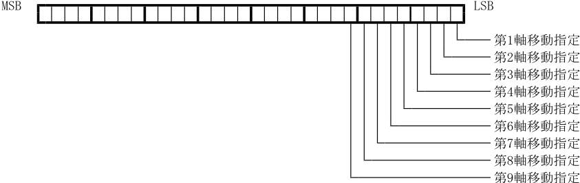

> **図の内容**
>
> 移動軸選択フラグ(32bit)。ビットDn が第(n+1)軸を表す（1=移動指定）。D0=第1軸移動指定、…、D8=第9軸移動指定。

- (2) 第1軸～第9軸インクリメント移動量

各軸の現在位置からの移動量を指定します。設定単位は[pulse]です。

(3) 補間送り速度

補間送り速度を指定します。設定単位は[pps](パルス/秒)です。指定する速度は、指定した軸の合成速度です。

【例:2軸移動の場合】


> **図の内容**
>
> 2軸（第1軸・第2軸）を直線補間で移動する例。横軸=第1軸の移動、縦軸=第2軸の移動。
> 原点から（第1軸, 第2軸）の位置決め座標まで直線の軌跡で移動し、「補間送り速度」はこの軌跡上の速度（指定した軸の合成速度）として指定する。

(4) スキップ抑制フラグ

軸移動中にセンサーラッチ入力が入った時に、移動をキャンセルし減速停止するか、または指定移動量の移動を継続するかを指定します。

#### 4-2-23.高速センサーラッチアブソ補間位置決めコマンド [REQ_SLINASTART / 16#29] <オプション>

**《データタイプ》**

REQ_SLINASTART / 16#29

**《タスク指定》**

有効

**《説明》**

高速センサーラッチアブソ補間位置決め動作を行ないます。有効軸以外の軸指定は、無効です。

**《コマンド実行条件》**

- サーボON状態
- 動作モードが手動運転モードか自動運転モード
- プログラム運転未実行またはティーチング中
- 移動中の軸がない
- 原点復帰中でない
- ホーム戻り中でない
- 手動パルサー選択無効
- 指定軸が独立位置決め中でない
- 指定軸がトルク指令中でない
- 指定軸が回転速度指令中(SPIN中)でない

**《データフォーマット》**

**○PLCデータレジスタ**

データサイズ:48byte(24WORD)

|   オフセット [Byte] | データ名称   | データサイズ   | データ範囲 [単位]                    |
|----------------|-------------|-----------|-------------------------------|
|              0 | 移動軸選択フラグ    | long      |                               |
|              4 | 第1軸目標位置     | long      | -1000000000～1000000000[pulse] |
|              8 | 第2軸目標位置     | long      | -1000000000～1000000000[pulse] |
|             12 | 第3軸目標位置     | long      | -1000000000～1000000000[pulse] |
|             16 | 第4軸目標位置     | long      | -1000000000～1000000000[pulse] |
|             20 | 第5軸目標位置     | long      | -1000000000～1000000000[pulse] |
|             24 | 第6軸目標位置     | long      | -1000000000～1000000000[pulse] |
|             28 | 第7軸目標位置     | long      | -1000000000～1000000000[pulse] |
|             32 | 第8軸目標位置     | long      | -1000000000～1000000000[pulse] |
|             36 | 第9軸目標位置     | long      | -1000000000～1000000000[pulse] |
|             40 | 補間送り速度      | long      | 1～1000000000[pulse/sec]       |
|             44 | スキップ抑制フラグ   | short     | 0：スキップ、1：継続                   |

**○C言語構造体**

```c
/************************************************************************/
/* 高速センサーラッチ補間移動開始コマンドパラメータ構造体(ABSO) */
/************************************************************************/
typedef struct {
    unsigned long AxisFlag;  /* 移動軸選択フラグ */
    long PosAxis[9];         /* 各軸位置決めポジション */
    long Feed;               /* 補間送り速度 */
    short NoSkipF;           /* スキップ抑制フラグ */
    short Reserve;           /* データをパックするためのダミー */
} SLINASTART;
```

**《データ詳細》**

(1) 移動軸選択フラグ

移動コマンドで、動かす軸を指定します。

各軸に対応するビットに"1"を設定するとその軸が移動を行います。

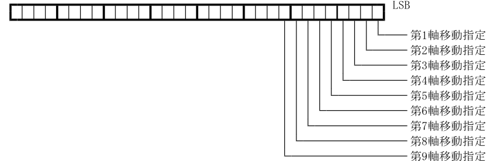

> **図の内容**
>
> 移動軸選択フラグ(32bit)。ビットDn が第(n+1)軸を表す（1=移動指定）。D0=第1軸移動指定、…、D8=第9軸移動指定。

MSB

- (2) 第1軸～第9軸目標位置

各軸の位置決め目標位置を指定します。設定単位は[pulse]です。

(3) 補間送り速度

補間送り速度を指定します。設定単位は[pps](パルス/秒)です。指定する速度は、指定した軸の合成速度です。

【例:2軸移動の場合】


> **図の内容**
>
> 2軸（第1軸・第2軸）を直線補間で移動する例。横軸=第1軸の移動、縦軸=第2軸の移動。
> 原点から（第1軸, 第2軸）の位置決め座標まで直線の軌跡で移動し、「補間送り速度」はこの軌跡上の速度（指定した軸の合成速度）として指定する。

(4) スキップ抑制フラグ

軸移動中にセンサーラッチ入力が入った時に、移動をキャンセルし減速停止するか、または指定目標位置まで移動を継続するかを指定します。

#### 4-2-24.汎用入力強制制御コマンド [REQ_COMPINPUT / 16#2A]

**《データタイプ》**

REQ_COMPINPUT / 16#2A

**《タスク指定》**

無効

- 《説明》

任意の入力の強制的なON/OFFを一括して指定します。

**《コマンド実行条件》**

常に実行可能です。

**《関連項目》**

4-2-15.汎用出力直接制御コマンド

4-2-25.汎用出力強制制御コマンド

4-2-26.汎用入出力ビット強制制御コマンド、汎用出力ビット直接制御コマンド

**《データフォーマット》**

**○PLCデータレジスタ**

データサイズ:1856byte(928WORD)

| オフセット [Byte]   | データ名称         | データサイズ   | データ範囲 [単位]   |
|----------------|-------------------|-----------|--------------|
| 0～ 15          | 入力1コマンド (i#0000)  | 16バイト     | －            |
| 16～ 31         | 入力2コマンド (i#0001)  | 16バイト     | －            |
| 32～ 47         | 入力3コマンド (i#0002)  | 16バイト     | －            |
| 48～ 63         | 入力4コマンド (i#0003)  | 16バイト     | －            |
|                |                   |           | －            |
| 1840～1855      | 入力116コマンド(i#0115) | 16バイト     | －            |

各入力コマンドのフォーマットは以下の通りです。

| オフセット [Byte]   | データ名称    | データサイズ   | データ範囲 [単位]   |
|----------------|--------------|-----------|--------------|
| 0+16*N         | D00ビット変更コマンド | byte      | 0～3          |
| 1+16*N         | D01ビット変更コマンド | byte      | 0～3          |
| 2+16*N         | D02ビット変更コマンド | byte      | 0～3          |
| 3+16*N         | D03ビット変更コマンド | byte      | 0～3          |
| 4+16*N         | D04ビット変更コマンド | byte      | 0～3          |
| 5+16*N         | D05ビット変更コマンド | byte      | 0～3          |
| 6+16*N         | D06ビット変更コマンド | byte      | 0～3          |
| 7+16*N         | D07ビット変更コマンド | byte      | 0～3          |
| 8+16*N         | D08ビット変更コマンド | byte      | 0～3          |
| 9+16*N         | D09ビット変更コマンド | byte      | 0～3          |
| 10+16*N        | D10ビット変更コマンド | byte      | 0～3          |
| 11+16*N        | D11ビット変更コマンド | byte      | 0～3          |
| 12+16*N        | D12ビット変更コマンド | byte      | 0～3          |
| 13+16*N        | D13ビット変更コマンド | byte      | 0～3          |
| 14+16*N        | D14ビット変更コマンド | byte      | 0～3          |
| 15+16*N        | D15ビット変更コマンド | byte      | 0～3          |

※ Nはアドレス(i#0000:0 ～ i#0115:115)を表します。

**○C言語構造体**

```c
/************************************************************************/
/* 汎用入力／出力強制制御コマンドパラメータサブ構造体 */
/************************************************************************/
typedef struct {
    unsigned char IoBit[16];  /* 汎用入出力D0~15ﾋﾞｯﾄ変更ｺﾏﾝﾄﾞ */
} IO_CMD;
/************************************************************************/
/* 汎用入力強制制御コマンドパラメータ構造体 */
/************************************************************************/
typedef struct {
    IO_CMD InCmd[116];
} COMPINPUT;
```

**《データ詳細》**

(1) ビット変更コマンド

0:無変更

1:強制制御解除

2:強制ON指定

3:強制OFF指定

#### 4-2-25.汎用出力強制制御コマンド [REQ_COMPOUTPUT / 16#2B]

**《データタイプ》**

REQ_COMPOUTPUT / 16#2B

**《タスク指定》**

無効

- 《説明》

任意の出力の強制的なON/OFFを一括して指定します。

**《コマンド実行条件》**

常に実行可能です。

**《関連項目》**

4-2-15.汎用出力直接制御コマンド

4-2-24.汎用入力強制制御コマンド

4-2-26.汎用入出力ビット強制制御コマンド、汎用出力ビット直接制御コマンド

**《データフォーマット》**

○PLCデータレジスタ

データサイズ:1024byte(512WORD)

| オフセット [Byte]   | データ名称        | データサイズ   | データ範囲 [単位]   |
|----------------|------------------|-----------|--------------|
| 0～ 15          | 出力1コマンド (o#1716) | 16byte    | －            |
| 16～15          | 出力2コマンド (o#1717) | 16byte    | －            |
| 32～23          | 出力3コマンド (o#1718) | 16byte    | －            |
| 48～31          | 出力4コマンド (o#1719) | 16byte    | －            |
|                |                  |           | －            |
| 1008～1023      | 出力64コマンド(o#1747) | 16byte    | －            |

各出力コマンドのフォーマットは以下の通りです。

| オフセット [Byte]   | データ名称    | データサイズ   | データ範囲 [単位]   |
|----------------|--------------|-----------|--------------|
| 0+16*N         | D00ビット変更コマンド | byte      | 0～3          |
| 1+16*N         | D01ビット変更コマンド | byte      | 0～3          |
| 2+16*N         | D02ビット変更コマンド | byte      | 0～3          |
| 3+16*N         | D03ビット変更コマンド | byte      | 0～3          |
| 4+16*N         | D04ビット変更コマンド | byte      | 0～3          |
| 5+16*N         | D05ビット変更コマンド | byte      | 0～3          |
| 6+16*N         | D06ビット変更コマンド | byte      | 0～3          |
| 7+16*N         | D07ビット変更コマンド | byte      | 0～3          |
| 8+16*N         | D08ビット変更コマンド | byte      | 0～3          |
| 9+16*N         | D09ビット変更コマンド | byte      | 0～3          |
| 10+16*N        | D10ビット変更コマンド | byte      | 0～3          |
| 11+16*N        | D11ビット変更コマンド | byte      | 0～3          |
| 12+16*N        | D12ビット変更コマンド | byte      | 0～3          |
| 13+16*N        | D13ビット変更コマンド | byte      | 0～3          |
| 14+16*N        | D14ビット変更コマンド | byte      | 0～3          |
| 15+16*N        | D15ビット変更コマンド | byte      | 0～3          |

※ Nはアドレス(o#0116:0 ～ o#0179:63)を表します。

**○C言語構造体**

```c
/************************************************************************/
/* 汎用入力／出力強制制御コマンドパラメータサブ構造体 */
/************************************************************************/
typedef struct {
    unsigned char IoBit[16];  /* 汎用入出力D0~15ﾋﾞｯﾄ変更ｺﾏﾝﾄﾞ */
} IO_CMD;
    ※ (4-2-24.汎用入力制御コマンド[REQ_COMPINPUT]と同じ構造体です。)
/************************************************************************/
/* 汎用出力強制制御コマンドパラメータ構造体 */
/************************************************************************/
typedef struct {
    IO_CMD OutCmd[64];
} COMPOUTPUT;
```

**《データ詳細》**

(1) ビット変更コマンド

0:無変更

1:強制制御解除

2:強制ON指定

3:強制OFF指定

#### 4-2-26.汎用入出力ビット強制制御コマンド、汎用出力ビット直接制御コマンド [REQ_COMPIOBIT / 16#2C､ REQ_OUTPUTBIT / 16#44]

**《データタイプ》**

REQ_COMPIOBIT / 16#2C : 汎用入出力ビット強制制御コマンド

REQ_OUTPUTBIT / 16#44 : 汎用出力ビット直接制御コマンド

**《タスク指定》**

無効

**《説明》**

汎用入出力ビット強制制御コマンド

任意の入出力の強制的なON/OFFを指定します。

汎用出力ビット直接制御コマンド

任意の汎用出力(O_RIO□□□□)のON/OFFを指定します。 (汎用出力以外の出力への設定は無視されます)

**《コマンド実行条件》**

常に実行可能です。

**《関連項目》**

- 4-2-15.汎用出力直接制御コマンド
- 4-2-24.汎用入力強制制御コマンド
- 4-2-25.汎用出力強制制御コマンド

**《データフォーマット》**

**○PLCデータレジスタ**

データサイズ:6byte(3WORD)

|   オフセット [Byte] | データ名称   | データサイズ   | データ範囲 [単位]   |
|----------------|-------------|-----------|--------------|
|              0 | 入出力ポート番号    | short     | 0～116        |
|              2 | 制御ビット番号     | short     | 0～15         |
|              4 | 制御フラグ       | short     |              |

**○C言語構造体**

```c
/************************************************************************/
/* 汎用入出力強制制御コマンドパラメータ構造体 */
/************************************************************************/
typedef struct {
    unsigned short Pno;  /* 入出力ポート番号 */
    unsigned short Bno;  /* 制御ビット番号 */
    unsigned short Flg;  /* 制御フラグ */
} COMPIOBIT;
```

**《データ詳細》**

- (1) 入出力ポート番号

MSB

(2) 制御ビット番号

制御対象のビット(D00～D15)を指定します。


> **図の内容**
>
> (1) 入出力ポート番号(16bit)の構成:
>
> | ビット | 内容 |
> |---|---|
> | D0～D6（7bit） | 入出力ポート番号 |
> | D15 | 入出力指定フラグ（0: 入力ポート、1: 出力ポート） |
>
> 汎用出力ビット直接制御コマンドでは「入出力指定フラグ」は無視される。

LSB

入出力指定フラグ

0:入力ポート

1:出力ポート

(汎用出力ビット直接制御コマンドでは"入出力指定フラグ"は無視します)

◆1.1

(3) 制御フラグ

MSB


> **図の内容**
>
> (3) 制御フラグ(16bit)の構成:
>
> | ビット | 内容 |
> |---|---|
> | D0～D1（2bit） | 制御コマンド（0: 無変更、1: 強制指定解除、2: 強制ON指定、3: 強制OFF指定） |
>
> 汎用出力ビット直接制御コマンドでは「強制指定解除」は無視される。

制御コマンド

0 : 無変更

1 : 強制指定解除

2 : 強制ON指定

3 : 強制OFF指定

(汎用出力ビット直接制御コマンドでは"強制指定解除"は無視します)

#### 4-2-27.送りオーバーライド%変更コマンド

[REQ_OVRDCHGP / 16#2D、 REQ_COVRDCHGP / 16#85、 REQ_SOVRDCHGP / 16#86]

**《データタイプ》**

REQ_OVRDCHGP / 16#2D : 全体オーバーライド%変更コマンド

REQ_COVRDCHGP / 16#85 : 補間オーバーライド%変更コマンド

REQ_SOVRDCHGP / 16#86 : 主軸オーバーライド%変更コマンド

**《タスク指定》**

有効

**《説明》**

送りオーバーライドを0%～200%の範囲で1%刻みで設定できます。

補間オーバーライド: 直線補間/円弧補間動作のオーバーライドです。

ROMSW設定で補間オーバーライドを無効にした場合、このコマンドを指令すると通信エラーになります。

主軸オーバーライド: 主軸/SPIN動作時のオーバーライドです。

ROMSW設定で主軸オーバーライドを無効にした場合、このコマンドを指令すると通信エラーになります。

**《コマンド実行条件》**

- 機械パネルのオーバーライド選択が無効

**《データフォーマット》**

○PLCデータレジスタ

データサイズ:2byte(1WORD)

|   オフセット [Byte] | データ名称   | データサイズ   | データ範囲 [単位]   |
|----------------|-------------|-----------|--------------|
|              0 | オーバーライド設定値  | short     | 0～200        |

**○C言語構造体**

```c
/************************************************************************/
/* 軸速度オーバーライド変更コマンドパラメータ構造体 */
/************************************************************************/
typedef struct {
    unsigned short Override;  /* オーバーライド設定値 */
} OVERCHG;
```

#### 4-2-28.接線制御ON/OFFコマンド [REQ_TLINE / 16#54] <オプション>

**《データタイプ》**

REQ_TLINE / 16#54

**《タスク指定》**

有効

**《説明》**

接線制御軸を、基準軸1と基準軸2の合成移動方向に自動的に回転動作をさせます。接線制御軸と基準軸1と基準軸2はROMSW設定ソフトで設定します。

**《コマンド実行条件》**

- アラーム未発生
- プログラム運転未実行または停止中
- 移動中の軸がない

**《データフォーマット》**

○PLCデータレジスタ

データサイズ:2byte(1WORD)

|   オフセット [Byte] | データ名称    | データサイズ   | データ範囲 [単位]   |
|----------------|--------------|-----------|--------------|
|              0 | Z軸接線制御機能スイッチ | short     | 0:OFF、1:ON   |

**○C言語構造体**

```c
/************************************************************************/
/* Z軸接線制御ON/OFFコマンドパラメータ構造体 */
/************************************************************************/
typedef struct {
    unsigned short tlinesw;  /* Z軸接線制御機能スイッチ */
} TLINESW;
```

#### 4-2-29.主軸回転ON/OFFコマンド [REQ_SPCMND / 16#50] <オプション>

**《データタイプ》**

REQ_SPCMND / 16#50

- 《タスク指定》

有効

**《説明》**

- 主軸回転のON/OFFを行います。
- 主軸回転ONを指令する場合、回転方向は正転のみ指定できます。
- 主軸回転ON/OFFコマンドの実行には、主軸オプションが必要です。

主軸回転は、以下の条件が満たされているときに実行可能です。

**《コマンド実行条件》**

- サーボON状態
- アラーム未発生
- 動作モードが手動運転モード/自動運転モード/DNC運転モード
- 移動中の軸がない
- Mコード出力中でない
- 指定軸が独立位置決め中でない
- 指定軸がトルク指令実行中でない

**《データフォーマット》**

- ○PLCデータレジスタ

データサイズ:2byte(1WORD)

|   オフセット [Byte] | データ名称   | データサイズ   | データ範囲 [単位]     |
|----------------|-------------|-----------|----------------|
|              0 | 主軸指令フラグ     | short     | 0:停止、1:正転、2:逆転 |

**○C言語構造体**

```c
/************************************************************************/
/* 主軸回転ON/OFFコマンドパラメータ構造体 */
/************************************************************************/
typedef struct {
    short SpOut;  /* 主軸指令フラグ */
} SPCMND;
```

**《データ詳細》**

- (1) 主軸指令フラグ
2. 主軸の動作を番号で指定します。

番号と主軸動作の関係は下表の通りです。

|   番号 | 主軸動作   |
|------|--------|
|    0 | 主軸停止   |
|    1 | 主軸正転   |
|    2 | 主軸逆転   |

#### 4-2-30.主軸回転数設定コマンド [REQ_SPREVSET / 16#51] <オプション>

**《データタイプ》**

REQ_SPREVSET / 16#51

**《タスク指定》**

有効

**《説明》**

- 主軸の回転数を指定します。

主軸回転中に主軸回転数設定コマンドで主軸回転を変更すると、直ちに指定された回転数に変わります。

**《コマンド実行条件》**

常に実行可能です。

**《データフォーマット》**

○PLCデータレジスタ

データサイズ:4byte(2WORD)

|   オフセット [Byte] | データ名称   | データサイズ   | データ範囲 [単位]       |
|----------------|-------------|-----------|------------------|
|              0 | 主軸回転数       | long      | 0～最高主軸回転数(パラメータ) |

**○C言語構造体**

```c
/************************************************************************/
/* 主軸回転数変更コマンドパラメータ構造体 */
/************************************************************************/
typedef struct {
    unsigned long SpRevo;  /* 主軸回転数 */
} SPREVSET;
```

**《データ詳細》**

- (1) 主軸回転数
2. 主軸回転数を指定します。指定できる最大回転数は、サーボパラメータで指定します。 IO主軸の場合の数値範囲は0～3です。

#### 4-2-31.シングルステップモード設定コマンド [REQ_SINGLE / 16#60]

**《データタイプ》**

REQ_SINGLE / 16#60

- 《タスク指定》

有効

**《説明》**

シングルステップモードへの移行と解除を交互に切替ます。

シングルステップモード設定コマンドは、自動運転モードの時のみ、実行することが出来ます。

シングルステップモードに移行すると、「4-1-6.ステータスデータ読出」の《データ詳細》(3)タスク情報①ステータスに"シングルステップモード"ビットが立ちます。

**《コマンド実行条件》**

- 機械パネルのモード選択無効

**《データフォーマット》**

コマンド付加データは有りません。

#### 4-2-32.ティーチング設定コマンド [REQ_TEACH / 16#61] <開発中>

**《データタイプ》**

REQ_TEACH / 16#61

**《タスク指定》**

有効

**《説明》**

ティーチングモードへの移行と解除を交互に切替ます。

ティーチングモードに移行すると、「4-1-6.ステータスデータ読出」の《データ詳細》(3)タスク情報 ①ステータスに"ティーチングモード"ビットが立ちます。

※ティーチングモードの解除時に移動軸が存在した時は、ティーチングモードを解除出来ません。

**《コマンド実行条件》**

(ティーチング有効)

- 機械パネルのティーチングモード選択無効
- 動作モードが自動運転モード
- シングルステップモードでのプログラム運転実行中
- ステップ間停止中(ステップ途中停止中は不可)

**《コマンド実行条件》**

(ティーチング解除)

- 機械パネルのティーチングモード選択無効
- ティーチングで軸を移動した後、元の位置へ戻していない。(挿入・置換をした場合は不要)

**《データフォーマット》**

コマンド付加データは有りません。

#### 4-2-33.プログラムステップ挿入コマンド [REQ_PRGINS / 16#62] <開発中>

**《データタイプ》**

REQ_PRGINS / 16#62

**《タスク指定》**

有効

**《説明》**

現在ステップへの移動命令を挿入します。

ティーチングモードへ移行してからの各軸の移動量をPTP(テクノコード)/G00(Gコード)命令で挿入します。ステップ挿入の結果、現在ステップ以降のステップは、1つづつ後ろへずれます。

プログラムステップ挿入コマンドが、正常に終了すると、ティーチングモードを自動的に解除します。

**《コマンド実行条件》**

- プログラム運転実行状態が、ティーチングモード
- ステップ挿入の結果が最大ステップ数を越えない
- ステップ挿入可能ステップ

**《データフォーマット》**

コマンド付加データは有りません。

#### 4-2-34.プログラムステップ置換コマンド [REQ_PRGALT / 16#63] <開発中>

**《データタイプ》**

REQ_PRGALT / 16#63

**《タスク指定》**

有効

**《説明》**

現在ステップの移動命令を置換えます。

プログラムステップ置換コマンドが、正常に終了すると、ティーチングモードを自動的に解除します。

**《コマンド実行条件》**

- プログラム運転実行状態が、ティーチングモード
- ステップ置換可能ステップ

**《データフォーマット》**

コマンド付加データは有りません。

#### 4-2-35.プログラムステップ削除コマンド [REQ_PRGDEL / 16#64] <開発中>

**《データタイプ》**

REQ_PRGDEL / 16#64

**《タスク指定》**

有効

**《説明》**

現在ステップを削除します。

**《コマンド実行条件》**

- 動作モードが自動運転モード
- シングルステップモードでステップ間停止中(ステップ途中停止中は不可)
- プログラム運転実行状態が、ティーチングモードでない

**《データフォーマット》**

コマンド付加データは有りません。

#### 4-2-36.プログラムステップ逆行コマンド [REQ_PRGREV / 16#65] <開発中>

**《データタイプ》**

REQ_PRGREV / 16#65

**《タスク指定》**

有効

**《説明》**

ティーチング開始位置への復帰または実行ステップの逆行を行います。

**《コマンド実行条件》**

1. ティーチング中

ティーチング開始位置への復帰

2. シングルステップモードでステップ間停止中(ステップ途中停止中は不可)<オプション> 前回ステップを逆行します。

（インクレ移動命令のみ逆行可能です。）

**《データフォーマット》**

コマンド付加データは有りません。

#### 4-2-37.プログラムステップ変更コマンド [REQ_STEPCHG / 16#66] <開発中>

**《データタイプ》**

REQ_STEPCHG / 16#66

**《タスク指定》**

有効

- 《説明》ティーチング対象のステップを変更します。

**《コマンド実行条件》**

- ティーチングモード
- ティーチングの移動をしていない

**《データフォーマット》**

○PLCデータレジスタ

データサイズ:2byte(1WORD)

|   オフセット [Byte] | データ名称    | データサイズ   | データ範囲 [単位]   |
|----------------|----------|-----------|--------------|
|              0 | ステップナンバー | short     | 1～999        |

**○C言語構造体**

```c
/************************************************************************/
/* ティーチングステップ変更コマンドパラメータ構造体 */
/************************************************************************/
typedef struct {
    unsigned short StepNo;
} STEPCHG;
```

#### 4-2-38.プログラムステップスキップコマンド [REQ_STEPSKIP / 16#67] <開発中>

**《データタイプ》**

REQ_STEPSKIP / 16#67

**《タスク指定》**

有効

- 《説明》

実行中のステップをスキップします。

**《コマンド実行条件》**

- ステップ間停止中
- ティーチングモード無効

**《データフォーマット》**

コマンド付加データは有りません。

#### 4-2-39.マルチタスクプログラム開始コマンド [REQ_TASKSTART / 16#80] <オプション>

**《データタイプ》**

REQ_TASKSTART / 16#80

**《タスク指定》**

有効

**《説明》**

指定したタスクのプログラム運転を開始します。

**《コマンド実行条件》**

- サーボON状態
- アラーム未発生
- 動作モードが自動運転モードかDNC運転モード

(自動運転モードなら、現在のプログラム番号に運転プログラムダウンロード済み)

- プログラム運転未実行(開始時)または停止中(再開時)
- 移動中の軸がない
- 原点復帰中でない
- ホーム戻り中でない
- 手動パルサー選択無効
- 原点復帰無効の軸を除く、全ての軸が原点復帰済み(ROMSW設定による)

**《データフォーマット》**

○PLCデータレジスタ

データサイズ:4byte(2WORD)

|   オフセット [Byte] | データ名称   | データサイズ   | データ範囲 [単位]   |
|----------------|---------|-----------|--------------|
|              0 | タスク番号   | long      | 0～7          |

**○Ｃ言語構造体**

```c
typedef int PRGTASK;
```

#### 4-2-40.マルチタスクプログラム停止コマンド [REQ_TASKSTOP / 16#81] <オプション>

**《データタイプ》**

REQ_TASKSTOP / 16#81

**《タスク指定》**

有効

**《説明》**

指定したタスクのプログラム運転と軸移動を停止します。

**《コマンド実行条件》**

常に実行可能です。

**《データフォーマット》**

「4-2-39.マルチタスクプログラム開始コマンド」と同様です。

#### 4-2-41.マルチタスクプログラムリセットコマンド [REQ_TASKRESET / 16#82] <オプション>

**《データタイプ》**

REQ_TASKRESET / 16#82

**《タスク指定》**

有効

**《説明》**

指定したタスクのリセットを行います。

**《コマンド実行条件》**

常に実行可能です。

「4-2-39.マルチタスクプログラム開始コマンド」と同様です。

#### 4-2-42.回転軸回転動作コマンド [REQ_SPINAX / 16#52]

**《データタイプ》**

REQ_SPINAX / 16#52

**《タスク指定》**

有効

**《説明》**

指定した無限回転軸が、指定した速度で定速回転動作を開始します。

指定した速度が"0"の時は回転動作を停止します。

回転動作の実行中に新たな回転動作指令を受け付けます。その結果停止することなく回転速度の変更が行えます。

回転動作中の軸に対して、他の移動命令(位置決め等)を行うことは出来ません。

無限回転軸の詳細は

「RTMC64-M3/ECユーザーズマニュアル Ⅱ機能編(TB00-1040E)<5-16.主軸機能>」を参照下さい。

**《コマンド実行条件》**

- サーボON状態
- アラーム未発生
- 動作モードが手動運転モード/自動運転モード/DNC運転モード
- 指定した軸が移動中の軸でない
- 原点復帰中でない
- ホーム戻り中でない
- 指定した軸が無限回転軸
- 指定軸が独立位置決め中でない
- 指定軸がトルク指令中でない

**《データフォーマット》**

- ○PLCデータレジスタ

データサイズ:40byte(20WORD)

|   オフセット [Byte] | データ名称     | データサイズ   | データ範囲 [単位]             |
|----------------|-----------|-----------|------------------------|
|              0 | オーバライドフラグ | short     | 0：無効、1：有効              |
|              2 | 移動軸選択フラグ  | short     | －                      |
|              4 | 第1軸回転数    | long      | 0～±(1Gpps*600/1回転パルス数) |
|              8 | 第2軸回転数    | long      | 0～±(1Gpps*600/1回転パルス数) |
|             12 | 第3軸回転数    | long      | 0～±(1Gpps*600/1回転パルス数) |
|             16 | 第4軸回転数    | long      | 0～±(1Gpps*600/1回転パルス数) |
|             20 | 第5軸回転数    | long      | 0～±(1Gpps*600/1回転パルス数) |
|             24 | 第6軸回転数    | long      | 0～±(1Gpps*600/1回転パルス数) |
|             28 | 第7軸回転数    | long      | 0～±(1Gpps*600/1回転パルス数) |
|             32 | 第8軸回転数    | long      | 0～±(1Gpps*600/1回転パルス数) |
|             36 | 第9軸回転数    | long      | 0～±(1Gpps*600/1回転パルス数) |

**○C言語構造体**

```c
/************************************************************************/
/* 回転軸回転動作コマンドパラメータ構造体 */
/************************************************************************/
typedef struct {
    short OverFlag;           /* オーバーライドフラグ */
    unsigned short AxisFlag;  /* 移動軸選択フラグ */
    long RevAx[9];            /* 各軸回転数 */
} SPINAX;
```

**《データ詳細》**

- (1) オーバーライド有効フラグオーバーライドの変更に伴い、回転速度を変更するかどうかを指定します。
- (2) 回転軸選択フラグ回転軸回転コマンドで動かす軸を指定します。各軸に対応するビットに"1"を設定するとその軸が回転を行います。

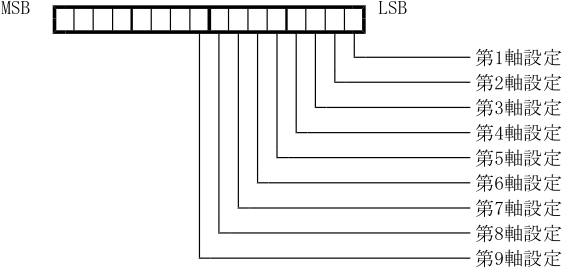

> **図の内容**
>
> ビットDn が第(n+1)軸を表す（1=回転軸回転コマンドで動かす）。D0=第1軸設定、D1=第2軸設定、…、D8=第9軸設定。

(3) 各軸回転数

0.1rpm単位で指定します。

回転数に"0"を指定した場合、回転動作を終了します。

#### 4-2-43.TPCデータ選択コマンド [REQ_TPCSEL / 16#31]

**《データタイプ》**

REQ_TPCSEL / 16#31

**《タスク指定》**

有効

**《説明》**

2チャンネルのTPCデータロギングを実行する時のデータを選択します。ロギングする軸と入出力の設定をします。

**《コマンド実行条件》**

- TPCロギング未実行

**《関連項目》**

- 4-1-15.TPCロギングデータ読出
- 4-1-16.TPCロギング情報読出

4-1-23.TPCロギング拡張情報読出

4-2-53.TPCロギング開始コマンド

- 4-2-57.TPCデータ選択拡張コマンド

**《データフォーマット》**

○PLCデータレジスタ

データサイズ:12byte(6WORD)

|   オフセット [Byte] | データ名称     | データサイズ   | データ範囲 [単位]   |
|----------------|-----------|-----------|--------------|
|              0 | 第1ポジション番号 | short     | 0～17         |
|              2 | 第1入力信号番号  | short     | 0～5          |
|              4 | 第1出力信号番号  | short     | 0～5          |
|              6 | 第2ポジション番号 | short     | 0～17         |
|              8 | 第2入力信号番号  | short     | 0～5          |
|             10 | 第2出力信号番号  | short     | 0～5          |

**○C言語構造体**

```c
/************************************************************************/
/* TPCデータ選択コマンドパラメータ構造体 */
/************************************************************************/
typedef struct {
    short ax1;  /* 第1ポジション番号 */
    short hi1;  /* 第1入力信号番号 */
    short ho1;  /* 第1出力信号番号 */
    short ax2;  /* 第2ポジション番号 */
    short hi2;  /* 第2入力信号番号 */
    short ho2;  /* 第2出力信号番号 */
} TPCSEL;
```

**《データ詳細》**

- (1) 各設定内容は下図の通りです。
- (2) コマンド発行前のデフォルト設定は、次頁表欄の、部がそれぞれ第1データ、第2データとなっています。
- (3) ポジションデータとしては通常、機械位置を使用します。

|   ポジション番号 (ax1,ax2) - 設定値 | ポジション番号 (ax1,ax2) - 指定内容   | 入力信号番号 (hi1,hi2) - 設定値   | 入力信号番号 (hi1,hi2) - 指定内容   | 出力信号番号 (ho1,ho2) - 設定値   | 出力信号番号 (ho1,ho2) - 指定内容   |
|---------------------------|----------------------------|--------------------------|---------------------------|--------------------------|---------------------------|
|                         0 | 第1軸指令位置                    | 0                        | i#1600                    | 0                        | o#1716                    |
|                         1 | 第2軸指令位置                    | 1                        | i#1601                    | 1                        | o#1717                    |
|                         2 | 第3軸指令位置                    | 2                        | i#1602                    | 2                        | o#1718                    |
|                         3 | 第4軸指令位置                    | 3                        | i#1603                    | 3                        | o#1719                    |
|                         4 | 第5軸指令位置                    | 4                        | i#1604                    | 4                        | o#1720                    |
|                         5 | 第6軸指令位置                    | 5                        | i#1605                    | 5                        | o#1721                    |
|                         6 | 第7軸指令位置                    | -                        | -                         | -                        | -                         |
|                         7 | 第8軸指令位置                    | -                        | -                         | -                        | -                         |
|                         8 | 第9軸指令位置                    | -                        | -                         | -                        | -                         |
|                         9 | 第1軸機械位置                    | -                        | -                         | -                        | -                         |
|                        10 | 第2軸機械位置                    | -                        | -                         | -                        | -                         |
|                        11 | 第3軸機械位置                    | -                        | -                         | -                        | -                         |
|                        12 | 第4軸機械位置                    | -                        | -                         | -                        | -                         |
|                        13 | 第5軸機械位置                    | -                        | -                         | -                        | -                         |
|                        14 | 第6軸機械位置                    | -                        | -                         | -                        | -                         |
|                        15 | 第7軸機械位置                    | -                        | -                         | -                        | -                         |
|                        16 | 第8軸機械位置                    | -                        | -                         | -                        | -                         |
|                        17 | 第9軸機械位置                    | -                        | -                         | -                        | -                         |

#### 4-2-44.論理原点シフトコマンド [REQ_ZRNSHIFT / 16#30]

**《データタイプ》**

REQ_ZRNSHIFT / 16#30

**《タスク指定》**

有効

**《説明》**

ティーチングで移動した量だけ、論理原点をシフトします。

**《コマンド実行条件》**

- ティーチング中
- サーボON状態
- 動作モードが手動運転モード/自動運転モード/DNC運転モード
- 移動中の軸がない
- 手動パルサー選択無効
- 独立位置決め中の軸がない
- トルク指令中の軸がない
- 回転速度指令中(SPIN中)の軸がない

**《データフォーマット》**

コマンド付加データは有りません。

#### 4-2-45.ホームポジション位置決めコマンド [REQ_HOME / 16#83]

**《データタイプ》**

REQ_HOME / 16#83

**《タスク指定》**

有効

- 《説明》

設定されたホーム位置へ移動します。

**《コマンド実行条件》**

- サーボON状態
- アラーム未発生
- 動作モードが手動運転モード/自動運転モード/DNC運転モード
- プログラム運転未実行またはティーチング中
- 移動中の軸がない
- 手動パルサー選択無効
- 独立位置決め中の軸がない
- トルク指令中の軸がない
- 回転速度指令中(SPIN中)の軸がない

**《データフォーマット》**

コマンド付加データは有りません。

#### 4-2-46.座標系設定コマンド [REQ_COORDSET / 16#37]

**《データタイプ》**

REQ_COORDSET / 16#37

**《タスク指定》**

有効

**《説明》**

各軸の現在位置を指定の論理座標値に設定します。

**《コマンド実行条件》**

- サーボON状態
- 動作モードが手動運転モード/自動運転モード/DNC運転モード
- プログラム運転未実行またはティーチング中
- 移動中の軸がない
- 手動パルサー選択無効
- 独立位置決め中の軸がない
- トルク指令中の軸がない
- 回転速度指令中(SPIN中)の軸がない

**《データフォーマット》**

**○PLCデータレジスタ**

データサイズ:40byte(20WORD)

|   オフセット [Byte] | データ名称   | データサイズ   | データ範囲 [単位]                    |
|----------------|-------------|-----------|-------------------------------|
|              0 | 設定軸選択フラグ    | long      | －                             |
|              4 | 第1軸論理座標値    | long      | -1000000000～1000000000[pulse] |
|              8 | 第2軸論理座標値    | long      | -1000000000～1000000000[pulse] |
|             12 | 第3軸論理座標値    | long      | -1000000000～1000000000[pulse] |
|             16 | 第4軸論理座標値    | long      | -1000000000～1000000000[pulse] |
|             20 | 第5軸論理座標値    | long      | -1000000000～1000000000[pulse] |
|             24 | 第6軸論理座標値    | long      | -1000000000～1000000000[pulse] |
|             28 | 第7軸論理座標値    | long      | -1000000000～1000000000[pulse] |
|             32 | 第8軸論理座標値    | long      | -1000000000～1000000000[pulse] |
|             36 | 第9軸論理座標値    | long      | -1000000000～1000000000[pulse] |

**○C言語構造体**

```c
/************************************************************************/
/* 座標系設定コマンドパラメータ構造体 */
/************************************************************************/
typedef struct {
    unsigned long AxisFlag;  /* 設定軸選択フラグ */
    long PosAxis[9];         /* 第1～第9軸設定座標 */
} COORDSET;
```

**《データ詳細》**

(1) 設定軸選択フラグ

論理座標値を設定する軸を指定します。設定する軸に対応するビットに"1"を設定します。


> **図の内容**
>
> ビットDn が第(n+1)軸を表す（1=論理座標値を設定する）。D0=第1軸設定、D1=第2軸設定、…、D8=第9軸設定。

#### 4-2-47.軸インタロック設定コマンド [REQ_AXISINTLK / 16#38]

**《データタイプ》**

REQ_AXISINTLK / 16#38

**《タスク指定》**

有効

**《説明》**

各軸のインタロックの有効/無効を設定します。

インタロック有効軸に対して指令を行うと、エラーになります。

**《コマンド実行条件》**

- 移動中の軸がない
- ACCたまりなし
- 指定軸が独立位置決め中でない
- 指定軸がトルク指令中でない
- 指定軸が回転速度指令中(SPIN中)でない

**《データフォーマット》**

**○PLCデータレジスタ**

データサイズ:18byte(9WORD)

|   オフセット [Byte] | データ名称       | データサイズ   | データ範囲 [単位]   | データ範囲 [単位]   | データ範囲 [単位]   |
|----------------|-------------|-----------|--------------|--------------|--------------|
|              0 | 第1軸インタロック指定 | short     | 0:無変更,       | 1:無効,        | 2:有効         |
|              2 | 第2軸インタロック指定 | short     | 0:無変更,       | 1:無効,        | 2:有効         |
|              4 | 第3軸インタロック指定 | short     | 0:無変更,       | 1:無効,        | 2:有効         |
|              6 | 第4軸インタロック指定 | short     | 0:無変更,       | 1:無効,        | 2:有効         |
|              8 | 第5軸インタロック指定 | short     | 0:無変更,       | 1:無効,        | 2:有効         |
|             10 | 第6軸インタロック指定 | short     | 0:無変更,       | 1:無効,        | 2:有効         |
|             12 | 第7軸インタロック指定 | short     | 0:無変更,       | 1:無効,        | 2:有効         |
|             14 | 第8軸インタロック指定 | short     | 0:無変更,       | 1:無効,        | 2:有効         |
|             16 | 第9軸インタロック指定 | short     | 0:無変更,       | 1:無効,        | 2:有効         |

**○C言語構造体**

```c
/************************************************************************/
/* 軸インタロック設定コマンドパラメータ構造体 */
/************************************************************************/
typedef struct {
    unsigned short IntlkSw[9];  /* 軸インタロック指定スイッチ */
} AXINTLK;
```

#### 4-2-48.軸ネグレクト設定コマンド [REQ_AXISNEG / 16#39]

**《データタイプ》**

REQ_AXISNEG / 16#39

**《タスク指定》**

有効

**《説明》**

各軸の軸指令の有効/無効を設定します。

軸指令を無効にした軸に対する指令は無視します。

**《コマンド実行条件》**

- 移動中の軸がない
- ACCたまりなし
- 指定軸が独立位置決め中でない
- 指定軸がトルク指令中でない
- 指定軸が回転速度指令中(SPIN中)でない

**《関連項目》**

4-1-17.軸ネグレクト設定データ読出

**《データフォーマット》**

○PLCデータレジスタ

データサイズ:18byte(9WORD)

|   オフセット [Byte] | データ名称      | データサイズ   | データ範囲 [単位]   | データ範囲 [単位]   | データ範囲 [単位]   |
|----------------|------------|-----------|--------------|--------------|--------------|
|              0 | 第1軸ネグレクト指定 | short     | 0:無変更,       | 1:無効,        | 2:有効         |
|              2 | 第2軸ネグレクト指定 | short     | 0:無変更,       | 1:無効,        | 2:有効         |
|              4 | 第3軸ネグレクト指定 | short     | 0:無変更,       | 1:無効,        | 2:有効         |
|              6 | 第4軸ネグレクト指定 | short     | 0:無変更,       | 1:無効,        | 2:有効         |
|              8 | 第5軸ネグレクト指定 | short     | 0:無変更,       | 1:無効,        | 2:有効         |
|             10 | 第6軸ネグレクト指定 | short     | 0:無変更,       | 1:無効,        | 2:有効         |
|             12 | 第7軸ネグレクト指定 | short     | 0:無変更,       | 1:無効,        | 2:有効         |
|             14 | 第8軸ネグレクト指定 | short     | 0:無変更,       | 1:無効,        | 2:有効         |
|             16 | 第9軸ネグレクト指定 | short     | 0:無変更,       | 1:無効,        | 2:有効         |

**○C言語構造体**

```c
/************************************************************************/
/* 軸ネグレクト設定コマンドパラメータ構造体 */
/************************************************************************/
typedef struct {
    unsigned short NeglectSw[9];  /* 軸ネグレクト指定スイッチ */
} AXNGLCT;
```

#### 4-2-49.各軸サーボON/OFFコマンド [REQ_SVONOFF / 16#3A]

**《データタイプ》**

REQ_SVONOFF / 16#3A

**《タスク指定》**

有効

**《説明》**

各軸のサーボON/OFFを設定します。

各軸サーボON/OFFコマンドはサーボON状態の時に強制的にサーボOFFするためのコマンドです。エラーが発生しているときなど、サーボONできない状態の時にはサーボON出来ません。

また、サーボOFF指定を行うと、対象軸に対してインターロックが設定されます。

サーボOFF指定を解除してもインターロック設定は解除されませんので、必要に応じてインターロック設定も解除して下さい。

**《コマンド実行条件》**

- 移動中の軸がない
- ACCたまりなし
- 指定軸が独立位置決め中でない
- 指定軸がトルク指令中でない
- 指定軸が回転速度指令中(SPIN中)でない

**《関連項目》**

4-2-47.軸インターロック設定コマンド

**《データフォーマット》**

○PLCデータレジスタ

データサイズ:18byte(9WORD)

|   オフセット [Byte] | データ名称          | データサイズ   | データ範囲 [単位]             |
|----------------|----------------|-----------|------------------------|
|              0 | 第1軸サーボON/OFF設定 | short     | 0:無変更,1:サーボON,2:サーボOFF |
|              2 | 第2軸サーボON/OFF設定 | short     | 0:無変更,1:サーボON,2:サーボOFF |
|              4 | 第3軸サーボON/OFF設定 | short     | 0:無変更,1:サーボON,2:サーボOFF |
|              6 | 第4軸サーボON/OFF設定 | short     | 0:無変更,1:サーボON,2:サーボOFF |
|              8 | 第5軸サーボON/OFF設定 | short     | 0:無変更,1:サーボON,2:サーボOFF |
|             10 | 第6軸サーボON/OFF設定 | short     | 0:無変更,1:サーボON,2:サーボOFF |
|             12 | 第7軸サーボON/OFF設定 | short     | 0:無変更,1:サーボON,2:サーボOFF |
|             14 | 第8軸サーボON/OFF設定 | short     | 0:無変更,1:サーボON,2:サーボOFF |
|             16 | 第9軸サーボON/OFF設定 | short     | 0:無変更,1:サーボON,2:サーボOFF |

**○C言語構造体**

```c
/************************************************************************/
/* 各軸サーボON/OFFコマンドパラメータ構造体 */
/************************************************************************/
typedef struct {
    unsigned short SvOnSw[9];  /* サーボON/OFF指定スイッチ */
} SVONOFFCHG;
```

#### 4-2-50.手動パルサーモードON/OFF設定コマンド [REQ_HANDLE / 16#5C] <オプション>

**《データタイプ》**

REQ_HANDLE / 16#5C

**《タスク指定》**

有効

**《説明》**

手動パルサーの有効/無効を指定します。

**《コマンド実行条件》**

- 機械パネルの手パ軸選択無効
- サーボON状態
- 動作モードが手動運転モード/自動運転モード/DNC運転モード/OT無視モード
- プログラム運転未実行またはティーチング中
- 移動中の軸がない
- 原点復帰中でない
- ホーム戻り中でない
- 手動パルサー有効軸が独立位置決め中でない
- 手動パルサー有効軸がトルク指令中でない

**《関連項目》**

- 4-1-20.手動パルサー設定情報読出

4-2-51.手動パルサー倍率設定コマンド

- 4-2-52.手動パルサー有効軸設定コマンド

**《データフォーマット》**

- ○PLCデータレジスタ

データサイズ:2byte(1WORD)

|   オフセット [Byte] | データ名称         | データサイズ   | データ範囲 [単位]   |
|----------------|---------------|-----------|--------------|
|              0 | 手動パルサー有効/無効設定 | short     | 0：無効、 1：有効   |

**○C言語構造体**

```c
/************************************************************************/
/* 手パモード構造体 */
/************************************************************************/
typedef struct {
    short mode;  /* 手パモード */
} HANDLEMODE;
```

#### 4-2-51.手動パルサー倍率設定コマンド [REQ_HANDLEKP / 16#5D] <オプション>

**《データタイプ》**

REQ_HANDLEKP / 16#5D

**《タスク指定》**

有効

**《説明》**

手動パルサーの倍率(手動パルサー1パルス毎に動く量)を指定します。

- 1,10,100,1000の内から任意の倍率を指定します。

**《コマンド実行条件》**

- 機械パネルの手パ軸選択無効

**《関連項目》**

4-1-20.手動パルサー設定情報読出

4-2-50.手動パルサーモードON/OFF設定コマンド

4-2-52.手動パルサー有効軸設定コマンド

**《データフォーマット》**

○PLCデータレジスタ

データサイズ:4byte(2WORD)

|   オフセット [Byte] | データ名称      | データサイズ   | データ範囲 [単位]    |
|----------------|------------|-----------|---------------|
|              0 | 手動パルサー設定倍率 | long      | 1,10,100,1000 |

**○C言語構造体**

```c
/************************************************************************/
/* 手パ倍率パラメータ構造体 */
/************************************************************************/
typedef struct {
    long kp;  /* 手パ倍率 */
} HANDLEKP;
```

#### 4-2-52.手動パルサー有効軸設定コマンド

[REQ_HANDLEAXIS1 / 16#5E､ REQ_HANDLEAXIS2 / 16#5F] <オプション>

**《データタイプ》**

REQ_HANDLEAXIS1 / 16#5E

REQ_HANDLEAXIS2 / 16#5F

**《タスク指定》**

有効

**《説明》**

手動パルサーで移動させるサーボ軸を指定します。

REQ_HANDLEAXIS1 / 16#5E は第1手動ハンドルで移動する軸の指定です。

REQ_HANDLEAXIS2 / 16#5F は第2手動ハンドルで移動する軸の指定です。

**《コマンド実行条件》**

- 機械パネルの手パ軸選択無効
- 指定軸が独立位置決め中でない
- 指定軸がトルク指令中でない

**《関連項目》**

4-1-20.手動パルサー設定情報読出

4-2-50.手動パルサーモードON/OFF設定コマンド

4-2-51.手動パルサー倍率設定コマンド

**《データフォーマット》**

○PLCデータレジスタ

データサイズ:4byte(2WORD)

|   オフセット [Byte] | データ名称     | データサイズ   | データ範囲 [単位]   |
|----------------|-----------|-----------|--------------|
|              0 | 手動パルサー有効軸 | long      | 0～軸数-1       |

**○C言語構造体**

```c
/************************************************************************/
/* 手パ軸パラメータ構造体 */
/************************************************************************/
typedef struct {
    long axis;  /* 手パ有効軸 */
} HANDLEAXIS;
```

#### 4-2-53.TPCロギング開始コマンド [REQ_TPCLOG / 16#32]

**《データタイプ》**

REQ_TPCLOG / 16#32

**《タスク指定》**

無効

**《説明》**

TPCロギングの開始/停止/再開を指定します。

**《コマンド実行条件》**

- TPCロギング未実行または停止中

**《関連項目》**

- 4-1-15.TPCロギングデータ読出
- 4-1-16.TPCロギング情報読出
- 4-1-23.TPCロギング拡張情報読出
- 4-2-43.TPCデータ選択コマンド
- 4-2-57.TPCデータ選択拡張コマンド

**《データフォーマット》**

○PLCデータレジスタ

データサイズ:2byte(1WORD)

|   オフセット [Byte] | データ名称      | データサイズ   | データ範囲 [単位]       |
|----------------|------------|-----------|------------------|
|              0 | TPCロギングフラグ | short     | 0:停止、 1:開始、 2:再開 |

**○C言語構造体**

構造体定義はありません。 WORD(short)のデータとして定義して下さい。

#### 4-2-54.Mコード出力コマンド [REQ_MCDOUT / 16#3D]

**《データタイプ》**

REQ_MCDOUT / 16#3D

**《タスク指定》**

無効

**《説明》**

指定したMコードを出力します。

Mコード出力コマンドでは、M03(主軸正転)のような内部Mコード処理は行いません。

**《コマンド実行条件》**

- サーボON状態
- 動作モードが手動運転モード/自動運転モード/DNC運転モード
- プログラム運転未実行またはティーチング中
- 移動中の軸がない
- 原点復帰中でない
- ホーム戻り中でない
- 手動パルサー選択無効

**《データフォーマット》**

- ○PLCデータレジスタ

データサイズ:2byte(1WORD)

|   オフセット [Byte] | データ名称    | データサイズ   | データ範囲 [単位]   |
|----------------|----------|-----------|--------------|
|              0 | 出力Mコード番号 | short     | 0～255        |

**○C言語構造体**

```c
/************************************************************************/
/* Mコード出力コマンドパラメータ構造体 */
/************************************************************************/
typedef struct {
    unsigned short mcd;  /* 出力Mコード */
} OUTMCD;
```

#### 4-2-55.サイクル運転モード設定コマンド [REQ_CYCLE / 16#36]

**《データタイプ》**

REQ_CYCLE / 16#36

**《タスク指定》**

有効

**《説明》**

サイクル運転モードの有効/無効を選択します。

サイクル運転については、

「RTMC64-M3/ECユーザーズマニュアル Ⅱ機能編(TB00-1040E)<5-12.サイクル運転>」を参照下さい。

**《コマンド実行条件》**

常に実行可能です。

**《データフォーマット》**

○PLCデータレジスタ

データサイズ:2byte(1WORD)

|   オフセット [Byte] | データ名称       | データサイズ   | データ範囲 [単位]   |
|----------------|-------------|-----------|--------------|
|              0 | サイクル運転有効フラグ | short     | 0:無効、1:有効    |

**○C言語構造体**

```c
/************************************************************************/
/* サイクル運転モード変更コマンドパラメータ構造体 */
/************************************************************************/
typedef struct {
    short cycle;  /* サイクル運転有効フラグ */
} CYCLECHG;
```

#### 4-2-56.マクロ変数書込コマンド [REQ_MCRREG / 16#84] <オプション>

**《データタイプ》**

REQ_MCRREG / 16#84

**《タスク指定》**

有効

**《関連項目》**

4-1-14.マクロ変数(一般レジスタ)読出

4-1-21.マクロ変数読出

**《説明》**

指定した番号のマクロ変数にデータを設定します。

書き込み可能な全てのマクロ変数に対して書き込む事が出来ます。

(ただし、指定したマクロ変数の範囲外のデータを書き込む事はできません。)

マクロ変数詳細については、

「RTMC64-M3/ECユーザーズマニュアルⅡ 機能編(TB00-1040F)<7-3.マクロ機>」を参照下さい。

**《コマンド実行条件》**

常に実行可能です。

**《データフォーマット》**

○PLCデータレジスタ

データサイズ:8byte(4WORD)

|   オフセット [Byte] | データ名称   | データサイズ   | データ範囲 [単位]                 |
|----------------|---------|-----------|----------------------------|
|              0 | マクロ変数番号 | long      | 1000～ 9999 [-]             |
|              4 | マクロ変数値  | long      | -2147483647～2147483647 [-] |

**○C言語構造体**

```c
/************************************************************************/
/* マクロ変数書込コマンドパラメータ構造体 */
/************************************************************************/
typedef struct {
    long RegNo;  /* マクロ変数番号 */
    long Val;    /* マクロ変数値 */
} MCRVALSET;
```

**《データ詳細》**

- (1) マクロ変数番号データを書き込む対象のマクロ変数の番号を指定します。

(2) マクロ変数値

指定したマクロ変数に書き込む値を指定します。

#### 4-2-57.TPCデータ選択拡張コマンド [REQ_TPCSEL_EX / 16#3E]

**《データタイプ》**

REQ_TPCSEL_EX / 16#3E

**《タスク指定》**

有効

**《説明》**

最大64チャンネルのTPCデータロギングを実行する時のロギングするデータを選択します。ロギングする軸と入出力の設定をします。

**《コマンド実行条件》**

- TPCロギング未実行

**《関連項目》**

- 4-1-15.TPCロギングデータ読出
- 4-1-16.TPCロギング情報読出
- 4-1-23.TPCロギング拡張情報読出
- 4-2-43.TPCデータ選択コマンド
- 4-2-53.TPCロギング開始コマンド

**《データフォーマット》**

- ○PLCデータレジスタ
- (A) ロギング種別:0 2ch(ポジション)の場合

データサイズ:20byte(10WORD)

| オフセット [Byte]   | データ名称   | データサイズ   | データ範囲 [単位]   |
|----------------|---------|-----------|--------------|
| 0～ 7           | ヘッダ情報   | 8byte     | -            |
| 8～19           | ロギング選択  | 12byte    | -            |

ヘッダ情報詳細(8byte)

|   オフセット [Byte] | データ名称    | データサイズ   | データ範囲 [単位]   |
|----------------|----------|-----------|--------------|
|              0 | ロギング種別選択 | short     | 0固定          |
|              2 | トリガ選択    | short     | 0固定          |
|              4 | ロギング周期   | short     | 0～32767      |
|              6 | 予約       | short     | 0固定          |

ロギング選択詳細(12byte)

|   オフセット [Byte] | データ名称     | データ長   | データ範囲 [単位]   |
|----------------|-----------|--------|--------------|
|              8 | 第1ポジション番号 | short  | 0～17         |
|             10 | 第1入力信号番号  | short  | 0～5          |
|             12 | 第1出力信号番号  | short  | 0～5          |
|             14 | 第2ポジション番号 | short  | 0～17         |
|             16 | 第2入力信号番号  | short  | 0～5          |
|             18 | 第2出力信号番号  | short  | 0～5          |

※ ロギング選択の詳細については、「4-2-43.TPCデータ選択コマンド」を参照下さい。

**○C言語構造体**

```c
/************************************************************************/
/* TPCデータ選択コマンドパラメータ構造体 */
/************************************************************************/
typedef struct {     /* ヘッダ情報 */
    short LogSel;    /* ロギング種別選択 */
    short TrigSel;   /* トリガ選択 */
    short Interval;  /* ロギング周期[msec] */
    short Reserved;  /* 予約 */
} TPCSEL_HEADER;
typedef struct {
    short ax1;    /* 第1ポジション番号 */
    short hi1;    /* 第1入力信号番号 */
    short ho1;    /* 第1出力信号番号 */
    short ax2;    /* 第2ポジション番号 */
    short hi2;    /* 第2入力信号番号 */
    short ho2;    /* 第2出力信号番号 */
} TPCSEL;
typedef struct {  /* ポジション・入出力ロギング要求 */
    TPCSEL_HEADER h;
    TPCSEL sel;
} TPCSEL_POS;
```

- (B) ロギング種別:2 64chの場合

データサイズ:2568byte(1284WORD)

| オフセット [Byte]   | データ名称   | データサイズ   | データ範囲 [単位]   |
|----------------|---------|-----------|--------------|
| 0～ 7           | ヘッダ情報   | 8byte     | -            |
| 8～2567         | ロギング選択  | 2560byte  | -            |

ヘッダ情報詳細(8byte)

|   オフセット [Byte] | データ名称    | データサイズ   | データ範囲 [単位]   |
|----------------|----------|-----------|--------------|
|              0 | ロギング種別選択 | short     | 0固定          |
|              2 | トリガ選択    | short     | 0固定          |
|              4 | ロギング周期   | short     | 0～32767      |
|              6 | 予約       | short     | 0固定          |

属性情報詳細(8byte)

| オフセット [Byte]   | データ名称   | データサイズ   | データ範囲 [単位]           |
|----------------|---------|-----------|----------------------|
| 16 +8*M+40*N   | 属性項目    | long      | 0～6 [M3] 0～7 [EC] ※1 |
| 20 +8*M+40*N   | 属性値     | long      | 属性に依存                |

M:属性番号-1、 N:チャンネル番号-1

ロギングチャンネル選択データ詳細(40byte)

| オフセット [Byte]   | データ名称   | データサイズ   | データ範囲     | データ範囲     | [単位]   |
|----------------|---------|-----------|-----------|-----------|--------|
| 8 + 40*N       | ロギング項目  | short     | 0～22 0～19 | [M3] [EC] | ※2     |
| 10 + 40*N      | 予約      | 6byte     |           |           |        |
| 16 + 40*N      | 属性情報1   | 8byte     |           |           |        |
| 24 + 40*N      | 属性情報2   | 8byte     |           |           |        |
| 32 + 40*N      | 属性情報3   | 8bytet    |           |           |        |
| 40 + 40*N      | 属性情報4   | 8byte     |           |           |        |

N: チャンネル番号-1 (チャンネル1: 0、チャンネル64: 63)

ロギング選択詳細

| オフセット [Byte]   | データ名称       | データサイズ   | データ範囲 [単位]   |
|----------------|-------------|-----------|--------------|
| 8～ 47          | 第1チャンネルデータ  | 40byte    |              |
| 48～ 87         | 第2チャンネルデータ  | 40byte    |              |
| 88～ 127        | 第3チャンネルデータ  | 40byte    |              |
|                | :           |           |              |
| 2448～2487      | 第62チャンネルデータ | 40byte    |              |
| 2488～2527      | 第63チャンネルデータ | 40byte    |              |
| 2528～2567      | 第64チャンネルデータ | 40byte    |              |

**○C言語構造体**

```c
/************************************************************************/
/* TPCデータ選択コマンドパラメータ構造体 */
/************************************************************************/
typedef struct {               /* ヘッダ情報 8バイト */
    short LogSel;              /* ロギング種別選択 */
    short TrigSel;             /* トリガ選択 */
    short Interval;            /* ロギング周期[msec] */
    short Reserved;            /* 予約 */
} TPCSEL_HEADER;
typedef struct {               /* 属性データ 8バイト */
    long item;                 /* 属性項目 */
    long val;                  /* 属性値 */
} TPCSEL_ATTR;
typedef struct {               /* ロギングチャンネル選択データ 40バイト */
    short log_item;            /* ロギング項目 */
    char csv_out_type;         /* CSV出力形式(セッティングPC用)*/
    char Reserved[5];
    TPCSEL_ATTR attribute[4];  /* ロギング項目属性 */
} TPCSEL_CH;
typedef struct {               /* 各種ロギング要求 */
    TPCSEL_HEADER h;           /* ヘッダ情報 */
    TPCSEL_CH ch[64];          /* ロギング軸選択(論理軸) */
} TPCSEL_64CH;
```

[M3]RTMC64-M3の場合

※1 属性項目選択 (0～6)

|   数値 | 項目     |   数値 | 項目      | 数値項目          | 数値項目    |
|------|--------|------|---------|----------------|----------|
|   -1 | 指定無し   |    0 | タスク番号   | 1 軸番号          | 2 マクロ番号  |
|    3 | IO信号番号 |    4 | MLモニタ番号 | 5 MLデータオフセット 6 | MLデータサイズ |

※2 ロギング項目選択 (0～22)

|   数値 | 項目      |   数値 | 項目      |   数値 | 項目     |   数値 | 項目       |
|------|---------|------|---------|------|--------|------|----------|
|   -1 | 指定無し    |    0 | 指令位置    |    1 | 機械位置   |    2 | 偏差量      |
|    3 | 最新払い出し量 |    4 | 絶対位置    |    5 | トルク    |    6 | 全体ステータス  |
|    7 | 全体アラーム  |    8 | 軸ステータス  |    9 | 軸アラーム  |   10 | タスクステータス |
|   11 | タスクアラーム |   12 | マクロ変数   |   13 | 入力信号   |   14 | 出力信号     |
|   15 | MLモニタ3  |   16 | MLモニタ4  |   17 | MLモニタ5 |   18 | MLモニタ6   |
|   19 | ML送信データ |   20 | ML受信データ |   21 | 時計     |   22 | 仮想指令位置   |

[EC]RTMC64-ECの場合

※1 属性項目選択 (0～7)

| 数値項目       |   数値 | 項目        | 数値             |   項目数値 | 項目           |
|-------------|------|-----------|----------------|---------|--------------|
| -1 指定無し     |    0 | タスク番号     | 1 軸番号          |       2 | マクロ番号        |
| 3 IO信号番号    |    4 | PDO Index | 5 PDO Subindex |       6 | PDOﾃﾞｰﾀｵﾌｾｯﾄ |
| 7 PDOデータサイズ |      |           |                |         |              |

※2 ロギング項目選択 (0～19)

|   数値 | 項目      |   数値 | 項目       |   数値 | 項目       |   数値 | 項目       |
|------|---------|------|----------|------|----------|------|----------|
|   -1 | 指定無し    |    0 | 指令位置     |    1 | 機械位置     |    2 | 偏差量      |
|    3 | 最新払い出し量 |    4 | 絶対位置     |    5 | トルク      |    6 | 全体ステータス  |
|    7 | 全体アラーム  |    8 | 軸ステータス   |    9 | 軸アラーム    |   10 | タスクステータス |
|   11 | タスクアラーム |   12 | マクロ変数    |   13 | 入力信号     |   14 | 出力信号     |
|   15 | PDOデータ  |   16 | RxPDOデータ |   17 | TxPDOデータ |   18 | 時計       |
|   19 | 仮想指令位置  |      |          |      |          |      |          |

※ 設定例

TPCロギングの10chで「タスク1の第5軸のトルク」を選択する

- ヘッダ(TPCSEL_HEADER)の「ロギング種別選択(LogSel)」で "64チャンネル(2)"を選択
- ロギング軸選択(TPCSEL_CH[9])にロギング項目を設定
- 「ロギング項目(log_item)」で"トルク(5)"を選択
- 「ロギング属性(attriburte)」にタスク0と第3軸を設定

attribute[0].itemで"タスク(0)"を選択

attribute[0].valに"タスク番号1(1)"を設定

attribute[1].itemで"軸番号(1)"を選択

attribute[1].valに"第5軸(4)"を設定 (軸番号-1)

attribute[2][3]は不要

#### 4-2-58.独立位置決めコマンド [REQ_AXMV* / 16#68～16#6A]

**《データタイプ》**

◆1.1

REQ_AXMV / 16#68 : インクレ指令

REQ_AXMVA / 16#69 : 論理座標系アブソ指令

REQ_AXMVB / 16#6A : 機械座標系アブソ指令

**《タスク指定》**

有効

**《説明》**

- 独立位置決め移動を開始します。

(MECHATROLINK-Ⅲの位置決め命令を使用することにより、RTMC64-M3の移動/プログラム運転実行とは別に(非同期に)移動を行います。)

**《コマンド実行条件》**

- 指定した軸がサーボONしている
- 全体アラームや指定したタスクがエラーでない
- セッティングモードでない
- 指定した軸が移動していない。移動指令での移動停止中でない (但し、独立位置決めコマンド(通信コマンド指令または運転プログラム指令による)で動いている軸は、移動中でも改めて独立位置決めコマンドの指令が可能です。)
- 手動操作中(JOG移動中や手パ軸選択中)でない軸
- 原点復帰中でない
- オーバライドが0%でない
- 指定軸がトルク指令中でない

**《関連項目》**

・なし

**《データフォーマット》**

**○PLCデータレジスタ**

データサイズ:76byte(38WORD)

※アブソ位置決め時、移動量が2147483647[pulse]を超えない様に設定して下さい。

|   オフセット [Byte] | データ名称        | データサイズ   | データ範囲 [単位]                      |
|----------------|--------------|-----------|---------------------------------|
|              0 | 軸フラグ         | long      | -                               |
|              4 | 第1軸移動量/目標位置 | long      | -2147483647～2147483647[pulse]   |
|              8 | 第2軸移動量/目標位置 | long      | -2147483647～2147483647[pulse]   |
|             12 | 第3軸移動量/目標位置 | long      | -2147483647～2147483647[pulse]   |
|             16 | 第4軸移動量/目標位置 | long      | -2147483647～2147483647[pulse]   |
|             20 | 第5軸移動量/目標位置 | long      | -2147483647～2147483647[pulse] ※ |
|             24 | 第6軸移動量/目標位置 | long      | -2147483647～2147483647[pulse]   |
|             28 | 第7軸移動量/目標位置 | long      | -2147483647～2147483647[pulse]   |
|             32 | 第8軸移動量/目標位置 | long      | -2147483647～2147483647[pulse]   |
|             36 | 第9軸移動量/目標位置 | long      | -2147483647～2147483647[pulse]   |
|             40 | 第1軸移動速度      | long      | 1～1000000000[pulse/sec]         |
|             44 | 第2軸移動速度      | long      | 1～1000000000[pulse/sec]         |
|             48 | 第3軸移動速度      | long      | 1～1000000000[pulse/sec]         |
|             52 | 第4軸移動速度      | long      | 1～1000000000[pulse/sec]         |
|             56 | 第5軸移動速度      | long      | 1～1000000000[pulse/sec]         |
|             60 | 第6軸移動速度      | long      | 1～1000000000[pulse/sec]         |
|             64 | 第7軸移動速度      | long      | 1～1000000000[pulse/sec]         |
|             68 | 第8軸移動速度      | long      | 1～1000000000[pulse/sec]         |
|             72 | 第9軸移動速度      | long      | 1～1000000000[pulse/sec]         |

**○C言語構造体**

```c
/************************************************************************/
/* 独立位置決めコマンドパラメータ構造体 */
/************************************************************************/
typedef struct {
    long AxFlg;       /* 軸フラグ */
    long PosAxis[9];  /* 移動量/目標位置 */
    long Feed[9];     /* 移動速度 [pls/sec] */
} AXMV;
```

**《データ詳細》**

- (1) 移動軸選択フラグ

動かす軸を指定します。

各軸に対応するビットに"1"を設定するとその軸が移動を行います。

(0に設定した軸のデータは無視します。)

MSB

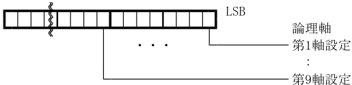

> **図の内容**
>
> ビットDn が第(n+1)論理軸を表す（1=移動する、0の軸のデータは無視）。D0=論理軸 第1軸設定、…、D8=第9軸設定。

(2) 移動量／目標位置

各軸の移動量／目標位置を指定します。

アブソ位置決め時は、移動量（目標位置－現在位置）が 2147483647[pulse] を越えないように指定して下さい。

(3) 移動速度

各軸の移動速度を指定します。

#### 4-2-59.プログラムブロック移動コマンド [REQ_PRGBLKMV / 16#6B]

**《データタイプ》**

REQ_PRGBLKMV / 16#6B

**《タスク指定》**

有効

**《説明》**

既にダウンロード済みのプログラムブロックを別ブロックに移動します。

**《コマンド実行条件》**

- 移動するプログラム番号が使用中でない
- 移動先に既にプログラムが設定されている場合は、そのブロックが使用中でない場合。 (移動先にあるプログラムは消去しますので、ご注意下さい。)

**《データフォーマット》**

○PLCデータレジスタ

データサイズ:4byte(2WORD)

|   オフセット [Byte] | データ名称        | データサイズ   | データ範囲 [単位]   |
|----------------|--------------|-----------|--------------|
|              0 | 移動対象P番号      | short     | 1～32767      |
|              2 | 移動先先頭BLOCK番号 | short     | 0～63         |

**○C言語構造体**

```c
/************************************************************************/
/* プログラムブロック 移動コマンドパラメータ構造体 */
/************************************************************************/
typedef struct {
    short SrcPno;  /* 移動対象P番号(1～32767) */
    short DstBlk;  /* 移動先先頭BLOCK番号(0～63) */
} BLKMVDATA;
```

#### 4-2-60.プログラムブロックコピーコマンド [REQ_PRGBLKCPY / 16#6C]

**《データタイプ》**

REQ_PRGBLKCPY / 16#6C

**《タスク指定》**

有効

**《説明》**

既にダウンロード済みのプログラムを指定し、別ブロックにコピーします。

別ブロックにコピーしたプログラムには、プログラム番号とタスクを設定可能です。

**《コマンド実行条件》**

- コピー元とコピー先が重ならない場合。
- コピーする際に、プログラムブロック領域外にならない場合。
- コピーするプログラム番号が使用中でない場合。
- コピー先に既にプログラムが設定されている場合は、そのブロックが使用中でない場合。 (コピー先にあるプログラムは消去しますので、ご注意下さい。)

**《データフォーマット》**

**○PLCデータレジスタ**

データサイズ:8byte(4WORD)

|   オフセット [Byte] | データ名称         | データサイズ   | データ範囲 [単位]   |
|----------------|---------------|-----------|--------------|
|              0 | コピー元P番号       | short     | 1～32767      |
|              2 | コピー先先頭BLOCK番号 | short     | 0～63         |
|              4 | コピー後P番号       | short     | 1～32767      |
|              6 | コピー後タスク番号     | short     | 0～7          |

**○C言語構造体**

```c
/************************************************************************/
/* プログラムブロック コピーコマンドパラメータ構造体 */
/************************************************************************/
typedef struct {
    short SrcPno;   /* コピー元P番号(1～32767) */
    short DstBlk;   /* コピー先先頭BLOCK番号(0～63) */
    short DstPno;   /* コピー後P番号(1～32767) */
    short DstTask;  /* コピー後タスク番号(0～7) */
} BLKCPYDATA;
```

#### 4-2-61.プログラムブロック削除コマンド [REQ_PRGBLKDEL / 16#6D]

**《データタイプ》**

REQ_PRGBLKDEL / 16#6D

**《タスク指定》**

有効

**《説明》**

既にダウンロード済みのプログラムを指定し、そのプログラムが格納されているブロックを削除します。

**《コマンド実行条件》**

- 削除するプログラム番号が使用中でない場合。

**《データフォーマット》**

○PLCデータレジスタ

データサイズ:2byte(1WORD)

|   オフセット [Byte] | データ名称    | データサイズ   | データ範囲 [単位]   |
|----------------|----------|-----------|--------------|
|              0 | 削除対象のP番号 | short     | 1～32767      |

**○C言語構造体**

```c
/************************************************************************/
/* プログラムブロック 削除コマンドパラメータ構造体 */
/************************************************************************/
typedef struct {
    short Pno;  /* 削除対象のP番号(1-32767) */
} BLKDLDATA;
```

#### 4-2-62.周期計測値クリアコマンド [REQ_TIMERRESET / 16#42]

**《データタイプ》**

REQ_TIMERRESET / 16#42

**《タスク指定》**

無効

**《説明》**

制御周期内処理時間最大値とフォアグランド周期計測最大値をクリアします。制御周期内処理時間については、4-1-32.制御周期内処理時間計測データ読出、

フォアグランド周期については4-1-33.フォアグランド周期計測データ読出を参照して下さい。

**《関連項目》**

4-1-32.制御周期内処理時間計測データ読出

4-1-33.フォアグランド周期計測データ読出

**《コマンド実行条件》**

常に実行可能です。

**《データフォーマット》**

コマンド付加データは有りません。

#### 4-2-63.トルク指令コマンド [REQ_TRQCMD / 16#46] <オプション>

**《データタイプ》**

REQ_TRQCMD / 16#46

**《タスク指定》**

有効

**《説明》**

各軸モータをトルク制御します。

オプションで「トルク指令有効」の場合に使用できます。有効軸以外の軸指定は無効です。

**《コマンド実行条件》**

- サーボON状態
- アラーム未発生
- 動作モードが手動運転モードか自動運転モード
- プログラム運転未実行またはティーチング中
- 移動中の軸がない(指定軸以外の独立位置決めは可能)
- 原点復帰中でない
- ホーム戻り中でない
- 手動パルサー選択無効

**《データフォーマット》**

**○PLCデータレジスタ**

データサイズ:76byte(38WORD)

|   オフセット [Byte] | データ名称    | データサイズ   | データ範囲 [単位]            |
|----------------|--------------|-----------|-----------------------|
|              0 | トルク制御軸選択ﾌﾗｸﾞ | long      |                       |
|              4 | 第１軸トルク指令値    | long      | -800～800[%]           |
|              8 | 第２軸トルク指令値    | long      | -800～800[%]           |
|             12 | 第３軸トルク指令値    | long      | -800～800[%]           |
|             16 | 第４軸トルク指令値    | long      | -800～800[%]           |
|             20 | 第５軸トルク指令値    | long      | -800～800[%]           |
|             24 | 第６軸トルク指令値    | long      | -800～800[%]           |
|             28 | 第７軸トルク指令値    | long      | -800～800[%]           |
|             32 | 第８軸トルク指令値    | long      | -800～800[%]           |
|             36 | 第９軸トルク指令値    | long      | -800～800[%]           |
|             40 | 第１軸速度制限値     | long      | 1～1000000000[pps], -1 |
|             44 | 第２軸速度制限値     | long      | 1～1000000000[pps], -1 |
|             48 | 第３軸速度制限値     | long      | 1～1000000000[pps], -1 |
|             52 | 第４軸速度制限値     | long      | 1～1000000000[pps], -1 |
|             56 | 第５軸速度制限値     | long      | 1～1000000000[pps], -1 |
|             60 | 第６軸速度制限値     | long      | 1～1000000000[pps], -1 |
|             64 | 第７軸速度制限値     | long      | 1～1000000000[pps], -1 |
|             68 | 第８軸速度制限値     | long      | 1～1000000000[pps], -1 |
|             72 | 第９軸速度制限値     | long      | 1～1000000000[pps], -1 |

**○C言語構造体**

```c
/************************************************************************/
/* トルク指令コマンドパラメータ構造体 */
/************************************************************************/
typedef struct {
    long AxisFlag;   /* 軸フラグ */
    long Torque[9];  /* 指令トルク [%] */
    long VClamp[9];  /* 速度制限 [pps](-1:位置制御モード)*/
} TRQCMD;
```

**《データ詳細》**

(1) 制御軸選択フラグ

トルク指令コマンドにて、トルク制御する軸を指定します。各軸に対応するビットに"1"を設定するとその軸がトルク制御になります。 ("0"を設定した軸に対しては制御を行いません)

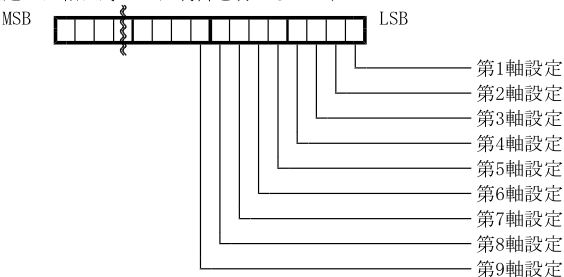

> **図の内容**
>
> ビットDn が第(n+1)軸を表す（1=トルク制御する）。D0=第1軸設定、D1=第2軸設定、…、D8=第9軸設定。

(2) トルク指令値

各軸のトルク指令量を%で指定します。

マイナスの値を指定すると、マイナス方向のトルクを発生(-移動)します。

- ※ 安川Σサーボでは、サーボ固有のトルク最大値以上のトルク指令値を受け付けた時は、そのサーボの最大トルク値になります。（アラームは発生しません）

(3) 速度制限

モータのエンコーダの一周パルス数に関係なく、pls/sec単位で指定します。 "-1"を設定すると、トルク指令を終了して、位置制御モードに戻ります。

(この場合は、トルク指令量は無効になります。)

#### 4-2-64.トルク制限モード変更コマンド [REQ_TRQLIMCHG / 16#3B] <開発中>

**《データタイプ》**

REQ_TRQLIMCHG / 16#3B

**《タスク指定》**

有効

**《説明》**

各軸モータの位置制御上で、トルク制限の設定/解除を切替ます。

**《コマンド実行条件》**

- 常時

**《データフォーマット》**

○PLCデータレジスタ

データサイズ:18byte(9WORD)

|   オフセット [Byte] | データ名称   | データサイズ   | データ範囲 [単位]      |
|----------------|-------------|-----------|-----------------|
|              0 | 第1軸トルク制限モード | short     | 0:無変更,1:解除,2:設定 |
|              2 | 第2軸トルク制限モード | short     | 0:無変更,1:解除,2:設定 |
|              4 | 第3軸トルク制限モード | short     | 0:無変更,1:解除,2:設定 |
|              6 | 第4軸トルク制限モード | short     | 0:無変更,1:解除,2:設定 |
|              8 | 第5軸トルク制限モード | short     | 0:無変更,1:解除,2:設定 |
|             10 | 第6軸トルク制限モード | short     | 0:無変更,1:解除,2:設定 |
|             12 | 第7軸トルク制限モード | short     | 0:無変更,1:解除,2:設定 |
|             14 | 第8軸トルク制限モード | short     | 0:無変更,1:解除,2:設定 |
|             16 | 第9軸トルク制限モード | short     | 0:無変更,1:解除,2:設定 |

**○C言語構造体**

```c
/************************************************************************/
/* トルク制限モード変更コマンドパラメータ構造体 */
/************************************************************************/
typedef struct {
    unsigned short TrqLimSw[9];  /* トルク制限モード指定スイッチ */
} TRQLIMCHG;
```

**《データ詳細》**

トルク制限モード指定スイッチは下記の指令になります。

- 0: 現在モードの続行(モード切替行わない)
- 1: トルク制限モードの解除
- 2: トルク制限モードの設定

#### 4-2-65.アブソ座標設定コマンド [REQ_MABSCOORDSET / 16#90]

**《データタイプ》**

REQ_MABSCOORDSET / 16#90

**《タスク指定》**

有効

- 《説明》

各軸のアブソポジション(機械座標系)を指定値に設定します。

**《コマンド実行条件》**

対象のタスクがセッティングモード

**《データフォーマット》**

○PLCデータレジスタ

データサイズ:40byte(20WORD)

|   オフセット [Byte] | データ名称   | データサイズ   | データ範囲 [単位]                    |
|----------------|-------------|-----------|-------------------------------|
|              0 | 設定軸選択フラグ    | long      | －                             |
|              4 | 第1軸機械座標値    | long      | -1000000000～1000000000[pulse] |
|              8 | 第2軸機械座標値    | long      | -1000000000～1000000000[pulse] |
|             12 | 第3軸機械座標値    | long      | -1000000000～1000000000[pulse] |
|             16 | 第4軸機械座標値    | long      | -1000000000～1000000000[pulse] |
|             20 | 第5軸機械座標値    | long      | -1000000000～1000000000[pulse] |
|             24 | 第6軸機械座標値    | long      | -1000000000～1000000000[pulse] |
|             28 | 第7軸機械座標値    | long      | -1000000000～1000000000[pulse] |
|             32 | 第8軸機械座標値    | long      | -1000000000～1000000000[pulse] |
|             36 | 第9軸機械座標値    | long      | -1000000000～1000000000[pulse] |

**○C言語構造体**

※座標系設定コマンド(REQ_COORDSET($37))と同じデータ構造体です。

```c
/************************************************************************/
/* 座標系設定コマンドパラメータ構造体 */
/************************************************************************/
typedef struct {
    unsigned long AxisFlag;  /* 設定軸選択フラグ */
    long PosAxis[9];         /* 第1～第9軸設定座標 */
} COORDSET;
```

**《データ詳細》**

- (1) 設定軸選択フラグ論理座標値を設定する軸を指定します。設定を行う軸に対応するビットに"1"を設定します。

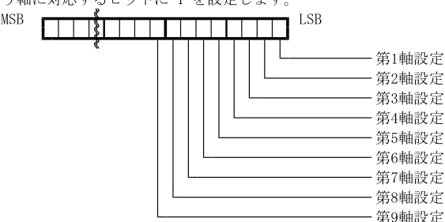

> **図の内容**
>
> ビットDn が第(n+1)軸を表す（1=論理座標値を設定する）。D0=第1軸設定、D1=第2軸設定、…、D8=第9軸設定。

#### 4-2-66.Flashメモリへのプログラム反映コマンド [REQ_REFMEM / 16#6E]

**《データタイプ》**

REQ_REFMEM / 16#6E

**《タスク指定》**

無効

**《説明》**

ダウンロード済みの全プログラムデータを保存領域に保存します。

ROMSWのユーザフリーオプションにて"運転プログラムバックアップ方法"を"手動バックアップ"に設定した場合に限りFlashメモリへのプログラム反映コマンドは有効です。

("自動バックアップ"の場合：処理をせずにOKを返します。

"バックアップ無し"の場合：通信エラー(E$CMDNOT)を返します。)

**《コマンド実行条件》**

- ROMSWの"運転プログラムバックアップ方法"が"バックアップ無し"ではない
- プログラム書き込み中でない

**《データフォーマット》**

コマンド付加データは有りません。

#### 4-2-67.Flashメモリへのポイントデータ反映コマンド [REQ_REFPOINT / 16#6F]

**《データタイプ》**

REQ_REFPOINT / 16#6F

**《タスク指定》**

無効

**《説明》**

ダウンロード済みの全ポイントデータを保存領域に保存します。

ROMSWのユーザフリーオプションにて"位置決めポイントテーブルバックアップ方法"を

"手動バックアップ"に設定した場合に限りFlashメモリへのポイントテーブル反映コマンドは有効です。

("自動バックアップ"の場合：処理をせずにOKを返します。

"バックアップ無し"の場合：通信エラー(E$CMDNOT)を返します。)

**《コマンド実行条件》**

- ROMSWの"位置決めポイントテーブルバックアップ方法"が"バックアップ無し"ではない
- ポイントテーブル書き込み中でない

**《データフォーマット》**

コマンド付加データは有りません。

#### 4-2-68.ポイント直線補間位置決めコマンド [REQ_LIMASTART / 16#47]

**《データタイプ》**

REQ_LIMASTART / 16#47

**《タスク指定》**

有効

**《説明》**

REQ_LIMASTART / 16#47 : 論理座標系ポイント指定アブソモードのポイント補間位置決めを行います。

有効軸以外の軸指定は、無効です。

**《コマンド実行条件》**

- サーボON状態
- 動作モードが手動運転モードか自動運転モード
- プログラム運転未実行またはティーチング中
- 移動中の軸がない
- 原点復帰中でない
- ホーム戻り中でない
- 手動パルサー選択無効
- 指定軸が独立位置決め中でない
- 指定軸がトルク指令中でない
- 指定軸が回転速度指令中(SPIN中)でない

**《データフォーマット》**

- ○PLCデータレジスタ

データサイズ:12byte(6WORD)

|   オフセット [Byte] | データ名称   | データサイズ   | データ範囲 [単位]              |
|----------------|-------------|-----------|-------------------------|
|              0 | ポイント番号      | long      | 1～400                   |
|              4 | 移動軸選択フラグ    | long      |                         |
|              8 | 補間送り速度      | long      | 1～1000000000[pulse/sec] |

**○C言語構造体**

```c
/************************************************************************/
/* LIMA指令コマンドパラメータ構造体 */
/************************************************************************/
typedef struct {
    long PntNo;     /* ポイント番号 */
    long AxisFlag;  /* 軸フラグ */
    long Feed;      /* 補間送り速度 [pls/sec] */
} LIMASTART;
```

**《データ詳細》**

(1) ポイント番号

位置決めポイントテーブル読出／書込コマンド(DAT_POINTTABLE)でダウンロード済みのポイントの番号を指定します。

(2) 移動軸選択フラグ

移動コマンドで動かす軸を指定します。

各軸に対応するビットに１を設定するとその軸が移動を行います。

MSB

(3) 補間送り速度

補間送り速度を指定します。設定単位は［pps］(パルス/秒)です。指定した速度は、指定した軸の合成速度です。

【例:2軸移動の場合】


> **図の内容**
>
> 2軸（第1軸・第2軸）を直線補間で移動する例。横軸=第1軸の移動、縦軸=第2軸の移動。
> 原点から（第1軸, 第2軸）の位置決め座標まで直線の軌跡で移動し、「補間送り速度」はこの軌跡上の速度（指定した軸の合成速度）として指定する。

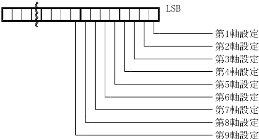

> **図の内容**
>
> 4-2-68 ポイント直線補間位置決めコマンドの (1) 移動軸選択フラグの図（変換時の読み順の都合でこの位置に出力されている）。
> ビットDn が第(n+1)軸を表す（1=その軸が移動する）。D0=第1軸設定、D1=第2軸設定、…、D8=第9軸設定。

#### 4-2-69.EtherCATパラメータ保存コマンド [REQ_ECPRMSAVE / 16#A0]

**《データタイプ》**

REQ_ECPRMSAVE / 16#A0

**《タスク指定》**

有効論理軸指定：0～7

物理局指定：-1

**《説明》**

EtherCATスレーブ局のオブジェクトIndex:0x1010、Subindex:0x01、Size:4[Byte]に対して、値"0x65766173"(アスキーコードの"save")を書き込みます。

本機能に対応しているスレーブ局においては、スレーブ局内の現状の設定を不揮発な領域に保存することで、パラメータを保存する処理となります。

**《コマンド実行条件》**

常に実行可能です。

**《データフォーマット》**

○PLCデータレジスタ

データサイズ:4byte

|   オフセット [Byte] | データ名称       | データサイズ   | データ範囲 [単位]           |
|----------------|-------------|-----------|----------------------|
|              0 | 論理軸番号物理局番号 | long      | 論理軸番号:0～8 物理局番号:0～63 |

**○C言語構造体**

```c
/************************************************************************/
/* EtherCATパラメータ保存構造体 */
/************************************************************************/
typedef struct {
    long StationNo;  /* 局番号 */
} ECTPRMSAVE;
```
