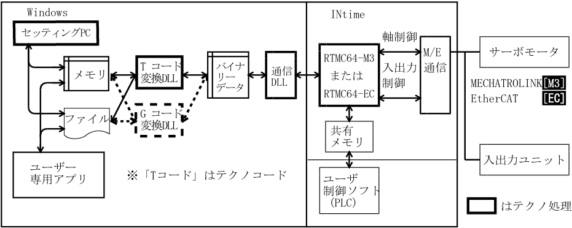
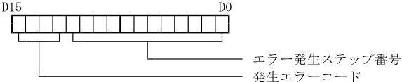
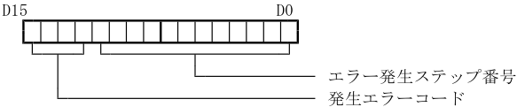
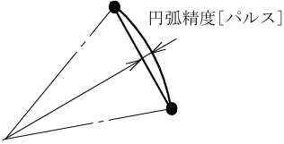

標準PCベースファインモーションコントローラ[RTMC64-M3/RTMC64-EC]

# テクノコード変換ライブラリリファレンスマニュアル

Ver1.1 2020.7.2

－目次－

- 1. 型式
- 2. 製品構成
- 3. 概要
- 4. 関連資料
- 5. 使用環境
- 6. インストール
- 7. ライブラリ使用上の注意事項
- 8. 関数使用例
  - 8-1. DLLロード関数による方法
- 9. 関数仕様
  - MemProgramConv
  - MemTaskProgramConv
  - MemTaskProgramConvS
  - MemProgramRConv
  - MemProgramRConvS
  - FileProgramConv
  - FileTaskProgramConv
  - FileTaskProgramConvS
  - FileProgramRConv
  - FileProgramRConvS
  - DncProgramConv
  - DncProgramConvS
  - TcdCircleSet
  - TcdSetProgMemSize
  - TcdFeedUnitSet
  - TcdSTSelect
  - TcdPaccTimeSet
  - TcdPositionUnitSet
  - TcdCircleMode
  - TcdDiametralAxis
  - TcdSetMultiplier
  - TcdGetErrLine
  - TcdSetZXPlane

## 1. 型式

このソフトウェアは、64軸制御PCベースファインモーションコントローラ(RTMC64-M3又はRTMC64-EC)を使用する時、テクノコードで書かれたテキスト形式の運転プログラムをバイナリー形式に変換するソフトです。 64軸制御PCベースファインモーションコントローラは次の2種類です。

- RTMC64-M3 ・・・・・・・・ MECHATROLINK-Ⅲ
- RTMC64-EC ・・・・・・・・ EtherCAT

以降の説明で2種類の共通部分はRTMC64と表記します。

また、Windows上のPC部(セッティングPCやユーザ作成ソフトなど)はPCアプリと表記します。

RTMC64-M3のみの説明には[M3]、RTMC64-ECのみの説明には[EC]を付けて区別します。

テクノコード運転プログラム変換の型式

RTMC64-M3の場合は RTMC64M3-PRGCNV

RTMC64-ECの場合は RTMC64EC-PRGCNV

## 2. 製品構成

①RTMC64-M3の場合

RTMC64M3TCNV.DLL ・・・・・・テクノコードテキスト運転プログラム変換ダイナミックリンクライブラリ

RTMC64M3TCNV.LIB ・・・・・・テクノコードテキスト運転プログラム変換インポートライブラリ

RTMC64M3TCNV.H ・・・・・・テクノコードインクルードファイル(関数定義)

RTMC64M3TCDAPI.TXT・・・・・・テクノコードビジュアルベーシック用データ型・関数定義

②RTMC64-ECの場合

RTMC64ECTCNV.DLL ・・・・・・テクノコードテキスト運転プログラム変換ダイナミックリンクライブラリ

RTMC64ECTCNV.LIB ・・・・・・テクノコードテキスト運転プログラム変換インポートライブラリ

RTMC64ECTCNV.H ・・・・・・テクノコードインクルードファイル(関数定義)

RTMC64ECTCDAPI.TXT・・・・・・テクノコードビジュアルベーシック用データ型・関数定義

## 3. 概要

テクノコード変換ライブラリは、テキストファイル形式のテクノコード運転プログラム解析し、バイナリー形式の運転プログラムに変換します。作成したバイナリー形式の運転プログラムを通信ライブラリを使ってRTMC64-M3/ECへ送信して下さい。

本ライブラリの入出力は、以下の2通りがあります。

テキスト入力バイナリー出力メモリ(メモリアドレス指定) → メモリファイル(ファイル名指定) → メモリ



> **図の内容**
>
> - **Windows**: 「セッティングPC」「ユーザー専用アプリ」が「メモリ」または「ファイル」のテキスト運転プログラムを「Tコード変換DLL」（太枠）でバイナリーデータに変換する。「Gコード変換DLL」は破線で描かれている（このマニュアルの対象外）。バイナリーデータは「通信DLL」を経て INtime 側へ送る
> - **INtime**: 「RTMC64-M3 または RTMC64-EC」が軸制御・入出力制御を行い、「M/E通信」（MECHATROLINK [M3] ／ EtherCAT [EC]）で「サーボモータ」「入出力ユニット」とつながる。「共有メモリ」を経て「ユーザ制御ソフト(PLC)」とつながる
> - 注記: ※「Tコード」はテクノコード。太枠はテクノ処理

```c
    PTPA X0 Y0 Z0 A0 TIM0.5 ENR1 ONR1856;
    CALL SUBPROC L10;
    TIM1.0 ONR1857;
    PTPA X100 Y100 Z100 A100 TIM0.5 OFR1857;
    CALL SUBPROC L5;
    TIM1.0;
    CIRR X400 Y0 Z100 I200 J0 F1000;
    END;
    :SUBPROC
    PTP X100 Y-100 Z100 A-100;
    PTP X-100 Y100 Z-100 A100 TIM0.5;
    LIN X1500 Y2000 Z2500 A3000 F1000 OFR1856;
    END;
```

## 4. 関連資料

「RTMC64-M3/EC ユーザーズマニュアル」

(TB00-1040)

「RTMC64-M3/EC セッティングPCマニュアル」

(TB00-1041)

「RTMC64-M3/EC ROMSW設定ソフトマニュアル」

(TB00-1042)

EtherCATのコンフィグレーションの手順書

「ENIファイル作成手順書(RSI-ECAT-Master用)」 (TB00-1058)

「ENIファイル作成手順書(AlgoEtherCAT"TwinCAT3"用)」

(TB00-1149)

「ENIファイル作成手順書(AlgoEtherCAT"ET9000"用)」 (TB00-1059)

PCアプリ/INtime上のソフト開発の資料

「RTMC64-M3/EC 通信ライブラリリファレンスマニュアル」 (TB00-1043)

「RTMC64-M3/EC 送受信データマニュアル」

(TB00-1044)

「RTMC64-M3/EC Tコード変換ライブラリリファレンスマニュアル

(TB00-1045) 本書

「RTMC64-M3/EC Gコード変換ライブラリリファレンスマニュアル (TB00-1046)

PLCからラダー制御する場合の参考資料

「RTMC64-M3/EC サンプルラダープログラム説明書」

(TB00-1047)

## 5. 使用環境

テクノコード変換ソフトは、RTMC64-M3/ECが動作するPCのWindows上で動作します。

## 6. インストール

DLLファイルをプログラム検索パスの通っているディレクトリ(フォルダ)に格納して下さい。

## 7. ライブラリ使用上の注意事項

- 円弧補間指令をプリ解析指定で変換する場合、複数の微小直線補間指令ステップに分解されます。プリ解析にて円弧ステップが何ステップに分解されるかは、「RTMC64-M3/ECユーザーズマニュアル機能編」<6-4.プリ解析処理(テキスト→バイナリ変換) 補足資料・1 円弧プリ解析処理(ステップ数/処理時間)>(TB00-1040F)を参照下さい。

円弧補間指令を含む運転プログラムの場合、分解後のステップ数が最大ステップ数をこえないようにして下さい。

通信ではプリ解析処理は使用しません。

- TcdPositionUnitSet関数は全ての軸指定の小数点位置を変更します。軸毎の小数点位置がTcdPositionUnitSet関数で指定した小数点位置に置き換わってしまいます。

従って、TcdPositionUnitSet関数をSetMultiplier関数の後で呼び出すと、SetMultiplier関数で設定した SetMultiplier関数は、必ずTcdPositionUnitSet関数の後で呼び出すようにしてください。

- メインプログラムは必ず先頭に記述してください。
- テキスト運転プログラムの詳細な説明については、

「RTMC64-M3/ECユーザーズマニュアル」(TB00-1040)を参照下さい。

## 8. 関数使用例

- DLLロード関数を使用して関数をインポートする。 DLLロード関数を使用してDLLをメモリにロードし、関数アドレスを取得して関数を呼び出します。
- MS-VC++での簡易的な方法
- MS-VC++では、インポートライブラリを使用して関数をインポートすることもできます。ライブラリに付属のインポートライブラリをアプリケーションの作成時にリンクします。この方法は、使用言語がMS-VC++ Ver6.0の時のみ有効です。ただし、アプリケーション実行開始時にDLLが見つからないとWindowsにより実行中断されてしまいます。 (Windowsのエラーメッセージは表示されます。) このため、DLLが見つからない時の処理を居プリケーションで作成することはできません。前述のDLLロード関数を使用する方法でアプリケーションで対処することをおすすめします。

詳細は次項を参照下さい。

### 8-1. DLLロード関数による方法

- 1.DLLのロード

(LoadLibrary()関数を使用)

2.DLL内の任意の関数のアドレス取得 (GetProcAddress()関数を使用)

:

: DLL内の関数の利用

:

3.DLLのアンロード

(FreeLibrary()関数を使用)

関数アドレス取得時に指定する関数名/関数ポインタのデータ型は、RTMC64m3tcnv.h[M3](RTMC64ectcnv.h [EC])内で定義しています。

RTMC64m3tcnv.h[M3](RTMC64ectcnv.h[EC])をインクルードする前に LOADLIBRARY_MCDLL を定義(define)することによってこれらの定義を使用できるようになります。

(LOADLIBRARY_MCDLLを定義しなかった場合はインポートライブラリを使用する設定になります。)

以下の例は、テクノコード変換ライブラリの関数取得例を示します。

```c
#define LOADLIBRARY_MCDLL // テクノ製ライブラリ明示的リンク指定
#include "RTMC64m3tcnv.h" // RTMC64-M3の場合 // Tコード変換ライブラリ宣言
    (#include "RTMC64ectcnv.h" // RTMC64-ECの場合
    // グローバルデータ定義
    HINSTANCE hTcdInst;           /* プログラム変換ライブラリハンドル */
    MEMPRGCNV *MemProgramConv;    /* Tコードテキスト → バイナリ変換関数へのポインタ */
    MEMPRGRCNV *MemProgramRConv;  /* バイナリ → Tコードテキスト変換関数へのポインタ */
    // テクノコード運転プログラム変換ライブラリ関数ロード処理
    int LoadTcdcnv(void)
    {
    // DLLのロード
    if(NULL == (hTcdInst = LoadLibrary(TLNCNVDLL))){
    return 0;
}
    // DLLが正常にロードできた場合
    // DLL関数ポインタの取得
    MemProgramConv = (MEMPRGCNV *)GetProcAddress(hTcdInst, TFNMEMPRGCNV);
    MemProgramRConv = (MEMPRGRCNV *)GetProcAddress(hTcdInst, TFNMEMPRGRCNV);
    if((NULL == MemProgramConv) || (NULL == MemProgramRConv)){
    // 関数アドレス取得が失敗した場合
    // DLLの解放
    FreeLibrary(hTcdInst);
    return 0;
}
    return 1;
}
```

〔参考〕

関数アドレス取得時に指定する関数名は、本説明書(ヘッダーファイル)の関数名と異なります。アドレス取得時の関数名のフォーマットは、ヘッダーファイルの関数名の前に_(アンダーバー)を付け、関数名の後に@、その後に引数の数 ×4 を付けます。具体的には以下の通りとなります。

_関数名@引数の数×4

- 例 MemProgramConv(LPBYTE text, LPDWORD size, LPVOID bin, short *pno)の場合関数名･････ _MemProgramConv@16

## 9. 関数仕様

### MemProgramConv

### MemTaskProgramConv

### MemTaskProgramConvS

**機能**

テキスト形式プログラムをバイナリ形式プログラムに変換します。

プログラムを変換する場合は、原則、MemTaskProgramConvS()を使用下さい。

MemTaskProgramConvS()は、MemTaskProgramConv()の安全性強化版APIです。

バイナリ変換中に、格納バッファサイズ(bufsize)を超える時、作業メモリオーバーフローを発生し安全に処理を停止します。

**プロトタイプ**

```c
#include "RTMC64m3tcnv.h" // RTMC64-M3の場合 //関数宣言に必要なインクルードファイル
    (#include "RTMC64ectcnv.h" // RTMC64-ECの場合
    ASISSAPI short MemProgramConv(LPBYTE text, LPDWORD size, LPVOID bin, short *pno);
    ASISSAPI short MemTaskProgramConv(LPBYTE text, LPDWORD size, LPVOID bin, WORD task, short *pno);
```

ASISSAPI short MemTaskProgramConvS(LPBYTE text, DWORD bufsize, , LPDWORD cnvsize, LPVOID bin, WORD task

, short *pno);

```c
    LPBYTE text
    DWORD bufsize
    LPDWORD size,cnv
    LPVOID bin
```

テキスト運転プログラム格納バッファポインタ

バイナリプログラム格納バッファサイズ

size,cnvsize バイナリプログラムサイズ格納ポインタ

WORD

task

バイナリー運転プログラム格納バッファポインタ (512Kバイト以上のバッファが必要です。)

プログラムタスク指定番号

short

*pno

タスク指定番号については「標準RTMC64-M3/EC対応送受信データ説明書 (TB00-1044)4-1-2.運転プログラム書込/読出」を参照下さい。

プログラム番号格納ポインタ

**戻り値**

変換処理実行ステータスとして以下の値を返します。


> **図の内容**
>
> 16 ビット（D15～D0）。ビットの範囲は図の括弧の位置から求めた。
> - D15～D12: 発生エラーコード
> - D11～D0: エラー発生ステップ番号

エラーコード =2 : 運転プログラムバッファオーバーフロー

=3 : テキスト運転プログラムフォーマットエラー

=4 : プログラム変換演算エラー

=5 : 作業メモリオーバーフロー

上記ステータスが全て0の場合、正常終了

### MemProgramRConv

### MemProgramRConvS

**機能**

**プロトタイプ**

```c
#include "RTMC64m3tcnv.h" // RTMC64-M3の場合 //関数宣言に必要なインクルードファイル
    (#include "RTMC64ectcnv.h" // RTMC64-ECの場合
    ASISSAPI short MemProgramRConv(LPVOID bin, LPDWORD size, LPBYTE text);
    ASISSAPI short MemProgramRConvS(LPVOID bin, DWORD bufsize, LPDWORD cnvsize, LPBYTE text);
    LPVOID bin バイナリー運転プログラム格納バッファポインタ
    DWORD bufsize テキストプログラム格納バッファサイズ
    LPDWORD size,cnvsize バイナリプログラムサイズ格納ポインタ
    LPBYTE text テキスト運転プログラム格納バッファポインタ
```

バイナリー運転プログラム格納バッファポインタ

テキストプログラム格納バッファサイズ

size,cnvsize バイナリプログラムサイズ格納ポインタ

テキスト運転プログラム格納バッファポインタ (512Kバイト以上のバッファが必要です。)

**戻り値**

変換処理実行ステータスとして以下の値を返します。


> **図の内容**
>
> 16 ビット（D15～D0）。D15～D12 が発生エラーコード、D11～D0 がエラー発生ステップ番号（前の図と同じ構成）。

エラーコード =2 : 運転プログラムバッファオーバーフロー

=5 : 作業メモリオーバーフロー

上記ステータスが全て0の場合、正常終了

バイナリ形式プログラムをテキスト形式プログラムに変換します。バイナリ変換する場合は、原則、MemProgramRConvS()を使用下さい。 MemProgramRConvS()は、MemProgramRConv()の安全性強化版APIです。

テキスト変換中に、格納バッファサイズ(bufsize)を超える時、作業メモリオーバーフローを発生し安全に処理を停止します。

### FileProgramConv

### FileTaskProgramConv

### FileTaskProgramConvS

**機能**

**プロトタイプ**

```c
#include "RTMC64m3tcnv.h" // RTMC64-M3の場合 //関数宣言に必要なインクルードファイル
    (#include "RTMC64ectcnv.h" // RTMC64-ECの場合
    ASISSAPI short FileProgramConv(LPBYTE fname, LPDWORD size, LPVOID bin, short *pno);
    ASISSAPI short FileTaskProgramConv(LPBYTE fname, LPDWORD size, LPVOID bin, WORD task, short *pno);
```

ASISSAPI short FileTaskProgramConvS(LPBYTE fname, DWORD bufsize, LPDWORD cnvsize, LPVOID bin, WORD task

, short *pno);

```c
    LPBYTE fname
    DWORD bufsize
    LPDWORD size,cnv
    LPVOID bin
```

テキスト運転プログラム格納ファイル名

バイナリプログラム格納バッファサイズ

size,cnvsize バイナリプログラムサイズ格納ポインタ

WORD

task

short

*pno

バイナリー運転プログラム格納バッファポインタ (512Kバイト以上のバッファが必要です。)

プログラムタスク指定番号タスク指定番号については「標準RTMC64-M3/EC対応送受信データ説明書

(TB00-1044)4-1-2.運転プログラム書込/読込」を参照下さい。

運転プログラム番号格納ポインタ

**戻り値**

変換処理実行ステータスとして以下の値を返します。



> **図の内容**
>
> 16 ビット（D15～D0）。D15～D12 が発生エラーコード、D11～D0 がエラー発生ステップ番号（前の図と同じ構成）。

エラーコード =1 : テキスト運転プログラムファイルエラー

=2 : 運転プログラムバッファオーバーフロー

=3 : テキスト運転プログラムフォーマットエラー

=4 : プログラム変換演算エラー

=5 : 作業メモリオーバーフロー

上記ステータスが全て0の場合、正常終了

テキスト形式プログラムをバイナリ形式プログラムに変換します。プログラムを変換する場合は、原則、FileTaskProgramConvS()を使用下さい。 FileTaskProgramConvS()は、FileTaskProgramConv()の安全性強化版APIです。

バイナリ変換中に、格納バッファサイズ(bufsize)を超える時、作業メモリオーバーフローを発生し安全に処理を停止します。

### FileProgramRConv

### FileProgramRConvS

**機能**

**プロトタイプ**

```c
#include "RTMC64m3tcnv.h" // RTMC64-M3の場合 //関数宣言に必要なインクルードファイル
    (#include "RTMC64ectcnv.h" // RTMC64-ECの場合
    ASISSAPI short FileProgramRConv(LPBYTE fname, LPDWORD size, LPVOID text);
    ASISSAPI short FileProgramRConvS(LPBYTE fname, DWORD bufsize, LPDWORD cnvsize, LPVOID text);
    LPBYTE fname バイナリー運転プログラム格納ファイル名
    DWORD bufsize テキストプログラム格納バッファサイズ
    LPDWORD size,cnvsize テキストプログラムサイズ格納ポインタ
```

バイナリー運転プログラム格納ファイル名

テキストプログラム格納バッファサイズ

LPVOID

size,cnvsize テキストプログラムサイズ格納ポインタ (512Kバイト以上のバッファが必要です。)

text

テキスト運転プログラム格納バッファポインタ

**戻り値**

変換処理実行ステータスとして以下の値を返します。


> **図の内容**
>
> 16 ビット（D15～D0）。D15～D12 が発生エラーコード、D11～D0 がエラー発生ステップ番号（前の図と同じ構成）。

エラーコード =1 : バイナリー運転プログラムファイルエラー

=2 : 運転プログラムバッファオーバーフロー

=5 : 作業メモリオーバーフロー

上記ステータスが全て0の場合、正常終了

バイナリ形式プログラムをテキスト形式プログラムに変換します。バイナリ変換する場合は、原則、FileProgramRConvS()を使用下さい。 FileProgramRConvS()は、FileProgramRConv()の安全性強化版APIです。

テキスト変換中に、格納バッファサイズ(bufsize)を超える時、作業メモリオーバーフローを発生し安全に処理を停止します。

### DncProgramConv

### DncProgramConvS

**機能**

テキスト形式プログラムをDNC運転用バイナリ形式プログラムに変換します。

**プロトタイプ**

```c
#include "RTMC64m3tcnv.h" // RTMC64-M3の場合 //関数宣言に必要なインクルードファイル
    (#include "RTMC64ectcnv.h" // RTMC64-ECの場合
    ASISSAPI short DncProgramConv(LPBYTE text, LPDWORD size, LPVOID bin，short cont);
    ASISSAPI short DncProgramConvS(LPBYTE *text, DWORD bufsize, LPDWORD cnvsize, LPVOID bin，short cont);
    LPBYTE text テクノコード運転プログラム格納バッファポインタ
    DWORD bufsize バイナリプログラム格納バッファサイズ
    LPDWORD size,cnvsize バイナリプログラムサイズ格納ポインタ
    LPVOID bin バイナリー運転プログラム格納バッファポインタ
```

テクノコード運転プログラム格納バッファポインタ

バイナリプログラム格納バッファサイズ

size,cnvsize バイナリプログラムサイズ格納ポインタ

short cont

バイナリー運転プログラム格納バッファポインタ (512Kバイト以上のバッファが必要です。)

先頭／継続指定フラグ

**戻り値**

変換処理実行ステータスとして以下の値を返します。

概要

注意事項



> **図の内容**
>
> 16 ビット（D15～D0）。D15～D12 が発生エラーコード、D11～D0 がエラー発生ステップ番号（前の図と同じ構成）。

エラーコード =2 : 運転プログラムバッファオーバーフロー

=3 : テキスト運転プログラムフォーマットエラー

=4 : 運転プログラム変換演算エラー

=5 : 作業メモリオーバーフロー

上記ステータスが全て0の場合、正常終了

textが示すバッファに格納された、テクノコード運転プログラム文字列を、null文字が見つかるまで DNCバイナリデータに変換します。

変換後のデータはbinが示すバッファに格納され、この時の総バイト数がsizeに返されます。また、一連のDNC運転プログラムにおける先頭部分の変換である時cont = 0を、続きのデータである

場合cont = 1を指定します。

サポートしているテクノコード機能中、下記のコードについてはDNC運転では使用できませんので注意して下さい。

PRG

: 別タスク起動

TSTART/TSTOP/TRESET : 別タスク操作

```c
    CALL
    PTMA
    PNT
```

: サブプログラム呼出

: ポイント指定PTP移動

: 位置決めポイント設定

DNCプログラムを変換する場合は、原則、DncProgramConvS()を使用下さい。

DncProgramConvS()は、DncProgramConv()の安全性強化版APIです。

バイナリ変換中に、格納バッファサイズ(bufsize)を超える時、作業メモリオーバーフローを発生し安全に処理を停止します。

### TcdCircleSet

**機能**

円弧補間計算精度を設定します。(デフォルト値は10パルス)

**プロトタイプ**

```c
#include "RTMC64m3tcnv.h" // RTMC64-M3の場合 //関数宣言に必要なインクルードファイル
    (#include "RTMC64ectcnv.h" // RTMC64-ECの場合
    ASISSAPI short TcdCircleSet(short size);
```

short size

円弧補間計算精度 1～1000(パルス)

**戻り値**

- ※ プリ解円弧の軌跡計算をする際の理想円と実際の指令位置との最大のずれ量です。(図参照) 本ライブラリでは、円弧形状を微小直線の集合

に変換する事により実現しています。

円弧補間計算精度を高くする（= 本設定値を小さくする）と微小直線の数が増えるため、変換後のデータ量が大きくなります。

円弧補間計算精度を低くする（= 本設定値を大きくする）と、変換のデータ量を小さく押さえる事ができます。



> **図の内容**
>
> 円弧の両端の点を結ぶ弦と、円弧との最大のずれが「円弧精度[パルス]」。中心から両端へ半径の線が引かれている。

プリ解円弧と内部円弧の違いについてはユーザーズマニュアルを参照下さい。

正常終了の場合、戻り値として0を返します。

円弧精度の指定値が設定範囲外の場合、-1を返します。

### TcdSetProgMemSize

**機能**

処理はありません。下位機種互換のため、残してあります。

**プロトタイプ**

```c
#include "RTMC64m3tcnv.h" // RTMC64-M3の場合 //関数宣言に必要なインクルードファイル
    (#include "RTMC64ectcnv.h" // RTMC64-ECの場合
    ASISSAPI short TcdSetProgMemSize(short mflg);
```

short mflg

**戻り値**

常に0を返します。

### TcdFeedUnitSet

**機能**

補間移動時のF指定の単位を設定します。(デフォルトは[pps(パルス/秒)])

**プロトタイプ**

```c
#include "RTMC64m3tcnv.h" // RTMC64-M3の場合 //関数宣言に必要なインクルードファイル
    (#include "RTMC64ectcnv.h" // RTMC64-ECの場合
    ASISSAPI short TcdFeedUnitSet(long pulse, short timef);
```

long pulse 単位時間あたりの移動量 1～1000000000パルス

short timef 単位時間フラグ

**戻り値**

SEC_UNIT ・・・秒

MIN_UNIT ・・・分

正常終了の場合、戻り値として0を返します。送り速度単位の指定値が設定範囲外の場合、-1を返します。

### TcdSTSelect

**機能**

RTMC64-M3/ECの制御周期を設定します。

**プロトタイプ**

```c
#include "RTMC64m3tcnv.h" // RTMC64-M3の場合 //関数宣言に必要なインクルードファイル
    (#include "RTMC64ectcnv.h" // RTMC64-ECの場合
    ASISSAPI short TcdSTSelect(short type);
```

short type RTMC64-M3/ECの制御周期をμsecで指定します。(125～4000)

**戻り値**

RTMC64-M3の制御周期はROMSW設定の「基本」サーボ制御周期で確認して下さい。 RTMC64-ECはインストール時のENIファイル作成手順の「2-3-8.Cycletime設定」で確認して下さい。(RSI-ECAT-Masterの場合はTB00-1058、AlgoEtherCATの場合は TB00-1059) ◆1.1

正常終了の場合、戻り値として0を返します。指定値が設定範囲外の場合、-1を返します。

### TcdPaccTimeSet

**機能**

プリ解加減速機能の加減速時間を指定します。

**プロトタイプ**

```c
#include "RTMC64m3tcnv.h" // RTMC64-M3の場合 //関数宣言に必要なインクルードファイル
    (#include "RTMC64ectcnv.h" // RTMC64-ECの場合
    ASISSAPI short TcdPaccTimeSet(short Time);
```

short Time

プリ解加減速時間 50msec～500msec

正常終了の場合、戻り値として0を返します。指定値が設定範囲外の場合、-1を返します。

### TcdPositionUnitSet

**機能**

**プロトタイプ**

```c
#include "RTMC64m3tcnv.h" // RTMC64-M3の場合 //関数宣言に必要なインクルードファイル
    (#include "RTMC64ectcnv.h" // RTMC64-ECの場合
    ASISSAPI short TcdPositionUnitSet(short flag);
```

short flag

座標/移動量単位フラグ

**戻り値**

0:1 [パルス]

1:10

2:100

3:1000

4:10000

5:100000

正常終了の場合、戻り値として0を返します。

座標/移動量単位フラグが設定範囲外の場合、-1を返します。

### TcdCircleMode

**機能**

円弧補間解析モード設定を指定します。

**プロトタイプ**

```c
#include "RTMC64m3tcnv.h" // RTMC64-M3の場合 //関数宣言に必要なインクルードファイル
    (#include "RTMC64ectcnv.h" // RTMC64-ECの場合
    ASISSAPI short TcdCircleMode(short md);
```

short md

円弧補間解析処理モード 0:プリ解､ 1:コントローラ内部解析

**戻り値**

正常終了の場合、戻り値として0を返します。

円弧補間解析処理モードが設定範囲外の場合、-1を返します。

全軸の座標/移動量指定、円弧半径指定の小数点単位を指定します。 ("X1." や "R1."と記述時の倍率指定)

TcdPositionUnitSet関数は全ての軸指定の小数点位置を変更します。

従って、TcdPositionUnitSet関数をSetMultiplier関数の後で呼び出すと、SetMultiplier関数で設定した軸毎の小数点位置がTcdPositionUnitSet関数で指定した小数点位置に置き換わってしまいます。 SetMultiplier関数は、必ずTcdPositionUnitSet関数の後で呼び出すようにしてください。

### TcdDiametralAxis

**機能**

直径指令軸設定処理を指定します。

本機能はオプションです。

**プロトタイプ**

```c
#include "RTMC64m3tcnv.h" // RTMC64-M3の場合 //関数宣言に必要なインクルードファイル
    (#include "RTMC64ectcnv.h" // RTMC64-ECの場合
    ASISSAPI short TcdDiametralAxis(short ax);
```

short ax

直径指令軸フラグ

**戻り値**

直径指令命令が有効軸に出されていれば、戻り値として0を返します。無効軸に出されていると、-1を返します。

### TcdSetMultiplier

**機能**

各軸の小数点位置を指定します。

本関数では、円弧半径指定には影響しません。

本関数と、TcdPositionUnitSet関数を同時に使用するときは注意が必要です。

(TcdPositionUnitSet関数の説明を参照下さい。)

**プロトタイプ**

```c
#include "RTMC64m3tcnv.h" // RTMC64-M3の場合 //関数宣言に必要なインクルードファイル
    (#include "RTMC64ectcnv.h" // RTMC64-ECの場合
    ASISSAPI short TcdSetMultiplier(long (*tbl)[9]);
    long (*tbl)[9] 各軸小数点位置の配列へのポインタ
```

(*tbl)[9] 各軸小数点位置の配列へのポインタ

1～100000[パルス]

必ず10 の値を設定してください。 N

**戻り値**

常に0(正常終了)を返します。

### TcdGetErrLine

**機能**

運転プログラムエラー行数を取得します。

**プロトタイプ**

```c
#include "RTMC64m3tcnv.h" // RTMC64-M3の場合 //関数宣言に必要なインクルードファイル
    (#include "RTMC64ectcnv.h" // RTMC64-ECの場合
    ASISSAPI long TcdGetErrLine(void);
```

**戻り値**

### TcdSetZXPlane

**機能**

フォーマットエラーが発生した行数を返します。エラー行がないときは最終行が返ります。

X軸/Z軸円弧を行う際の平面の選択を行います。

**プロトタイプ**

```c
#include "Rt64m3tcnv.h" // RTMC64-M3の場合 //関数宣言に必要なインクルードファイル
    (#include "Rt64ectcnv.h" // RTMC64-ECの場合
    ASISSAPI short TcdSetZXPlane(short zx_flg);
```

short zx_flg ZX平面指定フラグ 0:XZ平面、1:ZX平面

**戻り値**

正常終了の場合、戻り値として0を返します。 ZX平面指定フラグの値が不正の場合は-1を返します。
