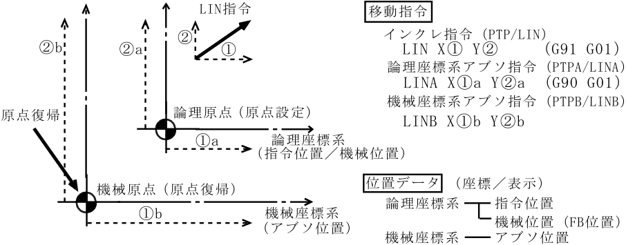

# お願い

このマニュアルの記載内容について、まちがいや不明な点がありましたら、お手数ですがFAXまたはメールにてテクノへお知らせ下さい。今後さらに改善していきます。

株式会社テクノ〒358-0011 埼玉県入間市下藤沢1304-5 TEL 04-2964-3677 FAX 04-2964-3322 E-mail mail@open-mc.com

標準ワンボードモーションコントローラ[SLM8000]

ユーザーズマニュアル

Ver1.3 2020.2.26

まえがき

SLM8000をご使用いただきありがとうございます。

SLM8000は小形ながら非常にインテリジェントで多機能なモーションコントローラです。この特質を活かすことで、かならずお客様のマシンやシステムの有意性や特徴が発揮されるものと信じております。

このマニュアルは、SLM8000を実際に使用し、機械や周辺電気品(制御盤など)の設計をしていただくために「SLM8000の導入方法」「SLM8000のハードウェア」「SLM8000の機能」「実機試運転・調整方法」「メンテナンス」について説明しています。

初めての方へ

まず、本書の <Ⅰ導入編> をご覧ください。「インストール」→「初期操作」→「運転練習(ダミー運転)」の流れで、自然に体験できます。

本書以外にも以下のマニュアルや資料がありますので、あわせて御覧下さい。

- [ ] □ SLM8000 セッティングPCマニュアル

- [ ] □ SLM8000 ROMSW設定ソフトマニュアル

TB00-1131

TB00-1132

PCソフト開発の資料

| □   | SLM8000 通信ライブラリリファレンスマニュアル       | TB00-1133   |
|-----|----------------------------------|-------------|
| □   | SLM8000 送受信データマニュアル              | TB00-1134   |
| □   | SLM8000 テクノコード変換ライブラリリファレンスマニュアル | TB00-1135   |
| □   | SLM8000 Gコード変換ライブラリリファレンスマニュアル   | TB00-1136   |

－目次－

| ………………………………… 1. 導入から運転・実稼動までの全体の作業（概要）                                                                    | ………………………………………………… A1 A1   |
|------------------------------------------------------------------------------------------------------------|-----------------------------|
| Ⅰ 導入編 ……………………………………… 2. 初期導入作業（ご購入後の初めての作業）                                                               | A3                          |
| ……………………………………………………………………………………………………… 2-1. 員数チェック！                                                       | A3                          |
| …………………………………………………………………………………… 2-2. こんなマニュアルがあります。                                                       | A4                          |
| ……………………………………………………………………………………………… 2-3. PCソフトインストール                                                      | A4                          |
| ………………………………………………………………………………………………… 2-4. SLM8000とPCの接続                                                   | A6                          |
| ……………………………………………………………………………………………………… 2-4-1. 通信形態                                                        | A6                          |
| ………………………………………………………………………………………………… 2-4-2. 通信接続手順                                                        | A7                          |
| ……………………………………………………………………………………… 2-5. ROMSW(ロムスイッチ)の設定                                                    | A9                          |
| ………………………………………… 2-6. セッティングPCソフト … 出荷時設定のパラメータファイル保存                                                      | A10                         |
| ……………………………………………………………………… 2-6-1. バックアップメモリエラーの解除                                                         | A10                         |
| ………………………………………………………………………… 2-6-2. パラメータ未設定エラーの解除                                                         | A11                         |
| ……………………………………………………………………………… 2-6-3. セッティングPCソフト設定                                                        | A12                         |
| 3. 1台のPCで複数のSLM8000を管理                                                                                     |                             |
|                                                                                                            | ……………………………………………… A13 A13  |
| ………………………………………………………………………………… 3-1. 1台目のSLM8000のインストール                                                    | A13                         |
| …………………………………………………………………………… 3-2. 2台目以降のSLM8000のインストール ………………………………………………………………………………………… 3-2-1. バージョンの確認 | A13                         |
| ……………………………………………… 3-2-2. 追加するSLM8000が同じソフトウェアバージョンの場合                                                     | A13                         |
| …………………………………………… 3-2-3. 追加するSLM8000が異なるソフトウェアバージョンの場合                                                     | A13                         |
| …………………………………………………………… 4. 通信接続の設定/確認                                                                      | A14                         |
| …………………………………………………………………………………………………………… 4-1. 通信設定 …………………………………………………………………………………………………………… 4-2. 通信確認    | A14 A15                     |
| ………………………………………………………………… 5. アンインストール                                                                      | A15                         |
| ……………………………………………………………… 6. SLM8000/PCの交換                                                                  | A16                         |
| ……………………………………………………………………………………………………… 6-1. SLM8000の交換                                                    | A16 A16                     |
| …………………………………………………………………………………………………………… 6-2. PCの交換                                                       | A16                         |
| …………………………………………………………………………………… 6-2-1. 元のPCが動作する場合                                                        |                             |
| ………………………………………………………………………………… 6-2-2. 元のPCが動作しない場合                                                        | A16                         |
| ………………………………………………………………………… 7. ダミー運転                                                                      | A17                         |
| …………………………………………………………………………………………………… 7-1. SLM8000 電源ON                                                   | A17 A17                     |
| …………………………………………………………………………………… 7-2. セッティングPCソフトを起動                                                       | A18                         |
| ……………………………………………………………………………………………… 7-3. ダミーで運転・操作 …………………………………………………………………………… 7-3-1. 手動操作（JOG/インチング）   | A19                         |
| ………………………………………………………………………………………… 7-3-2. 1ショット位置決め                                                        | A20 A21                     |
| …………………………………………………………………………………………… 7-3-3. ホーム位置決め                                                         | A22                         |
| ………………………………………………………………………… 7-3-4. 運転プログラムのダウンロード                                                         | A23                         |
| ………………………………………………………………………………… 7-3-5. 自動モードでメモリ運転                                                         | A24                         |
| …………………………………………………………… 7-3-6. ティーチング画面でシングルステップ運転                                                         | A25                         |
| …………………………………………………………………………………………………… 7-4. 他の画面をみる ……………………………………………………………………………………………… 7-5. その他の運転の準備    | A25                         |
|                                                                                                            | A25                         |
| …………………………………………………………………………………………… 7-5-1. アラームの解除                                                         | A25                         |
| …………………………………………………………………………………… 7-5-2. 原点復帰を不要にする ……………………………………………………………………………                           |                             |
| 7-5-3. SLM8000電源 OFF → 再度 ON                                                                               | A25                         |
| …………………………………………………………… 8. モータ単体運転の準備                                                                      | A26                         |
| 8-1. 配線図の作成                                                                                                | A26                         |
| ……………………………………………………………………………………………………… 8-2. 組立・配線・配線チェック                                                  | A26                         |
| ……………………………………………………………………………………… 8-2-1. アース                                                               | A27 A27                     |
| ……………………………………………………………………………………………………… 8-2-2. アース用ケーブル                                                    |                             |
| ………………………………………………………………………………………… ……………………………………………………………………………………… 8-2-3. アースプレートの例                      | A27                         |
| …………………………………………………………………………… 8-2-4. フラットケーブルのあまり線                                                         | A27                         |
| 8-2-5. DC電源の確認                                                                                             | A27                         |
| ……………………………………………………………………………………………… ………………………………………………………………………………………… 8-3. サーボアンプなどの設定                   | A28 A30                     |
| …………………………………………………………………………………………… 8-4. SLM8000のROMSWの設定                                                  |                             |
| …………………………………………………………………………… 8-5. SLM8000のサーボパラメータの設定例                                                    | A30                         |

| 9.                                                                                                                                                            | …………………………………………………………………… モータ単体運転                                                                                                                            | A31                                      |
|---------------------------------------------------------------------------------------------------------------------------------------------------------------|---------------------------------------------------------------------------------------------------------------------------------------------------------------|------------------------------------------|
| 9-1.                                                                                                                                                          | …………………………………………………………………………………… サーボ主電源投入シーケンス                                                                                                                | A31                                      |
| 9-2.                                                                                                                                                          | ……………………………………………………………………………………………… サーボロックの確認                                                                                                                | A31                                      |
| 9-3.                                                                                                                                                          | ……………………………………………………………………………………………………… サーボの異常                                                                                                                | A31                                      |
| 9-4.                                                                                                                                                          | ……………………………………………………………………………………………………… 手動/自動運転                                                                                                               | A31                                      |
| 9-5. 2. 外形寸法と設置方法                                                                                                                                             | ………………………………………………………………………… モータ単体でも原点復帰をしたい場合                                                                                                                | A31                                      |
| ……………………………………………………………… 10. 導入編の補足資料                                                                                                                         | ……………………………………………………………… 10. 導入編の補足資料                                                                                                                         | A32                                      |
| …………………………………………………………………………………… 10-1. SLMの製品型式と写真の一覧                                                                                                         | …………………………………………………………………………………… 10-1. SLMの製品型式と写真の一覧                                                                                                         | A32                                      |
| ………………………………………………………………………………………… 10-1-1. SLM8000製品一式                                                                                                        | ………………………………………………………………………………………… 10-1-1. SLM8000製品一式                                                                                                        | A32                                      |
| ……………………………………………………………………………… 10-1-2. RS232C通信用製品（別売）                                                                                                        | ……………………………………………………………………………… 10-1-2. RS232C通信用製品（別売）                                                                                                        | A33                                      |
| ………………………………………………………………… 10-1-3. アナログ出力オプション製品（別売）                                                                                                           | ………………………………………………………………… 10-1-3. アナログ出力オプション製品（別売）                                                                                                           | A33                                      |
| ……………………………………………………………………………………………… 10-2. 出荷リストサンプル                                                                                                          | ……………………………………………………………………………………………… 10-2. 出荷リストサンプル                                                                                                          | A33                                      |
| ……………………………………………………………………………………………………… 10-3. 出荷CDの中身 ………………………………………………………………………………………… 10-4. サンプル運転プログラム                                                    | ……………………………………………………………………………………………………… 10-3. 出荷CDの中身 ………………………………………………………………………………………… 10-4. サンプル運転プログラム                                                    | A36 A37                                  |
| ………………………………………………………………………………………… 10-5. ソフトウェアバージョン                                                                                                          | ………………………………………………………………………………………… 10-5. ソフトウェアバージョン                                                                                                          | A37                                      |
| ……………………………………………………………………… 10-5-1. ソフトウェアバージョンの付け方                                                                                                           | ……………………………………………………………………… 10-5-1. ソフトウェアバージョンの付け方                                                                                                           |                                          |
|                                                                                                                                                               |                                                                                                                                                               | A37                                      |
| …………………………………………………………………… 10-5-2. ソフトウェアバージョンの確認方法                                                                                                           | …………………………………………………………………… 10-5-2. ソフトウェアバージョンの確認方法                                                                                                           | A37                                      |
| ……………………………………… Ⅱ ハードウェア編 B1                                                                                                                                  | ……………………………………… Ⅱ ハードウェア編 B1                                                                                                                                  | ……………………………………… Ⅱ ハードウェア編 B1             |
| …………………………………………………………………………… 1. 一般事項 B1                                                                                                                      | …………………………………………………………………………… 1. 一般事項 B1                                                                                                                      | …………………………………………………………………………… 1. 一般事項 B1 |
|                                                                                                                                                               |                                                                                                                                                               | B1                                       |
| ……………………………………………………………………………………………………………… 1-1. 電源仕様                                                                                                          | ……………………………………………………………………………………………………………… 1-1. 電源仕様                                                                                                          |                                          |
| …………………………………………………………………………………………………………… 1-2. 寸法と重量                                                                                                          | …………………………………………………………………………………………………………… 1-2. 寸法と重量                                                                                                          | B1                                       |
| …………………………………………………………………………………………………… 1-3. 設置上の注意事項                                                                                                          | …………………………………………………………………………………………………… 1-3. 設置上の注意事項                                                                                                          | B1 B2                                    |
| ………………………………………………………………………………………… 1-4. ノイズ対策とシールド処理                                                                                                          | ………………………………………………………………………………………… 1-4. ノイズ対策とシールド処理                                                                                                          | ……………………………………………………………… B3              |
| ………………………………………………………………………………………… 2-1. AS710コントローラボード                                                                                                        | ………………………………………………………………………………………… 2-1. AS710コントローラボード                                                                                                        | B3                                       |
| ………………………………………………………………………………………………… 2-2. AS232の接続と設置                                                                                                        | ………………………………………………………………………………………………… 2-2. AS232の接続と設置                                                                                                        | B4                                       |
| ………………………………………………………………………………………………… 2-2-1. AS232の外観                                                                                                         | ………………………………………………………………………………………………… 2-2-1. AS232の外観                                                                                                         | B4                                       |
| ……………………………………………………………………………………………… 2-2-2. 取付板金加工図                                                                                                           | ……………………………………………………………………………………………… 2-2-2. 取付板金加工図                                                                                                           | B4                                       |
| ……………………………………… 2-2-3. [AS710 CN5/CN5A] ～ [AS232 CN1] ケーブル【CB-C-012-00】                                                                                       | ……………………………………… 2-2-3. [AS710 CN5/CN5A] ～ [AS232 CN1] ケーブル【CB-C-012-00】                                                                                       | B4                                       |
| …………………………………………………………… 3. AS710コントローラボード                                                                                                                     | …………………………………………………………… 3. AS710コントローラボード                                                                                                                     | C1                                       |
|                                                                                                                                                               |                                                                                                                                                               | C1                                       |
| …………………………………………………………………………… 3-1. AS710コネクタ表と使用コネクタ型式 ………………………………………………………………………………… 3-1-1. CN1 ：軸制御 C1 ……………………………………………………………………………………… 3-1-2. CN2 ： I/O | …………………………………………………………………………… 3-1. AS710コネクタ表と使用コネクタ型式 ………………………………………………………………………………… 3-1-1. CN1 ：軸制御 C1 ……………………………………………………………………………………… 3-1-2. CN2 ： I/O | C3 ……………………………………………………………………………………… C5  |
|                                                                                                                                                               |                                                                                                                                                               | C5                                       |
|                                                                                                                                                               |                                                                                                                                                               | ……………………………………………………………………………………         |
| ………………………………………………………………………… 3-1-5. CN5，CN5A ：シリアル通信                                                                                                         | ………………………………………………………………………… 3-1-5. CN5，CN5A ：シリアル通信                                                                                                         | C6 C6                                    |
| …………………………………………………………………… 3-1-6. CNETR ：イーサネット接続                                                                                                            | …………………………………………………………………… 3-1-6. CNETR ：イーサネット接続                                                                                                            | C7                                       |
| ………………………………………………………………………………… 3-1-7. CNSDA ： DA出力                                                                                                           | ………………………………………………………………………………… 3-1-7. CNSDA ： DA出力                                                                                                           | C7                                       |
| ………………………………………………………………………… 3-1-8. CN7 ： AD入力(予備)                                                                                                            | ………………………………………………………………………… 3-1-8. CN7 ： AD入力(予備)                                                                                                            | C8                                       |
| …………………………………………………………………………………………… 3-2. 標準入出力チャンネル表                                                                                                          | …………………………………………………………………………………………… 3-2. 標準入出力チャンネル表                                                                                                          | C8                                       |
| ………………………………………………………………… 3-2-1. 入力信号チャンネル表(デフォルト設定)                                                                                                          | ………………………………………………………………… 3-2-1. 入力信号チャンネル表(デフォルト設定)                                                                                                          |                                          |
| ……………………………………………………………… 3-2-2. 出力信号チャンネル表(デフォルト設定)                                                                                                           | ……………………………………………………………… 3-2-2. 出力信号チャンネル表(デフォルト設定)                                                                                                           | C10 C11                                  |
| ………………………………………………………………………………………… 3-3. 入出力信号の電気的仕様                                                                                                           | ………………………………………………………………………………………… 3-3. 入出力信号の電気的仕様                                                                                                           | C11                                      |
| …………………………………………………………………………………………… 3-3-1. 電気的仕様一覧                                                                                                            | …………………………………………………………………………………………… 3-3-1. 電気的仕様一覧                                                                                                            |                                          |
| …………………………………………………………………… 3-3-2. エンコーダFBパルス最少位相差時間                                                                                                           | …………………………………………………………………… 3-3-2. エンコーダFBパルス最少位相差時間                                                                                                           | C13                                      |
|                                                                                                                                                               |                                                                                                                                                               | C14                                      |
| ……………………………………………………………………… 3-4. パルス指令ドライバ（アンプ）との接続                                                                                                           | ……………………………………………………………………… 3-4. パルス指令ドライバ（アンプ）との接続                                                                                                           | C14                                      |
| ………………………………………………………………………………………………… 3-4-1. 電気的仕様                                                                                                            | ………………………………………………………………………………………………… 3-4-1. 電気的仕様                                                                                                            | C15                                      |
| ……………………………………………………………………………… 3-4-2. パルス出力タイミング仕様                                                                                                            | ……………………………………………………………………………… 3-4-2. パルス出力タイミング仕様                                                                                                            |                                          |
| ……………………………………………………………………………… 3-4-3. パルス出力のその他の設定                                                                                                            | ……………………………………………………………………………… 3-4-3. パルス出力のその他の設定                                                                                                            | C16                                      |
| ………………………………………………………… 3-5. 入力信号の漏れ電流と残留電圧（2線式センサー）                                                                                                           | ………………………………………………………… 3-5. 入力信号の漏れ電流と残留電圧（2線式センサー）                                                                                                           | C16                                      |
|                                                                                                                                                               |                                                                                                                                                               | C17                                      |
| ………………………………………………………………………… 4. 周辺接続                                                                                                                          | ………………………………………………………………………… 4. 周辺接続                                                                                                                          | C17                                      |
| ………………………………………………………………………………………………… 4-1. 周辺接続概観図                                                                                                           | ………………………………………………………………………………………………… 4-1. 周辺接続概観図                                                                                                           |                                          |
| ………………………………………………………………………………… 4-2. 全体接続図とサーボ主電源回路 …………………………………………………………………………………………………… 4-3. DC電源ケーブル                                                      | ………………………………………………………………………………… 4-2. 全体接続図とサーボ主電源回路 …………………………………………………………………………………………………… 4-3. DC電源ケーブル                                                      | C18 C19                                  |
|                                                                                                                                                               |                                                                                                                                                               | C19                                      |
| 4-5. CN1 パルス列指令形サーボアンプとの接続例                                                                                                                                   | 4-5. CN1 パルス列指令形サーボアンプとの接続例                                                                                                                                   |                                          |
|                                                                                                                                                               | セッティングPC用ケーブル（PC－AT）                                                                                                                                          |                                          |
|                                                                                                                                                               | …………………………………………………………………………                                                                                                                                  |                                          |
|                                                                                                                                                               |                                                                                                                                                               | C20                                      |
|                                                                                                                                                               |                                                                                                                                                               | …………………………………………………………………                |
| 3-1-3. 3-1-4. 4-4.                                                                                                                                            |                                                                                                                                                               |                                          |

| 4-5-1. 安川SGDH-Ⅱの例                                                                                                                                                                                     | …………………………………………………………………………………………… C20                     |
|-------------------------------------------------------------------------------------------------------------------------------------------------------------------------------------------------------|-------------------------------------------------------------|
| ………………………………………………………………………………………………… 4-5-2. 三菱J2の例 4-5-3.                                                                                                                                            | C20                                                         |
| ………………………………………………………… オリエンタルモータ社 αステップの接続例                                                                                                                                                           | C21                                                         |
| ………………………………………………………………………… 4-5-4. 各社パルス指令サーボとの接続 ………………………………………………………………………………………                                                                                                                  | C22                                                         |
| 4-6. CNEXT（手動パルサ/PG FB）                                                                                                                                                                               | C23                                                         |
| ………………………………………………………………………………………… 4-6-1. CNEXT標準ケーブル                                                                                                                                                 | C23                                                         |
| ………………………………………………………………………………………………… 4-6-2. CNEXT標準例                                                                                                                                                 | C23                                                         |
| ………………………………………………………………………………………………………… 4-7. CN7 AD入力                                                                                                                                                | C23                                                         |
| 5. 電源投入/電源断(サーボON/OFF)のシーケンス                                                                                                                                                                          | ……………………………… C24                                            |
| …………………………………………………………………………… 5-1. SLM8000 システム起動時シーケンス …………………………………………………………………………………………………… 5-2. 電源断時の処理                                                                                          | C24 C25                                                     |
| ………………………………………………………………………………………………… 5-3. アラーム時の処理                                                                                                                                                   |                                                             |
|                                                                                                                                                                                                       | C25                                                         |
|                                                                                                                                                                                                       | D1                                                          |
| ………………………………………………… Ⅲ 機能編 1.                                                                                                                                                                          | D1                                                          |
| …………………………………………………………………………… 機能概要 ……………………………………………………………………………………………… 1-1. PCからの運転・操作                                                                                                               | D1 ……………………………………………………………………… D1 ………………………………………………………… D2 |
| 1-1-1. セッティングPCソフトによる運転 1-1-2. ユーザーアプリケーションソフトによる運転 CNETR                                                                                                                                             | …………………………………………………… D3                                     |
| 1-1-3. イーサネット通信 1-1-4. CN5A                                                                                                                                                                           | D3                                                          |
| シリアル通信ポート2(RS232C 2ch) 1-1-5. CN5                                                                                                                                                                     | …………………………………………………… D3                                     |
| シリアル通信ポート1(RS232C 1ch)                                                                                                                                                                                | ……………………………………………………… D4                                    |
| …………………………………………………………………………………………… 1-2. 入出力信号による運転 …………………………………………………………………………………………… 1-3. サーボ制御（軸制御）                                                                                               | D5                                                          |
| ……………………………………………………………………………………………… 1-4. SLM8000 機能リスト                                                                                                                                               | D6 D6                                                       |
| …………………………………………………………………………………… 1-4-1. SLM8000本体機能リスト                                                                                                                                                |                                                             |
| ……………………………………………………………………………… 1-4-2. 機械操作パネル機能リスト                                                                                                                                                    | D8 D8                                                       |
| ……………………………………………………………………………… 1-4-3. セッティングPC機能リスト                                                                                                                                                   | D9                                                          |
| …………………………………………………………………………… 1-4-4. 通信コマンド機能リスト(PC)                                                                                                                                                  | D11                                                         |
| ……………………………………………………………………………………………… SLM8000 基本仕様                                                                                                                                                     |                                                             |
| 1-5. 2.                                                                                                                                                                                               | D13                                                         |
| ……………………………………………………………………… 入出力機能 …………………………………………………………………………………………… 2-1. 入力信号の名称と機能                                                                                                                 | D13 D13 D15                                                 |
| …………………………………………………………………………………………………… 2-1-1. 一般入力 ………………………………………………………………………………………………… 2-1-2. サーボ入力 ……………………………………………………………………………………………… 2-1-3. 補助機能入力                                              |                                                             |
| …………………………………………………………………………………………………… 2-1-4. 汎用入力                                                                                                                                                    | D16                                                         |
| ……………………………………………………………………… 2-1-5. 機械操作パネル入力(ダイレクト)                                                                                                                                                   | D16 D17                                                     |
| 2-1-6. 機械操作パネル入力(マルチプレクサ)                                                                                                                                                                             |                                                             |
|                                                                                                                                                                                                       | D18                                                         |
| 2-1-7.                                                                                                                                                                                                | ………………………………………………………………… D19                               |
| ………………………………………………………………………… 機械操作パネル入力の補足説明 ……………………………………………………………………… 2-1-8. 機械操作パネル入力のモード選択                                                                                                        | D20                                                         |
| …………………………………………………………………………………………… 2-2. 出力信号の名称と機能 …………………………………………………………………………………………………… 2-2-1. 一般出力                                                                                                | D21                                                         |
| ………………………………………………………………………………………………… 2-2-2. サーボ出力 2-2-3.                                                                                                                                             | D21 D22                                                     |
| ………………………………………………………………………………………………                                                                                                                                                                  |                                                             |
| ……………………………………………………………………………………………………                                                                                                                                                                | D23                                                         |
| 補助機能出力汎用出力                                                                                                                                                                                           | D23                                                         |
| 2-2-4. ……………………………………………………………………… 2-2-5. 機械パネル出力(マルチプレクサ)                                                                                                                                            | D23                                                         |
| …………………………………………………………………………………………… 2-3. 標準入出力の割り当て動作モード                                                                                                                                             | D24                                                         |
| ………………………………………………………………………… …………………………………………………………………………………………                                                                                                                                       | D25 D25                                                     |
| 3. 3-1. 各動作モードと主な機能                                                                                                                                                                                   | E1 E1                                                       |
| …………………………………………………………… 4. サーボ制御（一般仕様） ……………………………………………………………………………………………………………… 4-1. 座標系 ……………………………………………………………………………………… 4-2. アブソ指令とインクレ指令 ……………………………………………………………………………… 4-3. 補間加減速 (指数形/直線形/S字) | E1 E2                                                       |
| ……………………………………………………………………………………………………… 4-4. 直線形加減速                                                                                                                                                   | E2                                                          |
| 4-5. PTP制御(位置決め) PTP/G00                                                                                                                                                                              | E3                                                          |
| 4-6. 直線補間 LIN/GO1                                                                                                                                                                                     | E3                                                          |
| 4-7. 円弧補間 CIRR、CIRL / G02、G03                                                                                                                                                                         | E4                                                          |
| ……………………………………………………………………………………………… 4-7-1. プリ解析方式                                                                                                                                                    | ………………………………………………………………… E4                                |
|                                                                                                                                                                                                       | E4                                                          |
| 4-7-2. ボード内部方式                                                                                                                                                                                        |                                                             |
| ……………………………………………………………………………………………                                                                                                                                                                   |                                                             |
| ……………………………………………………………………………………                                                                                                                                                                      |                                                             |
| ……………………………………………………………………………………                                                                                                                                                                      |                                                             |

| …………………………………………………………………………………………………………… 4-8. 手動送り E5                                                                                                                | …………………………………………………………………………………………………………… 4-8. 手動送り E5                                                                                                                | …………………………………………………………………………………………………………… 4-8. 手動送り E5                                                                                                                | …………………………………………………………………………………………………………… 4-8. 手動送り E5                                                                                                                |
|-----------------------------------------------------------------------------------------------------------------------------------------------------------------------|-----------------------------------------------------------------------------------------------------------------------------------------------------------------------|-----------------------------------------------------------------------------------------------------------------------------------------------------------------------|-----------------------------------------------------------------------------------------------------------------------------------------------------------------------|
| …………………………………………………………………………………………… 4-8-1. ジョグ(JOG)送り E5                                                                                                              | …………………………………………………………………………………………… 4-8-1. ジョグ(JOG)送り E5                                                                                                              | …………………………………………………………………………………………… 4-8-1. ジョグ(JOG)送り E5                                                                                                              | …………………………………………………………………………………………… 4-8-1. ジョグ(JOG)送り E5                                                                                                              |
| …………………………………………………………………………………… 4-8-2. インチング送り(手動) E5                                                                                                                | …………………………………………………………………………………… 4-8-2. インチング送り(手動) E5                                                                                                                | …………………………………………………………………………………… 4-8-2. インチング送り(手動) E5                                                                                                                | …………………………………………………………………………………… 4-8-2. インチング送り(手動) E5                                                                                                                |
| ………………………………………………………………………………………… 4-9. インポジションチェック E5                                                                                                                | ………………………………………………………………………………………… 4-9. インポジションチェック E5                                                                                                                | ………………………………………………………………………………………… 4-9. インポジションチェック E5                                                                                                                | ………………………………………………………………………………………… 4-9. インポジションチェック E5                                                                                                                |
| ………………………………………………………………………………… 4-10. なめらかな送り制御(パス機能) E7                                                                                                              | ………………………………………………………………………………… 4-10. なめらかな送り制御(パス機能) E7                                                                                                              | ………………………………………………………………………………… 4-10. なめらかな送り制御(パス機能) E7                                                                                                              | ………………………………………………………………………………… 4-10. なめらかな送り制御(パス機能) E7                                                                                                              |
| …………………………………………………………………………………………… 4-11. シングルステップ動作 E7                                                                                                               | …………………………………………………………………………………………… 4-11. シングルステップ動作 E7                                                                                                               | …………………………………………………………………………………………… 4-11. シングルステップ動作 E7                                                                                                               | …………………………………………………………………………………………… 4-11. シングルステップ動作 E7                                                                                                               |
| ……………………………………………………………………………………………………… 4-12. サイクル運転 E8                                                                                                               | ……………………………………………………………………………………………………… 4-12. サイクル運転 E8                                                                                                               | ……………………………………………………………………………………………………… 4-12. サイクル運転 E8                                                                                                               | ……………………………………………………………………………………………………… 4-12. サイクル運転 E8                                                                                                               |
| ………………………………………………………………………………………………… 4-13. オーバライド機能 E8                                                                                                               | ………………………………………………………………………………………………… 4-13. オーバライド機能 E8                                                                                                               | ………………………………………………………………………………………………… 4-13. オーバライド機能 E8                                                                                                               | ………………………………………………………………………………………………… 4-13. オーバライド機能 E8                                                                                                               |
| ……………………………………………………………………………………………… 4-14. ストロークリミット E9                                                                                                               | ……………………………………………………………………………………………… 4-14. ストロークリミット E9                                                                                                               | ……………………………………………………………………………………………… 4-14. ストロークリミット E9                                                                                                               | ……………………………………………………………………………………………… 4-14. ストロークリミット E9                                                                                                               |
| ………………………………………………………………………………………………………… 4-15. 原点復帰 E10                                                                                                               | ………………………………………………………………………………………………………… 4-15. 原点復帰 E10                                                                                                               | ………………………………………………………………………………………………………… 4-15. 原点復帰 E10                                                                                                               | ………………………………………………………………………………………………………… 4-15. 原点復帰 E10                                                                                                               |
| …………………………………………………………………………………………… 4-15-1. 原点復帰方式 E10                                                                                                                | …………………………………………………………………………………………… 4-15-1. 原点復帰方式 E10                                                                                                                | …………………………………………………………………………………………… 4-15-1. 原点復帰方式 E10                                                                                                                | …………………………………………………………………………………………… 4-15-1. 原点復帰方式 E10                                                                                                                |
| …………………………………………………………………… 4-15-2. 軸ストロークと機械原点のようす E10 …………………………………………………………………………………… 4-15-3. 疑似アブソ【廃止】 E10                                                         | …………………………………………………………………… 4-15-2. 軸ストロークと機械原点のようす E10 …………………………………………………………………………………… 4-15-3. 疑似アブソ【廃止】 E10                                                         | …………………………………………………………………… 4-15-2. 軸ストロークと機械原点のようす E10 …………………………………………………………………………………… 4-15-3. 疑似アブソ【廃止】 E10                                                         | …………………………………………………………………… 4-15-2. 軸ストロークと機械原点のようす E10 …………………………………………………………………………………… 4-15-3. 疑似アブソ【廃止】 E10                                                         |
| ……………………………………………………………………………… 4-15-4. 全軸原点復帰の逃げ動作 E11 …………………………………………………………………… 4-15-5. 全軸原点復帰シ－ケンス（順位） E11 ………………………………………………………………………………… 4-16. 軸制御に関するその他の機能 E12 | ……………………………………………………………………………… 4-15-4. 全軸原点復帰の逃げ動作 E11 …………………………………………………………………… 4-15-5. 全軸原点復帰シ－ケンス（順位） E11 ………………………………………………………………………………… 4-16. 軸制御に関するその他の機能 E12 | ……………………………………………………………………………… 4-15-4. 全軸原点復帰の逃げ動作 E11 …………………………………………………………………… 4-15-5. 全軸原点復帰シ－ケンス（順位） E11 ………………………………………………………………………………… 4-16. 軸制御に関するその他の機能 E12 | ……………………………………………………………………………… 4-15-4. 全軸原点復帰の逃げ動作 E11 …………………………………………………………………… 4-15-5. 全軸原点復帰シ－ケンス（順位） E11 ………………………………………………………………………………… 4-16. 軸制御に関するその他の機能 E12 |
| ……………………………………………………………………………………… 4-16-1. 周回処理(回転軸) E12                                                                                                               | ……………………………………………………………………………………… 4-16-1. 周回処理(回転軸) E12                                                                                                               | ……………………………………………………………………………………… 4-16-1. 周回処理(回転軸) E12                                                                                                               | ……………………………………………………………………………………… 4-16-1. 周回処理(回転軸) E12                                                                                                               |
| ……………………………………………………………………………… 4-16-2. 回転速度指令 SPIN/G120 E12                                                                                                           | ……………………………………………………………………………… 4-16-2. 回転速度指令 SPIN/G120 E12                                                                                                           | ……………………………………………………………………………… 4-16-2. 回転速度指令 SPIN/G120 E12                                                                                                           | ……………………………………………………………………………… 4-16-2. 回転速度指令 SPIN/G120 E12                                                                                                           |
| ………………………………… 4-16-3. ねじ切り機能(同期送り) <オプション> (計画中) E13 ……………………………………………… 4-16-4. 同一指令2軸制御 <オプション> E13                                                                  | ………………………………… 4-16-3. ねじ切り機能(同期送り) <オプション> (計画中) E13 ……………………………………………… 4-16-4. 同一指令2軸制御 <オプション> E13                                                                  | ………………………………… 4-16-3. ねじ切り機能(同期送り) <オプション> (計画中) E13 ……………………………………………… 4-16-4. 同一指令2軸制御 <オプション> E13                                                                  | ………………………………… 4-16-3. ねじ切り機能(同期送り) <オプション> (計画中) E13 ……………………………………………… 4-16-4. 同一指令2軸制御 <オプション> E13                                                                  |
| ………………………………………………………………………………… 4-16-5. PGパルス任意分周機能 E14                                                                                                               | ………………………………………………………………………………… 4-16-5. PGパルス任意分周機能 E14                                                                                                               | ………………………………………………………………………………… 4-16-5. PGパルス任意分周機能 E14                                                                                                               | ………………………………………………………………………………… 4-16-5. PGパルス任意分周機能 E14                                                                                                               |
| ……………………………………………… 4-16-6. 接線制御軸機能 <オプション> E14 ……………………………………………… 4-16-7. センサーラッチ機能（スキップ機能） <オプション> E18                                                               | ……………………………………………… 4-16-6. 接線制御軸機能 <オプション> E14 ……………………………………………… 4-16-7. センサーラッチ機能（スキップ機能） <オプション> E18                                                               | ……………………………………………… 4-16-6. 接線制御軸機能 <オプション> E14 ……………………………………………… 4-16-7. センサーラッチ機能（スキップ機能） <オプション> E18                                                               | ……………………………………………… 4-16-6. 接線制御軸機能 <オプション> E14 ……………………………………………… 4-16-7. センサーラッチ機能（スキップ機能） <オプション> E18                                                               |
| ………………………………… 4-16-8. コンベア追従送り同調・同期送り <オプション> (計画中) E18 ……………………………………………… 4-16-9. 直径指令 <オプション> E20                                                                  | ………………………………… 4-16-8. コンベア追従送り同調・同期送り <オプション> (計画中) E18 ……………………………………………… 4-16-9. 直径指令 <オプション> E20                                                                  | ………………………………… 4-16-8. コンベア追従送り同調・同期送り <オプション> (計画中) E18 ……………………………………………… 4-16-9. 直径指令 <オプション> E20                                                                  | ………………………………… 4-16-8. コンベア追従送り同調・同期送り <オプション> (計画中) E18 ……………………………………………… 4-16-9. 直径指令 <オプション> E20                                                                  |
| ………………………………… 4-16-10. フレキシブル電子カム制御 <オプション> (計画中) E20 ……………………………………………… 4-16-11. 巻線指令 <オプション> E21                                                                    | ………………………………… 4-16-10. フレキシブル電子カム制御 <オプション> (計画中) E20 ……………………………………………… 4-16-11. 巻線指令 <オプション> E21                                                                    | ………………………………… 4-16-10. フレキシブル電子カム制御 <オプション> (計画中) E20 ……………………………………………… 4-16-11. 巻線指令 <オプション> E21                                                                    | ………………………………… 4-16-10. フレキシブル電子カム制御 <オプション> (計画中) E20 ……………………………………………… 4-16-11. 巻線指令 <オプション> E21                                                                    |
| ……………………………………………… 4-17. 主軸機能 <オプション> E26                                                                                                                             | ……………………………………………… 4-17. 主軸機能 <オプション> E26                                                                                                                             | ……………………………………………… 4-17. 主軸機能 <オプション> E26                                                                                                                             | ……………………………………………… 4-17. 主軸機能 <オプション> E26                                                                                                                             |
| …………………………………………………………………………………… 4-17-1. オープンループ方式 E26                                                                                                                | …………………………………………………………………………………… 4-17-1. オープンループ方式 E26                                                                                                                | …………………………………………………………………………………… 4-17-1. オープンループ方式 E26                                                                                                                | …………………………………………………………………………………… 4-17-1. オープンループ方式 E26                                                                                                                |
| ……………………………………………………………………………………… 4-17-2. 2bit出力信号方式 E27 …………………………………………… 4-17-3. 主軸制御と無限回転軸(一般の軸)に対するSPINの違い E28                                                    | ……………………………………………………………………………………… 4-17-2. 2bit出力信号方式 E27 …………………………………………… 4-17-3. 主軸制御と無限回転軸(一般の軸)に対するSPINの違い E28                                                    | ……………………………………………………………………………………… 4-17-2. 2bit出力信号方式 E27 …………………………………………… 4-17-3. 主軸制御と無限回転軸(一般の軸)に対するSPINの違い E28                                                    | ……………………………………………………………………………………… 4-17-2. 2bit出力信号方式 E27 …………………………………………… 4-17-3. 主軸制御と無限回転軸(一般の軸)に対するSPINの違い E28                                                    |
| ………………………………………………………………………………………………………… 4-18. 補正機能 E29                                                                                                               | ………………………………………………………………………………………………………… 4-18. 補正機能 E29                                                                                                               | ………………………………………………………………………………………………………… 4-18. 補正機能 E29                                                                                                               | ………………………………………………………………………………………………………… 4-18. 補正機能 E29                                                                                                               |
| ……………………………………………………………………………… 4-18-1. バックラッシュ補正機能 E29 ……………………………………………… 4-18-2. 工具長補正機能及び摩耗補正機能 <オプション> E30                                                         | ……………………………………………………………………………… 4-18-1. バックラッシュ補正機能 E29 ……………………………………………… 4-18-2. 工具長補正機能及び摩耗補正機能 <オプション> E30                                                         | ……………………………………………………………………………… 4-18-1. バックラッシュ補正機能 E29 ……………………………………………… 4-18-2. 工具長補正機能及び摩耗補正機能 <オプション> E30                                                         | ……………………………………………………………………………… 4-18-1. バックラッシュ補正機能 E29 ……………………………………………… 4-18-2. 工具長補正機能及び摩耗補正機能 <オプション> E30                                                         |
| ……………………………………………… 4-18-3. 工具径補正機能 <オプション> E32 ………………………………………………………………………………… 4-18-3-1.径補正指令コード E32                                                                  | ……………………………………………… 4-18-3. 工具径補正機能 <オプション> E32 ………………………………………………………………………………… 4-18-3-1.径補正指令コード E32                                                                  | ……………………………………………… 4-18-3. 工具径補正機能 <オプション> E32 ………………………………………………………………………………… 4-18-3-1.径補正指令コード E32                                                                  | ……………………………………………… 4-18-3. 工具径補正機能 <オプション> E32 ………………………………………………………………………………… 4-18-3-1.径補正指令コード E32                                                                  |
| ……………………………………………………………………………………… 4-18-3-2.使用上の条件                                                                                                                     | ……………………………………………………………………………………… 4-18-3-2.使用上の条件                                                                                                                     |                                                                                                                                                                       |                                                                                                                                                                       |
| 4-18-3-3.径補正モードへの入り方                                                                                                                                                  |                                                                                                                                                                       |                                                                                                                                                                       |                                                                                                                                                                       |
|                                                                                                                                                                       |                                                                                                                                                                       | E33                                                                                                                                                                   | E33                                                                                                                                                                   |
|                                                                                                                                                                       | ……………………………………………………………………………………… 4-18-3-4.径補正の終了                                                                                                                     | ………………………………………………………………………… E34                                                                                                                                      | ………………………………………………………………………… E34                                                                                                                                      |
|                                                                                                                                                                       | 4-18-3-5.補正モード中にX/Y移動のないステップ G00 の動作                                                                                                                                  | E35                                                                                                                                                                   | E35                                                                                                                                                                   |
|                                                                                                                                                                       | 4-18-3-7.工具径補正データ設定画面 …………………………………………………………………………………………                                                                                                              | ………………………………………………………… E36 ……………………………………………………………………………… E36 E37                                                                                                     | ………………………………………………………… E36 ……………………………………………………………………………… E36 E37                                                                                                     |
|                                                                                                                                                                       | ………………………………………………………………………………… 4-18-3-9.角度一致閾値設定                                                                                                                     | ……………………………………………………………………… E37 E38                                                                                                                                   | ……………………………………………………………………… E37 E38                                                                                                                                   |
|                                                                                                                                                                       |                                                                                                                                                                       | E39 E39                                                                                                                                                               | E39 E39                                                                                                                                                               |
| 4-18-3-6.補正中の 4-18-3-8.マクロ変数                                                                                                                                          | 4-18-3-10.工具径補正情報画面                                                                                                                                                   |                                                                                                                                                                       |                                                                                                                                                                       |
|                                                                                                                                                                       | ………………………………………………………………………………                                                                                                                                        | E40                                                                                                                                                                   | E40                                                                                                                                                                   |
| 4-18-3-12.各エラー内容 4-18-3-13.注意事項                                                                                                                                       | 4-18-3-11.工具径補正の詳細エラー情報                                                                                                                                               |                                                                                                                                                                       |                                                                                                                                                                       |
|                                                                                                                                                                       |                                                                                                                                                                       | …………………………………………………………………… E48                                                                                                                                        | …………………………………………………………………… E48                                                                                                                                        |
|                                                                                                                                                                       |                                                                                                                                                                       | ……………………………………………… E51                                                                                                                                                | ……………………………………………… E51                                                                                                                                                |
| 4-18-4.                                                                                                                                                               | ……………………………………………………………………………………… …………………………………………………………………………………………… ピッチエラー補正機能                                                                                      | ……………………………………………… E53 E58                                                                                                                                            | ……………………………………………… E53 E58                                                                                                                                            |
| 4-18-5. 4-19.                                                                                                                                                         | 形状補正(高精度輪郭制御) ティーチング (開発中)                                                                                                                                            | E58 E60                                                                                                                                                               | E58 E60                                                                                                                                                               |
| 4-19-1. 4-19-2.                                                                                                                                                       | ………………………………………………………………………………………… …………………………………………………………………………………………… ティーチング ……………………………………………………………………………………… 「逆行」動作詳細                                              | E61                                                                                                                                                                   | E61                                                                                                                                                                   |
| 4-19-4. 4-19-5.                                                                                                                                                       | ………………………………………………………………………………… 「スキップ」動作詳細                                                                                                                            |                                                                                                                                                                       |                                                                                                                                                                       |
| 4-19-3.                                                                                                                                                               |                                                                                                                                                                       | E61                                                                                                                                                                   | E61                                                                                                                                                                   |
|                                                                                                                                                                       | ……………………………………………………………………………………… 「挿入」動作詳細                                                                                                                            |                                                                                                                                                                       |                                                                                                                                                                       |
|                                                                                                                                                                       | 「置換」動作詳細                                                                                                                                                              | E62                                                                                                                                                                   | E62                                                                                                                                                                   |
| 4-19-6.                                                                                                                                                               | 「原点シフト」動作詳細                                                                                                                                                           | E64                                                                                                                                                                   | E64                                                                                                                                                                   |
|                                                                                                                                                                       | ………………………………………………………………………………………                                                                                                                                     | E64                                                                                                                                                                   | E64                                                                                                                                                                   |
| 4-19-7.                                                                                                                                                               | 「削除」動作詳細                                                                                                                                                              |                                                                                                                                                                       |                                                                                                                                                                       |
|                                                                                                                                                                       | ………………………………………………………………………………………                                                                                                                                     | ……………………………………………………………………………… E65                                                                                                                                    | ……………………………………………………………………………… E65                                                                                                                                    |
| 4-20.                                                                                                                                                                 |                                                                                                                                                                       | E65                                                                                                                                                                   | E65                                                                                                                                                                   |
|                                                                                                                                                                       | 補間前加減速(自動コーナオーバライド)機能                                                                                                                                                 | ……………………………………………… E65                                                                                                                                                | ……………………………………………… E65                                                                                                                                                |
| 4-20-1.                                                                                                                                                               | 補間前加減速(自動コーナオーバライド)のメリット                                                                                                                                              | E65                                                                                                                                                                   | E65                                                                                                                                                                   |
|                                                                                                                                                                       | 制限事項など                                                                                                                                                                |                                                                                                                                                                       |                                                                                                                                                                       |
|                                                                                                                                                                       |                                                                                                                                                                       | E66                                                                                                                                                                   | E66                                                                                                                                                                   |
| 4-20-4.                                                                                                                                                               |                                                                                                                                                                       |                                                                                                                                                                       |                                                                                                                                                                       |
|                                                                                                                                                                       |                                                                                                                                                                       | …                                                                                                                                                                     | …                                                                                                                                                                     |
|                                                                                                                                                                       | 4-20-3.                                                                                                                                                               |                                                                                                                                                                       |                                                                                                                                                                       |
|                                                                                                                                                                       |                                                                                                                                                                       |                                                                                                                                                                       | 補間前加減速(自動コーナオーバライド)をしているときの速度変化(オーバライド)の様子 ……………………………………………………………………………………………                                                                                        |
|                                                                                                                                                                       |                                                                                                                                                                       | ……………………………………………………                                                                                                                                                  | ……………………………………………………                                                                                                                                                  |
| 4-20-2.                                                                                                                                                               |                                                                                                                                                                       |                                                                                                                                                                       |                                                                                                                                                                       |
|                                                                                                                                                                       |                                                                                                                                                                       | <オプション> ………………………………………………                                                                                                                                            | <オプション> ………………………………………………                                                                                                                                            |
|                                                                                                                                                                       | 補間前加減速(自動コーナオーバライド)の概要                                                                                                                                                |                                                                                                                                                                       |                                                                                                                                                                       |

|                                           | 4-20-5.                                                                              | ……………………………………………………………………… 加速度(速度変化量)の算出方法 E66                        |
|-------------------------------------------|--------------------------------------------------------------------------------------|------------------------------------------------------------------------|
| 4-20-6.                                   | …………………………………………………………………………… パラメータの設定について                                           | E67                                                                    |
| 4-20-7.                                   | …………………………………………………………………………………………………… 動作例                                           | E68                                                                    |
| 4-20-8.                                   | …………………………………………………………………………………… パラメータの選定例                                           | E69                                                                    |
| 4-21.                                     | 手動パルサ/ジョイスティック <オプション>                                                               | ……………………………………………… E70                                                 |
| 4-21-1.                                   | ハードウェアの準備                                                                            | …………………………………………………………………………………… E70                                   |
| 4-21-2.                                   | …………………………………………………………………………………………… 手動送り設定                                           | E70                                                                    |
| 4-21-3.                                   | 手パモードの選択                                                                             |                                                                        |
|                                           |                                                                                      | ……………………………………………………………………………………… E70                                  |
| 4-21-4.                                   | ………………………………………………………………………………………… 手動運転の条件                                           | E70                                                                    |
| …………………………………………… 5. 運転プログラムの処理と各種運転方法 F1 | …………………………………………… 5. 運転プログラムの処理と各種運転方法 F1                                            | …………………………………………… 5. 運転プログラムの処理と各種運転方法 F1                              |
| 5-1.                                      | 運転プログラムの保存の仕組み                                                                       | ………………………………………………………………………………… F1                                     |
| 5-1-1.                                    | 運転プログラムの容量                                                                           | …………………………………………………………………………………… F2                                    |
| 5-1-2.                                    | 運転プログラムの番号管理                                                                         | ……………………………………………………………………………… F2                                      |
| 5-1-3.                                    | ポイントテーブル                                                                             | ………………………………………………………………………………………… F2                                  |
| 5-2.                                      | ……………………………………………………………………………………………                                                  | F3                                                                     |
|                                           | 運転プログラムの事例                                                                           |                                                                        |
| 5-3.                                      | 自動運転におけるステップ動作                                                                       | ………………………………………………………………………………… F5                                     |
| 5-3-1.                                    | …………………………………………………………………………………………………… 自動運転                                          | F5                                                                     |
| 5-3-2.                                    | シングル運転(順行)                                                                           | ……………………………………………………………………………………… F5                                   |
| 5-3-3.                                    | ステップ間停止                                                                              | …………………………………………………………………………………………… F5                                 |
| 5-3-4.                                    | ステップ途中停止                                                                             | ………………………………………………………………………………………… F5                                  |
|                                           | （開発中）                                                                                | …………………………………………………………………… F5                                          |
| 5-3-5.                                    | 逆行(ステップ逆行) プリ解析処理(テキスト→バイナリ変換)                                                       | ……………………………………………………………………… F6                                         |
| 5-4.                                      | DNC(Direct NC)方式 <オプション>                                                             | …………………………………………………………………………… F7                                       |
| 5-5.                                      |                                                                                      |                                                                        |
| 5-6.                                      | 単独コマンド運転                                                                             | F8                                                                     |
| 5-7.                                      | ………………………………………………………………………………………………… ………………………………………………………………………………… マルチタスク <オプション> | F9                                                                     |
|                                           | ……………………………………………………………………………………… マルチタスクの概要円弧プリ解析処理(ステップ数/処理時間)                     | F9                                                                     |
| 5-7-1.                                    | 補足資料1.                                                                               | F11                                                                    |
|                                           | ………………………………………………………… ………………………………………………………… プリ解円弧精度と送り速度上限値の関係                     | F11                                                                    |
|                                           | 補足資料2.                                                                               |                                                                        |
| ……………………………………………………………… 6. 運転プログラム詳細 F12 | ……………………………………………………………… 6. 運転プログラム詳細 F12                                            | ……………………………………………………………… 6. 運転プログラム詳細 F12                              |
| 6-1.                                      | テクノコード運転プログラム命令                                                                      | ……………………………………………………………………………… F12                                     |
| 6-1-1.                                    | テクノコード指令                                                                             | ………………………………………………………………………………………… F12                                 |
|                                           |                                                                                      | …………………………………………………………………………………… F12                                   |
| 6-1-2.                                    | 6-1-1-1.テクノコード指令一覧運転プログラム例                                                          | ………………………………………………………………………………………… F14                                 |
| 6-1-3.                                    | ………………………………………………………………………………………………… 付加データ                                          | F15                                                                    |
|                                           | 6-1-3-1.付加データアドレス付き数値指定                                                              | ………………………………………………………………… F15 ……………………………………………………………………………………………… F16 |
| 6-1-3-2.数値指定                              |                                                                                      | F16                                                                    |
|                                           | …………………………………………………………………………………………… 6-1-3-3.ラベル指定                                    |                                                                        |
| 6-1-4.                                    | ………………………………………………………………………………………… 指令フォーマット …………………………………………………………………………………………       | F16                                                                    |
|                                           | 6-1-4-1.指令の表記例 6-1-4-2.「軸単位」と「速度単位」                                                  | F16 ………………………………………………………………………… F17                                   |
|                                           | 6-1-4-3.「軸範囲」と「速度範囲」と「回転速度範囲」                                                        | ………………………………………………… F17 F18                                            |
| 6-1-5.                                    | テクノコードプログラムの詳細（Gr1aグループ） PTP :                                                       | …………………………………………………… インクレPTP移動指令                                       |
| 6-1-5-1.                                  | PTPA : PTPB :                                                                        | 論理座標上の位置へのPTP移動指令 …………………………………………………… 機械座標上の位置へのPTP移動指令 F18           |
|                                           | LIN :                                                                                | インクレ直線補間移動指令                                                           |
| 6-1-5-2.                                  |                                                                                      | 論理座標上の位置への直線補間移動指令                                                     |
|                                           | LINA : LINB :                                                                        | …………………………………………… 機械座標上の位置への直線補間移動指令 F19                               |
| 6-1-5-3.                                  | CIRR :                                                                               | インクレ円弧補間(ヘリカル)時計方向回り（CW）                                              |
|                                           | CIRL                                                                                 | インクレ円弧補間(ヘリカル)反時計方向回り（CCW）論理座標系アブソ円弧補間(ヘリカル)時計方向回り                    |
|                                           | : CIRRA :                                                                            | （CW）                                                                   |
|                                           | CIRLA                                                                                | …………………… 論理座標系アブソ円弧補間(ヘリカル)反時計方向回り（CCW） F20                            |
| 6-1-5-4.                                  | : :                                                                                  | ………………………………………… ポイント指定PTP位置決め移動<オプション> F24                            |
| 6-1-5-5.                                  | PTMA LIMA :                                                                          | ………………………………………… ポイント指定直線補間 <オプション> F24                                |
|                                           | SLIN                                                                                 | センサーラッチ直線補間 <オプション>                                                    |
| 6-1-5-6.                                  | : SLINC :                                                                            | …………………………………………… センサーラッチ直線補間(移動停止なし) F25                              |
|                                           |                                                                                      | ………………………………………… <オプション> F26                                           |
| 6-1-5-7.                                  | REEL                                                                                 | 巻線指令接線制御Z軸回転                                                          |
| 6-1-5-8.                                  | :                                                                                    | ………………………………………… <オプション> F27                                           |
|                                           | TURN :                                                                               |                                                                        |
|                                           | SPIN :                                                                               | ………………………………… 回転速度指令（主軸アナログ指令 <オプション>） F27 F28                         |
| 6-1-5-9. 6-1-5-10.                        | THSET                                                                                | ………………………………………… 工具長補正 <オプション> F28                                     |
|                                           | : :                                                                                  | ………………………………………… <オプション>                                               |
|                                           | THOFF                                                                                | 工具長補正停止                                                                |
| 6-1-5-11.                                 |                                                                                      |                                                                        |

| 6-1-5-12.                                                                                         | TSTART:               | 別タスクプログラム起動 <オプション>                                                                                                                                                                 | ………………………………………… F29                                                                  |
|---------------------------------------------------------------------------------------------------|-----------------------|-------------------------------------------------------------------------------------------------------------------------------------------------------------------------------------|---------------------------------------------------------------------------------------|
| 6-1-5-13. TSTOP                                                                                   | :                     | 別タスクストップ <オプション> <オプション>                                                                                                                                                            | ……………………………………… F29                                                                   |
| 6-1-5-14. TRESET:                                                                                 |                       | 別タスクリセット                                                                                                                                                                            | ………………………………………… F30                                                                  |
| 6-1-5-15. PRG                                                                                     | : 別タスクプログラム起動         | <オプション>                                                                                                                                                                             | ……………………………………… F30                                                                   |
| 6-1-5-16. SVON                                                                                    | :                     | …………………………………………………………………………… 各軸サーボON                                                                                                                                               | F31                                                                                   |
| 6-1-5-17. SVOFF                                                                                   | : 各軸サーボOFF            | …………………………………………………………………………                                                                                                                                                        | F31                                                                                   |
| 6-1-6.                                                                                            |                       | テクノコードプログラム指令の詳細（Gr1bグループ）                                                                                                                                                          | ……………………………………………… F32                                                                |
| 6-1-6-1. CALL :                                                                                   |                       | サブルーチンコール                                                                                                                                                                           | …………………………………………………………………… F32                                                        |
| 6-1-6-2. JMP                                                                                      | :                     | ジャンプ指定                                                                                                                                                                              | …………………………………………………………………………… F33                                                     |
| 6-1-6-3. マクロ演算                                                                                    |                       | <オプション>                                                                                                                                                                             | …………………………………………                                                                      |
| 6-1-6-5.                                                                                          | : 条件判断                | <オプション> :                                                                                                                                                                           | F34 ………………………………………… F35                                                              |
| 6-1-6-4. IF ELSE ENDIF CASE ENDSWITCH BREAK DEFAULT                                               | SWITCH                | 条件判断 <オプション> テクノコードプログラム指令の詳細（Gr1cグループ）接線制御有効 <オプション> 接線制御無効 <オプション> ………………………………………………………………………… 論理座標値設定                                                                          | ………………………………………… F36 ……………………………………………… F37 ………………………………………… F37 ………………………………………… F37 |
| 6-1-7. 6-1-7-1. STNE : 6-1-7-2. STND : 6-1-7-3. CSET : 6-1-7-4. END : 6-1-7-5. INPE 6-1-7-6. INPD |                       | ………………………………………………………………………… プログラム終了 …………………………………………………………………… INPOS有効モード指定 …………………………………………………… ………………………………………………… テクノコードプログラム指令の詳細（Gr2グループ） ………………………………………………………………… (RTC周期指定) | F37 F38 F38                                                                           |
| TIM TM 6-1-9. ONR_                                                                                | : : : :               | ステップ実行時間指定テクノコードプログラム指令の詳細（Gr3グループ） ……………………………………………………………… 汎用出力セット処理指定 ……………………………………………………………                                                                                   | F38 F39                                                                               |
| 6-1-8.                                                                                            | : :                   | INPOS無効モード<デフォルト>指定ステップ実行時間指定                                                                                                                                                      |                                                                                       |
|                                                                                                   |                       |                                                                                                                                                                                     | F39                                                                                   |
|                                                                                                   | :                     |                                                                                                                                                                                     | F39 F40                                                                               |
| 6-1-8-1. 6-1-8-2.                                                                                 | : :                   |                                                                                                                                                                                     |                                                                                       |
|                                                                                                   |                       |                                                                                                                                                                                     | ……………………………………………… ………………………………………………… F40                                            |
| 6-1-9-1. 6-1-9-2. OFR_                                                                            |                       |                                                                                                                                                                                     | F40                                                                                   |
| E□R_ J□R_                                                                                         |                       | 汎用出力リセット処理指定                                                                                                                                                                        |                                                                                       |
| 6-1-9-3.                                                                                          |                       | 汎用入力処理指定（強制終了）汎用入力処理指定（スキップ）                                                                                                                                                       |                                                                                       |
| S□R_ 6-1-10.                                                                                      | W□R_                  | 汎用入力処理指定（待ち）汎用入力処理指定（停止）テクノコードプログラム指令の詳細（Gr4グループ）                                                                                                                                 | …………………………………………………………… F41 ……………………………………………… F42 F42                                |
| 6-1-10-1.MOUT                                                                                     | : :                   | ……………………………………………………………………………… ………………………………………………………………… 特殊Mコード指令                                                                                                                   | F43 …………………………………………………… F44 ………………………………………… F44 F44                                 |
| 6-1-11.                                                                                           | 6-1-10-2.MOUT0/MOUT1: | Mコード出力テクノコードプログラムの詳細（Gr5グループ）                                                                                                                                                      | F45                                                                                   |
|                                                                                                   |                       | 工具径補正 <オプション>                                                                                                                                                                       | F45 F45                                                                               |
|                                                                                                   | :                     | 工具径補正停止 <オプション> テクノコードプログラムの詳細（その他） :プログラム番号                                                                                                                                        | F45                                                                                   |
| 6-1-11-1. DL/DR DC PNO                                                                            | :                     | ラベル定義                                                                                                                                                                               |                                                                                       |
| 6-1-12. 6-1-12-1. ':'                                                                             |                       |                                                                                                                                                                                     |                                                                                       |
| 6-1-11-2.                                                                                         | :                     | ………………………………………………………………………… ………………………………………………………………………………                                                                                                                         |                                                                                       |
|                                                                                                   |                       |                                                                                                                                                                                     | ………………………………………… ……………………………………………………………                                              |
|                                                                                                   |                       | "*/" または "「"                                                                                                                                                                        |                                                                                       |
| 6-1-12-2. 6-1-12-3. 6-1-12-4.                                                                     | ･･･ :コメント             | "」" : コメント                                                                                                                                                                          | ………………………………… F45                                                                     |
|                                                                                                   |                       | ･･･ …………………………………………………………………………………                                                                                                                                                 |                                                                                       |
| "/*"                                                                                              |                       | ……………………………………………………………………………………                                                                                                                                                    |                                                                                       |
| "//"                                                                                              |                       |                                                                                                                                                                                     | F46                                                                                   |
| Gコード運転プログラム命令 6-2-1.                                                                              | Gコード運転プログラムの概要        | ……………………………………………………………………………                                                                                                                                                       | F46                                                                                   |
| 6-2-1-1. Gコード 6-2-1-2. 6-2-1-3. 6-2-1-4.                                                          | 指令一覧シーケンス番号(N)       | …………………………………………………………………………………                                                                                                                                                     | F46 F47                                                                               |
|                                                                                                   |                       | ………………………………………………………………………………… Gコード運転のプログラム途中再開                                                                                                                                    | F47 F47                                                                               |
| 6-2-1-5.                                                                                          | Gコードモーダル              | ……………………………………………………………… …………………………………………………………………………………… ……………………………………………………………………………                                                                                             | F48                                                                                   |
| Gコード 6-2-2.                                                                                       |                       | プログラム例                                                                                                                                                                              | F49                                                                                   |
| 付加データ指令の表記方法 6-2-3-1.                                                                            |                       |                                                                                                                                                                                     | F50                                                                                   |
| 6-2-3.                                                                                            | 指令フォーマット              | ………………………………………………………………………………………………… …………………………………………………………………………………………… …………………………………………………………………………………                                                                           | F50                                                                                   |
| 6-2-3-2.指令の表記例                                                                                    |                       | ………………………………………………………………………………………… ………………………………………………………………………                                                                                                                      | F50                                                                                   |
| 6-2-3-3.                                                                                          |                       | 「軸単位」と「速度単位」「軸範囲」と「速度範囲」                                                                                                                                                           | F51                                                                                   |
|                                                                                                   |                       |                                                                                                                                                                                     | F51                                                                                   |
|                                                                                                   |                       |                                                                                                                                                                                     | F52                                                                                   |
| 6-2-3-4. 6-2-4.                                                                                   |                       | ……………………………………………………………………… …………………………………………………………… Gコードプログラムの詳細（Gr1グループ）                                                                                                           |                                                                                       |
| 6-2-4-1. G00                                                                                      | :                     | 位置決めPTP移動（インクレ/論理座標系アブソ）                                                                                                                                                            | …………………………………… F52                                                                    |
| 6-2-4-2.                                                                                          | :                     | 機械座標上の位置へのPTP移動指令                                                                                                                                                                   | ……………………………………………………                                                                  |
| G28                                                                                               |                       |                                                                                                                                                                                     | F52                                                                                   |
| 6-2-4-3.                                                                                          |                       |                                                                                                                                                                                     |                                                                                       |
| G01                                                                                               | :                     | 直線補間（インクレ/論理座標系アブソ）                                                                                                                                                                 | …………………………………………… F53                                                                 |

| 6-2-4-4.                         | G02 :                                                                              | 時計方向回り(CW)円弧補間 (インクレ/論理座標系アブソ) ………………………                                                                                | 時計方向回り(CW)円弧補間 (インクレ/論理座標系アブソ) ………………………                                                                                | 時計方向回り(CW)円弧補間 (インクレ/論理座標系アブソ) ………………………                                                                                | 時計方向回り(CW)円弧補間 (インクレ/論理座標系アブソ) ………………………   |
|----------------------------------|------------------------------------------------------------------------------------|-------------------------------------------------------------------------------------------------------------------------|-------------------------------------------------------------------------------------------------------------------------|-------------------------------------------------------------------------------------------------------------------------|--------------------------------------------|
| 6-2-4-5.                         | G03 :                                                                              | 反時計方向回り(CCW)円弧補間(インクレ/論理座標系アブソ)                                                                                         | 反時計方向回り(CCW)円弧補間(インクレ/論理座標系アブソ)                                                                                         | 反時計方向回り(CCW)円弧補間(インクレ/論理座標系アブソ)                                                                                         | F54                                        |
| 6-2-4-6.                         | G31 :                                                                              | ………………………………………………………………… センサーラッチ直線補間                                                                                   | ………………………………………………………………… センサーラッチ直線補間                                                                                   | ………………………………………………………………… センサーラッチ直線補間                                                                                   | F58 F58                                    |
|                                  | G112 :                                                                             | ………………………………………… 接線制御Z軸回転 <オプション> 接線制御有効 <オプション>                                                                        | ………………………………………… 接線制御Z軸回転 <オプション> 接線制御有効 <オプション>                                                                        | ………………………………………… 接線制御Z軸回転 <オプション> 接線制御有効 <オプション>                                                                        | F59                                        |
| 6-2-4-7.                         | G110 :                                                                             | …………………………………………                                                                                                        | …………………………………………                                                                                                        | …………………………………………                                                                                                        |                                            |
| 6-2-4-8.                         | G111 :                                                                             | ………………………………………… 接線制御無効 <オプション>                                                                                         | ………………………………………… 接線制御無効 <オプション>                                                                                         | ………………………………………… 接線制御無効 <オプション>                                                                                         | F59                                        |
| 6-2-4-9.                         | G120 :                                                                             | ……………………………………………………………………………… 回転速度指令                                                                                   | ……………………………………………………………………………… 回転速度指令                                                                                   | ……………………………………………………………………………… 回転速度指令                                                                                   | F60                                        |
| 6-2-4-10.                        | G04 :                                                                              | ………………………………………………………………… ステップ実行時間指定                                                                                    | ………………………………………………………………… ステップ実行時間指定                                                                                    | ………………………………………………………………… ステップ実行時間指定                                                                                    | F60 F61                                    |
| 6-2-4-11.                        | G43 : G49 :                                                                        | ………………………………………… 工具長補正開始 <オプション>                                                                                        | ………………………………………… 工具長補正開始 <オプション>                                                                                        | ………………………………………… 工具長補正開始 <オプション>                                                                                        | ………………………………………… F61                       |
| 6-2-4-12. 6-2-4-13.              | G61 :                                                                              | 工具長補正停止 <オプション>                                                                                                         | 工具長補正停止 <オプション>                                                                                                         | 工具長補正停止 <オプション>                                                                                                         |                                            |
|                                  |                                                                                    | …………………………………………………………………… INPOS有効モード指定 …………………………………………………… INPOS無効モード<デフォルト>指定                                        | …………………………………………………………………… INPOS有効モード指定 …………………………………………………… INPOS無効モード<デフォルト>指定                                        | …………………………………………………………………… INPOS有効モード指定 …………………………………………………… INPOS無効モード<デフォルト>指定                                        | F62                                        |
| 6-2-4-14.                        | G64 :                                                                              |                                                                                                                         |                                                                                                                         |                                                                                                                         | F62 F63                                    |
| 6-2-4-15. 6-2-4-16.              | G92 : G100 :                                                                       | …………………………………………………………………………… 論理座標設定                                                                                    | …………………………………………………………………………… 論理座標設定                                                                                    | …………………………………………………………………………… 論理座標設定                                                                                    | F64                                        |
|                                  |                                                                                    | ………………………………………… ポイント指定PTP位置決め移動<オプション>                                                                                 | ………………………………………… ポイント指定PTP位置決め移動<オプション>                                                                                 | ………………………………………… ポイント指定PTP位置決め移動<オプション>                                                                                 |                                            |
| 6-2-4-17.                        | G198 :                                                                             | ………………………………………… 別タスクプログラム起動 <オプション>                                                                                    | ………………………………………… 別タスクプログラム起動 <オプション>                                                                                    | ………………………………………… 別タスクプログラム起動 <オプション>                                                                                    | F65                                        |
| 6-2-4-18.                        | G197 :                                                                             | ………………………………………… 別タスクストップ <オプション>                                                                                       | ………………………………………… 別タスクストップ <オプション>                                                                                       | ………………………………………… 別タスクストップ <オプション>                                                                                       | F65                                        |
| 6-2-4-19.                        | G199 :                                                                             | ………………………………………… 別タスクリセット <オプション>                                                                                       | ………………………………………… 別タスクリセット <オプション>                                                                                       | ………………………………………… 別タスクリセット <オプション>                                                                                       | F65                                        |
|                                  | M03 :                                                                              | 主軸正転指令 <オプション>                                                                                                          | 主軸正転指令 <オプション>                                                                                                          | 主軸正転指令 <オプション>                                                                                                          |                                            |
| 6-2-4-20.                        | M04 : 主軸逆転指令 M05 :                                                                 |                                                                                                                         |                                                                                                                         | <オプション>                                                                                                                 | F66                                        |
| 6-2-4-21. 6-2-4-22.              | GOTO :                                                                             | ………………………………………… 主軸停止指令 <オプション> ………………………………………………………………………………… ジャンプ                                                    | ………………………………………… 主軸停止指令 <オプション> ………………………………………………………………………………… ジャンプ                                                    | ………………………………………… 主軸停止指令 <オプション> ………………………………………………………………………………… ジャンプ                                                    | F66 F66                                    |
|                                  | M30 :                                                                              | ………………………………………………………………………… プログラム終了                                                                                    | ………………………………………………………………………… プログラム終了                                                                                    | ………………………………………………………………………… プログラム終了                                                                                    |                                            |
| 6-2-4-23.                        | M98 :                                                                              | …………………………………………………………………… サブルーチンコール                                                                                    | …………………………………………………………………… サブルーチンコール                                                                                    | …………………………………………………………………… サブルーチンコール                                                                                    | F67 F68                                    |
| 6-2-4-24.                        | M99 :                                                                              | …………………………………………………………………… サブプログラム終了 …………………………………………                                                                   | …………………………………………………………………… サブプログラム終了 …………………………………………                                                                   | …………………………………………………………………… サブプログラム終了 …………………………………………                                                                   | F68                                        |
| 6-2-4-25.                        | マクロ演算 <オプション>                                                                      | マクロ演算 <オプション>                                                                                                           | マクロ演算 <オプション>                                                                                                           | マクロ演算 <オプション>                                                                                                           |                                            |
| 6-2-4-26.                        | IF ELSE                                                                            | IF ELSE                                                                                                                 | IF ELSE                                                                                                                 | IF ELSE                                                                                                                 | IF ELSE                                    |
|                                  | ………………………………………… ENDIF : 条件判断 <オプション>                                              | ………………………………………… ENDIF : 条件判断 <オプション>                                                                                   | ………………………………………… ENDIF : 条件判断 <オプション>                                                                                   | ………………………………………… ENDIF : 条件判断 <オプション>                                                                                   | F69                                        |
| 6-2-5. 6-2-5-1.                  | ……………………………………………………………… Gコードプログラムの詳細(Gr2グループ)                                     | ……………………………………………………………… Gコードプログラムの詳細(Gr2グループ)                                                                          | ……………………………………………………………… Gコードプログラムの詳細(Gr2グループ)                                                                          | ……………………………………………………………… Gコードプログラムの詳細(Gr2グループ)                                                                          | F70                                        |
|                                  | ……………………………………………………………………………… M : Mコード出力                                          | ……………………………………………………………………………… M : Mコード出力                                                                               | ……………………………………………………………………………… M : Mコード出力                                                                               | ……………………………………………………………………………… M : Mコード出力                                                                               | F70 F71                                    |
| 6-2-5-2.                         | M00/M01:                                                                           | ……………………………………………………………………… 特殊Mコード指令                                                                                    | ……………………………………………………………………… 特殊Mコード指令                                                                                    | ……………………………………………………………………… 特殊Mコード指令                                                                                    | F72                                        |
| 6-2-5-3.                         | S : G41/G42                                                                        | ………………………………………… S指令 <オプション>                                                                                            | ………………………………………… S指令 <オプション>                                                                                            | ………………………………………… S指令 <オプション>                                                                                            | F73                                        |
| 6-2-5-4.                         | :                                                                                  | ………………………………………… : 工具径補正 <オプション> ………………………………………… <オプション>                                                               | ………………………………………… : 工具径補正 <オプション> ………………………………………… <オプション>                                                               | ………………………………………… : 工具径補正 <オプション> ………………………………………… <オプション>                                                               | F73                                        |
| 6-2-5-5.                         | G40 :                                                                              | 工具径補正停止                                                                                                                 | 工具径補正停止                                                                                                                 | 工具径補正停止                                                                                                                 |                                            |
| 6-2-5-6.                         | G90                                                                                | ………………………………………………………………… 論理座標系アブソ指定                                                                                    | ………………………………………………………………… 論理座標系アブソ指定                                                                                    | ………………………………………………………………… 論理座標系アブソ指定                                                                                    | F74                                        |
| 6-2-5-7.                         | G91 :                                                                              | …………………………………………………………………… インクレ移動量指定                                                                                    | …………………………………………………………………… インクレ移動量指定                                                                                    | …………………………………………………………………… インクレ移動量指定                                                                                    | F74                                        |
| 6-2-5-8.                         | G17 : :                                                                            | 円弧平面指定(XY平面）円弧平面指定(XZ/ZX平面)                                                                                            | 円弧平面指定(XY平面）円弧平面指定(XZ/ZX平面)                                                                                            | 円弧平面指定(XY平面）円弧平面指定(XZ/ZX平面)                                                                                            |                                            |
|                                  | G18 G19 :                                                                          | ………………………………………………………………… 円弧平面指定(YZ平面)                                                                                  | ………………………………………………………………… 円弧平面指定(YZ平面)                                                                                  | ………………………………………………………………… 円弧平面指定(YZ平面)                                                                                  | F74 F75 F76                                |
| 6-2-5-9. 6-2-6.                  | N : PNO                                                                            | ………………………………………………………………………… シーケンス番号 ……………………………………………………………………… Gコードプログラムの詳細(その他) ………………………………………………………………………… プログラム番号 | ………………………………………………………………………… シーケンス番号 ……………………………………………………………………… Gコードプログラムの詳細(その他) ………………………………………………………………………… プログラム番号 | ………………………………………………………………………… シーケンス番号 ……………………………………………………………………… Gコードプログラムの詳細(その他) ………………………………………………………………………… プログラム番号 | F76                                        |
| 6-2-6-1. 6-2-6-2.                | "/*"                                                                               | : ……………………………………………………………………… "*/" : コメント                                                                               | : ……………………………………………………………………… "*/" : コメント                                                                               | : ……………………………………………………………………… "*/" : コメント                                                                               | F76                                        |
| マクロ機能                            |                                                                                    | ･･･                                                                                                                     | ･･･                                                                                                                     | ･･･                                                                                                                     |                                            |
| 6-3.                             | ……………………………………………………………………………………… <オプション> ………………………………………………………………………………………………………… | ……………………………………………………………………………………… <オプション> …………………………………………………………………………………………………………                                      | ……………………………………………………………………………………… <オプション> …………………………………………………………………………………………………………                                      | ……………………………………………………………………………………… <オプション> …………………………………………………………………………………………………………                                      | F77 F77                                    |
| 6-3-1. 6-3-2.                    | 書式 ……………………………………………………………………………… マクロ変数使用可能コード                                     | 書式 ……………………………………………………………………………… マクロ変数使用可能コード                                                                          | 書式 ……………………………………………………………………………… マクロ変数使用可能コード                                                                          | 書式 ……………………………………………………………………………… マクロ変数使用可能コード                                                                          | F78                                        |
|                                  | ……………………………………………………………………………………………… レジスタ一覧                                        | ……………………………………………………………………………………………… レジスタ一覧                                                                             | ……………………………………………………………………………………………… レジスタ一覧                                                                             | ……………………………………………………………………………………………… レジスタ一覧                                                                             | F79                                        |
| 6-3-3. 6-3-4.                    |                                                                                    |                                                                                                                         | #1000～                                                                                                                  | ……………………………………………………                                                                                                    | F80                                        |
| グローバルマクロ変数 6-3-5. ローカルマクロ変数      | グローバルマクロ変数 6-3-5. ローカルマクロ変数                                                        | グローバルマクロ変数 6-3-5. ローカルマクロ変数                                                                                             | #6500～                                                                                                                  | (タスク毎)                                                                                                                  | …………………………………… F80                         |
| 6-3-6. 各種情報                      | 6-3-6. 各種情報                                                                        | 6-3-6. 各種情報                                                                                                             | #1500～                                                                                                                  | …………………………………………………… ……………………………………………………                                                                               | F81                                        |
| 6-3-6-1.全体情報 6-3-6-2.軸ステータス      | 6-3-6-1.全体情報 6-3-6-2.軸ステータス                                                        | 6-3-6-1.全体情報 6-3-6-2.軸ステータス                                                                                             | #1500～ #1510～                                                                                                           | （タスク毎）                                                                                                                  | F81 …………………………………… F82                     |
| 6-3-6-3.タスク情報                    | 6-3-6-3.タスク情報                                                                      | 6-3-6-3.タスク情報                                                                                                           | #1530～                                                                                                                  | （タスク毎）                                                                                                                  | …………………………………… F83                         |
| 6-3-7. 入/出力パターン                  | 6-3-7. 入/出力パターン                                                                    | 6-3-7. 入/出力パターン                                                                                                         | #1600～                                                                                                                  | ……………………………………………………                                                                                                    | F84                                        |
| 6-3-8. サーボパラメータ                  | 6-3-8. サーボパラメータ                                                                    | 6-3-8. サーボパラメータ                                                                                                         | #2001～                                                                                                                  | （タスク毎）                                                                                                                  | …………………………………… F85                         |
| 6-3-9. 工具長補正テーブル                 | 6-3-9. 工具長補正テーブル                                                                   | 6-3-9. 工具長補正テーブル                                                                                                        | #3000～                                                                                                                  | （タスク毎）                                                                                                                  | …………………………………… F90                         |
|                                  |                                                                                    |                                                                                                                         | #3100～                                                                                                                  |                                                                                                                         | …………………………………… F90                         |
| 6-3-10. 工具長補正値 6-3-11. 工具径補正テーブル | 6-3-10. 工具長補正値 6-3-11. 工具径補正テーブル                                                   | 6-3-10. 工具長補正値 6-3-11. 工具径補正テーブル                                                                                        | #3500～                                                                                                                  | （タスク毎）（タスク毎）                                                                                                           |                                            |
| 6-3-12. ポジションデータ                 | 6-3-12. ポジションデータ                                                                   | 6-3-12. ポジションデータ                                                                                                        | #4000～                                                                                                                  | （タスク毎）                                                                                                                  | …………………………………… F91 …………………………………… F92      |
| 6-3-13. センサーラッチポジションデータ          | 6-3-13. センサーラッチポジションデータ                                                            | 6-3-13. センサーラッチポジションデータ                                                                                                 | #5000～                                                                                                                  | （タスク毎）                                                                                                                  | …………………………………… F93                         |
| 6-3-14. HEX 入力データ 6-3-15. 内部データ  | 6-3-14. HEX 入力データ 6-3-15. 内部データ                                                    | 6-3-14. HEX 入力データ 6-3-15. 内部データ                                                                                         | #6000～                                                                                                                  | ……………………………………………………                                                                                                    | F94 F95                                    |
| 6-3-15-1.軸インタロック                 | 6-3-15-1.軸インタロック                                                                   | 6-3-15-1.軸インタロック                                                                                                        | #7100～                                                                                                                  | ……………………………………………………                                                                                                    | …………………………………… F95                         |
|                                  |                                                                                    |                                                                                                                         | #7100～                                                                                                                  | （タスク毎）                                                                                                                  |                                            |

|                                                                                                                                                             | …………………………………… 6-3-15-2.軸ネグレクト #7200～（タスク毎） F95 …………………………………… 6-3-15-3.バックラッシュ補正値 #7400～（タスク毎） F95   |
|-------------------------------------------------------------------------------------------------------------------------------------------------------------|---------------------------------------------------------------------------------------------------------|
|                                                                                                                                                             | G1 G1                                                                                                   |
| 6-3-15-4.ピッチエラー補正値 #7410～（タスク毎）                                                                                                                            | ………………………………………… F96                                                                                    |
| ………………………………………………………… 6-4. 運転プログラムフォーマットエラー/実行エラー …………………………………………………………………… 6-4-1. 「プログラムフォーマットエラー」                                                      | F97                                                                                                     |
| ……………………………………………………………… 6-4-2. 「プログラムバッファオーバーフロー」                                                                                                          | F97                                                                                                     |
| ……………………………………………………………………………… 6-4-3. 「プログラム実行エラー」                                                                                                          | F99                                                                                                     |
|                                                                                                                                                             | F99 F101                                                                                                |
| …………………………………………………………………………………………… 6-5. 運転プログラム事例                                                                                                          |                                                                                                         |
| 6-5-1. 運転プログラム事例1                                                                                                                                           | F101                                                                                                    |
| SWITCH/CASEの応用 6-5-2. 運転プログラム事例2                                                                                                                            | F101                                                                                                    |
| マクロ変数で位置指定する搬送動作                                                                                                                                            | ………………………………………………………… ………………………………………                                                                  |
| …………………………………………………………………… 7. 機械操作パネル ……………………………………………………………………………………………… 7-1. 標準機械操作パネル 7-2. ハンディー形機械操作BOX 7-3. 機械パネルI/Fを応用したシーケンサ接続                      | ………………………………………………………………………………………… G1 ……………………………………………………………………… G2 G3                                 |
| ………………………………………………………………………………………………………………… 7-4. 配線 ……………………………………………………………………………… 7-5. 機械操作パネル入力チャンネル表 ………………………………………………………………………… 7-6. 機械操作パネル入力チャンネルの意味 | G4                                                                                                      |
|                                                                                                                                                             | G5                                                                                                      |
| …………………………………………………………………… 8. サーボパラメータ                                                                                                                      | G6                                                                                                      |
|                                                                                                                                                             | …………………………………………………………………………… G7                                                                        |
| 8-1.                                                                                                                                                        | ……………………………………………………………………………… G9 G9                                                                    |
| 送り速度、加減速などのパラメータ 8-2. ストロークリミットのパラメータ                                                                                                                       | ………………………………………………… G10                                                                                 |
| 8-3. 擬似アブソの異常値によりソフトリミットが発生する場合 8-4. 原点復帰の動作                                                                                                                | ……………………………………………………………………… G11                                                                         |
| …………………………………………………………………………………………………… 8-4-1.《DECサーチ方式 ±2段原点復帰》                                                                                             | G12                                                                                                     |
| 8-4-2.《DECサーチ方式 ±1段原点復帰》                                                                                                                                    | ………………………………………………………… G12                                                                              |
|                                                                                                                                                             | G12                                                                                                     |
| ……………………………………………………………………… 8-4-3.《OTサーチ原点復帰》(1段/2段は、同じ動作) 8-4-4.《C(Z)相サーチ方式(原点信号無し)》(1段/2段は、同じ動作) ±2段原点復帰》                                                 | G13                                                                                                     |
| 8-4-5.《C(Z)相サーチ方式(DEC信号) 8-4-6.《C(Z)相サーチ方式(DEC信号)                                                                                                           | ……………………………………… ……………………………………………………… G13                                                               |
|                                                                                                                                                             | G13                                                                                                     |
|                                                                                                                                                             | ……………………………………………………… G14                                                                               |
| ±1段原点復帰》 8-4-7.《C(Z)相サーチ方式(OT信号)》(1段/2段は、同じ動作) 8-4-9.《C(Z)相ラッチ方式(DEC信号)                                                                                     | ……………………………………………… ……………………………………… ……………………………………………………… G14                                            |
| 8-4-8.《C(Z)相ラッチ方式(原点信号無し)》(1段/2段は、同じ動作) ±2段原点復帰》 8-4-10.《C(Z)相ラッチ方式(DEC信号)                                                                                  | ……………………………………………………… G14                                                                               |
|                                                                                                                                                             | ……………………………………………… G15                                                                                  |
| ±1段原点復帰》                                                                                                                                                    | …………………………………………………… G16                                                                                |
| 8-4-11.《C(Z)相ラッチ方式(OT信号)》(1段/2段は、同じ動作)                                                                                                                      |                                                                                                         |
|                                                                                                                                                             | G16                                                                                                     |
| 8-4-12.原点復帰未完でOTに到達した場合(原点信号あり) 8-4-13.原点復帰未完でOTに到達した場合(原点信号なし)                                                                                             | G16                                                                                                     |
| 8-4-14.1段原点復帰でベタドグ(原点信号)のメリット                                                                                                                               | G17                                                                                                     |
| ………………………………………………………………………………………… 8-5. 全軸原点復帰の逃げ動作                                                                                                         | ……………………………………………………                                                                                    |
| ……………………………………………………………………………… 8-6. 全軸原点復帰シーケンス（順位）                                                                                                         | …………………………………………………………                                                                                  |
| 8-7. その他のパラメータ                                                                                                                                              | G17                                                                                                     |
|                                                                                                                                                             | G18                                                                                                     |
|                                                                                                                                                             | ………………………………………………………………………………………………                                                                    |
| Ⅳ 実機試運転・調整編 ………………………………………………………………… 1. 実機試運転の前に                                                                                                           | ………………………………… H1 H1                                                                                     |
| …………………………………………………………………………………………… 1-1. 実機試運転の前提条件 …………………………………………………………………………………………… 1-2. 関連図面・マニュアル 2. 導入から試運転・調整までの作業フロー（概略）                           | H1 H1 H2                                                                                                |
| 3. 実機試運転・調整の概要メカ組合せ試運転                                                                                                                                     | ………………………………… H3                                                                                        |
| ……………………………………………………………… 4. 制御盤の製作（準備） ……………………………………………………………………… 5. 機構側の準備                                                                                | …………………………………… H4                                                                                       |
| 5-1. モータの取り付け                                                                                                                                               | H4                                                                                                      |
| ………………………………………………………………………………………………… …………………………………………………………………………………………………………… 5-2. 機体配線                                                                   | H4 H4                                                                                                   |
| …………………………………………………………………                                                                                                                                   |                                                                                                         |
| 6. 実機試運転の作業                                                                                                                                                 |                                                                                                         |
| 6-1. 制御電源投入                                                                                                                                                 | H5 H5                                                                                                   |
| ………………………………………………………………………………………………………                                                                                                                     | H5                                                                                                      |
| ……………………………………………………………………………………… 6-2. サーボパラメータの再確認 ……………………………………………………………………………………………………… 6-3. ROMSWの再確認                                                  | H6                                                                                                      |
| 6-4.                                                                                                                                                        |                                                                                                         |
| 入力信号のチェック 6-5. 非常停止関係のチェック                                                                                                                                  |                                                                                                         |
| ……………………………………………………………………………………………… ………………………………………………………………………………………… ………………………………………………………………………………………………                                                |                                                                                                         |
|                                                                                                                                                             | H7                                                                                                      |
| 出力信号のチェック                                                                                                                                                   |                                                                                                         |
|                                                                                                                                                             | H7                                                                                                      |
| 6-6.                                                                                                                                                        |                                                                                                         |
|                                                                                                                                                             | H7                                                                                                      |

| 6-7.                                                 | サーボアンプの制御電源投入                                                                                   | …………………………………………………………………………………… H8                                      |
|------------------------------------------------------|-------------------------------------------------------------------------------------------------|--------------------------------------------------------------------------|
| 6-8.                                                 | サーボアンプのパラメータ設定 …………………………………………………………………………………………………                                            | ………………………………………………………………………………… H8                                       |
| 6-9.                                                 | サーボ主電源投入                                                                                        | H9                                                                       |
| 6-10.                                                | 指令単位の確認                                                                                         | …………………………………………………………………………………………………… H9                                |
| 6-11.                                                | 原点復帰の確認と調整(メカ組合せ試運転)                                                                            | ………………………………………………………………… H10                                            |
| …………………………………………………………………… 6-11-1. 各軸ストロークの整理（機構設計）  | …………………………………………………………………… 6-11-1. 各軸ストロークの整理（機構設計）                                             | H10                                                                      |
| ………………………………………………………………………… 6-11-2. 軸ストロークと機械原点の関係  | ………………………………………………………………………… 6-11-2. 軸ストロークと機械原点の関係                                             | H10                                                                      |
| 6-11-3. 原点復帰方式の選択（DECサーチ/C(Z)相サーチ）                   | 6-11-3. 原点復帰方式の選択（DECサーチ/C(Z)相サーチ）                                                              | …………………………………………………… H11                                                 |
| 6-11-4. 同一指令2軸制御での原点復帰                               | 6-11-4. 同一指令2軸制御での原点復帰                                                                          | ………………………………………………………………………… H13                                         |
| 6-12.                                                | ソフトリミットの設定(メカ組合せ試運転)                                                                            | ………………………………………………………………… H14                                            |
| 6-13.                                                | メモリ運転(単体試運転/メカ組合せ試運転)                                                                           | ………………………………………………………………… H15                                            |
| 6-14.                                                | サーボ調整用運転プログラム                                                                                   | ………………………………………………………………………………… H15                                      |
| 6-15.                                                | モータの駆動能力の確認                                                                                     | ……………………………………………………………………………………… H16                                    |
| 6-16.                                                | サーボ系の調整                                                                                         | ………………………………………………………………………………………………… H17                                |
| 6-17.                                                | サーボ応答の確認                                                                                        | ……………………………………………………………………………………………… H17                                 |
| 6-18.                                                | TPCによる精度チェック                                                                                    | ………………………………………………………………………………………… H18                                   |
| 6-19.                                                | パラメータの保存(単体試運転/メカ組合せ試運転)                                                                        | ………………………………………………………… H18                                               |
| 6-20.                                                | オーバートラベルからの復旧（ソフトOT/ハードOT）                                                                      | ……………………………………………………… H19                                                |
| 6-21.                                                | ………………………………………………………………………………………………… その他の注意点                                                   | H19                                                                      |
| 7. サーボ系の制御性能                                         | 7. サーボ系の制御性能                                                                                    | H20                                                                      |
| ……………………………………………………………                              | ……………………………………………………………                                                                         | …………………………………………………………………………………………………… H20                               |
| 7-1.                                                 | サーボ系とは？                                                                                         |                                                                          |
| 7-2.                                                 | 機械の剛性の重要性                                                                                       | ……………………………………………………………………………………………… H20                                 |
| 7-3.                                                 | 制御系の良さ                                                                                          | ……………………………………………………………………………………………………… H21                              |
| 7-4.                                                 | …………………………………………………………………………………………… サーボ系の3重ループ                                                  | H21                                                                      |
| 7-5.                                                 | …………………………………………………………………………………………… SLMとサーボ系の関係                                                 | H22                                                                      |
|                                                      | …………………………………………………………………… 7-5-1. パルスモータの場合(第1軸～第8軸)                                            | H22                                                                      |
| …………………………………………………………… 7-5-2. パルス指令型サーボの場合(第1軸～第8軸) | …………………………………………………………… 7-5-2. パルス指令型サーボの場合(第1軸～第8軸)                                            | H22 H23                                                                  |
| ……………………………………………… 8. サーボモータ応用時の一般的注意                | ……………………………………………… 8. サーボモータ応用時の一般的注意                                                           | ……………………………………………………………………………………………………… H23                              |
| 8-1. 8-2.                                            | モータの選定速度ループゲイン調整                                                                               | …………………………………………………………………………………………… H23                                  |
| 8-3.                                                 | ACサーボの単体動作とパラメータ設定                                                                              | ………………………………………………………………………… H23                                         |
|                                                      | 多軸のゲイン調整                                                                                        | ………………………………………………………………………………………………… H23                                |
| 8-4.                                                 |                                                                                                 |                                                                          |
| 8-5.                                                 | ……………………………………………………………………………………………… 各社サーボの調整例                                                  | H23                                                                      |
| ……………………………………………… 9. パルスモータ使用時の一般的注意                | ……………………………………………… 9. パルスモータ使用時の一般的注意                                                           | H24                                                                      |
| ……………………………………………………………………………………………………… 9-1. モータの選定  | ……………………………………………………………………………………………………… 9-1. モータの選定                                             | H24                                                                      |
| 9-2.                                                 |                                                                                                 | ………………………………………………………………………………………………………… H24                             |
| 9-3.                                                 | 脱調の確認                                                                                           | H24                                                                      |
| 9-4.                                                 | ……………………………………………………………………………………………………… SLM側の設定                                                 |                                                                          |
|                                                      | ………………………………………………………………………………………………………………… 発熱                                                  | H24                                                                      |
| 9-5.                                                 | ケーブル長と励磁電圧                                                                                      | H24                                                                      |
|                                                      | ……………………………………………………………………………………………                                                             |                                                                          |
| ………………………………………… Ⅴ メンテナンス編                           | ………………………………………… Ⅴ メンテナンス編                                                                      | ………………………………………………… J1                                                   |
| 1. 異常時の処理(SLM8000 1-1.                               | 本体側) …………………………………………………………………………………………… 基本動作に関する異常                                             | J1 J1                                                                    |
| 1-2. 1-3.                                            | …………………………………………………………………… アラーム表示をともなう異常(全体エラー) ……………………………………………………………… アラーム表示をともなう異常(タスク別エラー) | J6 J7                                                                    |
| 1-4.                                                 | アラーム表示をともなう異常(各軸エラー)                                                                            | …………………………………………………………………… J8                                            |
| 1-5.                                                 | 動作や操作に伴う異常                                                                                      | …………………………………………………………………………………………… J9                                   |
|                                                      |                                                                                                 | J10                                                                      |
| 1-6.                                                 | サーボ関連の異常(1/2)                                                                                   | …………………………………………………………………………………………                                       |
| ………………………………………………………………… 2. PCソフト側の異常               | ………………………………………………………………… 2. PCソフト側の異常                                                          | J12                                                                      |
| 2-1.                                                 | …………………………………………………………………………………………………………… 通信処理                                                  | J12                                                                      |
| 2-2.                                                 | ……………………………………………………………………………………………… プログラム変換処理                                                  | J13                                                                      |
| 2-3.                                                 | アプリケーション起動時                                                                                     | ………………………………………………………………………………………… J13                                   |
| ………………………………………………………………… 3. 詳細チェック手順                | ………………………………………………………………… 3. 詳細チェック手順                                                           | J14                                                                      |
| 3-1.                                                 | 一部の入力が不可の時の調査方法                                                                                 | ……………………………………………………………………………… J14                                       |
| 3-2.                                                 | 一部の出力が不可の時の調査方法                                                                                 | ……………………………………………………………………………… J15 ……………………………………………………………………………………… J16 |
| 3-3.                                                 | サーボ関連異常の調査方法 3-3-1. 配線の入れ替え、軸の交換による調査方法                                                         | …………………………………………………………… J17                                              |
| 3-4.                                                 | バックアップエラー時の詳細チェック                                                                               | ………………………………………………………………………… J18                                         |

| 3-4-1.                                                                                              | 「バッテリー電圧低下ワーニング」発生時                                                                                 | …………………………………………………………… J18                |
|-----------------------------------------------------------------------------------------------------|-----------------------------------------------------------------------------------------------------|--------------------------------------------|
| 3-4-2.                                                                                              | ………………………………………………………………… バックアップエラー発生時の調査方法                                                         | J18                                        |
| …………………………………………………… 4. SLMシリーズエラーコート一覧                                                             | …………………………………………………… 4. SLMシリーズエラーコート一覧                                                             | J19                                        |
| ……………………………………………………… 5. システムのバージョンアップ                                                              | ……………………………………………………… 5. システムのバージョンアップ                                                              | J20                                        |
| …………………………………………………………………………………………… 5-1. バージョンアップ手順                                                 | …………………………………………………………………………………………… 5-1. バージョンアップ手順                                                 | J20                                        |
| 5-1-1.                                                                                              | …………………………………………………………………………………… バージョンアップ準備                                                         | J20                                        |
| 5-1-2.                                                                                              | バージョンアップ作業                                                                                          | …………………………………………………………………………………… J20       |
| 5-2.                                                                                                | ファームウェアバージョンアップ(FLASH書き込み)                                                                          | ………………………………………………………… J21                 |
| 5-2-1.                                                                                              | FLASH書き込みソフト&必要ファイル                                                                                 | …………………………………………………………………… J21             |
| 5-2-2.                                                                                              | FLASH書き込みソフトの機能                                                                                     | …………………………………………………………………………… J22          |
| 5-2-3.                                                                                              | ファームウェアバージョンアップ(FLASH書き込み)手順                                                                        | …………………………………………… J22                      |
| 5-3.                                                                                                | ……………………………………………………………………………………… PCソフトバージョンアップ                                                     | J25                                        |
| 5-3-1. PCソフトバージョンアップ手順                                                                              | 5-3-1. PCソフトバージョンアップ手順                                                                              | ………………………………………………………………………… J25           |
| 6. ＩPアドレスの初期化                                                                                       | 6. ＩPアドレスの初期化                                                                                       | ……………………………………………………………… J26               |
| 6-1.                                                                                                | ………………………………………………………………………………………………… 一般的な注意事項                                                      | J26                                        |
| 6-2.                                                                                                | ディップスイッチの設定                                                                                         | ………………………………………………………………………………………… J26     |
| 改版履歴(Ver1.0) 2018.12.07                                                                             | 改版履歴(Ver1.0) 2018.12.07                                                                             | ……………………………………………………………………………………………… K1    |
| …………………………………………………………………………………… 改版履歴(Ver1.0→Ver1.1) 2019.03.01                                     | …………………………………………………………………………………… 改版履歴(Ver1.0→Ver1.1) 2019.03.01                                     | K1 K1                                      |
| ………………………………………………………………………………………………………………………… 表紙 ………………………………………………………………………………………………………………… Ⅰ 導入編 | ………………………………………………………………………………………………………………………… 表紙 ………………………………………………………………………………………………………………… Ⅰ 導入編 | K1                                         |
| Ⅱ ハードウェア編                                                                                           | Ⅱ ハードウェア編                                                                                           |                                            |
|                                                                                                     |                                                                                                     | ……………………………………………………………………………………………………… K1 |
| Ⅲ                                                                                                   | ………………………………………………………………………………………………………………… 機能編                                                     | K1                                         |
| Ⅳ                                                                                                   | 実機試運転・調整編                                                                                           | ………………………………………………………………………………………………… K1   |
| Ⅴ                                                                                                   | メンテナンス編                                                                                             | ……………………………………………………………………………………………………… K2 |
| 改版履歴(Ver1.1→Ver1.2)                                                                                 | 2019.03.15                                                                                          | …………………………………………………………………………………… K2        |
| ………………………………………………………………………………………………………………………… 表紙 Ⅲ 機能編                                             | ………………………………………………………………………………………………………………………… 表紙 Ⅲ 機能編                                             | K2                                         |
| …………………………………………………………………………………………………………………                                                         | …………………………………………………………………………………………………………………                                                         | K2                                         |
| 改版履歴(Ver1.2→Ver1.3)                                                                                 | 2020.02.26                                                                                          | …………………………………………………………………………………… K2        |
| ………………………………………………………………………………………………………………………… 表紙 ………………………………………………………………………………………………………………… Ⅰ 導入編 | ………………………………………………………………………………………………………………………… 表紙 ………………………………………………………………………………………………………………… Ⅰ 導入編 | K2 K2                                      |
| Ⅱ ハードウェア編                                                                                           |                                                                                                     | ……………………………………………………………………………………………………… K2 |
| ………………………………………………………………………………………………………………… Ⅲ 機能編                                                   | ………………………………………………………………………………………………………………… Ⅲ 機能編                                                   | K2                                         |
| Ⅴ メンテナンス編                                                                                           | Ⅴ メンテナンス編                                                                                           | ……………………………………………………………………………………………………… K3 |

■座標や位置

SLM8000 キーワード集

| キーワード          | 簡単な説明                                                                                                                                                                    | 参照項目NO.   | 参照項目NO.                |
|----------------|------------------------------------------------------------------------------------------------------------------------------------------------------------------------------|------------|-------------------------|
| アブソ位置          | 機械原点を0とする現在位置。機械座標系での位置情報。                                                                                                                                                   | Ⅲ機能編       | 4-2.                    |
| 指令位置           | 論理座標系での指令サーボへ指令している現在の位置。                                                                                                                                                    | Ⅲ機能編       | 4-2.                    |
| 機械位置           | 論理座標系で位置検出器からフィードバックされた位置。                                                                                                                                                   | Ⅲ機能編       | 4-2.                    |
| 相対移動量          | 各種移動命令1ステップ毎の移動量。(ステップ開始位置から現在位置までの移動量)                                                                                                                                     | Ⅲ機能編       | 4-2.                    |
| アブソ指令          | 目標位置を論理座標系の位置(座標)で設定する移動指令。                                                                                                                                                  | Ⅲ機能編       | 4-2.                    |
| インクレ指令         | 目標位置を移動量で設定する移動指令。                                                                                                                                                           | Ⅲ機能編       | 4-2.                    |
| 機械座標系          | 機械原点を原点とする座標系。(機械固有の座標系)                                                                                                                                                     | Ⅲ機能編       | 4-1.                    |
| 論理座標系 (指令座標)   | 原点設定した位置を原点とする座標系。原点設定ごとに変わります。                                                                                                                                             | Ⅲ機能編       | 4-1.                    |
| ソフトリミットエラー    | アブソ位置がパラメータ(ソフトリミット)に設定した範囲を越えたときに発生するエラー。誤操作でメカ端に衝突するのを防ぎます。                                                                                                               | Ⅲ機能編       | 4-14.                   |
| ハードリミットエラー    | OT(オーバートラベル)のリミットスイッチ信号など検出時に発生するエラー。誤操作でメカ端に衝突するのを防ぎます。                                                                                                                    | Ⅲ機能編       | 4-14.                   |
| 疑似アブソ機能        | 電源断時の機械座標値を記憶しておき、再投入されたときに機械座標値を記憶した値にセットアップする機能。                                                                                                                          | Ⅲ機能編       | 4-15-3.                 |
| 原点設定           | 現在の位置を論理座標の原点に設定すること。                                                                                                                                                        | Ⅲ機能編       | 4-1. 6-1-7-3. 6-2-4-15. |
| 機械原点           | 原点復帰動作が完了した位置。機械座標系(アブソ位置)の原点。                                                                                                                                               | Ⅲ機能編       | 4-1. 4-14.              |
| 論理原点 (プログラム原点) | 原点設定した位置。又は運転プログラムにて、CSET/G92を実行した結果、論理座標がすべて0になる位置。                                                                                                                        | Ⅲ機能編       | 4-1. 6-1-7-3. 6-2-4-15. |
| FB/FBパルス       | FB:フィードバック。位置検出信号/情報                                                                                                                                                         |            |                         |
| C相(Z相)信号       | エンコーダ上で正確な位置を検出するための信号。通常は回転型のエンコーダで１回転に１回のみONするため、それを機械原点の基準とする。                                                                                                          | Ⅲ機能編       | 8-4.                    |
| DEC信号          | 原点復帰をする際に、原点近傍で変化する信号。通常は、DEC信号が変化したら原点近傍と判断して減速する。減速後、 C相等の機械原点の基準信号を検出する。減速を開始する信号として用いることから、減速(Deceleration)を省略しDEC信号と呼ぶ。C相が検出できない装置の場合に、DEC信号そのものを機械原点の基準信号とする場合もある。 | Ⅲ機能編       | 8-4.                    |

■アブソ/インクレで紛らわしい言葉

「アブソ」と「インクレ」は、座標(位置)/移動指令方式/エンコーダの種類として、よく使われる言葉ですが、紛らわしいので整理しておきます。

※1 「機械位置」は、機械座標系でなく、論理座標系です。特にご注意下さい。

| キーワード             | 簡                                   | 単な説明                                        | 参照項目NO.   | 参照項目NO.   |
|-------------------|-------------------------------------|------------------------------------------------|------------|------------|
| 座標系               | 機械座標系                               | 機械原点を原点とする座標系。                                 | Ⅲ機能編       | 4-2.       |
| 座標系               | 論理座標系                               | 原点設定した位置を原点とする座標系。                             | Ⅲ機能編       | 4-2.       |
| 位置情報              | アブソ位置(機械座標系)                        | 機械原点を0とする現在位置。機械座標値                            | Ⅲ機能編       | 4-2.       |
| 位置情報              | 機械位置(論理座標系)                         | FB情報をもとにした、論理座標系での位置。機械座標系ではありません。※1          | Ⅲ機能編       | 4-2.       |
| 位置情報              | 指令位置(論理座標系)                         | 指令情報をもとにした、論理座標系での位置。                         | Ⅲ機能編       | 4-2.       |
| 指令                | アブソ指令(G90) (LINA/LINB など)           | 機械座標系/論理座標系を問わず、座標で目標を指定します。                  | Ⅲ機能編       | 4-2.       |
| 指令                | インクレ指令(G91) (LINなど)                 | 移動量(増分値)を指定します。                                | Ⅲ機能編       | 4-2.       |
| エンコーダ(PG) (位置検出器) | アブソエンコーダ (アブソPG) インクレエンコーダ (インクレPG) | 電源を切っても座標を記憶している位置検出器。原点復帰が不要になります。通常のエンコーダ。 | Ⅲ機能編       | 4-2.       |

■座標系と移動指令(アブソ/インクレ)の図

※FB：フィードバック

> **図の内容**
>
> - 「機械原点（原点復帰）」を原点とする「機械座標系（アブソ位置）」と、「論理原点（原点設定）」を原点とする「論理座標系（指令位置／機械位置）」
> - 「LIN指令」の矢印: ① と ② はインクレの移動量。①a・②a は論理座標系、①b・②b は機械座標系での目標位置
> - 【移動指令】
>   - インクレ指令 (PTP/LIN): LIN X① Y②（G91 G01）
>   - 論理座標系アブソ指令 (PTPA/LINA): LINA X①a Y②a（G90 G01）
>   - 機械座標系アブソ指令 (PTPB/LINB): LINB X①b Y②b
> - 【位置データ】（座標／表示）: 論理座標系 ─ 指令位置、機械位置（FB位置）。機械座標系 ─ アブソ位置

■軸制御

| キーワード                    | 簡単な説明                                                                                   | 参照項目NO.                                        |
|--------------------------|---------------------------------------------------------------------------------------------|-------------------------------------------------|
| 論理軸                      | 各タスクに割り当てた軸。最大9軸。通常の運転は、各タスクの論理軸への指令です。各タスクへの割り当て(論理軸定義)はROMSW設定ソフトで設定する。                 |                                                 |
| 物理軸                      | 第1軸~第8軸。SLM8000への配線によって決まる実際の軸。これらの実際の軸を、ROMSW設定ソフトで、各タスクに割り当て(論理軸定義)します。                 |                                                 |
| 直線形加減速                   | 目標速度まで直線的に加速(減速)します。PTPの移動命令の時の加減速の形態です。(加速度が一定です)                                         | Ⅲ機能編 4-4.                                       |
| 指数形加減速                   | 目標速度まで指数的に加速(減速)します。補間指令(直線、円弧)を行うときの加減速の形態です。                                             | Ⅲ機能編 4-3.                                       |
| 直線形補間加減速                 | 補間指令(直線、円弧)において目標速度まで直線的に加速(減速)します。(時定数が一定です)                                              | Ⅲ機能編 4-3.                                       |
| 補間前加減速 (自動コーナオーバライド)    | 補間の連続点で速度変化(加速度)の大きさを予測し、それに応じて自動的に減速/加速します。補間の合成速度全体を調整します。                               | Ⅲ機能編 4-20.                                      |
| パス機能                     | 各ステップ間で停止せずに動作をなめらかに連結させる機能。                                                                | Ⅲ機能編 4-10.                                      |
| インポジションチェック (INPOSチェック) | 移動指令時に、目標位置に到達しているかどうかチェックすること。目標位置と機械位置の差が、INPOS量(サーボパラメータで設定)の範囲以内に入っているかどうかによってチェックする。 | Ⅲ機能編 4-9. 6-1-7-5. 6-1-7-6. 6-2-4-13. 6-2-4-14. |
| 周回処理                     | 1回転以上する軸の座標を+360°～-360°で処理する方法。                                                             | Ⅲ機能編 4-16-1.                                    |
| 回転速度指令                   | 定速回転指令、加減速も可能。スピナーやツール軸に使用。                                                                 | Ⅲ機能編 4-16-2.                                    |
| ネジ切り機能                   | 旋盤応用でのネジ切り動作。                                                                               | Ⅲ機能編 4-16-3.                                    |
| 同一指令2軸制御                 | 1つの指令で、2つのモータを同期制御。（ガントリ制御）                                                                 | Ⅲ機能編 4-16-4.                                    |
| PGパルス任意分周                | フィードバックされたPGパルスに任意の倍率を乗じて処理する方法｡                                                            | Ⅲ機能編 4-16-5.                                    |
| 接線制御                     | 2軸(X/Y)の軌跡のベクトル(方向)に応じて､Z軸の回転位置(歯先の向き)を自動追従させる機能。                                          | Ⅲ機能編 4-16-6.                                    |
| センサーラッチ (スキップ機能)         | 特殊入力(SENSE)がONするとその位置を記憶する機能。                                                               | Ⅲ機能編 4-16-7.                                    |
| 同調/同期追従                  | 移動するワークに対して、自動的に速度・位置を同調させる機能。                                                              | Ⅲ機能編 4-16-8.                                    |

■動作指令

| キーワード          | 簡単な説明                                           | 参照項目NO.                         |
|----------------|-----------------------------------------------------|----------------------------------|
| インチング動作        | 一定のパルス量で移動する動作。(1,10,100,1000) 機械を微小に動かしたい時に使います。   | Ⅲ機能編 4-8-2.                      |
| JOG動作 (ジョグ)    | 指定された軸を一定速度で移動する動作。                                 | Ⅲ機能編 4-8-1.                      |
| オーバーライド        | パラメータや移動指令の速度に対する実際の移動速度の比率。比率の範囲は0～200％           | Ⅲ機能編 4-13.                       |
| ワン 1 ショット位置決め | 目標位置を指定して各軸の位置決めを行う機能。 (セッティングPCの手動操作画面にて操作)        | セッティングPC ソフトマニュアル 4-2-1.⑫        |
| ポイント位置決め       | 位置決めポイントの座標をあらかじめ定義しておき、そのポイントの番号を指定して位置決めを行う指令。   | Ⅲ機能編 6-1-5-4. 6-1-5-5. 6-2-4-16. |
| 原点復帰           | 機械原点の復帰を行う動作。                                       | Ⅲ機能編 8-4.                        |
| ヘリカル補間         | 円弧補間の動きに同期してその円弧平面に含まれない軸で直線補間を行う動作。(螺旋状の軌跡) ラセン | Ⅲ機能編 6-1-5-3. 6-2-4-4.           |

■動作モード

| キーワード     | 簡単な説明                                            | 参照項目NO.   | 参照項目NO.   |
|-----------|------------------------------------------------------|------------|------------|
| OT無視モード   | OT領域から正常領域に復帰する時に指定するSLM8000の動作モード。 (OT信号でアラームせずに動作) | Ⅲ機能編       | 3-1.       |
| 自動運転モード   | 自動運転(メモリ運転)を行う時に指定するSLM8000の動作モード。                   | Ⅲ機能編       | 3-1.       |
| DNC運転モード  | 自動運転(DNC運転)を行う時に指定するSLM8000の動作モード。                   | Ⅲ機能編       | 3-1.       |
| 手動運転モード   | 手動運転を行う時に指定するSLM8000の動作モード。                          | Ⅲ機能編       | 3-1.       |
| セッティングモード | パラメータの設定を行う時に指定するSLM8000の動作モード。                      | Ⅲ機能編       | 3-1.       |

■運転方法

| キーワード             | 簡単な説明                                                                                                                                                                                                            | 参照項目NO.   | 参照項目NO.      |
|-------------------|----------------------------------------------------------------------------------------------------------------------------------------------------------------------------------------------------------------------|------------|---------------|
| プリ解析処理            | プログラムのテキストデータをSLM8000で扱えるようなバイナリデータに変換する処理。 (円弧補間指令の場合は、微小な直線指令に展開します。)                                                                                                                                             | Ⅲ機能編       | 5-4.          |
| メモリ運転             | PCからSLM8000のメモリ上へダウンロードした運転プログラムでプログラム運転をおこなうこと。                                                                                                                                                                    | Ⅲ機能編       | 5-1.          |
| DNC運転             | 運転プログラムをPCからSLM8000のDNC運転用のバッファメモリにダウンロードしながらプログラム運転をおこなうこと。                                                                                                                                                        | Ⅲ機能編       | 5-5.          |
| マルチタスク機能          | 同時に2つ以上の運転プログラムを実行する機能。                                                                                                                                                                                              | Ⅲ機能編       | 5-7.          |
| マクロ機能             | 運転プログラム中の演算及び条件判断をおこなう機能。内部情報を変数として扱うことが可能。                                                                                                                                                                         | Ⅲ機能編       | 6-3.          |
| 単独コマンド運転          | PCから1動作毎のコマンド(指令)を出して、SLM8000を動作させる運転方法。                                                                                                                                                                            | Ⅲ機能編       | 5-6.          |
| ステップ              | 運転プログラムにおける1実行単位。                                                                                                                                                                                                    | Ⅲ機能編       | 5-2.          |
| ステップ間停止           | ステップの実行を開始する直前で停止している状態。 (前ステップの実行完了後、現在ステップが未実行な状態)                                                                                                                                                                 | Ⅲ機能編       | 5-3-3.        |
| ステップ途中停止          | ステップの途中で停止している状態。                                                                                                                                                                                                    | Ⅲ機能編       | 5-3-4.        |
| シングルステップモード      | 1ステップ実行する毎に停止(ステップ間停止)するモード。 1回のスタート入力毎に1ステップずつ実行する。                                                                                                                                                                 | Ⅲ機能編       | 5-3-2. 4-11.  |
| プログラムモーダル (Ｐモーダル) | 運転プログラム実行中に保持される情報。運転プログラム起動時・終了時に初期化される。例えば、補間指令(LIN/CIRR/CIRL/G01/G02/G03)の補間移動速度(F) は、一度実行すると保持されるため、以降の補間移動速度(F)を指定しない補間指令にはその保持された値が指定される。本書中では"Ｐモーダル"と省略して記載される場合がある。                                      | Ⅲ機能編       | 6-1-1. 6-2-1. |
| システムモーダル (Ｓモーダル)  | SLM8000の電源投入時に初期化して電源ON中は保持される情報。工具長補正の補正値等、バッテリーバックアップされているものは電源投入時にバックアップしている値で初期化する。例えば、接線制御の状態は、通信コマンド(REQ_TLINE)や運転プログラム(STNE/G110)で有効にするが、電源ON中は明示的に無効にしない限り接線制御有効の状態が保持される。本書中では"Ｓモーダル"と省略して記載される場合がある。 | Ⅲ機能編       | 6-1-1. 6-2-1. |
| Gコードモーダル          | Gコードプログラムの記述において、一度指令すると次のステップ以降ではその指令の記述を省略できるGコードを「Gコードモーダル」指令と呼びます。                                                                                                                                             | Ⅲ機能編       | 6-2-1-4.      |

■付加機能

| キーワード           | 簡単な説明                                                               | 参照項目NO.                          |
|-----------------|-------------------------------------------------------------------------|-----------------------------------|
| ティーチング機能        | 手動運転(JOGやインチング)などで目標位置を教示することにより運転プログラムを作成する機能。                        |                                   |
| Mコード出力          | シーケンサへコマンドや他の情報を渡すために使用する出力。                                            | Ⅲ機能編 2-1. 2-2. 6-1-10-1. 6-2-5-1. |
| ロムスイッチ ROM SW | 制御軸数、指令極性、入出力信号の論理などメカ、システム諸元に合わせて設定するパラメータ。ユーザがROMSW設定ソフトで自由に設定できます。 | ROMSW設定ソフトマニュアル                  |
| 機械操作パネル         | 一般設備工作機械溶接ロボット専用加工機 (手に持って使う) (制御盤に設置)                               | Ⅲ機能編 7.                           |

■補正機能

| キーワード     | 簡単な説明                                             | 参照項目NO.     |
|-----------|-------------------------------------------------------|--------------|
| 形状補正      | サーボ系の遅れによる軌跡のずれを補正する機能。                               | Ⅲ機能編 4-18-5. |
| ピッチエラー補正  | 機械原点を基点として、一定間隔毎に補正量を指令に加えることによりボールネジの誤差を自動的に補正する機能。 | Ⅲ機能編 4-18-4. |
| バックラッシュ補正 | 機械系の「ガタ」によって移動方向が変わったときに発生する位置の誤差を補正する機能。            | Ⅲ機能編 4-18-1. |
| 工具長補正     | 工具の長さをオフセットして動作する機能                                   | Ⅲ機能編 4-18-2. |
| 工具摩耗補正    | 工具歯先の変化分を調整するための機能                                    | Ⅲ機能編 4-18-2. |
| 工具径補正     | 工具の径をオフセットして動作する機能                                    | Ⅲ機能編 4-18-3. |
