# Ⅰ 導入編

PCソフトのインストールから、モータ単体での運転・操作まで、具体的な作業手順をご説明します。サンプルの運転プログラムもありますので、この流れに沿って作業いただければ、日常操作（手動運転・自動運転）まで自然と体験できます。初めての方は、必ずこの「導入編」に従って、作業を進めて下さい。

## 1. 導入から運転・実稼動までの全体の作業（概要）

SLM8000ご購入から試運転確認までの手順の概要です。

A 初期導入作業（インストール）

（詳細は、<Ⅰ導入編 2.初期導入作業> を参照）

ご購入直後、SLM8000にモータやIOを接続せず、PCとの通信確認までの作業です。

|   作業項目 | 作業項目         | 目的                 | ポイント                              | 関連資料            | お客様準備                 |
|--------|--------------|--------------------|-----------------------------------|-----------------|-----------------------|
|      1 | 員数確認         | 製品（納品物）の確認        | 員数リスト製品写真で確認マニュアル準備             | 出荷リスト           | 本マニュアル（PDF）          |
|      2 | PCソフトインストール | ソフト環境つくり           | インストーラ起動通信設定フォルダの作り方            | Ⅰ導入編 TB00-1130A | PC                    |
|      3 | 通信確認         | 電源ON PCソフトとの通信を確認 | DC電源と通信の配線通信接続と画面確認 PCインストール完了確認 | Ⅰ導入編 TB00-1130A | DC電源（24V）イーサネットケーブル |
|      4 | ROMSW設定（初回） | 最低限の設定             | デフォルト設定でOK                        |                 |                       |
|      5 | パラメータ設定（初回） | 最低限の設定             | デフォルト設定でOK                        |                 |                       |

B ダミー運転セッティングPCソフトの練習（詳細は、<Ⅰ導入編 7.ダミー運転> を参照）

SLM8000にモータやIOを接続せず（Aの状態のまま）に標準運転ソフトの練習をします。

セッティングPCソフト（標準運転ソフト）の機能や操作に自然に慣れていただきます。

|   作業項目 | 作業項目            | 目的       | ポイント                         | 関連資料           | お客様準備   |
|--------|-----------------|----------|------------------------------|----------------|---------|
|      1 | セッティングPC ソフトの操作 | 一通り慣れる   | セッティングPCソフトの基本操作に慣れる（体験手順） | セッティングPC マニュアル |         |
|      2 | プログラム運転         | 自動運転に慣れる | サンプル運転プログラムで運転（体験手順）        | サンプル運転プログラム   |         |

C モータ単体運転

準備として最低限の配線作業をしていただきます。

モータ単体で動作（機構を動かさず）させて、機能と操作にさらに慣れていただきます。

安心して、SLM8000を使っていただけるまでの作業です。

ダミー運転と同じことをモータを空運転しながらおこなっていただきます。

|   作業項目 | 作業項目     | 目的       | ポイント                                  | 関連資料     | お客様準備              |
|--------|----------|----------|---------------------------------------|----------|--------------------|
|      1 | 配線図の作成   | 配線図を作る   | 必ず作成配線チェック簡単なユニットまとめ部品の手配（購入）      | Ⅱハードウェア編 | サーボ関連周辺部品ユニットまとめ |
|      2 | 配線部品製作 | 電気品の動作確認 | モータを単体で回す準備できる部分からでもOK SLM8000デモユニット | Ⅱハードウェア編 | ご自身の図面展接材料表      |
|      3 | 配線チェック   | 事故が無いように | チェックポイント                              |          | ご自身の図面             |

（詳細は、<Ⅰ導入編 8.モータ単体運転> 参照）

|   作業項目 | 作業項目            | 目的             | ポイント                                    | 関連資料         | お客様準備     |
|--------|-----------------|----------------|-----------------------------------------|--------------|-----------|
|      4 | ROMSW設定（単体試験用） | 機械諸元に応じて       | サーボに応じて設定具体的設定事例詳細説明は、ROMSW説明書        | ROMSWマニュアル   | サーボメーカ取説 |
|      5 | パラメータ設定（単体試験用） | 機構・サーボに応じて    | 機構・サーボ系に応じて設定具体的設定事例詳細説明は、パラメータ説明の項目 | Ⅲ機能編パラメータ例  | サーボメーカ取説 |
|      6 | 電源投入モータ単体運転    | 基本動作の確認        | IOとサーボを動作モータ単体運転（機構駆動無）具体的手順に沿って      | サンプル運転プログラム |           |
|      7 | 動作確認            | 基本操作           | 手順に沿ってモータの動作に慣れる                       | サンプル運転プログラム |           |
|      8 | 基本機能の確認         | モータ空回りで一通りの動作 | デモユニット練習ガイドテクノ言語やG言語運転プログラムの練習        |              |           |

D 機構を含めた試運転・調整作業

（詳細は、<Ⅳ実機試運転・調整編>を参照下さい）

| 作業項目           | 目的                      | ポイント                                          | 関連資料            | お客様準備           |
|----------------|-------------------------|-----------------------------------------------|-----------------|-----------------|
| 機構の準備モータの取り付け | モータ取り付け機構駆動の準備         | 機構側準備センサなど準備部品手配（機構、電気）機体配線図               | モータ資料           | 機構図組み立て図       |
| 機体配線など         | 機体配線の完了配線チェック          | モータ、センサなどの実配線配線チェック                          | センサ資料など         | 機体配線図           |
| 入力信号のチェック      | IO電源ON 入力信号の確認          | センサ、スイッチなどの動作確認特に非常停止やOTなど                  | セッティングPC マニュアル  | IOチャンネル表        |
| 出力信号のチェック      | 出力回路の確認                 | LED、シリンダ、リレーなど機構やお互いの干渉に注意                   |                 | 使用部品の資料         |
| サーボ主電源         | サーボ電源投入                 | 機構を駆動                                         |                 | 主電源回路図          |
| 軸諸元の再確認        | 軸関連諸元を再確認              | アンプ接続移動方向移動量                                |                 | サーボメーカ取説軸諸元資料 |
| 手動動作           | 全動作範囲での機構やIOの確認        | ストローク確認、DEC,OT信号確認、原点ドグ調整                    |                 |                 |
| 原点復帰           | 原点の確立                   | 原点復帰再現性確認                                    |                 |                 |
| ソフトリミット設定      | 機構の動作範囲を制限             | メモリ運転前に、安全のためにリミットを設ける                       |                 |                 |
| メモリ運転          | 慣らし運転                   | 機構の様子サーボ系の様子なめらかさ異常は無いか？速度を上げる            | サンプル運転プログラム    |                 |
| サーボ系の調整        | 速度ループゲイン位置ループゲイン加減速など | サーボアンプのゲイン調整サーボメーカ調整ソフト TPC-EXCEL解析真円度リップル | TPC-EXCELマニュアル |                 |

E システム動作の確認

システムの全体的な動作を確認いただきます。

- ■ SLM8000の生産用運転プログラムの作成や動作確認。
- ■ 周辺機器(他のコントローラ)との接続の確認。
- ■ 最適な生産性を実現するための各種設定。

## 2. 初期導入作業（ご購入後の初めての作業）

必ず以下の

<2-1.員数チェック！> → <2-6.セッティングPCソフト> 手順で進めて下さい。

### 2-1. 員数チェック！

出荷リストと照合して員数をチェックして下さい。出荷リストの実例と各製品の写真一覧は不明点があれば、すぐにテクノへ問い合わせて下さい。「Ⅰ導入編補足資料」にあります。問い合わせ時、出荷リストに記載してあるオーダNO. (TH00～)を連絡下さい。 (出荷リストをそのままテクノへFAX下さい)

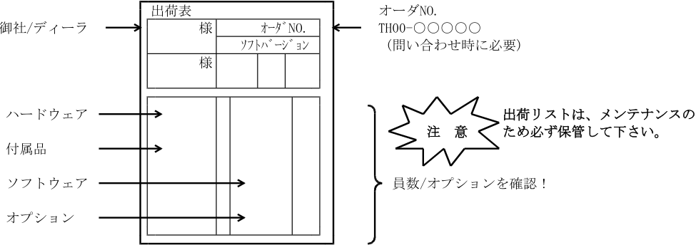

> **図の内容**
>
> 「出荷表」の各欄の説明:
> - 「御社/ディーラ」→ 宛先の欄（様）
> - 「オーダNO.」「ソフトバージョン」の欄 →「オーダNO. TH00-○○○○○（問い合わせ時に必要）」
> - 「ハードウェア」「付属品」「ソフトウェア」「オプション」の各行 →「員数/オプションを確認！」
> - 注意: 出荷リストは、メンテナンスのため必ず保管して下さい。

【重要1】 SLM8000のシリアル番号について


- 全てのSLM8000のボードには、ボード毎に固有のシリアル番号が付いています。
- ① オプションスイッチをボードに設定する時
- ② SLM8000ボードのROMソフトを変更する(FLASH書込を行う)時
- 以上の時、ボードに書き込むオプションスイッチファイル(*.osw)やFLASHシステムファイルのシリアル番号とボードのシリアル番号が一致しない場合、ボードへの設定(書込)は行えません。
- ボードのシリアル番号はセッティングPCソフトのバージョン情報画面で確認できます
- ※ 特別な場合、シリアル番号とは別にグループシリアル(GS)で管理することがあります。GSが一致している場合、複数のSLMに対して同一のFLASHシステムファイルの書き込みが可能です。

【重要2】 SLM8000のソフトウェアバージョンについて


SLM8000のソフトウェア（本体ソフト、PCソフト）は、原則出荷時点での最新バージョンが出荷されます。

リピート購入される場合、バージョンの違う新旧ソフトウェアの組み合わせによって問題が発生する可能性がありますので、ソフトウェア（CD）とボードのバージョンを管理して、同一バージョンの組み合わせで使用いただきますようお願いします。


：お急ぎの時は、この部分は読み飛ばしてください。後で、ゆっくり理解していただきたい箇所です。

### 2-2. こんなマニュアルがあります。

- □ ユーザーズマニュアル(導入、ハード、機能、実機試運転) TB00-1130
- □ セッティングPCマニュアル TB00-1131
- □ ROMSW(ロムスイッチ)設定マニュアル

TB00-1132

テクノHPから最新のマニュアル（PDF）をダウンロードできます。（会員コーナ）

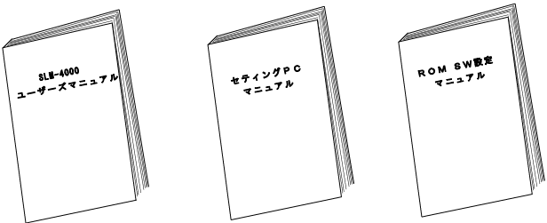

### 2-3. PCソフトインストール

1台のPC(ノートPC)で複数のマシン(SLM8000)

を管理することも想定して、マシン毎に「ショートカット」 (アイコン)を登録して下さい。

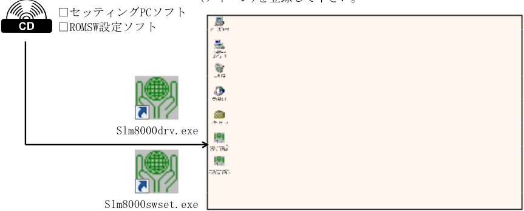

> **図の内容**
>
> CD（□セッティングPCソフト、□ROMSW設定ソフト）から、Slm8000drv.exe と Slm8000swset.exe のアイコンがデスクトップにできる様子。

- ①．CDをCD-ROMドライブに挿入して下さい。自動的にプログラム（インストーラ）が起動します。インストーラが自動的に起動しない場合は、以下の手順でインストーラを実行して下さい。
- 1)「スタート」ボタンをクリックしてから「ファイル名を指定して実行」を選択します。
- 2)「ファイル名を指定して実行」ダイアログで、"<CD-ROMドライブ名>:\setup" と入力します。（例： d:\setup）
- 3)「OK」ボタンをクリックするとインストーラが起動します。
- ②．インストールするフォルダを指定して、「OK」ボタンをクリックして下さい。選択したフォルダにファイルがコピーされます。

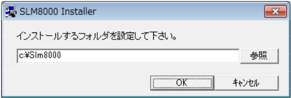

> **図の内容**
>
> ダイアログ「SLM8000 Installer」。「インストールするフォルダを設定して下さい。」、フォルダ「c:¥Slm8000」、ボタン: 参照、OK、キャンセル。

③．ショートカットの作成

- ａ. デスクトップ画面(Windowsの立ち上げ後の背景領域)で「右クリック」してショートカットメニューから「新規作成」「ショートカット」を選択して下さい。
- ｂ. 「ショートカットの作成」ダイアログが出ますので、画面の指示に従いセッティング PC(Slm8000drv.exe)とROMSW設定ソフト(Slm8000swset.exe)の各々のショートカットを作成して下さい。
- この時にダイアログのコマンドラインにファイル名を入力した後、個別のINI ファイル名(マシン毎に区別できる名称)をつけて下さい。また、ショートカット名も同時に個別の名称にして下さい。
- <Ⅰ導入編 3.1台のPCで複数のSLM8000を管理> を参照下さい。


> **図の内容**
>
> 「注意」の吹き出しの下に「SLM8000DRV1」。

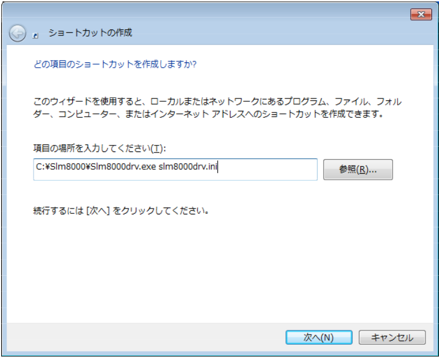

> **図の内容**
>
> Windows の「ショートカットの作成」画面。「どの項目のショートカットを作成しますか?」、項目の場所: `C:¥Slm8000¥Slm8000drv.exe slm8000drv.ini`。ボタン: 参照(R)...、次へ(N)、キャンセル。

セッティングPCとROMSW設定ソフトの各々のショートカットでは下記ののファイル名は必ず同名ファイルにしてください。

C:\Slm8000\Slm8000drv.exe slm8000drv1.ini

C:\Slm8000\Slm8000swset.exe slm8000drv1.ini

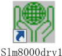


### 2-4. SLM8000とPCの接続

#### 2-4-1. 通信形態

SLM8000とPCとの接続方法は下の2種類があります。

- 1．イーサネットを使用する方法

図内の①の接続

イーサネットを使用して接続する場合は、SLM8000とPCのIPアドレス設定を合わせる必要があります。

SLM8000のイーサネット設定は、ROMSW設定ソフトで設定するため、設定を変更する前に、初期設定で接続する必要があります。

以下は、SLM8000のイーサネット設定の出荷値設定です。

＜SLM8000出荷値＞

| IPアドレス      | 192．168．   | 0．           |   2 |
|-------------|------------|--------------|-----|
| サブネットマスク    |            | 255．255．255． |   0 |
| デフォルトゲートウェイ | 192．168．   | 0．           |   1 |

接続するPCのIPアドレスとサブネットマスクを、SLM8000に合わせて設定して下さい。

- 2．RS232Cを使用する方法

図内の②の接続

RS232Cの接続には、別売のケーブルやボードが必要です。

※ PCにRS232Cポートがない場合はUSB/232変換アダプタ(市販品)を使ってください。

CB-C-□□□：テクノケーブル型式

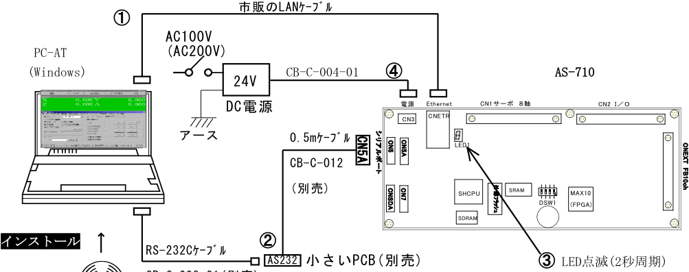

> **図の内容**
>
> - ① PC-AT (Windows) と AS-710 の Ethernet（CNETR）を「市販のLANケーブル」でつなぐ
> - ② RS-232C の場合: PC-AT から「RS-232Cケーブル」→「AS232 小さいPCB(別売)」→「0.5mケーブル CB-C-012（別売）」→ AS-710 の CN5A（シリアルポート）
> - ③ AS-710 の LED1: LED点滅(2秒周期)
> - ④ AC100V (AC200V) → 24V DC電源（アース）→「CB-C-004-01」→ AS-710 の 電源（CN3）
> - PC-AT には CD から「インストール」
> - AS-710 の基板: 上辺に 電源、Ethernet、CN1サーボ 8軸、CN2 I/O。右辺に CNEXT FB10ch。左辺に CN3、CN5、CN5A、CN5DA、CN7。中央に SHCPU、外部フラッシュ（と読める）、SRAM、SDRAM、DSW1、MAX10 (FPGA)、バッテリー


CB-C-008-01(別売)

- セッティングPCソフト（Slm8000drv.exe）

```c
    ROMSWソフト
    AS232ボードの設置
```

- （Slm8000swset.exe）

本来は板金などに固定します。（<Ⅱハードウェア編 2-2.AS232の接続と設置>を参照下さい。）固定しない時は絶縁材（ビニールなど）の上に置いてください（ショートに注意）。

#### 2-4-2. 通信接続手順

- (1) DC電源の準備・配線

制御電源図④

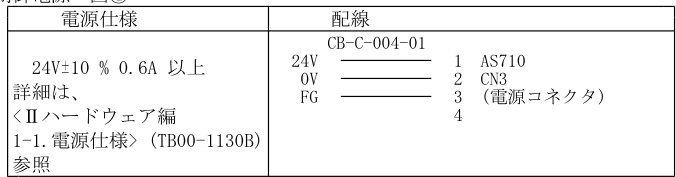

> **図の内容**
>
> | 電源仕様 | 配線 |
> |---|---|
> | 24V±10 % 0.6A 以上。詳細は、<Ⅱハードウェア編 1-1.電源仕様>（TB00-1130B）参照 | CB-C-004-01: 24V → 1、0V → 2、FG → 3（AS710 CN3（電源コネクタ））、4 |

電源のFGは、安全のためアースしてください。

- (2) PCの接続イーサネット又は RS232C
- (3) 配線確認 24Vの配線。

コネクタの挿入前にCN3のピンで電圧をテスターで確認してください。

(4) DC電源ON AS-710のLED（図③）が"0"表示で2秒周期で点滅すれば正常です。消灯又は点灯のままの場合は、異常です。（DC電源を確認してください。） "0"以外の場合は、異常です。 "0"以外の場合は、 <Ⅴメンテナンス編 1-2.アラーム表示をともなう異常>(TB00-1130J) を参照してください。

- (5) セッティングPC(Slm8000drv.exe)を起動します。
- (6) 以下の画面が表示されるので「OK」を押して下さい。
- (7) 以下の画面が表示されるので「OK」を押して下さい。
- (8) <4.通信接続の設定/確認>の手順を行い、正常に通信が出来ることを確認して下さい。

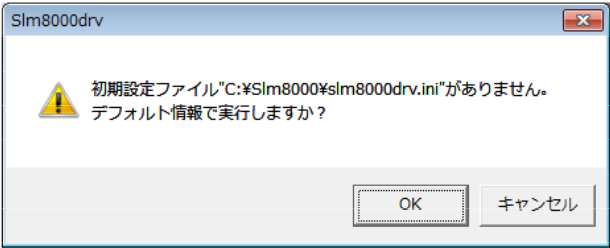

> **図の内容**
>
> ダイアログ「Slm8000drv」。警告アイコンと「初期設定ファイル"C:¥Slm8000¥slm8000drv.ini"がありません。デフォルト情報で実行しますか？」、ボタン: OK、キャンセル。

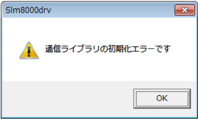

> **図の内容**
>
> ダイアログ「Slm8000drv」。警告アイコンと「通信ライブラリの初期化エラーです」、OK ボタン。

- (9) 通信確認後、「終了」ボタンを押してセッティングPCを終了して下さい。

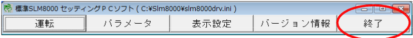

> **図の内容**
>
> ウィンドウ「標準SLM8000 セッティングPCソフト ( C:¥Slm8000¥slm8000drv.ini )」のメニュー: 運転、パラメータ、表示設定、バージョン情報、終了（赤丸で囲み）。

注意!

PCがサスペンドモードの場合、通信エラー(タイムアウト)が発生する場合があります。

サスペンドモードをOFFにするには以下を実行してください。

Windowsの「コントロールパネル」→「電源管理」を選択

- 電源設定

:常時ON

- システムスタンバイ :なし

セッティングPCが起動できない場合 ◆1.1

以下のようなダイアログメッセージが表示されセッティングPCが起動できない場合『Microsoft Visual C++ 2008 再頒布パッケージ(x86)』のインストールが必要です。

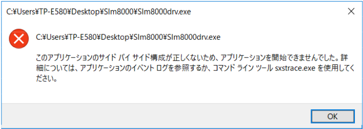

> **図の内容**
>
> ダイアログ「C:¥Users¥TP-E580¥Desktop¥Slm8000¥Slm8000drv.exe」。「このアプリケーションのサイド バイ サイド構成が正しくないため、アプリケーションを開始できませんでした。詳細については、アプリケーションのイベント ログを参照するか、コマンド ライン ツール sxstrace.exe を使用してください。」、OK ボタン。

詳細は、<Ⅴメンテナンス編 1-1.基本動作に関する異常>(TB00-1130J)の

- 「■『Microsoft Visual C++ 2008 再頒布パッケージ(x86)』のインストール」を参照下さい。

### 2-5. ROMSW(ロムスイッチ)の設定

- ① ROMSW設定ソフト(Slm8000swset.exe)を起動します。
- ② 「アップロード」ボタンをクリックします。

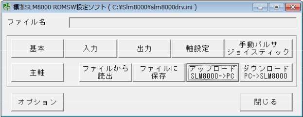

> **図の内容**
>
> ウィンドウ「標準SLM8000 ROMSW設定ソフト ( C:¥Slm8000¥slm8000drv.ini )」。ファイル名欄と、ボタン: 基本、入力、出力、軸設定、手動パルサ ジョイスティック、主軸、ファイルから読出、ファイルに保存、アップロード SLM8000->PC（強調表示）、ダウンロード PC->SLM8000、オプション、閉じる。

※ 通信エラーが発生した場合は、プログラムを終了(⑦)して通信設定を見直して下さい。 <4.通信接続の設定/確認>を参照して下さい。

- ③ 「ファイル保存」ボタンをクリックします。ファイル選択ダイアログが表示されるので、任意のファイル名を指定して下さい。（④で設定を変更する前に現在の設定をバックアップします。）
- ④ 必要に応じて設定を変更して下さい。

各項目については「SLM8000 ROMSW設定ソフトマニュアル」(TB00-1132)を参照下さい。

- ※ 変更内容が未定/不明であれば、後日改めて変更して下さい。
- ※ このあとダミー運転の場合は、ここでは何も変更しません。
- ⑤「ファイル保存」ボタンをクリックします。
- ファイル選択ダイアログが表示されるので、任意のファイル名を指定して下さい。 ※ ④で設定を変更していなければ不要です。（設定した内容をバックアップします。）
- ⑥ 「ダウンロード」ボタンをクリックします。
- ※ ④で設定を変更していなければ不要です。
- ※ 通信エラーが発生した場合は、プログラムを終了(⑦)して通信設定を見直して下さい。 <4.通信接続の設定/確認>を参照して下さい。
- ⑦ 「閉じる」ボタンをクリックしてプログラムを終了します。

｢ROMスイッチの内容を設定ファイルに保存しますか?｣のメッセージには必ず「はい」を選択して下さい。

- 注意! ROMSWデータの変更をした場合には、必ず以下を実行してください。
- ■ ダウンロード(PC→SLM8000)
- ■ ファイルへ保存
- ■ INIファイル作成(終了時に「はい」)
- ■ SLM8000の電源をOFF→ONする

### 2-6. セッティングPCソフト … 出荷時設定のパラメータファイル保存

PC(セッティングPC)とSLM8000をイーサネット又はRS232Cで接続しただけの状態 (<2-4. SLM8000とPCの接続>が完了した状態)で、「セッティングPCソフト」を起動して、 SLM8000内のサーボパラメータ(テクノ出荷時設定)をPC側に保存して下さい。

- ①．セッティングPC(Slm8000drv.exe)を起動すると、運転画面が表示されます

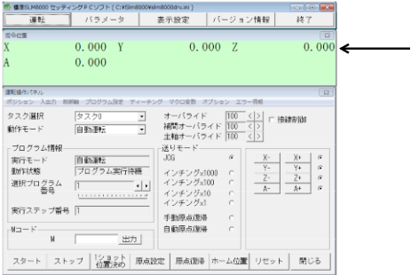

> **図の内容**
>
> ウィンドウ「標準SLM8000 セッティングPCソフト ( C:¥slm8000¥slm8000drv.ini )」の運転画面。矢印が位置表示（X 0.000、Y 0.000、Z 0.000、A 0.000）を指している。下部は運転操作パネル（タスク選択 タスク0、動作モード 自動運転、プログラム情報、オーバライド 100、送りモード、軸キー、操作ボタン）。

正常に通信ができると、位置表示に数字が表示されます。

- ②．通信エラーが発生したら、<4.通信接続の設定/確認>を参照下さい。

#### 2-6-1. バックアップメモリエラーの解除

エラーメッセージで、「バックアップメモリエラー」と表示された場合のみ、以下の操作をしてください

- ①．「パラメータ」ボタンをクリックします。
- ②．「バックアップデータ初期化」

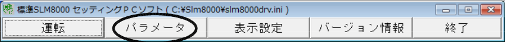

> **図の内容**
>
> メニュー: 運転、パラメータ（丸で囲み）、表示設定、バージョン情報、終了。

SLM8000で保存しているデータを初期化します。

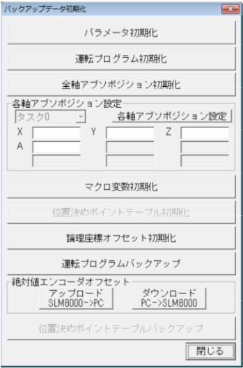

> **図の内容**
>
> 画面「バックアップデータ初期化」。ボタン: パラメータ初期化、運転プログラム初期化、全軸アブソポジション初期化、各軸アブソポジション設定（タスク0、X・Y・Z・A）、マクロ変数初期化、位置決めのポイントテーブル初期化（灰色）、論理座標オフセット初期化、運転プログラムバックアップ、絶対値エンコーダオフセット（アップロード SLM8000->PC、ダウンロード PC->SLM8000）、位置決めのポイントテーブルバックアップ（灰色）、閉じる。

以下の初期化ボタンを順番に押して下さい。

- パラメータ初期化
- 運転プログラム初期化
- 全軸アブソポジション初期化
- マクロ変数初期化
- 位置決めポイントテーブル初期化
- 論理座標オフセット初期化 ◆1.3

オプションによっては押せない場合もあります。


「バックアップメモリエラー」

この操作は、のときだけです。

#### 2-6-2. パラメータ未設定エラーの解除

以下の操作は、初回は必ず実施してください（初回のみ必須）。

- ①．「サーボパラメータ」ダイアログを表示します。
- ②．「アップロード」ボタンをクリックします。（SLM8000からデフォルトのパラメータを読み出します。）
- ③．必要に応じて設定を変更してください。

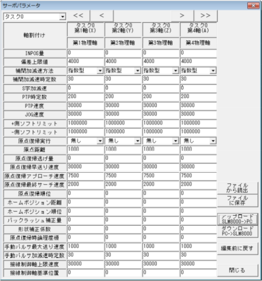

> **図の内容**
>
> 画面「サーボパラメータ」。タスク0 の 第1軸(X)～第4軸(A) の列に、INPOS量、偏差上限値、補間加減速方法（指数形）、補間加減速時定数、S字加減速時定数、PTP時定数、PTP速度、JOG速度、+側ソフトリミット、−側ソフトリミット、原点復帰実行、原点距離、原点復帰逃げ量、原点復帰早送り速度 などの値が並ぶ。ボタン: ファイルから読出、ファイルに保存、アップロード SLM8000->PC、ダウンロード PC->SLM8000、編集前に戻す、閉じる。
> 値は小さくて判読しにくい。

標準的な導入作業（この後の練習操作など）では、パラメータはデフォルト（出荷値）のままで良く、修正は不要です。特別の場合のみ、必要に応じて変更してください。

- ④．「ファイルに保存」ボタンをクリックします。ファイル選択ダイアログが表示されるので、任意のファイル名を指定して下さい。（INIファイルの区別と同様に、パラメータファイルにも個体の区別ができるようなファイル名を指定して保存して下さい。）
- ⑤．「ダウンロード」ボタンをクリックします。

ご購入後の初回は、設定変更なしでも、ダウンロードは必須です。

- ⑥．その他のデータのアップロードとダウンロード（初回のみ）＜オプション＞

各種のオプションを有効としているシステムでは、サーボパラメータと同様に、以下の画面で初回のみ上記①～⑤と同様の操作が必要です。

- 「ピッチエラー補正データ」画面
- 「工具長補正データ」画面
- 「工具径補正データ」画面
- 「補間前加減速パラメータ」画面
- 初回の保存は出荷時設定のものです。正式な試運転・調整をおこない、改めて保存(パラメータファイルの更新)して下さい。
- サーボパラメータは、今後の更新毎に必ずPC側で保存して下さい。また、上書きしたくない時は異なるファイル名にして下さい。


#### 2-6-3. セッティングPCソフト設定

通常はIPアドレスの設定のみ行い、他の設定は不要です（デフォルトのままで使えます）。

表示設定｢インターフェース設定/ポジション表示設定/入出力表示設定｣で、各々の設定画面が表示されます。

インタフェース設定

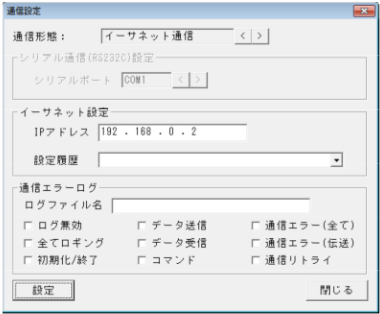

> **図の内容**
>
> 画面「通信設定」。
> - 通信形態: イーサネット通信
> - シリアル通信(RS232C)設定（灰色）: シリアルポート COM1
> - イーサネット設定: IPアドレス 192.168.0.2、設定履歴
> - 通信エラーログ: ログファイル名、チェック（ログ無効、全てロギング、初期化/終了、データ送信、データ受信、コマンド、通信エラー(全て)、通信エラー(伝送)、通信リトライ）はすべて未選択
> - ボタン: 設定、閉じる

ポジション表示設定

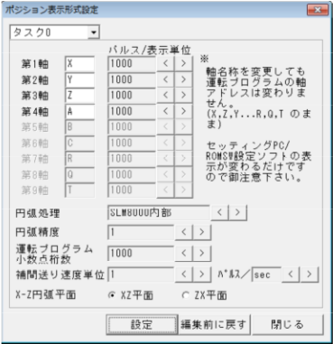

> **図の内容**
>
> 画面「ポジション表示形式設定」。タスク0。第1軸～第9軸の軸名称（X、Y、Z、A、B、C、R、Q、T）とパルス/表示単位（すべて 1000。第5軸以降は灰色）。円弧処理 SLM8000内部、円弧精度 1、運転プログラム小数点桁数 1000、補間送り速度単位 1 パルス/sec、X-Z円弧平面（XZ平面 / ZX平面）。
> 注記: 軸名称を変更しても運転プログラムの軸アドレスは変わりません。(X,Z,Y…R,Q,T のまま) セッティングPC/ROMSW設定ソフトの表示が変わるだけですので御注意下さい。

入出力表示設定

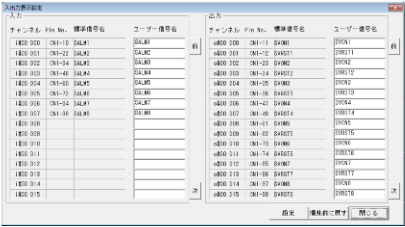

> **図の内容**
>
> 画面「入出力表示設定」。左が入力、右が出力。それぞれ チャンネル、Pin No.、標準信号名、ユーザー信号名 の一覧。入力は I000 000～015（CN1 のピンに SALM1～SALM8 など）、出力は O000 200～215（CN1 のピンに SVON1、SVRST1 など）。ボタン: 設定、編集前に戻す、閉じる。
> 細部は小さくて判読しにくい。

通常は、IPアドレスをSLM8000の（出荷値）「192.168.0.2」とします。

ROMSW設定でイーサネット設定を変更している時は、その設定値としてください。

通常はデフォルトで使えます。

軸名称表示を変えることができます。位置表示の小数点の位置を変えることができます。

例左右 ○○○○.○○ (少数2桁) 上下 ○○○○.○○○○(少数4桁) 前後 ○○○○.○○

※軸名称は漢字2文字まで可能です。

通常はデフォルトで使えます。

入出力名称を変更する場合に設定してください。使用していない入/出力の表示を削除することもできます。


以上で初期導入作業は終了です！

設定をしないと反映されません。設定によって、INIファイル内の


情報が更新されます。

## 3. 1台のPCで複数のSLM8000を管理

1台のPCで複数のSLM8000を管理する場合は、各SLM8000毎にフォルダを分け、以下の手順でインストールします。

追加するSLM8000のソフトウェアバージョンによって、手順が異なります。

### 3-1. 1台目のSLM8000のインストール

<2.初期導入作業(購入後の初めての作業)>を参照し、1台目のSLM8000をインストールして下さい。

### 3-2. 2台目以降のSLM8000のインストール

- 【注】同じPCで複数のSLM8000を管理(ソフトインストール)する場合は、別のフォルダで管理してください。

#### 3-2-1. バージョンの確認

インストール済みのSLM8000のバージョンと追加するSLM8000のバージョンにより、以降の手順が異なります。

（インストール済みのSLM8000のバージョンは<10-5-2.ソフトウェアバージョンの確認方法> で確認する事ができます。）

#### 3-2-2. 追加するSLM8000が同じソフトウェアバージョンの場合

- <2-4.SLM8000とPCの接続>～<2-6.セッティングPCソフト>相当の設定と確認をします。
- ① INIファイルのコピー既存のSLM8000のINIファイルを、追加するSLM8000のフォルダにコピーして下さい。 (これにより、2-6-3.のポジション表示や入出力表示の設定がコピーできます。)
- ② <2-4.SLM8000とPCの接続>の作業
- ③ <2-5.ROMSWの設定>の作業
- ④ <2-6.セッティングPCソフト>の作業
- 以上で初期作業は完了です。

#### 3-2-3. 追加するSLM8000が異なるソフトウェアバージョンの場合

通常の初期作業と同じで、

- <2-4.SLM8000とPCの接続>～<2-6.セッティングPCソフト>の設定と確認をいたします。
- ① <2-4.SLM8000とPCの接続>の作業
- ② <2-5.ROMSWの設定>の作業
- ③ <2-6.セッティングPCソフト>の作業
- 以上で初期作業は完了です。

## 4. 通信接続の設定/確認

### 4-1. 通信設定

セッティングPC(Slm8000drv.exe)の設定で接続方法を変更することができます。

SLM8000とPCとの接続方法は下の2種類があります。

- ■ イーサネットを使用する方法
- ■ RS232Cを使用する方法
- ① セッティングPC(Slm8000drv.exe)を起動して、「表示設定」ボタンをクリックします。

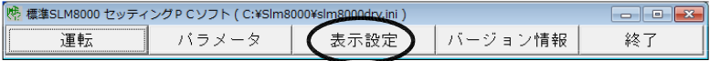

> **図の内容**
>
> ウィンドウ「標準SLM8000 セッティングPCソフト ( C:¥Slm8000¥slm8000drv.ini )」のメニュー: 運転、パラメータ、表示設定（丸で囲み）、バージョン情報、終了。

※通信設定が正しくない場合、起動時に通信異常のエラーメッセージが表示されます。

- ② 「インターフェース設定」ダイアログにて通信の設定を行って下さい。
- ③ 「設定」ボタンをクリックして下さい。

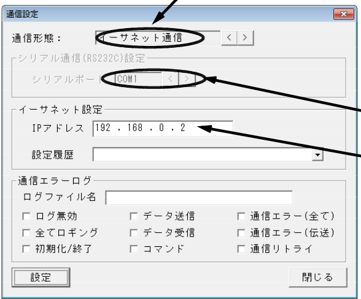

> **図の内容**
>
> 画面「通信設定」。丸と矢印で示された箇所: 通信形態「イーサネット通信」、シリアル通信(RS232C)設定のシリアルポート「COM1」（灰色）、イーサネット設定の IPアドレス「192.168.0.2」。通信エラーログのチェックはすべて未選択。ボタン: 設定、閉じる。


※設定の詳細は、

「SLM8000 セッティングPCマニュアル」<4-4-1-1.通信設定画面>(TB00-1131) を参照して下さい。

設定クリックをしないと反映されません。

設定クリックによって、INIファイル内の情報が更新されます。


・通信形態

イーサネット：

"イーサネット通信"

RS232C：

"シリアル通信(RS232C)"

- シリアルポート SLM8000と接続するシリアル

ポート番号を設定してください。

- IPアドレス

SLM8000のIPアドレスを設定してください。

(ROMSW設定の基本パラメータのIPアドレスを設定)

### 4-2. 通信確認

- ① セッティングPC(Slm8000drv.exe)を起動します。

(既に起動している場合は「運転」ボタンをクリックします。)

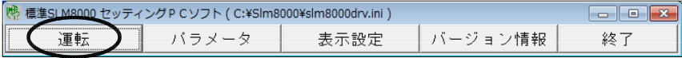

> **図の内容**
>
> メニュー: 運転（丸で囲み）、パラメータ、表示設定、バージョン情報、終了。

- ② 正しく接続できていれば、以下のような運転画面がでます。

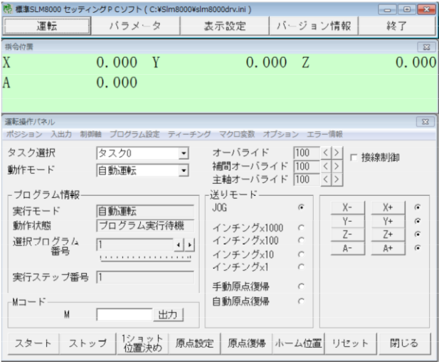

> **図の内容**
>
> 「標準SLM8000 セッティングPCソフト」の運転画面。位置表示（X、Y、Z、A すべて 0.000）、運転操作パネル（タスク選択 タスク0、動作モード 自動運転、プログラム情報: 実行モード 自動運転、動作状態 プログラム実行待機、オーバライド 100、送りモード、軸キー X-/X+ ～ A-/A+、ボタン: スタート、ストップ、1ショット位置決め、原点設定、原点復帰、ホーム位置、リセット、閉じる）。

③ 通信不良の場合

TO(タイムアウトエラー)のメッセージが出る場合や、や運転画面の位置表示が出ない場合は、正常に通信ができていません。

通信不良の一般的な原因は以下が考えられます。

- ○SLM8000のLED不点滅(点灯/消灯のままも異常です) LEDの不点滅は、SLM8000かDC電源の異常です。
- ○イーサネット接続の場合
- IPアドレスが合っていない
- PCがSLM8000を認識していない。
- 接続ケーブルの不良
- ○RS232C接続の場合
- シリアルポート選択が合っていない。
- PCの設定(Windowsの環境) COM1/COM2が使用できない状態
- 接続ケーブルの不良

## 5. アンインストール

インストールしたフォルダ内の全てのファイルと、作成したショートカットを削除して下さい。 SLM8000のインストーラはシステムフォルダやレジストリには変更を加えていません。そのため、フォルダを削除するだけでアンインストールできます。

## 6. SLM8000/PCの交換

### 6-1. SLM8000の交換

各種データ(ROMSW設定/各種パラメータ/動作プログラム等)や機械原点を元のSLM8000と同じ設定になるように設定して下さい。

※もし各種データ設定時のバックアップがPCに残っていたら、そのファイルを使用する事により、設定を復元して下さい。

このような場合の為にもデータ変更時は、PC側にも保存しておく事を強くお勧め致します。

### 6-2. PCの交換

#### 6-2-1. 元のPCが動作する場合

- (1) 元のPCから新しいPCへ、PCソフトをインストールしたフォルダ(デフォルトは"c:\Slm8000")
2. を丸ごとコピーして下さい。(サブフォルダも含めてコピーして下さい。)
- (2) 必要に応じて、元のPCからPCソフトをインストールしたフォルダを削除して下さい。
4. ※当社PCソフトはシステムフォルダやレジストリには変更を加えていません。
5. そのため、フォルダを丸ごとコピーするだけで環境の移行が可能です。
6. 尚、PCソフトの設定を新しいPCへ引き継ぐだけでしたら、以下の手順でも可能です。
7. ① <2-3.PCソフトインストール>を参照し、PCソフトを新しいPCへ新規インストールして下さい。
8. ② 元のPCからPCソフトをインストールしたフォルダ(デフォルトは"c:\Slm8000")から、設定ファイル(*.ini)を、新しいPCでインストールしたフォルダにコピーして下さい。

#### 6-2-2. 元のPCが動作しない場合

- (1) <2-3.PCソフトインストール>を参照し、PCソフトを新しいPCへ新規インストールして下さい。
- (2) <2-4.SLM8000とPCの接続>を参照し、通信設定を行ってください。
- (3) <2-6-3.セッティングPCソフト設定>を参照し、通信設定を行ってください。
4. ※ 特に「セッティングPC動作設定画面」「ポジション表示設定画面」の設定は、元のPCと同じ設定になるようにして下さい。

異なる設定にすると、一見正常動作しているようでも、動作プログラム実行時に想定外の動作をしてしまう場合があります。ご注意下さい。

## 7. ダミー運転

ここまでの段階で以下が完了いただいています。

- □ PCソフトインストール「セッティングPCソフト」「ROMSW設定ソフト」
- □ SLM8000とPCのとりあえずの接続（イーサネット/RS232C）
- □ ROMSWの設定（デフォルト）

この状態で、セッティングPCソフト（標準運転ソフト）で手動運転・自動運転を体験いただきます。 SLM8000の各軸パルス列出力信号が動作しますが、外部と未接続でも特別な問題はありません。仮想的に運転（ダミー運転）ができます。

### 7-1. SLM8000 電源ON

LED点滅（2秒周期）を確認してください。

接続の詳細は、<2-4.SLM8000とPCの接続>を参照ください。

CB-C-□□□：テクノケーブル型式

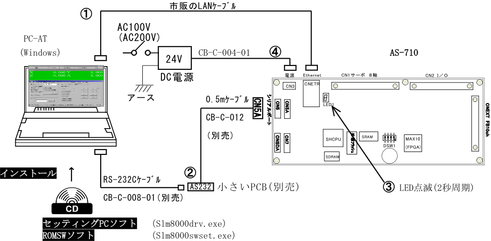

> **図の内容**
>
> 2-4-1 と同じ接続図（① 市販のLANケーブル、② RS-232Cケーブル CB-C-008-01(別売) と AS232 小さいPCB(別売)・CB-C-012、③ LED点滅(2秒周期)、④ DC電源 CB-C-004-01）。CD から「セッティングPCソフト」「ROMSWソフト」（Slm8000drv.exe、Slm8000swset.exe）をインストール。

### 7-2. セッティングPCソフトを起動


Slm8000drv.exe を起動

セッティングPC画面で位置情報がゼロ表示になることを確認してください。

これは、PCとSLM8000の通信が正常に確立していることを意味します。ゼロ表示にならない場合は、通信エラーが考えられます。 <2-4.SLM8000とPCの接続>を再度参照ください。また、<4.通信接続の設定/確認>も参照ください。

### 7-3. ダミーで運転・操作

出荷時のデフォルト状態のROMSWとパラメータでは、軸（CN1）やIO（CN2）が未配線でも、アラームが発生しないようになってます。（入力論理が全てA接。未配線で全てOFF。）操作は、全て以下の運転画面で行います。

デフォルト状態でない場合など、未接続でアラームが発生（エラー情報有り）する場合は、 <7-5-1.アラームの解除>を参照下さい。

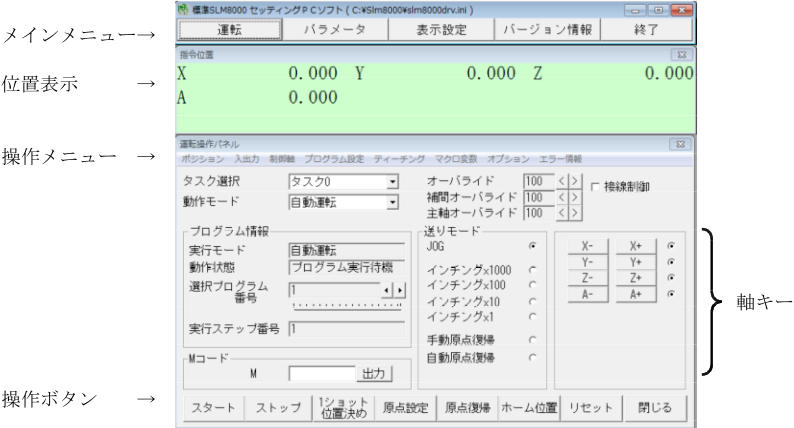

> **図の内容**
>
> 運転画面の各部の名前: 「メインメニュー」、「位置表示」（X、Y、Z、A）、「操作メニュー」、「軸キー」（右側の X-/X+ などのボタン）、「操作ボタン」（下部のボタン列）。

#### 7-3-1. 手動操作（JOG/インチング）

JOGは、軸キーを押し続けている間、サーボパラメータの「JOG速度」で動きます。（サーボパラメータJOG速度のデフォルト値：30kpps）インチングは、指定のインチング量を軸キーを押す毎に動きます。特に、微小送りで位置調整するときに便利です。動作モードを「手動運転」とし、送りモード選択して軸キーを押すことで動作します。途中、「原点設定ボタン」を押すことで、そのときの位置を座標原点とします。したがって、位置表示がゼロになります。

【運転画面にて】この表の「設定/選択/操作」の項目にならって順番に操作してください。

| 画面/項目   | 設定/選択/操作            | 動作/結果（表示確認）        | 補足説明               |
|---------|---------------------|---------------------|--------------------|
| 動作モード   | 手動運転                |                     |                    |
| 送りモード   | JOG                 |                     |                    |
| （軸キー）   | X+                  | X座標が+方向に変化          | X軸が+方向にJOG移動       |
|         | X-                  | X座標が-方向に変化          | X軸が-方向にJOG移動       |
|         | Y+                  | Y座標が+方向に変化          | Y軸が+方向にJOG移動       |
|         | Y-                  | Y座標が-方向に変化          | Y軸が-方向にJOG移動       |
|         | 同様にZ,Aでも確認してください。   | 同様にZ,Aでも確認してください。   |                    |
| （操作ボタン） | 原点設定                | 座標がゼロになります。         | 論理座標設定です。          |
| 送りモード   | インチング ×1000         |                     | 1000pls単位のインチングモード |
| （軸キー）   | X+                  | X座標が+に1000変化        | X軸が+1000pls移動      |
|         | X-                  | X座標が-に1000変化        | X軸が-1000pls移動      |
|         | 同様にY,Z,Aでも確認してください。 | 同様にY,Z,Aでも確認してください。 |                    |
| 送りモード   | インチング ×100          |                     | 100pls単位のインチングモード  |
| （軸キー）   | X+                  | X座標が+に100変化         | X軸が+100pls移動       |
|         | X-                  | X座標が-に100変化         | X軸が-100pls移動       |
|         | 同様にY,Z,Aでも確認してください。 | 同様にY,Z,Aでも確認してください。 |                    |
| 送りモード   | インチング ×10           |                     | 10pls単位のインチングモード   |
| （軸キー）   | X+                  | X座標が+に10変化          | X軸が10pls移動         |
|         | X-                  | X座標が-に10変化          | X軸が-10pls移動        |
|         | 同様にY,Z,Aでも確認してください。 | 同様にY,Z,Aでも確認してください。 |                    |
| 送りモード   | インチング×1             |                     | 1pls単位のインチングモード    |
| （軸キー）   | X+                  | X座標が+に1変化           | X軸が1pls移動          |
|         | X-                  | X座標が-に1変化           | X軸が-1pls移動         |
|         | 同様にY,Z,Aでも確認してください。 | 同様にY,Z,Aでも確認してください。 |                    |

#### 7-3-2. 1ショット位置決め

位置決めや補間動作で軸を指定量（あるいは目標位置）へ移動させる機能です。操作ボタンの「1ショット位置決め」ボタンを押すと以下の画面がでます。

1ショット位置決め画面

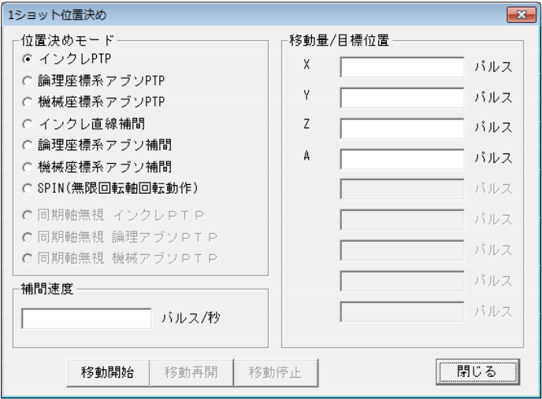

> **図の内容**
>
> 画面「1ショット位置決め」。
> - 位置決めのモード: インクレPTP（選択）、論理座標系アブソPTP、機械座標系アブソPTP、インクレ直線補間、論理座標系アブソ補間、機械座標系アブソ補間、SPIN(無限回転軸回転動作)、同期軸無視 インクレPTP、同期軸無視 論理アブソPTP、同期軸無視 機械アブソPTP（最後の 3 つは灰色）
> - 移動量/目標位置: X、Y、Z、A（単位 パルス）、ほかの軸は灰色
> - 補間速度: パルス/秒
> - ボタン: 移動開始、移動再開、移動停止、閉じる

(1) インクレPTP（位置決め）の操作。

一連の操作の中では、途中停止/再開、オーバライドも操作します。

【1ショット位置決め画面にて】「設定/選択/操作」の項目にならって順番に操作してください。

| 画面/項目                       | 設定/選択/操作                            | 動作/結果（確認）                          | 補足                           |
|-----------------------------|-------------------------------------|-------------------------------------|------------------------------|
| 位置決めモード                     | インクレPTP                             |                                     |                              |
| 移動量                         | X：1000 Y：1000 Z：1000 A：1000         | X：1000 Y：1000 Z：1000 A：1000         |                              |
|                             | 移動開始                                | 各軸座標が+1000変化します。                   | 全軸1000pls分の移動                |
| 同様に適当な値を設定して、位置決めをしてみてください。 | 同様に適当な値を設定して、位置決めをしてみてください。         | 同様に適当な値を設定して、位置決めをしてみてください。         | 同様に適当な値を設定して、位置決めをしてみてください。  |
| 移動量                         | X：100000 Y：100000 Z：100000 A：100000 | X：100000 Y：100000 Z：100000 A：100000 | 移動量が大きいので位置決め完了まで時間がかかります。 |
|                             | 移動開始                                | 各軸座標が変化します。                         | 移動量が大きいので位置決め完了まで時間がかかります。 |
| （移動中に）                      | 移動停止                                | 座標変化がとまります。                         | 途中停止しました。                    |
|                             | 移動再開                                | 座標変化が再開します。                         | 移動再開です。                      |
| 位置決め完了するまで、停止/再開は、何度も可能です。  | 位置決め完了するまで、停止/再開は、何度も可能です。          | 位置決め完了するまで、停止/再開は、何度も可能です。          | 位置決め完了するまで、停止/再開は、何度も可能です。   |
| （移動中に）（運転画面で）オーバライド       | "<" で小さい値に変更                       | 座標変化が遅くなります。                        | 移動速度がオーバライド比率で減少。           |
| （移動中に）（運転画面で）オーバライド       | ">" で大きな値に変更                       | 座標変化が早くなります。                        | 移動速度がオーバライド比率で増加。           |

途中で座標をゼロセットしたいときは、操作ボタンの「原点設定」を押してください。

補足説明

インクレ：移動指令量です。現在位置に加算して移動します。

アブソ：目標座標（目標位置）を指令します。（移動量＝目標位置-現在位置）

PTP ：位置決め各軸がサーボパラメータの「PTP」速度で移動します。

補間のように多軸同期にはなりません。

補間

：この場合は、直線補間です。補間速度を指定した複数軸の合成速度

論理座標

機械座標

- として、多軸が同期して動きます。したがって、目標位置の到着が同時です。

：通常は、この座標系で位置を管理します。原点設定するとその位置が、論理座標系の原点になります

：本来は、フィードバックパルスを積算した座標です。アブソ位置のことです。ただし、ダミー運転では、フィードバックなしなので指令パルスの積算となります。いずれにしても、原点設定で、座標系のセットアップはしません。

詳細は、以下を参照ください。


ただ、ここでは基本操作を体験するのが目的です。詳細なご理解は、後からでもかまいません。

「SLM8000 ユーザーズマニュアル」<SLM8000 キーワード集> 「SLM8000 ユーザーズマニュアル」<Ⅲ機能編>

(2) 論理座標系でのPTPや補間

【1ショット位置決め画面にて】「設定/選択/操作の項目」にならって順番に操作してください。

| 画面/項目   | 設定/選択/操作                                     | 動作/結果（確認）                                   |                                   |
|---------|----------------------------------------------|----------------------------------------------|-----------------------------------|
| 位置決めモード | 論理座標系アブソPTP                                 |                                              |                                   |
| 目標位置    | 目標位置を指定します。                                  | 目標位置を指定します。                                  |                                   |
| 目標位置    | 移動開始                                         | 目標位置まで動きます。                                  |                                   |
| 位置決めモード | インクレ直線補間                                    |                                              |                                   |
| 移動量     | 移動量を適宜                                       |                                              |                                   |
| 補間速度    | 30000                                        |                                              |                                   |
| 補間速度    | 移動開始                                         | 補間速度で指定の移動量動きます。                            | 同じ移動量でも補間速度を変えると到達時間が反比例で変わります。 |
| 補間速度    | 補間速度を1000pps（低速）～100000pps など変えてトライしてみてください。 | 補間速度を1000pps（低速）～100000pps など変えてトライしてみてください。 | 同じ移動量でも補間速度を変えると到達時間が反比例で変わります。 |
| 位置決めモード | 論理座標系アブソ補間                                  |                                              |                                   |
| 目標位置    | 目標位置を指定します。                                  | 目標位置を指定します。                                  |                                   |
| 補間速度    | 30000                                        |                                              |                                   |
| 補間速度    | 移動開始                                         | 補間速度で指定の移動量動きます。                            | 同じ移動量でも補間速度を変えると到達時間が反比例で変わります。 |
| 補間速度    | 補間速度を1000pps（低速）～100000pps など変えてトライしてみてください。 | 補間速度を1000pps（低速）～100000pps など変えてトライしてみてください。 | 同じ移動量でも補間速度を変えると到達時間が反比例で変わります。 |

#### 7-3-3. ホーム位置決め

ホーム位置（パラメータ）は、出荷時に全軸0になってます。どこからでもホーム位置（この場合ゼロの位置）に戻ります。

| 画面/項目   | 設定/選択/操作動作/結果   | （確認）           | 補足             |
|---------|------------------|----------------|----------------|
| 運転画面    | ホーム位置            | 座標が変化して、ゼロになる | どの位置にいても原点に戻る |

座標が大きくずれていると、ホーム位置決めに時間がかかります。停止は、いつでも有効です。

：お急ぎの時は、この部分は読み飛ばしてください。後で、ゆっくり理解して戴きたい箇所です。


#### 7-3-4. 運転プログラムのダウンロード

PTP命令のサンプル運転プログラム"L_PTP.TXT"（テクノ言語）をファイル選択して、 SLM8000のプログラムブロック0にダウンロードします。操作メニューから「プログラム設定」を押します。

プログラム設定画面

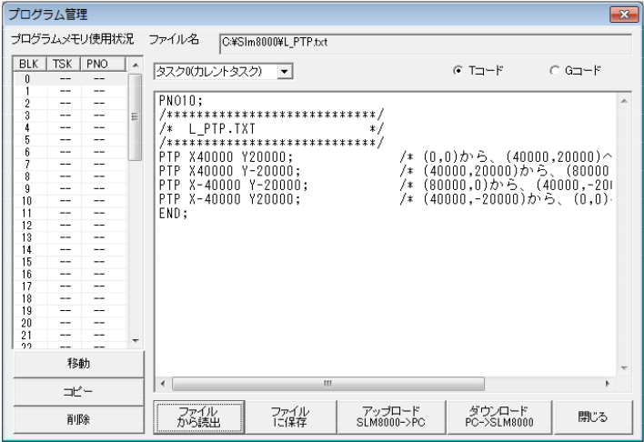

> **図の内容**
>
> 画面「プログラム管理」。ファイル名「C:¥Slm8000¥L_PTP.txt」。左にプログラムメモリ使用状況（BLK、TSK、PNO）。「タスク0(カレントタスク)」、Tコード（選択）/ Gコード。プログラム:
> ```
> PNO10;
> /****************************/
> /*  L_PTP.TXT              */
> /****************************/
> PTP X40000 Y20000;      /* (0,0)から、(40000,20000)へ
> PTP X40000 Y-20000;     /* (40000,20000)から、(80000…
> PTP X-40000 Y-20000;    /* (80000,0)から、(40000,-20…
> PTP X-40000 Y20000;     /* (40000,-20000)から、(0,0)…
> END;
> ```
> （行末のコメントは画面で切れている。）ボタン: 移動、コピー、削除、ファイルから読出、ファイルに保存、アップロード SLM8000->PC、ダウンロード PC->SLM8000、閉じる。

| 【プログラム設定画面にて】「設定/選択/操作の項目」の順番に操作してください。 - 画面/項目   | 【プログラム設定画面にて】「設定/選択/操作の項目」の順番に操作してください。 - 設定/選択/操作   | 【プログラム設定画面にて】「設定/選択/操作の項目」の順番に操作してください。 - 動作/結果（確認）   | 【プログラム設定画面にて】「設定/選択/操作の項目」の順番に操作してください。 - 補足   |
|----------------------------------------------------|-------------------------------------------------------|---------------------------------------------------------|-------------------------------------------------|
| プログラム設定画面                                          | ファイルから読出                                              | ファイル選択ダイアログが表示されます                                     |                                                 |
| L_PTP.TXTを選択してください。                                | L_PTP.TXTを選択してください。                                   | L_PTP.TXTを選択してください。                                     | PTP運転サンプル                                       |
| プログラム設定画面                                          | Tコード                                                  |                                                         |                                                 |
| プログラムメモリ使用状況                                      | BLK0の列をクリック                                          | BLK0の列が暗転します。                                           |                                                 |
|                                                    | ダウンロード                                                | SLM8000のブロック0にローディング                                   |                                                 |

ローディングが完了しない場合

通信エラーエラーメッセージがあるはずです。→ <4.通信接続の設定/確認> Pno.10の運転プログラムが運転途中 → リセットしてください。

#### 7-3-5. 自動モードでメモリ運転

ダウンロードしたPno.10（L_PTP.TXT）を運転します。

L_PTP.TXTのXY軌跡の様子

```c
/****************************/
/* L_PTP.TXT */
/****************************/
```

①PTP X40000 Y20000;

- ②PTP X40000 Y-20000;
- ③PTP X-40000 Y-20000;
- ④PTP X-40000 Y20000;

⑤END;

＜X/Y軸の合成軌跡＞

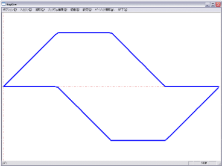

> **図の内容**
>
> 軌跡表示ウィンドウ。青い線で、左端から右上へ上がり、水平に進み、右端へ下がる台形と、左端から右下へ下がり、水平に進み、右端へ上がる台形が描かれ、全体で六角形の軌跡になっている。

【運転画面にて】「設定/選択/操作の項目」の順番に操作してください。

| 画面/項目     | 設定/選択/操作   | 動作/結果（確認）      | 補足   |
|-----------|------------|-----------------|------|
| 動作モード     | 自動運転       |                 |      |
| 実行プログラムNO | 10         |                 |      |
| 実行ステップNO  | 1          |                 |      |
|           | 原点設定       | 座標をゼロにする        |      |
|           | スタート       | 運転開始。座標が変化。     |      |
|           | （停止）       | 運転途中ならそこで停止     |      |
|           | スタート       | 再開終了していたら、最初から |      |
|           | （リセット）     | 運転途中で強制終了します    |      |

運転途中でオーバライドを変更し、速度が遅くなったり、早くなったりするのを確認してください。

#### 7-3-6. ティーチング画面でシングルステップ運転

プログラムティーチング画面でシングルステップ運転をします。シングルステップでは、運転プログラムの1ステップ（1行）毎に、一度停止して、

スタートボタンを押す毎に1ステップずつ実行します。作成した運転プログラムの動作確認に便利です。

【プログラム設定画面にて】「設定/選択/操作の項目」の順番に操作してください。

| 画面/項目     | 設定/選択/操作   | 動作/結果（確認）    | 補足   |
|-----------|------------|---------------|------|
| 動作モード     | 自動運転       |               |      |
| 実行プログラムNO | 10         |               |      |
| 実行ステップNO  | 1          |               |      |
|           | 原点設定       | [座標をゼロにする]を表示 |      |
| 操作メニュー    | ティーチング     | ティーチング画面になる   |      |

【ティーチング画面にて】「設定/選択/操作の項目」の順番に操作してください。

| 画面/項目    | 設定/選択/操作   | 動作/結果（確認）   | 補足   |
|----------|------------|--------------|------|
| ティーチング画面 | シングル       | シングル運転モードになる |      |
|          | スタート       | 1ステップを実行して停止 |      |
|          | スタート       | 次のステップを実行    |      |
|          | 以下、繰り返し    | 以下、繰り返し      |      |

ティーチング動作（ステップ挿入、置換、削除）は、ここでは省略します。 <Ⅲ機能編 4-19.ティーチング>(TB00-1130E)を参照下さい。


：お急ぎの時は、この部分は読み飛ばしてください。後で、ゆっくり理解して頂きたい箇所です。

以上でダミー運転は終了です！

余力がある方は、セッティングPCの全ての画面を確認してください。

### 7-4. 他の画面をみる


パラメータ画面パラメータを確認する。

サーボパラメータの説明は、<Ⅲ機能編 8.サーボパラメータ>(TB00-1130G) を参照ください。

表示設定画面

バージョン表示テクノへの連絡時などのため確認しておいてください。

### 7-5. その他の運転の準備

#### 7-5-1. アラームの解除

入力論理がデフォルトとは違う設定になっていると、未接続でエラーとなる場合があります。この場合は、ROMSWソフトで入力論理を一度全部A接にする必要があります。

OT、サーボアラーム、非常停止などの入力で発生している可能性があります。（B接がオープン）詳細は、

「SLM8000 ROMSW設定マニュアル」<6-2.入力信号の設定>(TB00-1132) を参照下さい。

「ROMSW設定ソフト」立ち上げ

IO論理でB接論理（OT、非常停止、SALM）をA接にしてください。設定後は、必ずバックアップファイルに保存してください。

#### 7-5-2. 原点復帰を不要にする

原点復帰有効になっていると、原点復帰を完了しないとメモリ運転ができません。

サーボパラメータを確認して、修正します。

「セッティングPCソフト」立ち上げパラメータ画面原点復帰実行：無し

全軸とも原点復帰実行（無し）としてください。

#### 7-5-3. SLM8000電源 OFF → 再度 ON

ROMSWを修正したときは、必ずSLM8000をOFF/ONして下さい。

：お急ぎの時は、この部分は読み飛ばしてください。後で、ゆっくり理解して戴きたい箇所です。


## 8. モータ単体運転の準備

準備として最低限の配線作業をしていただきます。

モータ単体で動作（機構を動かさず）させて、機能と操作にさらに慣れていただきます。

安心して、SLM8000を使っていただけるまでの作業です。

ダミー運転と同じことをモータを空運転しながらおこなっていただきます。

各モータに合わせて、アンプやSLM8000のパラメータ設定が必要です。送り速度なども実回転速度に応じて運転していただく必要があります。

注記使用するサーボアンプの取説や調整ソフトは、必ず準備してください。

### 8-1. 配線図の作成

どのような簡単な配線でも必ず、配線図を作成してください。

どのような方法にしても必ず図面を作成し、ケーブル作成後には配線チェックをしてください。代表的なサーボアンプとの接続例は、ユーザーズマニュアルに載せています。

また、メーカや型式が違っていてもほぼ同様に配線が可能です。

FB信号極性などは、設定でも変更できますが、なるべくマニュアルの通りにしていただくことを推奨します。

参考

<Ⅱハードウエア編 4.周辺接続>(TB00-1130C)

特にサーボの主電源回路（100Vや200V）は、ご注意ください。配線ミスで思わぬ事故になる場合も

あります。また、アースは必ず接地して下さい。サーボアンプは、相当なノイズ源です。

### 8-2. 組立・配線・配線チェック

正式には、制御ユニット（板金ボックスやシャーシなど）にまとめてください。

仮の配置でも、板（シャーシ）などの上に固定し、アース配線をしっかりするなど、最低限の安全策を取ってください。実験机の上にバラバラに配置するのは、作業性の悪さ、アースの不備などから事故の元になります。

配線箇所は、必ず全てテスターチェックなどをしてください。

試運転で苦労する最大の原因は、配線不良による異常動作です。

特に半田不良やかしめ不良で中途半端な接続をしている場合がもっとも苦労します。

ある程度正常に動作していて、時々異常になるからです。

半田部分は、テスターチェックだけでなく、目視でも十分に確認した方が無難です。

また、ケーブルを揺らしたり、引っ張ったりなど物理的なストレスを加えると、接触不良が見つかる場合

もあります。特に、ハーフピッチの圧接コネクタでは、注意が必要です。

#### 8-2-1. アース

必ずアースプレートを準備してください。

サーボアンプ、電源、インバータ、ラインフィルターなどアースが必要な部品は、必ずアースプレートに 5.5mm 2 以上のリード線でそれぞれ配線してください。丸編み線などが便利です。

#### 8-2-2. アース用ケーブル

ミスミの例 NAUL1283-8-GN-□ 8mm 2 ビニール単芯線緑 □：m指定

#### 8-2-3. アースプレートの例

各ユニットのアース配線をこのプレートに接続します。

ミスミの例 MTS110-3P 185mm M5×10

#### 8-2-4. フラットケーブルのあまり線

テクノ標準ケーブルでは、3mから4mのケーブルになってます。使わない信号は、100mm程度のところでカットすることを推奨します。（もし後で、必要になったらここに延長してください。）使わない信号を片端解放のまま残しておくのは、ノイズを呼び込むアンテナのようなものです。

カット部分は、フラット配線がまとまっている部分が良いです。切った部分の養生がしやすいです。

#### 8-2-5. DC電源の確認

CN3を、はずした状態で、24Vの電圧の確認をしてからSLM8000（AS710）に接続して下さい。

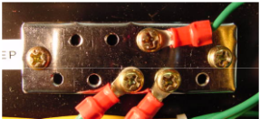

> **図の内容**
>
> 端子台の写真。赤い圧着端子の電線 3 本と緑の電線がねじ止めされている。

### 8-3. サーボアンプなどの設定

サーボアンプの設定の詳細については、以下の例を参考にそれぞれのメーカの説明書をご確認ください。

年間サポートを契約されている方

作成された接続図や配置図などをテクノにファックスかメールいただければ、SLMやサーボアンプの周辺接続を確認させていただきます。こちらから改善のご提案などさせていただくこともあります。また、サーボやパルスモータの設定についてもご相談いただければ、判る範囲ですが、ご支援します。

■安川電機 Σシリーズ設定例

| 項目              | ΣⅡ SGDM     | ΣⅡ SGDM   | ΣⅢSGDS   |   ΣⅢSGDS | 説明                           |
|-----------------|-------------|-----------|----------|----------|------------------------------|
| 制御方式            | Pn000.1     | 0→1       | 1桁目      |        1 | パルス列指令位置制御                   |
| 電子ギヤ比 (分子)      | Pn202       | 適宜        | Pn20E    |          | なるべくSLM側で設定                  |
| (分母)            | Pn203       | 適宜        | Pn210    |          |                              |
| P-OT入力使わない     | Pn50A.3     | 2→8       | 同左       |          | P-OT未接続                      |
| N-OT入力使わない     | Pn50B.0     | 3→8       | 同左       |          | N-OT未接続                      |
| 指令パルス形態         | Pn200.0     | 0→4       | 0桁目      |        4 | A/B相4逓倍（推奨）                  |
| PG分周比           | Pn201       | 適宜        | Pn212    |          | PG FBを使わないときは不要              |
| イナーシャ比          | Pn103       | 適宜        | 同左       |          | 計算値をもとに設定                    |
| 絶対値エンコーダ        | Pn002.2     | 0→1       | 2桁目      |        1 | 1：インクリメントPGとして使う             |
| 速度ループゲイン        | Pn100       | 適宜        | 同左       |          | 40→上限値を探す数百hz               |
| 速度ループ積分時定数      | Pn101       | 適宜        | 同左       |          | (20msec) (20～5msec)          |
| 位置ループゲイン        | Pn102       | 適宜        | 同左       |          | 上限値を探す 50～150r/s 補間する軸は統一    |
| 正転トルク制限逆転トルク制限 | Pn402 Pn403 |           | 同左同左    |          | 試運転などでトルク制限？ 50%程度？（通常800%） |

実際の設定は、安川電機の説明書にしたがってください。

■三菱電機ＭＲ-Ｊ2 設定例

| 項目          | MR-J2             | MR-J2     | 説明                             |
|-------------|-------------------|-----------|--------------------------------|
| 制御モード機能選択1 | 基3:*STY 基1:*OP1   | 0000 0000 | パルス列指令位置制御                     |
| 電子ギヤ比 (分子)  | 基3:CMX            | 適宜        | なるべくSLM側で設定                    |
| (分母)        | 基4:CDV            | 適宜        |                                |
| LSP/NSP内部   | 拡41:*DIA          | 0110      | LSP/NSP内部 SON外部                |
| 指令パルス形態     | 拡21:*OP3          | 0002      | A/B相4逓倍（推奨）                    |
| PG分周比       | 拡27:*ENR 拡54:*OP9 | 適宜        | PG FBを使わないときは不要 PGパルス/設定値関連あり |
| イナーシャ比      | 拡34:GD2           | 適宜        | 計算値をもとに設定                      |
| 速度ループゲイン    | 基36:VG1 基37:VG2   | 適宜        | 40→上限値を探す数百                   |
| 速度ループ積分時定数  | 基38:VIC           | 適宜        | (20msec) (20～5msec)            |
| 位置ループゲイン    | 基6:PG1 基35:PG2    | 適宜        | 上限値を探す 50～150 補間する軸は統一         |

実際の設定は、三菱電機の説明書にしたがってください。基：基本パラメータ拡：拡張パラメータ

- ■オリエンタル αステップ設定例パルス入力方式

分解能切り替えスイッチ例 1000×10 10000ｐ 0．036度 2pls 2パルス方式

αステップ配線例

| SLM   | CN1    | ASシリーズ   | ASシリーズ   | ASシリーズ    | ASCシリーズ   | ASCシリーズ   | ASCシリーズ   |
|-------|--------|----------|----------|-----------|-----------|-----------|-----------|
| ピン番   | 信号名    | ピン番      | 名称       | 機能        | ピン番       | 名称        | 機能        |
|       |        | 1        | 5V       | 制御用電源     |           |           |           |
| 7     | 0V     | 2        | GND      |           | 2         | GND       |           |
| 9     | 24V    | 3        | 24V      | 制御用電源     | 3         | 24V       | 制御用電源     |
| 3     | PDIR+  | 9        | CCW      | パルス指令     | 9         | CCW       | パルス指令     |
| 4     | PDIR-  | 10       | *CCW     |           | 10        | *CCW      |           |
| 1     | POUT+  | 11       | CW       |           | 11        | CW        |           |
| 2     | POUT-  | 12       | *CW      |           | 12        | *CW       |           |
|       |        | （21）     | ACL      | アラームクリア入力 | （21）      | ACL       | アラームクリア入力 |
| 12    | ARST   | 22       | *ACL     |           | 22        | *ACL      |           |
| 10    | SALM   | 25       | ALARM    | アラーム出力    | 25        | ALARM     | アラーム出力    |
| 8     | 024    | 26       | *ALARM   |           | 26        | *ALARM    |           |
| 5     | PGC    | 27       | TIM2     | タイミング     | 23        | TIM1      | O.C       |
| 6     | *PGC   | 28       | *TIM2    | ラインドライバ   |           |           |           |
| 7     | 0V     |          |          |           | 24        | *TIM2     | 0V        |
| 11    | SVON   | 34       |          |           | 34        | *COFF     | カレントオフ    |
| CNEXT | CNEXT  | CNEXT    | CNEXT    | CNEXT     | CNEXT     | CNEXT     | CNEXT     |
| 6     | PGFBB  | 17       | BSG2     | B相FB      | 13        | BSG1      | B相O.C出    |
| 5     | *PGFBB | 18       | *BSG2    | ラインドライバ   |           |           |           |
| 4     | PGFBA  | 19       | ASG2     | A相FB      | 15        | ASG1      | A相O.C出    |
| 3     | *PGFBA | 20       | *ASG2    | ラインドライバ   |           |           |           |
| 2     | 0V     |          |          |           | 14,16     | 0V        |           |

SLM8000は、第1軸を例にしました。第2～第8も同様です。

### 8-4. SLM8000のROMSWの設定

実際に使うサーボやパルスモータアンプに応じて、設定が必要です。 ROMSWマニュアルの、初や単の項目に特に注意してください。

| 画面       | ROMSW名           | 内容                               | ROMSWマニュアル(TB00-1132)                                  |
|----------|------------------|----------------------------------|--------------------------------------------------------|
| 基本ROMSW  | パルスジェネレータクロック   | 最大pps                            | <6-6-1.③パルスジェネレータクロック>                                |
| 軸設定ROMSW | 有効制御軸            | 使用する軸を選択                         | <6-4.(1)有効物理軸選択>                                       |
| 軸設定ROMSW | 原点信号選択 C(Z)相使用選択 | C相原点復帰をする場合のみ設定してください。パルス出力形態 | <6-4.(3)⑫原点復帰設定>                                       |
| 軸設定ROMSW | C(Z)相信号論理        |                                  |                                                        |
| 軸設定ROMSW | 指令/FBパルス         | パルス出力幅極性電子ギヤ任意分周値             | <6-4.(3)⑭指令パルス出力設定> <6-4.(3)⑮フィードバック設定> <7-2.指令/FBの設定> |

設定例安川電機Σサーボ（ΣⅡ ΣⅢ）三菱電機Ｊ2 オリエンタルモータαステップ

| ROMSW項目                | 安川 ΣⅡΣⅢ   | 三菱Ｊ2   | オリエンタル αステップ   |
|------------------------|-----------|---------|----------------|
| 基本ROMSW パルスジェネレータクロック | 512k（1Ｍ）  | 同左      | 256ｋ           |
| 軸設定ROMSW               |           |         |                |
| C(Z)相使用選択 C(Z)相信号論理    | 適宜        | 同左      | 適宜             |
| C(Z)相信号論理              | 正         | 同左      | 正              |
| パルス出力モード               | A/B       | 同左      | CW/CCW         |
| パルス出力幅                 | 1倍        | 同左      | 1倍             |
| 指令極性                   | 適宜        | 同左      | 適宜             |
| 電子ギヤ                   | 適宜        | 同左      | 適宜             |
| FB入力ポート                | 適宜        | 同左      | 適宜             |
| FB入力極性                 | 正         | 同左      | 正              |
| 任意分周値                  | 適宜        | 同左      | 適宜             |

パルスモータの場合の注意

パルスジェネレータクロック（最大pps）パルス出力モード（波形）パルス幅 FB入力極性 A相すすみが正

標準配線を元にした極性です。（配線が変われば、極性もかわります）

### 8-5. SLM8000のサーボパラメータの設定例

モータ単体とはいえ、多少の設定が必要です。セッティングPCのパラメータ画面で設定します。また、機構を駆動する場合には、さらに速度や加減速の見直しが必要です。

| サーボパラメータ   | サーボ ΣⅡ ΣⅢ 三菱Ｊ2 など   | パルスモータオリエンタルαステップ   |
|-------------|---------------------|----------------------|
| PTP時定数      | 適宜                  | 適宜                   |
| PTP速度       | 30ｋ→上げる             | モータPPS上限以下           |
| JOG速度       | 適宜                  | モータPPS上限以下           |
| 補間時定数       | 適宜                  | 適宜                   |
| 原点復帰方向      | 無し→適宜 ※1            | 無し→適宜 ※1             |

※1 モータ単体でも原点復帰を試したい場合は、原点復帰方向を適宜設定します。

詳細は、<Ⅲ機能編 8.サーボパラメータ>(TB00-1130G)を参照下さい。

## 9. モータ単体運転

モータは、単体で空回りしますが、急に回転すると自分の慣性で転がったりします。必ず、モータ自身も仮固定してください。

### 9-1. サーボ主電源投入シーケンス

- (1) SLM8000のSVM出力でサーボ主電源を投入（リレーシーケンス）

SLM8000の電源を入れると、一定のシーケンスの後で、サーボアラーム以外のアラーム要因が無ければ、 SVM出力をONします。

また、各軸のSVON出力もONします。（ROMSWの設定によっては、自動的にSVONしないので運転画面でリセット操作して、サーボONさせます。

起動時のシーケンスの詳細は、

<Ⅱハードウェア編 5-1.SLMシステム起動時シーケンス>(TB00-1130C) を参照下さい。

- (2) とりあえず、単独（手動）でサーボ主電源投入する場合

SLM8000が正常に動作して、かつサーボアラーム以外のアラーム要因が無いことを確認して、サーボ主電源を入れます。その後で、運転画面からリセット操作して、サーボONにしてください。

### 9-2. サーボロックの確認

サーボが正常にサーボONしたら、モータのシャフトがサーボロックされます。手で回しても動きません。位置ループ制御が正常であることが確認できます。

モータのシャフトが簡単に手で回せる状態は、サーボOFFの状態です。

### 9-3. サーボの異常

サーボ主電源を投入し、サーボONしたときにモータが暴走したり異常な動作をする場合は、サーボアンプか

サーボモータ（エンコーダも含む）、あるいはそれらの配線の不良の可能性があります。

また、主電源が投入されていて、SLMからSVON出力をONしたにもかかわらず、サーボロックしないのは、異常です。

最近のACサーボは、調整ソフトやオペレーションパネルで内部状態のモニタリングやモータ単独運転ができますので、サーボメーカの説明書にしたがって、調べてください。

### 9-4. 手動/自動運転

ダミー運転と同じ手順でモータ空運転をおこなっていただきます。ただし以下を再確認してください。

サーボアンプのパラメータ設定 <8-3.サーボアンプなどの設定> SLMの設定 <8-4.SLM8000のROMSWの設定>

- <8-5.SLM8000のサーボパラメータの設定例>


余力があれば！

### 9-5. モータ単体でも原点復帰をしたい場合

原点ドグ（原点LS）の入力をスイッチなどで入力できれば、擬似的に原点復帰も可能です。また、IO画面の強制入力をうまく使うことで、擬似的に原点復帰させることも可能です。

## 10. 導入編の補足資料

### 10-1. SLMの製品型式と写真の一覧

10-1-1. SLM8000製品一式

| 名称                 | 型式           | 外観（写真）   | 仕様内容                | 補足説明            |
|--------------------|--------------|----------|----------------------|-----------------|
| SLM8000 コントローラボード | AS710        |          | 寸法230×100×15         |                 |
| サーボ用ケーブル          | CB-F-H100-00 |          | フラットケーブル             | 100芯 4m （50×2段） |
| IO用ケーブル            | CB-F-H80-00  |          | フラットケーブル（40×2段）     | 80芯 4m          |
| DC電源ケーブル           | CB-C-004-00  |          | 3芯 3m                |                 |
| FBケーブル             | CB-F-H68-00  |          | フラットケーブル 68芯（34×2段） | 4m              |
| 出荷CD               |              | ◆1.1     | 出荷ソフト1式              |                 |

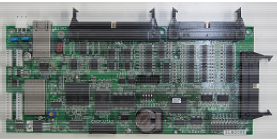


> **図の内容**
>
> 赤と灰色のフラットケーブルの写真。（本文の表の並びから、サーボ用ケーブルの写真と思われる。）


> **図の内容**
>
> 赤と灰色のフラットケーブルの写真。（本文の表の並びから、IO用ケーブルの写真と思われる。）

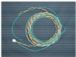

> **図の内容**
>
> 3 色の電線を束ねたケーブルの写真。


> **図の内容**
>
> 赤と灰色のフラットケーブルの写真。（本文の表の並びから、FBケーブルの写真と思われる。）


#### 10-1-2. RS232C通信用製品（別売）

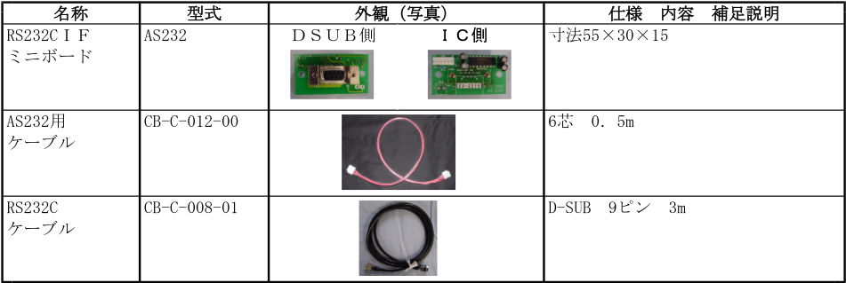

> **図の内容**
>
> | 名称 | 型式 | 外観（写真） | 仕様 内容 補足説明 |
> |---|---|---|---|
> | RS232C I F ミニボード | AS232 | DSUB側、IC側の写真 | 寸法55×30×15 |
> | AS232用ケーブル | CB-C-012-00 | ケーブルの写真 | 6芯 0．5m |
> | RS232C ケーブル | CB-C-008-01 | ケーブルの写真 | D-SUB 9ピン 3m |

10-1-3. アナログ出力オプション製品（別売）

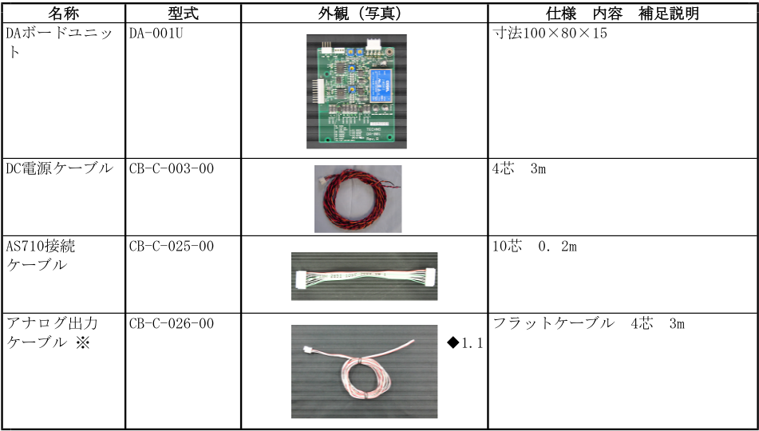

> **図の内容**
>
> | 名称 | 型式 | 外観（写真） | 仕様 内容 補足説明 |
> |---|---|---|---|
> | DAボードユニット | DA-001U | 基板の写真 | 寸法100×80×15 |
> | DC電源ケーブル | CB-C-003-00 | ケーブルの写真 | 4芯 3m |
> | AS710接続ケーブル | CB-C-025-00 | ケーブルの写真 | 10芯 0．2m |
> | アナログ出力ケーブル ※ | CB-C-026-00 | ケーブルの写真 | フラットケーブル 4芯 3m（改訂マーク ◆1.1） |

### 10-2. 出荷リストサンプル

出荷リストのサンプルを次頁以降（全2頁）に示します。ただし、［備考］のページは、備考情報がなければ、添付しません。

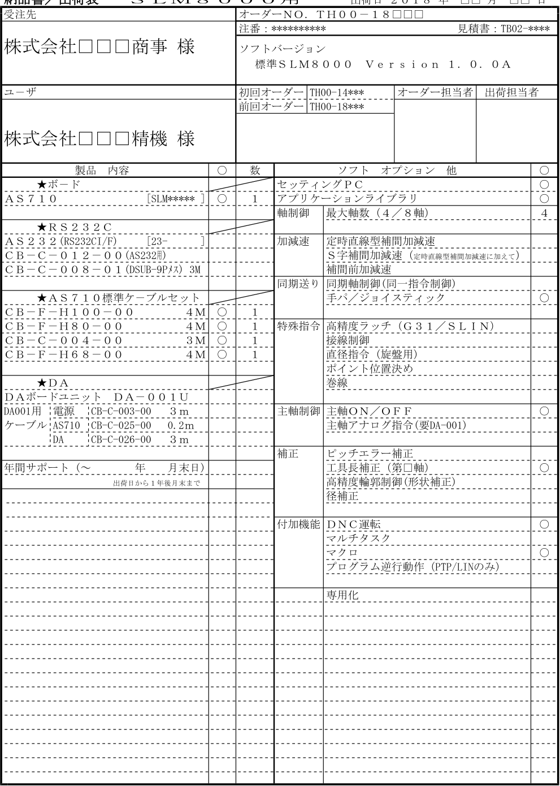

> **図の内容**
>
> 出荷リスト（納品書／出荷表）のサンプル。受注先「株式会社□□□商事 様」、ユーザ「株式会社□□□精機 様」、ソフトバージョン「標準SLM8000 Version 1.0.0A」と読める。製品内容（AS710、ケーブル類、DAボードユニット など）とソフト オプションの一覧。
> 細部は小さくて判読できず。

【備考】

オーダーＮｏ．ＴＨ００－１８□□□

| 番号 ※１   | 日付   | 内容   | 担当サイン   | 検印   |
|---------|------|-------|---------|------|
| ※２      |      |       |         |      |
| ※３      |      |       |         |      |
| ※４      |      |       |         |      |
| ※５      |      |       |         |      |
| ※６      |      |       |         |      |
| ※７      |      |       |         |      |
| ※８      |      |       |         |      |
| ※９      |      |       |         |      |
| ※１０     |      |       |         |      |
| ※１１     |      |       |         |      |
| ※１２     |      |       |         |      |
| ※１３     |      |       |         |      |
| ※１４     |      |       |         |      |
| ※１５     |      |       |         |      |
| ※１６     |      |       |         |      |
| ※１７     |      |       |         |      |
| ※１８     |      |       |         |      |
| ※１９     |      |       |         |      |
| ※２０     |      |       |         |      |
| ※２１     |      |       |         |      |
| ※２２     |      |       |         |      |
| ※２３     |      |       |         |      |
| ※２４     |      |       |         |      |
| ※２５     |      |       |         |      |

### 10-3. 出荷CDの中身

出荷CD内のソフトウエアの一覧を、以下に示します。

```c
    cd ┬ AUTORUN.INF 自動起動用情報ファイル
    ├ Setup.ini インストール用情報ファイル
    ├ setup.exe インストール用実行ファイル
    ├ [vcredist]┬[32bit]─vcredist_x86.exe Visual C++2008再頒布パッケージ(32bit用) ◆1.3
    │ └[64bit]─vcredist_x64.exe Visual C++2008再頒布パッケージ(64bit用)
    └ [Slm8000]
    ├ [devlp] アプリケーション開発用ファイル
    ├ [flash] Flashファイル
    ├ Default.rom デフォルト設定ROMSWファイル
    ├ G_CALL.txt Gコード版サブルーチン呼び出し(M98)命令サンプル運転プログラム
    ├ G_CIR.txt Gコード版円弧補間命令(G91 G02/G03)サンプル運転プログラム
    ├ G_CSET.txt Gコード版論理座標系設定命令(G92)サンプル運転プログラム
    ├ G_INPD.txt Gコード版ｲﾝﾎﾟｼﾞｼｮﾝﾁｪｯｸ無効/無効命令(G61/G64)サンプル運転プログラム
    ├ G_LIN.txt Gコード版直線補間命令(G91 G01)サンプル運転プログラム
    ├ G_PTMA.txt Gコード版ポイント位置決め命令(G100)サンプル運転プログラム
    ├ G_PTP.txt Gコード版早送り命令(G91 G00)サンプル運転プログラム
    ├ G_PTPA.txt Gコード版アブソ早送り命令(G90 G00)サンプル運転プログラム
    ├ G_SPIN.txt Gコード版無限回転軸回転命令(G120)サンプル運転プログラム
    ├ L_CALL.txt Tコード版サブルーチン呼び出し(CALL)命令サンプル運転プログラム
    ├ L_CIR.txt Tコード版円弧補間命令(CIRR/CIRL)サンプル運転プログラム
    ├ L_CIR10.txt Tコード円弧補間命令(CIRL)の円弧中心指定/円弧半径指定サンプル運転プログラム
    ├ L_CSET.txt Tコード版論理座標系設定命令(CSET)サンプル運転プログラム
    ├ L_DI.txt Tコード版入力判断命令サンプル運転プログラム
    ├ L_DNC.txt Tコード版サンプルDNC運転プログラム
    ├ L_DO.txt Tコード版出力制御命令サンプル運転プログラム
    ├ L_INPD.txt Tコード版ｲﾝﾎﾟｼﾞｼｮﾝﾁｪｯｸ無効/無効命令(INPE/INPD)サンプル運転プログラム
    ├ L_LIMA.txt Tコード版ポイント直線補間命令(LIMA)サンプル運転プログラム
    ├ L_LIMA2.txt Tコード版ポイント直線補間命令(LIMA)サンプル運転プログラム2
    ├ L_LIN.txt Tコード版直線補間命令(LIN)サンプル運転プログラム
    ├ L_MicroMove.txt 1ステップ＝1．1制御周期の微小移動運転プログラム
    ├ L_PTMA.txt Tコード版ポイント位置決め命令(PTMA)サンプル運転プログラム
    ├ L_PTP.txt Tコード版早送り命令(PTP)サンプル運転プログラム
    ├ L_PTPA.txt Tコード版アブソ早送り命令(PTPA)サンプル運転プログラム
    ├ L_SPIN.txt Tコード版無限回転軸回転命令(SPIN)サンプル運転プログラム
    ├ L_Square.txt 四角形軌跡サンプル運転プログラム
    ├ L_SWITCH.txt Tコード版スイッチ命令(SWITCH)サンプル運転プログラム
    ├ LangEn.dll 言語ライブラリ(英語)
    ├ LangJp.dll 言語ライブラリ(日本語)
    ├ Slm8000comnt.dll 通信ライブラリ
    ├ Slm8000gcnv.dll Gコード変換ライブラリ
    ├ Slm8000tcnv.dll Tコード変換ライブラリ
    ├ Slm8000drv.exe セッティングPCソフト
    ├ Slm8000swset.exe ROMSW設定ソフト
    ├ Slm8000Fdl.exe Flash書き込みソフト
    ├ L_pnt_clr.pnt ポイント直線補間命令(LIMA)サンプル運転
    ├ L_pnt_t0.pnt 位置決めポイントテーブルクリア用データサンプル
    ├ L_pnt_t1.pnt 位置決めポイントテーブルデータサンプル(L_LIMA2.txt)
    ├ L_pnt_t2.pnt 位置決めポイントテーブルデータサンプル(L_LIMA2.txt)
    ├ L_pnt_t3.pnt 位置決めポイントテーブルデータサンプル(L_LIMA2.txt)
    ├ L_pnt_t4.pnt 位置決めポイントテーブルデータサンプル(L_LIMA2.txt)
    ├ L_pnt_t5.pnt 位置決めポイントテーブルデータサンプル(L_LIMA2.txt)
    ├ L_pnt_t6.pnt 位置決めポイントテーブルデータサンプル(L_LIMA2.txt)
    ├ L_pnt_t7.pnt 位置決めポイントテーブルデータサンプル(L_LIMA2.txt)
    ├ L_PTMA.pnt 位置決めポイントテーブルデータサンプル(G_PTMA.txt/L_PTMA.txt/L_LIMA.txt)
    └ Version.sys バージョン情報ファイル
```

### 10-4. サンプル運転プログラム

テクノ言語やG言語の運転プログラム（<10-3.出荷CDの中身>の .txtファイル）です。ダミー運転やモータ単体運転でも使います。

サンプル運転プログラムの一部は「サンプル運転プログラム説明書」(TB04-0422)に詳細説明があります。ご参照下さい。

（テクノHPの「マニュアルダウンロード」ページから取得できます。）

### 10-5. ソフトウェアバージョン

#### 10-5-1. ソフトウェアバージョンの付け方

バージョン番号の付け方は以下の通りです。

Ver1.3.0A 英字部分：PC側のソフトだけを変更した時に A→B→...→Z と上がって行きます。*1 数字部分：SLM8000のファームウェア(ROMソフト)のバージョンです。

- *1 ファームウェアのバージョンアップ時には、PC側ソフトを変更していなくても英字部分は A に戻ります。
- 例）元バージョンが「Ver1.0.0B」の時、バージョンアップの内容により、以下のようにバージョンが変わります。
- 1) ファームウェアとPC側ソフトの両方をバージョンアップ → 「Ver1.1.0A」
- 2) ファームウェアだけバージョンアップ
- → 「Ver1.1.0A」
- 3) PC側ソフトだけバージョンアップ → 「Ver1.0.0C」

#### 10-5-2. ソフトウェアバージョンの確認方法

- ① セッティングPC(Slm8000drv.exe)を起動します。
- ② 「バージョン情報」ボタンを押します。
- ③ 表示されるバージョン情報ダイアログの以下の部分がバージョン番号です。

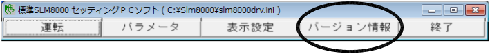

> **図の内容**
>
> メニュー: 運転、パラメータ、表示設定、バージョン情報（丸で囲み）、終了。

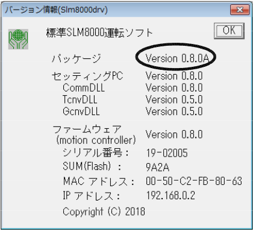

> **図の内容**
>
> ダイアログ「バージョン情報(Slm8000drv)」。標準SLM8000運転ソフト。
> - パッケージ: Version 0.8.0A（丸で囲み）
> - セッティングPC Version 0.8.0、CommDLL Version 0.8.0、TcnvDLL Version 0.5.0、GcnvDLL Version 0.5.0
> - ファームウェア(motion controller) Version 0.8.0
> - シリアル番号: 19-02005、SUM(Flash): 9A2A
> - MAC アドレス: 00-50-C2-FB-80-63
> - IP アドレス: 192.168.0.2
> - Copyright (C) 2018
