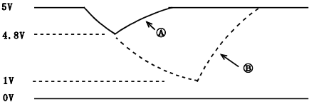
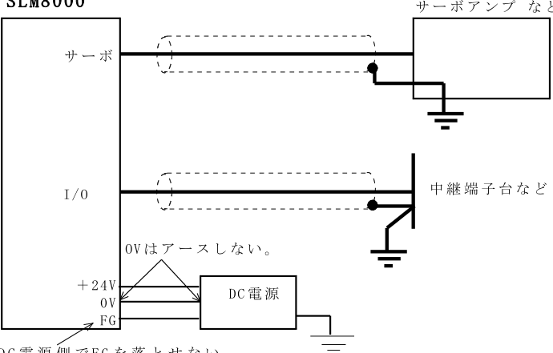
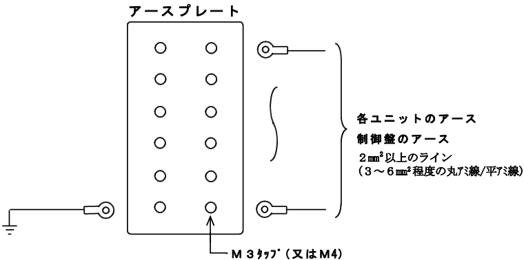
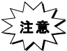
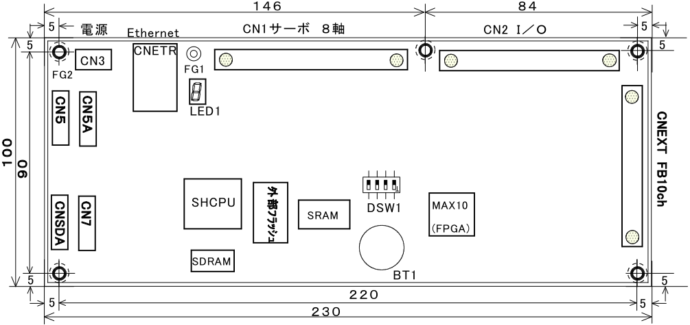
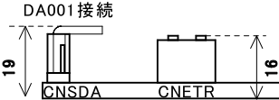
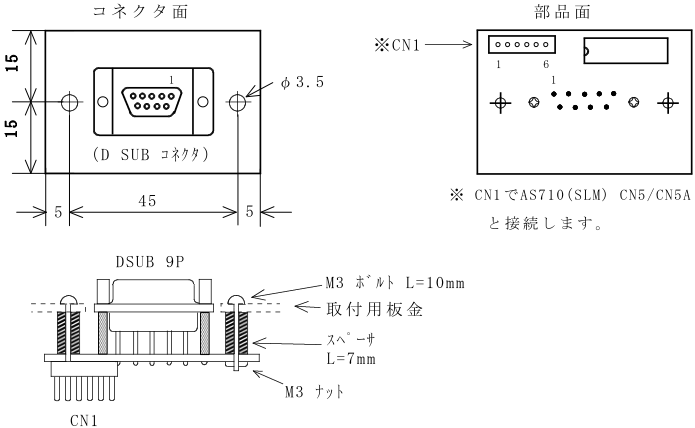
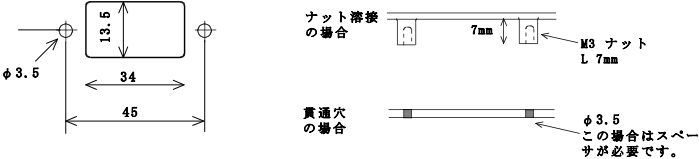
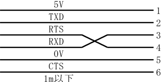

## 1. 一般事項

### 1-1. 電源仕様

| 電源電圧    | 24V±10%             |    |
|---------|---------------------|----|
| SLM8000 | 0.6A(入力回路全ON)+外部駆動 | ※1 |
| AS710のみ | (入力回路)              |    |

- ※1 24V電源容量は、AS710の制御電源+外部のI/O回路によります。外部PGへAS710経由で5Vを供給する場合は、制御電流にその分を別途考慮下さい。
- 〔注〕5V電源が4.8V以下の場合に、停電処理（NMI処理）が走らず、バックアップメモリエラーが発生することがあります。

瞬停 5V電源が 4.8V以下に下がると停電処理によりSLMのソフトウェアは停止します。

(サーボ電源及び指令もOFFになります。)

瞬停の場合で下図のAのような場合、SLMのCPUへのリセットが発生せず、停止状態のままで、ハングアップすることがあります。

ユーザ殿回路にて電源シーケンスを準備するか、SLMの「READY出力」を監視する方法を推奨します。

> **図の内容**
>
> 電源電圧の変化の図。縦軸の目盛りは 5V、4.8V、1V、0V。
> - Ⓐ（実線）: 電圧が 4.8V 付近まで下がってから 5V に戻る
> - Ⓑ（破線）: 電圧が 4.8V を下回り、1V 付近まで下がってから 5V に戻る
> （本文の電源シーケンスの説明に対応する）

### 1-2. 寸法と重量

| 形式   | 寸法(mm)    | 重量   |
|-------|------------|-------|
| AS710 | 230×100×15 | 170g  |

### 1-3. 設置上の注意事項

- 振動がないこと
- 周囲温度 0℃ ～ 55℃
- PCBの直近に強力な磁気/静電誘導がないこと。特に、強電回路や大きな電流の流れる配線が、PCBの直近を通らないように配慮下さい。 (PCB：Printed Circuit Board の一般名称です。当社コントローラボードと解釈下さい。)
- A. CPUに対して、リセット発生せず。 (ハングアップ)
- B. CPUのリセット発生して、再起動されます。(正常)

Ⅱ ハードウェア編

### 1-4. ノイズ対策とシールド処理

ケーブルのシールドのアース処理については、以下の方針で行って下さい。

【基本方針】

- SLM側の0Vは浮かす。(アースに落とさない)
- シールドやFG(フレームグランド)は、原則相手機器側で落とす。 CN3のFGはDC電源に接続し、DC電源側でFGを落とせない場合は、SLM8000側のFG1,FG2の端子からFGを落とす。(CN3のFGとPCB上のFG1,FG2はつながっています。)◆1.1

D C 電源側でF G を落とせない

> **図の内容**
>
> - SLM8000 の「サーボ」とサーボアンプなど、「I/O」と中継端子台などを、シールド線（破線）でつなぎ、シールドは相手側で接地する
> - DC電源の +24V、0V、FG を SLM8000 につなぐ。「0Vはアースしない。」
> - 下端の文は切れている（「DC電源側でFGを落とせない」場合の説明）

場合はSLM8000 側で落とす

制御盤には、アースプレートを設置して、サーボアンプ、電源などのアースはこのアースプレートへ落として、さらに1次側のアースへ接続して下さい。

> **図の内容**
>
> 「アースプレート」に M3タップ（又は M4）の穴が並び、「各ユニットのアース」「制御盤のアース」を「2mm²以上のライン（3～6mm²程度の丸ﾗｸﾞ線/平ﾗｸﾞ線）」でつなぐ。

PCは、一般的に0Vがアースとコモンになっています。従って、PC接続している場合には、 PC側で接地されてしまいます。

RS232Cが不安定になってしまう場合がありますので、PCもアースから浮かせるようにしてください。（2股コンセントをつかう、筐体をアースとつながないなど）

## 2. 外形寸法と設置方法

### 2-1. AS710コントローラボード ◆1.1

> **図の内容**
>
> AS710 ボードの外形と部品配置。外形 230 × 100（取付穴の間隔 220 × 90、端から 5）。
> 上辺: 電源、Ethernet（CNETR）、CN1 サーボ 8軸（幅 146）、CN2 I/O（幅 84）。左辺: CN3、FG2、FG1、CN5、CN5A、CNSDA、CN7、LED1。右辺: CNEXT FB10ch。中央: SHCPU、外部ﾌﾗｯｼｭ、SRAM、SDRAM、DSW1、MAX10(FPGA)、BT1。
> 細部の文字は小さくて判読しにくい。

- PCB取付穴(φ3.5) M3ﾅｯﾄ(6mmφ) L:4mm以上で受けて下さい。

> **図の内容**
>
> 「DA001接続」: CNSDA に DA001 をつないだときの高さ 19、CNETR の高さ 16。

最大高さ（基板裏面より）

DA001接続時(ケーブル曲げRも含め) 約１９mm

DA001未接続時(RJ45コネクタのツメ含め) 約１６mm （なしの時）

- FG1はPCBの表裏両面で接続可能です。
- FG2はCN3の隣のPCB取り付け穴の表面で接続可能です。
- ※FGは原則として相手側機器で落としてください。どうしても相手側機器で落とせない場合にFG1,FG2を使用してください。

### 2-2. AS232の接続と設置

#### 2-2-1. AS232の外観

> **図の内容**
>
> - 「コネクタ面」: D SUB コネクタ、幅 45（両側 5）、高さ 15 + 15、取付穴 φ3.5
> - 「部品面」: CN1（1～6）。「※ CN1でAS710（SLM）CN5/CN5Aと接続します。」
> - 側面: DSUB 9P、M3ボルト L=10mm、取付用板金、スペーサ L=7mm、M3ナット、CN1

#### 2-2-2. 取付板金加工図

2-2-3. [AS710 CN5/CN5A] ～ [AS232 CN1] ケーブル【CB-C-012-00】

> **図の内容**
>
> 取付板金の加工寸法: 穴 φ3.5 の間隔 45、切り欠き 34 × 13.5。
> - 「ナット溶接の場合」: M3ナット、L 7mm
> - 「貫通穴の場合」: φ3.5、この場合はスペーサが必要です。

AS710

CN5/CN5A

ケーブル側コネクタ

日圧 H6P-SHF-AA

コンタクト BHF-001T-0.8BS

1

2

3

4

5

6

> **図の内容**
>
> | ピン | 信号 |
> |---|---|
> | 1 | 5V |
> | 2 | TXD |
> | 3 | RTS |
> | 4 | RXD |
> | 5 | 0V |
> | 6 | CTS |
>
> 3 番（RTS）と 4 番（RXD）の線が途中で交差して描かれている。ケーブル長は「1m以下」。

CN5 (SIO-1)オプション(シーケンサリンク等) CN5A(SIO-2)セッティングPC用(通常使用)

AS232 CN1 ケーブル側コネクタ日圧 H6P-SHF-AA

コンタクト BHF-001T-0.8BS

- ※ ケーブル長 0.5m以下この信号は、5V系の信号です。ノイズ源からは、離して下さい。
