## 3. AS710コントローラボード

### 3-1. AS710コネクタ表と使用コネクタ型式

| 3-1-1.   | CN1 Pin   | アドレス       | ： Bit      | 軸制御信号名    | Pin アドレス   | Bit   | 信号名        |     |
|----------|-----------|------------|------------|------------|------------|-------|------------|-----|
|          | 1         | - -        | POUT1+     | 51         | -          | -     | POUT5+     |     |
| 第1軸      | 2 -       | -          | POUT1-     | 52         | -          | -     | POUT5-     | 第5軸 |
|          | 3 -       | -          | PDIR1+     | 53         | -          | -     | PDIR5+     |     |
|          | 4 -       | -          | PDIR1-     | 54         | -          | -     | PDIR5-     |     |
|          | 5 -       | -          | *PGC1(O.C) | 55         | -          | -     | *PGC5(O.C) |     |
|          | 6 -       | -          | PGC1       | 56         | -          | -     | PGC5       |     |
|          | 7 -       | -          | 0V         | 57         | -          | -     | 0V         |     |
|          | 8 -       | -          | 024        | 58         | -          | -     | 024        |     |
|          | 9 -       | -          | +24V       | 59         | -          | -     | +24V       |     |
|          | 10        | I#0000 D00 | SALM1      | 60         | I#0000     | D04   | SALM5      |     |
|          | 11 0#0000 | D00        | SVON1      | 61         | 0#0000     | D08   | SVON5      |     |
|          | 12        | D01        | SVRST1     | 62         | 0#0000     | D09   | SVRST5     |     |
|          | 13 -      | 0#0000 -   | POUT2+     | 63         | -          | -     | POUT6+     |     |
| 第2軸      | 14 -      | -          | POUT2-     | 64         | -          | -     | POUT6-     | 第6軸 |
|          | 15 -      | -          | PDIR2+     |            | 65 -       | -     | PDIR6+     |     |
|          | 16 -      | -          | PDIR2-     |            | 66 -       | -     | PDIR6-     |     |
|          | 17 -      | -          |            | *PGC2(O.C) | 67 -       | -     | *PGC6(O.C) |     |
|          | 18 -      | -          | PGC2       | 68         | -          | -     | PGC6       |     |
|          | 19 -      |            | - 0V       |            | 69 -       | -     | 0V         |     |
|          | 20 -      | -          | 024        |            | 70 -       | -     | 024        |     |
|          | 21        | -          | - +24V     |            | 71 -       | -     | +24V       |     |
|          | 22        | I#0000     | D01 SALM2  |            | 72 I#0000  | D05   | SALM6      |     |
|          | 23        | 0#0000     | D02        | SVON2      | 73 0#0000  | D10   | SVON6      |     |
|          | 24        | 0#0000     | D03        | SVRST2     | 74 0#0000  | D11   | SVRST6     |     |
|          | 25        | -          | - POUT3+   |            | 75 -       | -     | POUT7+     |     |
| 第3軸      | 26 -      | -          | POUT3-     |            | 76 -       | -     | POUT7-     | 第7軸 |
|          | 27 -      | -          | PDIR3+     | 77         | -          | -     | PDIR7+     |     |
|          | 28 -      | -          | PDIR3-     |            | 78 -       | -     | PDIR7-     |     |
|          | 29 -      |            | -          | *PGC3(O.C) | 79 -       | -     | *PGC7(O.C) |     |
|          | 30 -      | -          | PGC3       |            | 80 -       | -     | PGC7       |     |
|          | 31 -      | -          | 0V         | 81         | -          | -     | 0V         |     |
|          | 32 -      | -          | 024        |            | 82 -       | -     | 024        |     |
|          | 33 -      | -          | +24V       |            | 83 -       | -     | +24V       |     |
|          | 34        | I#0000     | D02        | SALM3      | 84 I#0000  | D06   | SALM7      |     |
|          | 35        | 0#0000     | D04        | SVON3      | 85 0#0000  | D12   | SVON7      |     |
|          | 36        | 0#0000     | D05        | SVRST3     | 86 0#0000  | D13   | SVRST7     |     |
|          | 37 -      | -          | POUT4+     |            | 87 -       | -     | POUT8+     |     |
| 第4軸      | 38 -      | -          | POUT4-     |            | 88 -       | -     | POUT8-     | 第8軸 |
|          | 39 -      | -          |            | PDIR4+     | 89 -       | -     | PDIR8+     |     |
|          | 40 -      | -          |            | PDIR4-     | 90 -       | -     | PDIR8-     |     |
|          | 41 -      | -          |            | *PGC4(O.C) | 91 -       | -     | *PGC8(O.C) |     |
|          | 42 -      | -          |            | PGC4       | 92 -       | -     | PGC8       |     |
|          | 43 -      |            | -          | 0V         | 93 -       | -     | 0V         |     |
|          | 44 -      | -          |            | 024        | 94 -       | -     | 024        |     |
|          | 45 -      | -          |            | +24V       | 95 -       | -     | +24V       |     |
|          | 46        | I#0000 D03 | SALM4      | 96         | I#0000     | D07   | SALM8      |     |
|          | 47        | 0#0000     | D06        | SVON4      | 97 0#0000  | D14   | SVON8      |     |
|          | 48        | 0#0000     | D07        | SVRST4     | 98 0#0000  | D15   | SVRST8     |     |
|          | 49 -      | -          | COM1       | ※1         | 99 -       | -     | 予備         |     |
|          | 50 -      | -          |            | 予備         | 100 -      | -     | 予備         |     |

- ※1 COM1グループ：SALM1～SALM8用の24Vもしくは024を接続。詳細は<3-3.入出力信号の電気的仕様>を参照。

【内容】

- ○入力信号 8本(各軸サーボアラーム)
- ○出力信号 16本(各軸サーボON、各軸アラームリセット)
- ○パルス出力 8軸
- ○C(Z)相入力 8軸

【コネクタ】

基板側ヒロセ HIF6-100PA-1.27DS(71) ケーブル側ヒロセ HIF6-100D-1.27R(20)

024：24V系のGND（全コネクタで同名信号はコモン）注記 0V：5V系のGND（全コネクタで同名信号はコモン） 0Vと024 は、AS710内で1点コモンになっています。

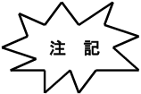

|   Pin | アドレス   | Bit   | 信号名      |      |   Pin | アドレス   | Bit   | 信号名     |      |
|-------|--------|-------|----------|------|-------|--------|-------|---------|------|
|     1 | I#0001 | D00   | DEC1     | COM2 |    41 | O#0001 | D00   | T0SVM   |      |
|     2 | I#0001 | D01   | T0RESET  | COM2 |    42 | O#0001 | D01   | T0READY |      |
|     3 | I#0001 | D02   | T0STOP   | COM2 |    43 | O#0001 | D02   | T0RUN   |      |
|     4 | I#0001 | D03   | T0CRCLR  | COM2 |    44 | O#0001 | D03   | T0ALARM |      |
|     5 | I#0001 | D04   | OTP1     | COM2 |    45 | O#0001 | D04   | T0INPOS |      |
|     6 | -      | -     | COM2 ※   | -    |    46 | -      | -     | +24V    |      |
|     7 | I#0001 | D05   | OTM1     | COM2 |    47 | O#0001 | D05   | T0PRDY  |      |
|     8 | I#0001 | D06   | DEC2     | COM2 |    48 | O#0001 | D06   | T0PAUSE |      |
|     9 | I#0001 | D07   | T0EMS    | COM2 |    49 | O#0001 | D07   | T0M0    |      |
|    10 | I#0001 | D08   | T0START  | COM2 |    50 | O#0001 | D08   | T0M1    |      |
|    11 | I#0001 | D09   | T0RETURN | COM2 |    51 | O#0001 | D09   | T0M2    |      |
|    12 | -      | -     | 024      | -    |    52 | -      | -     | +24V    |      |
|    13 | I#0001 | D10   | OTP2     | COM2 |    53 | O#0001 | D10   | T0M3    |      |
|    14 | I#0001 | D11   | OTM2     | COM2 |    54 | O#0001 | D11   | T0MSTRB |      |
|    15 | I#0001 | D12   | DEC3     | COM2 |    55 | O#0001 | D12   | T0M4    |      |
|    16 | I#0001 | D13   | DEC5     | COM2 |    56 | O#0001 | D13   | T0M5    |      |
|    17 | I#0001 | D14   | T0ONSW   | COM2 |    57 | O#0001 | D14   | T0M6    |      |
|    18 | -      | -     | COM3 ※   | -    |    58 | -      | -     | +24V    |      |
|    19 | I#0001 | D15   | T0MFIN   | COM2 |    59 | O#0001 | D15   | T0M7    |      |
|    20 | I#0002 | D00   | OTP3     | COM3 |    60 | I#0003 | D02   | DEC6    | COM4 |
|    21 | I#0002 | D01   | OTM3     | COM3 |    61 | I#0003 | D03   | OTP6    | COM4 |
|    22 | I#0002 | D02   | DEC4     | COM3 |    62 | I#0003 | D04   | OTM6    | COM4 |
|    23 | I#0002 | D03   | Ri08     | COM3 |    63 | I#0003 | D05   | DEC7    | COM4 |
|    24 | -      | -     | 024      | -    |    64 | -      | -     | +24V    |      |
|    25 | I#0002 | D04   | Ri09     | COM3 |    65 | I#0003 | D06   | OTP7    | COM4 |
|    26 | I#0002 | D05   | Ri10     | COM3 |    66 | I#0003 | D07   | OTM7    | COM4 |
|    27 | I#0002 | D06   | OTP5     | COM3 |    67 | I#0003 | D08   | DEC8    | COM4 |
|    28 | I#0002 | D07   | OTM5     | COM3 |    68 | O#0002 | D00   | Ro00    |      |
|    29 | I#0002 | D08   | Ri00     | COM3 |    69 | O#0002 | D01   | Ro01    |      |
|    30 | -      | -     | COM4 ※   | -    |    70 | -      | -     | +24V    |      |
|    31 | I#0002 | D09   | Ri01     | COM3 |    71 | O#0002 | D02   | Ro02    |      |
|    32 | I#0002 | D10   | Ri02     | COM3 |    72 | O#0002 | D03   | Ro03    |      |
|    33 | I#0002 | D11   | Ri03     | COM3 |    73 | O#0002 | D04   | Ro04    |      |
|    34 | I#0002 | D12   | Ri04     | COM3 |    74 | O#0002 | D05   | Ro05    |      |
|    35 | I#0002 | D13   | Ri05     | COM3 |    75 | O#0002 | D06   | Ro06    |      |
|    36 | -      | -     | 024      | -    |    76 | -      | -     | +24V    |      |
|    37 | I#0002 | D14   | Ri06     | COM3 |    77 | O#0002 | D07   | Ro7     |      |
|    38 | I#0002 | D15   | Ri07     | COM3 |    78 | I#0003 | D09   | OTP8    | COM4 |
|    39 | I#0003 | D00   | OTP4     | COM4 |    79 | I#0003 | D10   | OTM8    | COM4 |
|    40 | I#0003 | D01   | OTM4     | COM4 |    80 | I#0003 | D11   | SENSE   | COM4 |

※ 24Vもしくは024を接続。

詳細は<3-3.入出力信号の電気的仕様>を参照。

【内容】

- ○入力信号計44本
- DEC 8本(1軸～8軸)
- OTP 8本(1軸～8軸)
- OTM 8本(1軸～8軸)
- 汎用入力Ri** 11本
- 機能SW 8本(非常停止、リセット、ストップ、原点設定、スタート、原点復帰、T0MFIN、T0ONSW)
- センサーラッチ入力 1本

**○出力信号計24本**

- Mコード 8本(T0M0～T0M7)
- 汎用出力Ro** 8本
- 機能SW 8本(T0SVM、T0READY、T0RUN、T0ALARM、T0INPOS、T0PRDY、T0PAUSE、T0MSTRB)

【コネクタ】

基板側ヒロセ HIF6-80PA-1.27DS(71) ケーブル側ヒロセ HIF6-80D-1.27R(20)

信号の割付(ピン配置、機能選択)は自由です。上記はデフォルト設定です。詳細は「SLM8000 ROMSW設定ソフトマニュアル」(TB00-1132)をご覧下さい。

3-1-3. CNEXT ： FB

|   Pin |    | アドレス Bit   | 信号名            | Pin     | アドレス   | Bit   | 信号名          |
|-------|----|------------|----------------|---------|--------|-------|--------------|
|     1 | -  | -          | +5V            | 35      | -      | -     | +5V          |
|     2 | -  | -          | 0V             | 36      | -      | -     | 0V           |
|     3 | -  |            | PGFBA1         | 37      | -      | -     | PGFBA6       |
|     4 | -  | -          | *PGFBA1(O.C)   | 38      | -      | -     | *PGFBA6(O.C) |
|     5 | -  | -          | PGFBB1         | 39      | -      | -     | PGFBB6       |
|     6 | -  | -          | *PGFBB1(O.C)   | 40      | -      | -     | *PGFBB6(O.C) |
|     7 | -  | -          | +5V            | 41      | -      | -     | +5V          |
|     8 | -  | -          | 0V             | 42      | -      | -     | 0V           |
|     9 | -  | -          | PGFBA2         | 43      | -      | -     | PGFBA7       |
|    10 | -  | -          | *PGFBA2(O.C)   | 44      | -      | -     | *PGFBA7(O.C) |
|    11 | -  |            | - PGFBB2       | 45      | -      | -     | PGFBB7       |
|    12 | -  | -          | *PGFBB2(O.C)   | 46      | -      | -     | *PGFBB7(O.C) |
|    13 | -  |            | - +5V          | 47      | -      | -     | +5V          |
|    14 | -  |            | - 0V           | 48      | -      | -     | 0V           |
|    15 | -  | -          | PGFBA3         | 49      | -      | -     | PGFBA8       |
|    16 | -  | -          | *PGFBA3(O.C)   | 50      | -      | -     | *PGFBA8(O.C) |
|    17 | -  | -          | PGFBB3         | 51      | -      | -     | PGFBB8       |
|    18 | -  | -          | *PGFBB3(O.C)   | 52      | -      | -     | *PGFBB8(O.C) |
|    19 | -  | -          | +5V            | 53      | -      | -     | +5V          |
|    20 | -  | -          | 0V             | 54      | -      | -     | 0V           |
|    21 | -  | -          | PGFBA4         | 55      | -      | -     | HPGA1        |
|    22 | -  |            | - *PGFBA4(O.C) | 56      | -      | -     | *HPGA1(O.C)  |
|    23 | -  |            | - PGFBB4       | 57      | -      | -     | HPGB1        |
|    24 | -  | -          | *PGFBB4(O.C)   | 58      | -      | -     | *HPGB1(O.C)  |
|    25 | -  | -          | +5V            | 59      | -      | -     | +5V          |
|    26 | -  |            | - 0V           | 60      | -      | -     | 0V           |
|    27 | -  | -          | PGFBA5         | 61      | -      | -     | HPGA2        |
|    28 | -  | -          | *PGFBA5(O.C)   | 62      | -      | -     | *HPGA2(O.C)  |
|    29 | -  | -          | PGFBB5         | 63      | -      | -     | HPGB2        |
|    30 | -  | -          | *PGFBB5(O.C)   | 64      | -      | -     | *HPGB2(O.C)  |
|    31 | -  |            | - SEN1         | 65      | -      | -     | SEN5         |
|    32 | -  | -          | SEN2           | 66      | -      | -     | SEN6         |
|    33 | -  | -          | SEN3           | 67      | -      | -     | SEN7         |
|    34 | -  |            | -              | SEN4 68 | -      | -     | SEN8         |

【内容】

○フィードバック 10CH (軸/手パ等の合計)

【コネクタ】

基板側ヒロセ HIF6-68PA-1.27DS(71)

ケーブル側ヒロセ HIF6-68D-1.27R(20)

#### 3-1-4. CN3

：電源

|   Pin | 信号名   |
|-------|-------|
|     1 | +24V  |
|     2 | 0V    |
|     3 | FG    |

【内容】

基板の電源入力

【コネクタ】

基板側日圧 B3PS-VH

ケーブル側日圧 VHR-3N

CN5 SIO-1

CN5A SIO-2

|   Pin | 信号名    |
|-------|--------|
|     1 | +5V    |
|     2 | TX_D1  |
|     3 | S_RDY1 |
|     4 | RX_D1  |
|     5 | 0V     |
|     6 | CTS1   |

【内容】

232C通信用

テクノAS232基板と接続します。(TTLレベル)

【コネクタ】

基板側日圧 B6P-SHF-1AA ケーブル側日圧 H6P-SHF-AA

#### 3-1-6. CNETR ：イーサネット接続

| Pin   | 信号名    |
|-------|--------|
| 1     | TRCT3  |
| 2     | TRD3-  |
| 3     | TRD3+  |
| 4     | TRD2+  |
| 5     | TRD2-  |
| 6     | TRCT2  |
| 7     | TRCT4  |
| 8     | TRD4+  |
| 9     | TRD4-  |
| 10    | TRD1-  |
| 11    | TRD1+  |
| 12    | TRCT1  |
| 13    | YLED_K |
| 14    | YLED_A |
| 15    | GLED_K |
| 16    | GLED_A |
| F1    | F1     |
| F2    | F2     |

【内容】

イーサネット通信用

【コネクタ】

基板側 BeL Fuse L826-1X1T-23-F ケーブル側市販LANケーブル

|   Pin | 信号名    |
|-------|--------|
|     1 | +5V    |
|     2 | TX_D2  |
|     3 | S_RDY2 |
|     4 | RX_D2  |
|     5 | 0V     |
|     6 | CTS2   |

|   Pin | 信号名    |
|-------|--------|
|     1 | +5V    |
|     2 | 0V     |
|     3 | DACLK1 |
|     4 | DALT1  |
|     5 | DAD1   |
|     6 | (予備)   |
|     7 | DACLK2 |
|     8 | DALT2  |
|     9 | DAD2   |
|    10 | (予備)   |

【内容】

DA出力 2CH(DA001基板と接続)

【コネクタ】

基板側日圧 B10P-SHF-1AA

ケーブル側日圧 H10P-SHF-AA

#### 3-1-8. CN7 ： AD入力(予備)

◆1.3

|   Pin | 信号名      |
|-------|----------|
|     1 | +3.3V    |
|     2 | 0V       |
|     3 | PF0/ADI0 |
|     4 | PF1/ADI1 |
|     5 | PF2/ADI2 |
|     6 | PF3/ADI3 |
|     7 | PF4/ADI4 |
|     8 | PF5/ADI5 |
|     9 | PF6/ADI6 |
|    10 | PF7/ADI7 |

【内容】

CPUAD入力 0～+3.3V (予備)

【コネクタ】

基板側日圧 B10P-SHF-1AA

ケーブル側日圧 H10P-SHF-AA

### 3-2. 標準入出力チャンネル表

CN2の入出力については、信号名と信号の配置はユーザ設定が可能です。

信号名(ユーザ信号名)：セッティングPCソフトで設定可詳細は、

「SLM8000 セッティングPCマニュアル」(TB00-1131)

<4-2-3-1.汎用入出力画面>

<4-4-3.入出力表示設定画面>

を参照下さい。

信号の配置(機能選択)：ROMSW設定ソフトで変更可

詳細は、

「SLM8000 ROMSW設定ソフトマニュアル」(TB00-1132)

<6-2.入力信号の設定>

<6-3.出力信号の設定>

を参照下さい。

下記はデフォルト設定の例です

#### 3-2-1. 入力信号チャンネル表(デフォルト設定)

i#0□は入出力アドレスでマクロ変数#160□と対応します。

| チャンネル   | Bit         | コネクタ名   | ピンNo.   | 信号名          | 入力論理   |
|---------|-------------|---------|---------|----------------|--------|
| i#00    | D00         |         | 10      | SALM1          | A      |
|         | D01         | AS710   | 22      | SALM2          | A      |
|         | D02         | CN1     | 34      | SALM3          | A      |
|         | D03         |         | 46      | SALM4          | A      |
|         | D04         |         | 60      | SALM5          | A      |
|         | D05         |         | 72      | SALM6          | A      |
|         | D06         |         | 84      | SALM7          | A      |
|         | D07         |         | 96      | SALM8          | A      |
|         | D08         |         |         |                |        |
|         | D09         |         |         |                |        |
|         | D10         |         |         |                |        |
|         | D11         |         |         |                |        |
|         | D12 D13     |         |         |                |        |
|         | D14         |         |         | DEC1           | A      |
|         | D15 D00 D01 | AS710   | 1 2     | T0RESET T0STOP | A A    |
|         | D02         | CN2     | 3 4     |                | A      |
|         | D03         |         |         | T0CRCLR        |        |
|         | D04         |         | 5       | OTP1           | A      |
|         | D05         |         | 7       | OTM1           | A      |
|         | D06         |         | 8       | DEC2           | A      |
| i#01    | D07         |         | 9       | T0EMS          | A      |
|         | D08         |         | 10      | T0START        | A      |
|         | D09         |         | 11      | T0RETURN       | A      |
|         | D10         |         | 13      | OTP2           | A      |
|         | D11         |         | 14      | OTM2           | A      |
|         | D12         |         | 15      | DEC3           | A      |
|         | D13         |         | 16      | DEC5           | A      |
|         | D14         |         | 17      | T0ONSW         | A      |
|         | D15         |         | 19      | T0MFIN         | A      |

入力論理 A＝A接点： "CLOSE"＝入力論理ON、"ノーマル OPEN "＝入力論理OFF B＝B接点： "OPEN "＝入力論理ON、"ノーマル CLOSE"＝入力論理OFF

| チャンネル   | Bit     | コネクタ名     |   ピンNo. | 信号名   | 入力論理   |
|---------|---------|-----------|---------|---------|--------|
| i#02    | D00     | AS710 CN2 |      20 | OTP3    | A      |
| i#02    | D01     |           |      21 | OTM3    | A      |
| i#02    | D02     |           |      22 | DEC4    | A      |
| i#02    | D03     |           |      23 | Ri08    | A      |
| i#02    | D04     |           |      25 | Ri09    | A      |
| i#02    | D05     |           |      26 | Ri10    | A      |
| i#02    | D06     |           |      27 | OTP5    | A      |
| i#02    | D07     |           |      28 | OTM5    | A      |
| i#02    | D08     |           |      29 | Ri00    | A      |
| i#02    | D09     |           |      31 | Ri01    | A      |
| i#02    | D10     |           |      32 | Ri02    | A      |
| i#02    | D11     |           |      33 | Ri03    | A      |
| i#02    | D12     |           |      34 | Ri04    | A      |
| i#02    | D13     |           |      35 | Ri05    | A      |
| i#02    | D14     |           |      37 | Ri06    | A      |
| i#02    | D15     |           |      38 | Ri07    | A      |
| i#02    | D00     |           |      39 | OTP4    | A      |
| i#03    | D01     | AS710     |      40 | OTM4    | A      |
| i#03    | D02     | CN2       |      60 | DEC6    | A      |
| i#03    | D03     |           |      61 | OTP6    | A      |
| i#03    | D04     |           |      62 | OTM6    | A      |
| i#03    | D05     |           |      63 | DEC7    | A      |
| i#03    | D06     |           |      65 | OTP7    | A      |
| i#03    | D07     |           |      66 | OTM7    | A      |
| i#03    | D08     |           |      67 | DEC8    | A      |
| i#03    | D09     |           |      78 | OTP8    | A      |
| i#03    | D10     |           |      79 | OTM8    | A      |
| i#03    | D11     |           |      80 | SENSE   | A      |
| i#03    | D12     |           |         |         |        |
| i#03    | D13 D14 |           |         |         |        |
| i#03    | D15     |           |         |         |        |

※ センサーラッチ信号(SENSE)はコネクタCN2の80番ピンに固定です。

#### 3-2-2. 出力信号チャンネル表(デフォルト設定)

o#0□は入出力アドレスでマクロ変数#161□と対応します。

| チャンネル   | Bit     |                 |   ピンNo. | 信号名   | 出力論理   | 初期状態   |
|---------|---------|-----------------|---------|---------|--------|--------|
| o#00    | D00     | コネクタ名 AS700 CN1 |      11 | SVON1   | ON     | OFF    |
| o#00    | D01     | コネクタ名 AS700 CN1 |      12 | SVRST1  | ON     | OFF    |
| o#00    | D02     | コネクタ名 AS700 CN1 |      23 | SVON2   | ON     | OFF    |
| o#00    | D03     | コネクタ名 AS700 CN1 |      24 | SVRST2  | ON     | OFF    |
| o#00    | D04     | コネクタ名 AS700 CN1 |      35 | SVON3   | ON     | OFF    |
| o#00    | D05     | コネクタ名 AS700 CN1 |      36 | SVRST3  | ON     | OFF    |
| o#00    | D06     | コネクタ名 AS700 CN1 |      47 | SVON4   | ON     | OFF    |
|         | D07     |                 |      48 | SVRST4  | ON     | OFF    |
|         | D08     |                 |      61 | SVON5   | ON     | OFF    |
|         | D09     |                 |      62 | SVRST5  | ON     | OFF    |
|         | D10     |                 |      73 | SVON6   | ON     | OFF    |
|         | D11     |                 |      74 | SVRST6  | ON     | OFF    |
|         | D12     |                 |      85 | SVON7   | ON     | OFF    |
|         | D13     |                 |      86 | SVRST7  | ON     | OFF    |
|         | D14     |                 |      97 | SVON8   | ON     | OFF    |
|         | D15     |                 |      98 | SVRST8  | ON     | OFF    |
| o#01    | D00     |                 |      41 | T0SVM   | ON     | OFF    |
| o#01    | D01     |                 |      42 | T0READY | ON     | OFF    |
| o#01    | D02     |                 |      43 | T0RUN   | ON     | OFF    |
| o#01    | D03     |                 |      44 | T0ALARM | ON     | OFF    |
| o#01    | D04     |                 |      45 | T0INPOS | ON     | OFF    |
| o#01    | D05     |                 |      47 | T0PRDY  | ON     | OFF    |
| o#01    | D06     |                 |      48 | T0PAUSE | ON     | OFF    |
| o#01    | D07     | AS700           |      49 | T0M0    | ON     | OFF    |
| o#01    | D08     | CN2             |      50 | T0M1    | ON     | OFF    |
| o#01    | D09     | CN2             |      51 | T0M2    | ON     | OFF    |
| o#01    | D10     | CN2             |      53 | T0M3    | ON     | OFF    |
| o#01    | D11     | CN2             |      54 | T0MSTRB | ON     | OFF    |
| o#01    | D12     | CN2             |      55 | T0M4    | ON     | OFF    |
| o#01    | D13     | CN2             |      56 | T0M5    | ON     | OFF    |
| o#01    | D14     | CN2             |      57 | T0M6    | ON     | OFF    |
| o#01    | D15     | CN2             |      59 | T0M7    | ON     | OFF    |
| o#02    | D00     | AS700 CN2       |      68 | Ro00    | ON     | OFF    |
| o#02    | D01     | AS700 CN2       |      69 | Ro01    | ON     | OFF    |
| o#02    | D02     | AS700 CN2       |      71 | Ro02    | ON     | OFF    |
| o#02    | D03     | AS700 CN2       |      72 | Ro03    | ON     | OFF    |
| o#02    | D04     | AS700 CN2       |      73 | Ro04    | ON     | OFF    |
| o#02    | D05     | AS700 CN2       |      74 | Ro05    | ON     | OFF    |
| o#02    | D06     | AS700 CN2       |      75 | Ro06    | ON     | OFF    |
| o#02    | D07     | AS700 CN2       |      77 | Ro07    | ON     | OFF    |
| o#02    | D08     |                 |         |         |        |        |
| o#02    | D09 D10 |                 |         |         |        |        |
| o#02    | D11     |                 |         |         |        |        |
| o#02    | D12 D13 |                 |         |         |        |        |
| o#02    | D14     |                 |         |         |        |        |
| o#02    | D15     |                 |         |         |        |        |

出力論理 ON 出力論理ONの時、出力トランジスタがON （信号Lレベル）

OFF 出力論理ONの時、出力トランジスタがOFF（信号Hレベル）

初期状態 ON 初期状態にて出力トランジスタ ON

OFF 初期状態にて出力トランジスタ OFF

### 3-3. 入出力信号の電気的仕様

#### 3-3-1. 電気的仕様一覧

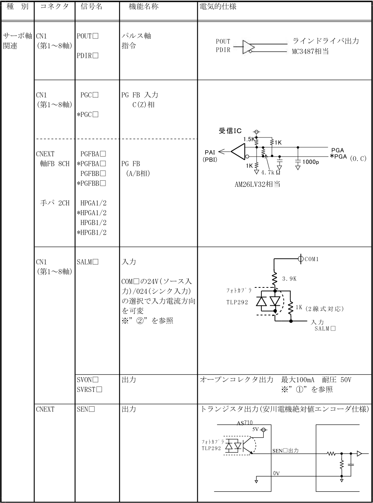

> **図の内容**
>
> | 種別 | コネクタ | 信号名 | 機能名称 | 電気的仕様 |
> |---|---|---|---|---|
> | サーボ軸関連 | CN1（第1～8軸） | POUT□、PDIR□ | パルス軸指令 | ラインドライバ出力 MC3487相当 |
> | サーボ軸関連 | CN1（第1～8軸） | PGC□、*PGC□ | PG FB 入力 C(Z)相 | 受信IC（AM26LV32相当）。PGA・*PGA (O.C) を 1.5K、1K、4.7kΩ、1000p の回路で受けて PAI (PBI) へ |
> | サーボ軸関連 | CNEXT 軸FB 8CH | PGFBA□、*PGFBA□、PGFBB□、*PGFBB□ | PG FB（A/B相） | 同上 |
> | サーボ軸関連 | CNEXT 手パ 2CH | HPGA1/2、*HPGA1/2、HPGB1/2、*HPGB1/2 | PG FB（A/B相） | 同上 |
> | サーボ軸関連 | CN1（第1～8軸） | SALM□ | 入力。COM□の24V(ソース入力)/024(シンク入力)の選択で入力電流方向を可変 ※"②"を参照 | COM1 から 3.9K、フォトカプラ TLP292、1K（2線式対応）を経て 入力 SALM□ |
> | サーボ軸関連 | CN1（第1～8軸） | SVON□、SVRST□ | 出力 | オープンコレクタ出力 最大100mA 耐圧 50V ※"①"を参照 |
> | サーボ軸関連 | CNEXT | SEN□ | 出力 | トランジスタ出力(安川電機絶対値エンコーダ仕様)。AS710 内のフォトカプラ TLP292（5V）から SEN□出力、0V |

| 種別     | コネクタ                       | 信号名                                                             | 機能名称                                          | 電気的仕様                                                                 |
|---------|----------------------------|-----------------------------------------------------------------|-----------------------------------------------|-----------------------------------------------------------------------|
| サーボ軸関連 | CN1 POUT□ (第1～8軸) PDIR□    | パルス軸指令                                                         | POUT PDIR                                     | ラインドライバ出力 MC3487相当                                                    |
|         | CN1 PGC□ (第1～8軸) *PGC□     | PG FB 入力 C(Z)相 PGFBA□ PG FB                                     | 受信ＩＣ PAI (PBI )                               | 1.5K 1K 1K 1000p *PGA PGA (O.C)                                       |
|         | CNEXT 軸FB 8CH 手パ 2CH SALM□ | *PGFBA□ PGFBB□ (A/B相) *PGFBB□ HPGA1/2 *HPGA1/2 HPGB1/2 *HPGB1/2 | 入力 COM□の24V(ソース入力)/024(シンク入力) の選択で入力電流方向を可変 | 4.7kΩ AM26LV32相当 COM1 3.9K                                            |
|         | CN1 (第1～8軸)                | SVON□ SVRST□                                                    | ※"②"を参照出力                                    | オープンコレクタ出力最大100mA 耐圧 50V ※"①"を参照 1K 入力 (2 線式対応) SALM□ ﾌｫﾄｶﾌﾟﾗ TLP292 |
|         | SEN□                       |                                                                 |                                               | トランジスタ出力(安川電機絶対値エンコーダ仕様)                                              |
|         | CNEXT                      | 出力                                                              | ﾌｫﾄｶﾌﾟﾗ TLP292                                | AS710 SEN□出力 0V 5V                                                    |

| 種       | 別   | コネクタ               | 信号名               | 機能名称                                                      | 電気的仕様                                                        |
|---------|-----|--------------------|-------------------|-----------------------------------------------------------|--------------------------------------------------------------|
| 一般入出力  |     | CN2                | OT±□ DEC□ RI□ PI□ | デジタル入力 COM□の24V(ソース入力)/024(シンク入力) の選択で入力電流方向を可変 ※"②"を参照 | C O M 2 ～7 3.9K 1K 入力 (2 線式対応) Ri□, ORG, etc. ﾌｫﾄｶﾌﾟﾗ TLP292 |
|         |     | CN2                | RO□ SWSEL□        | デジタル出力                                                    | オープンコレクタ出力最大100mA 耐圧 50V ※"①"を参照                            |
| アナログ入力 |     | CN7                | ADI□              | AD入力                                                      | 0～3.3V 10Bit 8CH 量子化誤差±0.5LsB ◆1.3                           |
| シリアル通信 |     | CN5 TXD□ CN5A RXD□ | RTS□ 出力 CTS□ 入力   |                                                           | TTLレベルの入出力                                                   |

①誘導負荷の対策

ソレノイドやマグネットコイルなどの誘導性負荷には、必ずサージサプレッサ(ダイオードなど)を付けて下さい。

■誘導負荷の対策

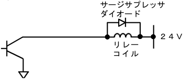

> **図の内容**
>
> トランジスタ出力と 24V の間のリレーコイルに、並列にサージサプレッサダイオードを付ける。

- ②入力信号のソース/シンク切替 COM□を24Vまたは024に接続して選択して下さい。

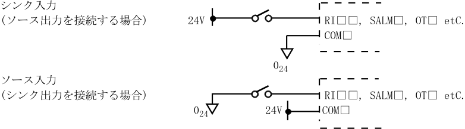

> **図の内容**
>
> - シンク入力（ソース出力を接続する場合）: 24V → スイッチ → RI□□、SALM□、OT□ etc.。COM□ は 0₂₄
> - ソース入力（シンク出力を接続する場合）: 0₂₄ → スイッチ → RI□□、SALM□、OT□ etc.。COM□ は 24V

#### 3-3-2. エンコーダFBパルス最少位相差時間

エンコーダFBのA相/B相パルスの最少位相差時間について規定します。実際にはケーブルインピーダンス等による波形のなまりなどの影響があります。従って当社コントローラボードのレシーバIC入力信号にて規定いたします。

(1) 最少位相差時間

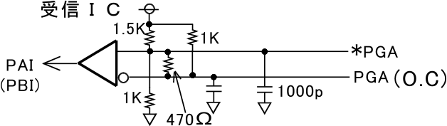

> **図の内容**
>
> 受信IC。PGA と *PGA (O.C) を、1.5K・1K のプルアップ、1K・470Ω、1000p のコンデンサの回路で受け、PAI (PBI) を出力する。

上記の回路は、A相,B相,C(Z)相全て同様です。従ってA相,B相の位相差は正確にはPAIと PBI(B相受信ICの出力)に対して以下のようになります。

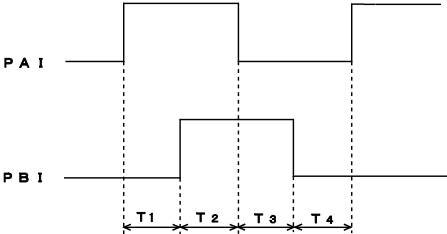

> **図の内容**
>
> PAI と PBI の波形。各エッジの間隔が T1、T2、T3、T4。

(2) 実際の測定/動作チェック

最高PPSやPG/スケールの最少位相差時間が問題となりそう場合は以下の確認をおこなって下さい。

- FBカウンタを有効にした軸で、一定量往復運動のくり返し動作を行い、偏差カウンタが動作前の値より+又は、-方向に増えていない(動作前の値が"0"の場合は"0"に戻る)のを確認。
- 特殊な使い方のFBについては、当社へご相談下さい。

注記波形になまりが生じて、最少位相差時間以下のT□が発生する場合は上記回路のフィルターコンデンサ(1000P)の値を見直します。

当社へご相談下さい。

### 3-4. パルス指令ドライバ（アンプ）との接続

#### 3-4-1. 電気的仕様

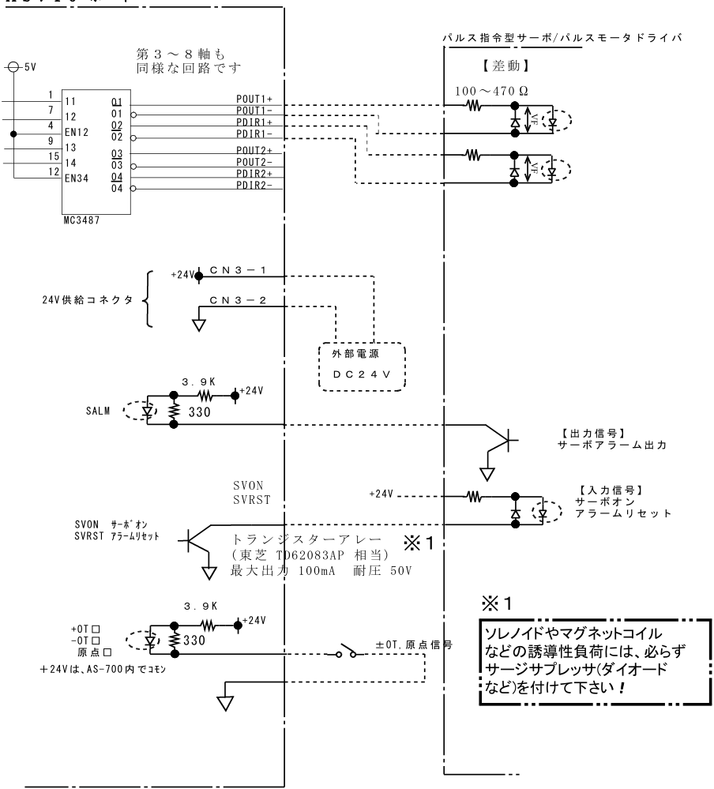

> **図の内容**
>
> 左が AS710 ボード、右が「パルス指令型サーボ/パルスモータドライバ」。
> - MC3487（5V、EN12、EN34）の出力 POUT1+、POUT1−、PDIR1+、PDIR1−、POUT2+、POUT2−、PDIR2+、PDIR2− → ドライバ側【差動】100～470Ω とフォトカプラ（VF）。「第３～８軸も同様な回路です」
> - 24V供給コネクタ: +24V CN3−1、CN3−2（GND）← 外部電源 DC24V
> - SALM: +24V から 3.9K、330 とフォトカプラ ← ドライバ側【出力信号】サーボアラーム出力
> - SVON サーボオン、SVRST アラームリセット: トランジスターアレー（東芝 TD62083AP 相当）最大出力 100mA 耐圧 50V ※1 → ドライバ側【入力信号】サーボオン、アラームリセット（+24V）
> - +OT□、−OT□、原点□: +24V から 3.9K、330 とフォトカプラ ← ±OT、原点信号のスイッチ。「+24Vは、AS-700内でコモン」
> - ※1: ソレノイドやマグネットコイルなどの誘導性負荷には、必らずサージサプレッサ(ダイオードなど)を付けて下さい！

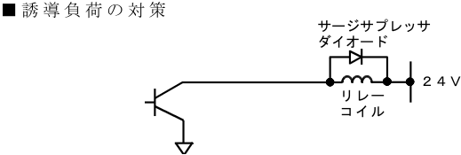

> **図の内容**
>
> ■誘導負荷の対策。トランジスタ出力と 24V の間のリレーコイルに、並列にサージサプレッサダイオードを付ける。

#### 3-4-2. パルス出力タイミング仕様

パルスジェネレータクロック数の選択により異なります。ROMSW設定ソフトで選択ください。

| パルス形態               | 信号波形                            | 略称             | パルスジェネレータクロック(MAX pps) - 4096K      | パルスジェネレータクロック(MAX pps) - 2048K      | パルスジェネレータクロック(MAX pps) - 1024K      | パルスジェネレータクロック(MAX pps) - 512K   | パルスジェネレータクロック(MAX pps) - 256K   | パルスジェネレータクロック(MAX pps) - 128K   |
|---------------------|---------------------------------|----------------|-------------------------------------|-------------------------------------|-------------------------------------|---------------------------------|---------------------------------|---------------------------------|
| PLS/DIR パルス列+方向     | ＴH POUT+ PDIR+ ｔ1ｔ2             | TH TL ＴL t1 t2 | 0.12μsec 0.12μsec 0.12μsec 0.12μsec | 0.24μsec 0.24μsec 0.24μsec 0.24μsec | 0.48μsec 0.48μsec 0.48μsec 0.48μsec | 0.9μsec 0.9μsec 0.9μsec 0.9μsec | 1.9μsec 1.9μsec 1.9μsec 1.9μsec | 3.9μsec 3.9μsec 3.9μsec 3.9μsec |
| CW/CCW CWパルス CCWパルス | ＴH POUT+ (CW) PDIR+ ＴL (CCW) t1 | TH TL t1       | 0.12μsec 0.12μsec 0.24μsec          | 0.24μsec 0.24μsec 0.48μsec          | 0.48μsec 0.48μsec 0.97μsec          | 0.9μsec 0.9μsec 1.9μsec         | 1.9μsec 1.9μsec 3.8μsec         | 3.9μsec 3.9μsec 7.8μsec         |
| A/B相 90度位相差 2相パルス   | ＴH POUT+ (PA) ＴL PDIR+ (PB) ｔ1  | TH TL t1       | 0.48μsec 0.48μsec 0.24μsec          | 0.97μsec 0.97μsec 0.48μsec          | 1.9μsec 1.9μsec 0.97μsec            | 3.9μsec 3.9μsec 2.0μsec         | 7.8μsec 7.8μsec 3.9μsec         | 15.6μsec 15.6μsec 7.8μsec       |

|          |                |                |                |                |                |                |
|----------|----------------|----------------|----------------|----------------|----------------|----------------|
| RTC周期    | パルスジェネレータクロック数 | パルスジェネレータクロック数 | パルスジェネレータクロック数 | パルスジェネレータクロック数 | パルスジェネレータクロック数 | パルスジェネレータクロック数 |
|          | 4M             | 2M             | 1M             | 512K           | 256K           | 128K           |
| 0.5 msec | ○              | ○              | ○              | 不可             | 不可             | 不可             |
| 1 msec   | ○              | ○              | ○              | ○              | 不可             | 不可             |
| 2 msec   | ○              | ○              | ○              | ○              | ○              | 不可             |
| 4 msec   | 不可             | ○              | ○              | ○              | ○              | ○              |
| 8 msec   | 不可             | 不可             | ○              | ○              | ○              | ○              |

波形の立上り(TR)/立下り(TF)時間

【差動出力波形】

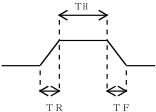

> **図の内容**
>
> パルス 1 つの波形。パルス幅 TH、立上り時間 TR、立下り時間 TF。

MC3487等の出力ICの出力スイッチング自体は、瞬時に行われますが、配線ケーブル上のインピーダンスやドライバの受け回路の特性により波形のなまりが生じます。波形がなまることで、上記の表よりTH(TL)が短くなります。

パルス出力波形はROMSW設定により変わります。詳細は、

「SLM8000 ROMSW設定ソフトマニュアル」<7-1.パルス出力波形>(TB00-1132) を参照下さい。

#### 3-4-3. パルス出力のその他の設定

(1) 指令極性と信号極性

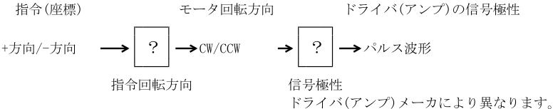

> **図の内容**
>
> 「指令(座標) +方向/−方向」→ ? →「モータ回転方向 CW/CCW」→ ? →「ドライバ(アンプ)の信号極性 パルス波形」。最初の ? は「指令回転方向」、次の ? は「信号極性」。注記: ドライバ(アンプ)メーカにより異なります。

(2) パルス形態と信号極性

【P.PLS/DIR 形態】

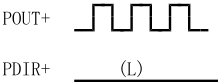

> **図の内容**
>
> POUT+ にパルス列、PDIR+ は (L)。

(3) 信号極性の選択

各々の形態で上図の波形の時、モータをシャフト側からみて (A) CW/(B)CCW ？

【C.CW/CCW 形態 (+指令)】【 A.A/B 相形態 (+指令)】

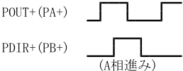

> **図の内容**
>
> POUT+ (PA+) と PDIR+ (PB+) が位相をずらしたパルス。(A相進み)

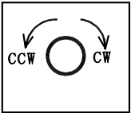

> **図の内容**
>
> モータ軸を正面から見た絵。左回りが CCW、右回りが CW。

### 3-5. 入力信号の漏れ電流と残留電圧（2線式センサー）

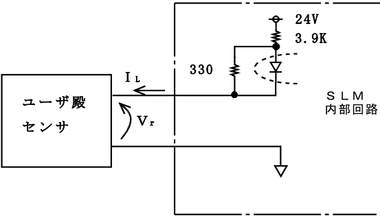

> **図の内容**
>
> 「ユーザ殿センサ」と「SLM 内部回路」（24V、3.9K、330、フォトカプラ）。センサに流れる電流 Iʟ と、センサの残留電圧 Vr。

2線式センサーを使う場合には、上記条件を考慮して下さい。注意 3線式(+V、信号、0V)は、上記条件の問題はありません。

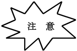

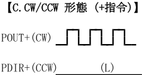

> **図の内容**
>
> 【C.CW/CCW 形態 (+指令)】POUT+ (CW) にパルス列、PDIR+ (CCW) は (L)。

## 4. 周辺接続

### 4-1. 周辺接続概観図

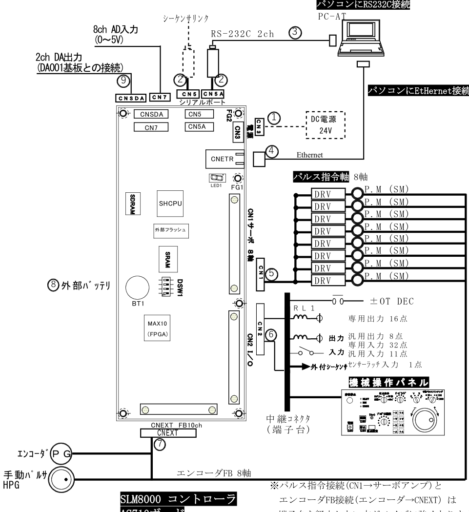

> **図の内容**
>
> SLM8000 コントローラの基板と周辺機器の接続。読める範囲:
> - パソコンとの RS-232C 接続、パソコンとの Ethernet 接続
> - 8ch AD入力 (0～5V)、2ch DA出力 (DA001基板との接続)
> - 電源 24V（DC電源）
> - パルス指令 8軸（DRV → P.S (SVM) など）
> - CN2 I/O: ±OT、DEC、専用出力、汎用入出力、機械操作パネル、中継コネクタ（端子台）
> - CNEXT: エンコーダFB、手動パルサ（HPG）
> - 外部バッテリ
> - 注記: 他パルス指令接続(CN1→サーボアンプ)と、エンコーダFB接続(エンコーダ→CNEXT) は…（以降判読できず）
> 細部は小さくて判読できず。

SLM8000 コントローラエンコーダFB接続(エンコーダ→CNEXT）は端子台を経由しない方がノイズに強くなります。

◆1.1

| NO.   | 名称         | 形式         | テクノ標準仕様             |
|-------|-------------|-------------|---------------------|
| ①     | DC電源ケーブル    | CB-C-004-00 | 3m 片端フリー            |
| ②     | AS232 ケーブル  | CB-C-012-00 | 0.55m               |
| ③     | RS232Cケーブル  | CB-C-008-01 | 3ｍ以下 PC側コネクタに合わせて選択 |
| ④     | 市販LANケーブル   |             |                     |
| ⑤     | 軸制御用ケーブル    | CB-F-H100   | 4m 片端フリーフラットケーブル   |
| ⑥     | I/O用ケーブル    | CB-F-H80    | 4m 片端フリーフラットケーブル   |
| ⑦     | FBケーブル      | CB-F-H68    | 4m 片端フリーフラットケーブル   |
| ⑧     | 外付けバッテリ     |             | ボタン電池(CR2032相当)     |
| ⑨     | DA001接続ケーブル | CB-C-025-00 | 0.2m                |

AS710ボード

ケーブル及び外付けバッテリ

### 4-2. 全体接続図とサーボ主電源回路

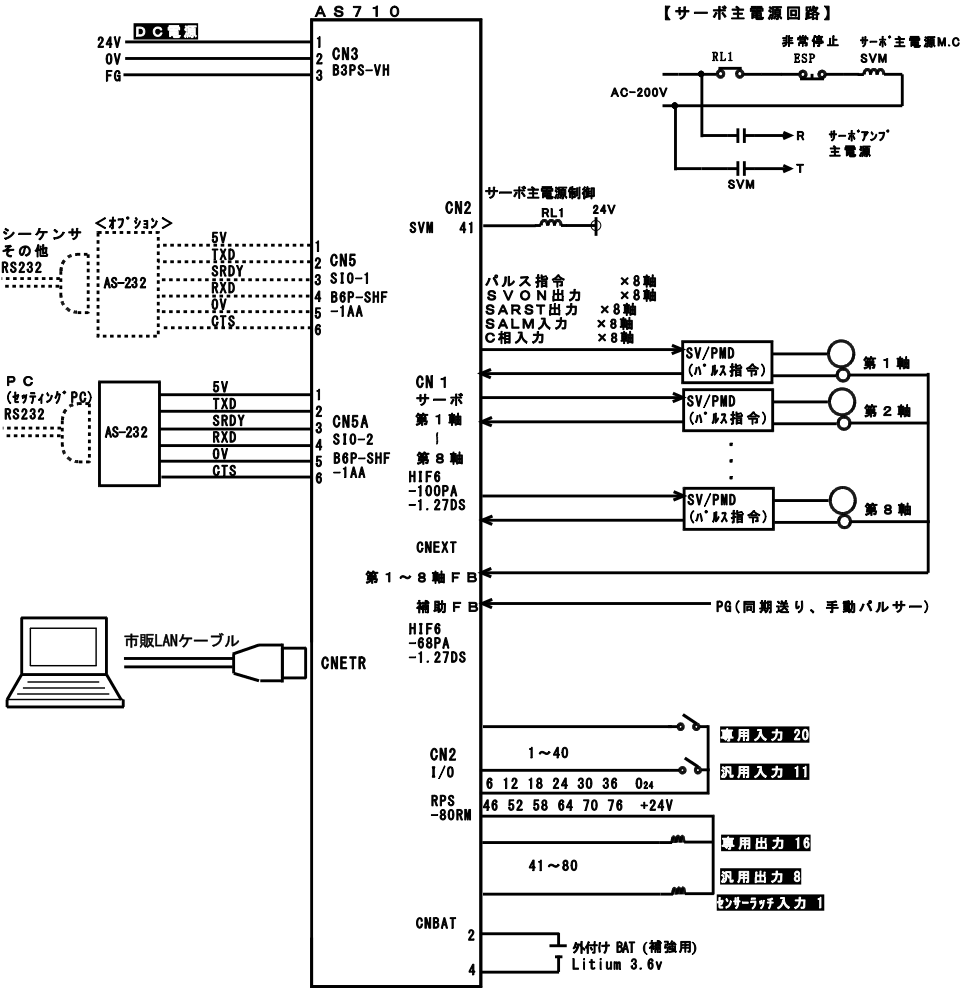

> **図の内容**
>
> AS710 を中心にした全体の接続図。読める範囲:
> - 24V 電源 → CN3
> - CN5（シーケンサ等の RS232C）、CN5A（PC のセッティングPC RS232C）
> - CN1 サーボ（第1軸～）→ サーボアンプ（SV/PWD など）→ 各軸モータ
> - CNEXT → PG（同期送り、手動パルサー）
> - CNETR ← 市販LANケーブル ← PC
> - CN2 I/O（1～40、41～80）→ 機械操作パネル、汎用入出力 など
> - 【サーボ主電源回路】AC200V、非常停止、サーボ主電源MC、SVM
> - CNBAT: PANSY BAT（電池）、Lithium 3.6v
> 細部は小さくて判読できず。

### 4-3. DC電源ケーブル

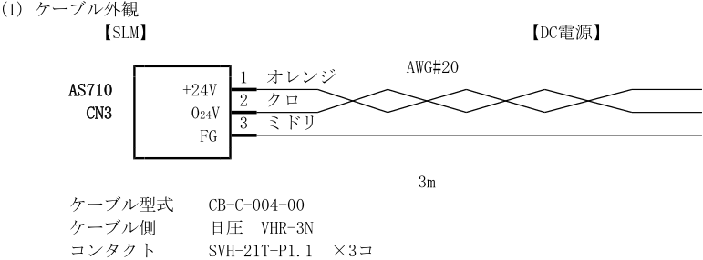

> **図の内容**
>
> (1) ケーブル外観。【SLM】AS710 CN3 の 1 +24V（オレンジ）、2 0₂₄V（クロ）、3 FG（ミドリ）→【DC電源】。AWG#20、長さ 3m。
> - ケーブル型式: CB-C-004-00
> - ケーブル側: 日圧 VHR-3N
> - コンタクト: SVH-21T-P1.1 ×3コ

### 4-4. セッティングPC用ケーブル（PC－AT）

◆1.1

(1) 外観

ＤＳＵＢ９Ｐオス

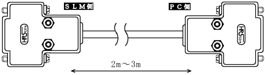

> **図の内容**
>
> 「SLM側」と「PC側」の D-SUB コネクタをつなぐケーブル。長さ 2m～3m。

| 相手 PC    | コネクタタイプ    | ケーブル形式      |
|----------|------------|-------------|
| PC-AT 9P | DSUB 9P メス | CB-C-008-01 |

コネクタタイプはケーブル側のコネクタです。(PC側とは、オス/メス逆になります)

(2) 配線

【AS232側(SLM側)】

CB-C-008-01

【PC-AT 9P】

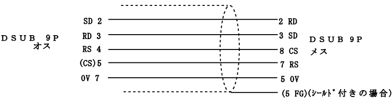

> **図の内容**
>
> | DSUB 9P オス（SLM側） | DSUB 9P メス（PC側） |
> |---|---|
> | SD 2 | 2 RD |
> | RD 3 | 3 SD |
> | RS 4 | 8 CS |
> | (CS) 5 | 7 RS |
> | 0V 7 | 5 0V |
> | （シールド） | (5 FG)(シールド付きの場合) |

### 4-5. CN1 パルス列指令形サーボアンプとの接続例

4-5-1. 安川SGDH-Ⅱの例

◆1.3

4-5-2. 三菱J2の例

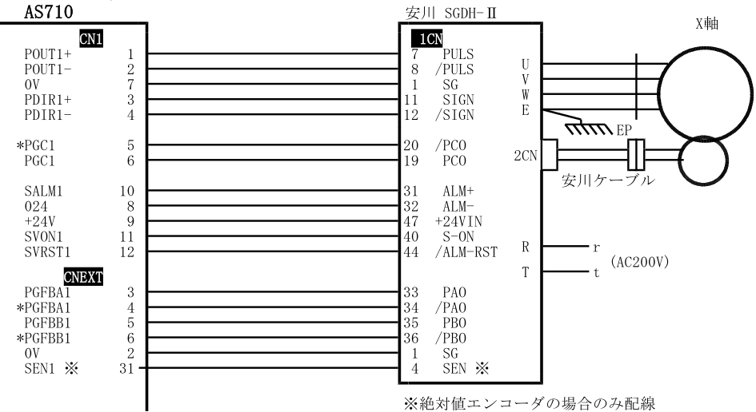

> **図の内容**
>
> AS710 の CN1・CNEXT と 安川 SGDH-Ⅱ の 1CN の接続。
> | AS710 | ピン | SGDH-Ⅱ 1CN |
> |---|---|---|
> | CN1 POUT1+ | 1 | 7 PULS |
> | CN1 POUT1− | 2 | 8 /PULS |
> | CN1 0V | 7 | 1 SG |
> | CN1 PDIR1+ | 3 | 11 SIGN |
> | CN1 PDIR1− | 4 | 12 /SIGN |
> | CN1 *PGC1 | 5 | 20 /PCO |
> | CN1 PGC1 | 6 | 19 PCO |
> | CN1 SALM1 | 10 | 31 ALM+ |
> | CN1 024 | 8 | 32 ALM− |
> | CN1 +24V | 9 | 47 +24VIN |
> | CN1 SVON1 | 11 | 40 S-ON |
> | CN1 SVRST1 | 12 | 44 /ALM-RST |
> | CNEXT PGFBA1 | 3 | 33 PAO |
> | CNEXT *PGFBA1 | 4 | 34 /PAO |
> | CNEXT PGFBB1 | 5 | 35 PBO |
> | CNEXT *PGFBB1 | 6 | 36 /PBO |
> | CNEXT 0V | 2 | 1 SG |
> | CNEXT SEN1 ※ | 31 | 4 SEN ※ |
>
> SGDH-Ⅱ の U・V・W・E → X軸モータ、2CN ← 安川ケーブル（エンコーダ）、r・t（AC200V）。※絶対値エンコーダの場合のみ配線

◆1.3

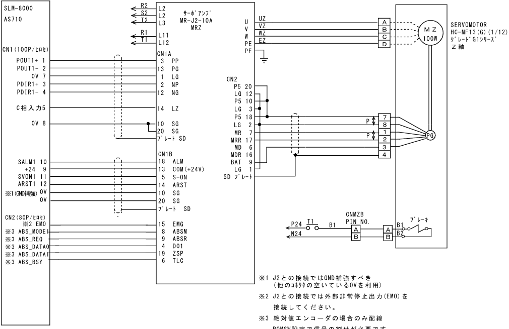

> **図の内容**
>
> 改訂マーク ◆1.3。SLM-8000 (AS710) の CN1 (100P/20R) と サーボアンプ MR-J2-10A の CN1A・CN1B・CN2 の接続、SERVOMOTOR HC-MF13(-S)(1/12) への配線。CN1 の POUT1+、POUT1−、0V、PDIR1+、PDIR1−、C相入力、SALM1、+24、SVON1、ARST1 と、アンプ側の PP、PG、LG、NP、NG、LZ、ALM、COM(+24V)、S-ON、ARST、SG、EMG、ABSM、ABSR、D01、ZSP、TLC などがつながる。注記 ※1～※3（J2との接続ではGND補強すべき、J2の接続では外部非常停止 (EMG) を接続してください、絶対値エンコーダの場合のみ配線 と読める）。
> 細部は小さくて判読しにくい。

- ※3 絶対値エンコーダの場合のみ配線 ROMSW設定で信号の割付が必要です。

#### 4-5-3. オリエンタルモータ社 αステップの接続例

HIF6-100D－1.27R（圧接）

αステップドライバ：LDS1B-C

AS710

CN1

POUT1+

1

- 11 DIR-A

POUT1-

2

- 12 *DIR-A

0V

7

- 2 GND

PDIR1+

3

- 9 DIR-B

PDIR1-

4

- 10 *DIR-B

SALM1

10

- 25 ALARM

024

8

- 26 *ALAM

+24V

9

- 3 VCC+24V

SVON1

11

- 34 *C.OFF

(出力論理をOFFｱｸﾃｨﾌﾞで使用します) ARST1

AS710 CNEXT

PGFBA1

12

※1

- 32 *×10

MOLEX 54306-3611（コネクタ）付属品 54331-1361（フード）付属品

- 22 *ACL

3

*PGFBA1

4

- 19 ASG2
- 20 *ASG2

PGFBB1

5

- 17 BSG2

*PGFBB1

6

- 18 *BSG2

※1：分解能切換設定

ドライバのDIPSW設定

| DIPSW    | DIPSW   | 分解能                                                    |
|----------|---------|--------------------------------------------------------|
| 500]     | [×1]    | 0.02 32Pin *×10をON (0Vにショー                             |
| [ [1000] | [×1]    | 0.01 ト又は、SLMの汎用出力に接続してON)させることで分解能を10倍に切り換えることが出来ます。 |
| 500]     | [×10]   | 0.002                                                  |
| [ [1000] | [×10]   | 0.001                                                  |

注1 SLMのROMSW設定

パルス出力形態：CW/CCW

MAX128kpps パルス幅1倍

- 注2 指令極性、FB極性は機械の仕様に応じて ROMSWを設定して下さい。
- 注3 FBパルスの配線は、必須ではありません。
- 注4 SLMのサーボON信号とαステップのC．OFFは逆の論理です。

サーボON信号をOFFアクティブで使用下さい。

- SLMが電源OFFで、ドライバ通電・アラーム無しの時は、

| SLMサーボOFF状態   | サーボON出力ON →モータ無励磁   |
|---------------|---------------------|
| SLMサーボON状態    | サーボON出力OFF →モータ励磁   |

サーボON出力OFF→モータ励磁状態となります。

モータの発熱に注意下さい。

※2 αステップの指令パルス入力はフォトカプラなので、0V接続は不要です。ただし、A/B相パルス（ラインドライバ出力）をSLMにFBするためには、 SLMとαステップの0V接続が必要です。

※2

#### 4-5-4. 各社パルス指令サーボとの接続 ◆1.3

| サーボ制御 - Pin          | サーボ制御 - 信号名                                         | サーボ制御 - 内容(機能)                 | 安川 - SGDH-Ⅱ - CN1                                                             | 三菱 - J2 - CN1A                                 | 三菱 - J2 - CN1B             | Panasonic - MINAS-A - CNI/F     | Panasonic - MINAS-XX - CNI/F                   | 日立 - A D - I/O                                      |
|----------------------|-----------------------------------------------------|--------------------------------|-------------------------------------------------------------------------------|------------------------------------------------|----------------------------|---------------------------------|------------------------------------------------|-----------------------------------------------------|
| CN1- 1               | POUT1+ 0V                                           | 第1軸                            | 7 PULS 8 /PULS 1 SG                                                           | 3 PP 13 PG 1 LG                                |                            | 4 PULS2 3 PULS1 13 GND          | 5 PULS2 6 PULS1 3 GND                          | 15 PLSP 16 PLSN 45 L                                |
| 2 7 3 4 5 6 10 8 CN2 | POUT1- PDIR1+ PDIR1- *PGC1 PGC1 SALM1 024 ARST1 EMO | パルス指令 C(Z)相パルスサーボアラームX        | 11 SIGN 12 /SIGN 20 /PCO 19 PCO 31 ALM+ 32 ALM- 33 PAO 34 /PAO 35 PBO 36 /PBO | 2 NP 12 NG 15(14)LZR 5 LZ 10,20 SG 6 LA 16 LAR | 18 ALM 10,20 SG 6 TLC      | 6 SIGN2 5 SIGN1 24 OZ- 36 21 22 | 7 SIGN2 8 SIGN1 2 OZ- 1(4)OZ+ 19 OA+           | 40 SIGP 41 SIGN 24 OZN 23(48)OZP 11 ALM OAP OAN OBP |
| CNEXT-3 4 5 6        | PGFBA1 *PGFBA1 PGFBB1                               |                                |                                                                               | 7 LB 17 LBR                                    |                            | OA+ OA- 48 OB+                  | 20 OA- 21 OB+                                  | 22 46 47 OBN                                        |
| 2 31                 | い時                                                  | C(Z)相パルス                       | 4 SEN ﾊﾟﾗﾒｰﾀ                                                                  | ﾊﾟﾗﾒｰﾀ 09 駆動禁止入力無効 1に変更                        |                            | 49 OB-                          | 22 OB- 3 GND                                   |                                                     |
|                      |                                                     | 安川絶対値ｴﾝｺｰﾀﾞ                    |                                                                               |                                                |                            | 25 GND                          |                                                | ﾊﾟﾗﾒｰﾀFC01 入力端子極性 0030に変更                           |
| 設定上の注意              |                                                     |                                | Pn50Aビット4 Pn50Bビット1 を8に変更ﾊﾟﾗﾒｰﾀ                                              |                                                |                            | ﾊﾟﾗﾒｰﾀ02 制御モードの設定 0に変更          | ﾊﾟﾗﾒｰﾀ 09 駆動禁止入力無効 1に変更ﾊﾟﾗﾒｰﾀ02 制御モードの設定 0に変更 |                                                     |
|                      |                                                     | サーボアンプのOT入力を使わな                |                                                                               |                                                |                            | 23(19)OZ+ 37 ALM+ 41            | 26 ALM 28 COM- 11 COM+                         |                                                     |
|                      |                                                     | 位置指令モードに設定                     | Pn000ビット2 を1に変更                                                               |                                                |                            | COM- ALM-                       |                                                | ﾊﾟﾗﾒｰﾀ FC01入力端子極性 1004に変更 OT入力無効の場合 1034に変更         |
|                      |                                                     |                                |                                                                               |                                                |                            |                                 |                                                | 10･30 CM1 34･39 CM2 2 PLC                           |
| 9 11 12              | +24V SVON1                                          | +24V サーボONX                    | 47 +24VIN                                                                     |                                                | 13 COM                     | COM+                            |                                                | 21 49 L                                             |
|                      | *PGFBB1                                             | アラームリセットX 外部非常停止出力三菱絶対値ｴﾝｺｰﾀﾞ | 40 /S-ON 44 /ALM-RST                                                          |                                                | 5 SON 14 RES 15 EMG        | 7 29 SRV-ON 31                  | 12 SRV-ON                                      | 26 SON RS                                           |
|                      | ABS_MODE1 ABS_REQ ABS_DATA0 ABS_DATA1 ABS_BSY       | を使う場合 ※ROMSW設定で信号の割付が必要 ◆1.3  |                                                                               |                                                |                            | A-CLR                           | 31 A-CLR                                       | 27                                                  |
|                      | 0V SEN1                                             | PGFBを使う場合を使う場合◆1.3           | 1 0V                                                                          | 1 LG                                           | 8 ABSM 9 ABSR 4 D01 10 ZSP |                                 |                                                |                                                     |

※実際のケーブル製作にあたっては、各サーボアンプメーカのマニュアルを参照下さい。

### 4-6. CNEXT（手動パルサ/PG FB）

#### 4-6-1. CNEXT標準ケーブル

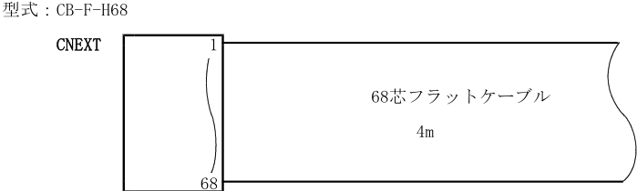

> **図の内容**
>
> 型式: CB-F-H68。CNEXT（1～68）から 68芯フラットケーブル、長さ 4m。

ケーブル側ヒロセ HIF6-68D-1.27R(20)

#### 4-6-2. CNEXT標準例

◆1.1

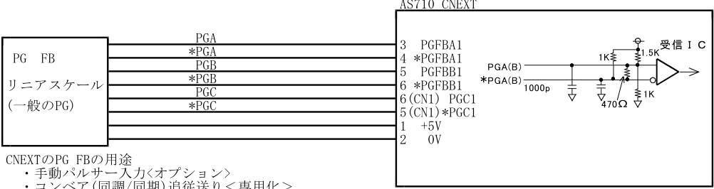

> **図の内容**
>
> 改訂マーク ◆1.1。「PG FB リニアスケール (一般のPG)」の PGA、*PGA、PGB、*PGB、PGC、*PGC、+5V、0V → AS710 CNEXT の 3 PGFBA1、4 *PGFBA1、5 PGFBB1、6 *PGFBB1、6(CN1) PGC1、5(CN1) *PGC1、1 +5V、2 0V。CNEXT 内は受信IC（1K、1K、470Ω、1000p）。CNEXTのPG FBの用途: 手動パルサー入力（オプション）、コンベア(同調/同期)追従送り＜専用化＞。

AS710 CNEXT

AS710 CNEXT

- コンベア(同調/同期)追従送り＜専用化＞

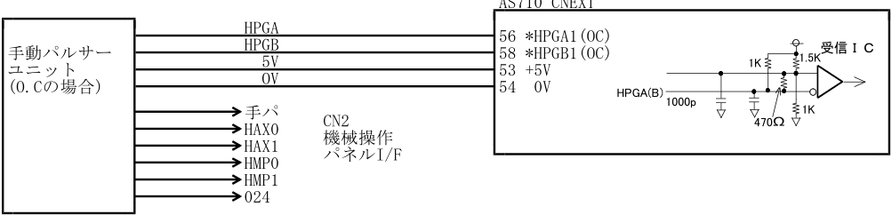

> **図の内容**
>
> 「手動パルサーユニット (O.Cの場合)」の HPGA、HPGB、5V、0V → AS710 CNEXT の 56 *HPGA1 (OC)、58 *HPGB1 (OC)、53 +5V、54 0V。CNEXT 内は受信IC。手動パルサーユニットの 手パ、HAX0、HAX1、HMP0、HMP1、024 は「CN2 機械操作パネル I/F」へ。

### 4-7. CN7 AD入力

◆1.3

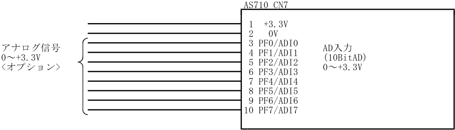

> **図の内容**
>
> 改訂マーク ◆1.3。「アナログ信号 0～+3.3V <オプション>」→ AS710 CN7 の 1 +3.3V、2 0V、3 PF0/AD10、4 PF1/AD11、5 PF2/AD12、6 PF3/AD13、7 PF4/AD14、8 PF5/AD15、9 PF6/AD16、10 PF7/AD17。AD入力 (10Bit AD) 0～+3.3V。

## 5. 電源投入/電源断(サーボON/OFF)のシーケンス

### 5-1. SLM8000 システム起動時シーケンス

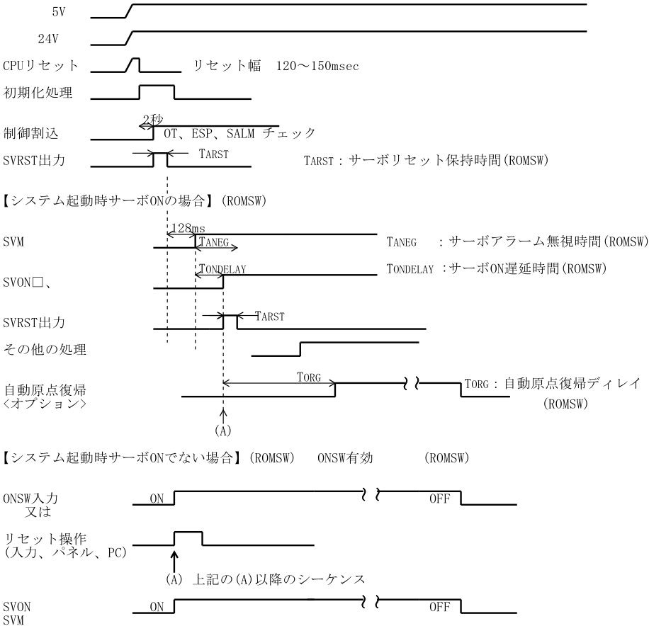

> **図の内容**
>
> タイミングチャート。読める範囲:
> - 5V、24V の立ち上がり → CPUリセット（リセット幅 120～150msec）→ 初期化処理 → 制御割込（OT、ESP、SALM チェック）
> - SVRST出力（TARST：サーボリセット保持時間(ROMSW)）
> - 【システム起動時サーボON の場合】(ROMSW): SVM（TSMSL：サーボアラーム無視時間(ROMSW)）、SVON□（TONDELAY：サーボON遅延時間(ROMSW)）、SVRST出力、その他の処理、自動原点復帰(オプション)（TORG：自動原点復帰ディレイ(ROMSW)）
> - 【システム起動時サーボON でない場合】(ROMSW): ONSW入力又は…、リセット操作(入力、パネル、PC)、SVON/SVM。(A) 上記の(A)以降のシーケンス
> 細部は小さくて判読しにくい。

※1 サーボON状態でのリセット操作では(A)以降の動作は発生せず。

### 5-2. 電源断時の処理

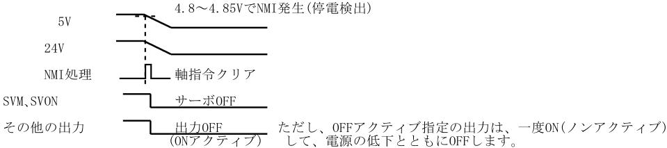

> **図の内容**
>
> タイミングチャート。5V・24V が下がり、4.8～4.85VでNMI発生(停電検出) → NMI処理で軸指令クリア → SVM、SVON はサーボOFF → その他の出力は出力OFF（ONアクティブ）。注記: ただし、OFFアクティブ指定の出力は、一度ON(ノンアクティブ)して、電源の低下とともにOFFします。

### 5-3. アラーム時の処理

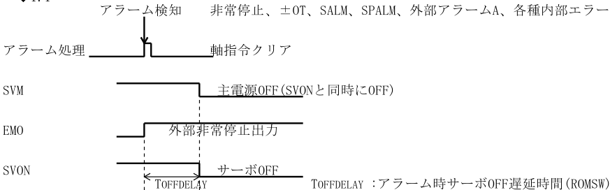

> **図の内容**
>
> タイミングチャート。アラーム検知（非常停止、±OT、SALM、SPALM、外部アラームA、各種内部エラー）→ アラーム処理で軸指令クリア → SVM は主電源OFF(SVONと同時にOFF)、EMO は外部非常停止出力、SVON はサーボOFF（TOFFDELAY 後）。TOFFDELAY：アラーム時サーボOFF遅延時間(ROMSW)。

◆1.1
