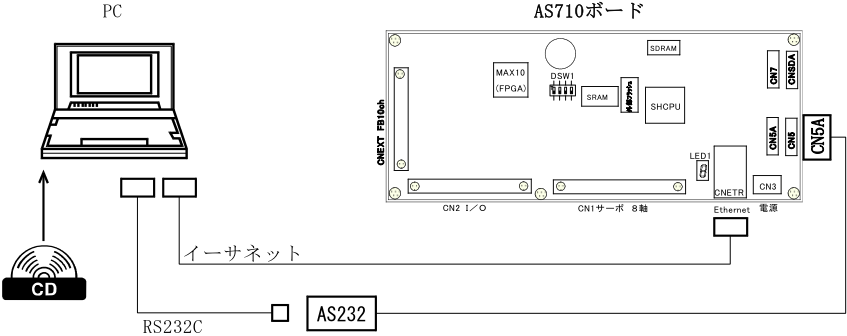
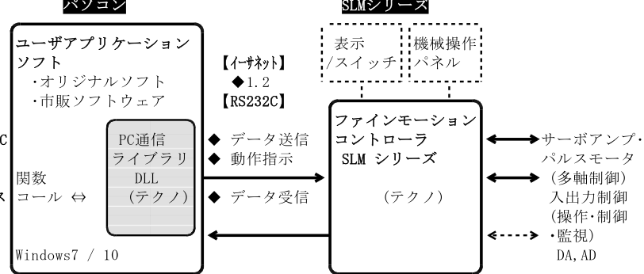
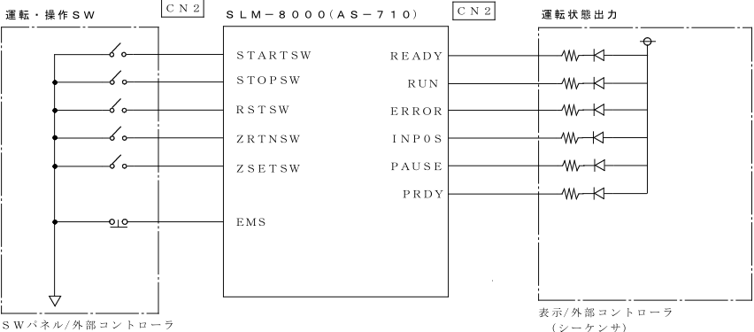
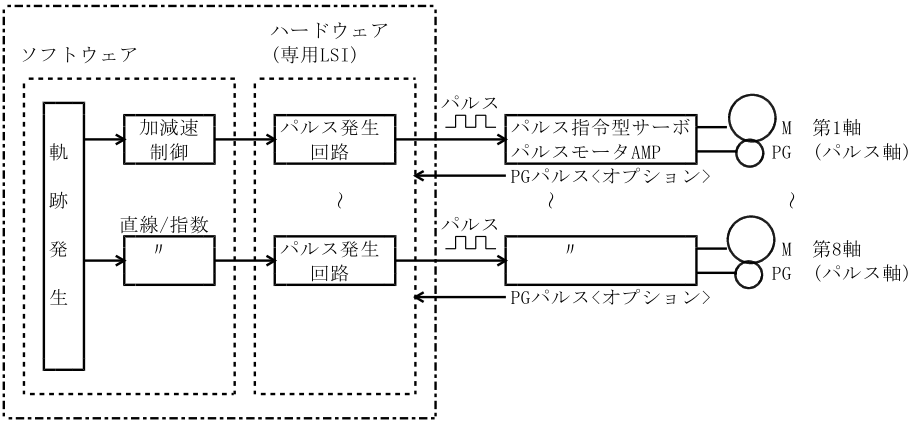
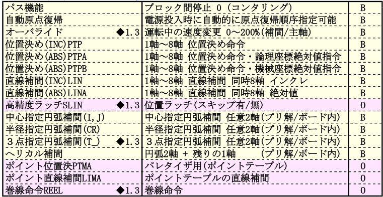
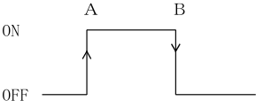
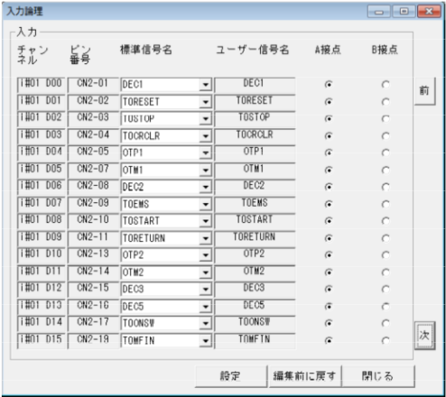
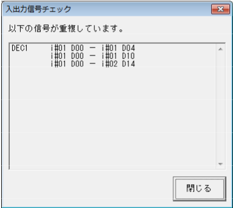

## 1. 機能概要

### 1-1. PCからの運転・操作

PCとの接続は、以下の2通りの接続方法があります。

- イーサネット通信 (CNETR)
- シリアル通信 RS232C (CN5A)
- ※ RS232C通信は2chのポートを持っています。PCと接続する場合は、CN5Aを使用します。 CN5は専用化対応で使用するため予約ポートとなっています。



> **図の内容**
>
> 「PC」（セッティングPC ソフトを CD で提供）と「AS710ボード」をつなぐ図。
> - 「イーサネット」: PC と AS710 ボードの Ethernet コネクタ（CNETR）をつなぐ
> - 「RS232C」: PC から「AS232」（変換器）を経て AS710 ボードの CN5A につなぐ
> - AS710 ボード上の部品（MAX10 FPGA、SDRAM、CN1～CN5A、LED など）が描かれている。細部の文字は小さくて判読できない箇所がある

#### 1-1-1. セッティングPCソフトによる運転

テクノの標準運転ソフト"セッティングPC"では、試運転・調整、段取り、日常運転などの全ての操作を行うことができます。

■セッティングPCソフト標準運転ソフト

|             | 機能                                                                                                             |
|-------------|-----------------------------------------------------------------------------------------------------------------|
| 表示 (モニタリング) | 位置(指令､アブソ):1軸～8軸ステータス(アラーム各種内部ステータス) 入出力モニタ(全入出力信号状態) マルチタスクマクロ変数                                            |
| 操作          | 動作モード選択(自動手動セッティング OT無視) JOG インチング原点復帰(各軸/全軸) マニュアル出力(DO) プログラム選択スタートストップオーバライドリスタートパソコンティーチング 1ショットPTP |
| 編集          | プログラム編集(＊言語プログラム(T/G)は､汎用エディタで編集) パラメータ編集ポイントデータ編集 DNC機能 CAD I/F (専用化) バックアップデータ初期化                            |

セッティングPCソフトの詳細は、「SLM8000 セッティングPCマニュアル」(TB00-1131)

を参照ください。

Ⅲ 機能編

#### 1-1-2. ユーザーアプリケーションソフトによる運転

「アプリケーションライブラリ」は、パソコンを応用して、オリジナルNCを製作していただくためのソフトウェアです。

CAD/CAM、データベース、LAN、生産管理などのソフトウェアと自由に組合せができます。

オープンシステム

簡単

リアルタイム

- ■ CAD/CAM ソフト
- ■ 生産管理･市販ソフトウェア【RS232C】
- ■ オリジナルNC
- ■ 人工知能関数 /データベースコール ⇔ (テクノ) ◆ データ受信

SLMの内部的な動作や状態を、PCソフトから指令、監視することができます。

C言語の関数コールで使用します。 NCの特別な知識は不要です。

I/O､位置､各種ステータス､各種動作の指令や監視が常時可能です。

【システム構成】



> **図の内容**
>
> - **パソコン（Windows7 / 10）**: 「ユーザアプリケーションソフト」（・オリジナルソフト ・市販ソフトウェア）が「関数コール」で「PC通信ライブラリDLL（テクノ）」を呼ぶ
> - PC通信ライブラリから「SLMシリーズ」の「ファインモーションコントローラ SLM シリーズ（テクノ）」へ、【イーサネット】◆1.2 または【RS232C】でつなぐ。やりとりは「◆データ送信」「◆動作指示」（PC → SLM）、「◆データ受信」（SLM → PC）
> - SLM シリーズには「表示/スイッチ」「機械操作パネル」（破線）がつながる
> - SLM シリーズから: サーボアンプ・パルスモータ（多軸制御）、入出力制御（操作・制御・監視）、DA、AD

【アプリケーションライブラリコマンド/機能一覧】

| 機能分類   | 機能機能分類        | 機能          |
|--------|-----------------|--------------|
| データ送信 | サーボパラメータ設定動作指示 | バックアップデータ初期化 |
| データ送信 | オプションパラメータ設定    | 動作モード設定      |
| データ送信 | 運転プログラム書込       | 軸移動停止        |
| データ受信 | サーボパラメータ読出      | 軸移動再開        |
|        | オプションパラメータ読出    | JOG移動        |
|        | 運転プログラム読出       | 原点復帰         |
|        | ポジションステータス読出    | PTP位置決め      |
|        | 入出力状態読出         | 補間指令         |
|        | 動作モード読出         | リセット         |
|        | 指令位置読出          | 原点設定         |
|        | ステータスフラグ読出      | 汎用出力直接制御     |
|        | アラームフラグ読出       | サーボ電源ON/OFF  |
|        | 送りオーバライド設定読出    | プログラム実行開始    |
|        |                 | 実行プログラム選択    |
|        |                 | 送り速度オーバライド変更 |
|        |                 | 全軸原点復帰開始     |

【パソコン接続方法】

イーサネット

RS232C

【対応OS】

Windows 7 Windows 10 ◆1.2

#### 1-1-3. イーサネット通信

CNETR

パソコン接続専用の通信ポートです。

以下は、AS710のイーサネット設定の出荷値設定です。

| IPアドレス      |   192. |   168. |   0. |   2 |
|-------------|--------|--------|------|-----|
| サブネットマスク    |   255. |   255. | 255. |   0 |
| デフォルトゲートウェイ |   192. |   168. |   0. |   1 |

イーサネット設定の変更はROMSW設定ソフトにて行います。

ROMSW設定ソフトの詳細は、

「SLM8000 ROMSW設定ソフトマニュアル」(TB00-1132) を参照ください。

#### 1-1-4. シリアル通信ポート2(RS232C 2ch) CN5A

パソコン接続専用の通信ポートです。

試運転･調整､段取り､日常運転など全ての操作が可能です。

| 転送レート                 | 19200bps                                                        |
|-----------------------|-----------------------------------------------------------------|
| 通信プロトコル               | テクノオリジナル (X-MODEM 相当)                                           |
| PC側ソフトウェア (テクノ製) ◆1.2 | セッティングPCソフト PC-AT Windows 7 / 10 PC通信ライブラリ PC-AT Windows 7 / 10 |

#### 1-1-5. シリアル通信ポート1(RS232C 1ch) CN5

多目的の通信ポートです。専用化対応で使います。

シリアル通信ポートの区別

| 使用目的             | CN5 (外側)   | CN5A 内側   |
|------------------|------------|-----------|
| セッティングPC/ROMSW設定 | ○          | ○         |
| 専用化              | (予約)       | ×         |

通常は、CN5Aを使用下さい。

○：使用可 ×：使用不可

### 1-2. 入出力信号による運転



> **図の内容**
>
> - 「運転・操作SW」（SWパネル/外部コントローラ）の接点が、CN2 を経て「SLM-8000(AS-710)」の入力 STARTSW、STOPSW、RSTSW、ZRTNSW、ZSETSW、EMS につながる
> - SLM-8000 の出力 READY、RUN、ERROR、INPOS、PAUSE、PRDY が、CN2 を経て「運転状態出力」（表示/外部コントローラ（シーケンサ））につながる

SLM8000の標準入出力の中から必要なもののみを接続して、簡単に運転できます。

このような日常運転には、PCは不要です。汎用PLC（シーケンサ）から、IOによる運転もできます。

### 1-3. サーボ制御（軸制御）

パルス指令軸制御については、パルス指令形サーボとパルスモータでは、ほとんど同一です。このマニュアルでは、パルスモータも含めてサーボ制御と呼びます。

- サーボ(軸)制御のブロック図

SLM8000 軸制御



> **図の内容**
>
> - **ソフトウェア**: 「軌跡発生」から、第1軸～第8軸それぞれの「加減速制御」「直線/指数」
> - **ハードウェア（専用LSI）**: 各軸の「パルス発生回路」が「パルス」を出す
> - 各軸の「パルス指令型サーボ／パルスモータAMP」がモータ(M) を動かし、「PGパルス（オプション）」が戻る
> - 第1軸（パルス軸）～第8軸（パルス軸）

- (1) パルス指令軸制御 (第1軸～第8軸)

パルス信号によりサーボ制御をおこないます。(サーボアンプ/パルスモータ)

パルス量＝移動量

パルス周期＝移動速度

サーボアンプやパルスモータアンプを制御するための入出力や機能を全て、 SLMに内在しています。

### 1-4. SLM8000 機能リスト

各機能を以下のように分類して記述します。

B:標準

O:オプション

S:専用化

開:開発中

PC:パソコン操作

#### 1-4-1. SLM8000本体機能リスト

◆1.3

軸制御

| 機能 | 内容 | 区分 |
|---|---|---|
| 直線加減速 | PTP、JOG送りの加減速 | B |
| 指数形補間加減速 | 補間送りの加減速 | B |
| 直線形補間加減速 | 補間送りの加減速 | O |
| S字補間加減速 | 補間送りの加減速 | O |
| 補間前加減速（自動コーナオーバライド） | 軌跡発生より手前の加減速 | O |

加減速制御

| 直線加減速指数形補間加減速直線形補間加減速 S字補間加減速補間前加減速 (自動コーナオーバライド)   | PTP､JOG送りの加減速補間送りの加減速補間送りの加減速補間送りの加減速軌跡発生より手前の加減速   | B B O O O   |
|--------------------------------------------------------|---------------------------------------------------------|-------------|

自動送り(運転プログラム、PC コマンド)



> **図の内容**
>
> 区分: B:標準、O:オプション（原本の「O」）。◆ は改訂マーク。
>
> | 機能 | 内容 | 区分 |
> |---|---|---|
> | パス機能 | ブロック間停止 0（コンタリング） | B |
> | 自動原点復帰 | 電源投入時に自動的に原点復帰順序指定可能 | B |
> | オーバライド ◆1.3 | 運転中の速度変更 0～200%（補間/主軸） | B |
> | 位置決め(INC)PTP | 1軸～8軸 位置決め命令 | B |
> | 位置決め(ABS)PTPA | 1軸～8軸 位置決め命令・論理座標絶対値指令 | B |
> | 位置決め(ABS)PTPB | 1軸～8軸 位置決め命令・機械座標絶対値指令 | B |
> | 直線補間(INC)LIN | 1軸～8軸 直線補間 同時8軸 インクレ | B |
> | 直線補間(ABS)LINA | 1軸～8軸 直線補間 同時8軸 絶対値 | B |
> | 高精度ラッチSLIN ◆1.3 | 位置ラッチ（スキップ有/無） | O |
> | 中心指定円弧補間(I,J) | 中心指定円弧補間 任意2軸（プリ解/ボード内） | B |
> | 半径指定円弧補間(CR) | 半径指定円弧補間 任意2軸（プリ解/ボード内） | B |
> | ３点指定円弧補間(T_) ◆1.3 | ３点指定円弧補間 任意2軸（プリ解/ボード内） | B |
> | ヘリカル補間 | 円弧2軸 + 残りの1軸（プリ解/ボード内） | B |
> | ポイント位置決PTMA | パレタイザ用（ポイントテーブル） | O |
> | ポイント直線補間LIMA | ポイントテーブルの直線補間 | O |
> | 巻線命令REEL ◆1.3 | 巻線命令 | O |

主軸制御

| 機能 | 内容 | 区分 |
|---|---|---|
| 主軸 ON/OFF | ON/OFF, CW/CCW | O |
| Ｓ5桁/主軸アナログ指令 | 主軸アナログ指令(要DA001) | O |

補正制御

| B.L 補正     | バックラッシュ補正         | B   |
|------------|-------------------|-----|
| P.E 補正     | ピッチエラー補正          | O   |
| 工具長補正 ◆1.2 | 任意の1軸で工具長のオフセット   | O   |
| 工具摩耗補正     | 同オフセットの変化量        | 開   |
| 工具径補正      | 工具径の補正            | O   |
| 形状補正       | 高精度輪郭制御、位置ループ遅れ補正 | O   |

座標系

| 機能 | 内容 | 区分 |
|---|---|---|
| 原点設定 | 論理座標系のセット | B/PC |
| 論理座標/アブソ座標 | | B |

運転プログラム

| メモリ運転      | 64ブロック (58ステップ/ブロック)   | B    |
|------------|------------------------|------|
| サブプロ       | サブルーチンプログラム            | B    |
| 回数指定CALL   | サブプロの回数指定のCALL         | B    |
| DNC運転      | RS232C通信/イーサネット        | O/PC |
| マルチタスク     | 8タスク並列動作               | O    |
| マクロ        | 変数､四則演算､条件判断           | O    |
| フレキシブル電子カム | テーブル方式 (切換可)           | 開    |

保護機能

| 疑似アブソ    | 電源断時の位置を記憶   | B   |
|----------|--------------|-----|
| ソフトリミット  |              | B   |
| ハードリミット  | OT入力         | B   |
| サーボ主電源制御 |              | B   |

共通入力信号

汎用入力(Ri0～34)

タスク毎入力信号 ◆1.3

非常停止 ONSW MOK MFIN

リセット停止起動外部アラーム原点設定リワインド

オプショナルストップ MP有効各種モード選択(9)

手パ倍率(4) 手パ軸選択(4) JOG軸選択(8)

全体オーバライド(8) 補間オーバライド(8) 主軸オーバライド(8)

実行P番号(16) 主軸アラーム

※数字はbit数

共通出力信号

汎用出力(Ro00～30)

タスク毎出力信号 ◆1.3

SVM(サーボ主電源)主軸出力0/1 MSTRB M0～M7

READY ALARM RUN PAUSE

INPOS PRDY M00停止中 MODE0～2

主軸SVON 主軸リセット非常停止出力

通信機能

| 機能 | 内容 | 区分 |
|---|---|---|
| RS232C 1ch | 多目的（シーケンサ等） | B |
| RS232C 2ch | PC用 | B |
| イーサネット | PC用 | B |

通信応用

| セッティングPC      | RS232C /イーサネット   | B   |
|---------------|------------------|-----|
| アプリケーションライブラリ | RS232C /イーサネット   | B   |
| RS232Cテキスト    | テキストコマンドプロトコル    | B   |
| シーケンサ接続(M)    | Mコード(8bit))      | B   |

#### 1-4-2. 機械操作パネル機能リスト

◆1.3

機械操作パネルイメージ入力 (タスク毎)機能リスト

詳細は、<2-1-5.機械操作パネル入力>を参照下さい。

| 分類      | 機能名称                                                                                                              | 内                                                                   | 容                                                   |    |
|----------|----------------------------------------------------------------------------------------------------------------------|---------------------------------------------------------------------|-----------------------------------------------------|----|
| 機械操作パネル | T□MP_HSEL0～3 T□MP_INCH0～3 T□MP_OVR0～7 T□MP_COVR0～7 T□MP_SOVR0～7 T□MP_MDAUTO～ T□MP_ENABLE T□MP_AXSEL0～7 T□MP_PSEL0～15 | 手パ軸選択手パ倍率オーバーライド補間オーバライド主軸オーバライド動作モード(9種) パネル有効/無効軸動作プログラム選択 | (bit/code仕様) (bit/code仕様) (bit/code仕様) (bit/code仕様) | B  |

#### 1-4-3. セッティングPC機能リスト

セッティングPCの機能リスト(代表的な機能)です。

詳細は、「SLM8000 セッティングPCマニュアル」(TB00-1131)を参照下さい。

| 分類         | 機能名称                                                                                     | 内容                                                                                                                                                         | PC                      |
|-------------|---------------------------------------------------------------------------------------------|-------------------------------------------------------------------------------------------------------------------------------------------------------------|-------------------------|
| モニタリング     | 各軸位置表示ステータス表示入出力モニタ                                                                       | 指令位置､機械位置､アブソ位置､偏差量､相対移動量アラーム、その他ステータス入出力信号のモニタ機能(I/O表示) 入出力信号の強制制御                                                                                      | B B B                   |
| 操作          | JOG インチング原点復帰(各軸) 原点復帰(全軸) Mコード出力 P選択スタート/ストップリスタート機能トレーストレース（逆行) パソコンティーチング 1ショット位置決め | 手動送り(各軸) ×1､×10､ ×100､ ×1000 パルス送り手動 Mコード出力プログラム選択起動/停止指令 S点設定(プログラム途中からのスタート) 連続・シングルプログラム編集時模擬実行逆行ｼングル同上の逆行動作プログラム編集時のティ-チング動作による入力位置決め/直線補間の単独指令 | B B B B B B B S 開開開 B |
| 編集運転プログラム | プログラム編集 ※1 パラメータ編集バックアップ初期化ポイントデータ編集 ※2 G92 G54関係の処理 DNC PE補正データ工具長補正データ工具径補正データ軸単位系変換 | テクノコード/Gコード表形式編集 SLM8000内メモリーのクリアーポイントデータワーク座標系設定(1つ) ワーク座標系関連(複数) DNC運転指令/検出単位換算                                                                       | B B B 開 B S O O O O S   |

- ※1 テキストプログラム(テクノ/Gコード)は、汎用エディタで編集可能です。
- ※2 ポイントデータは、汎用エディタで編集可能です。

#### 1-4-4. 通信コマンド機能リスト(PC)

PC運転(アプリケーションライブラリ)の機能リスト(代表例)です。

詳細は、「SLM8000 送受信データマニュアル」(TB00-1134)を参照ください。

| 機能分類   | 機能                  | LIB   |     |
|--------|----------------------|-------|-----|
|        | サーボパラメータ書込           |       | B   |
|        | オプションパラメータ書込         |       | O   |
| データ送信  | 運転プログラム書込            |       | B   |
|        | DNCデータ書込             |       | O   |
|        | ピッチエラー補正用パラメータ書込     |       | O   |
|        | 工具長補正データ書込           |       | O   |
|        | 工具径補正データ書込           |       | O   |
|        | 絶対値エンコーダオフセット書込      | ◆1.3  | B   |
|        | サーボパラメータ読出           |       | B   |
|        | オプションパラメータ読出         |       | O   |
|        | 運転プログラム読出            |       | B   |
|        | ポジション・ステータス読出        |       | B   |
|        | 入出力状態読出              |       | B   |
| データ受信  | 動作モード読出              |       | B   |
|        | 指令位置読出               |       | B   |
|        | ステータスフラグ読出           |       | B   |
|        | アラームフラグ読出            |       | B   |
|        | オーバーライド読出            |       | B   |
|        | プログラム実行情報読出          |       | B   |
|        | DNCバッファ情報読出          |       | O   |
|        | ピッチエラー補正用パラメータ読出     |       | O   |
|        | センサーラッチ位置情報読出        |       | B   |
|        | 工具長補正データ読出           |       | O   |
|        | 工具径補正データ読出           |       | O   |
|        | 送りオーバーライド %読出        |       | B   |
|        | TPCロギング情報読出          |       | B   |
|        | TPCロギングデータ読出         |       | B   |
|        | プログラム1ステップデータ読出      |       | B   |
|        | 絶対値エンコーダオフセット読出      | ◆1.3  | B   |
|        | バックアップデータ初期化         |       | B   |
|        | 動作モード設定              |       | B B |
|        | 軸移動停止                |       |     |
|        | 軸移動再開 JOG移動          |       | B B |
|        | 原点復帰                 |       | B   |
|        | インクレPTP位置決め          |       | B   |
|        | アブソPTP位置決め           |       | B   |
|        | インクレ補間位置決め           |       | B   |
|        | アブソ補間位置決め            |       | B   |
| 動作指示   | リセット                 |       | B   |
|        | 原点設定                 |       | B   |
|        | 汎用出力直接制御             |       | B   |
|        | サーボ電源ON              |       | B   |
|        | サーボ電源OFF             |       | B   |
|        | プログラム実行開始            |       | B   |
|        | プログラム実行停止            |       | B   |
|        | 実行プログラム選択            |       | B   |
|        | 送りオーバーライド変更          |       | B   |
|        | 全軸原点復帰開始             |       | B   |
|        | 高速センサーラッチインクレ補間位置決め | <OP>  | O   |
|        | 高速センサーラッチアブソ補間位置決め  | <OP>  | O   |

| 機能分類   | 機能               | 機能               | LIB   |
|--------|-------------------|-------------------|-------|
| 動作指示   | 汎用入力一括強制制御        | 汎用入力一括強制制御        | B     |
| 動作指示   | 汎用出力一括強制制御        | 汎用出力一括強制制御        | B     |
| 動作指示   | 汎用入出力強制制御         | 汎用入出力強制制御         | B     |
| 動作指示   | 送りオーバーライド %変更     | 送りオーバーライド %変更     | B     |
| 動作指示   | TPCデータ選択          | TPCデータ選択          | B     |
| 動作指示   | TPCデータロギング ON/OFF | TPCデータロギング ON/OFF | B     |
| 動作指示   | 主軸回転ON/OFF        | <OP>              | O     |
| 動作指示   | 回転軸回転動作指令         | 回転軸回転動作指令         | B     |
| 動作指示   | Z軸接線制御ON/OFF      | <OP>              | O     |
| 動作指示   | シングルステップモード設定     | シングルステップモード設定     | B     |
| 動作指示   | ティーチング設定          | ティーチング設定          | 開     |
| 動作指示   | プログラムステップ挿入       | プログラムステップ挿入       | 開     |
| 動作指示   | プログラムステップ置換       | プログラムステップ置換       | 開     |
| 動作指示   | プログラムステップ削除       | プログラムステップ削除       | 開     |

アプリケーションライブラリオプション Windows 7 / 10 ◆1.2

| オプション機能                        | 機能             |                              |
|--------------------------------|-----------------|------------------------------|
| アプリケーションライブラリ SLM8000COMNT.DLL |                 | SLM8000との通信で使用               |
| テクノコード変換ライブラリ SLM8000TCNV.DLL  | テクノコードテキスト変換処理 | テクノコード仕様テキストプログラムの変換/逆変換で使用 |
| Gコード変換ライブラリ SLM8000GCNV.DLL    | Gコードテキスト変換処理   | Gコード仕様テキストプログラムの変換/逆変換で使用   |

これらのオプションライブラリは、アプリケーションライブラリにより「オリジナルNC」をユーザ開発する時のみ使用します。

セッティングPCによる応用では、使用しません。

### 1-5. SLM8000 基本仕様

◆1.3

SLM8000の基本仕様を整理します。

〈OP）:オプション

| 分類         | 項目                      | 仕様                                                              |
|------------|-------------------------|-----------------------------------------------------------------|
| 基本仕様       | 座標値                     | ±1000000000                                                     |
| 基本仕様       | 速度                      | 1pps～1Gpps                                                      |
| 基本仕様       | 実行タスク                   | 最大8本〈OP）                                                       |
| 基本仕様       | 制御周期                    | 0.5～8msec                                                       |
| 基本仕様       | 軸数                      | 最大8軸 (論理軸は、9軸/タスク) (仮想軸も含む)                                     |
| 基本仕様       | 座標系                     | 機械座標系、論理座標系                                                     |
| 基本仕様       | オーバライド                  | 0～200%                                                          |
| 基本仕様       | 同時補間                    | 8軸/タスク                                                          |
| 基本仕様       | 最小連続補間                  | 制御周期時間(0.5msec～)                                                |
| 基本仕様       | センサーラッチ遅れ時間             | 立ち上がり時：3μs 〈OP）立ち下がり時：73μs                                     |
| 加減速        | 加減速(補間後の各軸)             | 指数形加減速直線形補間加減速〈OP） S字加減速〈OP）                                 |
| 加減速        | 補間前加減速 (自動コーナオーバライド)    | 判定6段階                                                           |
| 運転プログラム   | 運転プログラム                 | 64ブロック 1ブロック :58ステップ 1プログラム :1～32ブロック                           |
| 運転プログラム   | テクノ言語 G言語               | <6.運転プログラム詳細>(TB00-1130F) を参照下さい。                               |
| 運転プログラム   | タイマー命令                  | TIM 0.1～2147483.6 0.1秒単位 TM 1～2147483648 制御周期単位                 |
| 運転プログラム   | CALL命令                  | 最大20ネスト同一プログラム内のみ                                              |
| 運転プログラム   | 同時入力判別                  | 同一命令内 4入力                                                       |
| 運転プログラム   | 同時出力                    | 同一命令内 4出力 (Ro□□命令) 16bit(マクロ変数方式)                               |
| 入出力        | 論理入力点数                  | タスク毎一般:11/タスク汎用:64                                             |
| 入出力        | 機械パネル入力                 | 67点×8タスク                                                        |
| 入出力        | 軸関連I/O                  | 入力:(±OT、DEC)×8                                                  |
| 入出力        | 論理出力点数                  | タスク毎一般:10/タスク汎用:64 共通:SVM、SOUT1/2                              |
| 入出力        | Mコード                    | 出力:8点 +MSTRB 入力:MFIN、MOK                                        |
| 補助データ      | ポイントテーブル〈OP)            | 400点/タスク ×8                                                     |
| 補助データ      | ピッチエラー補正〈OP)            | 4160点/全指定軸間隔1000～1000000p 補正値:±127(×1～×10)                     |
| 補助データ      | 工具長補正〈OP)              | ±1000000000 20点 ×8タスク                                           |
| 補助データ      | 工具径補正〈OP)              | ±1000000000 20点 ×8タスク                                           |
| 補助データ      | DNCの速度〈OP) 連続可能な最短ステップ | イーサネット5～8msec(目安) DLL :制御周期単位                                   |
| マクロ機能〈OP） | 演算                      | × ÷ + - 剰余 AND OR XOR シフトL/R 大小比較                               |
| マクロ機能〈OP） | 値                       | 整数 32bit/16bit                                                  |
| マクロ機能〈OP） | グローバル変数                 | 200個                                                            |
| マクロ機能〈OP） | ローカル変数                  | 200個×8タスク                                                       |
| マクロ機能〈OP） | その他の変数                  | ステータス入力ポート4 出力ポート3 サーボパラメータ、工具長補正、ポジション、 HEX入力、軸インターロック、軸ネグレクト |

| 分類     | 項目                         | 仕様                             |
|--------|----------------------------|--------------------------------|
| サーボ    | INPOS                      | 0～1Gp G:ギガ 10の9乗               |
| パラメータ  | 偏差上限値                      | 1～1Gp                          |
|        | MPOS偏差上限                   | 1～1Gp                          |
|        | 補間加減速指数形直線形              | 0～1000msec 0～2000×RTC(msec) ※1 |
|        | S字時定数                      | 0～1000×RTC(msec) ※1            |
|        | PTP時定数                     | 0～32767msec                    |
|        | PTP速度                      | 最小値～1Gpps ※2                   |
|        | JOG速度                      | 最小値～1Gpps ※2                   |
|        | ±ソフトリミット                   | 1000～1Gp                       |
|        |                            | -1Gp～+1Gp                      |
|        | 原点距離原点復帰早送り速度原点復帰アプローチ速度 | 最小値～1Gpps ※2 最小値～1Gpps ※2      |
|        | 原点復帰最終サーチ速度                | ※2                             |
|        | バックラッシュ補正量                 | 最小値～1Gpps 0～3000p              |
| 手動操作   | 接線制御上限速度インチング             | 最小値～1Gpps ※2 ×1、×10,×100,×1000 |
| セッティング | POS表示桁数                    | 全9桁小数以下:0～5桁(設定可)             |
| PC     | POS軸名称                     | 英/漢字 1～2文字 9軸表示/画面             |
|        | TPCロギングデータ                 | 2座標(指令/FB)×4096点               |

- ※1 直線型補間加減速の時定数:0～2000×RTC(msec) S字加減速の時定数 :0～1000×RTC(msec)
- ※2 最小値は制御周期の設定で変わります 1000 / RTC(msec) pps は pulse/sec です。

機能リスト（機械操作パネル）

| 分類       | 機能 NO   |      | 機                   | 能   | 名   | 称   | 内容                                                                                                    | テクノコード仕様   | G コード仕様   | 開発中   |
|-----------|----------|------|---------------------|-----|-----|-----|--------------------------------------------------------------------------------------------------------|---------------|------------|---------|
| 17 パネル機能 |          | 17-1 | CH1 CH2 CH3 CH4 CH5 |     |     |     | 手パ軸選択 (bit/code仕様) 手パ倍率オーバーライド (bit/code仕様) 動作モードパネル有効/無効原点設定軸動作 (bit/code仕様) プログラム選択 (bit/code仕様) | Ｏ             | Ｏ          |         |

## 2. 入出力機能

ここでは以下の入出力を説明します。(一般的に使用する入出力です) ここで説明している信号以外の入出力及びコネクタの電気的/物理的仕様については、 <Ⅱハード編>を参照下さい。

- ※ SLM内部には、SLMが持っている入出力ピン数（入力35点、出力30点）

以上の標準入出力が論理定義されています。

論理定義された標準入出力を、お客様が必要に応じて選択していただき、物理的に持っている入出力ピンに割り当てて御使用いただけます。出荷時には、デフォルトの入出力割り当てを行っておりますので、特に必要なけ

ればそのまま御使用いただけます。

### 2-1. 入力信号の名称と機能

2-1-1. 一般入力

| 標準信号名称                | 機能説明                                                                                                                                                                                         |
|-----------------------|-------------------------------------------------------------------------------------------------------------------------------------------------------------------------------------------------|
| T□RESET (リセット) 【エッジ】  | 【実行条件】・常時【動作結果】・アラームの解除と自動運転/軸移動などの動作を中断します。・Gコード仕様では、自動運転は途中終了状態となります。・テクノコード仕様では、自動運転は通常の終了状態となります。・サーボOFF状態でアラーム要因が全て解除されている場合は、サーボONします。                                             |
| T□STOP (ストップ) 【エッジ】   | 【実行条件】・サーボON状態【動作結果】・以下の状態であれば動作を一時停止します。(再開可) 自動運転中、主軸動作中、通信コマンドによる移動中・原点復帰中は、原点復帰を中断します。(再開不可)                                                                                            |
| T□CRCLR (原点設定) 【エッジ】  | 【実行条件】・サーボON状態・動作モードが手動運転モード/自動運転モード/DNC運転モード・運転プログラム未実行又はティーチング中又はM0停止中・移動中の軸がない・手動パルサー選択無効(手動モード) ・各種シーケンス完了【動作結果】・現在位置を論理座標系原点とします。                                                   |
| T□REWND (リワインド) 【エッジ】 | 【有効条件】・ROMSWで「Gコード途中再開」を選択【実行条件】・選択中運転プログラムがGコード仕様【動作結果】・自動運転の途中終了状態をクリアします。途中終了状態は、自動運転をリセットで中断したとき、またはアラームで異常終了したときになります。途中終了状態で、自動運転の起動を行うと、前回中断したステップの直前のシーケンスNO.付のステップから実行を開始します。 |

| 標準信号名称                              | 機能説明                                                                                                                                                                                                                                                                                                |
|-------------------------------------|--------------------------------------------------------------------------------------------------------------------------------------------------------------------------------------------------------------------------------------------------------------------------------------------------------|
| T□EMS (非常停止) 【レベル】                  | 【実行条件】・常時【動作結果】・非常停止アラームになります。・サーボOFF ・自動運転/軸移動などの動作を中断します。・各種シーケンス中断します。                                                                                                                                                                                                                         |
| EMS (全タスク非常停止) 【レベル】                | 全タスク同時に非常停止とします。機能は「T□EMS」と同じです。                                                                                                                                                                                                                                                                      |
| T□RETURN (原点復帰) 【レベル】               | 【実行条件】・サーボON状態・アラーム無し・動作モードが手動運転モード/自動運転モード/DNC運転モード・プログラム実行待機状態・手動パルサ無効・移動中の軸がない・各種シーケンス完了状態【動作結果】                                                                                                                                                                                            |
| T□START (スタート) 【エッジ】                | ・全軸の原点復帰動作を開始します。【実行条件】 A.自動/DNCモードの場合・サーボON状態・アラーム無し・移動中の軸がない・各種シーケンス完了・ティーチング中でない・プログラム実行待機状態(開始時)/停止中(再開時) B.手動モードで原点復帰モードの場合・サーボON状態・アラーム無し・手動パルサ無効・移動中の軸がない・各種シーケンス完了状態・プログラム実行待機状態【動作結果】 A.自動/DNCモードの場合自動運転の起動を行います。自動運転が停止中の場合は、運転の再開を行います。 B.手動モードで原点復帰モードの場合全軸の原点復帰動作を開始します。 |
| T□VCAMSON                           | 電子カムサイクル(繰り返し)入力 <開発中>                                                                                                                                                                                                                                                                                 |
| T□ONSW (オンスイッチ) ON :【エッジ】 OFF:【レベル】 | 【有効条件】・ROMSWでONSWを選択した場合【実行条件】・OFFは、常時・ONは、アラーム無し・サーボOFF 【動作結果】 ON :サーボOFF状態であれば、サーボ電源ON (但し、サーボOFFエラー発生時はサーボOFFします。) サーボOFFエラーは、非常停止/サーボアラーム/サーボ電源OFF/外部アラームA /ROMSWでOT時サーボOFFを選択した場合のOT OFF :サーボ電源OFF                                                                                          |

| 標準信号名称 ONSW (全タスクオンスイッチ) ON :【エッジ】 OFF:【レベル】   | 機能説明全タスク同時のオンスイッチです。機能は「T□ONSW」と同じです。                                                  |
|-------------------------------------------------|---------------------------------------------------------------------------------------------|
| T□EXTALMA (外部アラームA) (サーボOFF) 【レベル】              | 【実行条件】・常時【動作結果】・サーボOFFして、外部アラーム状態Aとなります。 (軸動作不可)                                         |
| T□EXTALMB (外部アラームB) (緊急停止) 【レベル】                | 【実行条件】・常時【動作結果】・緊急停止して、外部アラーム状態Bとなります。 (軸動作不可)                                           |
| T□EXTALMC (外部アラームC) (通常停止) 【レベル】中断は【エッジ】       | 【実行条件】・常時【動作結果】・補間は減速停止、PTP/JOGは緊急停止して、外部アラーム状態Cとなります。ただし、外部アラームC中でも、再度スタートやJOGは、可能です。 |
| OTP1 ～ OTP8 OTM1 ～ OTM8 (オーバートラベル)              | 各軸の+方向/-方向のストロークリミットです。本入力がONになると、ハードOTアラーム状態となり、自動運転/軸移動等、全ての動作を中断し、サーボOFFします。（出荷時はA接）   |
| DEC1 ～ DEC8 （原点入力）                              | 各軸の機械原点位置(付近)です。 SLMは、本入力を基に原点位置への位置決めを行います。                                                |
| SENSE (スキップ割り込み)                                | 外部センサによる、移動の中断(スキップ)を行う際に使用します。 SLMは移動の中断と同時にセンサ入力位置の記憶を行います。本入力は、コネクタCN2の80番ピン固定です。       |

#### 2-1-2. サーボ入力

| 標準信号名称                                           | 機能説明                                                                                  |
|--------------------------------------------------|------------------------------------------------------------------------------------------|
| SALM1 ～ SALM8 （サーボアラーム）                          | サーボドライバ内部でアラームが発生していることを示します。                                                            |
| T□SPALM （主軸アラーム）                                 | 主軸ドライバ内部でアラームが発生していることを示します。                                                             |
| ◆1.3 ABS_BSY ABS_DATA0 ABS_DATA1 （三菱絶対値エンコーダ読出） | 三菱絶対値エンコーダの現在位置を読出します。全ての軸で共通に使用します。複数の軸の三菱絶対値エンコーダを使用する場合、複数のサーボアンプから同じPinに配線してください。 |

#### 2-1-3. 補助機能入力

| 信号名称                       | 機能説明                                                                                                                                                                                                                                                                |
|----------------------------|---------------------------------------------------------------------------------------------------------------------------------------------------------------------------------------------------------------------------------------------------------------------|
| T□MFIN (Mコード読取完了) 【エッジ】    | 【説明】・外部機器よりSLM8000へ、補助機能(Mコード)の実行完了を通知します。詳細は、 <Ⅲ機能編 6-1-10-1.Mコード出力>(TB00-1130F) を参照して下さい。【実行条件】・MSTRB出力のON中(Mコードシーケンス中) 【動作結果】                                                                                                                               |
| T□MOK (Mコード正常終了) 【レベル】     | ・MSTRB出力をオフし、Mコードシーケンスが終了します。【説明】・補助機能(Mコード出力)にて、外部機器よりMFINを受け取った時この信号をチェックして、Mコードが正常に完了したかを判別します。詳細は、 <Ⅲ機能編 6-1-10-1.Mコード出力>(TB00-1130F) を参照して下さい。【有効条件】・ROMSWでMOK入力を選択した場合【動作結果】・MFINのON時、MOKがOFFの場合はMコード実行エラーになります。 (更に、プログラム実行中の場合はプログラム実行エラーにもなります。) |
| T□MOPT (オプショナルストップ) 【レベル】 | 【有効条件】・ROMSWで｢M00/M01停止｣を選択【実行条件】・M00/M01コード実行時にチェックします。【動作結果】・ON中は、M01命令で停止します。                                                                                                                                                                               |

#### 2-1-4. 汎用入力

| 信号名称              | 機能説明                                                                     |
|-------------------|--------------------------------------------------------------------------|
| Ri0 ～ Ri34 （汎用入力） | 運転プログラムの中で、条件判別に使用します。 W WAIT 処理待ち S STOP 途中停止 J スキップスキップ動作 E EXIT 強制終了 |

#### 2-1-5. 機械操作パネル入力(ダイレクト)

機械パネル入力は、タスク毎にあります。以下で説明する機械パネル入力の説明(条件や動作)は、全てタスク内の事になります。

| T□MP_HSEL 0～3 (手パ軸選択)                                                  | 軸コードと選択軸と MPHSEL3 の対応はROMSW設定 OFF ソフトにて設定します。                                                                              | MPHSEL1                                    | MPHSEL2 MPHSEL0 OFF   |           | 軸コード                                        |                      |
|------------------------------------------------------------------------|-----------------------------------------------------------------------------------------------------------------------------|--------------------------------------------|-----------------------|-----------|---------------------------------------------|----------------------|
|                                                                        | ～ ON                                                                                                                        | OFF (4bitコード) ～                            | OFF ON ON             |           | 0 ～ 15                                      | ON                   |
| T□MP_INCH 0～3 (手パ倍率/                                                   |                                                                                                                             | MPINCH2                                    | MPINCH3 MPINCH1       |           | MPINCH0                                     |                      |
|                                                                        | 手動パルサモード倍率                                                                                                                 | ×100                                       | ×1000 ×10             |           | ×1                                          |                      |
| インチング送り量)                                                             | インチングモードパルス                                                                                                                |                                            | 1000                  |           |                                             |                      |
| T□MP_OVR 0～7 (全体/PTPオーバライド)                                            | 【bit仕様】 MPOVR7～MPOVR0:200%,175%,～,25%(25%ステップ) 全ビットOFF時は無効。(PCからの指定が有効) 【code仕様】8ビットバイナリーデータで0～200%を選択。有効範囲外の時はPCによる選択が有効。 | 100                                        | 10                    |           | 1                                           |                      |
|                                                                        | 全体オーバライドのときは、全体。3種で区別する場合は、PTP/JOG                                                                                          |                                            |                       |           |                                             |                      |
| T□MP_COVR 0～7 (補間オーバライド)                                               | 【bit仕様】 MP_COVR7～MP_COVR0:200%,175%,～,25%(25%ステップ) 全ビットOFF時は無効。(PCからの指定が有効)                                                 |                                            |                       |           |                                             |                      |
| T□MP_SOVR 0～7                                                          | 【code仕様】8ビットバイナリーデータで0～200%を選択。                                                                                             | MP_SOVR7～MP_SOVR0:200%,175%,～,25%(25%ステップ) | 有効範囲外の時はPCによる選択が有効。   |           |                                             |                      |
| (主軸オーバライド)                                                             | 【bit仕様】                                                                                                                     | 全ビットOFF時は無効。(PCからの指定が有効)                   |                       |           |                                             |                      |
|                                                                        | 【code仕様】8ビットバイナリーデータで0～200%を選択。                                                                                             |                                            |                       |           |                                             |                      |
| T□MP_MDSET T□MP_MDAUTO T□MP_MDDNC                                      |                                                                                                                             |                                            |                       |           | :全軸自動原点復帰                                   |                      |
| T□MP_MDSNGL T□MP_MDZRN T□MP_MDJOG T□MP_MDINCH T□MP_MDHNDL T□MP_MDOTDIS | 有効範囲外の時はPCによる選択が有効。セッティングモード連続運転モード DNCモードシングルステップモード STRTSW入力                                                           | 可能です。 (方向によってはJOG)                         |                       |           | ※原点復帰モード時は以下の動作が軸動作入力(MPAXSEL):各軸手動原点復帰 ※1 |                      |
| (モード選択)                                                                | 原点復帰モード JOGモードインチングモード手動パルサモード                                                                                            |                                            |                       |           |                                             |                      |
|                                                                        | OT無視モード                                                                                                                     |                                            |                       |           |                                             |                      |
| (ティーチング) <開発中>                                                         | 自動モードかつ運転プログラムがステップ間で一時停止中の場合、                                                                                              |                                            |                       |           |                                             |                      |
|                                                                        | ONでティーチングモード、OFFでティーチング解除                                                                                                   |                                            |                       |           |                                             |                      |
|                                                                        | 7 6 5                                                                                                                       | 2 1                                        | 4 3 0                 |           |                                             |                      |
| 動作開始                                                                   | -A +A -Z                                                                                                                    | +Y -X                                      | +Z -Y                 |           |                                             |                      |
|                                                                        | (JOG、各軸手動、原点復帰､インチング) 【bit仕様】                                                                                               |                                            |                       |           | ※1                                          |                      |
| T□MP_AXSEL0～7(軸動作) 軸移動の立上がりエッジで                                        | +X～-A:各軸移動                                                                                                                  |                                            |                       |           |                                             |                      |
|                                                                        | この入力がONの時のみ、この表の機械操作パネル関連が有効となります。                                                                                          |                                            |                       |           |                                             |                      |
|                                                                        |                                                                                                                             |                                            | +X                    |           |                                             |                      |
| T□MP_TEACH                                                             |                                                                                                                             |                                            |                       |           |                                             |                      |
| T□MP_ENABLE(パネル有効)                                                     |                                                                                                                             |                                            |                       | ～         |                                             |                      |
|                                                                        |                                                                                                                             |                                            | ON                    | 第9軸       |                                             |                      |
|                                                                        | 移動移動 ※1 ※1                                                                                                                 | ～                                          | OFF OFF ON ～～        |           |                                             | ～                    |
|                                                                        | 【code仕様】                                                                                                                    |                                            |                       |           |                                             |                      |
|                                                                        |                                                                                                                             |                                            |                       |           | 第1軸第2軸                                     |                      |
| JOG.原点復帰は立下り検出で移動停止                                                   |                                                                                                                             |                                            |                       |           |                                             |                      |
|                                                                        | *SEL5 *SEL4 -方向 +方向                                                                                                         | *SEL2 *SEL1 OFF OFF OFF OFF                | *SEL3 OFF             | *SEL0 軸選択 |                                             |                      |
|                                                                        |                                                                                                                             |                                            | OFF                   |           |                                             |                      |
|                                                                        |                                                                                                                             | OFF                                        |                       |           |                                             |                      |
|                                                                        | 表の"*"                                                                                                                       |                                            | は                     | の省略です。    |                                             |                      |
|                                                                        |                                                                                                                             | OFF "T□MP_AX"                              |                       |           |                                             |                      |
| T□MP_PSEL                                                              |                                                                                                                             |                                            |                       |           |                                             |                      |
|                                                                        | 【code仕様】全入力OFF:選択無し                                                                                                         |                                            |                       |           |                                             |                      |
| 0～15                                                                   |                                                                                                                             |                                            |                       |           |                                             |                      |
|                                                                        | (プログラム選択)                                                                                                                   |                                            | その他                   |           |                                             |                      |
|                                                                        |                                                                                                                             |                                            |                       |           |                                             | :バイナリーコードでタスク毎にP番号指定 |

- 【bit仕様】と【code仕様】は､ROMSW設定ソフトにて各チャンネル毎に設定
- bit仕様で複数bitが同時にONのときは、無効(無視)
- 上記信号は、全て【レベル】入力です。

■「機械操作パネル有効T□MP_ENABLE」信号の意味

モード選択/オーバーライド選択等、機械パネル以外の操作(PC操作)でも変更できる選択では、機械パネルの選択が最優先されます。そのため、機械パネル以外の操作では変更できなくなります。

動作モードを変更できないと、PCからパラメータのダウンロードをできなくなってしまいます。 (セッティングモードに変更できないため)

これを防ぐために「機械操作パネル有効」信号はON/OFFできるようにして下さい。

■【オーバライド】の種類

ROMSW設定ソフトで「全体オーバライド」と「3種別オーバライド」を選択出来ます。「全体オーバライド」 : T□MP_OVR0～7が送り速度、主軸回転速度すべて共通の指定。「3種別オーバライド」 : PTP、補間、主軸の各々のオーバライド設定が可能です。

※1■【各軸手動原点復帰】の軸移動方向

MPZRN(原点復帰)モードでMP_AXSELで軸方向を指定した場合、+/-の移動方向によって動作が変わります。

サーボパラメータの「原点復帰方法」で示す方向と比較して、

- 同方向の場合:手動原点復帰動作
- 逆方向の場合:JOG動作

となります。

2-1-6. 機械操作パネル入力(マルチプレクサ)

◆1.1

| 信号名称                    | 機能説明                                   |
|-------------------------|----------------------------------------|
| T□Pi0 ～ T□Pi7 （機械パネル入力） | 現在SWSEL1～8にて選択されている、機械パネル入力チャンネルの状態です |

機械操作パネルはマルチプレクサとすることで、IOの点数を少なくすることができます。上記のダイレクト入力と両方が割付いている場合は、ダイレクト入力が優先されます。

- ※ 一般の信号は OFF → ON(Ａ) で動作します。

例外的には ON → OFF (Ｂ)で動作するものがあります。(スタート入力/原点復帰)



> **図の内容**
>
> 信号が OFF から ON に変わる時点が A、ON から OFF に変わる時点が B。一般の信号は A（OFF → ON）で動作し、例外的に B（ON → OFF）で動作するものがある（本文）。

詳細は、

<Ⅲ機能編 7.機械パネル>(TB00-1130G) を参照下さい。

#### 2-1-7. 機械操作パネル入力の補足説明

- (1) T□MP_HSEL0～3(手動パルサ軸選択)

【検出条件】

パネル有効

ROMSWで手動パルサオプション有効

T□MPHNDLがON

手動(手動パルサ)OT無視(手動パルサ)

サーボON状態

移動中の軸が無い

各種シーケンス完

プログラム実行待機、又はシングルモード時、又は一時停止時

手動モード/OT無視モード/自動モードのM0停止中

【動作結果】

手動パルサで移動する軸を選択します。軸コードと物理軸の対応は、ROMSW設定です。

【注意】

本入力が有効な時に、通信コマンドで手動パルサを有効にするとコマンド実行エラーになります。

- (2) T□MP_INCH0～3(手パ倍率/インチング送り量)

【検出条件】

パネル有効

【動作結果】

手パ倍率またはインチング送り量を設定します。

【注意】

本入力が有効な時に、通信コマンドから手パ倍率を変更するとコマンド実行エラーになります。

- (3) T□MP_OVR0～7(全体/PTPオーバライド)

【検出条件】

パネル有効

【動作結果】

オーバライドを設定します。ROMSWの設定で「全体/PTPのみ」を選択できます。

【注意】

本入力が有効な時に、通信コマンドから変更するとコマンド実行エラーになります。

- (4) T□MP_COVR0～7(補間オーバライド)

【検出条件】

パネル有効

【動作結果】

補間オーバライドを設定します。

【注意】

本入力が有効な時に、通信コマンドから変更するとコマンド実行エラーになります。

- (5) T□MP_MDSET～T□MP_MDOTDIS(モード選択)

【検出条件】

パネル有効

「機械操作パネル入力のモード選択」の組み合わせ

プログラム実行待機状態(プログラム運転中でない状態)

動作中の軸が無く

各種シーケンス完了

ただし、DNCモードへの切換時は、DNCオプションが有効

【動作結果】

モード選択入力変化時、それ以前のパネル操作で動作中(JOG、インチング、原点復帰)の軸は停止します。その後、上記検出条件を判定し、モードが切り替わります。

【注意】

本入力が有効な時に、通信コマンドから変更するとコマンド実行エラーになります。

- (6) T□MP_ENABLE(パネル有効)

【検出条件】常時

【動作結果】

機械パネルIFの各入力信号が有効になります。

- (7) T□MP_AXSEL0～7( 軸動作)

【検出条件】

パネル有効

サーボON状態

セッティングモードでなく

プログラム実行待機(プログラム運転中でない)/ティーチング中/M0停止中手動パルサ無効

原点復帰が実行中でない

ホーム移動が実行中でない

【動作結果】

手動(原点復帰)モードの場合は

原点復帰方向であれば、原点復帰動作

原点復帰方向と逆方向でソフトリミットやOT方向でなければ、JOG動作

手動モード(原点復帰以外)/OT無視/ティーチング中/M0停止中の場合は

ソフトリミットやOT方向でなければ

手動(JOG)であればインチング動作

手動(インチング)であればインチング動作

- (8) T□MP_PSEL0～15(プログラム選択)

【検出条件】

パネル有効

プログラム実行待機状態(プログラム運転中でない)

【動作結果】

選択中のプログラム番号が変わります。

本入力が有効な時に、通信コマンドから変更するとコマンド実行エラーになります。

#### 2-1-8. 機械操作パネル入力のモード選択

無印:OFF

|           | モード選択 - MDSET   | モード選択 - MDAUTO   | モード選択 - MDDNC   | モード選択 - MDSNGL   | モード選択 - MDZRN   | モード選択 - MDJOG   | モード選択 - MDINCH   | モード選択 - MDHNDL   | モード選択 - MDOTDIS   |
|-----------|-----------------|------------------|-----------------|------------------|-----------------|-----------------|------------------|------------------|-------------------|
| セッティング    | ON              |                  |                 |                  |                 |                 |                  |                  |                   |
| 自動(連続運転)  |                 | ON               |                 |                  |                 |                 |                  |                  |                   |
| 自動(シングル)  |                 | ON               |                 | ON               |                 |                 |                  |                  |                   |
| DNC(連続運転) |                 |                  | ON              |                  |                 |                 |                  |                  |                   |
| DNC(シングル) |                 |                  | ON              | ON               |                 |                 |                  |                  |                   |
| 手動(原点復帰)  |                 |                  |                 |                  | ON              |                 |                  |                  |                   |
| 手動(JOG)   |                 |                  |                 |                  |                 | ON              |                  |                  |                   |
| 手動(インチング) |                 |                  |                 |                  |                 |                 | ON               |                  |                   |
| 手動(手パ)    |                 |                  |                 |                  |                 |                 |                  | ON               |                   |
| OT無視(JOG) |                 |                  |                 |                  |                 | ON              |                  |                  | ON                |
| OT無視(手パ)  |                 |                  |                 |                  |                 |                 |                  | ON               | ON                |

- ※ 上記パターン以外(全入力OFFも含む)や機械パネル有効信号がOFFの時は、通信コマンド (PC/ラダー)のモード選択が有効です。

### 2-2. 出力信号の名称と機能

#### 2-2-1. 一般出力

| 信号名称                  | 機能説明                                                                                                                                                                                                                                                                                               |
|-----------------------|----------------------------------------------------------------------------------------------------------------------------------------------------------------------------------------------------------------------------------------------------------------------------------------------------|
| T□SVM (サーボ主電源制御) ◆1.1 | 【説明】・サーボの主電源制御用出力です。【ONする条件】 A.「システム起動時サーボON」設定(ROMSW)の場合 ([起動時] OR [リセットON]) AND [アラーム無し] B.「ONSW有効設定」(ROMSW)の場合 ([ONSWがON] OR [リセットON]) AND [アラーム無し] C.「その他一般の場合」 [リセットON] AND [アラーム無し] [リセットON] ＝ [リセット入力] OR [リセットコマンド] 【OFFする条件】 A.「ONSW有効設定」(ROMSW)の場合 [ONSWがOFF] OR [アラーム発生] B.「その他一般の場合」 |
| T□READY (コントローラレディ)  | [アラーム発生] 【説明】・正常状態を示します。【ONする条件】・正常状態(アラームなし)                                                                                                                                                                                                                                                   |
| T□RUN (プログラム運転中)      | 【説明】・軸移動中(位置停止も含む)、各種シーケンス中を示します。【ONする条件】・プログラム運転の実行中(もしくは一時停止中) 又は移動コマンドによる軸移動中(もしくは一時停止中) 又は各種シーケンス中軸移動中(一時停止中を含む)                                                                                                                                                                            |
| T□ALARM (アラーム)        | 【ONする条件】・アラームが発生。【OFFする条件】・アラーム要因を解除して、リセット                                                                                                                                                                                                                                                     |
| T□INPOS (位置決完了)       | 【説明】・位置決め完了を示します。【ONする条件】全軸が以下の条件となったとき ■INPOS値(パラメータ)が設定してある軸・軌跡発生処理の残出力移動量がINPOS幅以下。・「偏差 + 加減速溜まり」がINPOS幅以下。 ■INPOS値がゼロ設定の軸:軌跡発生完了                                                                                                                                                          |
| T□PAUSE (途中停止中)       | 【説明】・自動運転が一時停止中であることを示します。【ONする条件】・シングル実行中で移動完了かつMコード中でない。又はプログラム運転の一時停止中又は、汎用入力処理のSTOPもしくはWAIT中                                                                                                                                                                                              |

| 信号名称                         | 機能説明                                                                                                                                       |
|------------------------------|--------------------------------------------------------------------------------------------------------------------------------------------|
| T□PRDY (プログラム起動可)            | 【説明】・自動運転の開始条件が全て整った事を示します。【ONする条件】・アラームなし・軸移動中でない・プログラム実行待機状態(プログラム運転中でない) ・各種シーケンス完了・手動パルサ無効・自動モードで選択中プログラムが有効、もしくはDNCモード         |
| T□MODE0 ～T□MODE2 (モード出力)     | 【説明】 SLM8000の動作モードを出力します。【動作条件】動作モード MODE2 MODE1 MODE0 セッティングモード 0 0 0 手動モード 0 0 1 自動モード 0 1 0 OT無視モード 0 1 1 DNC運転モード 1 0 0 0:OFF , 1:ON |
| T□SOUT0/1 (主軸出力)             | 信号出力主軸(オプション)時に主軸へ回転指令を指示する出力です。詳細は <Ⅲ機能編 4-17.主軸機能>(TB00-1130E) を参照下さい。                                                                  |
| T□EMO (外部非常停止出力)             | サーボOFFする「重大アラーム」の時にONし、サーボアンプ等の外部機器に非常停止を通知します。                                                                                           |
| BAT_WARN (バッテリー電圧低下警告) ◆1.3 | バッテリーの電圧低下警告を通知します。                                                                                                                        |

#### 2-2-2. サーボ出力

| 信号名称                                               | 機能説明                                                                                                                 |
|----------------------------------------------------|----------------------------------------------------------------------------------------------------------------------|
| SVON1 ～ SVON8 （サーボON）                              | モーター制御のON/OFFを切り換えます。「重大アラーム」の時は、OFFになります。                                                                          |
| SVRST1 ～ SVRST8 (アラームリセット)                         | サーボドライバ内部で発生しているアラームの解除を行います。                                                                                        |
| T□SPSVON （主軸ON）                                    | 主軸モーター制御のON/OFFを切り換えます。「重大アラーム」の時は、OFFになります。 ※SVON信号と同じタイミングでON/OFFします。                                             |
| T□SPRST （主軸リセット）                                   | 主軸ドライバ内部で発生しているアラームの解除を行います。 ※SVRST信号と同じタイミングでON/OFFします。                                                             |
| ◆1.3 ABS_MODE1 ～ ABS_MODE8 ABS_REQ （三菱絶対値エンコーダ読出） | 三菱絶対値エンコーダの現在位置を読出します。 ABS_MODEは軸毎、ABS_REQは全ての軸で共通に使用します。複数の軸の三菱絶対値エンコーダを使用する場合、複数のサーボアンプから同じABS_REQのPinに配線してください。 |

#### 2-2-3. 補助機能出力

| 信号名称               | 機能説明                                                                                                                                                 |
|--------------------|------------------------------------------------------------------------------------------------------------------------------------------------------|
| T□M0～T□M7 (Mコード出力) | 【説明】・SLMコントローラから外部機器へ補助機能の実行を指示する際の機能コード(Mコード)を出力します。機能コードはM0～M7の8点の出力信号を使用して、8ビットバイナリーデータ形式で出力します。【動作条件】・Mコード実行時にMSTRBと同時にON。次のMコード実行まで状態保持。 |
| T□MSTRB (Mストローブ)   | 【説明】現在出力されているMコードが、有効であることを示します。【ONする条件】 Mコードシーケンス開始して、MFINのOFF確認後【OFFする条件】 Mコード実行中以外 MFIN受け取り時リセット (プログラムステップスキップ)(ティーチングモード未完成)                |
| T□MZSTP (M00停止中)   | 【説明】 M00/01停止中である事を示します。【ONする条件】運転プログラムにM00指定がある。またはM01指定があり、オプショナルストップ入力がON 【OFFする条件】プログラム再開/リセット/アラーム発生                                        |

#### 2-2-4. 汎用出力

| 信号名称              | 機能説明                                                          |
|-------------------|---------------------------------------------------------------|
| Ro0 ～ Ro30 （汎用出力） | 汎用出力命令(ONR/OFR命令)で使用できる出力信号です。汎用出力信号のON/OFFは、運転プログラム中で指令します。 |

#### 2-2-5. 機械パネル出力(マルチプレクサ)

| 信号名称                      | 機能説明                          |
|---------------------------|-------------------------------|
| SWSEL1～SWSEL8 (機械パネルCH選択) | 読み出しを行う機械操作パネルの入力チャンネルを指定します。 |

### 2-3. 標準入出力の割り当て

<2-1.入力信号の名称と機能>及び、<2-2.出力信号の名称と機能>で説明した標準入出力を使用する際は、使用する標準入出力を、入出力ピンに割り当てて使用します。

割り当ての設定はROMSWにて行います。

以下の画面にて、入出力ピン番号毎に標準入出力を標準信号名にて指定します。



> **図の内容**
>
> ROMSW 設定ソフトの「入力論理」画面。入力ごとに、チャンネル、ピン番号、標準信号名、ユーザー信号名、A接点／B接点の選択。
> 表示されている割り当て（チャンネル、ピン番号、標準信号名）:
>
> | チャンネル | ピン番号 | 標準信号名 |
> |---|---|---|
> | i#01 D00 | CN2-01 | DEC1 |
> | i#01 D01 | CN2-02 | T0RESET |
> | i#01 D02 | CN2-03 | T0STOP |
> | i#01 D03 | CN2-04 | T0CRCLR |
> | i#01 D04 | CN2-05 | OTP1 |
> | i#01 D05 | CN2-06 | OTM1 |
> | i#01 D06 | CN2-08 | DEC2 |
> | i#01 D07 | CN2-09 | T0EMS |
> | i#01 D08 | CN2-10 | T0START |
> | i#01 D09 | CN2-11 | T0RETURN |
> | i#01 D10 | CN2-13 | OTP2 |
> | i#01 D11 | CN2-14 | OTM2 |
> | i#01 D12 | CN2-15 | DEC3 |
> | i#01 D13 | CN2-16 | DEC5 |
> | i#01 D14 | CN2-17 | T0ONSW |
> | i#01 D15 | CN2-18 | T0MFIN |
>
> すべて A接点が選ばれている。ボタン: 前、次、設定、編集前に戻す、閉じる。
> ピン番号は小さくて読みにくく、自信がない。

同時に使用できる標準入出力は、入力52点、出力40点です。全ての標準入出力を同時に使用することはできません。

同一の標準入出力を複数の入出力ピンに割り当てることはできません。標準入出力が重複して割り当てられている場合、設定ボタンを押したときに以下の画面が表示されますので、割り当てを変更してください。



> **図の内容**
>
> ダイアログ「入出力信号チェック」。「以下の信号が重複しています。」
> ```
> DEC1    i#01 D00 － i#01 D04
>         i#01 D00 － i#01 D10
>         i#01 D00 － i#02 D14
> ```
> 「閉じる」ボタン。

入出力ピンに割り当てられていない入出力は常に以下のような状態となります。

入力･･････ A接/B接に関わらず、常にOFF(インアクティブ)です。出力･･････どのピンにも出力されません。

内部的には、ON/OFF動作しています。（運転プログラムで利用可）

出荷時（ROMSW初期化時）、入出力ピン割り当ては、テクノ標準割り当てになります。テクノ標準割り当ての内容については、 <Ⅱハードウェア編 3-2.標準入出力チャンネル表>(TB00-1130C)

を参照下さい。

## 3. 動作モード

SLMシリーズには以下のような動作モード(内部の動作状態)があります。

### 3-1. 各動作モードと主な機能

| モード名称                 | モードの特徴                                                                                | 使用目的                                         | セッティングPCソフト通信コマンドでの主な操作                                                                                        | 操作パネル,手動操作BOX 機械パネルでの主な操作                                                  |
|-------------------------|---------------------------------------------------------------------------------------|----------------------------------------------|------------------------------------------------------------------------------------------------------------------|-----------------------------------------------------------------------------|
| 自動運転モード DNC運転モード ◆1.3 | 運転プログラムを実行することにより、機械の自動運転を行うモードです。                                                 | 通常運転ティーチングによるプログラム変更 ※電源投入直後は自動運転モードです。 | ・プログラム運転スタート/ストップ (メモリ運転､DNC運転) ・ティーチング操作・シングルステップ ※以下自動･手動ともに可能・プログラム選択・全軸原点復帰・原点復帰・JOG送り・インチング送り・リセット | ・プログラム運転スタート/ストップ (メモリ運転､DNC運転) ・シングルステップ・プログラム選択(*1) ・ティーチング操作(*1) ・リセット |
| 手動運転モード                | オペレータが直接指示を行うことにより機械の運転を行うモードです。                                                   | ・試運転・調整・段どり                                 | ・プログラム運転スタート/ストップ (メモリ運転､DNC運転) ・ティーチング操作・シングルステップ ※以下自動･手動ともに可能・プログラム選択・全軸原点復帰・原点復帰・JOG送り・インチング送り・リセット | ・JOG送り・インチング送り・原点復帰・全軸原点復帰・リセット                                         |
| セッティングモード              | 各種パラメータの読出/設定を行うモードです。本モードでは全ての運転操作がインタロックされます｡ ※ パラメータの読み出しは全てのモードで可能。       | ･試運転・調整パラメータ変更初期化                          | ・リセット・バックアップメモリ初期化・パラメータ読出/書込                                                                                 |                                                                             |
| OT無視モード                | ハードOTエラーからの復旧作業を行うモードです。本モードでは、ハードOTエラーの状態でもサーボONが出来ます。 JOG移動はOTとは逆方向にのみ可能です。 | ・OT領域からの復旧操作                                | ・JOG送り・リセット                                                                                                     | ・JOG送り・リセット                                                                |

- (*1)プログラム選択・ティーチング操作は自動運転・手動運転でのみ可能です。 DNC運転では無効です。
