## 4. サーボ制御（一般仕様）

### 4-1. 座標系

SLM8000では、基本的に2種類の座標系を管理しています。

【機械座標系】

原点復帰位置を原点とします。ソフトリミットチェックなどはこの座標系でおこないます。

PTPB/LINB指令は、この座標系でのアブソ指令です。

【論理座標系】

原点設定(入力又は操作)をした位置を、原点とします。 PTPB/LINBを除く全ての移動指令、動作プログラムは論理座標系での指令です。

原点復帰の完了時の論理座標系の設定方法は、以下から選択できます。

- 「論理原点 = 機械原点」とする方式
- 原点復帰前の「論理原点と機械原点のオフセット」を保持する方式
- 機械原点をサーボパラメータで指定した論理座標とする方式詳細は、

「SLM8000 ROMSW設定ソフトマニュアル」<6-1.基本パラメータ>(TB00-1132) を参照下さい。

### 4-2. アブソ指令とインクレ指令

移動指令の目標位置の指令方法には、「アブソ指令」と「インクレ指令」があります。

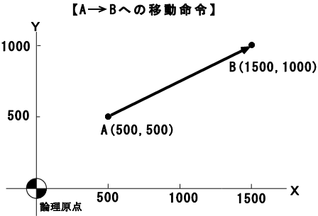

> **図の内容**
>
> 論理原点を原点とする X-Y 座標。A(500, 500) から B(1500, 1000) への矢印。

■相対移動量

指令1ステップ毎の移動量です。上記の指令の例では、A点からの移動量となります。

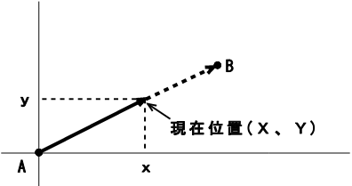

> **図の内容**
>
> A から現在位置 (X、Y) を経て B へ。x、y は A からの移動量。

- ■アブソ指令の表記 PTPA X1500 Y1000 目標位置を指令します。
- ■インクレ指令の表記 PTP X1000 Y500 移動量を指令します。
- (X、Y)は、論理原点からの距離 (論理座標)
- (x、y)は、A点からの距離 (相対移動量)

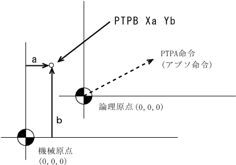

> **図の内容**
>
> 機械原点 (0, 0, 0) と論理原点 (0, 0, 0)。「PTPB Xa Yb」は機械原点からの a、b の位置へ、「PTPA命令（アブソ命令）」は論理原点基準の位置へ移動する。

### 4-3. 補間加減速 (指数形/直線形/S字)

補間指令(直線補間や円弧補間)に対しては、各軸に加減速制御(スムージング)がかかります。加減速時定数は、サーボパラメータの「補間加減速時定数」で指定します。スムージングが不要の場合、「補間加減速時定数」を0として下さい。

※ 以降速度単位の pulse/sec を pps と表します。

軸速度の様子

【指数形補間加減速】

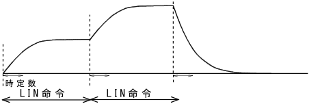

> **図の内容**
>
> LIN命令が 2 つ続くときの軸速度。各 LIN命令の速度変化が、指数関数の曲線（時定数）で行われる。

【直線形補間加減速】< オプション>

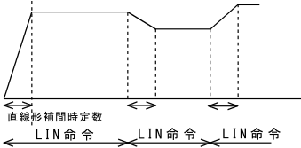

> **図の内容**
>
> LIN命令が 3 つ続くときの軸速度。各速度変化が一定の時間（直線形補間時定数）の直線で行われる。

【S 加減速】< オプション>

補間加減速( 指数形／直線形) をさらにスムージングします。直線形補間加減速と組み合わせて使用します。

速度の変化点でTs(ms) の平均化( フィルタリング) をします。

Ts はサーボパラメータで設定します。

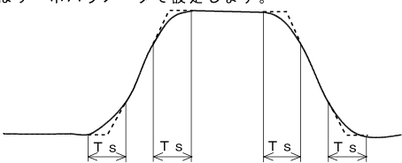

> **図の内容**
>
> 台形の速度（点線）の角を、速度の変化点ごとに Ｔs の区間で丸めた曲線（実線）。

### 4-4. 直線形加減速

PTPの移動指令の際には、直線形加減速制御をおこないます。

制御は各軸独立におこないます。PTP時定数(サーボパラメータ)は、ROMSWの選択により、以下のTとPtpTの

いずれかを設定します。

詳細は、<Ⅲ機能編 8-1.送り速度、加減速などのパラメータ>(TB00-1130G)を参照下さい。

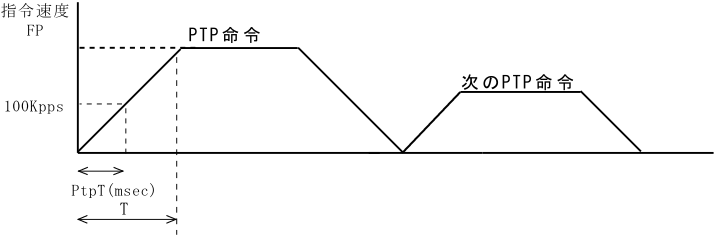

> **図の内容**
>
> 縦軸 指令速度 FP、横軸 時間。PTP命令の台形と、次のPTP命令の台形。100Kpps に達するまでの時間が PtpT(msec)、FP に達するまでの時間が T。

T :加減速時間・・・ 0からPTP速度に到達するまでの時間

PtpT:PTP加減速時定数・・・ 0から100Kppsに到達するまでの時間

Ts : S字加減速時定数 (ms)

### 4-5. PTP制御(位置決め) PTP/G00

目標位置へ向かって、各軸独立に直線加減速制御により位置決めします。各軸の速度は、セッティングPC「サーボパラメータ」画面の「PTP速度」で指定します。加減速については、<4-4.直線形加減速>を参照して下さい。各軸独立ですので、各軸の目標到達時間には、差が出ます。

PTP X1,Y1 の例

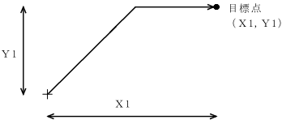

> **図の内容**
>
> 始点から目標点 (X1, Y1) へ。始めは斜め 45° に進み、移動量の少ない Y 軸が先に到着したあと X 軸だけが進む軌跡。

### 4-6. 直線補間 LIN/GO1

1軸～8軸同時の直線補間です。目標点への到達は全軸が同時です。速度指令は、直線補間指令で指定された全軸の合成速度です。下の図は、指数型の加減速の時の速度です。

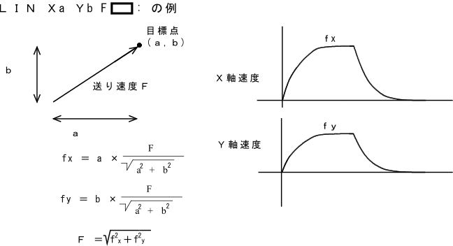

> **図の内容**
>
> 目標点 (a, b) へ送り速度 F で直線補間。各軸の速度:
> - fx = a × F ／ √(a² + b²)
> - fy = b × F ／ √(a² + b²)
> - F = √(fx² + fy²)
> 右に X軸速度（fx）と Y軸速度（fy）の時間変化。

上記図の場合、Y軸は移動量が少ないため、 PTP速度に達する前に減速が始まっています。

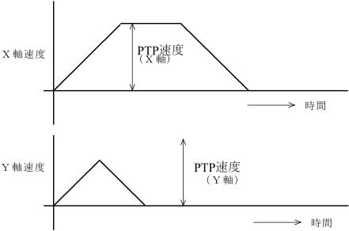

> **図の内容**
>
> X軸速度は台形で PTP速度（X軸）に達し、Y軸速度は移動量が少ないため三角形で、PTP速度（Y軸）に届かない。横軸 時間。

### 4-7. 円弧補間

CIRR、CIRL / G02、G03

2軸の円弧補間です。

円弧の指定には次の3つの方式可能です。

- ① 目標位置と中心座標値を設定します。
- ② 目標位置と半径を設定します。
- ③ 目標位置と円弧の途中通過点を設定します。

1周円以上の円弧動作を行う場合は、円弧補間指令を連続的に使用することで実現できます。

また、多回転の円運動を行う必要が有るとは指定した円弧を含んだ円を指定回数回る多回転円弧指令機能もあります。(多回転機能はプリ解析方式には対応していません)

速度指定Fは、円弧処理方式により以下のようになります。

プリ解析方式 : ヘリカル軸も含めた接線速度(3軸の合成速度)

ボード内部方式 : 円弧2軸の合成速度(ヘリカル軸はこれに同期)

各円弧処理方式はセッティングPCの「ポジション表示形式設定画面」で選択できます。

各円弧処理方式については以下に記述します。

- ※ 基本的にボード内部方式を使用して下さい。

(プリ解析方式は旧機種との互換性のための機能です。)

#### 4-7-1. プリ解析方式

円弧を微小直線に展開するため実ステップ長が増えます。

詳細は、<Ⅲ機能編 5-4.プリ解析処理(テキスト→バイナリ変換)>(TB00-1130F)を参照して下さい。

プリ解析方式の場合、連続した円弧補間指令を行うと、円弧の切り換わり時に速度が変動する場合があるのでご注意下さい。

この方式では、アブソ指令(CIRRA/CIRLA)は使えません。

速度指令Fは、ヘリカル軸も含めた接線速度(3軸の合成速度)です。

#### 4-7-2. ボード内部方式

ボード内部で円弧解析を行う機能です。

速度指令Fは、円弧2軸の合成速度です。ヘリカル軸はこれに同期します。

### 4-8. 手動送り

#### 4-8-1. ジョグ(JOG)送り

指定された方向へ軸を移動します。

速度は、セッティングPC「サーボパラメータ」画面の"JOG速度"(単位[pps])で設定します。加減速については、<4-4.直線形加減速> を参照して下さい。

#### 4-8-2. インチング送り(手動)

指定された軸を一定のパルス量だけ送ります。

各軸の速度は、セッティングPC「サーボパラメータ」画面の「PTP速度」で指定します。加減速については、<4-4.直線形加減速> を参照して下さい。

| 倍率   | 送り量     |
|-------|-----------|
| ×1    | 1パルス送り    |
| ×10   | 10パルス送り   |
| ×100  | 100パルス送り  |
| ×1000 | 1000パルス送り |

### 4-9. インポジションチェック

【概要】

＜パルス指令軸の場合＞

以下の場合に、インポジションとなります。

INPOS量 ≧ ACCたまり＋ ER

- ER(偏差) ＝ CR(指令位置) - PR(機械位置)
- ACCたまり＝補間加減速処理でのたまりパルス
- INPOS量は、セッティングPCの「サーボパラメータ」画面の「INPOS量」で設定します。

FBコネクタ(CNEXT）にFBを配線している場合は、ER（偏差）を検出できますが、FB配線が無い場合は、 ER（偏差）が検出できない(ER＝0)としてインポジションチェックをします。

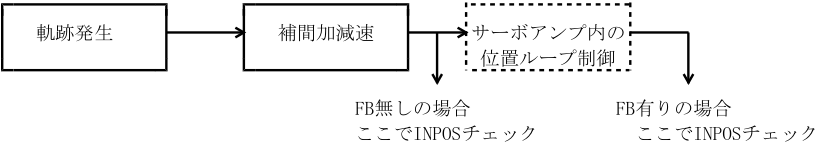

> **図の内容**
>
> 「軌跡発生」→「補間加減速」→「サーボアンプ内の位置ループ制御」（点線の枠）。FB無しの場合は補間加減速の出力で INPOSチェック、FB有りの場合はサーボアンプの位置ループの後で INPOSチェック。

＜アナログ指令軸の場合＞（将来）

目標値と現在値が、インポジションゾーン（パラメータ）に入っているかをチェックします。

INPOS量 ≧ 偏差レジスタ

の時に、INPOS(出力/ステータス)ONとなります。

【INPOS量の設定の目安】

(1). 考え方

- a. 連続位置決めの時に、きっちり停止して次に移動したい場合・・・小さめの値
- b. 連続位置決めのタクトを高めたい。

完全に止まらないで、次の移動を始めたい場合。・・・大きめの値

(2). 設定値の目安

停止時に偏差値があるかどうかをセッティングPCの「偏差量」画面で確認下さい。 ACサーボによっては、停止時に数パルスの偏差が発生しています。

これをアンプ側でゼロにできれば良いのですが、解消できない場合もあります。 INPOS量の値は、停止時の偏差量の2倍以上の値にして下さい。

【インポジションチェック動作比較表】

※1 補間

| 実行ステップ次ステップインポジションチェック無効   | 実行ステップ次ステップインポジションチェック無効   | 実行ステップ次ステップインポジションチェック無効   | インポジションチェック有効（デフォルト）   |
|------------------------------|------------------------------|------------------------------|------------------------|
| 補間以外                         | 補間以外                         | インポジションチェック無し                | インポジションチェック有り          |
| 補間補間以外                      | 補間以外補間                      | インポジションチェック無し                | インポジションチェック有り          |
| 補間                           | 補間                           | インポジションチェック無し                | インポジションチェック有り          |
|                              |                              | つなぎ(補間指令をなめらかに連続させる。)        | つなぎ(補間指令をなめらかに連続させる。)  |

補間：直線補間(LIN/LINA等)指令、円弧補間(CIRR/CIRL等)指令

補間以外：PTP指令、TIM指令、マクロ変数演算等

※1の動作で停止させたい場合は、補間指令の間にドウェル(G04又はTIM/TM)を入れて下さい。

インポジションチェック有りインポジションチェック無しつなぎ

位置決め完了(インポジション) 軌跡発生終了後、ただちに次速度変動が起きないを待ってから､次ステップをステップを実行します。ように補正します。実行します。

F(速度)

ステップN ステップN+1 ステップN ステップN+1

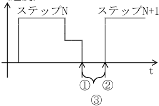

> **図の内容**
>
> ステップN からステップN+1 への速度。① 軌跡発生完了、② 次命令開始。①と②の間が ③ INPOS待ち。

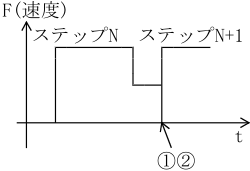

> **図の内容**
>
> ステップN からステップN+1 への F(速度)。①② が同じ時刻（INPOS待ちなし）。

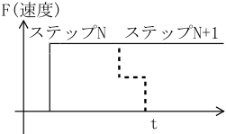

> **図の内容**
>
> ステップN の速度が下がる途中（点線）でステップN+1 が始まる。

- ①軌跡発生完了、②次指令開始、③INPOS待ち
- ※ インポジションチェックは、ステップとステップの間(次ステップを実行する前)にチェックを行います。

### 4-10. なめらかな送り制御(パス機能)

各ステップ(ブロック)の実行の間で、停止時間が有りません。 NCのブロック間停止ゼロ(パス機能)に当たります。このパス機能により微小連続送りでのなめらかな輪郭制御が実現できます。以下のような軌跡を、指定された接線速度でなめらかに送ります。

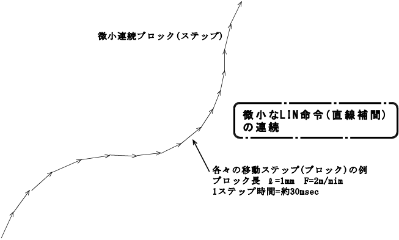

> **図の内容**
>
> 曲線を細かい矢印でつないだ軌跡。「微小連続ブロック(ステップ)」「微小なLIN命令(直線補間)の連続」。各々の移動ステップ(ブロック)の例: ブロック長 ℓ=1mm、F=2m/min、1ステップ時間=約30msec。

### 4-11. シングルステップ動作

シングルステップモードでは運転プログラムの各ステップ毎に停止し、スタート信号により1ステップずつ進行します。

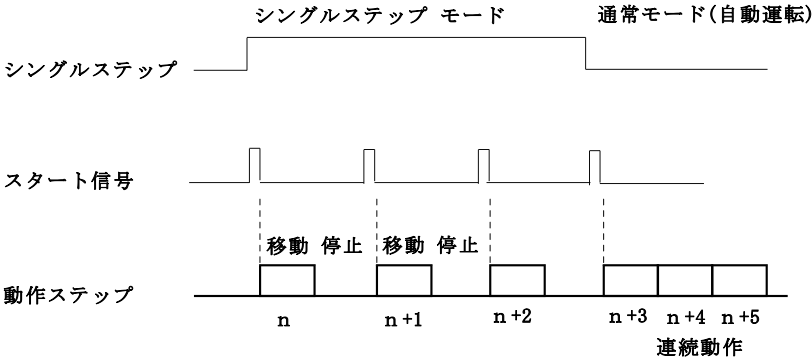

> **図の内容**
>
> シングルステップ: シングルステップ モードの間は ON、通常モード(自動運転) で OFF。スタート信号のパルスごとに、動作ステップ n、n+1、n+2 を 1 つずつ実行（移動 → 停止）。通常モードでは n+3、n+4、n+5 を連続動作。

運転プログラムのセッティングやメンテナンス時に、動作確認のために使用します。

### 4-12. サイクル運転

繰り返し実行中に、サイクル運転モードをOFFにすると、その回の最後まで実行した後、プログラム実行終了

サイクル運転モードでは運転プログラムの繰り返し実行を行います。 SLM8000コントローラは、運転プログラムのENDステップ実行時、サイクル運転モードの場合自動的に運転プログラムの先頭から再実行を行います。します。

サイクル運転モードのON/OFFは、通信コマンドでおこないます。

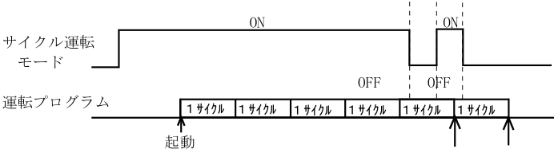

> **図の内容**
>
> サイクル運転モードが ON の間、起動で運転プログラムが 1サイクルずつ繰り返す。OFF にするとその回のサイクルの終わりで止まる。

プログラム終了時サイクルここではプログラム再開しない。運転モードなのでプログラム再開

サイクル運転モードで、繰り返し実行する運転プログラムの先頭と最後のステップが補間移動の場合でも、最後のステップと先頭ステップのつなぎ処理は行いません。 ENDステップでは、1制御周期とインポジションチェック有効時の時間は、停止します。

### 4-13. オーバライド機能

送り速度を 0%～200%の比率で、動作中に変更できます。セッティングやメンテナンスでも使用します。 (機械操作パネルでは、25%刻みか1%刻みかを選択出来ます。)

### 4-14. ストロークリミット

機械の動作範囲外への移動を禁止するために、二重の安全対策を実施しています。

ソフトウェアストロークリミットソフトウェアにより、動作可能な範囲を規定します。 (ソフトOT) 指定位置がこの領域を越えるとSLM8000は

「ソフトリミットエラー」になり移動を中断します。

この時の減速方法は、動作により異なります。

- 補間動作・・・減速停止します。
- 補間動作以外・即停止します。

(PTP/JOG/原点復帰等)

サーボ主電源は落ちません。そのまま手動操作(JOG)にてもどせます。

(戻した後、リセットにてソフトリミットエラーを解除して下さい。)

ハードウェアストロークリミットマシンエンドに配置したLS信号をSLM8000へ入力(ハードOT)します。 (ハードOT) 一般はb接論理で入力し､これがOFFするとサーボは緊急停止します。その結果、設定によっては、サーボ主電源を落とします。通常の使用状態では必ずソフトOTにより停止しますので、ハードOTが作動する可能性はほとんどありません。

ハードOTの処理

| OT時サーボOFF ※1 (ROMSW設定ソフトの設定)   | 動作          | 復旧                                           |
|--------------------------------|--------------|-----------------------------------------------|
| する                             | 即停止後にサーボ OFF | OT無視モードにして、リセット(サーボON) ジョグでもどして、リセット。(アラーム解除) |
| しない                            | 即停止のみ        | そのままジョグでもどして、リセット(アラーム解除)                     |

※1 詳細は、

「SLM8000 ROMSW設定ソフトマニュアル」<6-1.基本パラメータ>(TB00-1132) を参照下さい。

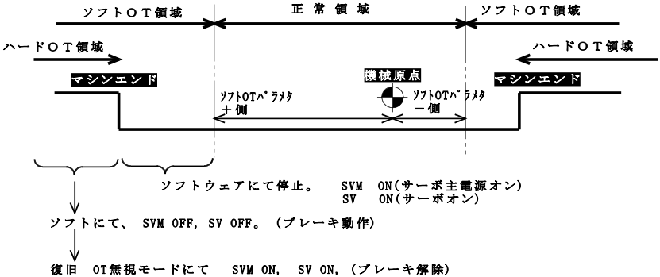

> **図の内容**
>
> - 左から: ハードOT領域（マシンエンド）、ソフトOT領域、正常領域、ソフトOT領域、ハードOT領域（マシンエンド）
> - 正常領域の両端が「ソフトOTパラメタ +側」と「ソフトOTパラメタ −側」。その間に機械原点
> - ソフトOT領域: ソフトウェアにて停止。SVM ON（サーボ主電源オン）、SV ON（サーボオン）
> - ハードOT領域: ソフトにて、SVM OFF、SV OFF。（ブレーキ動作）
> - 復旧: OT無視モードにて SVM ON、SV ON。（ブレーキ解除）

ソフトOTのパラメータは、マシン原点を基準に、+側と-側の各々に対して設定します。ソフトOTのパラメータ(ソフトリミット)については、 <Ⅲ機能編 8-2.ストロークリミットのパラメータ>(TB00-1130G)を参照して下さい。

- 【注】マシンエンドにおける、メカニカルストッパーは必ず設置して下さい。

高速動作している状態では、どのようなOT方式にしても、相当量の惰走距離は発生します。

### 4-15. 原点復帰

#### 4-15-1. 原点復帰方式

軸設定ROMSWの「C(Z)相使用選択」で、以下の3通りを選択できます。

ROMSW設定

| C(Z)相使用選択       | 原点復帰方式   | 簡単な説明                                                     |
|-----------------|----------|-----------------------------------------------------------|
| 原点信号サーチ (C相不使用) | 原点サーチ方式  | 原点（DEC/OTP/OTM）信号のエッジを基準に原点を決めます。センサーの経年変化でずれることもあります。   |
| C相サーチ（FB不使用）   | C相サーチ方式  | エンコーダやスケールのC(Z)相パルスを基準に指令位置から原点を決めます。原点サーチより高精度です。       |
| C相ラッチ（FB使用）    | C相ラッチ方式  | エンコーダやスケールのC(Z)相パルスを基準にフィードバック位置から原点を決めます。原点サーチより高精度です。 |

動作の詳細は、

<Ⅲ機能編 8-4.原点復帰の動作>(TB00-1130G) を参照下さい。

#### 4-15-2. 軸ストロークと機械原点のようす

軸のストロークに関連して、マシンエンド、ハードOT、ソフトOT、機械原点、原点（DEC）信号、C(Z)相、逃げ動作の関係は、以下の図のようになります。

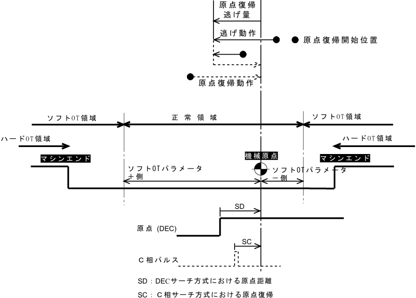

> **図の内容**
>
> ストロークリミットの領域の図（ハードOT領域、ソフトOT領域、正常領域、マシンエンド、ソフトOTパラメータ +側／−側、機械原点）に、原点復帰の動き（原点復帰開始位置、原点復帰逃げ量、逃げ動作、原点復帰動作）と、原点 (DEC) 信号・C相パルスの位置を重ねたもの。
> - SD: DECサーチ方式における原点距離
> - SC: C相サーチ方式における原点復帰

#### 4-15-3. 疑似アブソ【廃止】

◆1.1

SLM4000の「疑似アブソ」機能は、SLM8000では、廃止しました。

#### 4-15-4. 全軸原点復帰の逃げ動作

◆1.1

SLM8000では、「疑似アブソ」機能が無いため、SLM4000とは逃げ動作が異なります。

動作の詳細は、

<Ⅲ機能編 8-4.原点復帰の動作>(TB00-1130G) を参照下さい。

#### 4-15-5. 全軸原点復帰シ－ケンス（順位）

全軸原点復帰のときに原点復帰をおこなう順番を軸毎に設定できます。（サーボパラメータ）普通は、上下軸が先に原点復帰し、その後水平軸が動くようなシーケンスが安全です。それぞれの機構の条件に応じて、設定できます。

サーボパラメータの原点復帰順位

数字の小さい順（0→1→2…）に原点復帰を行います。

- 例「Zの順位＝0 X，Yの順位＝1」：Z軸→X軸，Y軸の順番で原点復帰

### 4-16. 軸制御に関するその他の機能

#### 4-16-1. 周回処理(回転軸)

無限回転軸では、1周で同じ所にもどるので、座標値を1周内の値にもどす必要があります。座標値は以下の範囲となります。

-(メカ機構1回転パルス数) < 座標値 < メカ機構1回転パルス数

ROMSW設定ソフトでPG分周値やギア比などを全てを考慮した上での、「メカ機構1回転パルス数」を設定します。(0以外の値を設定した場合のみ、その値で各座標値の周回処理を実行)リジットタップやねじ切りオプション機能使用時の主軸及び、実回転数ステータスが必要な主軸に対しては必ず設定します。

#### 4-16-2. 回転速度指令 SPIN/G120

定速回転をする指令です。無限回転軸(ROMSW設定)に対して有効です。回転数(RPM)は、機械軸での回転数です。

(ROMSW設定ソフトで「メカ機構1回転パルス数」の設定が必要です。)

運転プログラム「SPIN」/「G120」につづいて、回転軸を指定します。軸指定には回転速度を0.1RPM単位で指定します。さらに「OVR1」を付加する事により、回転動作にオーバライドがかかります。指定しない場合は、オーバライドはかかりません。（G120では、OVR1機能は有りません。）

【テクノコード】

SPIN Z1000;

SPIN Z1000 OVR1;

100rpmでの定速回転(オーバライドは無効)

100rpmでの定速回転(オーバライドは有効)

SPIN Z0;

定速回転の停止

【Gコード】

G120 Z1000;

Gコードでは、OVR1は対応していません。

定速回転動作の開始/停止時には、PTP時定数による直線加減速がかかります。移動中の軸に、回転指令をおこなうと「プログラム実行エラー」となります。また、回転動作中の軸に対しては、他の動作指令は「プログラム実行エラー」となります。回転動作停止後は、再び他の移動指令(位置決め)が可能となります。回転動作の実行中に再度回転指令を行い、回転速度を変更する事は可能です。

尚、回転動作の開始(または停止)指令時は、指令回転数への到達(または停止)を待たずに、次のステップが実行されるので、必要に応じてドウェル(タイマー)指令等を使用して下さい。

０°

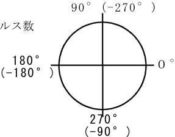

> **図の内容**
>
> 円の右が 0°、上が 90°(−270°)、左が 180°(−180°)、下が 270°(−90°)。左上に「…ルス数」（左が切れている）。

#### 4-16-3. ねじ切り機能(同期送り)

<オプション> (計画中)

位置ループ制御型主軸のフィードバックデータから、X/Y軸の送り量を計算して同期指令する事により、ねじ切り動作を行います。

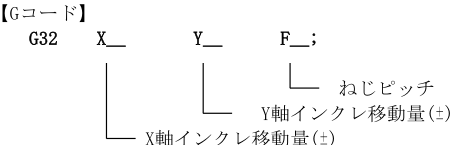

> **図の内容**
>
> 【Gコード】G32 X＿ Y＿ F＿;
> - X＿: X軸インクレ移動量(±)
> - Y＿: Y軸インクレ移動量(±)
> - F＿: ねじピッチ

- XYどちらか一方の指令で平行ねじ、両方の指令でテーパーねじとなります。
- XY両軸動作の場合、ピッチ計算の基準軸は、移動量が大きい方の軸となります。
- ねじピッチFは、主軸1回転あたりの基準軸の移動量を指定します。
- G32の実行時は、あらかじめ主軸の回転動作が実行されているものとします。

主軸停止状態でG32が指令された場合は、プログラムエラーとなります。

- X軸,Y軸の移動は、主軸のフィードバックに対する、比例分配制御によって行います。

また、動作開始のタイミングを、主軸のC(Z)相位置を基準にする事により、繰り返し時の切り込み位置を一定とします。ただしG32が連続する場合、2回目以降では主軸のC(Z)相検出はせずに前ブロックに継続して動作します。

- 同じねじ切りに対して、切り込み量を変えて繰り返しねじ切り動作を行う場合、その途中で主軸回転数 (S値)を変更してはいけません。
- ねじ切り動作中、一時停止は無効となります。

#### 4-16-4. 同一指令2軸制御

<オプション>

選択した第n軸が第m軸の同期軸(従軸)として動作します。m軸に対する全ての動作指令 (プログラム指令、動作コマンド、手動操作)に対して、n軸がm軸と同期して動作します。通常は、平行軸などで使用します。

■選択 n軸:同期軸(従軸) ROMSW「軸設定」で「同期軸(従軸)」をチェック

m軸:マスター軸 ROMSW「軸設定」で「基準軸」で選択

※同タスク内に複数の同期軸が設定可能です。◆1.2

原点復帰の完了で、お互いの2軸が正確に平行になります。その後は、手動/自動ともに常に一緒に動きます。お互いのC(Z)相位置にずれがあっても、サーボパラメータの原点距離でそのように調整します。

<同一指令2軸の原点復帰>

原点復帰方式の選択では、C(Z)相ラッチの原点復帰方式を推奨します。原点サーチやOTサーチでは、再現性に誤差が生じる可能性があります。

原点復帰動作時、C(Z)相信号については個々のモーターより検出しますので、サーボパラメータの"原点距離"は別々に設定して下さい。(試運転時要注意!)

尚、モーターを機械に組みつける際には、軸の回転位置(C(Z)相位置)をできるだけ合わせておく事をお勧めします。また、原点信号は通常、別々の信号を使用しますが、平行軸では一つのセンサー出力を2軸のサーボに並列接続する方法も現実的です。

<Ⅳ試運転・調整編 6-11-4.同一指令2軸での原点復帰>(TB00-1130H)も参照下さい。

<2軸の誤差の問題>

電源投入後から原点復帰が完了するまでは、同一指令2軸(平行軸)はお互いに多少のズレを持ってます。

原点復帰動作をスムースにおこなうためには、機構に応じて以下をご注意下さい。

<2軸の機構連結が強い場合>

2軸の連結が強い場合は、お互いの誤差も少ないですが、誤差があると平行性が崩れて、異常摩擦が発生する危険性もあります。このような応用では、各軸の原点やC(Z)相を一致させておく方が無難です。また、アプローチ速度や原点復帰速度も低めが安全です。

理想的な条件では、電源投入時も平行が保たれており、原点復帰動作中や原点復帰の完了時も正確に平行を保ちます。

<2軸の機構連結が弱い場合>

お互いの軸の機構干渉が少ない場合は、お互いの原点やC(Z)相がずれていても、ほとんど問題はありません。

#### 4-16-5. PGパルス任意分周機能

ROMSW設定により、各軸モーターのエンコーダフィードバックパルスが、任意の値で分周可能です。分周値は各軸毎に分子/分母の値で、分子/分母とも1～32767の値です。従来では、モーター側での分周設定が不可能であったり、変速機のギア比が割り切れないなどの理由により、1パルス＝1μｍの様な切りの良い値にする事ができなかったシステムに対して、本機能によりそれが可能となります。例として、モーターのエンコーダが2000パルス/回転（固定）で、ボールネジピッチが＝5ｍｍ、（変速機は無し）の場合、分周値を5/8に設定する事で1パルス＝1μｍのシステムとなります。

5[mm/rev] ÷（2000[pulse/rev] × 4 × 5 / 8）＝ 0．001[mm/pulse]

詳細は、

「SLM8000 ROMSW設定ソフトマニュアル」<6-4.軸設定>(TB00-1132) を参照下さい。

#### 4-16-6. 接線制御軸機能

<オプション>

生地や板のカッティングの場合、軌跡の方向に常に歯先を向ける必要があります。

本機能により無限回転軸であるm軸(選択)が、k/l軸(選択)の合成移動方向に、自動的に回転動作します。

- ■選択 m軸:接線制御軸 ROMSW設定ソフト「軸設定」で「接線制御軸」をチェック

(ROMSW設定ソフト「メカ機構1回転パルス数」の設定も必要)

k軸:基準軸1 ROMSW設定ソフト「軸設定」で「接線制御軸」の「基準軸1」で選択

l軸:基準軸2 ROMSW設定ソフト「軸設定」で「接線制御軸」の「基準軸2」で選択

運転プログラム(テクノコード/Gコード)で使う方法と通信コマンドで使用する方法があります。

- (1). 接線制御用指令コード
- ＿のデータは 0.1～2147483.6秒
- ※1 接線制御有効/無効の設定はシステムモーダルです。(システム起動時は無効です。)◆1.3 接線制御有効/無効の設定はプログラム終了後も継続します。

- G111/STND

接線制御無効 ※1

- G110/STNE

接線制御有効 ※1

- G112(P＿)/TURN(TIM＿)

m軸回転指令 P＿(TIM＿)は、回転後の待ち時間(秒)

(2). 運転プログラム例

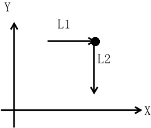

> **図の内容**
>
> X-Y 座標。L1（右向き）のあと L2（下向き）へ曲がる経路。

G01 X1000 ;

G04 P1.0 ; →位置決め完了待ちのWait ※2

G112 P0.1 ; →TURN指令

※3

G01 Y-1000;

※4

- ※2 TURN指令(G112)の前には、ドウェル(G04)を入れることを推奨します。
- ※3 サーボ系の遅れを考慮して、Wait(P指定)を入れることができます。
- ※4 TURN指令でm軸の移動位置を算出するため、TURN(G112)指令の直後にk/l軸のインクレ移動指令が必須です。TURN(G112)指令の次にk/l軸に対する以下の指令がない場合は、プログラム実行エラーとなります。
- PTP/G91G00
- LIN/G91G01
- CIRR/G91G02(プリ解円弧)
- CIRL/G91G03(プリ解円弧)
- SLIN/G91G31

TURN指令の直後に上記指令を指定できない場合は、m軸の移動位置の算出のため、TURN指令に k/l軸のインクレ移動量を付加して下さい。この機能によりTURN指令の直後に、アブソ移動指令や、移動指令以外の指令を指定することもできます。

<例>

以下の例では、G112(TURN)指令の次がアブソ補間移動のため、エラーにならないように、

G112のステップにm軸移動量の算出用のY軸のインクレ移動量を付加しています。

```c
    G110;           /* 接線制御有効 */
    G90 G01 X1000;  /* X軸 アブソ補間指令 */
    G112 Y1000 P1;  /* m軸の移動量算出のため、Y軸のインクレ移動量を指定 */
/* このステップではY軸は移動を行いません */
    G90 G01 Y1000;  /* Y軸 アブソ補間指令 */
```

G90 G01 X1000;

G112 Y1000 P1;

G90 G01 Y1000;

- ※5 m軸は、一般的にサーボモータの使用をお奨めします。

パルスモータの場合、動作がなめらかでない場合があります。

- (3). LIN指令(X/Y)に対するZ軸(3軸)の動作

LIN指令(G01)のX、Yのベクトル方向へZ軸(第3軸)を回転させます。

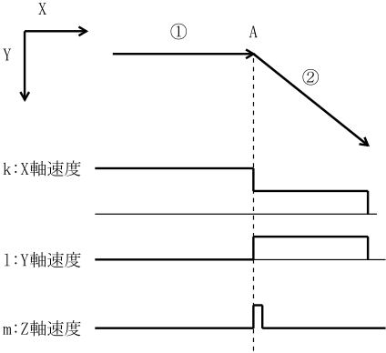

> **図の内容**
>
> X は右、Y は下の向き。① 右へ移動して A で ② 右下へ向きを変える。k: X軸速度は A で下がり、l: Y軸速度は A から始まり、m: Z軸速度は A で向きを変えるためのパルス状の動き。

Z軸は、A点で「接線制御上限速度」 (サーボパラメータ)で回転します。

一般には位置ループの特性により速度の変化やZ軸の回転速度の変化は曲線になります。

- (4). ジョグ送り(手動送り)の時にも接線制御します。

例) +X キー

↓

Z軸 +X方向へ回転 X軸手動送り

- (5). 接線制御の有効(G110/STNE)/無効(G111/STND)

◆1.3

- G110/(STNE)の指令で接線制御有効(システムモーダル)となり、それ以降のk/l移動に対してm軸を自動追従させます。

G111/(STND)の指令で接線制御を解除します。

(6). TURN指令 (G112)

直角に折れ曲がるようなカドの部分では、TURN指令を使います。

L1
  
A G01 X(L1);
  
G04 P＿;
  
L2 G112 (P＿);
  
G01 Y(L2)

k/l軌跡がなめらかに変化する軌跡であれば、上記機能は不要です。

(7). 関連するサーボパラメータ

| サーボパラメータ名称   | 意味                           |
|---------------|-------------------------------|
| 接線制御軸上限速度     | 接線制御によるm軸回転速度α、上限値(pps)       |
| 接線制御軸基準位置     | kl平面にて+k方向へ動く時のm軸のアブソ位置(パルス) |

(8). 関連するROMSW設定

θ軸(m軸)の以下のROMSWは必ず設定して下さい。

- 「メカ機構1回転パルス数」 θ軸が360ﾟするパルス量
- 「ソフトリミット」を無効 θ軸が360°回転が可能なときは「ソフトリミット」を無効に設定して下さい。

詳細は、

「SLM8000 ROMSW設定ソフトマニュアル」 <6-4.軸設定パラメータ>(TB00-1132) を参照下さい。

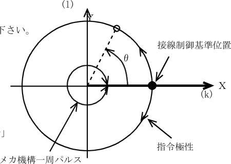

> **図の内容**
>
> (1) X 軸を基準に角度 θ、「接線制御基準位置」、「(k)」、「指令極性」、「メカ機構一周パルス」。左端の文字は切れている。

(9). 通信コマンドにおける使用方法

＜通信コマンド＞

Z軸接線制御ON/OFFコマンド"REQ_TLINE"を使用します。本コマンドにより、接線制御のON/OFFが切り換えられます。デフォルトは接線制御OFFとなっています。

ステータスデータ読出(DAT_STATUS)で得られる、"タスクステータス"にて、接線制御ON/OFFの状態を取得出来ます。

詳細は、

「SLM8000 送受信データマニュアル」(TB00-1134)

<4-2-26.Z軸接線制御ON/OFFコマンド>

<4-1-7.ステータスデータ読出>

を参照して下さい。

(10). 接線制御軸のソフトリミット

接線制御軸にソフトリミットを設定できます。ソフトリミットはマクロ変数で設定します。

※接線制御軸以外の軸は、サーボパラメータで設定したソフトリミットが効きます。

【マクロ変数】

#2018～#2818:対象タスクの第1軸(X)～第9軸(T)の+側ソフトリミット

#2019～#2819:対象タスクの第1軸(X)～第9軸(T)の-側ソフトリミット

詳細は、

<Ⅲ機能編 6-3-8.サーボパラメータ>(TB00-1130F)

を参照下さい。

※接線制御軸以外の軸のマクロ変数に書き込みを行うと"実行エラー"となります。

【注】

- ROMSWで接線制御軸の「ソフトリミット」を有効に設定して下さい。
- 接線制御軸のソフトリミットを有効にすると、1回転パルス数を超えても座標はラウンドしません。
- 接線制御軸のソフトリミット機能は、オプションの「マクロ機能」が必要です。
- SLM8000起動時、接線制御軸のソフトリミット値は、+側は1000000000、-側は-1000000000です。起動後、適切な値を設定して下さい。+側、-側とも0～±1000000000まで設定できます。

+側 > -側

の条件が満足しないと設定エラーになります。

#### 4-16-7. センサーラッチ機能（スキップ機能） <オプション>

本機能は特殊な直線補間を実行します。センサーラッチ入力（CN2 80番）がONすると、

その瞬間の機械位置（論理座標系及びアブソ座標系）を制御軸数分メモリーにセットします。

動作としては、以下の2通りが選択可能です。

- 同信号入力の論理ONにより移動指令の残りを中止して次のステップへ進みます。(スキップ機能) （信号の論理はROMSW「軸設定」のHI0のL/Hで選択）
- スキップせず最後まで移動します。

センサーラッチ位置情報は、マクロ変数や通信コマンドによって読み出す事ができます。

- マクロ変数♯500□、♯510□です。
- 通信コマンドの詳細は、以下を参照して下さい。

「SLM8000 送受信データマニュアル」(TB00-1134)

- <4-1-29.センサーラッチ位置データ読出>
- <4-2-23.高速センサーラッチインクレ補間位置決めコマンド>
- <4-2-24.高速センサーラッチアブソ補間位置決めコマンド>

<運転プログラムコード>

|         | テクノコード   | Gコード   |
|---------|----------|--------|
| スキップ    | SLIN     | G31    |
| スキップしない | SLINC    |        |

Gコードでは、スキップしない動作はできません。

基本的な動作方式及び制約事項は、テクノコードの"SLIN"は従来の"LIN"に、Gコードの"G31"は従来の"G01"に等価です。(ただしG31は非モーダルとなります。)

- 【注】ラッチ信号のOFF→ONのエッジで動作します。SLIN実行の始めからONしているとラッチしません。

#### 4-16-8. コンベア追従送り同調・同期送り <オプション> (計画中)

ベルトコンベア上などを移動するワークに対して、同調・同期制御が有効です。

同調送り(TUN) ベルトコンベア上のワークに対して、位置と速度を合わせます。同期追従送り(DLIN) ベルトコンベア上のワークに対して、同じ速度で動きます。

```c
    TUN X(lm) Y(LM);
```

無限回転軸であるY軸を、あらかじめSPIN指令により、回転動作させておきます。

TUN指令により、両軸の論理座標系機械位置が指定した(lm,LM)に到達する様に、Y軸のフィードバックに同調してX軸を動作させます。指定点を通過した時点で分配完了となり、次のステップへ進みます。尚、TUN指令を開始する時点で、既にX軸の座標が指定位置を越えていた場合、プログラムエラーとなります。

また、Y軸の座標が指定位置を越えていた場合は、Y軸が周回処理によって一度ラウンドアップした後、再度到達する指定位置をYの目標点として動作します。

- DLIN X(lb) TIM＿ ONR＿ /OFR＿;

無限回転軸であるY軸を、あらかじめSPIN指令により、回転動作させておきます。

DLIN指令によりTIMで指定された時間だけ、Y軸のフィードバックに同期してX軸を移動させます。この間に論理座標系のX軸機械位置が、指定した座標値(lb)に

到達してしまったた場合は、プログラムエラーとなります。

また、同時に標準のONR/OFR指令による汎用出力信号制御を実行できます。

**使用例**

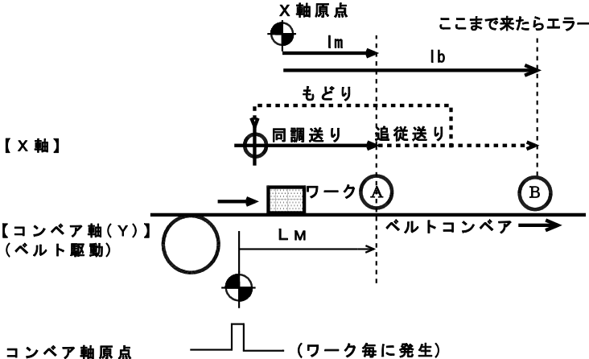

> **図の内容**
>
> - 【X軸】X軸原点から Im の位置で「同調送り」を開始し、「追従送り」で ワーク A → B を追う。Ib は「ここまで来たらエラー」の距離。終了後に「もどり」
> - 【コンベア軸(Y)】(ベルト駆動): ベルトコンベア上のワーク。LM はコンベア軸原点からの距離
> - コンベア軸原点の信号はワーク毎に発生

コンベア軸は、ワーク毎に原点パルスを出して下さい。一般には、回転軸座標として、コンベア軸の座標をワーク毎にセットアップします。

A点 : 同調を完了させるべき目標位置。(LM)

ここまでにX軸は加速して位置・速度を合わせます。

<プログラム例>

X軸のもどり位置でシリンダを上/下。(Ro00出力:シリンダ ON/OFF)

追従区間でシリンダを上/下させます。

P01入力ONで終了。

PTPA X0

; X軸ホーム位置へ

SPIN Y600 OVR1

; ベルトコンベア起動(直線形加減速)

～

ONR00 TIM0.1

; シリンダ下降(0.1秒)

TIM0.1

; 0.1秒

0FR00 TIM0.1

; シリンダ上昇(0.1秒)

TUN X(lm) Y(LM)

; 同調

DLIN X(POSB) ONR00 TIM0.1 ; 同期追従シリンダ下降

DLIN X(POSB)

TIM0.1 ; 同期追従 0.1秒

DLIN X(POSB) OFR00 TIM0.1 ; 同期追従シリンダ上昇

PTPA X0

; X軸もどり

SPIN Y0 JNR01

; R01入力 ONの時コンベア停止

ER01

; R01入力 ONの時強制終了

END (サイクル運転)

; サイクル運転(エンドレス)

#### 4-16-9. 直径指令

<オプション>

旋盤等の機械で、X軸(切れ込み軸)の指令値をワークの直径値で与えるものです。

運転プログラム内の数値だけが直径指令として扱われます。

ワンショットPTPやサーボパラメータは半径値として扱われます。

また、現在位置表示画面の指令位置は直径指令値として表示され。

アブソ位置、機械位置、偏差量は半径指令値として表示されます。

例:X軸を直径指令とし、運転プログラム中で以下のような記述をした場合 PTP X100;

指令位置には100と表示され、アブソ位置、機械位置、(偏差量)には50と表示されます。ワンショットPTPでX軸に100と指令したときは、指令位置には200と表示され、アブソ位置、機械位置、

(偏差量)には100と表示されます。

#### 4-16-10. フレキシブル電子カム制御 <オプション> (計画中)

マスター軸の角度を基準として、複数軸を同期させるものです。

マスター軸は「コントローラ内の仮想軸」で指定された速度で定速回転します。

各軸の動作の指定は、マスター軸の任意の角度(ただし2度ステップ)での各軸の位置を指定したテーブルにて行います。

テーブルは動作開始時、連続回転時、動作終了時を分けて定義できます。

(動作開始テーブル、動作終了テーブルは必須ではありません)

また連続回転時のテーブルは4パターン定義でき、動作中に各種条件により切り換えることができます。

本機能は、軸動作を行う別タスクと同時に使用することはできません。

パターン作成は、作成用のエクセルソフトで行い、最終的にTコードで作ります。

作成したTコードはセッティングPC等からダウンロードし実行します。

カム曲線(動作タイミングチャート)①

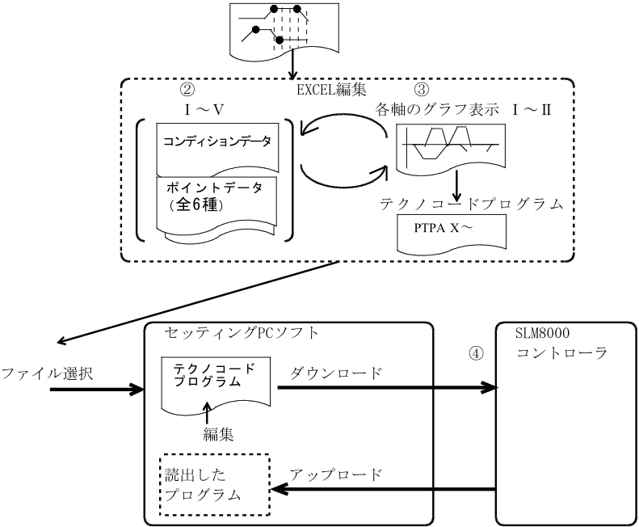

> **図の内容**
>
> ① EXCEL編集（② I～V のコンディションデータ・ポイントデータ（全6種）、③ 各軸のグラフ表示 I～II）→ テクノコードプログラム（PTPA X～）。セッティングPCソフトでファイル選択・編集し、④ SLM8000 コントローラへダウンロード。コントローラから読出したプログラムをアップロード。

詳細は「PLMC40フレキシブル電子カム制御」(TB04-1238)を参照下さい。

#### 4-16-11. 巻線指令

<オプション>

- ◆1.3

(1).動作

フライヤー式、ボビン式等の巻線機を容易に制御できる巻線指令機能です。

主軸が指定された速度で回転し、トラバース軸は主軸指令に同期して往復動作します。

- 巻き線機の軸構成は以下の通りです。
- 巻線動作にはオーバーライド指定が反映されます。
- 主軸速度には、サーボパラメータの「PTP時定数」による加減速がかかります。
- トラバース移動は主軸指令に同期しますので主軸と同様の加減速がかかります。
- ※ トラバース軸独自の加減速はかかりません。

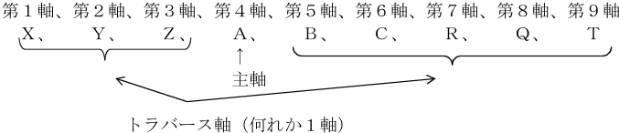

> **図の内容**
>
> 第１軸～第９軸（X、Y、Z、A、B、C、R、Q、T）のうち、A を「主軸」、残りの軸のうち何れか１軸を「トラバース軸」とする。

（トラバース軸の加減速パラメータの「PTP時定数」「補間加減速時定数」は使用しません。）

- 全体の巻回数、1巻当たりのトラバース軸の移動量(ピッチ幅)、巻き取り主軸の回転速度、コイル巻き終わり時のトラバースの位置を指定することができます。

(2).巻線指令書式

【テクノコード】

REEL {X＿ Y＿ Z＿ B＿ C＿ R＿ Q＿ T＿} P＿ RN＿ S＿ [RE＿] ;

- ＿･･･数値指定(即値/マクロ変数)を示します。
- {X＿ Y＿ Z＿ B＿ C＿ R＿ Q＿ T＿}:トラバース移動量の指定[pulse]

任意の1軸をトラバース軸とし、往復幅を指定します。(いずれか1軸のみ指定)

A軸は主軸として使用するため、トラバース軸には使用できません。

トラバース幅が+の場合、最初に+方向に移動して、往復運動を行います。

-の場合、最初に-方向に移動して、往復運動を行います。

0の場合、トラバース軸は往復運動をせずに巻き取りのみ実行（主軸のみ回転）します。

【注】

通常の軸指定と同様に小数点を付けてプログラムを作ることも可能です。

（小数点あり：ｍｍ単位、小数点なし：パルス単位）

ただし、この場合は、後述するピッチ指定の単位と単位が異なる事になりますので、ご注意下さい。

- 例）少数点位置が3桁の時、以下はトラバース幅1000パルス、ピッチ10.0パルスです。
- X1000 P10
- X1000 P10.0
- X1.0 P10
- X1.0 P10.0

・P:ピッチ幅[pulse/rev]

主軸一回転当たりのトラバース軸の移動量をパルス単位で指定します。

最小で小数点以下0.01パルス単位で指定することができます。

（マクロ変数指定の場合は、0.01パルス単位になります。マクロ変数が100の場合は、1.00パルスが指定されたものとして動作します。）

しかし実際には、モータに対して1パルス未満の指令を行うことはできません。

そこで、1パルス未満部分を積算して1パルスになったところで指令することにより、小数点

以下の指定に対処します。

尚、巻線終了時に1パルス未満の端数が残っていた場合、端数は出力されません。

例) P100.25

```c
    // 1回転目：100 pulse 移動（端数0.25pulse）
    // 2回転目：100 pulse 移動（端数0.50pulse）
    // 3回転目：100 pulse 移動（端数0.75pulse）
    // 4回転目：101 pulse 移動（端数無し）
```

【注】

ピッチ指定の単位はパルスです。

（ピッチ指定の小数点は整数部がパルス単位で、小数部はパルス単位での端数になります。）トラバース指定の小数点とピッチ幅の小数点とは単位が異なりますので、ご注意下さい。詳細は、上述のトラバース幅指定の注記を参照下さい。

- RN:総巻数[主軸回転数]

主軸の回転回数を指定します。最小で小数点以下0.01回転で指定することができます。

（マクロ変数指定の場合は、0.01回転単位になります。マクロ変数が100の場合は、1.00回転が指定されたものとして動作します。）

総巻数指定が+の場合は正回転で巻き取り、-指定の場合は逆回転で巻き取ります。

0の場合、REEL命令は無効(何も実行せずステップ終了)になります。

- S:巻き取り速度(主軸速度)[rpm]

主軸の回転速度を指定します。

主軸速度には、サーボパラメータの「PTP時定数」による加減速がかかります。

- RE:巻き取り終了方向指定 [ 単位なし、0/1/2 ]（省略時は0）

巻き終わりのトラバースの位置の指定です。

設定内容は以下の通りです。

0：自然終了（デフォルト）

1：トラバース始端で終了

2：トラバース終端で終了

- (3).巻き終わり処理指定(RE指定)の詳細
- 巻き終わり時のピッチ調整

トラバース位置が巻き終わり指定側に到達したときに残巻数を確認して、残巻数に応じてトラバースのピッチを調整します。

- ① 1往復分の巻数 ≦ 残巻数

ピッチ調整をせずに命令で指定されたピッチのまま継続します。

（巻き終わり指定側に戻って来た際に再度ピッチ調整の判別を行います。）

- ② (片道分の巻数＋トラバース軸移動無し巻数÷2) ＜残巻数＜１往復分の巻数片道(巻き終わり指定の反対側)へはピッチ調整をせずに命令で指定されたピッチのまま移動して、反対側から巻き終わり指定側に戻るときにピッチ調整を行います。ピッチを命令で指定されたピッチより大きくすることにより巻き終わり時に巻き終わり指定側に到達

するようにします。

- ③トラバース軸移動無し巻数＜残巻数 ≦ (片道分の巻数＋トラバース軸移動無し巻数÷2) １往復分のピッチ調整を行います。

ピッチを命令で指定されたピッチより大きくすることにより巻き終わり時に巻き終わり指定側に到達するようにします。

- ④ 残巻数 ≦ トラバース軸移動無し巻数

トラバース移動を行わずに主軸のみ回転します。

本条件が成立した場合は、「最終層巻数異常警告」が発生します。詳細は後述する「トラバース軸移動無し巻数指定」を参照下さい。

巻き終わり指定の動作

- トラバース位置

仮にRE0で実行した場合に始端への移動中に巻線終了する設定 (トラバース軸移動無し巻数=0)

主軸角度(巻線開始位置が０°)

仮にRE0で実行した場合に終端への移動中に巻線終了する設定 (トラバース軸移動無し巻数=0)トラバース位置

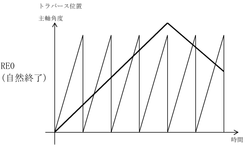

> **図の内容**
>
> 横軸 時間。主軸角度は鋸歯状に繰り返し、トラバース位置は三角形に往復する。RE0 は往復の途中で自然に終了する。

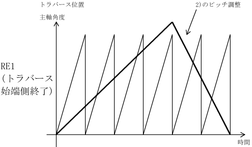

> **図の内容**
>
> 主軸角度（鋸歯状）とトラバース位置（三角形）。RE1 はトラバースの始端側で終了する。終わりの部分は「2)のピッチ調整」。

度

時間トラバース位置

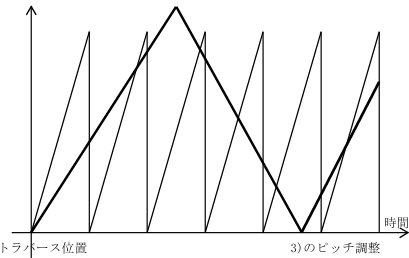

> **図の内容**
>
> 主軸角度（鋸歯状）とトラバース位置（往復）。終わりの部分で「3)のピッチ調整」。

度

時間トラバース位置

主軸角度

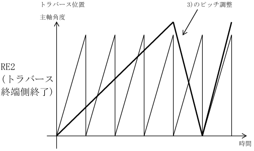

> **図の内容**
>
> 主軸角度（鋸歯状）とトラバース位置。RE2 はトラバースの終端側で終了する。「3)のピッチ調整」。

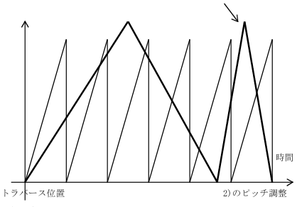

> **図の内容**
>
> 主軸角度（鋸歯状）とトラバース位置。矢印の箇所で「2)のピッチ調整」。

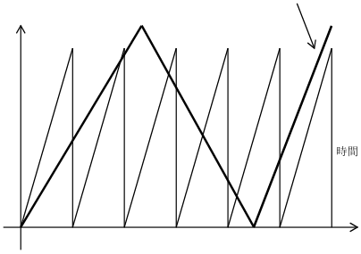

> **図の内容**
>
> 主軸角度（鋸歯状）とトラバース位置（三角形の往復）。矢印の箇所で、最後の往復が終端まで進む。横軸 時間。

主軸角

主軸角

**○ トラバース軸移動無し巻数指定**

- 「ROMSW設定ソフト」の「基本」にて、「トラバース軸移動無し巻数」を設定する事ができます。 0～100の範囲で設定します。

設定や画面操作については、

「SLM8000 ROMSW設定ソフトマニュアル」<6-1.基本パラメータ>(TB00-1132) を参照して下さい。

- 巻き終わり指定側で残巻数が「トラバース軸移動無し巻数」以下だった場合は、ピッチ調整を行わずに、トラバース移動を停止します。（トラバース移動を行わずに主軸のみ回転します） ※ 前述の「巻き終わり時のピッチ調整」の ④ の動作です。
- この動作が発生した場合は、「最終層巻数異常警告」になります。 ※ エラーではありません。本警告が発生してもプログラム実行を継続します。

最終層巻数異常警告はリセットで解除する事ができます。又、プログラム実行開始時に自動的にクリアされます。

最終層巻数異常警告は通信コマンドの、ステータスデータやプログラム実行情報データにて読み出す事ができます。

詳細は、

「SLM8000 送受信データマニュアル」(TB00-1134)

の

<4-1-7.ステータスデータ読出 [DAT_STATUS(0x02)]>

<4-1-43.プログラム実行情報データ読出 [DAT_PRGSTS(0x0C)]> を参照下さい。

尚、本警告が発生するとセッティングＰＣでは「巻線最終層異常」と表示されます。

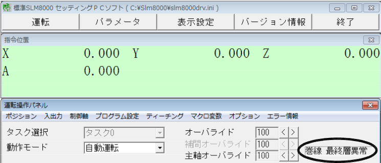

> **図の内容**
>
> 「標準SLM8000 セッティングPCソフト ( C:¥Slm8000¥slm8000drv.ini )」の運転画面。運転操作パネルの右側に「巻線 最終層異常」の表示（丸で囲み）。

- 巻き終わり指定時は、巻き終わり時にピッチ調整を行いトラバース軸が巻き終わり指定側で終了するようにします。このピッチ調整を行う際に「往復で調整」を行うか、「片道のみ調整」を行うかの判別にも「トラバース軸移動無し巻数」を使用します。

※ 前述の「巻き終わり時のピッチ調整」の ③ の動作です。

（ ② の動作か ③ の動作かの閾値に使用します。）

残巻数が片道分しかない場合だけでなく、片道分より少しだけ多い

(トラバース軸移動無し巻数÷２以下)時にも往復でピッチ調整を行うようにします。

片道ではなく往復でピッチ調整を行うことで、トラバース軸の速度が速くなりすぎる事を防ぎます。

ピッチ調整後のトラバース軸の最大速度は以下の通りです。

最大速度[pps] ＝トラバース幅×2×主軸速度[RPM] ÷（トラバース軸移動無し巻数×60）

(4).注意点

- REEL命令を使用する際は、第4軸(A軸)が無限回転軸である必要があります。必ず「メカ機構1回転パルス数」を設定してください。（「ROMSW設定ソフト」の「軸設定」にて設定）
- 巻き線命令実行開始時に以下の条件が成立した場合は、正常に動作できません。この場合は「プログラム実行エラー」になり、プログラム実行をエラー中断します。

[条件]

- 主軸（第4軸）の「メカ機構1回転パルス数」が 0（無限回転軸でない）
- 主軸移動量異常（2147483647 ＜ PPR × RN）
- 主軸速度異常（最大速度＜ PPR × S ÷ 60）
- トラバース速度異常（最大速度＜ P × S ÷ 60）
- トラバース移動量異常（2147483647 ＜ P × RN）
- 片道移動時間異常（４制御周期＞ X ÷ (P × S ÷ 60 ÷ 1000) ）
- 巻き終わり指定が「トラバース終端で終了(RE2)」で、総巻数指定が「トラバース軸移動無し巻数」
- (ROMSW)の半分以下の場合、総巻数分巻き終わるまでにトラバース軸をトラバース終端まで移動します。（本来ならトラバース終端側からの１往復でピッチ調整する必要がありますが、巻数が足りないので

PPR ：主軸の「メカ機構1回転パルス数」（ROMSW設定）

S ：主軸速度[rpm] （巻線命令のS指定）

RN ：総巻数（巻線命令のRN指定）

P ：ピッチ（巻線命令のP指定）

X ：トラバース移動量（巻線命令の軸指定）

最大速度：2 Gpps

片道分だけで調整します。）

この場合は「トラバース軸移動無し巻数」による最大速度以上の速度になる可能性があります。ピッチ調整時のトラバース軸最大速度については、「(3).巻き終わり処理指定(RE指定)の詳細」を参照下さい。

### 4-17. 主軸機能

<オプション>

主軸機能は、指令された一定速度でサーボモータやインダクションモータを回転してワーク軸やツール軸として使用するものです。

| 方式                         | 内容・特徴               | ハード                                                                   | 指令方式 - Gコード                                  | 指令方式 - Tコード   |
|-----------------------------|---------------------|-----------------------------------------------------------------------|-------------------------------------------------|------------------|
| オープンループ方式 (アナログ速度指令) 主軸回転指令 | PG FB 不要。一般の主軸     | DA出力 DA001：電圧(速度) 一般出力 ◆1.1 SOUT0：ON(回転) OFF(停止) SOUT1：ON(逆転) OFF(正転) | S5ｹﾀ (RPM) M03 (正転) M04 (逆転) M05 (停止) G120      | SPIN S 指令        |
| 2bit出力信号制御方式 (主軸 ON/OFF)   | I/O 信号のみアナログI/F不要。 | 一般出力 SOUT0 SOUT1                                                      | S0 停止 S1 速度 1 S2 速度 2 S3 速度 3 ＋M03/M04/M05 G120 |                  |

- ※ 旋盤の主軸は、一般にはオープンループ方式です。

ネジ切りのためには、主軸 PG FB が必要、且つ、専用化対応が必要です。

#### 4-17-1. オープンループ方式

主軸操作は、"コマンド"、"S指令"、"テクノコード"、"Gコード"から行い、最後に指令した指令が有効となります。

＜Gコード運転プログラムによる指令＞

Gコードプログラムの主軸回転速度指令として、Sコードが有効となります。書式は、Sに続けて回転速度［rpm］を指定します。【例】S300；実際の主軸動作は、M03(正転）/M04(逆転）/M05(停止）の各指令により実行されます。尚、主軸回転の開始（または停止）指令時は、指令回転数への到達（または停止）を待たずに、次のステップが実行されるので、必要に応じてドウェル指令等を使用して下さい。 Mコード出力あり（基本ROMSW：主軸指令Mコード出力をチェック）のときには、M0□ 実行時にそのMコード出力（8bit）も動作します。

Mコード出力時はFIN待ちを行います。FINが返るまで、新たなMコード発行や移動コマンド等の発行は出来ません。

また、Mコードの実行に伴いSOUT出力をします。

| Mコード   | SOUT1出力   | SOUT0出力   |
|--------|-----------|-----------|
| M03実行時 | ON(回転)    | OFF(正転)   |
| M04実行時 | ON(回転)    | ON(逆転)    |
| M05実行時 | OFF(停止)   | OFF       |

「アナログ指令」オプションが有効の時、"G120"指令とSコードを指令すると主軸動作を行います。指定した主軸速度が主軸最高回転数（ROMSW設定）を越えた場合、「プログラム実行エラー」になります。

※ "G120"指令については、＜4-16-2.回転速度指令 SPIN/G120＞を参照下さい。

＜ROMSW設定＞

- 主軸設定画面において、タスク毎の主軸設定をします。
- 主軸機能選択：「アナログ指令」を選択し以下の3項目を設定します。
- ①DAチャンネル

2チャンネル(DA1,DA2)のどちらを使用するか選択します。

- ②最大指令電圧

主軸最高回転数で主軸を回転させる時の、アナログ指令電圧の値を設定します。

- 主軸回転速度にマイナス値が指定された場合は、対応するアナログ指令電圧もマイナス値になります。設定範囲は、1～10000［mV］です。◆1.1
- ③主軸最高回転数

主軸の最高回転数を指定します。

設定範囲は、10～100000［rpm］です。

本設定値を越える値が指令された場合、主軸回転数は本設定値でクランプします。

- ④主軸時定数

主軸の停止指令 ←→ 最高回転指令の加減速時間を指定します。

設定範囲は、「ROMSWの制御周期の値」～「6400」［msec］です。

- ※各設定値と出力電圧の関係

・Sで指定した回転速度と出力電圧、各パラメータは以下の関係にあります。

最大指令電圧 × Sで指定した値

主軸最高回転数

＜PC通信ライブラリによるアナログ指令出力＞◆1.3

PC通信ライブラリ動作コマンドREQ_SPREVSETとREQ_SPCMNDの発行で、アナログ指令制御が可能です。REQ_SPREVSETで、主軸速度を設定します。

動作コマンドREQ_SPCMND(パラメータ=0)の発行では、常にS0相当の出力となります。

ただし、主軸速度はシステムモーダルとして記憶されていますので、再度REQ_SPCMND

(パラメータ=1または2)を指令すると記憶していた主軸速度に対応する出力を行います。

逆に、あらかじめREQ_SPCMND(パラメータ=1または2) を発行しておき、その後REQ_SPREVSETで、主軸速度を変更する事もできます。

＜テクノ言語では＞

「アナログ指令」オプションが有効の時、"SPIN S"を指令すると

- 主軸動作を行います。指定した主軸速度が主軸最高回転数を越えた場合、

「プログラム実行エラー」になります。

- ※ "SPIN"指令については、

<4-16-2.回転速度指令 SPIN/G120>を参照下さい。

#### 4-17-2. 2bit出力信号方式

＜Gコード運転プログラムによる指令＞◆1.3

- Gコードプログラムの主軸回転速度指令として、Sコードが使えます。

書式は、Sに続けて0～3のコードを指定します。【例】S1；

S指令は、システムモーダルです。（一端指令すると記憶しています）

実際の出力は、M03（正転）/M04（逆転）/M05（停止）の各指令により実行されます。

また、M03(04)出力後に、S1→S2→S3などと指令することで主軸の速度を変えられます。

2bit出力に関しては、M03とM04では差がありません。

尚、主軸回転の開始（または停止）指令時は、指令回転数への到達（または停止）を待たずに、次のステップが実行されるので、必要に応じてドウェル指令等を使用して下さい。

|            |           |           |         |         |
|------------|-----------|-----------|---------|---------|
| 主軸速度指令     | M03/04実行時 | M03/04実行時 | M05実行時  | M05実行時  |
| S指令（Ｓモーダル） | SOUT1出力   | SOUT0出力   | SOUT1出力 | SOUT0出力 |
| 0：S0       | OFF       | OFF       | OFF     | OFF     |
| 1：S1       | OFF       | ON        | OFF     | OFF     |
| 2：S2       | ON        | OFF       | OFF     | OFF     |
| 3：S3       | ON        | ON        | OFF     | OFF     |

Mコード出力あり（基本ROMSW：主軸指令Mコード出力をチェック）のときには、M0□ 実行時にそのMコード出力（8bit）も動作します。

Mコード出力時はFIN待ちを行います。FINが返るまで、新たなMコード発行や移動コマンド等の発行は出来ません。

出力電圧[mV]＝

＜PC通信ライブラリによる2bit出力＞◆1.3

PC通信ライブラリ動作コマンドREQ_SPREVSETとREQ_SPCMNDの発行で、SOUT□出力の制御が可能です。 REQ_SPREVSETで、S0～3の主軸速度を選択します。

動作コマンドREQ_SPCMND(パラメータ=0)の発行では、常にS0相当の出力となります。ただし、S1～S3の選択はシステムモーダルとして記憶されていますので、再度REQ_SPCMND (パラメータ=1または2)を指令すると記憶していたS□に対応する出力を行います。

逆に、あらかじめREQ_SPCMND(パラメータ=1または2) を発行しておき、その後REQ_SPREVSETで、 S0～3の出力を変更する事もできます。低速/中速/高速などの選択に応用できます。

| Gコードプログラム - Mコード      | Gコードプログラム - Sコード   | PC通信ライブラリ - REQ_SPCMND   | PC通信ライブラリ - REQ_SPREVSET   | SOUT1   | SOUT0   | 主軸動作指定   |
|-----------------------|--------------------|--------------------------|----------------------------|---------|---------|----------|
| M05                   | S0                 | パラメータ＝ 0                 | パラメータ＝ 0                   | OFF     | OFF     | 停止       |
| M03/M04 M03:正転 M04:逆転 | S1                 | パラメータ＝ 1：正転 2：逆転         | パラメータ＝ 1                   | OFF     | ON      | 速度1      |
|                       | S2                 |                          | パラメータ＝ 2                   | ON      | OFF     | 速度2      |
|                       | S3                 |                          | パラメータ＝ 3                   | ON      | ON      | 速度3      |

＜テクノ言語では＞

テクノ言語からは2bit出力は指令不可です。

#### 4-17-3. 主軸制御と無限回転軸(一般の軸)に対するSPINの違い

◆1.1

|                     |                     | 主軸制御 - アナログ指令                                          | 主軸制御 - 2bit出力          | 無限回転軸に対する SPIN   |
|---------------------|---------------------|--------------------------------------------------------|------------------------|------------------|
| 制御方式                | 制御方式                | DA指令                                                   | 速度選択 S0～S3            | パルス指令の位置ループ      |
| 対応軸 (2bit出力ではI/O接続) | 対応軸 (2bit出力ではI/O接続) | DA出力                                                   | 一般出力SOUT0/ SOUT1でI/O出力 | 全ての軸             |
| オプション選択             | オプション選択             | 主軸アナログ指令                                               | 主軸ON/OFF               | (標準) ※1          |
| プログラム指令            | Gコード                | S指令 M03～M05 (主軸オーバライド)※3 G120※2                        | S0～S3 M03～M05          |                  |
| プログラム指令            | Gコード                |                                                        | G120                   | G120             |
| プログラム指令            | Gコード                | (主軸オーバライド)※3                                           |                        | (オーバライドは無し)      |
| プログラム指令            | テクノコード              | SPIN(アナログ)※2 (主軸オーバライド)※3 (OVR0/1は無視)                  |                        | SPIN OVR1でオーバライド |
| セッティング PC表示         | 主軸操作                | 回転数モニタ表示 FBが無い場合は指令電圧から回転数表示 FBがある場合はFB値から回転数を算出して表示 | 無し                     |                  |
| セッティング PC表示         | 指令位置                |                                                        |                        | 指令位置(パルス)        |
| セッティング PC表示         | 機械位置                |                                                        |                        | FB有効機械位置(パルス)   |
| セッティング PC表示         | 機械位置                |                                                        |                        | FB無効指令位置(パルス)   |

- ※1 無限回転軸の場合は、ROMSWで「1回転パルス数」の設定が必要です。
- ※2 主軸オプション有でSPINやG120指令をした場合は、主軸指令として動作します。同時にM3/M4/M5のMコードが動作します。
- ※3 ROMSWの基本パラメータ「主軸オーバライド」が有効設定の時には主軸指令にオーバライドがかかります。

### 4-18. 補正機能

#### 4-18-1. バックラッシュ補正機能

機械系に、いわゆる「ガタ」(不感帯)がある場合には、サーボパラメータの「バックラッシュ補正量」に「ガタ」に相等するパルス量を設定して下さい。

【バックラッシュ補正の概念図】

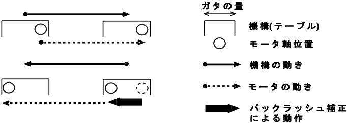

> **図の内容**
>
> 凡例: ガタの量、機構(テーブル)、モータ軸位置、機構の動き（実線の矢印）、モータの動き（点線の矢印）、バックラッシュ補正による動作（太い矢印）。移動方向が反転するときに、モータをガタの量だけ余分に動かして機構の位置を合わせる。

バックラッシュ補正は、軸の移動方向が変わるたびに、その方向へ加わります。

<最初のバックラッシュ補正>

- ○インクリメンタルエンコーダの場合原点復帰の完了後に、「原点復帰中の最後に原点に向かって動いた方向と逆の方向」に動いた時に、バックラッシュ補正がかかります。原点復帰未完もしくは原点復帰無効の軸は、補正無効です。
- ○絶対値エンコーダの場合◆1.1

原点復帰をした場合に最後に原点に向かって動く方向に「バックラッシュ補正量」以上の距離移動した後、その逆方向に移動する時にバックラッシュ補正がかかります。

- ※原点復帰において、最後に原点に向かう移動方向は、原点信号に「OT信号」を選択した場合、
- 原点復帰方向の逆方向です。それ以外は、原点復帰方向です。

#### 4-18-2. 工具長補正機能及び摩耗補正機能 <オプション>

指令コード

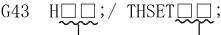

> **図の内容**
>
> `G43 H□□;` / `THSET□□;`（□□ の部分に波線）

補正テーブル番号

工具長補正及び摩耗補正を実行します。

すでに補正がかかった状態で、新たな補正番号が指令された場合、現在の補正量と新たな補正量の差分で補正がかかり、常に最後に指令された補正番号の補正がかかった状態になります。

指令コード

G49;/ THOFF;

工具長補正及び摩耗補正をキャンセルします。

補正テーブル

| T No.   |      工具長補正量 | 工具長補正量       |       摩耗補正量 | 摩耗補正量        |
|---------|-------------|--------------|-------------|--------------|
| 0       | -1000000000 | ～ 1000000000 | -1000000000 | ～ 1000000000 |
| ・       |             | ・            |             | ・            |
| ・       |             | ・            |             | ・            |
| ・       |             | ・            |             | ・            |
| 19      | -1000000000 | ～ 1000000000 | -1000000000 | ～ 1000000000 |

指定する補正テーブル番号は工具長補正と摩耗補正で共通となりますので、ご注意下さい。

■工具長補正◆1.2◆1.3

指定された補正テーブル番号の工具長補正量を現在の論理座標値に加算します。

軸の移動は行いません。

工具長補正量はシステムモーダルです。

工具補正が指定された状態で、原点復帰動作を行うと、動作完了時に論理座標値が再セットアップされます。

本補正を実行した後の最初の移動指令は必ずアブソ指令にして下さい。

工具長補正有効軸の選択は、ROMSW設定ソフトの「軸設定」画面で有効軸を選択します。

※複数の軸を有効にしないでください。全ての軸に同じ補正パラメータが反映されてしまいます。

■摩耗補正 <未完成>

指定された補正テーブル番号の摩耗補正量の分だけ、軸の移動を行います。

ただし、論理座標系をシフトする事により移動前と移動後で論理座標値は変化しません。原点復帰動作を実行した場合、摩耗補正は自動的にキャンセルされます。

注記

摩耗補正は未完成です。現在、対応しておりません。

工具長補正/摩耗補正の運転プログラム例

この例では、Z軸に対しROMSW設定ソフトの"工具長補正"を有効にしています。

```c
    ① G90 G00 X0 Z0;
    ② G91 G01 X1000 Z1000 F1000;
    ③ G43 H0;
    ④ G90 G00 X2000 Z1000;
    ⑤ G43 H1;
    ⑥ G90 G00 X3000 Z1000;
    ⑦ G49 ;
```

例1

|   HNO. |   工具長補正 |   摩耗補正 |
|--------|---------|--------|
|      0 |    2000 |      0 |
|      1 |   -1000 |      0 |

| 動作 - ステップ   |   論理座標 - X |   論理座標 - Z |   アブソ座標(メカ) - X |   アブソ座標(メカ) - Z |
|-------------|------------|------------|-----------------|-----------------|
| ①           |          0 |          0 |               0 |               0 |
| ②           |       1000 |       1000 |            1000 |            1000 |
| ③           |       1000 |       3000 |            1000 |            1000 |
| ④           |       2000 |       1000 |            2000 |           -1000 |
| ⑤           |       2000 |      -2000 |            2000 |           -1000 |
| ⑥           |       3000 |       1000 |            3000 |            2000 |
| ⑦           |       3000 |       2000 |            3000 |            2000 |

例2

|   HNO. |   工具長補正 |   摩耗補正 |
|--------|---------|--------|
|      0 |       0 |    500 |
|      1 |       0 |   -500 |

|    |   論理座標 - X |   論理座標 - Z |   アブソ座標(メカ) - X |   アブソ座標(メカ) - Z |
|----|------------|------------|-----------------|-----------------|
| ①  |          0 |          0 |               0 |               0 |
| ②  |       1000 |       1000 |            1000 |            1000 |
| ③  |       1000 |       1000 |            1000 |            1500 |
| ④  |       2000 |       1000 |            2000 |            1500 |
| ⑤  |       2000 |       1000 |            2000 |             500 |
| ⑥  |       3000 |       1000 |            3000 |             500 |
| ⑦  |       3000 |       1000 |            3000 |            1000 |

【注意】

工具長補正/摩耗補正と同時に汎用入力制御を設定した場合でも、論理座標のセットアップには入力制御はききません。(座標のセットアップは即時行われます。)

座標のセットアップを行った後に汎用入力制御(Exit、スキップ、Wait、Stop)による処理を行います。

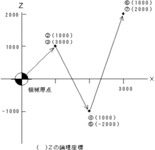

> **図の内容**
>
> Z の論理座標（( )は Z の論理座標）。機械原点から ②(1000) ③(3000)、④(1000) ⑤(−2000)、⑥(1000) ⑦(2000) へ移動する軌跡。

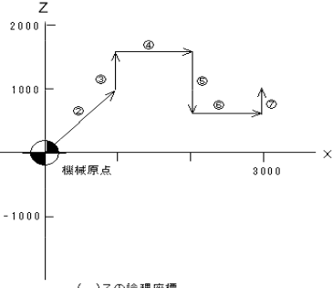

> **図の内容**
>
> 同じ動作の補正後の軌跡。②→③→④→⑤→⑥→⑦ と、Z 方向の移動が段状になる。

#### 4-18-3. 工具径補正機能

<オプション>

◆1.3

4-18-3-1.径補正指令コード

■ Gコード(G40、G41、G42)

【Gコード例】

G41 (G01) D＿ X＿ Y＿

;左側補正

～

G42 D＿ X＿ Y＿

;右側補正

～

G40

;径補正キャンセル

| G40   | 径補正キャンセル          |
|-------|-------------------|
| G41   | 径補正左側            |
| G42   | 径補正右側            |
| D     | 工具径補正テーブルNO.(2ケタ) |

- a). Dの値はプログラムモーダルです。 (省略可、プログラムモーダル※)
- b). Dの指定範囲は0～19です。
- c). 工具径補正テーブルの補正量(+値)は、あらかじめセットしておきます。
- d). 径補正は、ROMSW設定で選択されたX/Y平面にておこないます。(2次元)
- e). G40、G41、G42は、単独でも、またG00、G01と組み合わせても使用できます。
- f). 円弧指令ではアドレスDの値は第4軸中心指定です。径補正値の設定はできません。プログラムモーダルでの設定となります。
- ※ 前回のプログラム実行で指令したDの値は引き継ぎません。プログラム起動時は、デフォルト値(D00)になります。

■ テクノコード(DC、DL、DR)

【テクノコード例】

LIN X＿ Y＿ F＿ DL＿

;左側補正

～

LIN X＿ Y＿ F＿ DR＿

;右側補正

～

DC

;径補正キャンセル

| DC   | 径補正キャンセル                |
|------|-------------------------|
| DL   | 径補正左側+工具径補正テーブルNO.(2ケタ) |
| DR   | 径補正右側+工具径補正テーブルNO.(2ケタ) |

- a). DL/DRで工具径補正テーブルNO.を指定します。 (DL/DR指令時は必ず工具番号を指定して下さい。) 工具径補正テーブルNO.はプログラムモーダルです。
- b). DL/DRの指定範囲は0～19です。
- c). 工具径補正テーブルの補正量(+値)は、あらかじめセットしておきます。
- d). 径補正は、X/Y平面にておこないます。(2次元)
- e). DC、DL、DRは、単独でも、またPTP(A)、LIN(A)と組み合わせても使用できます。円弧指令との同時使用はできません。

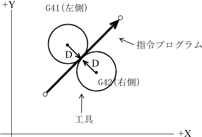

> **図の内容**
>
> 「指令プログラム」の直線に対し、工具（半径 D）が G41（左側）または G42（右側）にずれた位置を通る。

##### 4-18-3-2.使用上の条件

- a). 径補正を有効とする区間では、以下の指令は使えません。
- ① 移動指令や径補正D値に対するマクロ変数指定。
- ② マクロなどによる条件判断や分岐
- ③ JR指定
- ④ センサーラッチ（G31）
- ⑤ X/Y軸の論理座標設定指令（G92､CSET）
- ⑥ X/Y軸の回転軸回転指令（G120､SPIN）
- ⑦ X/Yのどちらかとその他の軸の円弧指令。
- ⑧ X/Yのどちらかがヘリカル円弧のヘリカル軸。 ※ X/Y軸が指定されていない円弧指令/ヘリカル円弧指令、及び X/Y軸両方が円弧軸に指定されて
- いる円弧指令/ヘリカル円弧指令は実行出来ます。
- b). 径補正を有効とする区間では、ティーチングは行えません。
- c). 指令位置、及び機械位置は、径補正後の座標値となります。
- d). 径補正モード(右/左/無効)の変更後、または工具径変更後の最初のX/Y軸移動は必ず、PTP位置決め指令、または直線補間指令で行って下さい。

（X/Y軸以外の軸の円弧補間指令は可能です。）

- e). 径補正を行うには、ROMSW設定により前もって径補正の対象軸を設定して下さい。（タスク毎に設定が必要です。）

対象軸を設定していないタスクで径補正開始(右側/左側)指令を実行すると、プログラム実行エラーになります。

※ 現状では径補正対象軸はX/Y軸固定です。

（ROMSW設定では、必ず「横軸＝論理軸第1軸(X軸)/縦軸＝論理軸第2軸(Y軸)」に設定して下さい。）

##### 4-18-3-3.径補正モードへの入り方

「DL」又は「DR」／「G41(42) G00」又は「G41(42) G01」の指令で径補正モードに入ります。径補正モード指令の前のステップはインポジション待ちを行います。径補正モード後、最初の移動（スタートアップステップ）時に径補正が加味された位置へ移動します。（スタートアップステップの目標位置が径補正が加味された位置に変わります。）スタートアップステップの目標位置は、スタートアップステップを法線方向に径補正分シフトした移動と、次の移動ステップを法線方向に径補正分シフトした移動の交点です。

（スタートアップステップを径補正中のステップと考えた場合の目標位置へ移動します。）

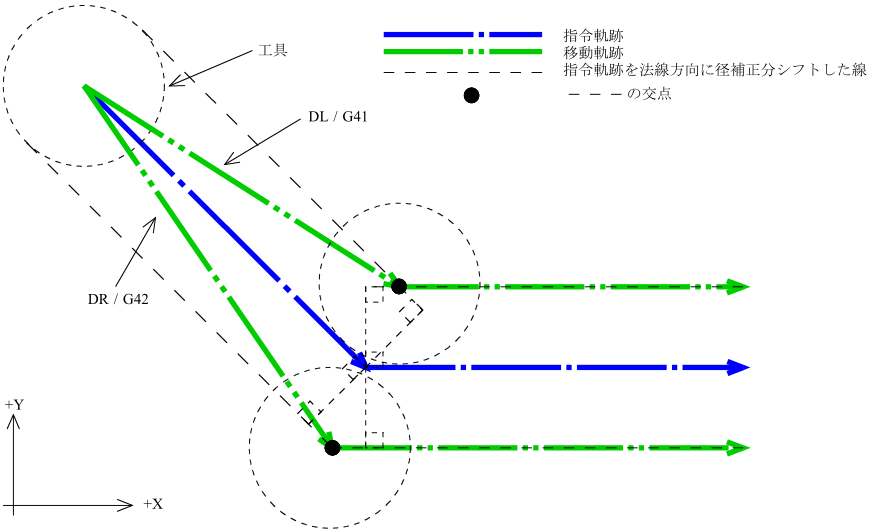

> **図の内容**
>
> 凡例: 指令軌跡（青）、移動軌跡（緑）、指令軌跡を法線方向に径補正分シフトした線（点線）、● はその交点。工具の始点から、DL / G41 と DR / G42 のそれぞれで、補正後の経路が交点を経て直線に入る様子。

【注意点】

- 円弧命令では、径補正に入れません。（プログラム実行エラーになります。） ※ 径補正中の円弧命令は問題ありません。
- スタートアップステップの目標位置が上記説明の動作のため、スタートアップステップとその次の移動ステップの角度が180°未満の場合は、工具端面の軌跡が次の移動ステップの指令軌跡の最初の方を通らない（削り残し）場合があります。同様に、角度が180°より大きい場合は、工具端面の軌跡が次の移動ステップの指令軌跡の最初の方に重なる（削りすぎ）場合があります。これを防ぐには２通りの方法があります。
- ① スタートアップステップとその次の移動ステップの角度が180°になるようにして下さい。
- ② スタートアップステップの次の移動ステップを実際の加工より手前から始まるようにして下さい。

##### 4-18-3-4.径補正の終了

G40指令と同時又は直後のＸ／Ｙ指令(G00／G01)にて径補正を終了します。円弧命令では、径補正の終了は行えません。(エラーになります。)

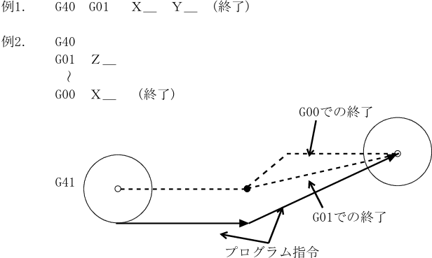

> **図の内容**
>
> - 例1. `G40 G01 X__ Y__`（終了）
> - 例2. `G40` → `G01 Z__` … `G00 X__`（終了）
> G41 で補正中の経路から、G00での終了（点線）と G01での終了（実線）の違い。「プログラム指令」の経路。

「G40」指令の前のステップはインポジション待ちを行います。

(1).終了直前の補間指令の完了点

終了直前の移動の完了点は、単純に径補正量分を平行移動した点（Ａ）になります。以下の場合、いずれも図のような軌跡となります。

- （G41） G01 X□□□ Y□□□ ① 終了点Ａ
- G40 G01 X□□□ Y□□□ ②

（G41） G01 X□□□ Y□□□ ① 終了点Ａ

G40

G01 X□□□ Y□□□ ②

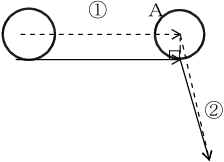

> **図の内容**
>
> ① A へ水平に移動し、② 下向きに移動する。工具の円と、補正後の経路（点線）。

点線：実際の軌跡

実線：指令の軌跡

上記を考慮して、径補正キャンセル時のツール軌跡を指令してください。特に、ワークに近づく軌跡で終了する場合は注意が必要です。

##### 4-18-3-5.補正モード中にX/Y移動のないステップ

補正モード(G41/G42)中にX/Y移動でない指令があった場合は、ステップを先読みして径補正軌跡を作成します。最大10ステップの先読みが可能です。

X/Y移動でない指令が連続して10ステップ以上あった場合は、「プログラム実行エラー」になります。

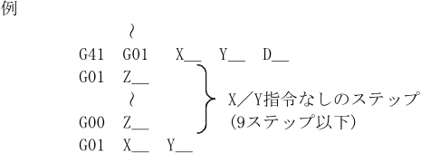

> **図の内容**
>
> 例:
> ```
> G41 G01 X__ Y__ D__
> G01 Z__
>  ～
> G00 Z__
> G01 X__ Y__
> ```
> `G01 Z__` から `G00 Z__` までが「X/Y指令なしのステップ（9ステップ以下）」。

サブプログラム呼び出しを行っている場合、先読みステップには、サブプログラムの呼び出しステップとサブプログラム内のステップが含まれます。

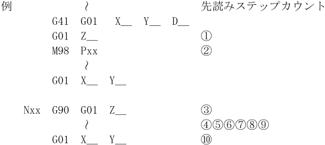

> **図の内容**
>
> 例:
> ```
> G41 G01 X__ Y__ D__
> G01 Z__          ①
> M98 Pxx          ②
>  ～
> G01 X__ Y__
> Nxx G90 G01 Z__  ③ ④⑤⑥⑦⑧⑨
>  ～
> G01 X__ Y__      ⑩
> ```
> 右の番号が先読みステップカウント。

##### 4-18-3-6.補正中の G00 の動作

G00指定のステップは、最終的なオフセット位置に向かって各軸独立に位置決めします。工具軌跡に注意を要します。

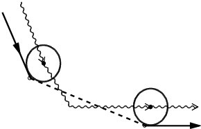

> **図の内容**
>
> 波線の経路（G00）と、工具の円・補正後の経路（点線）。G00 のステップでも最終的なオフセット位置へ移動する。

波線:実際の軌跡

点線:G00指令

実線:G01指令

##### 4-18-3-7.工具径補正データ設定画面

セッティングPCの以下の画面で、工具径補正時に必要な補正パラメータの作成・設定を行います。

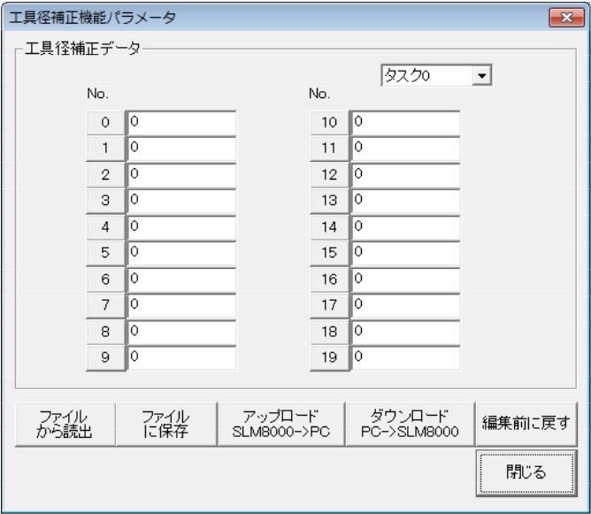

> **図の内容**
>
> 画面「工具径補正機能パラメータ」。工具径補正データ（タスク0）No.0～19 の値（すべて 0）。ボタン: ファイルから読出、ファイルに保存、アップロード SLM8000->PC、ダウンロード PC->SLM8000、編集前に戻す、閉じる。

- (1). ファイルから読出ボタン工具径補正データファイルを読み出します。
- (2). ファイルに保存ボタン

工具径補正データファイルに保存します。

- (3). アップロードボタン SLM8000に格納されている工具径補正データを読み出します。
- (4). ダウンロードボタン

工具径補正データをSLM8000に格納します。

- (5). 編集前に戻すボタン編集中に押すと編集前の状態にします。

No. 0～19に対応する工具の半径を指定します。単位はパルスです。

##### 4-18-3-8.マクロ変数

#3500～#3519：工具径補正データ（No.00 ～ 19）

工具径補正データをマクロ変数書き込みで値を変更した場合、一時的なワークメモリのみ変更し、同パラメータのバックアップメモリの数値は変更しません。

また、SLM8000は電源OFF → ON で、バックアップメモリから同パラメータを読み出します。

そのため、書き込んだ後も電源OFF → ONで元の値(パックアップメモリの値)に戻ります。

バックアップメモリのパラメータを変更するのは、セッティングPCソフト

<4-18-3-7.工具径補正データ設定画面>、またはユーザアプリケーションソフトから書き込む必要があります。

##### 4-18-3-9.角度一致閾値設定

ROMSW設定ソフト「基本」画面

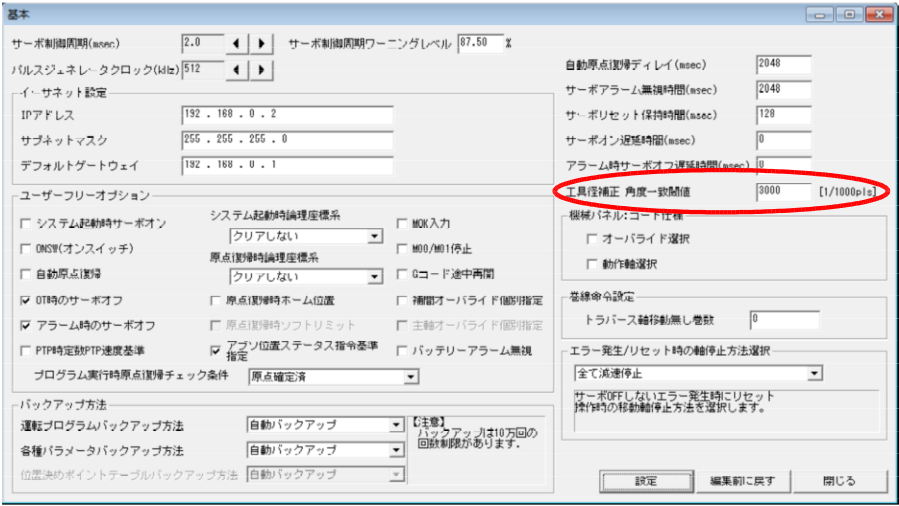

> **図の内容**
>
> ROMSW設定ソフトの「基本」画面。「工具径補正 角度一致閾値」の欄（単位 [1/1000pls] と読める）が赤丸で囲まれている。ほかの項目は小さくて判読できず。

- 工具径補正角度一致閾値[1/1000pls]

角度一致閾値を1/1000パルス単位で設定します。(1000で1パルスです。)

- ※ 工具径補正では、補正後の軌跡を求めるために、径補正後の交点を使用します。この際、演算誤差による誤判別を避けるため、角度一致の閾値を設定できるようにしています。

円弧指令を使用していると、交点が２つ出来てしまうため、使用する交点を判別する必要があります。デフォルト値(0:3000)で交点を誤判別するようでしたら調整してください。

円弧半径

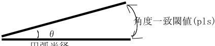

> **図の内容**
>
> 2 本の線が角度 θ で開いている。開いた先の幅が「角度一致閾値(pls)」。下の線の名前は「円弧半径」（下が切れている）。

円弧半径と角度一致閾値(pls)から角度θを求め、θを交点判別時の許容誤差にします。

- 尚、主な演算誤差の原因は以下の通りです。
- 動作プログラム作成時の離散誤差

(パルス単位で指令するための切り捨て／切り上げ)

- 浮動小数点演算による演算誤差

参考までに<4-18-3-13.注意事項>も参照して下さい。

##### 4-18-3-10.工具径補正情報画面

工具径補正の有効/無効状態と、現在選択中の工具径補正データ番号をモニタ出来ます。

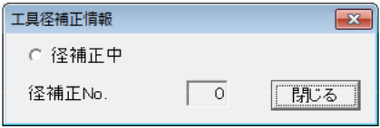

> **図の内容**
>
> 画面「工具径補正情報」。「径補正中」（未選択）、径補正No. 0、「閉じる」ボタン。

径補正中

工具径補正実行中（DR□/DL□命令実行から、DC命令実行までの間）ONになります。

径補正No.

径補正実行中の工具番号を表示します。

（DC命令実行後も工具番号表示は残ります。プログラムスタート時に"0"になります。）

##### 4-18-3-11.工具径補正の詳細エラー情報

工具径補正の詳細エラー情報をモニタリングすることができます。

※工具径補正実行時、補正の軌跡の作成処理でエラーが発生すると、要因にかかわらず

「プログラム実行エラー」になります。この時、エラーの要因(詳細)を本画面で確認することができます。

(1).ＰＣ画面

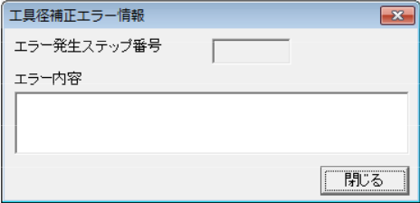

> **図の内容**
>
> 画面「工具径補正エラー情報」。エラー発生ステップ番号（空）、エラー内容（空）、「閉じる」ボタン。

エラー発生ステップ番号

工具径補正実行時に発生したエラーのステップ番号を表示します。

エラー内容

発生したエラーの内容を表示します。

各エラー内容の種類は、<(2). エラーの種類>を参照して下さい。

(2).エラーの種類

エラー内容で表示されるエラーの種類と参照項目

| エラー内容             | 参照項目                                 |
|-------------------|--------------------------------------|
| 円弧指令での径補正モード変更エラー | <4-18-3-12.-(1).円弧指令での径補正モード変更エラー>   |
| 径補正中の禁止命令指定エラー    | <4-18-3-12.-(2).径補正中の禁止命令指定エラー>      |
| マクロ変数エラー          | <4-18-3-12.-(3).マクロ変数エラー>            |
| 径指定範囲外エラー         | <4-18-3-12.-(4).径指定範囲外エラー>           |
| 移動量なしエラー          | <4-18-3-12.-(5).移動量なしエラー>            |
| 円弧中心点演算エラー        | <4-18-3-12.-(6).円弧中心点演算エラー>          |
| 交点なしエラー(LIN→LIN)  | <4-18-3-12.-(7).-1)交点なしエラー(LIN→LIN)> |
| 交点なしエラー(LIN→CIR)  | <4-18-3-12.-(7).-2)交点なしエラー(LIN→CIR)> |
| 交点なしエラー(CIR→LIN)  | <4-18-3-12.-(7).-3)交点なしエラー(CIR→LIN)> |
| 交点なしエラー(CIR→CIR)  | <4-18-3-12.-(7).-4)交点なしエラー(CIR→CIR)> |
| 移動方向反転エラー(LIN)    | <4-18-3-12.-(8).-1)移動方向反転エラー(LIN)>   |
| 移動方向反転エラー(CIR)    | <4-18-3-12.-(8).-2)移動方向反転エラー(CIR)>   |

##### 4-18-3-12.各エラー内容

(1).円弧指令での径補正モード変更エラー

円弧指令の径補正中に、径補正モードを変更するとエラーになります。

<例>

```c
    F20000;
    DR1;
```

円弧指令では径補正に入れないのでエラー。

CIRL X40000 Y0 I20000 J0;

```c
    DC;
    END;
```

[対策]

PTP(G00)かLIN(G01)の指令時に、径補正モードを変更できます。

F20000;

LIN X10000 DR1; 「LIN」命令で径補正に入ります。

CIRL X40000 Y0 I20000 J0;

```c
    DC;
    END;
```

(2).径補正中の禁止命令指定エラー

径補正中に、以下の命令を使用するとエラーになります。

- Ｘ／Ｙ軸のセンサーラッチ命令(SLIN/G31)

<例> SLIN Y50000;

- Ｘ／Ｙ軸のどちらかと他の軸の円弧命令

<例> CIRR X10000 Z0 I5000 K0;

- Ｘ／Ｙ軸のどちらかがヘリカル軸のヘリカル指令

<例> CIRR Z10000 A0 X10000 K5000 D0;

※<4-18-3-2.使用上の条件>の使えない命令のうち、上記を使用した場合のみ、

「径補正中の禁止命令指定エラー」になります。他の禁止命令の場合は

「プログラム実行エラー」になるだけで、径補正エラー情報に情報が出てきません。

(内部処理の関係により、このような仕様にしています。)

(3).マクロ変数エラー

軸移動量指定に、マクロ変数を使用するとエラーになります。

<例>

```c
    F20000;
    DR1;
```

LIN X#1000 Y#1001; 移動量指定にマクロ変数を使用するとエラー

```c
    DC;
    END;
```

(4).径指定範囲外エラー

径指定(DL/DR/D)で、範囲外(０～１９以外)を指定するとエラーになります。

<例>

F20000;

LIN Y50000 DR20; 径指定が範囲外なのでエラー

```c
    DC;
    END;
```


(5).移動量なしエラー

径補正中に、Ｘ軸とＹ軸の移動量が０になる命令はエラーにします。

<例１>

F20000;

LINA Y40000 DL10;

CIRRA X40000 Y0 I0 J-40000;

```c
    LINA Y0; 移動量０なのでエラー
    DC;
    END;
```

<例２>

F20000;

LINA Y40000 DL10;

```c
    LINA X20000;
    LINA Y40000;
    DC;
    END;
```

移動量０なのでエラー

(6).円弧中心点演算エラー

1)円弧の半径指定の場合

- a).１周円命令の半径指定はエラーになります。１周円命令は必ず中心指定で記述して下さい。

<例>

LIN X30000 DL1;

CIRRA PXY X30000 Y0 R40000; １周円を半径指定しているのでエラー

[対策]


１周円は中心指定で記述します。

<例>

LIN X30000 DL1;

CIRRA X30000 Y0 I40000 J0; 中心指定に変更

- b).「始点-終点」間距離の1/2と、半径指定の差が1000パルス以上でエラーになります。

<例>

CIRR PXY X10000 Y0 R6500 F10000;

「始点-終点」間距離の1/2 = 5000

半径指定との差が1500パルスなのでエラーになります。

差が1000パルス未満の場合は、半径調整を行います。詳細は、

<4-18-3-13.(2).半径指定円弧の半径調整>を参照して下さい。

2)円弧の中心指定の場合

「始点-中心」間距離と「終点-中心」間距離の差が1000パルス以上でエラーになります。

<例>

CIRR X10000 Y0 I6500 J0 F10000;

「始点-中心」間距離 = 6500

「終点-中心」間距離 = 3500

差が3000パルスなのでエラーになります。

差が1000パルス未満の場合は、中心調整を行います。詳細は、 <4-18-3-13.(1).中心指定円弧の中心調整>を参照して下さい。

(7).交点無しエラー

1)交点無しエラー(ＬＩＮ→ＬＩＮ）

直線の逆方向への移動(同一軌跡の往復)は、交点が出来ないのでエラーになります。

<例>

交点が出来ないのでエラー

径補正量2000の場合

①LIN X30000 DL19;

②LIN X-30000 DC;

[対策]

<例>

①LIN X30000 DL19;

②LIN Y-2000;


> **図の内容**
>
> DL①（点線）と DL②（実線）が同じ直線上で重なる。下向きの矢印は次の図へ続くことを示す。

ステップ間に直線を入れて交点が出来るようにする

直線を入れる。

③LIN X-30000;

2)交点無しエラー(ＬＩＮ→ＣＩＲ)

<例>

径補正量5000の場合 ①LIN Y40000 DL1;

②CIRL X80000 Y0 I40000 J0;

[対策]

<例>

①LIN Y40000 DL1;

②LIN X1000; 直線を入れる。

③CIRL X80000 Y0 I40000 J0;


> **図の内容**
>
> DL①、DL②、DL③ の補正経路（点線）。指令経路は細長いコの字。

交点が出来ないのでエラー


> **図の内容**
>
> DL①（上向きの直線）と DL②（円弧）。補正後の経路（点線）に交点が出来ない。下向きの矢印は次の図へ続く。

ステップ間に直線を入れて交点が出来るようにする


> **図の内容**
>
> DL①、DL②（短い直線を追加）、DL③（円弧）。ステップ間に直線を入れて交点が出来るようにした例。

3)交点無しエラー(ＣＩＲ→ＬＩＮ)

交点が出来ないのでエラー

- <例> 径補正量5000の場合 ①CIRR X80000 Y0 I40000 J0; ②LIN Y30000;

[対策]


> **図の内容**
>
> `J0;`。DR①（円弧）と DR②（上向きの直線）。補正後の経路（点線）。下向きの矢印は次の図へ続く。

ステップ間に直線を入れて交点が出来るようにする

- ①CIRR X80000 Y0 I40000 J0;
- ②LIN X1000; 直線を入れる。
- ③LIN Y30000;

4)交点無しエラー(ＣＩＲ→ＣＩＲ)

<例>


> **図の内容**
>
> DR①（円弧）、DR②（追加した直線）、DR③（上向きの直線）。

交点が出来ないのでエラー

- 径補正量2000の場合
- ①CIRL X40000 Y0 I20000 J0;
- ②CIRL X40000 Y0 I20000 J0;

[対策]

<例>

①CIRL X40000 Y0 I20000 J0; ②LIN X1000; 直線を入れる。

- ③CIRL X40000 Y0 I20000 J0;

J0;
  
J0;
  
DL① DL②

ステップ間に直線を入れて交点が出来るようにする


> **図の内容**
>
> DL①（円弧）、DL②（追加した直線）、DL③（円弧）。

(8).移動方向反転エラー

基軌跡の移動方向と、補正後軌跡の移動方向が逆になる場合はエラーとなります。 (径よりも狭い場所の移動等)

尚、次ステップが確定しなければ、そのステップの移動が反転するかが判断できないため、径補正エラー情報画面の"エラー発生ステップ番号"には、実際に移動反転するステップの次ステップ番号が表示されます。

1) 移動方向反転エラー(ＬＩＮ)

<例１>

径補正量5000の場合

- ①LIN X20000 DR1;
- ②LIN Y-3000;
- ③LIN X-20000;
- "DR②"の移動方向が、"ステップ②"の移動方向と逆になるのでエラー


> **図の内容**
>
> DR①、DR②、DR③ の経路。"DR②"の移動方向が、"ステップ②"の移動方向と逆になる。※線「-----」は交点を出すための補助線。

[対策]

径が移動できるように変更

- ①LIN X20000 DR1;
- ②LIN Y-11000; 径が通れる
- ③LIN X-20000; ようにする

<例２>

径補正量5000の場合

- ①LIN X3000;

②LIN Y10000;

[対策]

※線「」は交点を出すための補助線


> **図の内容**
>
> 矩形の指令経路と、DR①、DR②、DR③ の補正経路（点線）。補助線（細い点線）で交点を示す。

"DL①"の移動方向が、"ステップ①"の移動方向と逆になるのでエラー

径が移動できるように変更


> **図の内容**
>
> DR①、DR② の補正経路（点線）と指令経路（実線）。※線「-----」は交点を出すための補助線。下向きの矢印は次の図へ続く。

径補正量5000の場合

- ①LIN X6000; 径よりも大きい

②LIN Y10000; 移動にする


> **図の内容**
>
> DR①、DR② の補正経路（点線）と指令経路（実線）。※線「-----」は交点を出すための補助線。

2) 移動方向反転エラー(ＣＩＲ)

<例１>

- 径補正量20000の場合
- ①CIRR X40000 Y-40000 I0 J-40000;
- ②CIRR X10000 Y0 I5000 J0;
- ③CIRR X40000 Y40000 I40000 J0;
- "DR②"の移動方向が、"ステップ②"の移動方向と逆になるのでエラー


> **図の内容**
>
> DL①、DL②、DL③ と、交点を求めるための円（点線）。※線「-----」は交点を出すための補助線。

[対策]

- ①CIRR X40000 Y-40000 I0 J-40000;
- ②CIRR X40000 Y0 I20000 J0; 径が通れるようにする
- ③CIRR X40000 Y40000 I40000 J0;

径が移動できるように変更

※線「」は交点を出すための補助線


> **図の内容**
>
> DL①、DL②、DL③ と、交点を求めるための円（点線）。

<例２>

径補正量20000の場合

- ①LIN Y-80000;
- ②CIRL X-10000 Y26458 I-40000 J0;
- ③CIRL X-70000 Y-26458 I-30000 J-26458;

ステップ②と③の円弧は同じ軌跡です。

"DR②"の移動方向が、"ステップ②"の移動方向と逆になるのでエラー


> **図の内容**
>
> DR①（下向きの直線）、DR②、DR③（円弧）の補正経路（点線）と指令経路。※線「-----」は交点を出すための補助線。下向きの矢印は次の図へ続く。

[対策]

円弧を分割している座標を、径の外側にずらす。

- ①LIN Y-80000;
- ②CIRL X-30000 Y38730 I-40000 J0; 分割している座標をずらす。
- ③CIRL X-50000 Y-38730 I-10000 J-38730;

ステップ②と③の円弧は同じ軌跡です。

※線「」は交点を出すための補助線


> **図の内容**
>
> DR①、DR②、DR③（円弧）の補正経路（点線）と指令経路。上に「…軌跡です。」の文字（左が切れている）。

<例３>

１つの円弧命令で、径補正後の軌跡が１周円以上になる場合はエラーになります。

径補正量20000の場合

①LIN Y-40000;

②CIRL X40000 Y-40000 I0 J-40000;

③LIN X20000;

[対策]

円弧命令を２つに分割し、１つの円弧命令での径補正後の軌跡が１周円以上にならないようにします。

①LIN Y-40000;

②CIRL X0 Y-80000 I0 J-40000; 円弧命令を２つに分割する

③CIRL X40000 Y40000 I0 J40000;

④LIN X20000;


> **図の内容**
>
> DL①（下向き）、DL④（右向き）と、円弧の指令経路。「DL②軌跡」「DL③軌跡」を拡大して示す。※線「-----」は交点を出すための補助線。

"DL②"は１周以上移動します。


> **図の内容**
>
> DL①（下向き）、DL②（円、点線）、DL③（右向き）。"DL②"は１周以上移動します。

※線「」は交点を出すための補助線


##### 4-18-3-13.注意事項

(1).中心指定円弧の中心調整

- 中心指定の円弧命令で指定された、「始点-中心」間距離と「終点-中心」間距離の差が1000パルス未満の時、「始点-中心」間距離と「終点-中心」間距離の平均の半径になるように中心を調整します。「始点-中心」間距離と「終点-中心」間距離の差が1000パルス以上の場合はエラーになります。詳細は、<4-18-3-12.-(6).-2)円弧の中心指定の場合>を参照して下さい。
- ※ 動作プログラム作成時の離散誤差(パルス単位で指令するための切り捨て／切り上げ)により、終点／中心指定が円弧上にない現象を防ぎます。


> **図の内容**
>
> 「始点」「運転プログラムで指定された終点」「運転プログラムで指定された中心」と「調整後の中心」。始点と終点から等距離になるように中心を調整する。

【注意】

上記のように、1000パルス未満の間違えであれば調整を行うため、運転プログラムの作成ミス等で異常な円弧(下記例を参照)を指定したときでも調整して動作してしまいます。ご注意下さい。

- <例> 中心指定が終点よりも外側に指定された場合 CIRR X800 Y0 I1000 J0 F1000;

半径Ｒ = (1000(始点-中心間距離) + 200(終点-中心間距離)) / 2 Ｒ = 600


> **図の内容**
>
> 始点 (0, 0)、運転プログラムで指定された終点 (800, 0)、運転プログラムで指定された中心座標 (1000, 0)。

半径が600になるように中心を調整します。


> **図の内容**
>
> 始点 (0, 0) から 運転プログラムで指定された終点 (800, 0) への円弧。R600 となるように調整後の中心座標 (400, 447)。

(2).半径指定円弧の半径調整

「始点-終点」間距離の1/2と、半径指定の差が1000パルス未満の場合は、「始点-終点」間距離の1/2に半径を調整します。

差が1000パルス以上の場合はエラーになります。

詳細は、<4-18-3-12.-(6).-1)円弧の半径指定の場合>を参照して下さい。


> **図の内容**
>
> 始点から運転プログラムで指定された終点への半円。「運転プログラムで指定された半径」と「調整後の半径」。

(3).交点が２つある場合の注意

交点が２つある場合は、補正前図形の終点に近い交点を選択して動作します。

<例１> CIR→CIR

径補正量20000の場合

- ①CIRR X75000 Y-19365 I40000 J0;
- ②CIRR X75000 Y19365 I35000 J19365;

補正前図形の終点

補正前図形の終点に

近い補正後の交点


> **図の内容**
>
> `…5000 J19365;`（左が切れている）。2 つの円弧の指令経路と補正経路（点線）、交点を求める円。矢印で示す 2 つの点（左側の説明文は切れていて判読できず）。


[手前の交点を使用したい場合]

- 交点を２つ作らない命令にします。
- ①CIRR X75000 Y19365 I40000 J0;
- ②CIRR X75000 Y-19365 I35000 J-19365;

※線「」は交点を出すための補助線


> **図の内容**
>
> 2 つの円弧の補正経路（点線）。「補正後図形の交点」と「補正前図形の終点」。

※線「」は交点を出すための補助線

例1の命令の場合、補正後の軌跡が交差してしまいます。

- <例２> LIN→CIR

径補正量5000の場合

例2の命令の場合、補正後の軌跡が交差してしまいます。

- ①CIRR X78000 Y-12490 I40000 J0;
- ②LINA Y80000;

補正前図形の終点

補正前図形の終点に近い補正後の交点


> **図の内容**
>
> `J0;`。円弧と上向きの直線の指令経路と補正経路（点線）。矢印で示す 2 つの点（左側の説明文は図に含まれていない）。

※線「」は交点を出すための補助線


[手前の交点を使用したい場合]

交点を２つ作らない命令にします。

- ①CIRR X60000 Y34641 I40000 J0;
- ②LINA Y80000;

※線「」は交点を出すための補助線


> **図の内容**
>
> 円弧と上向きの直線。「補正後図形の交点」と「補正前図形の終点」。

#### 4-18-4. ピッチエラー補正機能

<オプション>

◆1.1

各軸毎に機械原点を基点とした、一定間隔の区間毎の補正データを、パラメータに記憶させ、そのデータに従って、ボールネジの誤差を自動的に補正する機能です。この機能は、インクリメンタルエンコーダの場合、原点復帰の完了後、有効になります。原点復帰未完もしくは原点復帰無効のインクレ軸は補正無効です。絶対値エンコーダの場合、サーボON後有効になります。無限回転軸に設定した軸には、ピッチエラー補正は無効です。

【基本仕様】

| 補正軸     | 全制御軸中の任意の指定軸        |
|---------|---------------------|
| 補正点の数   | 全軸で4160点Max.        |
| 補正の基点   | 機械原点                |
| 補正の間隔   | 1000～1000000パルス     |
| データ設定方式 | アブソリュート(機械原点からの補正量) |
| 補正量     | 0～±127パルス           |
| 補正倍率    | ×10Max.             |

【注意事項】

- (1). 最大補正量は、基点に対して±1270パルスとなります。
- (2). 使用するサーボの応答性やサーボ調整により異なりますが、隣合う補正量の差が大きすぎると、急激な動作となる場合があります。
- (3). 総補正点数が4160点以内であれば、軸毎の点数配分は任意です。
- (4). ピッチエラー補正を無効とする場合は、パラメータの補正倍率に、0を設定して下さい。
- (5). 補正量(補正量×補正倍率)が補正間隔以上の場合、ダウンロード時にパラメータエラーとなります。
- (6). 補正有効の状態でパラメータを変更した場合、ダウンロード後すぐに値を反映します。 (値によっては、急激な動作となる場合があります。)

【パラメータ】

|    | 項目          | 設定値                |
|----|--------------|----------------------|
| 各  | 補正倍率補正間隔    | 0～10 1000～1000000パルス |
| 各  | 補正データ先頭番号    | 0～4159               |
| 軸  | -側補正区間数      |                      |
| 各  |              | 0～4160               |
| 各  | +側補正区間数      | 0～4160               |
| 共  | 補正データ        | 0～±127パルス            |
| 通  | No.0～No.3999 |                      |

【設定例】

下図の様なX軸の補正を設定する例を示します。


> **図の内容**
>
> 基点＝機械原点。X軸座標の − 側に ③区間～①区間、+ 側に ①区間～⑧区間。各区間の補正間隔＝100000パルス。ピッチエラー計測誤差の階段状のグラフ。


> **図の内容**
>
> X軸: 補正倍率 :1、補正間隔 :100000、補正データ先頭番号 :0、−側補正区間数 :3、+側補正区間数 :8。
> 補正データ（No. → 補正値）: 000 → 3、001 → 2、002 → 0、003 → 0、004 → −2、005 → −3、006 → −4、007 → −5、008 → −5、009 → −6、010 → −6（ここまで X軸で使用）、011～4159 は他の軸で使用。

#### 4-18-5. 形状補正(高精度輪郭制御) <オプション>

高速・高精度な輪郭制御を要求するマシンでは、形状補正による軌跡精度の向上が有効です。これにより、サーボ系の遅れによる軌跡誤差を最小限に抑えることが可能となります。

(1). 形状補正機能の概要

- a. コーナ部の内回りを少くする
- b. 円弧の縮みをなくす


> **図の内容**
>
> 直角のコーナーで、「指令」の軌跡に対して「従来の軌跡」（点線）は大きく内側を回り、「補正有の場合の軌跡」は指令に近い。


> **図の内容**
>
> 円弧の指令（実線）と実軌跡（点線）。「この縮みを小さくします。」

(2). 形状補正の効果

サーボ系を1次遅れ系とみなして、その遅れ分を補償します。その結果、指令どおりの実軌跡となります。

速度ベクトルの変化がなめらかな場合には、最大限の効果が出ます。従って、速度変化が大きい場合は、「プリ解加減速」を利用するか「運転プログラムの各ステップ(ブロ

ック)を細分化して、速度Fがゆるやかに変化する」ようにして下さい。

(3). 形状補正機能の制限事項

また、理想的なサーボ系(1次系)と現実のサーボ系の差(機械系、速度ループ特性)から、効果の程度が

速度が急に変化する動きでは、充分な効果が上がらない場合もあります。変わることがあります。

(4). 使用方法 <オプション>

サーボパラメータの「形状補正係数」を設定して下さい。

形状補正係数:位置ループゲイン(Kp)の1.5倍～5倍

|   例 KP | 形状補正係数   |
|--------|----------|
|     40 | 60～200   |

0の時は制御なし。

初め5倍の値を設定して、すこしずつ小さくして下さい。(軌跡を確認しながら)1倍以下は、使用不可。

(5). 任意曲線における高精度輪郭制御の実例

【運転プログラム】

微小直線補間連続ブロック LIN X292 Y316 F50000; (全432ブロック)

【共通動作条件】

位置ループゲインKp=30 (XY軸共通)

形状補正なし

- 指数型加減速処理:有効 (時定数=30msec)
- プリ解加減速機能:未使用
- 形状補正制御 :無効

形状補正あり

- 指数型加減速処理:無効
- プリ解加減速機能:使用 (加減速時間=100msec)
- 形状補正機能 :有効 (形状補正係数=60)

LIN X339 Y367 F50000; LIN X339 Y367 F50000; LIN X359 Y347 F50000; LIN X386 Y318 F50000; LIN X410 Y286 F50000; LIN X432 Y252 F50000; LIN X451 Y216 F50000; LIN X467 Y179 F50000; LIN X480 Y141 F50000; LIN X85 Y21 F50000; LIN X240 Y220 F50000;

LIN X-250 Y-433 F50000; LIN X-232 Y-443 F50000; LIN X-213 Y-452 F50000; LIN X-195 Y-461 F50000; LIN X-175 Y-468 F50000; LIN X-155 Y-475 F50000; LIN X-135 Y-482 F50000; LIN X-116 Y-486 F50000; LIN X-95 Y-491 F50000; LIN X-74 Y-494 F50000; LIN X-42 Y-372 F50000;

END;


> **図の内容**
>
> 複雑な曲線の指令と実軌跡。「指示と実軌跡のずれ」が見える。

（指令軌跡 / 実軌跡）


> **図の内容**
>
> 同じ曲線の指令と実軌跡。「指令と実軌跡のずれなし」。

(6). 円弧における高精度輪郭制御の実例

プリ解加減速と形状補正を利用して、高精度輪郭制御を実現しました。

① プリ解析による加減速発生

通常、NCの内部処理では軌跡発生処理のあと、速度変化や機械のショックをやわらげるために各軸の指令に対して加減速をかけます。この加減速による遅れ要素と位置ループ系による偏差量が加わって、実際の軌跡が、コーナーの内側を回るなどの、大きな形状誤差が発生します。ただし、加減速処理を行わないと、指令の速度変化にサーボ系が追従できないという別の問題が生じます。そこで補間後の加減速処理を使用しないでも充分に追従できるようにプリ解析処理において加減速区間微小ブロックを発生させて、補間前加減速(自動コーナオーバライド)をおこないます。

【円弧動作での各軸の速度・通常】


> **図の内容**
>
> 「サーボ応答チェック」画面（サンプリング 8msec）。上が X軸、下が Y軸の速度 [PPS]（±99875、±49937.5 の目盛、横軸 0～5 [sec]）。正弦波状の速度で、始まりと終わりに角がある。

【動作での各軸の速度・プリ解加減速】


> **図の内容**
>
> 「サーボ応答チェック」画面（サンプリング 8msec）。始まりと終わりがなめらかな正弦波状の速度。

プリ解加減速無し

補間時定数=30ms Kp=30 R=50000p F=100Kpps でのサーボ応答 (≒速度指令)

プリ解加減速有り

補間前加減速(自動コーナオーバライド) 補間時定数=0

Kp=30 R=50000p F=100Kpps でのサーボ応答 (≒速度指令)

② 形状補正の効果

プリ解加減速をおこなっても、位置ループ系による偏差量分の遅れのため、高速送り(位置偏差大)では軌跡誤差が顕著となります。これを0に近づける為に、コントローラ内でフィードフォワード的な補償制御をおこなうことで、位置偏差を小さくします。

当社モーションアナライザでの真円精度解析の例を示します。プリ解加減速と形状補正によって、円弧の縮小はゼロになっています。


> **図の内容**
>
> 当社モーションアナライザでの真円精度解析の例。3 つの条件ごとに、円の指令（黒）と実軌跡（赤）を拡大した図と、条件の文字。
> 条件の文字は小さくて判読できず。

(7). プリ解加減速(プリ解析における加減速ステップの発生) <オプション>

① プリ解加減速の意味

プリ解加減速は、直線補間や円弧補間に対してスタート区間(加速区間)と停止区間(減速区間)のステップを発生させるものです。

- a. 各軸の指令速度の変化を少なくして、形状補正の効果を最大限にします。
- b. 補間後の各軸の加減速をなくしても、オーバシュートや振動がおきないようにします。

② プリ解加減速の使用上の注意

加速/減速を設定するブロック(ステップ)は必ず「プリ解加減速区間(時間)」よりも時間的に長いことが必要です。

【元の指令】

Fx2


> **図の内容**
>
> - 【元の指令】L1 (F) のあと L2 (F)。X速度は Fx1 → Fx2、Y速度は Fy1 → Fy2 に段で変わる
> - 【L1を加速した例】L1 を L11、L12、L13 の加速ステップに分解。X速度は Fx11 → Fx12 → Fx13 → Fx2、Y速度は Fy11 → Fy12 → Fy13 → Fy2。「加速区間としてブロックを分解」

従って、加速/減速指令をするブロック(ステップ)では、以下を確認して下さい。ブロック処理時間(L/F) ≧ プリ解加減速区間(時間)

③ 微小ブロックの処理

2項の条件式を満たさない微小な(短い)ブロックの場合は、CAD/CAMによるブロックの発生において、あらかじめ接線速度を加速/減速させることを推奨します。


> **図の内容**
>
> - 【CAD/CAMによる加減速】(高精度輪郭制御の精度良好): F1、F2、F3、F4 と速度が段階的に上がり F に達する
> - 【加減速なし】F1～F4 のブロックが同じ速度 F

この処理については、必須ではありませんが、高精度輪郭制御を効果的にするためには、必要です。

### 4-19. ティーチング (開発中)

#### 4-19-1. ティーチング

モーションコントローラ内に記憶している動作プログラムに対してティーチング (挿入/置換/削除等)を行い、動作プログラムの変更を行うことが出来ます。ティーチングでは記憶している動作プログラムを直接変更するので、次回のプログラム実行でもティーチングした内容が反映されています。尚、ティーチングした動作プログラムはPCでアップロードして保管(管理)して下さい。 (故障時などに復旧できるようにするため) セッティングPCのティーチング画面を元にティーチング関連の動作を説明します。ティーチング画面で使用している通信コマンドは、全てアプリケーション開発ライブラリで公開しているので、お客様も同等の画面を作成する事が出来ます。

参考までに、以下の表にセッティングPCの操作とそれに対応する通信コマンドを併記します。


> **図の内容**
>
> 画面「ティーチング」。プログラム:
> ```
> 1: LIN X40000 Y20000 F40000;
> 2: LIN X40000 Y-20000 F40000;   （選択中）
> 3: LIN X-40000 Y-20000 F40000;
> 4: LIN X-40000 Y20000 F40000;
> 5: END;
> ```
> ステップ変更（+、−）、ティーチング開始ステップ、チェック: サイクル、シングル（チェック）、ティーチング（灰色）。ボタン: 逆行、スキップ、挿入、置換、原点シフト、削除、実行、閉じる。

| セッティングPC表示 [通信コマンド]                       | 内容                                                                                                             |
|-------------------------------------------|-----------------------------------------------------------------------------------------------------------------|
| プログラム表示 [DAT_ONEBLOCK]                    | 現在選択されているプログラムの内容を表示しています。モーションコントローラ内で記憶しているプログラム情報を元に逆変換を行って表示しているため、実際にダウンロードしたプログラムとは見た目が異なっている可能性があります。 |
| 現在(強調表示) ステップ [DAT_STATUS] [DAT_TEACHSTS] | 現在実行中/実行予定のステップ又は、ティーチング対象のステップを強調表示しています。 (ティーチング中にステップ変更「+」「-」を行うと、このステップが前後します。)                          |
| ティーチング開始ステップ [DAT_TEACHSTS]              | ティーチングを開始したステップを表示しています。                                                                                        |

| セッティングPC操作 [通信コマンド]                 | 動作                                                                                                                                                        | 基本的条件                                              |
|-------------------------------------|------------------------------------------------------------------------------------------------------------------------------------------------------------|----------------------------------------------------|
| サイクル [ REQ_CYCLE ]                  | サイクル運転モードの設定/解除サイクル運転モードの時は、プログラムが終了したら自動的に最初から再開します。 (ティーチング操作では使用しません。)                                                                                | 常に実行可                                              |
| シングル [ REQ_SINGLE ]                 | シングルステップモードの設定/解除シングルステップモードの時は、「実行」を押す毎に1 ステップずつ実行します。 1ステップ実行して停止すると、「ステップ間停止」状態になっています。ほとんどのティーチング操作では「ステップ間停止」状態である必要があります。                         | 常に実行可                                              |
| ティーチング [ REQ_TEACH ] ※1             | ティーチングモードに設定します。ステップ間停止中のみ可能です。ステップ間停止にするには、シングルステップモードで実行するか、M00/M01停止を使用する必要があります。ティーチングモードを解除します。ティーチング移動を行っている場合は、「逆行」操作で、ティーチング開始位置まで戻る必要があります。 | ･ティーチングモードでない･ステップ間停止中･ティーチングモード中･ティーチング移動未実行 |
| ティーチングステップ変更 +/- [REQ_STEPCHG ] ※1 | ティーチング対象のステップを変更します。ステップを変更した後、ティーチング開始ステップ以外でティーチングモードを解除して再開すると、変更前と後の間のステップを実行しないで再開する事になります。注意して下さい。                                               | ･ティーチングモード中                                        |

| セッティングPC操作 [通信コマンド]    | 動作                                                                                                                                              | 基本的条件                                               |
|------------------------|--------------------------------------------------------------------------------------------------------------------------------------------------|-----------------------------------------------------|
| 逆行 [ REQ_PRGREV ] ※1   | ティーチング開始位置への移動(戻り) 直前のステップの逆行。<オプション>                                                                                                            | ･ティーチングモード中･ティーチングモードでない･ステップ間停止中･PTP/LINステップのみ |
| スキップ ※1 [REQ_STEPSKIP] | 現在ステップをスキップして、次ステップに実行ステップを移します。移動中のステップは中断します。                                                                                                 | ･ティーチングモードでない･停止中                                 |
| 挿入 [ REQ_PRGINS ] ※1   | 表示されているステップ番号以降の既存ステップが繰り下げられ、ティーチング移動した分の新たなPTP指令ステップが、表示されているステップ番号として登録されます。                                                               | ･ティーチングモード中･ティーチング開始ステップ                          |
| 置換 [ REQ_PRGALT ] ※1   | 表示されているステップの移動量が、ティーチングした移動量にさし変わります。この時、指定コードは元のステップより継承され、アブソ移動指令であった場合は、移動先の座標値が入ることになります。また、PTMAコードの場合も同様に、指定されているポイント番号の座標データに差し変わります。 | ･ティーチングモード中･移動指令のステップ                              |
| 原点シフト※1 [REQ_ZRNSHIFT] | ティーチング移動先の論理座標がティーチング開始時の論理座標と同じになるように、論理原点をシフトします。                                                                                            | ･ティーチングモード中                                         |
| 削除 [ REQ_PRGDEL ] ※1   | 表示されているステップ番号のステップが削除され、それ以降の既存ステップが繰り上げられます。                                                                                                   | ･ティーチングモードでない･ステップ間停止中                            |
| 実行 [REQ_PROGSTRT]      | プログラム運転の開始/再開を行います。                                                                                                                              | ･ティーチングモードでない･プログラム未実行/ 停止中                       |

※1 : 開発中です。

#### 4-19-2. 「逆行」動作詳細

- (1). ティーチング開始位置への移動(戻り)

ティーチングで移動した分をキャンセルするPTP移動を行い、ティーチング開始位置へ戻ります。既にティーチング開始位置にいる場合は何もしません。

- ① A点にてステップ間停止 (現在ステップ表示はn)
- ② 「ティーチング」ティーチングモード設定
- ③ 各軸JOG、インチングなどを使って移動
- ④ 「逆行」 A点にPTP動作で戻る。
- ⑤ 「ティーチング」ティーチングモード解除
- (2). 直前のステップの逆行をします。<オプション>

ステップn-1


> **図の内容**
>
> A からステップn で B へ向かう途中で JOG/インチングで移動したあと、「ティーチング移動量の戻り」で A へ戻る。

直前のステップを逆に移動して実行前の位置へ戻ります。

- ※ この動作はインクレ移動(PTP/LIN)のステップのみ可能です。
- ① B点にてステップ間停止 (現在ステップ表示はn)
- ② 「逆行」

A点へ逆移動します。 (現在ステップ表示はn-1)

ステップn-2


> **図の内容**
>
> A → B（ステップn-1）→ C（ステップn）。B から「逆行」で A へ戻る。

#### 4-19-3. 「スキップ」動作詳細

現在ステップをスキップして、次ステップに実行を移します。移動中のステップは中断します。

- ① A'点にて停止 (現在ステップ表示はn)
- ② 「スキップ」移動を中断して、次ステップに実行が移ります。 (現在ステップ表示はn+1)
- ③ 「実行」

次の移動指令がPTP/LIN(インクレ)の時は、 C′へ、PTPA(アブソ)の時は、Cへ移動

#### 4-19-4. 「挿入」動作詳細

ステップn-1


> **図の内容**
>
> A → ステップn → B → ステップn+1 → C。JOG で A′ へ移動したあと、挿入により A′ → B → C、または A′ → C′（ステップn+1）と点線で示す経路。

現在ステップ(ティーチング対象のステップ)以降の既存ステップが繰り下げられ、ティーチング移動した分の新たなPTP指令ステップを、現在ステップに記憶(挿入)します。

- ① A点にてステップ間停止 (現在ステップ表示はn)
- ② 「ティーチング」ティーチングモードに入る。
- ③ 各軸JOG、オーバライドなどを使って D点へ移動。

ステップnにD点までのPTP指令が

- ④ 「挿入」挿入されます。

(現在ステップ表示はn+1に変る)

- ⑤ 「ティーチング」ティーチングモード解除
- ⑥ 「実行」次の移動指令(もとのステップn)がPTP/LIN(インクレ)の時は、B′へPTPA(アブソ)の時は、Bへ移動


> **図の内容**
>
> A（ステップn-1）から D への「挿入されたステップn」、D から B′ へのステップn+1。もとのステップn は A から B（元々の目標値）。

Ｃ

#### 4-19-5. 「置換」動作詳細

現在ステップ(ティーチング対象のステップ)の移動量が、ティーチングした移動量にさし変わります。この時、移動指令は元の指令より継承され、アブソ移動指令であった場合は、移動先の座標値が入ることになります。また、PTMAコードの場合も同様に、指定されているポイント番号の座標データが移動先の座標に差し変わります。

- (1). 現在ステップ(次ステップ)の置換
- ※ 現在ステップが移動指令(PTP/PTPA/PTPB/LIN/LINA/LINB/PTMA)の時のみ可能な操作です。ただし、PTMAのポイント指定をマクロ変数で指定していた場合は実行できません。

又、移動量/移動座標指定がマクロ変数指定だった場合は、マクロ変数指定が解除されます。 (数値指定になります)

- ① A点にてステップ間停止 (現在ステップ表示はn)
- ② 「ティーチング」ティーチングモード設定
- ③ 各軸JOG、インチングなどを使って B′へ移動
- ④ 「置換」ステップnをステップn'に置換して、

現在ステップ表示が n +1に変る。

- ⑤ 「ティーチング」ティーチングモード解除
- ⑥ 「実行」
- n +1ステップから実行を再開します。

(移動指令がPTP/LIN(インクレ)の時は、C'へ、PTPA(アブソ)の時はCへ移動)

ステップn-1


> **図の内容**
>
> A から B（元の目標値）へのステップn を、JOG/インチングで B′（修正したい位置）へ移動して置き換える（ステップn′）。次は C′ または C へ。

- (2). 直前に実行したステップの置換(目標位置のオフセット)
- ※ ティーチングを開始したステップの直前のステップで、インクレ移動指令(PTP/LIN)の時のみ可能な操作です。

(アブソ指令の場合は、次項の「任意のステップの置換」の処理になります。) ただし、移動量指定にマクロ変数を指定していて、その軸を移動させた場合は、実行出来ません。

- ① B点にてステップ間停止 (現在ステップ表示はn)
- ② 「ティーチング」ティーチングモードに入る。
- ③ ティーチングステップ「-」現在ステップ(ティーチングステップ)を戻します。
- ④ 各軸JOG、インチングなどを使って B′へ移動
- ⑤ 「置換」ステップn-1をステップn-1'に置換して、現在ステップ表示が n に変る。
- ⑥ 「ティーチング」ティーチングモード解除
- ⑦ 「実行」

ステップnから実行を再開します。

(移動指令がPTP/LIN(インクレ)の時はC'へ、アブソ指令の時はCへ移動)

(3). 任意のステップの置換(アブソ指令のみ)

- ※ アブソ指令[PTPA/PTPB/LINA/LINB/PTMA]のステップに対してのみ可能な操作です。ただし、PTMAのポイント指定をマクロ変数で指定していた場合は実行できません。又、移動座標指定がマクロ指定だった場合は、マクロ指定が解除されます。(数値指定になります)
- ① 任意のステップでステップ間停止
- ② 「ティーチング」ティーチングモードに入る。
- ③ ティーチングステップ「+」/「-」キーにより、現在ステップを変更
- ④ 「置換」ティーチングステップの目標座標を現在の座標に置換します。
- ⑤ 「ティーチング」

ティーチングモード解除

ステップn-2


> **図の内容**
>
> A から B（元の目標値）へのステップn-1 を、JOG/インチングで B′（修正したい位置）へ置き換える（ステップn-1′）。次のステップn は C′ または C へ。

#### 4-19-6. 「原点シフト」動作詳細

ティーチング移動先の論理座標がティーチング開始時の論理座標と同じになるように、論理原点をシフトします。

- ① A点にてステップ間停止 (現在ステップ表示はn)
- ② 「ティーチング」ティーチングモード設定
- ③ 各軸JOG、インチングなどを使って A′へ移動
- ④ 「座標シフト」 A'点の座標がA点の座標と同じになるように論理原点をシフトします。
- ⑤ 「ティーチング」ティーチングモード解除
- ⑥ 「実行」

ステップnから実行を再開します。

#### 4-19-7. 「削除」動作詳細

表示されているステップ番号のステップが削除され、それ以降の既存ステップが繰り上げられます。

- ① A点にてステップ間停止 (現在ステップ表示はn)
- ② 「削除」ステップnが削除されて、n+1以降のステップが1つずつ前にシフトします。
- ③ 「実行」時は、C′へPTPA(アブソ)の時は、

次の移動指令がPTP/LIN(インクレ)の Cへ移動。


> **図の内容**
>
> A（ステップn-1）から B への「削除したステップ」を削除すると、次の移動指令がPTP/LIN(インクレ)の場合は C′ へ、元の n+1 であるステップn は C へ移動する。

Ｃ'


> **図の内容**
>
> A(1000, 2000) から JOG/インチングで A′ へ。(1000, 3000) → (1000, 2000) に座標シフト。ステップn で B′(3000, 4000) → C′、または B(3000, 4000) → C。

ステップn-1

### 4-20. 補間前加減速(自動コーナオーバライド)機能 <オプション>

#### 4-20-1. 補間前加減速(自動コーナオーバライド)のメリット

- (1). コーナ内回りの軌跡誤差の最小化
- (2). 加速度(速度変化量)を自動判別して、必要に応じて加速度(速度変化量)を制限すべく自動的に減速。
- (3). 判定や減速度合いは、SLM8000の自動計算ですので、運転プログラム作成者が個別に計算する必要はありません。
- (4). 判定基準や補間前加減速時(自動コーナオーバライド)定数はあらかじめ自由に設定できます。
- (5). 判定区分は6段階で、かなり自由度がありますので、機構に応じて最適な設定が可能です。

#### 4-20-2. 補間前加減速(自動コーナオーバライド)の概要

直線補間や円弧補間の連続点での加速度(速度変化量)を自動計算し、その大きさによって、適切な速度に減速/加速します。たとえば、2m/秒速度の直線から、0.5m/秒の円弧に進入するときに、直線補間の最後に減速してから、円弧に進入します。

SLM8000の内部処理を簡単に説明します。

軌跡発生(補間)の前に全体速度を加減速する機能を追加致します。

これによって、従来の(各軸)加減速の時定数を10msecのように小さくしても各軸のモータに対して、急激な加減速が発生しないようになります。


> **図の内容**
>
> 「加速度判定&補間前加減速（自動コーナオーバーライド）今回追加」→「軌跡発生 直線補間 円弧補間など」→「従来の各軸加減速(例:10msec)」の 加減速 → X軸指令、加減速 → Y軸指令。

補間指令のつなぎ目で、加速度(速度変化量)をチェックし、大きいときは、その補間の減速と次の補間の加速をおこないます。

(1). 加速度判定

(2). 補間前加減速

(自動コーナオーバライド) 加速度判定の結果、補間のつなぎの部分で、設定された減速と加速を

します。

#### 4-20-3. 補間前加減速(自動コーナオーバライド)をしているときの速度変化(オーバライド)の様子

補間前加減速(自動コーナオーバライド)時定数


> **図の内容**
>
> 補間1、補間2、補間3 の速度。補間の境目 ①、② で速度が最小オーバーライドまで下がる。

①

②

- ①補間前加減速(自動コーナオーバライド)を必要とする補間連続点(速度変化がそれなりに大きい連続点) オーバライド指定なので、ステップで指令速度が違う場合は速度変動が発生します。
- ②補間が連続しない点(ドウェルなど)

補間時に、加速度(速度変化量)を計算し、その大きさを判定します。この判定を6段階に分類し、その程度に応じて、送り速度全体を減速します。

#### 4-20-4. 制限事項など

- (1). 判定値や時定数は、設計値である程度既定できますが、本来の最適値は、実際のサーボ系や機構系で再確認する必要があります。
- (2). 以下のような微小補間の場合は、減速が間に合わない場合があります。

例 ①直線補間 L1 F1 ;

②直線補間 L2 F2 ;(微小補間)

F1とF2の変化が小さいと①は減速せずに②へ移行します。この時、②の移動量が小さい微小補間の場合は、減速が間に合わず、急停止する事になります。

運転プログラムの作成時にご注意下さい。

- (3). サーボ系の位置ループ制御の影響による内回りは発生します。ただし、これはかなり小さい値です。また、サーボのフィードフォワード制御などで、改善も期待できます。
- (4). 補間指令の間に IF, #＿, TIM などの補間指令以外の指令がある場合は、そのステップを速度0とみなして加速度判定します。その結果、減速/加速を行います。

#### 4-20-5. 加速度(速度変化量)の算出方法

補間指令の場合は以下の様に、つなぎ目の加速度(速度変化量)を算出します。

加速度VA = V2 - V1


> **図の内容**
>
> V1 から V2 へ向きが変わる。速度変化量 VA = V2 − V1（点線の矢印）。

- = (F2X-F1X) 2 + (F2Y-F1Y) 2 ・・・(F2A-F1A) 2

VA:加速度(速度変化量)

V1:実行するステップの補間移動ベクトル

(円弧の場合は、始点の接線ベクトル)

V2:次ステップの補間移動のベクトル

(円弧の場合は、終点の接線ベクトル)

F1X・・F1A:V1の各軸速度

F2X・・F2A:V2の各軸速度

以下の組み合わせで、補間指令の加速時/減速時の速度変化量VAを算出します。

加速時 : 前ステップと実行ステップ

減速時 : 実行ステップと次ステップ

- 前ステップが補間でない場合 :前ステップのベクトルを0としてVAを計算します。※
- 次ステップが補間でない場合 :次ステップのベクトルを0としてVAを計算します。※

- ※補間でないステップのベクトルは0として計算するため、実行ステップの速度そのものが加速度(速度変化量)となります。

#### 4-20-6. パラメータの設定について

セッティングPCの以下の画面で、関連のパラメータを設定します。


> **図の内容**
>
> 画面「補間前加減速パラメータ」。タスク0。補間前加減速時定数 330 msec（0:補間前加減速無効）。最小オーバーライド設定（加速度 [pls/sec^2] → 最小オーバーライド [%]）:
>
> | 加速度 | 最小オーバーライド |
> |---|---|
> | 0 ～ 500000 | 100 |
> | 500000 ～ 700000 | 90 |
> | 700000 ～ 1000000 | 70 |
> | 1000000 ～ 1200000 | 40 |
> | 1200000 ～ 1500000 | 20 |
> | 1500000 ～ 2000000 | 10 |
> | 2000000 ～ 2500000 | 5 |
>
> ※加速度は絶対値を設定して下さい。ボタン: ファイルから読出、ファイルに保存、アップロード SLM8000->PC、ダウンロード PC->SLM8000、編集前に戻す、閉じる。

ファイルに保存設定したデータを拡張子 .acoのファイルとして保存します。

ファイルから読出保存した設定データを読み出して、設定します。

アップロード

SLM8000から現在の設定値を読み出します。

ダウンロード

SLM8000へこの画面の設定を書き込みます。

補間前加減速(自動コーナオーバライド)時定数

設定範囲 : 0msec～16383msec(0msecを設定すると、補間前加減速機能

(単位[msec]) は無効になります。)

補間前加減速(自動コーナオーバライド)が0%～100%に変化するまでの時間です。 (加速と減速の傾き(時間)は同じです。)

※ 傾き一定になるように変化させるので、実際の加減速時間は、その時の目標オーバライドによって変わります。

加速度(速度変化量)設定範囲 : 0pps～2000000000pps

最小オーバライド設定範囲:1%～100%

加速度(速度変化量)とそのときの最小オーバライド(目標オーバライド) の関係のテーブルを設定します。


> **図の内容**
>
> オーバーライド(%) が 100% から 0% まで、補間前加減速(自動コーナーオーバーライド)時定数で階段状に下がり、最小オーバーライドで止まる。

減速時は、最小オーバライド(目標オーバライド)にかかわらず、0%まで減速できる所から減速を開始します。(最小オーバライドまで減速した後は、最小オーバライドの速度で動作します。) そのため、移動の終点付近では一定速になります。

(減速を開始してからの時間は、補間前加減速(自動コーナオーバライド)時定数より短くなります。)

最小オーバライド設定

#### 4-20-7. 動作例

セッティングPCの「補間前加減速(自動コーナオーバライド)パラメータ」画面で以下の設定をした時の動作例を記述します。

- 補間前加減速(自動コーナオーバライド)時定数 : 330msec

- 最小オーバライド

|   加速度(速度変化量[pulse/sec]) - (表示のみ) - 0 | 加速度(速度変化量[pulse/sec]) - 設定値 - ～ 500000   |   最小オーバライド - (無効:100%) |
|--------------------------------------|------------------------------------------|------------------------|
|                               500000 | ～ 700000                                 |                     80 |
|                               700000 | ～1000000                                 |                     70 |
|                              1000000 | ～1200000                                 |                     40 |
|                              1200000 | ～1500000                                 |                     20 |
|                              1500000 | ～2000000                                 |                     10 |
|                              2000000 | ～2500000                                 |                      5 |

以下の<例1>～<例3>は、全て同じ速度(F指定)で直線補間→円弧補間動作を実行した例です。速度は同じですが、直線補間→円弧補間の加速度(速度変化量)が違うため、選択される最小オーバーライドが異なります。

- <例1>右図の軌跡の運転プログラム
- ① LIN X500000 F1000000;
- ② CIRR X500000 Y500000 I500000 J0 F1000000;
- ③ END;
- ①と②の加速度(速度変化量):1414213 = (0-1000000) 2 + (1000000-0) 2
- ②と③の加速度(速度変化量):1000000 = (1000000) 2 + (0) 2
- <例2>右図の軌跡の運転プログラム
- ① LIN X500000 F1000000;
- ② CIRR X500000 Y-500000 I0 J-500000 F1000000;
- ③ END;
- ①と②の加速度(速度変化量):0 = (1000000-1000000) 2 + (0-0) 2
- ②と③の加速度(速度変化量):1000000 = (1000000) 2 + (0) 2


> **図の内容**
>
> V1（右向き）から V2（上向き）へ曲がる。


> **図の内容**
>
> 合成速度 [pps]。① と ② の境目で最小OVR20% まで下がり、② の終わりで最小OVR40%。横軸 時間。


> **図の内容**
>
> V1（右向き）から V2（下向き）へ曲がる。


> **図の内容**
>
> 合成速度 [pps]。① と ② の境目は最小OVR100%（速度が下がらない）、② の終わりで最小OVR40%。

- <例3>右図の軌跡の運転プログラム
- ① LIN X500000 F1000000;
- ② CIRR PXY X707107 Y0 CR500000 F1000000;
- ③ END;

①と②の加速度(速度変化量):707017 = (1000000-707107) 2 + (0-707107) 2

②と③の加速度(速度変化量):1000000 = (1000000) 2 + (0) 2


> **図の内容**
>
> 合成速度 [pps]。① と ② の境目で最小OVR80% まで下がり、② の終わりで最小OVR40%。

#### 4-20-8. パラメータの選定例

実運転時の最高速度 : 6m/分 = 100000P/秒 (1p=1μm)

仮に 6m/分の速度で急加速や急停止をおこなうときの加速/減速時間を0.04秒とします。

加速度(速度変化量) 100000pps - 0pps = 100000pps

設定例

補間前加減速(自動コーナオーバライド)時定数T 40msec 最小オーバライド

| 加速度(速度変化量[pps])   | 加速度(速度変化量[pps])   |           |
|-------------------|-------------------|-----------|
| (表示のみ)            | 設定値               | 最小オーバライド  |
| 0                 | ～ 20000           | (無効:100%) |
| 20000             | ～ 36000           | 84        |
| 36000             | ～ 52000           | 67        |
| 52000             | ～ 68000           | 50        |
| 68000             | ～ 84000           | 34        |
| 84000             | ～100000           | 17        |
| 100000            | ～150000           | 1         |

実際の確認

- ① 補間前加減速(自動コーナオーバライド)時定数T:40msecの確認 6m/分(100000P/秒)で直角に曲がる部分で、軌跡形状を確認下さい。まだ、うねりがあれば、50～60msecなどにして再度トライして下さい。

逆に問題なければ、補間前加減速(自動コーナオーバライド)を30msecや20msecとして、限界を探します。

- ② その状態で、他の軌跡部を確認して、必要であれば加速度(速度変化量)の区分けや最小オーバライドを変更して下さい。

【注意事項】

- 注1 通常の補間加減速も多少設定する事を推奨します。

定時直線型補間加減速:5msec～数十msec

ただし、この数値に比例して、軌跡の内回りが発生します。

- 注2 補間前加減速(自動コーナオーバライド)を必要以上に使用すると以下の問題もあり得ます。
- ① 自由曲線などのコーナ部(微小な直線補間の連続)で不自然な減速/加速が発生しがたがたした動きになってしまう。
- ② 全体のタクトが下がる。減速と加速が入る分だけ、移動時間が遅くなるため。


> **図の内容**
>
> V1（右向き）から V2（右上向き）へ緩やかに曲がる。

### 4-21. 手動パルサ/ジョイスティック

<オプション>

◆1.3

手動パルサー（手パと略記します）やジョイスティックにより任意の軸を手動で動かすことができます。

※ジョイスティックは開発中です。

#### 4-21-1. ハードウェアの準備

手パからのパルス信号は、FBコネクタ（CNEXT）から読み込みます。

ジョイスティックからの電圧値は、ADコネクタ（CN7）から読み込みます。

#### 4-21-2. 手動送り設定

- ROMSW設定の「オプション」で"手パ/ジョイスティック"がチェックされていることを確認して下さい。
- ROMSW設定の「手動パルサー」を選択して次の設定を行って下さい。
- 手パ/ジョイスティック使用数
- 手動パルサー信号の極性
- ジョイスティック電気条件(最大値、最小値、不感帯)
- 手パ/ジョイスティック「軸選択設定」で選択信号を設定して下さい。

詳細は、

「SLM8000 ROMSW設定ソフトマニュアル」<6-5.手動パルサ/ジョイスティック設定>(TB00-1132) を参照下さい。

- セッティングPCの「サーボパラメータ」次の設定を行ってください。
- 手動パルサーやジョイスティックで動かす各軸の最大速度、加減速時定数

#### 4-21-3. 手パモードの選択

手パモードは機械パネルスイッチの信号による切り替えと、通信コマンドによる切り替えが可能です。

#### 4-21-4. 手動運転の条件

手動パルサーやジョイスティックで運転できるのは次の条件のときです。

| 条件                                         | 機械パネル   | 通信   |
|--------------------------------------------|---------|------|
| 機械パネル有効信号(T□MP_ENABLE)がON                  | 必要      | 不要   |
| 手動パルサモード信号(T□MP_MDHNDL)がON                 | 必要      | 不要   |
| 手動パルス倍率信号(T□MP_INCH) 手パ軸選択信号(T□MP_HSEL)がON | 必要      | 不要   |
| 軸停止中                                       | 必要      | 必要   |
| アラーム無し                                     | 必要      | 必要   |
