## 7. 機械操作パネル

ロータリーSWや押しボタンSWによる操作パネルです。基本的にはユーザ殿にて作成して下さい。

### 7-1. 標準機械操作パネル

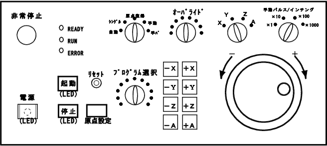

> **図の内容**
>
> パネルの部品: 非常停止、電源（LED）、READY・RUN・ERROR のランプ、起動（LED）、停止（LED）、原点設定、リセット、モード選択のロータリースイッチ（シングル、連続、原点復帰、手動、手パ など）、オーバライドのロータリースイッチ、手パ軸選択（X、Y、Z、A）、手動パルス/インチング倍率（×1、×10、×100、×1000）、プログラム選択のロータリースイッチ、軸キー（−X/+X、−Y/+Y、−Z/+Z、−A/+A）、手動パルサー。
> 細部の小さい文字は判読しにくい。

### 7-2. ハンディー形機械操作BOX

操作盤に取り付けます。

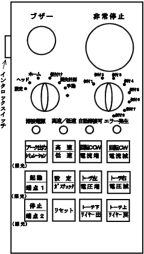

> **図の内容**
>
> ブザー、非常停止、インターロックスイッチ（側面）、ロータリースイッチ 2 個、ランプ（原点復帰、高速/低速、自動運転中、エラー発生 など）、押しボタン（アーク ON/OFF、高速/低速、溶接 CW/CCW、起動・補点1、停止・補点2、リセット、トーチ上下 など）。用途別の専用化された例。
> 細部の小さい文字は判読しにくい。

手に持ちやすい寸法に作成します。

- ※ この絵は、各スイッチの機能を専用化しています。ソフトウェアの専用化が必要です。

### 7-3. 機械パネルI/Fを応用したシーケンサ接続

シーケンサでSLMの操作・運転が可能です。もちろん、専用入/出力のみでの運転も可能です。

※SWSEL□は約350μsecのパルスです。 IOモジュールは接点型

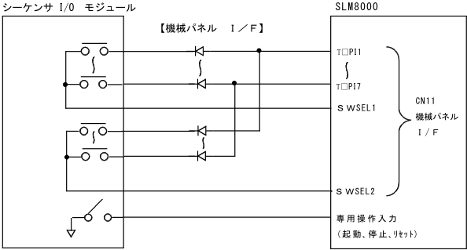

> **図の内容**
>
> - 左: 「シーケンサ I/O モジュール」の接点（スイッチ）。中央: 【機械パネル I/F】のダイオード
> - 右: 「SLM8000」の端子 T□PI1 ～ T□PI7、SWSEL1 ～ SWSEL2。これらは「CN11 機械パネル I/F」
> - シーケンサの別の接点は「専用操作入力（起動、停止、リセット）」へつながる

として下さい。

### 7-4. 配線

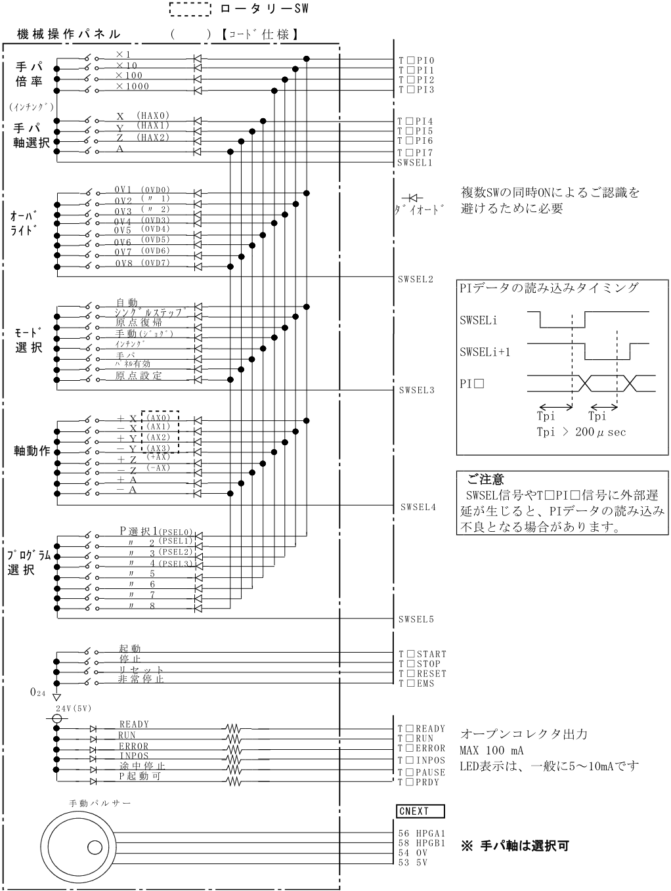

> **図の内容**
>
> 「機械操作パネル（　）【コード仕様】」の配線図。点線の枠はロータリーSW。各スイッチはダイオードを経て T□PI0 ～ T□PI7 へつながり、グループごとに SWSEL で選ばれる。
> - **SWSEL1**: 手パ倍率 ×1、×10、×100、×1000（T□PI0 ～ T□PI3）、手パ軸選択（インチング）X (HAX0)、Y (HAX1)、Z (HAX2)、A（T□PI4 ～ T□PI7）
> - **SWSEL2**: オーバライド 0V1 (0VD0) ～ 0V8 (0VD7)
> - **SWSEL3**: モード選択 自動、シングルステップ、原点復帰、手動(ジョグ)、インチング、手パ、パネル有効、原点設定
> - **SWSEL4**: 軸動作 +X (AX0)、−X (AX1)、+Y (AX2)、−Y (AX3)、+Z (+AX)、−Z (−AX)、+A、−A
> - **SWSEL5**: プログラム選択 P選択1 (PSEL0)、2 (PSEL1)、3 (PSEL2)、4 (PSEL3)、5 ～ 8
> - 専用入力: 起動 T□START、停止 T□STOP、リセット T□RESET、非常停止 T□EMS（コモンは 0₂₄）
> - 出力（24V(5V)、オープンコレクタ出力 MAX 100 mA、LED表示は、一般に5～10mAです）: READY T□READY、RUN T□RUN、ERROR T□ERROR、INPOS T□INPOS、途中停止 T□PAUSE、P起動可 T□PRDY
> - 手動パルサー → CNEXT の 56 HPGA1、58 HPGB1、54 0V、53 5V。※ 手パ軸は選択可
> - ダイオード: 複数SWの同時ONによるご認識を避けるために必要
> - **PIデータの読み込みタイミング**: SWSELi が下がったあと、SWSELi+1 が下がる。それぞれの立ち下がりから PI□ の確定までの時間 Tpi。Tpi ＞ 200μsec
> - **ご注意**: SWSEL信号やT□PI□信号に外部遅延が生じると、PIデータの読み込み不良となる場合があります。

### 7-5. 機械操作パネル入力チャンネル表

| CH選択       | T□PI7                       | T□PI6                       | T□PI5                       | T□PI4                       | T□PI3                       | T□PI2                       | T□PI1                       | T□PI0                       |
|------------|-----------------------------|-----------------------------|-----------------------------|-----------------------------|-----------------------------|-----------------------------|-----------------------------|-----------------------------|
| CH1        | 手パ軸選択                       | 手パ軸選択                       | 手パ軸選択                       | 手パ軸選択                       | 手パ倍率/インチング送り量選択             | 手パ倍率/インチング送り量選択             | 手パ倍率/インチング送り量選択             | 手パ倍率/インチング送り量選択             |
| SWSEL1     | HAX3                        | HAX2                        | HAX1                        | HAX0                        | ×1000                       | ×100                        | × 10                        | × 1                         |
| CH2        | オーバライド選択                    | オーバライド選択                    | オーバライド選択                    | オーバライド選択                    | オーバライド選択                    | オーバライド選択                    | オーバライド選択                    | オーバライド選択                    |
| SWSEL2     | OV8                         | OV7                         | OV6                         | OV5                         | OV4                         | OV3                         | OV2                         | Bit仕様 OV1 Code仕様            |
| CH3        | OVD7 ティーチング                | OVD6 機械操作パネル               | OVD5                        | OVD4                        | OVD3                        | OVD2 モード選択                  | OVD1                        | OVD0                        |
| SWSEL3     | (原点設定)                      | 有効                          | 手パ                          | 手動運転モードインチング              | JOG                         | 原点復帰                        | 自動運転モードシングル連続運転           |                             |
|            | ステップ軸動作                    | ステップ軸動作                    | ステップ軸動作                    | ステップ軸動作                    | ステップ軸動作                    | ステップ軸動作                    | ステップ軸動作                    | ステップ軸動作                    |
| CH4 SWSEL4 | -A                          | +A                          | -Z                          | +Z                          | -Y                          | +Y                          | -X                          | Bit仕様 +X Code仕様             |
| CH5        | +AX AX3 AX2 AX1 AX0 プログラム選択 | +AX AX3 AX2 AX1 AX0 プログラム選択 | +AX AX3 AX2 AX1 AX0 プログラム選択 | +AX AX3 AX2 AX1 AX0 プログラム選択 | +AX AX3 AX2 AX1 AX0 プログラム選択 | +AX AX3 AX2 AX1 AX0 プログラム選択 | +AX AX3 AX2 AX1 AX0 プログラム選択 | +AX AX3 AX2 AX1 AX0 プログラム選択 |
| SWSEL5     | PS 8                        | PS 7                        | PS 6                        | PS 5                        | PS 4                        | PS 3                        | PS 2                        | Bit仕様 PS 1 Code仕様           |
| CH6 SWSEL6 | PSEL3 PSEL2 PSEL1 PSEL0     | PSEL3 PSEL2 PSEL1 PSEL0     | PSEL3 PSEL2 PSEL1 PSEL0     | PSEL3 PSEL2 PSEL1 PSEL0     | PSEL3 PSEL2 PSEL1 PSEL0     | PSEL3 PSEL2 PSEL1 PSEL0     | PSEL3 PSEL2 PSEL1 PSEL0     | PSEL3 PSEL2 PSEL1 PSEL0     |
|            | 予備                         | 予備                         | 予備                         | 予備                         | 予備                         | 予備                         | 予備                         | 予備                         |
| CH7 SWSEL7 | 備                           | 備                           | 備                           | 備                           | 備                           | 備                           | 備                           | 備                           |
| CH8 SWSEL8 |                             |                             | 予                           | 備                           |                             |                             |                             |                             |

機械パネルの入力状態を画面(セッティングPC)で確認することができます。

画面表示については

「SLM8000 セッティングPCマニュアル」<4-2-3-2.機械パネル入力画面>(TB00-1131) を参照下さい。

【注意】

モード選択/オーバライド選択等、機械パネル以外の操作（PCや操作パネル）でも変更できる選択では、機械パネルの選択が最優先されます。

そのため、CH3の「機械パネル有効」がONしていると、機械パネル以外の操作では変更できなくなります。動作モードを変更できないと、PCからパラメータのダウンロードをできなくなってしまいます。

（セッティングモードに変更できないため）

これを防ぐためにCH3の「機械操作パネル有効」はSWでON/OFFできるようにして下さい。

### 7-6. 機械操作パネル入力チャンネルの意味

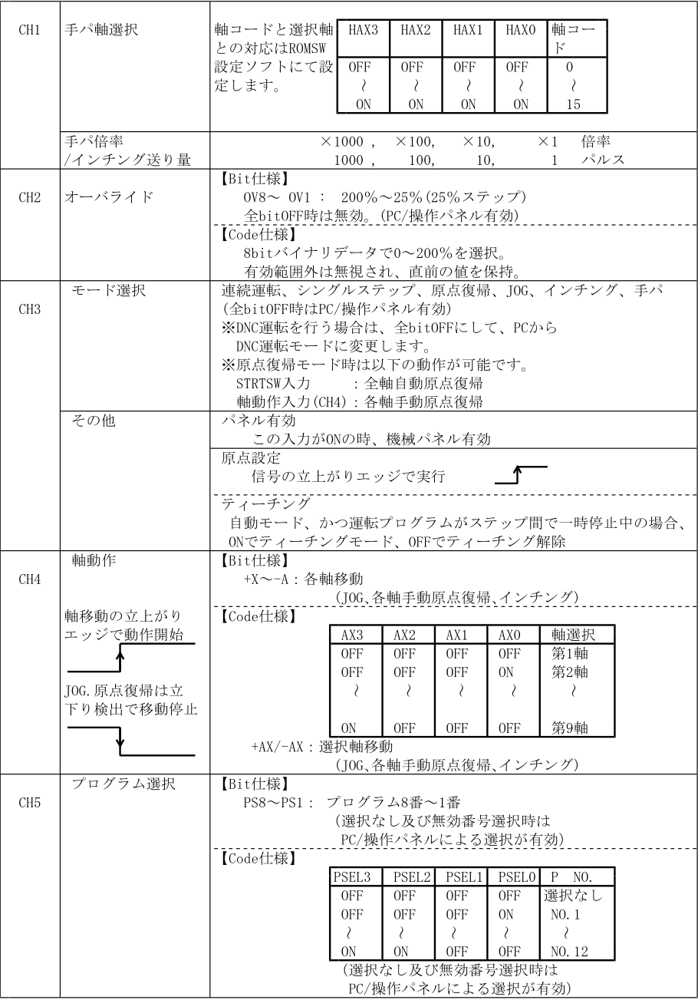

> **図の内容**
>
> | CH | 項目 | 意味 |
> |---|---|---|
> | CH1 | 手パ軸選択 | 軸コードと選択軸との対応はROMSW設定ソフトにて設定します。HAX3～HAX0 が OFF～ON で軸コード 0～15 |
> | CH1 | 手パ倍率/インチング送り量 | ×1000、×100、×10、×1 倍率 ＝ 1000、100、10、1 パルス |
> | CH2 | オーバライド | 【Bit仕様】OV8～OV1 : 200%～25%（25%ステップ）。全bitOFF時は無効。（PC/操作パネル有効）／【Code仕様】8bitバイナリデータで0～200%を選択。有効範囲外は無視され、直前の値を保持。 |
> | CH3 | モード選択 | 連続運転、シングルステップ、原点復帰、JOG、インチング、手パ（全bitOFF時はPC/操作パネル有効）。※DNC運転を行う場合は、全bitOFFにして、PCからDNC運転モードに変更します。※原点復帰モード時は以下の動作が可能です。STRTSW入力：全軸自動原点復帰、軸動作入力(CH4)：各軸手動原点復帰 |
> | CH3 | その他 | パネル有効: この入力がONの時、機械パネル有効／原点設定: 信号の立上がりエッジで実行／ティーチング: 自動モード、かつ運転プログラムがステップ間で一時停止中の場合、ONでティーチングモード、OFFでティーチング解除 |
> | CH4 | 軸動作 | 軸移動の立上がりエッジで動作開始、JOG.原点復帰は立下り検出で移動停止。【Bit仕様】+X～-A : 各軸移動（JOG、各軸手動原点復帰、インチング）／【Code仕様】AX3～AX0 が OFF,OFF,OFF,OFF で第1軸、OFF,OFF,OFF,ON で第2軸 … ON,OFF,OFF,OFF で第9軸。+AX/-AX : 選択軸移動（JOG、各軸手動原点復帰、インチング） |
> | CH5 | プログラム選択 | 【Bit仕様】PS8～PS1 : プログラム8番～1番（選択なし及び無効番号選択時はPC/操作パネルによる選択が有効）／【Code仕様】PSEL3～PSEL0 が すべて OFF で選択なし、OFF,OFF,OFF,ON で NO.1 … ON,ON,OFF,OFF で NO.12（選択なし及び無効番号選択時はPC/操作パネルによる選択が有効） |

| HAX3   | HAX2   | HAX1   | HAX0   | 軸コード   |
|--------|--------|--------|--------|---------|
| OFF    | OFF    | OFF    | OFF    | 0       |
| ～      | ～      | ～      | ～      | ～       |
| ON     | ON     | ON     | ON     | 15      |

| AX3   | AX2   | AX1   | AX0   | 軸選択   |
|-------|-------|-------|-------|-------|
| OFF   | OFF   | OFF   | OFF   | 第1軸   |
| OFF   | OFF   | OFF   | ON    | 第2軸   |
| ～     | ～     | ～     | ～     | ～     |
| ON    | OFF   | OFF   | OFF   | 第9軸   |

| PSEL3   | PSEL2   | PSEL1   | PSEL0   | P NO.   |
|---------|---------|---------|---------|---------|
| OFF     | OFF     | OFF     | OFF     | 選択なし    |
| OFF     | OFF     | OFF     | ON      | NO.1    |
| ～       | ～       | ～       | ～       | ～       |
| ON      | ON      | OFF     | OFF     | NO.12   |

- 【Bit仕様】と【Code仕様】は､ROMSW設定ソフトにて各チャンネル毎に設定
- CH3の原点設定とティーチングのいずれかをROMSW設定ソフトにより選択

## 8. サーボパラメータ

SLMのサーボ(制御軸)に関するパラメータです。実機に応じて最適な値を設定します。

セッティングPC「サーボパラメータ画面」で設定します。

サーボパラメータ設定画面

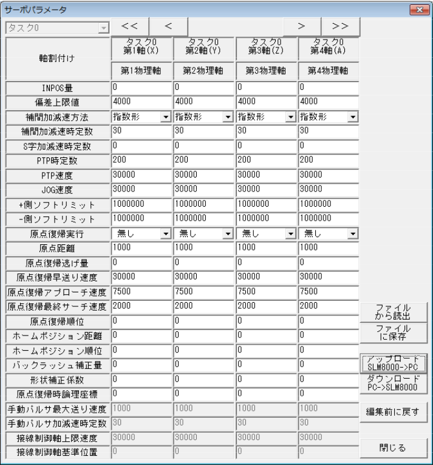

> **図の内容**
>
> 画面「サーボパラメータ」。タスク0 の 第1軸(X)～第4軸(A) の列に、INPOS幅、偏差上限値、補間加減速方法（指数形）、補間加減速時定数、S字加減速時定数、PTP時定数、PTP速度、JOG速度、+側ソフトリミット、-側ソフトリミット、原点復帰実行、原点距離、原点復帰逃げ量、原点復帰早送り速度、原点復帰アプローチ速度、原点復帰最終サーチ速度、原点復帰順位、ホームポジション距離、ホームポジション順位、バックラッシュ補正量 などの値が並ぶ。右側にボタン: ファイルから読出、ファイルに保存、アップロード SLM8000->PC、ダウンロード PC->SLM8000、編集前に戻す、閉じる。
> 値は小さくて判読しにくい。

### 8-1. 送り速度、加減速などのパラメータ

- ◆1.3

① PTP時定数

位置決め(PTP)、JOG動作の時の直線加減速の傾きを基準の速度に到達するまでの単位：[msec] 時間[msec]で設定します。

範囲：0～32767 ROMSWのPTP時定数PTP速度基準の設定により意味合いが変わります。

ROMSWのPTP時定数PTP速度基準:チェック無しの場合

0から100kppsに到達するまでの時間[msec]

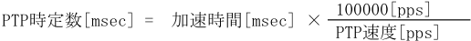

> **図の内容**
>
> PTP時定数[msec] ＝ 加速時間[msec] × 100000[pps] ／ PTP速度[pps]

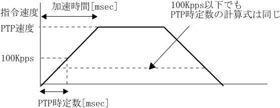

> **図の内容**
>
> 指令速度の台形。PTP速度まで上がる時間が「加速時間[msec]」、100Kpps に達するまでの時間が「PTP時定数[msec]」。注記: 100Kpps以下でもPTP時定数の計算式は同じ。

ROMSWのPTP時定数PTP速度基準:チェック有りの場合

0からサーボパラメータで設定するPTP速度に到達するまでの時間[msec] PTP時定数[msec]=加速時間[msec]

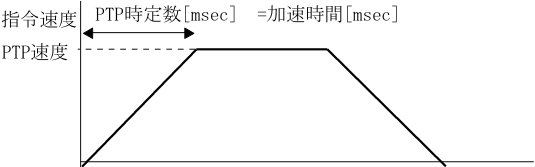

> **図の内容**
>
> 指令速度の台形。PTP速度に達するまでの時間が「PTP時定数[msec] ＝加速時間[msec]」。

具体例:PTP速度 200Kpps を 100msec で立ち上げる時

PTP時定数PTP速度基準チェック無し:PTP時定数=50msec

PTP時定数PTP速度基準チェック有り:PTP時定数=100msec

PTP速度 50Kpps を 100msec で立ち上げる時

PTP時定数PTP速度基準チェック無し:PTP時定数=200msec

PTP時定数PTP速度基準チェック有り:PTP時定数=100msec

- ② PTP速度 PTP送りの速度（位置決め/早送り速度）
- ③ JOG速度 JOG送りの速度
- ※ 本マニュアルでの速度単位[pps]は[パルス/秒]です。

単位：[pulse/sec]

範囲：1～1000000000

単位：[pulse/sec]

範囲：1～1000000000

指数形加減速 (補間送り)

範囲(指数)： 0～1000

④ 補間時定数直線補間や円弧補間送りのときの加減速を指令速度に到達する時間[msec]で設定します。単位：[msec] 一般的には、20～40msecを設定します。

軌跡精度を重視する場合は、なるべく小さな値にします。

- この値を大きくすると、円弧補間の時に実際の半径が小さくなりますので注意下さい。

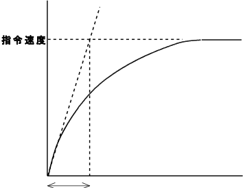

> **図の内容**
>
> 指令速度へ向かって指数関数的に立ち上がる曲線。原点での接線（点線）が指令速度と交わるまでの時間（下の矢印）が時定数。

直線形を選択すると、直線形の補間加減速をおこないます。<オプション> 指数形に比べて、円弧の半径縮小も小さく、コーナー部の軌跡誤差も軽減します。

直線形補間加減速

範囲(直線)： 0～上限右表のように制御周期により上限が変わります。

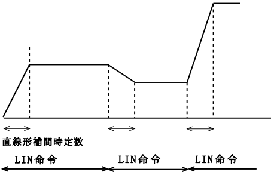

> **図の内容**
>
> LIN命令が 3 つ続くときの速度の変化。各 LIN命令の速度変化（加速・減速）が、それぞれ一定の時間（「直線形補間時定数」、下の矢印）の直線で行われる。

⑤ S字加減速(S字補間時定数) <オプション>

単位： [msec] 直線補間や円弧補間送りのときのS字補間の時定数を［msec］単位で設定します。

範囲：0～上限直線型補間加減速が前提です。右表のように制御周期により上限が変わります。 S字の時定数は、直線型補間加減速の時定数の1/3以下と 1.0

してください。

|   制御周期[ms] |   上限[ms] |
|------------|----------|
|        0.5 |      500 |
|        1.0 |     1000 |
|        2.0 |     2000 |
|        4.0 |     4000 |

補間加減速(指数形／直線形) をさらにスムージングします。一般には、直線形補間加減速と組み合わせます。

速度の変化点でＴs(ms)の平均化( フィルタリング)をします。

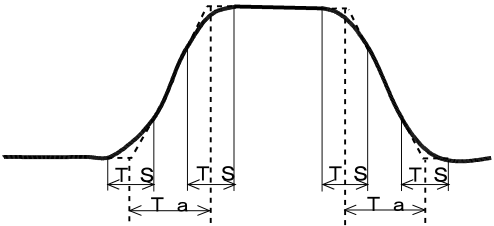

> **図の内容**
>
> 台形の速度（点線）の角が丸められた曲線（実線）。速度の変化点ごとに、Ｔs の区間で平均化する。Ｔa は加減速の時間。

ＴＳ：Ｓ字補間時定数

( ｍｓ)

Ｔａ：直線形補間時定数

|   制御周期[ms] |   上限[ms] |
|------------|----------|
|        0.5 |     1000 |
|        1.0 |     2000 |
|        2.0 |     4000 |
|        4.0 |     8000 |

### 8-2. ストロークリミットのパラメータ

- ◆1.3
- ① +側ソフトリミット

単位：[pls]

ソフトウェアにより、動作範囲を制限します。ソフトリミット値は [pls]単位で設定します。

範囲：1～1000000000 この領域を越える移動指令があった場合、

SLMは停止して、アラームとなります。

② -側ソフトリミット

この場合、サーボ主電源は落ちません。そのまま手動にてもどせます。

単位：[pls]

ソフトリミットは、機械座標でチェックします。

範囲：1～1000000000 設定できる最大値は 1×10 9 です。

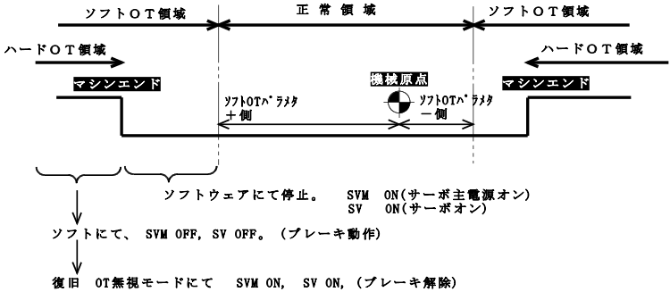

> **図の内容**
>
> - 左から: ハードOT領域（マシンエンド）、ソフトOT領域、正常領域、ソフトOT領域、ハードOT領域（マシンエンド）
> - 正常領域の両端が「ソフトOTパラメタ +側」と「ソフトOTパラメタ −側」。その間に機械原点
> - ソフトOT領域: ソフトウェアにて停止。SVM ON（サーボ主電源オン）、SV ON（サーボオン）
> - ハードOT領域: ソフトにて、SVM OFF、SV OFF。（ブレーキ動作）
> - 復旧: OT無視モードにて SVM ON、SV ON。（ブレーキ解除）

ハードウェアストロークリミットマシンエンドに配置したLS信号をSLMへ入力します。 (ハードOT) 一般はB接論理で入力し､これがOFFするとSLMは緊急停止して、サーボ主電源を落とします。

### 8-3. 擬似アブソの異常値によりソフトリミットが発生する場合

- ■ 疑似アブソ

(アブソポジション)

電源断の時の機械座標値を記憶しておき、再投入された時に機械座標値を記憶した値にセットアップする機能です。

■ 異常な疑似アブソ値試運転などの時に、モータを回したまま放置しておくと機械座標値

は異常に大きな値になります。

この時に、電源を切ると異常値を記憶することになります。

- ■ ソフトリミット発生この状態で再投入すると必ずソフトリミットになります。
- ■ 解除方法

（1）又は（2）

- (1) JOGなどで、機械座標が正常領域になるように動かしてください。
- (2) セッティングモードにしパラメータ画面で、「バックアップデータ初期化画面」を選択し、「アブソポジション初期化」を押してください。ただ、この場合は全軸クリアになります。

### 8-4. 原点復帰の動作

原点復帰の動作は、ROMSW設定で原点復帰方式を選択し、サーボパラメータで動作速度や原点からの距離を設定します。

[ROMSW設定]

ROMSWの以下の設定で原点復帰方式を選択します。

**○ C(Z)相使用選択**

以下の3通りの原点復帰方式を選択できます。

- 原点信号サーチ(C(Z)相不使用)
- C(Z)相サーチ(FB不使用)
- C(Z)相ラッチ(FB使用)

**○原点信号選択**

原点信号の選択。

- 原点信号無し
- DEC信号
- OT信号

**○原点復帰方向**

原点復帰する方向（+/-）の選択。

- なし
- +方向2段減速
- -方向2段減速
- +方向1段減速
- -方向1段減速

「なし」を選択すると、原点復帰動作を実行しません。

[ROMSW設定と原点復帰方式の関係]

| C(Z)相使用選択          | 特徴速度精度                    | 原点信号選択    | 原点復帰方向            | 詳細説明                         |
|--------------------|-----------------------------|-----------|-------------------|-------------------------------|
| 原点サーチ方式 (C(Z)相不使用) | 高速 △ 中速 △ 低速 △              | DEC OT    | 2段 ±方向 1段 ±方向 ※   | 8-4-1. 8-4-2. 8-4-3.          |
| C(Z)相サーチ方式 (FB不使用) | 低速中精度高速中精度中速中精度中速中精度 | なし DEC OT | ※ 2段 ±方向 1段 ±方向 ※ | 8-4-4. 8-4-5. 8-4-6. 8-4-7.   |
| C(Z)相ラッチ方式 (FB使用)  | 低速高精度高速高精度中速高精度中速高精度 | なし DEC OT | ※ 2段 ±方向 1段 ±方向 ※ | 8-4-8. 8-4-9. 8-4-10. 8-4-11. |

※1段/2段原点復帰のどちらに設定しても、同じ動きをします。

注1 原点（DEC）サーチでは、近接やリミットセンサの経年変化で、ずれることがあります。

- 注2 エンコーダのC(Z)相を基準する「C(Z)相ラッチ方式」では、経年変化はありません。ただし、C(Z)相パルスとDECのエッジが重ならないようにしてください。詳細は、

<Ⅳ実機試運転・調整編 6-11.原点復帰の確認と調整>(TB00-1130H) を参照ください。

[サーボパラメータ]

◆1.3

- ① 原点復帰実行

原点復帰動作を実行するかどうかを選択します。

範囲：無し、有り

② 原点距離

サーチするC(Z)相やDEC信号からの距離を[pls]単位で設定します。

単位：[pls]

範囲：-1000000000

～1000000000

- ③ 原点復帰早送り速度

原点復帰早送り速度を[pps]単位で設定します。

単位：[pps]

範囲：1～1000000000

④ 原点復帰アプローチ速度原点復帰アプローチ速度を[pps]単位で設定します。

単位：[pps]

範囲：1～1000000000

⑤ 原点復帰最終サーチ速度原点復帰最終サーチ速度を[pps]単位で設定します。

単位：[pps]

範囲：1～1000000000

- ②～⑤は、原点復帰方式により使用方法に違いがあるため、以降の図をご覧ください。

[以降の図の表記]

- a: 原点復帰早送り速度 (サーボパラメータ)
- b: 原点復帰アプローチ速度 (サーボパラメータ)
- c: 原点復帰最終サーチ速度 (サーボパラメータ)
- S: 原点距離

(サーボパラメータ)

A: 原点信号～C(Z)相間距離原点復帰の直後にセッティングPC「相対移動量」に表示

[原点復帰時の条件] 注意!

|OFS| < A < |PLS-OFS|

Aがこの範囲でない場合は、ドグ位置または、C(Z)相を再調整すべき

OFS < PLS ÷ 4

OFS = (FEED × RTC × 6) ÷ 1000

FEED: 原点復帰速度、アプローチ速度[pps]

PLS : モータ1回転パルス数[pulse]

RTC : RTC(制御)周期[msec]

A : 原点信号とC(Z)相間の距離[pulse]

#### 8-4-1.《DECサーチ方式 ±2段原点復帰》

速度(原点復帰方向)

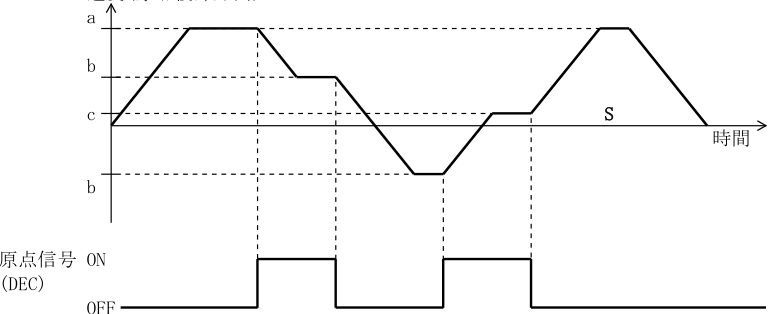

> **図の内容**
>
> 速度（原点復帰方向）の時間変化と原点信号(DEC)。速度 a で原点復帰方向へ進み、原点信号が ON になると減速して速度 b で逆方向に戻り、原点信号が OFF になると速度 c で再び原点方向へ進み、原点信号の変化で止まったあと、原点距離 S だけ移動する。

#### 8-4-2.《DECサーチ方式 ±1段原点復帰》

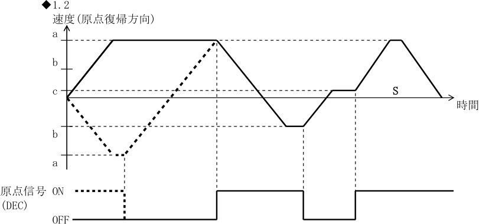

> **図の内容**
>
> 改訂マーク ◆1.2。速度 a で進み（原点信号の状態により逆方向へ速度 a で戻る場合を点線で示す）、原点信号が ON から変化した位置から速度 c でサーチし、原点距離 S だけ移動する。

#### 8-4-3.《OTサーチ原点復帰》(1段/2段は、同じ動作)

◆1.2

OFF

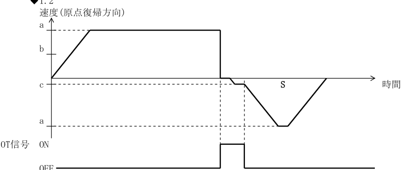

> **図の内容**
>
> 改訂マーク ◆1.2。速度 a で進み、OT信号が ON になると止まって逆方向へ c で戻り、OT信号が OFF になったあと原点距離 S だけ移動する（S は逆方向で、速度 a まで下がる）。

- 【注1】 s: 原点距離は、原点復帰方向によらず、+の値で設定してください。

-値を設定すると異常な動作となります。OTサーチを繰り返して、動作が終了しません。

- 【注2】 a: 原点復帰早送り速度は、低めにして下さい。

#### 8-4-4.《C(Z)相サーチ方式(原点信号無し)》(1段/2段は、同じ動作)

◆1.2

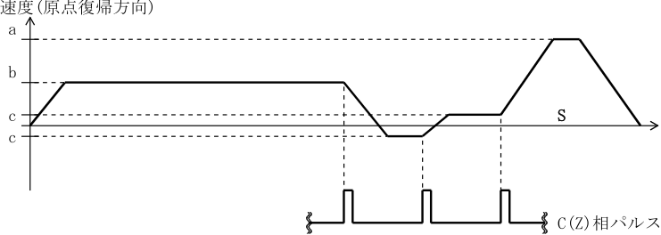

> **図の内容**
>
> 速度 b で進み、速度 c に落としてサーチし、C(Z)相パルスで止まったあと、原点距離 S だけ移動する。

#### 8-4-5.《C(Z)相サーチ方式(DEC信号) ±2段原点復帰》

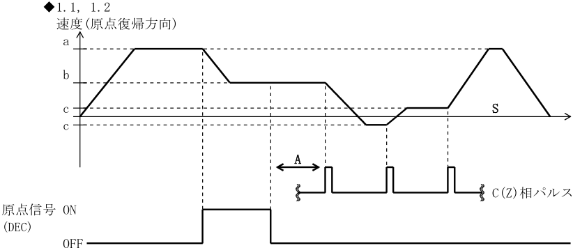

> **図の内容**
>
> 改訂マーク ◆1.1、1.2。速度 a で進み、原点信号(DEC)が ON で b に減速、OFF で c に減速して逆方向へサーチし、原点信号 OFF から距離 A の後の C(Z)相パルスで止まり、原点距離 S だけ移動する。

#### 8-4-6.《C(Z)相サーチ方式(DEC信号) ±1段原点復帰》

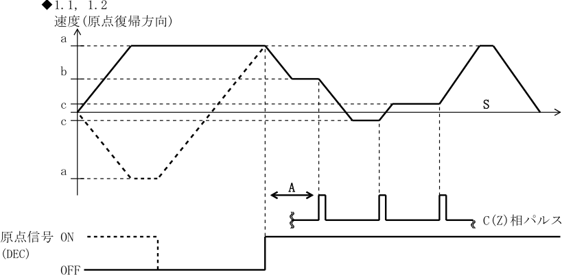

> **図の内容**
>
> 改訂マーク ◆1.1、1.2。8-4-5 と同様だが 1 段。原点信号の状態により逆方向へ速度 a で戻る場合を点線で示す。原点信号の変化から距離 A の後の C(Z)相パルスで止まり、原点距離 S だけ移動する。

#### 8-4-7.《C(Z)相サーチ方式(OT信号)》(1段/2段は、同じ動作)

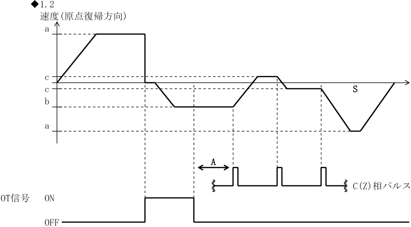

> **図の内容**
>
> 改訂マーク ◆1.2。速度 a で進み、OT信号が ON で逆方向へ戻り、OT信号 OFF から距離 A の後の C(Z)相パルスを速度 c・b でサーチして止まり、原点距離 S だけ移動する。

#### 8-4-8.《C(Z)相ラッチ方式(原点信号無し)》(1段/2段は、同じ動作)

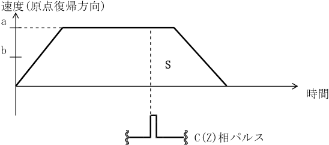

> **図の内容**
>
> 速度 a で進み、C(Z)相パルスの位置をラッチし、そこから原点距離 S の位置で止まる（減速しながら移動）。

#### 8-4-9.《C(Z)相ラッチ方式(DEC信号) ±2段原点復帰》

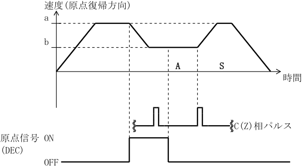

> **図の内容**
>
> 速度 a で進み、原点信号(DEC)が ON で b に減速し、原点信号 OFF から距離 A の後の C(Z)相パルスをラッチして、原点距離 S の位置で止まる。

8-4-10.《C(Z)相ラッチ方式(DEC信号) ±1段原点復帰》

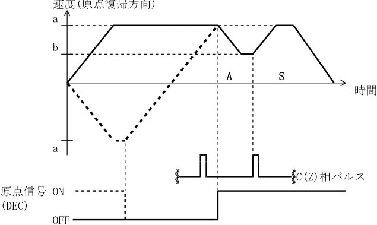

> **図の内容**
>
> 速度 a で進み（原点信号の状態により逆方向へ速度 a で戻る場合を点線で示す）、原点信号の変化から距離 A の後の C(Z)相パルスをラッチして、原点距離 S の位置で止まる。

#### 8-4-11.《C(Z)相ラッチ方式(OT信号)》(1段/2段は、同じ動作)

【注】 a:原点復帰早送り速度は、低めにして下さい。

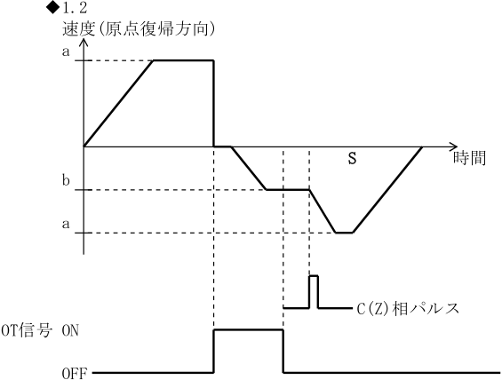

> **図の内容**
>
> 改訂マーク ◆1.2。速度 a で進み、OT信号が ON で逆方向へ速度 b で戻り、OT信号 OFF の後の C(Z)相パルスをラッチし、原点距離 S だけ移動する（S は逆方向で、速度 a まで下がる）。

#### 8-4-12.原点復帰未完でOTに到達した場合(原点信号あり)

この場合は、OT到達後に反対方向へ動作して、DEC信号を越えてから原点復帰をやりなおします(2段原点復帰/1段原点復帰とも共通)。

- 例 ①DEC信号が無いので+OTへ。
- ②反転してDEC信号を越えます。
- ③再度原点復帰動作をします。

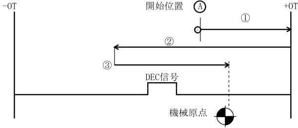

> **図の内容**
>
> -OT と +OT の間。開始位置 Ⓐ から ① +OT まで進み、② 逆方向へ戻って DEC信号を通り過ぎ、③ 再び原点方向へ進んで DEC信号の位置で機械原点を決める。

#### 8-4-13.原点復帰未完でOTに到達した場合(原点信号なし)

OT到達後にもどり、ラッチ信号を確認後に、再度ラッチ信号をもとに原点復帰します。

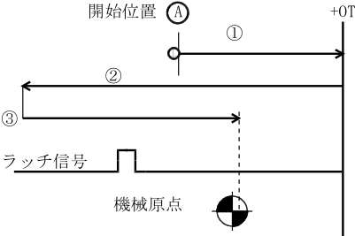

> **図の内容**
>
> 開始位置 Ⓐ から ① +OT まで進み、② 逆方向へ戻ってラッチ信号を通り過ぎ、③ 再び原点方向へ進んでラッチ信号を確認し、機械原点を決める。

#### 8-4-14.1段原点復帰でベタドグ(原点信号)のメリット

原点(DEC)信号をベタドグとして1段原点復帰を選択すれば、どの位置にあっても原点復帰時にOTへ行くことはありません。

- A の場合は必ず戻ります。

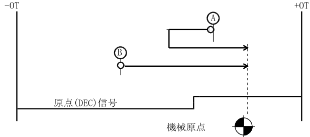

> **図の内容**
>
> -OT と +OT の間。原点(DEC)信号は機械原点の手前から +OT 側まで ON のまま（ベタドグ）。開始位置 Ⓐ（原点信号 ON の側）からは一度戻ってから原点へ、開始位置 Ⓑ（原点信号 OFF の側）からはそのまま原点へ進み、機械原点に止まる。

### 8-5. 全軸原点復帰の逃げ動作

- ◆1.3

① 原点復帰逃げ量（下図参照）

単位：[pls] ※原点復帰逃げ量は必ず減速LSと原点との距離以上の十分な値（2倍程度）範囲：0(無効) として下さい。(図のAの2倍)

1000～1000000000

全軸原点復帰時に原点付近に軸がある場合は、原点からの逃げ動作(正常領域内へ移動)を行い、その後で原点復帰を行います。

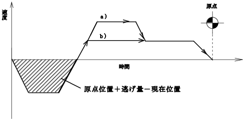

> **図の内容**
>
> 横軸 時間、縦軸 速度。原点付近に軸がある場合、まず逆方向へ移動し（斜線部の面積 ＝ 原点位置＋逃げ量－現在位置）、その後 a) または b) の速度で原点方向へ進んで原点に止まる。

注記名称は、「逃げ量」ですが、「逃げ位置」と考えてください。逃げるべき位置（座標）を示しています。

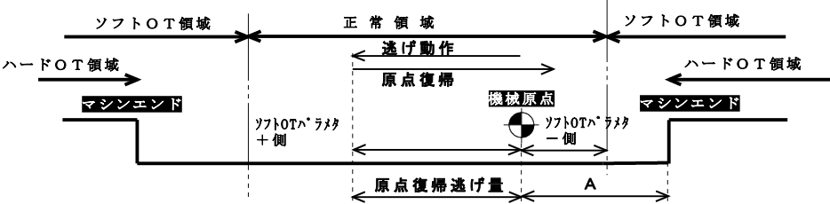

> **図の内容**
>
> 8-2 の領域の図（ハードOT領域、ソフトOT領域、正常領域、マシンエンド、ソフトOTパラメタ +側／−側、機械原点）に、「逃げ動作」「原点復帰」の矢印と、「原点復帰逃げ量」「A」の範囲を書き加えたもの。

### 8-6. 全軸原点復帰シーケンス（順位）

- ◆1.3
- ① 原点復帰順位

範囲：0～8

数字の小さい順（0→1→2…）に原点復帰を行います。例 Z軸をまず原点復帰、その後でX，Yが原点復帰 Zの順位＝0 X，Yの順位＝1

### 8-7. その他のパラメータ

◆1.3

① INPOS量

インポジションチェックを行う場合に設定して下さい。

単位：[pls]

範囲：0(無効)

1～1000000000

② 偏差量

詳細は、<Ⅲ機能編 4-9.インポジションチェック>(TB00-1130E)を参照下さい。

偏差がこの設定値を超えると「偏差過大エラー」になります。

単位：[pls]

範囲：1～1000000000

③ バックラッシュ補正量軸にバックラッシュがある場合に設定して下さい。

単位：[pls]

範囲：0～30000

詳細は、<Ⅲ機能編 4-18-1.バックラッシュ補正機能>(TB00-1130E)を参照下さい。

④ 形状補正係数<オプション> 軌跡形状補正を行う場合のパラメ-タです。単位：[1/s] 使用しない場合は、ゼロにします。

範囲：0(無効)

1～30000

詳細は、<Ⅲ機能編 4-18-5. 形状補正(高精度輪郭制御)>(TB00-1130E)を参照下さい。

⑤ ホームポジション距離ホームポジション位置決めの目標値を機械座標系で指定します。

単位：[pls]

範囲：-1000000000

～1000000000

⑥ ホームポジション順位ホームポジション位置決めを行う軸の順番を設定します。範囲：0～8 数字の小さい順に移動します。

⑦ 原点復帰時論理座標

原点復帰を完了した位置の論理座標をこの値にセットアップします。

単位：[pls]

範囲：-1000000000

～1000000000

⑧ 手動パルサ最大送り速度手動パルサで移動するときの速度制限を[pps]単位で指定します。

単位：[pps]

範囲：0～4000000

⑨ 手動パルサ加減速時定数手動パルサで移動するとき専用の指数形加減速の時定数です。単位：[msec] 指数形加減速の意味については、<8-1.送り速度、加減速などのパラメータ> 範囲：0～1000 を参照下さい。

⑩ 接線制御軸上限速度

単位：[pps]

範囲：1～1000000000

⑪ 接線制御軸基準位置

接線制御によるZ軸回転速度の上限値[pps]を設定します。詳細は、<Ⅲ機能編 4-16-6. 接線制御軸機能>(TB00-1130E)を参照下さい。

XY平面にて＋X方向へ動く時のZ軸のアブソ位置[pls]を設定します。

単位：[pls]

範囲：-1000000000

～1000000000

詳細は、<Ⅲ機能編 4-16-6. 接線制御軸機能>(TB00-1130E)を参照下さい。
