# Ⅳ 実機試運転・調整編

## 1. 実機試運転の前に

### 1-1. 実機試運転の前提条件

モータ単体運転や最低限の調整(サーボアンプやSLMパラメータ)が完了していることが前提です。具体的には、<Ⅰ導入編>の以下の作業が完了していることを確認下さい。

- ■初期導入作業
- ■ダミー運転

PCソフトインストールなど SLM単独での運転・操作

- ■モータ単体運転の準備サーボなどの配線など
- ■モータ単体運転

モータを空回しで試運転

### 1-2. 関連図面・マニュアル

関連する図面とマニュアルを準備下さい。

- [ ] □ SLM関連マニュアル □ SLM8000 ユーザーズマニュアル

TB00-1130（本書）

- [ ] □ SLM8000 セッティングPCマニュアル TB00-1131

- [ ] □ SLM8000 ROMSW設定ソフトマニュアル TB00-1132

- □ 周辺回路図

- [ ] □展開接続図

- [ ] （ユーザ殿設計） □ケーブル図など

- [ ] □ サーボ/パルスモータアンプのマニュアルや説明書（各メーカ）

## 2. 導入から試運転・調整までの作業フロー（概略）

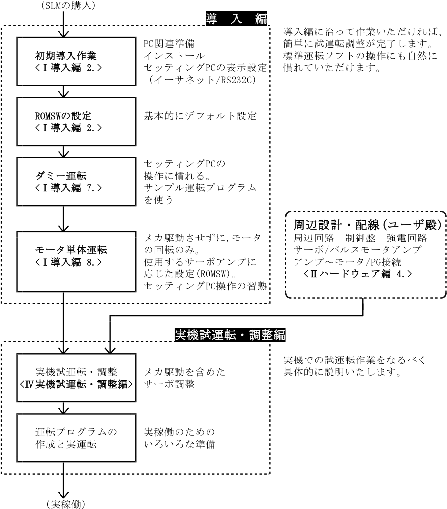

> **図の内容**
>
> （SLM の購入）から（実稼働）までの流れ。
> - 導入編: 初期導入作業（Ⅰ導入編 2.）PC環境準備・インストール・セッティングPCの表示確認（イーサネット/RS232C）→ ROMSWの設定（Ⅰ導入編 2.）基本的にデフォルト設定 → ダミー運転（Ⅰ導入編 7.）セッティングPCの操作に慣れる、サンプル運転プログラムを使う → モータ単体運転（Ⅰ導入編 8.）メカ駆動させずに、モータの回転のみ。使用するサーボアンプに応じた設定(ROMSW)、セッティングPC操作の習熟
> - 並行して「周辺設計・配線（ユーザ殿）」: 周辺回路、制御盤、強電回路、サーボパルスモータアンプ、アンプ・モータ/PG接続（Ⅱハードウェア編 6.）
> - 実機試運転・調整編: 実機試運転・調整（Ⅳ実機試運転・調整編）メカ駆動を含めたサーボ調整 → 運転プログラムの作成と実施（実稼働のためのいろいろな準備）
> - 注記: 導入編に沿って作業していただければ、徐々に試運転調整が完了します。標準設定ソフトの操作にも自然に慣れていただけます。実機での試運転作業をなるべく具体的に説明いたします。
>
> 縮小されていて細部の文字は判読できない箇所がある。

## 3. 実機試運転・調整の概要メカ組合せ試運転

対象のマシンにより、詳細手順は多少異なります。ここでは代表的な例について説明します。特にリンク系のロボットや落下軸のあるマシンでは、ブレーキ動作が安全上で非常に重要です。

サーボOFFのときにブレーキが正常動作しないと、自重で落下する危険性もあります。

モータ単体運転が正常に完了していることを前提としています。

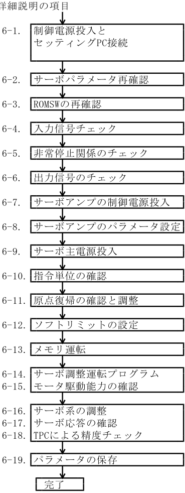

> **図の内容**
>
> 手順説明の項目（上から順に）: 6-1 制御電源投入とセッティングPC接続、6-2 サーボパラメータの再確認、6-3 ROMSWの再確認、6-4 入力信号のチェック、6-5 非常停止関係のチェック、6-6 出力信号のチェック、6-7 サーボアンプの制御電源投入、6-8 サーボアンプのパラメータ設定、6-9 サーボ主電源投入、6-10 指令単位の確認、6-11 原点復帰の確認と調整、6-12 ソフトリミットの設定、6-13 メモリ運転、6-14 サーボ調整運転プログラム、6-15 モータ駆動能力の確認、6-16 サーボ系の調整、6-17 サーボ応答の確認、6-18 TPCによる精度チェック、6-19 パラメータの保存、完了。
> 縮小されていて一部の項目名は判読しにくい。

サーボ主電源以外の電源投入をおこないます。セッティングPCを接続してモニタします。

NC部（SLM）が正常動作していることを再確認します。

SLMのパラメータの再確認をします。使わない軸の設定など。安全のため速度などは小さくします。機構やサーボに応じて再確認をします。

入力信号を一通り動作チェックします。特にA接/B接の論理に注意下さい。非常停止、各軸OTの動作を確認します。ブレーキ電源もチェックします。出力回路を一通り動作チェックします。

- 6-7. サーボアンプの制御電源投入サーボの制御電源のみ投入します。

6-8. サーボアンプのパラメータ設定サーボアンプのパラメータを再確認します。事例やサーボメーカの説明書を参照ください。

サーボ主電源を投入し、低速でJOG動作します。

実機動作で指令単位系をチェックします。

(例 1p=1μmのとき 100000p移動＝100mm？) 原点復帰方式の選定と原点ドグやパラメータなどの調整原点ドグとC(Z)相パルスの位置関係をチェックします。機械原点を決めて、ソフトリミットを設定します。ハードOTとの位置関係もチェックします。

シングルステップ動作と連続運転をおこないます。

6-14. サーボ調整運転プログラムサーボ調整用運転プログラムを準備。位置ループゲインや加減速パラメータを設定します。モータの負荷電流などもチェックします。

当社モーションアナライザTPCにより「サーボ応答」「軌跡精度」のチェックを行うことを推奨します。

設定したサーボパラメータをファイルに保存します。

## 4. 制御盤の製作（準備）

モータ単体運転までは、制御ユニットをとりあえずの製作で済ませている場合もありますが、実機運転では、正式に完成させておく必要があります。

配線チェックなども完全に完了させてください。

<Ⅰ導入編 8.モータ単体運転の準備>(TB00-1130A)を再度ご確認下さい。特にアースは、安全上もノイズ対策としても重要です。

一般には、以下のような図面を作成して、確認します。

- ■展開接続
- ■材料表
- ■ケーブル図例：マニュアル<Ⅱハードウェア編>(TB00-1130C)
- ■組立・配線図
- ■部品配置図
- ■板金図（制御盤構造図）

## 5. 機構側の準備

### 5-1. モータの取り付け

各モータメーカの説明書にしたがって、取り付けてください。

カップリングやタイミングベルトなどがゆるんでいると思わぬ事故になる危険性があります。

可動部では、ケーブルは一般的にロボットケーブルを使用します。モータメーカに問い合わせてください。

### 5-2. 機体配線

配線チェックは大変重要ですので入念におこなって下さい。特に強電関係の配線を充分にチェックします。

信号ケーブルケーブル製作時点で確実にチェックして下さい。

特に混色や接触不良などは、試運転作業を大幅に遅らせる原因になります。必ず事前に充分なチェックをおこなって下さい。強電配線電源やリレー回路などの配線ミスは、焼損の原因になる場合があります。必ず配線図と照合チェックして下さい。また､線サイズ、端子カシメ、ネジ締めなどもチェックして下さい。

- 注1 リレーコイルや電磁開閉器には、必ずサージサプレッサを入れて下さい。 <Ⅱハードウェア編 3-3.入出力信号の電気的仕様>(TB00-1130C) を参照下さい。
- 注2 一般信号ケーブルと強電回路は配線経路を極力分離して下さい。
- 注3 ケーブルのシールドは、アースプレートやクランプ用金具にて制御盤アースへ落として下さい。

## 6. 実機試運転の作業

### 6-1. 制御電源投入

PCのセッティングPCソフトを起動してください。

次にSLMとIO関係の制御電源を入れてください。

サーボ主電源は、安全のためOFFにしておきます。

非常停止などの入力によって、サーボ主電源回路のリレー制御でOFFさせてください。

SLMの電源電圧（24V）を確認して下さい。 DC24V 24V±10％

注記本来は、モータ単体運転の準備作業で確認済みです。

- ①SLMのLED1の点滅を確認してください。
- ②セッティングPCソフトの運転画面で位置情報にゼロ表示がでることを確認してください。
- <Ⅰ導入編 7.ダミー運転>(TB00-1130A)と同じ作業です。

### 6-2. サーボパラメータの再確認

サーボ(制御軸)に関するパラメータです。実機に応じて最適な値を設定します。セッティングPC「サーボパラメータ画面」で設定します。

サーボパラメータ設定画面

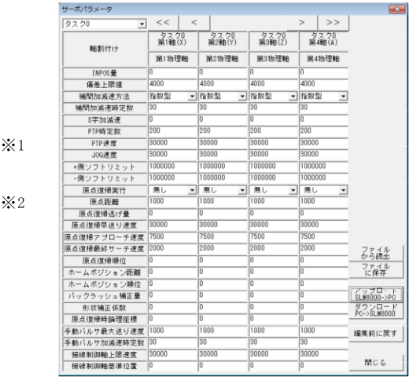

> **図の内容**
>
> セッティング PC の「サーボパラメータ」画面（タスク0、第1軸～第4軸）。※1 と ※2 の印が、画面の上の方の行（INPOS量・偏差上限値付近）と補間加減速の行付近に付いている。
> 値は小さくて判読できず。

※1：速度関連のパラメータ（PTP速度、JOG速度）は、安全のため、初めは低速に設定してください。

※2：「原点復帰実行」を「無し」に設定しておけば、原点復帰をしなくても、メモリ運転が可能です。

### 6-3. ROMSWの再確認

実機の状況に応じてROMSWを再設定します。基本的には、単体運転で完了しています。

| 画面       | ROMSW名         | 内容                                  | ROMSWマニュアル(TB00-1132)参照                |
|----------|----------------|-------------------------------------|----------------------------------------|
| 基本ROMSW  | 有効制御軸          | 使用する軸を選択                            | <6-4.軸設定>(1)有効物理軸選択                    |
| 基本ROMSW  | パルスジェネレータクロック | 最大pps                               | <6-1-1.サーボ制御周期> ③パルスジェネレータクロック         |
| 軸設定ROMSW | C(Z)相使用選択      | C(Z)相原点復帰をする場合のみ設定してください。パルス出力形態 | <6-4.軸設定>(3)各軸設定 ⑫原点復帰設定               |
| 軸設定ROMSW | C(Z)相論理        |                                     | <6-4.軸設定>(3)各軸設定 ⑫原点復帰設定               |
| 軸設定ROMSW | 指令/FBパルス       | パルス出力幅                              | <6-4.軸設定>(3)各軸設定 ⑭指令パルス出力設定 ⑮フィードバック設定 |

設定例

| ROMSW項目               | 安川 - ΣⅡ   | 安川 - ΣⅢ   | 三菱 - J2   | オリエンタル - αステップ   |
|-----------------------|-----------|-----------|-----------|------------------|
| 基本ROMSW パルスジェネレータクロック |           | 512k（1M）  | 同左        | 256ｋ             |
| 軸設定ROMSW              |           |           |           |                  |
| C(Z)相使用選択             | 適宜        |           | 同左        | 適宜               |
| C(Z)相論理               | 正         |           | 同左        | 正                |
| パルス出力モード              | A/B       |           | 同左        | CW/CCW           |
| パルス出力幅                | 1倍        |           | 同左        | 1倍               |
| 指令極性                  | 適宜        |           | 同左        | 適宜               |
| 電子ギヤ                  | 適宜        |           | 同左        | 適宜               |
| FB入力ポート               | 適宜        |           | 同左        | 適宜               |
| FB入力極性                | 正         |           | 同左        | 正                |
| 任意分周値                 | 適宜        |           | 同左        | 適宜               |

パルスモータの場合の注意パルスジェネレータクロック（最大pps）

FB入力極性

パルス出力モード（波形）パルス幅 A相すすみが正標準配線を元にした極性です。（配線が変われば、極性もかわります）

### 6-4. 入力信号のチェック

配線してある入力信号を一通りON/OFFさせて、セッティングPCのIO画面で確認してください。特に、アラーム関連の入力は重要です。OT（オーバトラベル）、非常停止、サーボアラームなどは、十分に確認してください。

機体側のLSや近接SWをON/OFFさせてモニタ画面のON/OFFでチェックします。

都合で機体配線が無い入力は、端子台などでショート/オープンさせてチェックします。

入出力モニタリング画面

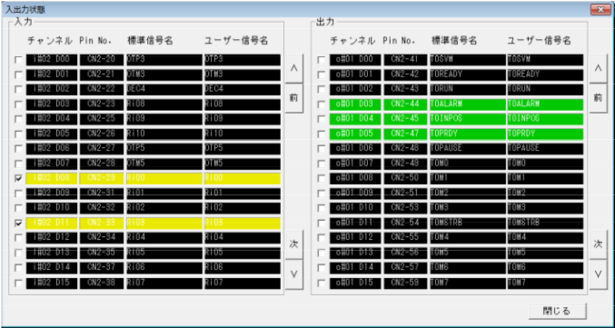

> **図の内容**
>
> セッティング PC の「入出力状態」画面。入力と出力のチャンネル、Pin No.、標準信号名、ユーザー信号名。ON の信号が色付き（黄、緑）で表示されている。
> 細部は小さくて判読できず。

入力信号の論理設定（A接/B接）の変更が必要な場合は、ROMSW設定ソフトでおこなってください。

### 6-5. 非常停止関係のチェック

「非常停止」や「OT入力」でサーボ主電源断(SLMからのSVM出力OFF)することをチェックします。

非常停止入力を解除して電源投入します。サーボ主電源が投入されます。

サーボ主電源がONした状態で、「非常停止」及び「各OT入力」（B接点のショートなら、オープンにする）にて、主電源断になることを確認して下さい。

サーボ主電源が入らない場合は、他にアラーム要因があります。

セッティングPCのモニタ画面にて、アラーム要因を確認して下さい。

＜ブレーキ電源チェック＞

落下軸の場合、ブレーキの動作チェックをします。ここではサーボフリーのまま、注意ブレーキ解除しますので、落下防止の処置（材木などによる支え）をして下さい。 SVM出力ONにて、ブレーキ電圧が発生し、ブレーキは解除します。ブレーキ解除のディレータイムも長め(2～3秒)に設定して下さい。


### 6-6. 出力信号のチェック

セッティングPCの「入出力画面」で配線している出力信号をON/OFFさせてリレー、ランプ、ソレノイド、シリンダなどを動作させて確認してください。ただし、出力がON/OFFして具体的に作用する結果をあらかじめ想定し、安全であることを確認したうえで、おこなう必要があります。出力動作が電気的にも機械的にも干渉する場合があります。このような場合、周囲状況やお互い

の出力状態を十分に確認しながら、慎重に動作させてください。

### 6-7. サーボアンプの制御電源投入

サーボアンプの制御電源が投入できる状態であれば、主電源を入れずにサーボのパラメータを確認・調整できます。

サーボアンプの電源端子が制御電源と主電源が別々のタイプの場合は、以下のように配線し主電源がOFFしていても制御電源が投入できるようにしてください。

■サーボアンプ電源■例

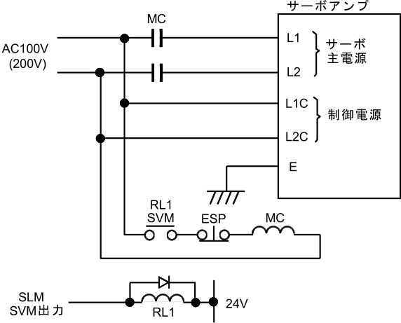

> **図の内容**
>
> - AC100V(200V) から「MC」（電磁接触器）を経て、サーボアンプの L1・L2（サーボ主電源）へ
> - AC100V(200V) から直接、サーボアンプの L1C・L2C（制御電源）へ。E は接地
> - MC のコイルは、「RL1」の接点（SVM）と「ESP」（非常停止）を直列に通して動かす
> - 「SLM SVM出力」が RL1 のコイル（ダイオード付き、24V）を動かす

### 6-8. サーボアンプのパラメータ設定

使用するサーボやパルスモータアンプの設定をおこないます。具体的設定方法は各アンプメーカの説明を参照下さい。

また、基本的な考え方は、<7.サーボ系の制御性能>を参照下さい。

サーボアンプの電源を入れます必要であれは、SLMの強制出力にて主電源回路ON

サーボメーカのPCソフト速度ループゲイン/位置ループゲインは低目

- や設定器でパラメータ設定 <Ⅰ導入編 8-3. サーボアンプなどの設定>(TB00-1130A) に安川、三菱の例があります。

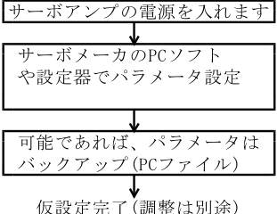

> **図の内容**
>
> 「サーボアンプの電源を入れます」→「サーボメーカのPCソフトや設定器でパラメータ設定」→「可能であれば、パラメータはバックアップ(PCファイル)」→「仮設定完了（調整は別途）」

最初の段階では、以下のようにサーボアンプのパラメータを設定するとより安全です。

- （1）トルクリミット：ぶつけても機械が壊れないように50％程度に下げる。（まれに、摩擦や重量荷重で定常時に50％以上のトルクを必要とすることもあります。この場合は、動作に支障が無い程度のトルクリミット70％～80％として下さい。）
- （2）速度リミット：安全な速度に制限しておく

### 6-9. サーボ主電源投入

非常停止やOTを解除して電源投入を行うとサーボ主電源が入ります。非常停止ボタンに手をおいて電源投入して下さい。

乱調や急な動作をした場合は、すぐに非常停止を押して下さい。

サーボロックを確認後、JOG操作により +方向、-方向に動かして様子を見ます。メカ端にぶつけないように注意して下さい。（±OTは、必ずチェック完了して置いてください）はじめは、なるべく低速で動かしてください。（オーバライドで10%にするなど）

＜サーボが乱調したとき＞

配線不良やPGFBの逆極性の可能性があります。モータとPGの配線や極性のチェックを行ってください。

＜未完成の軸など＞

未完成や使用したくない軸があれば、セッティングPCで軸設定により、使用禁止にでます。セッティングPC運転画面→操作メニューの「制御軸」→「軸設定」詳細は、

「SLM8000 セッティングPCマニュアル」<4-2-4-1.軸設定画面>(TB00-1131) を参照下さい。

### 6-10. 指令単位の確認

念のため指令単位に間違いがないか、全軸それぞれに確認します。

- 例 1p=1μm
- 100000pの送り＝正確に100mm？
- 例 1p=0.001゜ 90000pの送り＝正確に90゜？

異る場合オーダ設定/メカ諸元(ギヤ比、ボールネジなど)を確認下さい。

また、「指令パルス電子ギヤ」の設定(ROMSW)が必要な場合もあります。

②電子ギヤの確認

セッティングPCソフトで仮に10mm相当のパルス量をインチング送りメカの移動が正確に10mm → 電子ギヤは、OK

メカの移動が10mmでない → 電子ギヤを再計算。

- ※ 10mmである必要は、ありません。わかりやすい移動量を指定してください。設定ミスにより、1パルスの移動量が桁違いなどで大きく異なっている場合、予想の 10倍以上の距離を動くこともあります。OT動作の確認、移動量を極端に小さくする、送り速度を低速にするなど安全に配慮しておこなってください。

### 6-11. 原点復帰の確認と調整(メカ組合せ試運転)

#### 6-11-1. 各軸ストロークの整理（機構設計）

◆1.1

本来、ストロークに対して、DEC変化点位置、機械原点、ソフトOT位置、ハードOT 位置など図面上で整理して、数値化しておきます。（以下のような図）これにならって、 DEC位置や原点位置の確認や調整をおこないます。

■軸ストロークの設計例

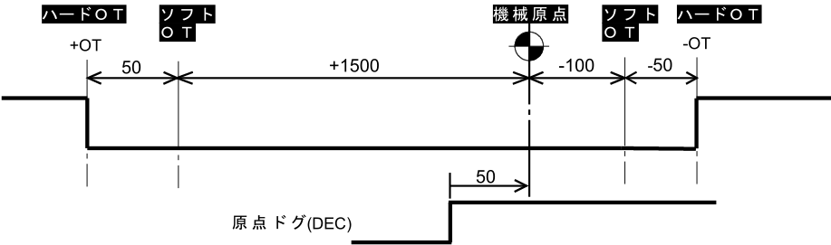

> **図の内容**
>
> 左から ハードOT（+OT）、ソフトOT、機械原点、ソフトOT、ハードOT（-OT）。
> - +OT からソフトOT まで 50、ソフトOT から機械原点まで +1500、機械原点からソフトOT まで -100、ソフトOT から -OT まで -50
> - 原点ドグ(DEC) は機械原点の手前 50 から ON

6-11-2. 軸ストロークと機械原点の関係

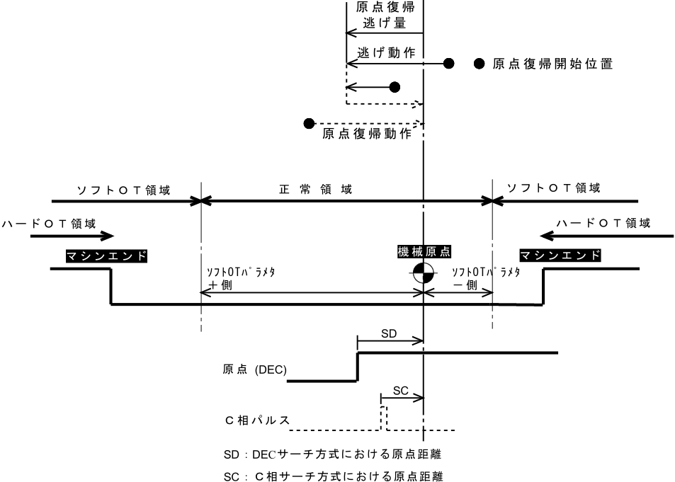

> **図の内容**
>
> - 「原点復帰開始位置」から「逃げ動作」で「原点復帰逃げ量」だけ離れ、「原点復帰動作」で機械原点へ向かう
> - 中央が「正常領域」、両側が「ソフトOT領域」、外側が「ハードOT領域」、両端に「マシンエンド」。機械原点の左右に「ｿﾌﾄOTﾊﾟﾗﾒﾀ ＋側」「－側」
> - 原点(DEC) の信号は機械原点の手前から ON。DEC の切り替わりから機械原点までが「SD」、C相パルスから機械原点までが「SC」
> - SD：DECサーチ方式における原点距離、SC：C相サーチ方式における原点距離

#### 6-11-3. 原点復帰方式の選択（DECサーチ/C(Z)相サーチ）

◆1.1

原点復帰方式の選択をしてください。

ROMSW 軸設定：C(Z)相使用選択

原点信号サーチ(C(Z)相不使用) ：原点サーチ方式原点LS（DEC/OT）のみ使用

C(Z)相サーチ(FB不使用)(初期値）：C(Z)相サーチ方式原点LSとC(Z)相FBパルスを使用

- C(Z)相ラッチ(FB使用)

：C(Z)相ラッチ方式原点LSとFBパルスを使用

各方式の動作については、

<Ⅲ機能編 8-4.原点復帰の動作>(TB00-1130G) を参照して下さい。

(１). 原点信号サーチ方式の場合

軸を手動でゆっくり動かして、どこでDEC信号やOT信号がOFF/ON変化するかを確認して下さい。センサのLEDが見える場合は、それを目視し、変化点の座標を記録します。あるいは、IO画面でON/OFF表示を見ながら運転し、変化時の座標を記録します。

注）①②の位置計測は、電源投入した位置（仮原点）から適当でかまいません。ただし、同じ仮原点で計測してください。

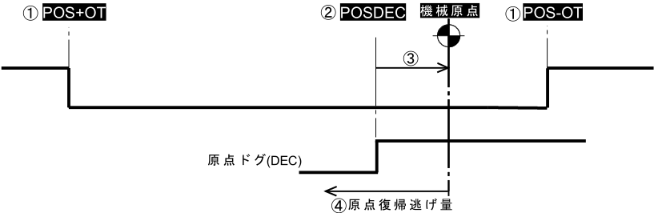

> **図の内容**
>
> ① POS+OT と ① POS-OT の間に ② POSDEC と機械原点がある。③ の動きで DEC を検出し、④ 原点復帰逃げ量だけ動く。原点ドグ(DEC) は機械原点の手前から ON。

- ①±OT位置の記録 POS+OT POS-OT

ストロークが十分か？（POS+OT）-（POS-OT）が予定通りか？ OTセンサの位置が悪ければ、位置を調整。十分なストロークを確保。

本当のメカ端（ぶつかる位置）との差も考慮。

- ②原点信号変化位置の記録 POSDEC

DEC位置が悪ければ調整。

- ③原点距離の設定

DEC位置が決まったら、次にサーボパラメータ「原点距離」を設定します。

- ④原点復帰逃げ量の設定
- ③の値の2倍程度を設定。

原点復帰速度を低速にして、原点復帰動作をおこなってください。

複数回おこなって、必ず一定の位置に原点復帰する事を確認してください。

(２). C(Z)相サーチ・C(Z)相ラッチ方式の場合

上記の①と②までは、同じです。

- C(Z)相パルスが確認できる場合

オシロやサーボのモニタでC(Z)相パルスを確認できる場合は、ゆっくり送りながら DEC変化点後のC(Z)相位置を記録してください。

- C(Z)相パルスが確認できない場合

C(Z)相パルスが、DEC後の「あるところ」で発生すると仮定して原点復帰をおこなって、間接的に確認します。

原点距離を0に設定して、原点復帰します。

繰り返しおこなって、必ず同じ位置に原点復帰する事を確認します。

その位置が、C(Z)相の位置です。

そこから、設定したい原点までの距離を改めて原点距離に設定します。

＜繰り返しで原点復帰位置がずれる場合＞

- a. C(Z)相論理を確認してください。

逆論理では、DEC後にすぐにC(Z)相が有効と判断してしまいます。

- b. DECの変化点とC(Z)相が重なっていないかどうかを確認して下さい。

＜原点ドグの変化点とC(Z)相の確認＞（C(Z)相サーチ方式の場合）

早送り速度(PTP速度)、アプローチ速度などは、なるべく低速に設定しておこなって下さい。C(Z)相サーチ方式では、原点ドグとC(Z)相パルスの位置関係を確認して下さい。

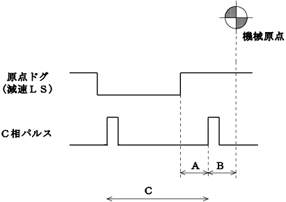

> **図の内容**
>
> 「原点ドグ（減速ＬＳ）」が ON になってから、次の「Ｃ相パルス」までの距離が A、C 相パルスから「機械原点」までが B。C 相パルスの間隔が C。

A: 減速LSとC(Z)相パルスの相対位置

B: 原点復帰距離（パラメータ）

C：モータ1回転ピッチ

Aの値の条件 0.1×C≦A≦0.9×C C：モータ1回転ピッチ

【Aの値の確認方法】

セッティングPCのポジション表示の「相対移動量」には、原点復帰の完了時には Aの値が表示されます。（原点復帰完了の直後のみです）

この時表示される値は、任意分周や電子ギアを掛けていないFBパルスそのものの値です。

アプローチ速度が速いと値のバラツキがありますので、何回おこなっても上の条件を満足するように、原点ドグ位置を調整下さい。

【具体例】

条件モータ1回転 4000p（1000p×4逓倍)

- （1）C(Z)相サーチ方式で原点復帰をします。
- （2）「相対移動量」の表示でAの値を確認します。

400≦A≦3600 NO(NG) 原点ドグ位置をずらして（1）からやりなおし。

(5～6回動作)

YES(OK)

(5～6回とも全てOK)終了

※Aの値が0や4000に近い場合は、C(Z)相と原点ドグが重なっていて問題になります。

#### 6-11-4. 同一指令2軸制御での原点復帰

同一指令2軸制御(平行軸)の原点復帰では、2軸のDEC信号やC(Z)相パルスの位置を合わせる必要があります。

| 原点復帰方式   | 2軸の各信号の位置合わせの必要性   | 2軸の各信号の位置合わせの必要性   | 同一指令2軸への適用                       |
|----------|--------------------|--------------------|----------------------------------|
|          | 原点(DEC)/OT         | C(Z)相              | 同一指令2軸への適用                       |
| C(Z)相ラッチ | DEC ①              | ②                  | 推奨                               |
| C(Z)相サーチ | DEC ①              | ②                  | 同一指令2軸には、不向き。 C(Z)相基準でないと精度が悪い。 |
| DECサーチ   | DEC 両エッジとも同じ位置     | 使用せず               | 同一指令2軸には、不向き。 C(Z)相基準でないと精度が悪い。 |
| OTサーチ    | OT エッジが同じ位置        | 使用せず               | 同一指令2軸には、不向き。 C(Z)相基準でないと精度が悪い。 |

- ① 原点(DEC)信号（C(Z)相サーチ方式のとき）

両軸の原点信号(DEC)の前のエッジ位置があっている方がベターです。

- ※ 前のエッジ位置が異なる場合

サーボパラメータの「原点復帰速度」と「アプローチ速度」が同じであれば問題ありません。

- ② C(Z)相

両軸のC(Z)相の位置をできるだけ合わせてください。

- ■原点距離(サーボパラメータ)の調整両軸の原点距離(サーボパラメータ）は、原点復帰完了で正確に平行になるように調整下さい。
- ■平行軸のOT信号位置

お互いの軸のOT発生位置をできるだけ合わせてください。

起動時にOTでの折り返しによる原点復帰を行う場合があります。

また、万一OTとなる場合、片軸だけでなく両軸ともOT発生となる方が自然です。

- ■DEC/OT信号の並列入力上記の理由からDECやOTは、同じセンサの信号を両軸用として並列配線する方法が現実的です。ただし、原点復帰方式がDECサーチ/OTサーチの場合は、各々のセンサが基準なので、別々に入力してください。

C(Z)相位置の合わせ方

- ■回転型モータでカップリングや機構連結が外せる場合

カップリングや機構連結を外して、各々のモータが独立に回転できるようにして「原点距離」を同じ設定で、原点復帰してください。原点復帰が完了した状態で、機構を連結すれば、両軸のC(Z)相位置は合います。

特に、あらかじめモータ単体でC(Z)相位置を確認して、モータシャフトに印をつけておくと、機構組立で簡単に位置あわせができます。

- ■回転型モータでカップリングを外せない時

原点復帰速度などを低速にして、原点距離を同じ設定で、仮に原点復帰してください。原点復帰完了した位置で、両軸の平行度のずれを計測します。そのずれが大きい場合は、やはりカップリングを外して、ずれをキャンセルする方向にモータ軸を回転させて、

カップリングを再固定してください。

- ■リニアスケールなど

通常はスケールにC(Z)相位置のマークがあります。両軸の位置があうように組み付けて下さい。

- ■C(Z)相位置が直接に確認できる場合

サーボアンプやツールソフトで、C(Z)相位置が確認できる場合は、それを利用して下さい。

同一指令2軸の原点復帰の補足説明

- ■原点復帰完了までの両軸のずれ
- 同一指令2軸（平行軸）でも、電源投入後から原点復帰が完了するまでは、一般にお互いに多少のズレがあります。
- 両軸の原点復帰は、同時におこないますが、原点信号やC(Z)相信号の位置がずれていると、一連のお互いの動きのタイミングに多少のずれが生じます。

■2軸の機構連結が強い場合

2軸の連結が強い場合は、両軸の誤差も少ない反面、多少の誤差であっても平行性の崩れによって、異常摩擦が発生する危険性があります。このような応用では、各軸の原点やC(Z)相を正確に一致させておく必要があります。また、アプローチ速度や原点復帰速度も低めが安全です。

■2軸の機構連結が弱い場合

お互いの軸の機構干渉が少ない場合は、お互いの原点やC(Z)相がずれていても、ほとんど問題はありません。

### 6-12. ソフトリミットの設定(メカ組合せ試運転)

機械原点の位置が決まったら、最終的なソフトウェアストロークリミットのパラメータを設定して下さい。

- その位置(機械座標値)より、すこし内側に
- +(-)OTになるまでゆっくりと移動。 +(-)ソフトリミットを設定。
- ※ 機械原点位置を変更した場合には、ソフトリミットの再設定が必要です。

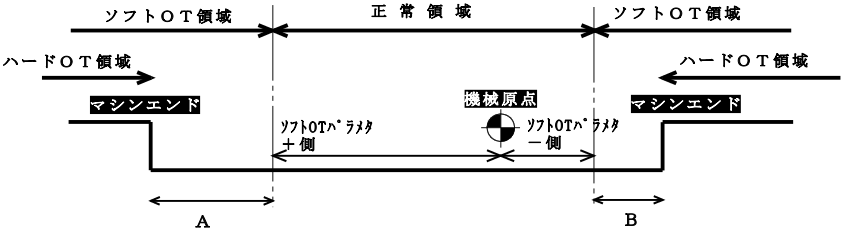

> **図の内容**
>
> 中央が「正常領域」、両側が「ソフトＯＴ領域」、外側が「ハードＯＴ領域」、両端に「マシンエンド」。機械原点から左右に「ｿﾌﾄOTﾊﾟﾗﾒﾀ ＋側」「－側」。マシンエンドからソフトOTの境界までが A（左）、B（右）。

AやBの値は、大きい方が安全ですが、その分正常領域が狭くなります。

＜ハードOT領域＞

ハードOTから実際のマシンエンドまでの距離も大きい方が安全ですが、現実には数10mmが一般的です。

ある程度の高速でハードOTに入った場合は、惰走でマシンエンドにぶつかる可能性があります。マシン設計においては、物理的な安全策(メカダンパーなど)を必ずおこなって下さい。

### 6-13. メモリ運転(単体試運転/メカ組合せ試運転)

出荷CDの中のサンプル運転プログラムを適当に選択して、以下のように運転して下さい。また「出力制御」や「入力処理」についても、各々の機械仕様に合せて作成して下さい。はじめは、オーバライドを下げて低速で行い、その後速度を上げてください。

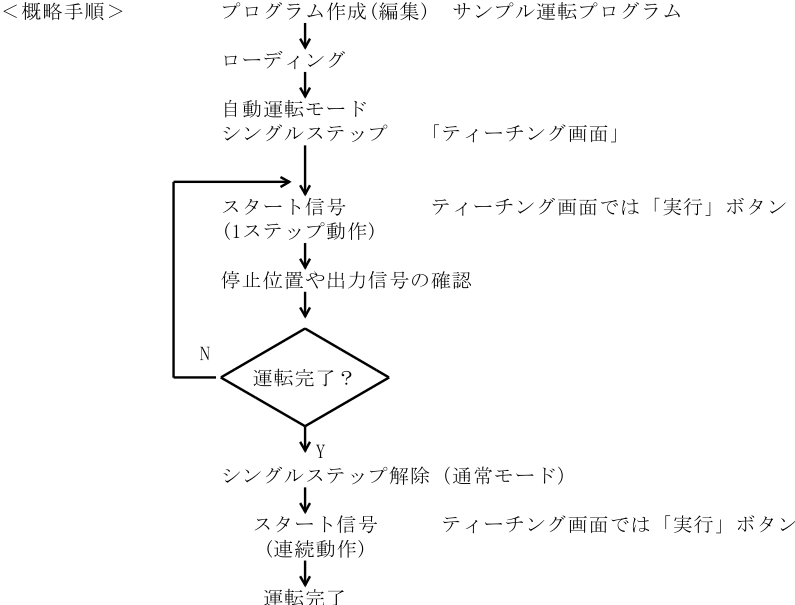

> **図の内容**
>
> 1. プログラム作成（編集）（サンプル運転プログラム）
> 2. ローディング
> 3. 自動運転モード、シングルステップ（「ティーチング画面」）
> 4. スタート信号（1ステップ動作）（ティーチング画面では「実行」ボタン）
> 5. 停止位置や出力信号の確認
> 6. 運転完了？ N なら 4 に戻る。Y なら次へ
> 7. シングルステップ解除（通常モード）
> 8. スタート信号（連続動作）（ティーチング画面では「実行」ボタン）
> 9. 運転完了

### 6-14. サーボ調整用運転プログラム

サーボ調整用としては、1軸毎の往復動作を直線補間(指数形加減速)で作成して下さい。

例 PTPA X0;

CALL SUB L100;

```c
    CALL SUB L100;  /*100往復*/
    END;
```

:SUB

LIN X100000 F100000;

TIM0.1;

LIN X-100000;

TIM0.1;

END;

はじめは、補間時定数を30～50msec程度（機構によります）として、往復動作させます。サーボ系の確認としては、補間時定数をゼロでおこなうことも意味があります。

上記例では、停止待ち時間（ドウェル）を入れてます。静止摩擦と動摩擦を行き来するのが確認のポイントの一つです。

ある程度の高速で、サーボ系のゲインの上限などを確認します。

極低速では、摩擦や外乱による速度リップルの確認をします。

まれに、サーボメーカのロギング機能では、極低速のサンプリングがうまくできない場合もあります。テクノのTPC-EXCELでは、そのような評価も可能です。

### 6-15. モータの駆動能力の確認

1軸毎の往復動作運転プログラムにて、モータ駆動能力の確認をします。補間時定数をゼロとして、サーボ応答波形と電流（トルク）波形を確認してください。サーボアンプメーカの調整用ソフトでモニタリングできます。

＜加速/減速トルク＞加速トルクが定格トルクの100%以下が理想的です。補間（加減速）時定数を大きくすることで、指令速度変化がなめらかになり、加速減速のピークトルクは下がります。

- ＜定常（摩擦）トルク＞定常（摩擦）トルクが100%近い場合は、モータのパワー不足です。摩擦を小さくするか、モータの再選択が必要です。定常（摩擦）トルクは、水平軸であれば通常は10%以下です。大きくても30%以下になるように選択いただきたいです。

＜上下軸＞

上下軸では、重力の影響で方向によって違いが生じます。下がりながら停止したときと、

あがりながら停止したときでは、停止時の保持トルクにも差がでることがあります。このような非線形性は、無い方が良いですが、カウンタバランスが無い上下機構では、

多少発生します。

- ※ モータのトルクは、定格トルクを100%として、その比で表現します。

100%以上のトルクを一定時間発生させるとオーバロードエラーになります。

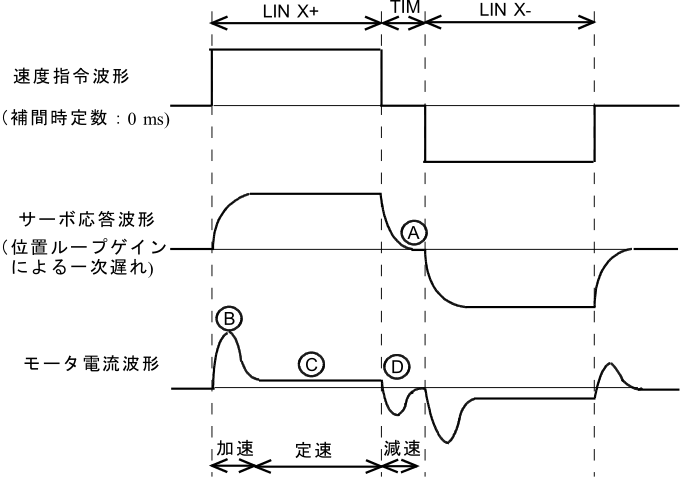

> **図の内容**
>
> 区間: 「LIN X+」「TIM」「LIN X-」。
> - 「速度指令波形（補間時定数：0 ms）」: LIN X+ で正の一定値、TIM で 0、LIN X- で負の一定値
> - 「サーボ応答波形（位置ループゲインによる一次遅れ）」: 指令に一次遅れで追従する（Ⓐ は減速の始まり）
> - 「モータ電流波形」: 加速時に Ⓑ のピーク、定速時は Ⓒ の一定値、減速時に Ⓓ の逆向きの電流
> - 下の区間: 加速、定速、減速

- A ：停止時間
- B ：加速トルク（加速時の電流）
- C ：定速トルク（摩擦負荷による電流）
- D ：減速トルク

### 6-16. サーボ系の調整

実際の運転に応じた位置ループゲインや加減速定数を設定します。 <6-14.サーボ調整用運転プログラム>の運転プログラムを使います。

| 分         | 類           | 調整箇所       | 第1～4軸(パルス指令軸)                                        |
|-----------|-------------|------------|------------------------------------------------------|
| 制御性の調 | 速度ループ位置 | サーボアンプの調整 | 使用上の設定参照・<7.サーボ系の制御性能> 速度ループゲイン(上限値) ・各サーボアンプのマニュアル |
| 整         | ループ         | (パラメータ設定)  | 位置ループゲイン(最適値) (全軸同一)                                 |
| 指令系の      | 指令系の        | SLM 加速度    | PTP時定数なめらかな早送りを可能とする最小値補間時定数なめらか補間送りを可能とする最小値     |
| 調整       | 調整         | SLM 送り速度   | PTP速度早送り速度 JOG速度手動送り速度原点復帰速度原点復帰の早送り速度           |
|           |             | SLM 軌跡形状補正 | 形状補正係数軌跡形状を特に改善したい場合＜オプション＞同係数≧位置ループゲイン           |

### 6-17. サーボ応答の確認

送り速度、加減速定数、Kpの関係でオーバーシュートや発振が発生する場合があります。実際の動きに対してオーバーシュートのないサーボ応答にする必要があります。サーボ応答の観測方法は、「サーボアンプの速度モニタ(各社調整ソフト)」、

「TPCロギング機能とTPC-EXCELによる解析」、などがあります。TPC-EXCELソフトを用いれば、サーボ応答だけでなく、軌跡精度や実動作の局所的動作も詳細にチェックできます。

＜PTPの速度モニタ＞

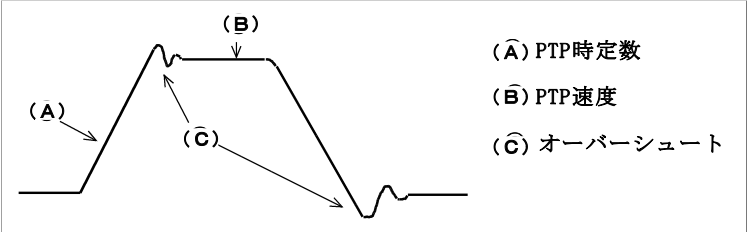

> **図の内容**
>
> 台形の速度の波形。(A) PTP時定数（立ち上がりの傾き）、(B) PTP速度（一定の高さ）、(C) オーバーシュート（立ち上がりと停止のあとの揺れ）。

- (C)の値がなくなるか、許容の大きさになるように(A)PTP時定数やKpを調整します。一般に(B)については、仕様面から決められます。

＜直線補間の速度モニタ＞

PTP同様に(C)の大きさを見ながら(A)補間時定数やKpを調整します。

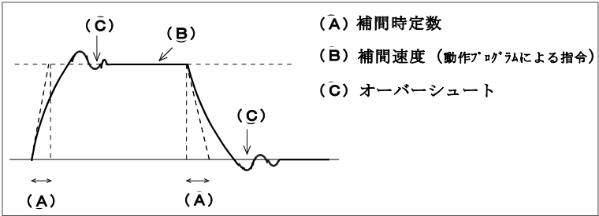

> **図の内容**
>
> 補間の速度の波形。(A) 補間時定数（立ち上がりと立ち下がりの幅）、(B) 補間速度（動作プログラムによる指令）、(C) オーバーシュート。

### 6-18. TPCによる精度チェック

当社モーションアナライザ「TPC-EXCEL」により機械系を含めたトータルの精度チェックを行うことをお進めします。

バックラッシュ、異常な摩擦、振動、オーバシュートなどが定量的に測定できます。詳細はテクノHP会員コーナの「TPC-EXCEL説明書」を参照下さい。

- ■ TPC-EXCEL精度解析処理

時系列データファイルをEXCEL専用ソフトで解析・グラフィック表示します。

サーボ応答解析各軸の速度カーブ

軌跡解析

2軸の合成軌跡

直線精度解析理想直線との誤差分を拡大

真円精度解析理想円弧との誤差分を拡大

■サーボ応答解析

■真円精度解析

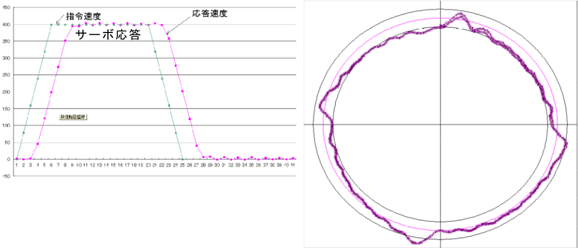

> **図の内容**
>
> - 左: 「サーボ応答」のグラフ。「指令速度」（緑）と「応答速度」（ピンク）の台形の速度。応答は指令に遅れて追従する
> - 右: 真円精度解析のグラフ。理想円（ピンク）の周りで、実際の軌跡（紫）が凹凸を持って一周している
>
> 軸の目盛りの値は小さくて判読できず。

### 6-19. パラメータの保存(単体試運転/メカ組合せ試運転)

設定したパラメータは機械に対して最適調整した大事なデータです。セッティングPCにて必ずファイルにセーブして保存して下さい。ファイル名としては、機械の名称などに合わせて管理しやすい名称として下さい。

ファイルに保存しておけば、他の機械の調整やパラメータを誤って変更してしまった場合、簡単に再ロードできます。

### 6-20. オーバートラベルからの復旧（ソフトOT/ハードOT）

＜ソフトリミットエラー＞

運転プログラムや操作のミスでソフトリミットにかかると停止します。手動モードのJOGでは、戻す方向には操作できますので、そのまま戻せます。

＜ハードOTエラー＞

ハードOTを越えた場合は以下のいずれかで対処して下さい。

- ａ. 機械が手でもどる場合は、もとの位置にもどします。（アラームでサーボOFF状態）
- ｂ. 「OT無視モード」にして、リセット入力するとアラームは消えます。安全を充分に確認してJOG送りにて戻して下さい。

復旧後は「OT無視モード」をすみやかに解除（正常なモードに戻す）して下さい。

### 6-21. その他の注意点

＜軸の安全な位置への移動＞

運転確認を完了した軸については、機械構造や周囲との関係、他の軸との関係から最も安全と思われる位置に移動して、他の軸のチェックへ移行して下さい。

＜落下軸の注意＞

正常なサーボロックを確認するまで、おさえの材木などは、はずさないで下さい。万一落下しても機械を壊さないような保護をしてください。

＜ゲインの仮調整＞

JOG動作でなめらかにモータが回転するように、とりあえず速度ループゲインや位置

ループゲインを仮調整して下さい。全体的に安定動作が確認できたら、正式にサーボゲインの調整をしてください。

## 7. サーボ系の制御性能

### 7-1. サーボ系とは？

サーボ系とは、以下の要素が組み合わさった制御系です。その特性は、各要素の総合的な性能で決まります。性能への責任（重要度）としては、①＞②＞③＞④＞⑤です。テクノHPでは、サーボ系の基本的な説明もしています。ご興味ある方は、参照下さい。テクノHP→会員コーナ→「サーボマスターテキスト」

| サーボ系の要素       | おもな役割や機能                             | サーボ系への責任                       |
|---------------|--------------------------------------|--------------------------------|
| ①機構           | ボールネジ、カップリングガイド、駆動に関するすべての機能       | 機構の剛性が高く、正確であることがもっとも重要。      |
| ②検出器（位置、速度）   | エンコーダやスケール位置検出（速度検出）                | FB制御の基本情報。特に速度ループ制御が重要。       |
| ③モータ          | 電気を力に変換パワーを出す。                      | 所望の力や速度を出すパワーが重要。             |
| ④サーボアンプ       | モータの電流、速度、位置の制御。トルク外乱などにも、うち勝って制御。 | 摩擦や外乱に負けずに正確に所望の速度で動くためのFB制御。 |
| ⑤モーションコントローラ | 生産のための動作指示。各サーボアンプへの指示。             | 多軸の同期性や軌跡精度。なめらかで高精度な軌跡制御。    |

### 7-2. 機械の剛性の重要性

機械の剛性が高くなければ、高精度なサーボ系の調整は困難です。ユーザ殿(機械設計担当者)は、まず機械の剛性を高めることに努力下さい。

| 機械の剛性                | 高(良)    | 低(悪)                  |
|----------------------|---------|-----------------------|
| 機械的「ガタ」              | ない      | ある                    |
| ねじりバネ要素              | 小 (かたい) | 大(やわらかい) 細くて長いボールネジなど |
| イナーシャ                | 小       | 大                     |
| ボールネジの張りタイミングベルトの張り | 強       | 弱                     |

### 7-3. 制御系の良さ

制御系の良さ（ダイナミクスな精度）とは、次のようなことです。

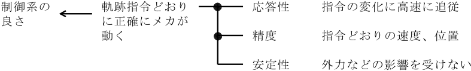

> **図の内容**
>
> 「制御系の良さ」←「軌跡指令どおりに正確にメカが動く」。その中身は 3 つ:
> - 応答性: 指令の変化に高速に追従
> - 精度: 指令どおりの速度、位置
> - 安定性: 外力などの影響を受けない

＜静的な精度＞位置決め応用

位置決めの精度のみが必要であれば、静的な精度のみが制御対象です。

移動途中は問いません。軌跡誤差、速度リップルなどが発生しても作業上は問題ありません。位置決め後に止まった状態で作業します。

搬送機、簡単な穴あけ機などです。

このような応用では、制御系がそれほど良くなくても問題にはならない傾向です。

＜動的な精度＞軌跡制御の応用

切削、研磨、巻線、カッティング等では、移動中も作業しており、軌跡そのものが重要です。速度リップル、速度ムラ、多軸の同期誤差が致命的な結果になります。このような応用では、制御系の良さ（ダイナミクスな精度）が必要になります。

### 7-4. サーボ系の3重ループ

サーボ系は、図のような3重ループの制御になっています。そのため、制御性能の責任は以下の順番で生じます。

サーボモータの特性サーボアンプの特性位置ループの特性メカ剛性＞＞＞ PG(検出器の精度) 電流ループ・速度ループサーボアンプ又はSLM

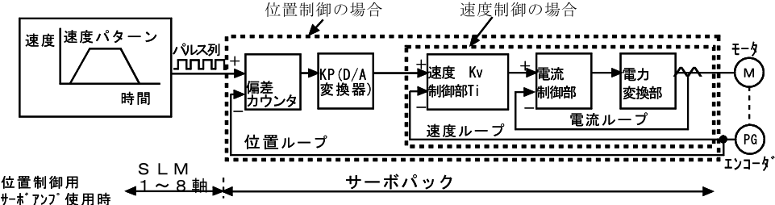

> **図の内容**
>
> - 「速度パターン」（台形）から「パルス列」が出て、「偏差カウンタ」→「KP(D/A変換器)」（位置ループ）→「速度 Kv 制御部Ti」（速度ループ）→「電流制御部」→「電力変換部」（電流ループ）→「モータ」。「PG」（エンコーダ）の信号が各ループに戻る
> - 点線の枠: 「位置制御の場合」は位置ループから、「速度制御の場合」は速度ループからがサーボパック側
> - 下: 「SLM」（1～8軸）と「サーボパック」の範囲。「位置制御用ｻｰﾎﾞｱﾝﾌﾟ使用時」

KP：位置ループゲイン KP：位置ループゲイン

KV：速度ループゲイン KV：速度ループゲイン

TI ：積分時定数 TI ：積分時定数

### 7-5. SLMとサーボ系の関係

【第1軸～第8軸パルス指令】

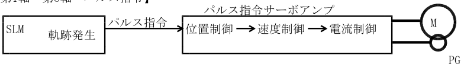

> **図の内容**
>
> 「SLM」の「軌跡発生」から「パルス指令」が「パルス指令サーボアンプ」へ。アンプの中は「位置制御」→「速度制御」→「電流制御」→ モータ(M)、PG の信号が戻る。

#### 7-5-1. パルスモータの場合(第1軸～第8軸)

ＳＬＭ８０００(ＡＳ７１０)

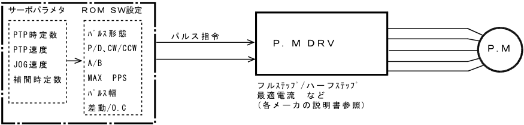

> **図の内容**
>
> SLM8000 の「サーボパラメータ」（PTP時定数、PTP速度、JOG速度、補間時定数）と「ROM SW設定」（ﾊﾟﾙｽ形態 P/D,CW/CCW,A/B、MAX PPS、ﾊﾟﾙｽ幅、差動/O.C）から「パルス指令」が「P. M DRV」（パルスモータドライバ）へ行き、「P.M」（パルスモータ）を動かす。ドライバ側の設定: フルｽﾃｯﾌﾟ/ハーフｽﾃｯﾌﾟ、最適電流など（各メーカの説明書参照）。

#### 7-5-2. パルス指令型サーボの場合(第1軸～第8軸)

ＳＬＭ８０００(ＡＳ７１０)

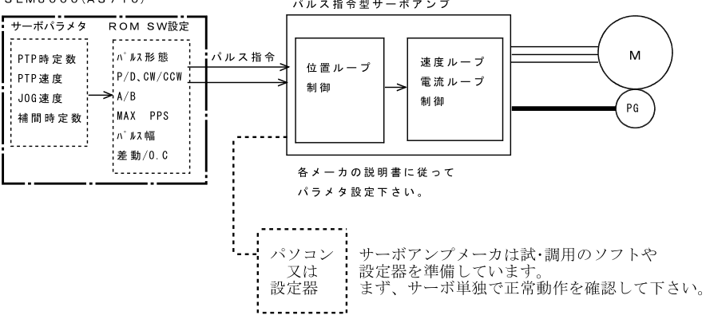

> **図の内容**
>
> SLM8000 の「サーボパラメータ」と「ROM SW設定」（前の図と同じ項目）から「パルス指令」が「パルス指令型サーボアンプ」（位置ループ制御、速度ループ・電流ループ制御）へ行き、モータ(M)と PG につながる。
> - 「各メーカの説明書に従ってパラメタ設定下さい。」
> - 「パソコン又は設定器」: サーボアンプメーカは試・調用のソフトや設定器を準備しています。まず、サーボ単独で正常動作を確認して下さい。

## 8. サーボモータ応用時の一般的注意

### 8-1. モータの選定

負荷イナーシャ、最高速度、加減速時間、1パルス移動量などの条件をもとに選定します。詳細は各サーボメーカの説明書を参照下さい。最近のACサーボは、加速性能は高いものの、定速回転(特に低速)での速度リップルが大きい傾向があります。サーボアンプの速度ループゲインを上げることで、このリップルを小さくします。

モータ選定用のソフトも各サーボメーカから提供されています。また、「年間サポート」を契約いただいているお客様には、テクノにてモータ選定のご支援もいたします。

### 8-2. 速度ループゲイン調整

サーボアンプのパラメータ調整にて、速度ループゲインを上げていきます。往復運転をしながら、速度ループゲインを上げていき、発振限界のゲインを探します。

メカのストロークに対して、中央/両端どの場所でも発振させない値にして下さい。

- 注意 (1) 発振させると、非常に大きな音が出ます。また、メカ強度が不足(特にカップリングなど)している部分は、まれにこわれる可能性があります。発振が生じた場合は、すぐに速度ループゲインを大きく下げて発振を止めて下さい。一端発振すると、少しゲインを下げても止まりません。
- (2) メカ調整(ボールネジ/ベルトの張りなど)により速度ループゲインの上限値は変わります。

### 8-3. ACサーボの単体動作とパラメータ設定

<7-5-2.パルス指令型サーボの場合>の構成図のように、サーボの制御性の調整はサーボアンプのパラメータ設定によりおこないます。

この場合、各サーボメーカのPCソフトや設定器による単体動作が基本です。

### 8-4. 多軸のゲイン調整

複数軸で補間動作をさせ、軌跡精度を重視する応用では、以下のパラメータについては必ず一致させて下さい。

- ◆ 位置ループゲインサーボアンプパラメータ
- ◆ 補間時定数(指数形/直線形/S字)
- SLM8000パラメータ

### 8-5. 各社サーボの調整例

<Ⅰ導入編 8-3. サーボアンプなどの設定>(TB00-1130A) に安川電機Σ、三菱電機MR-J2の例があります。参考にしてください。

また、「年間サポート」を契約いただいているお客様には、テクノにてサーボアンプの設定のご支援もいたします。

## 9. パルスモータ使用時の一般的注意

### 9-1. モータの選定

負荷イナーシャ、最高速度、加減速レート、1パルス移動量などの条件をもとに選定します。詳細は各パルスモータメーカの説明書を参照下さい。

※ 「オリエンタルモータ総合カタログ」には、詳細な説明があります。

### 9-2. 脱調の確認

使用する最高速度、加減速レートにて往復運動させて位置ずれがないことを確認して下さい。一般に脱調時には、通常とは音が異なります。

### 9-3. SLM側の設定

以下の設定が必要です。

- □ ROMSW

最高PPS(パルスジェネレータクロック) パルス幅パルス出力モード(信号形態)、指令出力極性

□ サーボパラメータ速送り速度加減速定数その他

### 9-4. 発熱

パルスモータアンプは、消費電力が大きいため発熱が大です。制御盤の熱対策は、充分に考慮して下さい。

### 9-5. ケーブル長と励磁電圧

アンプ～モータ間のケーブル長が長くなると励磁電圧を上げる必要が生じます。 (詳細は各メーカの説明書を参照)
