# Ⅴ メンテナンス編

## 1. 異常時の処理(SLM8000 本体側)

### 1-1. 基本動作に関する異常

◆1.1

| 異常状態                                                                                                 | 推定される原因                                                                                                 | 処置                                                                                                                                     | 詳細説明                   |
|------------------------------------------------------------------------------------------------------|---------------------------------------------------------------------------------------------------------|----------------------------------------------------------------------------------------------------------------------------------------|------------------------|
| 1 ボ－ド上のLED が点滅しない OFFのまま ONのまま                                                                       | DC電源異常(24V) 24Vの供給不良(CN3) その他コントローラボードにおける重大故障                                                         | 24Vのチェック SLM側にて±10% CN3カシメ不良(目視チェック) ボード交換により調査                                                                                        | Ⅱハードウェア編               |
| 2 セッティングPC の接続不可 (タイムアウト)                                                                            | 【イーサネットの接続】 LANケーブル IPアドレスの設定【RS232C接続】 RS232Cケーブル【PC側設定】 COMポートが使用可能になっているか PCがサスペンドモード             | ケーブルのテスターチェックし不良なら修正又はケーブル交換 IPアドレスの確認他のPCを使ってみるケーブルの交換 PC側設定(通信ポート)の再チェック(PCのCOM1/COM2設定等) 電源管理を無効にする                             | Ⅱハードウェア編               |
| 3 操作入力全ての入力が不可一部の入力が不可                                                                             | 24Vの供給不良 (CN3) 外部配線不良 SLM内回路/部品不良                                                                       | <セッティングPC入出力モニタ> 電源 24Vをチェックセンサや入力信号の配線チェック                                                                                          | Ⅱハードウェア編 <3-1.> <3-2.> |
| 4 出力信号出力が出ない一部の出力が不可                                                                               | 24Vの供給不良 (CN3) 外部配線不良 SLM内回路/部品不良                                                                       | <セッティングPC入出力モニタ> 電源 24Vをチェック出力の配線チェック                                                                                                 | Ⅱハードウェア編 <3-1.> <3-2.> |
| 5 セッティングPC が起動できない。ダイアログメッセージ「このアプリケーションのサイドバイサイド構成が正しくないため、アプリケーションを開始できませんでした。...」が表示される場合 | 『Microsoft Visual C++ 2008 Redistributable - x86』 (『Microsoft Visual C++ 2008 再頒布パッケージ』) がインストールされていない。 | 『Microsoft Visual C++ 2008 再頒布パッケージ』をインストールする。インストールCD内にあるパッケージをインストールします。 [ドライブ名]:\vcredist\32bit \vcredist_x86.exe をインストールしてください。 |                        |

■SLMボードでの24Vのチェック

制御用DC電源の電圧確認は、電源コネクタをSLM8000のCN3にさしたままで、電圧をテスタチェックしてください。

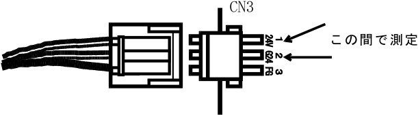

> **図の内容**
>
> 電源コネクタを SLM8000 の CN3 に差した絵。CN3 の端子（24V、024、FG と読める）のうち、矢印で示した 2 本の間を「この間で測定」。

■セッティングPCが起動できない場合

セッティングPC起動時に以下のダイアログメッセージが表示される場合は、『Microsoft Visual C++ 2008 Redistributable - x86』 (『Microsoft Visual C++ 2008 再頒布パッケージ(x86)』) をインストールする必要があります。

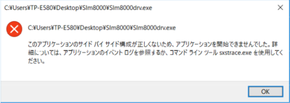

> **図の内容**
>
> ダイアログ「C:¥Users¥TP-E580¥Desktop¥Slm8000¥Slm8000drv.exe」。「C:¥Users¥TP-E580¥Desktop¥Slm8000¥Slm8000drv.exe　このアプリケーションのサイド バイ サイド構成が正しくないため、アプリケーションを開始できませんでした。詳細については、アプリケーションのイベント ログを参照するか、コマンド ライン ツール sxstrace.exe を使用してください。」、OK ボタン。

- ■『Microsoft Visual C++ 2008 再頒布パッケージ(x86)』のインストール
- ①『Microsoft Visual C++ 2008 再頒布パッケージ(x86)』のインストーラーはインストールCDの以下のパスにあります。
- これを実行してください。
- 【注意】OSのビット数に関わらず、必ず32bitの『Microsoft Visual C++ 2008 再頒布パッケージ』をインストールします。

[ドライブ名]:\vcredist\32bit\vcredist_x86.exe

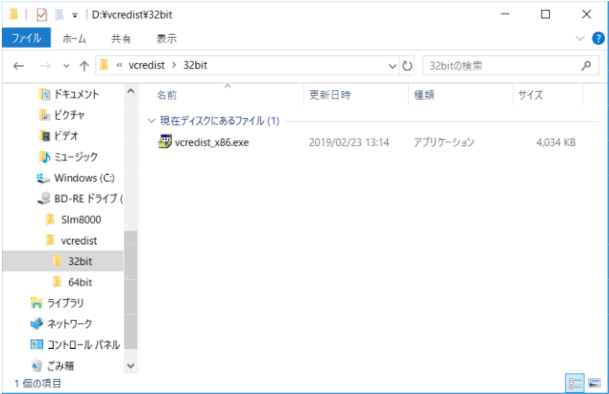

> **図の内容**
>
> エクスプローラーで「D:¥vcredist¥32bit」を開いた画面。ファイル「vcredist_x86.exe」（2019/02/23 13:14、アプリケーション、4,034 KB）。左のツリーに BD-RE ドライブの Slm8000、vcredist（32bit、64bit）。

- ②インストーラーの実行

インストールウィザードに従いインストールして下さい。

［次へ］を押す。

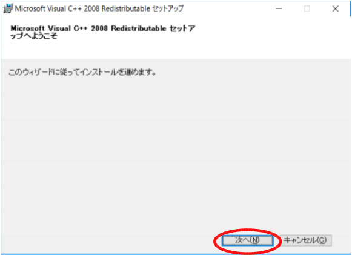

> **図の内容**
>
> 「Microsoft Visual C++ 2008 Redistributable セットアップへようこそ」「このウィザードに従ってインストールを進めます。」。「次へ(N)」ボタンが赤丸で囲まれている。

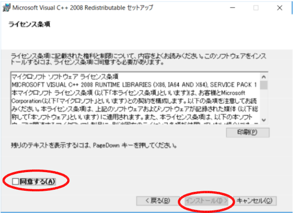

> **図の内容**
>
> 「ライセンス条項」の画面。「同意する(A)」のチェックボックスと「インストール(I)」ボタンが赤丸で囲まれている。

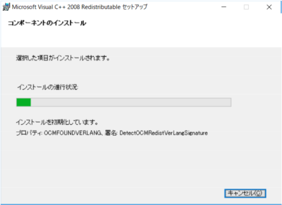

> **図の内容**
>
> 「コンポーネントのインストール」の画面。「選択した項目がインストールされます。」、インストールの進行状況のバー、「インストールを初期化しています。」。

［同意する］にチェック［インストール］を押す

インストールの完了を待つ

インストール完了

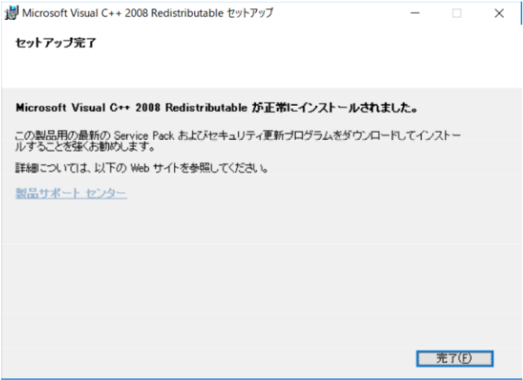

> **図の内容**
>
> 「セットアップ完了」の画面。「Microsoft Visual C++ 2008 Redistributable が正常にインストールされました。」、「完了(F)」ボタン。

インストールが完了したら、セッティングPCが起動できることを確認してください。

- ■『Microsoft Visual C++ 2008 再頒布パッケージ(x86)』がインストール済の場合インストールを実行すると以下の画面が表示されますこの場合は、インストールの必要はありません。

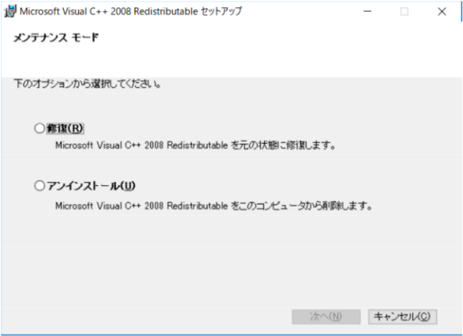

> **図の内容**
>
> 「メンテナンス モード」の画面。「下のオプションから選択してください。」、選択肢「修復(R)」（Microsoft Visual C++ 2008 Redistributable を元の状態に修復します。）と「アンインストール(U)」（Microsoft Visual C++ 2008 Redistributable をこのコンピュータから削除します。）。

■7セグLEDの表示

7セグLEDの表示内容で状態やエラー要因を示す。

表示内容と状態との対応は以下の通りです

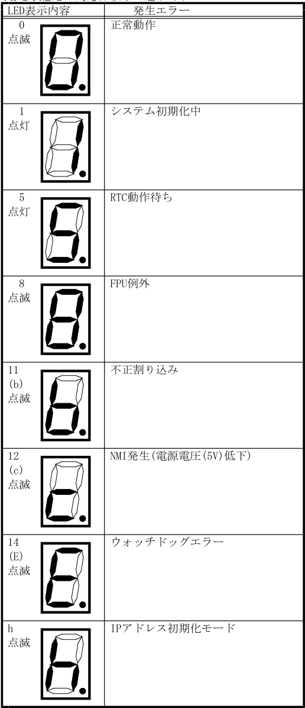

> **図の内容**
>
> | LED表示内容 | 発生エラー |
> |---|---|
> | 0 点滅 | 正常動作 |
> | 1 点灯 | システム初期化中 |
> | 5 点灯 | RTC動作待ち |
> | 8 点滅 | FPU例外 |
> | 11 (b) 点滅 | 不正割り込み |
> | 12 (c) 点滅 | NMI発生(電源電圧(5V)低下) |
> | 14 (E) 点滅 | ウォッチドッグエラー |
> | h 点滅 | IPアドレス初期化モード |

### 1-2. アラーム表示をともなう異常(全体エラー)

| 異常状態                      | 推定される原因                                                                                      |                                                                                                                                                          | 詳細説明                                   |
|------------------------------|----------------------------------------------------------------------------------------------------|----------------------------------------------------------------------------------------------------------------------------------------------------------|----------------------------------------|
| 1 システムエラー                    | SLM内部の演算エラーなどパラメータや運転プログラムの設定値や記述上のミス｡                                                           | 処置パラメータや運転プログラムのチェック及び再ロード｡条件を記録 (テクノにて詳細調査)                                                                                                         | 【パラメータ】 Ⅲ機能編<8.> 【プログラム】テキストプログラム説明書 |
| 2 バックアップエラー 3 パラメータ未設定エラー   | バッテリー電圧低下のためバックアップメモリが消えている｡パラメータ初期化後､有効なパラメータを設定(ダウンロード) していない｡                               | バッテリー交換全バックアップデータをクリアして再設定する｡                                                                                                                          | Ⅴメンテナンス編 <3-4.>                        |
| 4 ROMSWバックアップエラー            | ソフトバージョンアップ(FLASH 書換)により、ROMSWも更新する必要が発生した。                                                       | 新しいROMSWをダウンロードする。(SLM8000内のROMSWデータはデフォルトになっています。)                                                                                                   |                                        |
| 5 制御周期負荷ワーニングまたは、制御周期負荷過大 | 制御周期が短すぎる。サーボ制御周期処理時間の最大値と、ROMSWで設定したサーボ制御周期の比 ●サーボ制御周期ワーニングレベル以上制御周期負荷ワーニング ●100%以上制御周期負荷過大 | ROMSW設定ソフト「基本」画面の「サーボ制御周期」を長くする。制御周期負荷ワーニング、制御周期負荷過大の解除は、セッティングPCの「オプション」の「制御周期モニタ」で「RTC」を選択し、「計測値クリア」ボタンを押します。 (または、REQ_TIMERRESETコマンドを発行します。) |                                        |
| 6 特殊モードエラー                   | ディップスイッチを変更し、 IPアドレス初期化モードになっている。                                                                 | ディップスイッチを全て OFFにする。                                                                                                                                      | Ⅴメンテナンス編 <6.>                          |

### 1-3. アラーム表示をともなう異常(タスク別エラー)

| 異常状態                            | 推定される原因                                                                  | 処置                                                                                           | 詳細説明          |
|------------------------------------|--------------------------------------------------------------------------------|-----------------------------------------------------------------------------------------------|---------------|
| 1 非常停止                             | 非常停止スイッチの動作｡その他非常停止入力｡                                                        | 非常停止スイッチの解除｡非常停止の回路をチェック｡                                                                    |               |
| 2 プログラム実行エラー                      | 運転プログラムの表記、又はデータ上の矛盾など｡                                                       | 運転プログラムの内容を再チェック｡異常発生時の条件を記録 (テクノ調査) 運転プログラム保存 (ファイル)                                       | Ⅲ機能編 <6-4-1.> |
| 3 Mコード実行エラー                        | ROMSWでMOK入力有効の設定で MFIN検出エッジでMOKがOFF                                            | リセットで解除。 MOKがOFFがONしている場合 MOKが遅い？ MFINをONする前に、 MOKが返るようにする。 MOKがOFFの場合 MOKが入力されない？ラダーや外部配線確認 |               |
| 4 割り当て軸エラー                         | タスクに割り当てている軸にエラーが発生しています。                                                     | 各軸毎のアラームの処置を実施してください。                                                                        |               |
| 5 サーボOFFエラー                        | ROMSWでシステム起動時サーボオンを設定していない。【リセット操作でONしない】 OT入力非常停止入力【一度ONしてすぐに落ちる】サーボアラーム | リセットで解除 OTや非常停止入力等のアラーム要因をチェック。（I/Oモニター画面）サーボアンプ/モータ関係の異常を調査。サーボ単体で動作。（主電源強制ON）         |               |
| 6 外部アラームAエラー外部アラームBエラー外部アラームCエラー | 外部アラームA,B,C信号がONした。                                                           | リセット入力で解除。外部アラームA,B,C信号をONさせている要因をチェック。配線確認。                                               | Ⅲ機能編 <2-1.>   |
| 7 主軸アラーム                           | 主軸ドライバのアラーム出力                                                                  | 主軸ドライバのモニタソフト等で主軸のアラーム要因をチェック                                                               |               |
| 7 主軸アラーム                           | 主軸ドライバ/モータの配線不良｡主軸の主電源不良｡                                                    | SLM、主軸ドライバ間の配線チェック                                                                           |               |

### 1-4. アラーム表示をともなう異常(各軸エラー)

| 異常状態                                         | 推定される原因                                                                                                           | 処置                                                                                                                                                                          | 詳細説明                                                                    |
|-------------------------------------------------|-------------------------------------------------------------------------------------------------------------------------|------------------------------------------------------------------------------------------------------------------------------------------------------------------------------|-------------------------------------------------------------------------|
| 1 偏差過大エラ－ □軸+方向偏差過大エラー □軸-方向偏差過大エラー           | FBの配線不良モータが動かない kpが小さい速度指令が速すぎる(kpを調整しても上がらなかった場合) ・サーボパラメータのER上限値が小さい・補間命令(LIN等)の実行中・ポイント位置決め(PTP等)の実行中・JOG移動中 | 配線を修正 (SLM～アンプ、アンプ～PG) サーボアンプの設定を確認。 POT,NOTの入力(サーボの場合) 制御モード(位置指令モードになっているか？) トルク制限が有効になっていないか？機械の干渉 kpの調整 ER上限値を大きくする F値を遅くするサーボパラメータのPTP速度を遅くするサーボパラメータのJOG速度を遅くする | Ⅱハードウェア編サーボアンプのマニュアル試運転･調整編セッティングPC マニュアルテキストプログラムセッティングPC マニュアル |
| 2 サーボアラーム □軸サーボアラーム                             | サーボアンプのアラーム出力｡ (I/Oモニタでチェック) サーボアンプ/モータの配線不良｡サーボ主電源不良｡                                                                | SLM ←→ サーボアンプの配線チェックサーボアンプ/モータの単体動作にてチェック｡サーボのデジタルオペレータでアラーム要因トレースを                                                                                                     | Ⅱハードウェア編 <4.> サーボアンプのマニュアル                                             |
| 3 ソフトリミット □軸+方向ソフトリミット □軸-方向ソフトリミット           | ソフトリミットのパラメータ値不良｡ SLM内のアブソPOS.の異常運転中のソフトリミット                                                                          | チェックパラメータ値をチェック｡バックアップデータの初期化で「アブソPOS.」をクリア｡ JOGでリミット内に戻す｡                                                                                                                | Ⅲ機能編<8.> セッティングPC マニュアル                                                 |
| 4 ハードリミット □軸+方向ハードリミット □軸-方向ハード                | OT入力がON 配線不良｡B接入力がオープン｡運転中のハードリミット                                                                                     | セッティングPC入出力チェック配線を修正 OT無視モードにしてリミット内へ戻す｡                                                                                                                                   | Ⅱハードウェア編 <3-3.>                                                         |
| リミット                                            | なぜソフトリミットで止まらなかった?                                                                                                     | ソフトリミット/OT間の距離と送り速度の関係を再チェック｡ソフトリミット値(パラメータ)は正常か?                                                                                                                        | Ⅳ試運転･調整編 <6-12.>                                                        |
| 5 パルス発生過大エラー □軸+方向パルス発生過大エラー □軸-方向パルス発生過大エラー | 補間命令(LIN等)の指令速度が速すぎる。                                                                                                  | ・F値を遅くする。ク」を大きくする。・ROMSWの電子ギヤを使用せず、サーボアンプの電子ギヤを使用する。サーボアンプとの配線やサーボアンプの設定を確認。                                                                                           | ROMSW設定ソフト・｢パルスジェネレータクロッマニュアル                                         |
| 6 アブソリードエラー                                     | 起動時にサーボアンプから、絶対値エンコーダ値の読み出しを失敗                                                                                        |                                                                                                                                                                              |                                                                         |

### 1-5. 動作や操作に伴う異常

| 異常状態                                                       | 推定される原因                                                               | 処置                                                                  | 詳細説明                            |
|---------------------------------------------------------------|-----------------------------------------------------------------------------|----------------------------------------------------------------------|---------------------------------|
| 1 原点復帰しない                                                     | ROMSW設定で原点復帰方向が設定されていない。サーボパラメータで原点復帰実行が｢無し｣の指定になっている｡                   | パラメータを適宜変更｡                                                          | Ⅲ機能編<8-4.>                      |
| 2 原点復帰が完了しない                                                 | 原点信号が入らない｡(各軸) 制御パラメータ｡モータC(Z)相パルス不良                                       | I/Oモニタで原点信号をチェック｡パラメータを再チェック｡サーボアンプ/モータとSLM との配線をチェック｡            | Ⅱハードウェア編サーボアンプのマニュアル Ⅱハードウェア編 |
| 3 全軸原点復帰で逃げ動作しない 4 原点位置がずれる (モータ1回転分ずれる) 重なっている C(Z)相原点復帰方式 | パラメータの設定ミス｡疑似アブソPOSのずれ (メカを手で動かした) パラメータの原点距離が不足している｡ DEC信号のエッジとPG C(Z)相が | パラメータを適宜変更パラメータ値再チェック｡ドグ位置調整(メカ) C(Z)相論理が逆設定になっている。抵抗モジュールの実装ミス  | Ⅲ機能編 <8.> 同上                   |
| 5 プログラム運転がスタートしない INPOSのずれ                                   | C(Z)相を使わない方式原点復帰未完｡                                                        | 原点ドグの論理逆原点ドグ配線不良原点ドグの論理逆原点復帰を完了させる｡全軸を｢原点復帰なし｣指定にする｡ INPOS幅を広げる | 同                               |
|                                                               |                                                                             |                                                                      | 上                               |
|                                                               | 運転プログラムがロードされていない｡                                                         | 運転プログラムをダウンロード                                                      |                                 |
|                                                               |                                                                             | (PNO. 注意)                                                            |                                 |
| 自動運転モードになっていない 6 Mコード出力でハングアップ                               | MFINが返らない｡                                                                  | モード変更「自動運転」にする｡相手(シーケンサ)のMFIN出力をチェック｡ MSTRBがシーケンサに入っているか？        | Ⅱハードウェア編                        |

### 1-6. サーボ関連の異常(1/2)

| 異常状態                                | 推定される原因                                                 | 処置                                                                                          | 詳細説明                                  |
|----------------------------------------|---------------------------------------------------------------|----------------------------------------------------------------------------------------------|---------------------------------------|
| 1 サーボ主電源が入らない｡                        | OT入力｡非常停止入力｡サーボ主電源回路の不良｡ I/OモニタでSVMのbitはONするが主電源リレーが動作しない。 | I/OモニタでOTや非常停止入力をチェック｡サーボ主電源回路不良をチェック｡強制出力 OK:OT,非常停止になる条件をチェックします。 NG:SVMの配線をチェックします。 | Ⅱハードウェア編                              |
| 2 サーボ主電源がONしてすぐに落ちる                   | サーボアンプのサーボアラーム主電源OFF→ONのインターバル不足。 (数秒以上、サーボアンプの特性)         | SLM ←→ サーボアンプの配線チェックサーボ電源を強制投入し、アラーム履歴をチェックサーボアンプ/モータの単体動作｡ (アンプ/モータ間の接続チェック)          | 同上サーボアンプのマニュアル                     |
| 3 低速で回るサーボロックしない                      | サーボアンプ/モータ側の異常サーボアンプの設定不良                                    | サーボアンプ/モータの配線をチェック。(単体動作) 設定の確認。サーボアンプのパラメータ再チェック                                         |                                       |
| 4 発振するがたがた動く暴走する偏差過大になる (パルス指令軸の場合) | 速度ループゲインが大きすぎるサーボアンプ/モータ側の異常サーボアンプの設定不良                     | 速度ループゲインを下げるサーボアンプ/モータの配線をチェック。(単体動作) 設定の確認。                                               | サーボアンプのマニュアル Ⅱハードウェア編 <3-4.> サーボアンプの |
| 5                                      | サーボアンプ設定不良｡加減速時定数の不良｡サーボアンプの位置ループゲインKpが高すぎる｡(メカ剛性不足)       | サーボの「速度ループゲイン」を確認する｡加減速､時定数を適宜設定 Kpを下げる｡                                                   |                                       |
|                                        |                                                               |                                                                                              | マニュアル                                 |
| オーバシュートする                              |                                                               |                                                                                              | サーボアンプのマニュアル Ⅲ機能編<8.>                |
| 6 速度ムラ低速送りのリップル                       | サーボアンプ速度ループゲインが低い｡ (メカ剛性不足)                                  | 速度ループゲインを上げる｡                                                                                | サーボアンプのマニュアル                         |
| 7 位置ズレする (パルス指令軸の場合) (第1～8軸)           | セッティングPCの指令表示をチェック指令がずれている場合指令がずれていない場合                    | 運転プログラムのチェック SLM/アンプ/モータ各々のケーブルの配線チェック。サーボアンプのパルス表示を確認する。(指令パルスとあっているか？)                 | Ⅱハードウェア編 <3-4.>                       |

### 1-6. サーボ関連の異常(2/2)

| 異常状態       | 推定される原因                                  | 処置           | 詳細説明   |
|---------------|------------------------------------------------|---------------|--------|
| 一方向にしか移動しない。 | パルス形態の設定ミス CW/CCW方式のドライバに対して PLS/DIR方式を設定した場合。 | 正しいパルス方式を設定する |        |

## 2. PCソフト側の異常

### 2-1. 通信処理

| エラ－メッセ－ジ                  | 推定される原因                                                                        | 処置                                             | 詳細説明             |
|---------------------------|--------------------------------------------------------------------------------------|-------------------------------------------------|------------------|
| 1 通信パラメータエラー             | アプリケーションの設定ファイルとROMSWの設定内容が異なる                                                     | ROMSW設定ソフトでROMの設定内容を読み出しアプリケーションの設定ファイルを更新する | ROMSW設定ソフトマニュアル |
| 2 通信異常(TO/RO/RR) です       | 【イーサネット接続】 LANケーブル IPアドレス【RS232C接続】 RS232Cケーブル【PC側】 PC側設定が合っていない (PCのCOM1/COM2設定等) | ケーブルの交換 IPアドレスを整合させるケーブルの交換 PC側設定の修正           | Ⅱハードウェア編         |
| 3 指定のデ－タが存在しません          | ・SLMのプログラムバッファにデータが入っていない・運転プログラムを初期化した                                            |                                                 |                  |
| 4 指定のデ－タを書き込めません         | プログラムダウンロード・指定した番号のプログラムを実行中パラメータ、ROMSWデータのダウンロード・セッティングモードになっていない             | プログラムが終了してからダウンロードするセッティングモードに変更する           | セッティングPC マニュアル   |
| 5 現在実行できません               | アラーム発生中にコマンドを発行指定したコマンドを実行できるモードになっていない他のコマンドの動作中                                | アラーム要因のクリアモードの変更他のコマンドの実行が終了するのを待つ、又は終了させる   |                  |
| 6 通信処理にて正体不明のエラーが発生しました | 通信中にケーブルを抜いた。通信ケーブルの異常。                                                             | 通信ケーブルのコネクタがきちんとささっているかチェックケーブルのチェック         |                  |

### 2-2. プログラム変換処理

| エラ－メッセ－ジ            | 推定される原因                                   | 処置                            | 詳細説明           |
|---------------------|-------------------------------------------------|--------------------------------|----------------|
| 1 プログラムバッファオーバーフロー | 運転プログラムのステップ数が多すぎる円弧命令(CIR□)のプリ解析処理でステップ数が増加 | ステップ数を減らす。円弧精度を荒くする DNC機能を用いる | セッティングPC マニュアル |
| 2 プログラムフォーマットエラー   | 運転プログラムの表記の間違い                                  | 運転プログラムの表示されたステップの内容をチェック     | Ⅲ機能編 <6-4.>    |

### 2-3. アプリケーション起動時

| エラ－メッセ－ジ                        | 推定される原因                           | 処置                             | 詳細説明             |
|---------------------------------|-----------------------------------------|---------------------------------|------------------|
| 1 設定ファイルはありません。デフォルト情報で実行しますか | カレントディレクトリにINIファイルが存在しない               | ROMSW設定ソフトでROMの内容をアップロードして作成する | ROMSW設定ソフトマニュアル |
| 2 □□ライブラリが見つかりません              | カレントディレクトリまたは PATHの通ったディレクトリにDLL が存在しない | ・必要なDLLのコピー・再インストール            | セッティングPC マニュアル   |
| 3 □□ライブラリ内に必要な関数が見つかりません      | DLLのバージョンが異なる                           | ファイルの構成ファイルの日付(バージョン) を確認      |                  |

## 3. 詳細チェック手順

### 3-1. 一部の入力が不可の時の調査方法

| チェック箇所                     | チェック内容                                                                                            | 推定される不具合                                                        | その他            |
|----------------------------|--------------------------------------------------------------------------------------------------------|-----------------------------------------------------------------|------------------|
| ROMSW設定ソフト                 | 必要な入力が入力ピンに割り当てられていること。                                                                               | OFFのまま                                                          |                  |
| セッティングPC 入出力モニタ            | 入力をOFF/ONさせたときにセッティング PCの入出力モニタが変化する事。                                                                | I/Oが変化しない →入力SW、センサの不良 OFFのまま→ケーブル断線コネクタ接触不良 ONのまま →センサ不良ショート | セッティングPC モニタ画面参照 |
| A：中継端子台                    | 配線不良、誤配線、ショート､ゆるみ                                                                                     | ユーザ殿回路をチェック                                                     |                  |
| 入力コネクタ B：CN2(I/O) CN1(サーボ) | コネクタの接触不良 →コネクタを抜き差ししてみる。 ±OT、DEC → CN1 汎用入力 → CN2 その他専用入力                                             | ピンが曲がっていないか？ (無理に挿入していないか？)                                     | Ⅱハードウェア編 <3-1.>  |
| 入力が時々 ONする OFFする           | ケーブルをゆすってみる？ I/Oモニタの入力が変化するか？ (表示リフレッシュが遅いので見えない可能性あり) 中継端子台にて、ON/OFFの電圧レベルをチェック ON ： 2V以下 OFF：20V以上 | ケーブルのカシメ不良センサの残留電圧や、OFF時のリーク電圧など                              |                  |

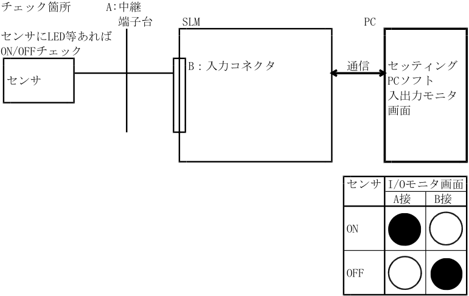

> **図の内容**
>
> - 「センサ」→「A：中継端子台」→ SLM の「B：入力コネクタ」→「通信」→ PC の「セッティングPCソフト 入出力モニタ画面」
> - 「センサにLED等あれば ON/OFFチェック」
> - 表: センサが ON のとき I/Oモニタ画面は A接 ●（黒）・B接 ○（白）、OFF のとき A接 ○・B接 ●

### 3-2. 一部の出力が不可の時の調査方法

| チェック箇所                      | チェック内容                                | 推定される不具合                                                | その他            |
|-----------------------------|--------------------------------------------|---------------------------------------------------------|------------------|
| ROMSW設定ソフト                  | 必要な出力が出力ピンに割り当てられていること。                   | 出力が変化しない。                                               |                  |
| 出力不可                        |                                            |                                                         |                  |
| セッティングPC 強制出力による出力状態の変化    | セッティングPCの強制出力機能を使い、該当する出力を強制ONさせます。      | 出力が変化しない ONしない →ケーブル断線コネクタ接触不良 OFFしない→ケーブルショート (ONのまま) | セッティングPC モニタ画面参照 |
| A：中継端子台                     | 配線不良、誤配線、ショート、ゆるみ                         | ユーザ殿回路をチェック                                             |                  |
| 出力コネクタ B：CN2(I/O) ：CN1(サーボ) | コネクタの接触不良 →コネクタを抜き差ししてみる                   | ピンが曲がっていないか？ (無理に挿入していないか？)                             | Ⅱハードウェア編 <3-1.>  |
| 操作していないのに、出力が時々ON/ OFFする   | ケーブルをゆすってみて、出力が変化するか？                     | ケーブルのカシメ不良                                              |                  |
| 操作していないのに、出力が時々ON/ OFFする   | リレーやコイルの駆動電流は充分か？リレー・コイルの定格(電流/電圧) をチェック | 駆動不足                                                    |                  |

チェック箇所

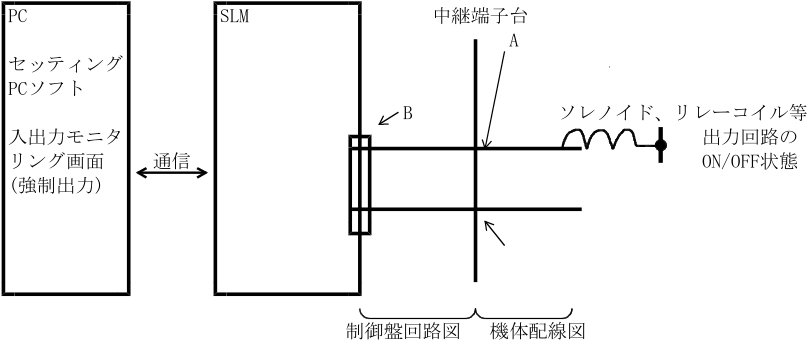

> **図の内容**
>
> - PC の「セッティングPCソフト 入出力モニタリング画面（強制出力）」→「通信」→ SLM →（B）→ 中継端子台（A）→「ソレノイド、リレーコイル等」
> - 「出力回路の ON/OFF状態」。下に「制御盤回路図」「機体配線図」の範囲を示す括弧

### 3-3. サーボ関連異常の調査方法

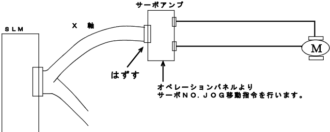

> **図の内容**
>
> SLM と X軸のサーボアンプをつなぐケーブルの、サーボアンプ側を「はずす」。サーボアンプの先にモータ（M）。「オペレーションパネルよりサーボNO．JOG移動指令を行います。」

- 1) サーボアンプの電源を入れます。

SLMのSVM出力による電源シーケンス回路を組んでいる場合には、強制出力で SVMをONして電源を入れて下さい。

- 2) サーボアンプのオペレーションパネルより、サーボON状態にします。
- 3) 同様に、オペレーションパネルよりJOG操作を行い、軸が正しく動作する否かを確認します。 ※ サーボアンプ単体による動作を行う場合は、サーボアンプのパラメータの確認を必ずおこなって下さい。(JOGの移動速度等) 詳細は、各社のサーボアンプのマニュアルを参照して下さい。

注意ソフトリミット、ハードリミット等はSLMコントローラで制御しています。単体動作は、これらと無関係な動作になります。チェックの際は送り速度を下げる等、安全に注意して下さい。

#### 3-3-1. 配線の入れ替え、軸の交換による調査方法

配線の入れ替え、交換などを行い、何処に原因があるかを絞り込むことが重要です。

注意サ－ボアンプとモ－タの容量・種類などが一致していることが前提です。また、サ－ボアンプ内のパラメータ設定の違いにも注意が必要です。

例：Y軸のモータが異常動作した場合

何処に原因(不良)があるか？交換して調べます。

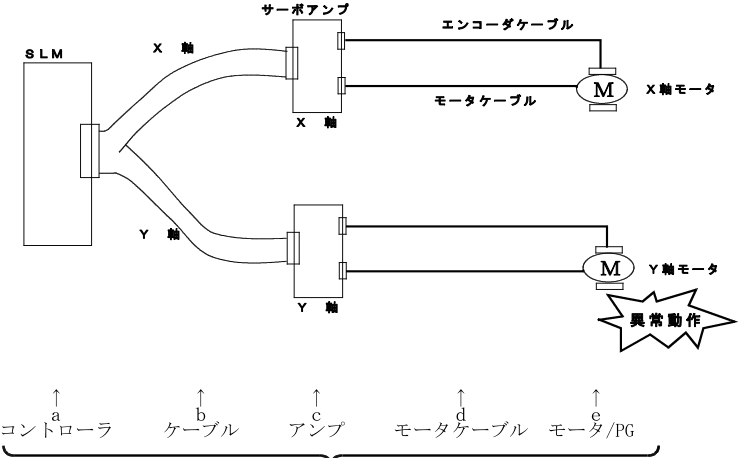

> **図の内容**
>
> SLM から X軸・Y軸のサーボアンプへケーブル、サーボアンプから「エンコーダケーブル」「モータケーブル」で X軸モータ・Y軸モータへ。Y軸モータが「異常動作」。下に調べる部位: a コントローラ、b ケーブル、c アンプ、d モータケーブル、e モータ/PG。

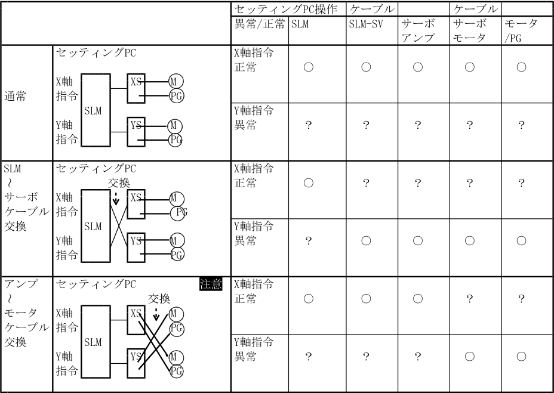

> **図の内容**
>
> 例: Y軸のモータが異常動作した場合。○ は正常、？ は原因の可能性あり。
>
> | 入れ替え | セッティングPC操作 異常/正常 | SLM | ケーブル SLM-SV | サーボアンプ | ケーブル サーボモータ | モータ/PG |
> |---|---|---|---|---|---|---|
> | 通常 | X軸指令 正常 | ○ | ○ | ○ | ○ | ○ |
> | 通常 | Y軸指令 異常 | ？ | ？ | ？ | ？ | ？ |
> | SLM～サーボケーブル交換 | X軸指令 正常 | ○ | ？ | ？ | ？ | ？ |
> | SLM～サーボケーブル交換 | Y軸指令 異常 | ？ | ○ | ○ | ○ | ○ |
> | アンプ～モータケーブル交換（注意） | X軸指令 正常 | ○ | ○ | ○ | ？ | ？ |
> | アンプ～モータケーブル交換（注意） | Y軸指令 異常 | ？ | ？ | ？ | ○ | ○ |
>
> 各行の左の絵: SLM の X軸指令・Y軸指令が XS・YS（サーボアンプ）を経て M・PG へつながる。「SLM～サーボケーブル交換」では SLM と XS・YS の間を、「アンプ～モータケーブル交換」では XS・YS と M・PG の間を入れ替える。

|                   |                                       | セッティングPC操作 - 異常/正常   | SLM   | ケーブル - SLM-SV   | サーボアンプ   | ケーブル - サーボモータ   | モータ /PG   |
|-------------------|---------------------------------------|----------------------|-------|-----------------|-----------|------------------|-----------|
|                   | セッティングPC X軸 XS M                      | X軸指令正常              | ○     | ○               | ○         | ○                | ○         |
|                   | 通常指令 PG SLM Y軸 YS M 指令 PG            | Y軸指令異常              | ？     | ？               | ？         | ？                | ？         |
| SLM ～サーボケーブル交換 | セッティングPC 交換 X軸 XS M 指令                | X軸指令正常              | ○     | ？               | ？         | ？                | ？         |
| SLM ～サーボケーブル交換 | PG SLM Y軸 YS M 指令 PG                  | Y軸指令異常              | ？     | ○               | ○         | ○                | ○         |
| アンプ～モータケーブル交換 | セッティングPC 交換 X軸 XS M 指令 PG SLM Y軸 YS M | 注意 X軸指令正常           | ○     | ○               | ○         | ？                | ？         |
| アンプ～モータケーブル交換 | 指令 PG                                 | Y軸指令異常              | ？     | ？               | ？         | ○                | ○         |

### 3-4. バックアップエラー時の詳細チェック

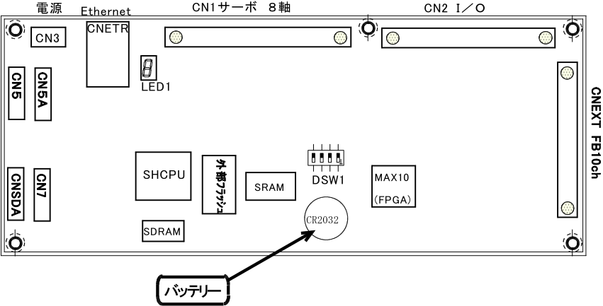

> **図の内容**
>
> SLM8000 基板の配置図。上辺に 電源（CN3）、Ethernet（CNETR）、CN1サーボ 8軸、CN2 I/O。右辺に CNEXT FB10ch。左辺に CN5、CN5A、CN5DA、CN7。中央に LED1、SHCPU、外部フラッシュ（と読める）、SRAM、SDRAM、DSW1、MAX10 (FPGA)、CR2032。「バッテリー」の吹き出しが CR2032 を指す。

#### 3-4-1. 「バッテリー電圧低下ワーニング」発生時

SRAM内の記憶データは正常ですが、バッテリーの電圧が低下し、バッテリーの寿命が近づいています。「バックアップエラー」が発生する前にバッテリーを交換して下さい。

注1：必要なバックアップデータ(パラメータ、運転プログラムなど)は、全てPCに保存してから電池

交換作業を実行してください。交換後に必要に応じてダウンロードしてください。

注2：SLM8000を通電中に電池交換をおこなえば、記憶データ(SRAM内)は消えません。

但し、SLM8000上の回路は通電していますので、他の部品に触らないように充分注意してください。

#### 3-4-2. バックアップエラー発生時の調査方法

| チェック箇所   | チェック内容                        | 推定される不具合   | その他   |
|----------|-------------------------------|------------|-------|
| バッテリー電圧  | 電圧をチェックしてください。 3.0V以上あれば正常です。 | バッテリー寿命    |       |

【バッテリーユニットの寿命】

(バッテリーメーカーの資料から)設計上は導通しない状態で約10年です。

周囲の状況(通電時間,温度,湿度)で変わります。2～3年毎の定期的な交換が望ましいです。

【バックアップメモリエラーの解除】

バックアップメモリエラーの解除は、

<Ⅰ導入編 2-6-1. バックアップメモリーエラーの解除>(TB00-1130A) を参照して下さい。

※バッテリーを交換し、バックアップメモリエラー解除の手順を実施してもエラーがクリアできない場合は、テクノで詳細な調査をしなければ、原因がわかりません。 SLM8000の調査・修理をテクノにご依頼ください。

## 4. SLMシリーズエラーコート一覧

| 番号 | エラー種別 | 対処 |
|---|---|---|
| 0001 | システムエラー | <Ⅴメンテナンス編 1-2.1>参照 |
| 0005 | バックアップエラー | <Ⅴメンテナンス編 1-2.4>,<3-4.>参照 |
| 0006 | 制御パラメータ未設定 | <Ⅴメンテナンス編 1-2.5>参照 |
| 0007 | 非常停止中 | <Ⅴメンテナンス編 1-2.2>参照 |
| 0008 | サーボ電源OFF | <Ⅴメンテナンス編 1-2.3>,<3-3.>参照 |
| 0009 | アブソリードエラー | <Ⅴメンテナンス編 1-2.13>参照 |
| 0050 | プログラム実行エラー | <Ⅴメンテナンス編 1-2.7>参照 |
| 0110 | X軸+方向偏差過大 | <Ⅴメンテナンス編 1-2.11>参照 |
| 0111 | X軸-方向偏差過大 | <Ⅴメンテナンス編 1-2.11>参照 |
| 0112 | X軸サーボアンプアラーム | <Ⅴメンテナンス編 1-2.8>参照 |
| 0113 | X軸+方向ソフトリミット | <Ⅴメンテナンス編 1-2.9>参照 |
| 0114 | X軸-方向ソフトリミット | <Ⅴメンテナンス編 1-2.9>参照 |
| 0115 | X軸+方向ハードリミット | <Ⅴメンテナンス編 1-2.10>参照 |
| 0116 | X軸-方向ハードリミット | <Ⅴメンテナンス編 1-2.10>参照 |
| 0117 | X軸+方向パルス発生過大 | <Ⅴメンテナンス編 1-2.12>参照 |
| 0118 | X軸-方向パルス発生過大 | <Ⅴメンテナンス編 1-2.12>参照 |
| 0120～0128 | Y軸+方向偏差過大 ～ Y軸+方向パルス発生過大 | X軸参照 |
| 0130～0138 | Z軸+方向偏差過大 ～ Z軸+方向パルス発生過大 | X軸参照 |
| 0140～0148 | A軸+方向偏差過大 ～ A軸+方向パルス発生過大 | X軸参照 |
| 0150～0158 | B軸+方向偏差過大 ～ B軸+方向パルス発生過大 | X軸参照 |
| 0160～0168 | C軸+方向偏差過大 ～ C軸+方向パルス発生過大 | X軸参照 |
| 0170～0178 | R軸+方向偏差過大 ～ R軸+方向パルス発生過大 | X軸参照 |
| 0180～0188 | Q軸+方向偏差過大 ～ Q軸+方向パルス発生過大 | X軸参照 |
| 0190～0198 | T軸+方向偏差過大 ～ T軸+方向パルス発生過大 | X軸参照 |

## 5. システムのバージョンアップ

機能追加等、システム(SLM8000/PCのソフトウェア)のバージョンアップを行うための説明です。別途、当社からご提供するバージョンアップ用のインストールCD(又は、インストールCDイメージファイル) を使用してバージョンアップを行います。

(お客様のご都合によるバージョンアップは、別途バージョンアップ費を申し受けます。)

尚、以下の説明では、インストール済みで現在使用しているソフトを「現ソフト」、新しくインストールするソフトを「新ソフト」と呼びます。

### 5-1. バージョンアップ手順

#### 5-1-1. バージョンアップ準備

テクノからご提供した「新ソフト」を準備します。(まだインストールは行いません。) 現在、「現ソフト」を使用しているPCで準備してください。

テクノから「新ソフト」をご提供する方法には、以下の2通りの方法があります。ご提供の方法に応じて準備して下さい。

- インストールCDでご提供した場合：

「現ソフト」を使用しているPCのCDドライブへCDを挿入して下さい。

- ※ AutoRunによりインストーラが起動した場合は、「キャンセル」ボタンをクリックして、中断して下さい。
- メールの添付等でインストールCDイメージの圧縮ファイル(zip)をご提供した場合：圧縮ファイルを「現ソフト」を使用しているPCの任意のフォルダに解凍して下さい。 (解凍した中身はインストールCDと同じファイルです。)
- ※「現ソフト」を使用しているPC上にインストールCDイメージファイルをコピーして下さい。別のPCやファイルサーバ等でファイル共有をすると、インストーラや各種PCソフトが正常に動作しない場合があります。

#### 5-1-2. バージョンアップ作業

「現ソフト」と「新ソフト」のソフトウェアバージョン番号によって、作業手順が分かれます。ソフトウェアバージョンは Ver1.0.0A の様に数字部分(1.0.0)と英字部分(A)に分かれています。この数字部分と英字部分の違いにより、作業手順を判断して下さい。

- ① 「現ソフト」と「新ソフト」のバージョンの数字部分が違う
- → <5-2.ファームウェアバージョンアップ(FLASH書き込み)>を行い、続いて、<5-3.PCソフトバージョンアップ>を行います。
- ② 「現ソフト」と「新ソフト」のバージョンの数字部分が同じで、英字部分が違う。(上記以外)
- → <5-3.PCソフトバージョンアップ>を行います。

- 例) 「現ソフト」 : Ver1.0.0A → 「新ソフト」 : Ver1.1.0A

「現ソフト」 : Ver2.1.0B → 「新ソフト」 : Ver2.2.0A

- 例) 「現ソフト」 : Ver1.0.0A → 「新ソフト」 : Ver1.0.0B

「現ソフト」 : Ver3.0.0B → 「新ソフト」 : Ver3.0.0C

### 5-2. ファームウェアバージョンアップ(FLASH書き込み)

#### 5-2-1. FLASH書き込みソフト&必要ファイル

以下の3つファイルを使用します。

実際の書き込み手順については、

<5-2-3.ファームウェアバージョンアップ(FLASH書き込み)手順> を参照下さい。

- ① FLASH書き込みソフト： Slm8000Fdl.exe

※「現ソフト」のFLASH書き込みソフトを使用して下さい。

(「現ソフト」をインストールしているフォルダに入っています。)

例)デフォルトのインストールフォルダの場合

C:\SLM8000\Slm8000Fdl.exe

- ② FLASHシステムファイル： (******.ufd)

※ FLASHへ書き込むファイル(拡張子は .ufd)です。

「新ソフト」に含まれているファイルを使用して下さい。

FLASHシステムファイルは「新ソフト」CD内の"flash"フォルダ内にあります。

- CDの場合 ※ドライブ名はPCによって異なります。

E:\SLM8000\falsh\******.ufd

- メール送付のCDイメージの場合

[ファイル解凍先]\SLM8000\falsh\******.ufd

ファイル名はご注文の状況により、以下のいずれかの形式になっています。

- 個別管理

個体毎(シリアル番号毎)にFLASHシステムファイルをご提供します。

FLASH書き込みを行うシリアル番号に応じたFLASHシステムファイルをご使用下さい。 [ファイルフォーマット]

シリアル番号.ufd (SLM*****.ufd)

例)SLM02001.ufd

- グループ管理

グループ共通のFLASHシステムファイルをご提供します。

別途グループファイルを読み込むことにより、グループに含まれる全てのシリアル番号の個体に対して共通のFLASHシステムファイルを使用できます。

[ファイルフォーマット]

グループ番号.ufd (G*****.ufd)

例)G00001.ufd

- ③ グループファイル： (G*****.asg)

※ グループファイル(拡張子は .asg)です。

グループ管理されていない場合は使用しません。(ファイルが存在しません。)

グループファイルは「新ソフト」CD内にあります。

- CDの場合 ※ドライブ名はPCによって異なります。

E:\SLM8000\******.asg

- メール送付のCDイメージの場合

[ファイル解凍先]\SLM8000\******.asg

[ファイルフォーマット] グループ番号.asg (G*****.asg)

例)G00001.asg

#### 5-2-2. FLASH書き込みソフトの機能

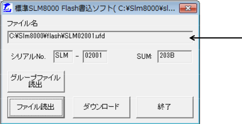

> **図の内容**
>
> ウィンドウ「標準SLM8000 Flash書込ソフト ( C:¥Slm8000¥sl…」。
> - ファイル名: C:¥Slm8000¥flash¥SLM02001.ufd（矢印で指す）
> - シリアルNo.: SLM － 02001、SUM: 203B
> - ボタン: グループファイル読出、ファイル読出、ダウンロード、終了

FLASHシステムファイル名

- グループファイル読出･･･グループシリアル(GS)管理の場合のみ、グループファイルを読出
- します。

GS管理については、

<Ⅰ導入編 2.初期導入作業【重要1】>(TB00-1130A) を参照下さい。

- ファイルから読出･･････ダウンロードするFLASHシステムファイル名を選択します。
- ダウンロード･･････････ SLM8000へFLASHシステムファイルを書き込みます。
- ※ 以下場合はダウンロードできません。
- FLASHシステムファイルのシリアルNoと書き込み先SLM8000のシリアルNoが一致しない。
- グループファイル内に書き込み先SLM8000のシリアルNoが存在しない。

#### 5-2-3. ファームウェアバージョンアップ(FLASH書き込み)手順

- (１) 通信の確認(推奨)

「現ソフト」のセッティングPCソフト(Slm8000drv.exe)にてSLM8000との通信が行える事を確認して下さい。

- ※ FLASH書き込みソフトでは、セッティングPCソフトの通信設定を参照して、通信を行います。そのため、前もってセッティングPCで通信が行えるようにして下さい。通信設定については、

<Ⅰ導入編 2-4.SLM8000とPCの接続>(TB00-1130A) を参照下さい。

- (２) 各種データのバックアップファイル作成(推奨)

「現ソフト」のまま、SLM8000に格納している各種パラメータ/運転プログラム等のデータをバックアップして下さい。

- ①．ROMSW設定ソフト(Slm8000swset.exe)にて、ROMSW設定(*.rom)をバックアップします。 ROMSW設定ソフトを起動して、

「アップロード」→「ファイル保存」を行い、ファイルに保存して下さい。

- ②．セッティングPCソフトにて、各種パラメータ/運転プログラムをバックアップします。

セッティングPCソフトを起動して、以下の画面にて、

「アップロード」→「ファイル保存」

を行い、ファイルに保存して下さい。

(オプションの画面はオプション未購入時は表示されません。バックアップ不要です。)

- サーボパラメータ画面

(*.prm)

- プログラム管理画面(運転プログラム)(*.txt)

- ピッチエラーパラメータ画面
- (*.pit) ：オプション
- 補間前加減速パラメータ画面 (*.aco) ：オプション
- 工具長補正パラメータ画面 (*.tol) ：オプション
- 工具径補正パラメータ画面
- (*.tod) ：オプション
- マクロ変数画面 (*.mcr) ：オプション
- 位置決めポイントテーブル作成画面 (*.pnt) ：オプション

また絶対値エンコーダを使用している場合は、「バックアップデータ初期化」画面で、

- (３) PCソフト環境バックアップ(推奨)

現ソフトの動作環境/ソフトをバックアップします。

(後述するインストール手順で上書きインストールを行うことを推奨しているため、念のため元の環境をバックアップします。)

- ①．エクスプローラにて、PCソフトをインストールしたフォルダ

(デフォルトだと"c:\Slm8000\")を任意のフォルダにコピーして下さい。

- (４) フラッシュへの書き込み(ROMソフト更新)
2. ① 現ソフトのFLASH書き込みソフト(Slm8000Fdl.exe)を起動します。

※ 新ソフトでなく、現ソフトのFLASH書き込みソフトです。

ご注意下さい。

- ② 「ファイルから読出」ボタンを押して、新ソフトのFLASHシステムファイル(～.ufd)を選択します。

グループ管理の場合は、「グループファイル読出」ボタンを押してグループファイル (～.asg)も選択して下さい。

- ※ 現ソフトでなく、新ソフトに含まれているFLASHシステムファイル/グループファイルです。ご注意下さい。
- ③ 「ダウンロード」ボタンを押して、ダウンロードします。

まず、「FLASHデータの送信処理」プログレスバーが伸び、その後、

「FLASHデータ書き込み処理」プログレスバーが伸びて行きます。

全ての処理が完了後、転送終了のメッセージが表示されます。

- ④ 「OK」ボタンを押して、フラッシュ書き込みソフトを終了します。
- ⑤ SLM8000の電源を OFF → ON して下さい。
- ⑥ 7セグLEDの点滅を確認下さい。

"0"点滅：正常

"0"点滅以外：異常

- 【注1】上記③のダウンロードは中断しないで下さい。

中断した場合、ソフトが動作しなくなる場合があります。

その場合は、SLM8000をテクノに戻していただき、再書き込みをする必要があります。

- 【注2】上記③のダウンロード完了時(プログレスバーが全て延びた状態)、タイミングによってはまれに通信エラーが発生する場合があります。

その為、ダウンロード完了時に通信エラーが発生しても、念のため③以降の手順を行って下さい。

⑥でLEDが"0"点滅していれば正常に書き込めています。

- (５) <5-3.PCソフトバージョンアップ>へ

### 5-3. PCソフトバージョンアップ

#### 5-3-1. PCソフトバージョンアップ手順

- (１) PCソフトバージョンアップ準備(推奨)

もし出荷時CDに入っていたサンプルデータファイル(Default.rom / L_*.txt / G_*.txt / L_*.pnt 等)をお客様で変更されている場合はインストール前にファイル名を変更しておいてください。

インストール時に上書きしてしまいます。

- (２) 新ソフトをPCへインストール(PCソフト更新)
2. ① インストーラを起動します。

エクスプローラにて、CDドライブ内又は圧縮ファイルを解凍したフォルダ内(テクノのご提供状況によります)の "setup.exe" を実行して下さい。

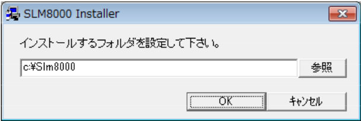

> **図の内容**
>
> ダイアログ「SLM8000 Installer」。「インストールするフォルダを設定して下さい。」、フォルダ「c:¥Slm8000」、ボタン: 参照、OK、キャンセル。

- ② 現ソフトをインストールしているフォルダを指定して、「OK」ボタンをクリックして下さい。選択したフォルダにファイルがコピーされます。

【注意！】現ソフトをインストールしているフォルダには、インストール後に作成された設定ファイル(*.ini)が存在します。

そのファイルを新ソフトでも流用するため、同じフォルダにインストールする事をお勧め致します。

尚、異なるフォルダにインストールしても設定ファイル(*.ini)をコピーして頂ければ、問題ありません。

- (３) セッティングPCを起動し、バージョン情報のROMソフトのバージョンが書き込んだバージョンになっているか確認します。

## 6. ＩPアドレスの初期化

ROMSW設定ソフトにて、IPアドレスの設定に誤って不正な値を設定してしまった場合や、設定値がわからなくなってしまった時に、以下の方法でIPアドレスの初期化をします。

### 6-1. 一般的な注意事項

IPアドレスを初期化する時はディップスイッチを変更します。ディップスイッチの変更をする時は、必ず電源をOFFして下さい。

### 6-2. ディップスイッチの設定

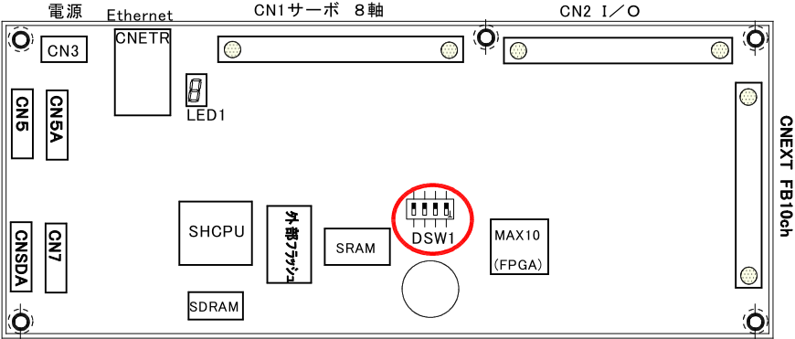

> **図の内容**
>
> 3-4 と同じ基板の配置図で、DSW1 が赤丸で囲まれている。

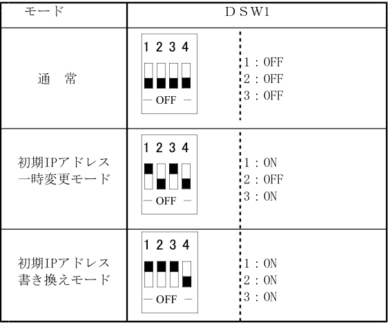

> **図の内容**
>
> | モード | DSW1 1 | DSW1 2 | DSW1 3 |
> |---|---|---|---|
> | 通常 | OFF | OFF | OFF |
> | 初期IPアドレス一時変更モード | ON | OFF | ON |
> | 初期IPアドレス書き換えモード | ON | ON | ON |
>
> スイッチ 4 は、絵ではどのモードでも OFF 側。
