# 標準ワンボードモーションコントローラ[SLM8000]

ROMSW 設定ソフトマニュアルロムスイッチ

Ver.1.3 2020.2.26

SLM8000の御購入ありがとうございます。試運転前に、本ソフトにてユーザ設定パラメータ「ROMSW パラメータ」をお客様にて

設定して下さい。

SLM8000の導入作業については、

「SLM8000 ユーザーズマニュアル」<Ⅰ導入編>(TB00-1130A)をご覧下さい。

お願い

このマニュアルの記載内容について、まちがいや不明な点がありましたら、お手数ですがFAXまたはメールにてテクノへお知らせ下さい。今後さらに改善していきます。

株式会社テクノ

〒358-0011 埼玉県入間市下藤沢1304-5

TEL 04-2964-3677 FAX 04-2964-3322

－目次－

- 1.概要
- 2.製品構成/動作環境
  - 2-1.製品構成(ファイル構成)
  - 2-2.動作環境
  - 2-3.関連資料
- 3.SLM8000のパラメータ
  - 3-1.SLM8000で記憶している情報
  - 3-2.ROMSW(ロムスイッチ)の目的
  - 3-3.ROMSW設定ソフトの使用上の注意
- 4.操作
  - 4-1.作業の手順
- 5.メインメニュー
- 6.各画面とROMSW パラメータの内容
  - 6-1.基本パラメータ
    - 6-1-1. サーボ制御周期
    - 6-1-2. イーサネット設定
    - 6-1-3. ユーザーフリーオプション
    - 6-1-4. バックアップ方法
    - 6-1-5. 自動原点復帰ディレイ(msec) 【2048】
    - 6-1-6. サーボアラーム無視時間(msec) 【2048】
    - 6-1-7. サーボリセット保持時間(msec) 【128】
    - 6-1-8. サーボオン遅延時間(msec) 【0】
    - 6-1-9. アラーム時サーボオフ遅延時間(msec) 【0】
    - 6-1-10. 工具径補正角度一致閾値 (1/1000pls) 【3000】
    - 6-1-11. 機械パネル:コード仕様
    - 6-1-12. 巻線命令設定
    - 6-1-13. エラー発生/リセット時の軸停止方法選択
    - 6-1-14. サーボON動作の補足説明
  - 6-2.入力信号の設定
  - 6-3.出力信号の設定
  - 6-4.軸設定
  - 6-5.手動パルサ/ジョイスティック設定<オプション>
  - 6-6.主軸設定<オプション>
  - 6-7.オプション
- 7.補足説明
  - 7-1.パルス出力波形
  - 7-2.指令/FBの設定
    - 7-2-1. 指令極性/FB極性の設定
    - 7-2-2. 波形が確認できないとき（現物合わせ）
    - 7-2-3. 電子ギヤ/任意分周値の設定の意味
    - 7-2-4. 設定例

## 1.概要

ROMSW(ロムスイッチ)設定ソフトは、SLM8000のROMSWを設定するソフトです。 PC(Windows)上で動作します。

対象の機械に応じてサーボ軸数、原点復帰の方式、入出力信号割り付けなどを設定できます。

## 2.製品構成/動作環境

### 2-1.製品構成(ファイル構成)

Slm8000drv.exe ･･････････････････････････セッティングPCソフト実行プログラム詳細は下記ソフトマニュアルを参照下さい。｢SLM8000 セッティングPCマニュアル｣ (TB00-1131) Slm8000comnt.dll ････････････････････････通信ライブラリ Slm8000tcnv.dll ･････････････････････････テクノコードプログラム変換ライブラリ

Slm8000gcnv.dll ･････････････････････････ Gコードプログラム変換ライブラリ Slm8000swset.exe ････････････････････････ ROMSW設定ソフト実行プログラム

TH00-*****(SLM*****).ROM ････････････････出荷時のROMSWファイル

オーダ番号ボードのシリアル番号

VERSION.SYS ･･･････････････････････････ソフトウェアバージョン情報ファイル

### 2-2.動作環境

対応OS ････････････････････

対応パソコン･･･････････････

Windows 7 / 10

CPU 80386以降のX86プロセッサ画面解像度 1024×768以上要マウス

### 2-3.関連資料

| 「SLM8000 ユーザーズマニュアル」            | (TB00-1130)   |
|---------------------------------|---------------|
| 「SLM8000 セッティングPCマニュアル」         | (TB00-1131)   |
| 「SLM8000 ROMSW設定ソフトマニュアル」       | (TB00-1132)※  |
| 「SLM8000 通信ライブラリリファレンスマニュアル」    | (TB00-1133)   |
| 「SLM8000 送受信データ説明書」             | (TB00-1134)   |
| 「SLM8000 Tコード変換ライブラリリファレンスマニュアル | (TB00-1135)   |
| 「SLM8000 Gコード変換ライブラリリファレンスマニュアル | (TB00-1136)   |
|                                 | ※ 本書          |

## 3.SLM8000のパラメータ

### 3-1.SLM8000で記憶している情報

SLM8000で記憶している情報は、以下のとおりです。

これらは、全てSLM8000個体毎(各マシン毎)に管理して下さい。

| 記憶している情報            | 設定者   | 設定方法                           | 内容                                                    | PC側ファイル拡張子   |
|---------------------|-------|--------------------------------|--------------------------------------------------------|---------------|
| ROMSW<オプション> ロムスイッチ | テクノ   | ROMSW 設定ソフト                    | オプション機能の有無。                                            | .OSW          |
| ROMSW<ユーザ> ロムスイッチ   | ユーザ   | ROMSW 設定ソフト                    | 軸数、指令極性、信号論理などメカ/システムに合わせた設定(設計レベル)                   | .ROM          |
| サーボパラメータ            | ユーザ   | セッティングPC                       | 加減速や速度などメカ諸元やメカ個体差に応じた設定(調整レベル)                       | .PRM          |
| 初期化ファイル INI(イニ)ファイル | ユーザ   | ROMSW設定 (終了時) セッティングPC (入出力名称) | SLM8000個体のオプション情報や入出力名称を記憶しておき、セッティングPCの表示内容を設定する情報 | .INI          |
| 動作プログラム             | ユーザ   | セッティングPC 汎用エディター               | 動作(運転)プログラムテクノ言語/G言語                                  | .TXT          |
| ピッチエラー補正データ         | ユーザ   | セッティングPC                       | P.E補正<オプション>用のデータ                                      | .PIT          |
| 工具長補正データ            | ユーザ   | セッティングPC                       | 工具長補正<オプション>用のデータ                                      | .TOL          |
| 工具径補正データ            | ユーザ   | セッティングPC                       | 工具径補正<オプション>用のデータ                                      | .TOD          |
| 補間前加減速パラメータ         | ユーザ   | セッティングPC                       | 補間前加減速<オプション>用のデータ                                     | .ACO          |
| 位置決めポイントテーブルデータ    | ユーザ   | セッティングPC                       | ポイント位置決め<オプション>用のデータ                                   | .PNT          |
| 絶対位置オフセット           | ユーザ   | セッティングPC                       | アブソエンコーダ座標との差分                                         | .AEO          |

ユーザが管理する情報

SLM8000内で記憶する情報

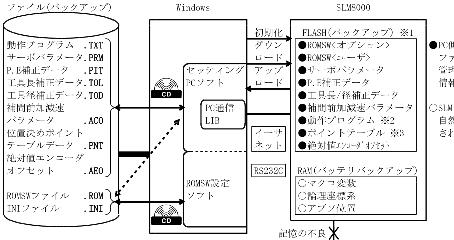

> **図の内容**
>
> - **ファイル(バックアップ)**: 動作プログラム .TXT、サーボパラメータ .PRM、P.E補正データ .PIT、工具長補正データ .TOL、工具径補正データ .TOD、補間前加減速パラメータ .ACO、位置決めポイントテーブルデータ .PNT、絶対値エンコーダオフセット .AEO、ROMSWファイル .ROM、INIファイル .INI
> - **Windows**: 「セッティングPCソフト」（PC通信LIB）と「ROMSW設定ソフト」（どちらも CD で提供）。イーサネットまたは RS232C で SLM8000 とつながる
> - **SLM8000**: 「FLASH(バックアップ) ※1」に ROMSW〈オプション〉、ROMSW〈ユーザ〉、サーボパラメータ、P.E補正データ、工具長/径補正データ、補間前加減速パラメータ、動作プログラム ※2、ポイントテーブル ※3、絶対値ｴﾝｺｰﾀﾞｵﾌｾｯﾄ。「RAM(バッテリバックアップ)」にマクロ変数、論理座標系、アブソ位置
> - Windows → SLM8000: 「初期化」「ダウンロード」、SLM8000 → Windows: 「アップロード」
> - 右端の注記（●PC側でもファイル管理…、○SLM…）は切れていて判読できず
> - SLM8000 の下に「記憶の不良」（× の付いた矢印）

□ パラメータ未設定エラー

□ バックアップエラー

セッティングPCからパラメータの「初期化」をおこなって､SLM8000内がクリアされている時。

バックアップデータの一部に破損があった時

※1 フラッシュメモリの書き込みには、10万回の回数制限があります。

- ※2 ROMSWの"運転プログラムバックアップ方法"で保存の有無を選択
- ※3 ROMSWの"位置決めポイントテーブルバックアップ方法"で保存の有無を選択
- ●PC側でファイル管理すべき情報

### 3-2.ROMSW(ロムスイッチ)の目的

ROMSWの設定をしていただくことでユーザ殿には大きな自由度とメリットが生じます。多様な周辺設計(センサーや入出力の論理)にも柔軟に対応できます。機械の設計諸元や使用するサーボアンプなどのいろいろな条件に合わせてSLM8000を

設定できます。軸構成や形態が変わっても現場で変更できます。

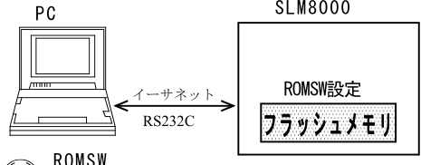

> **図の内容**
>
> 「PC」の「ROMSW」（設定ソフト）から、「イーサネット」または「RS232C」で「SLM8000」の「ROMSW設定」を「フラッシュメモリ」に書き込む。

ROMSW 設定ソフト設定情報を記憶してマシンの要求に合わせます！

おもなROMSW

- ■基本パラメータ
- ■軸設定パラメータ(各軸)

サーボ制御周期パルスジェネレータクロックサーボ初期化設定機械パネル関係

有効軸タスク指定指令パルス出力フィードバック論理軸割付け絶対値エンコーダソフトリミット有原点復帰方式

- ■ユーザーフリーオプション起動時サーボON ONSW有効原点復帰時のホーム位置決め

自動原点復帰 OT時サーボOFF有り無し原点復帰時の論理座標 MOK使用 M00/M01有り

### 3-3.ROMSW設定ソフトの使用上の注意

- a. ユーザ各位は、SLM8000の購入後、必ずこのマニュアルをもとに「ROMSW」パラメータを設定して下さい。
- b. 導入手順は「SLM8000 ユーザーズマニュアル」<Ⅰ導入編>(TB00-1130A)に記載してありますので、その手順に従って下さい。
- c. ROMSW( .ROM)、サーボパラメータ( .PRM)、INIファイル( .INI)は必ず、ファイル保存して下さい。
- d. 「ROMSW設定ソフト」の使用環境
5. （注記）全ての関連ファイルは、PC上(又は別のメディア)で必ずユーザー殿にてバックアップして下さい。 SLM8000の故障などで交換する際には、再設定が必要です。
6. ■その他

OS Windows 7 CPU 80386以降のX86プロセッサ画面解像度 1024×768以上

入出力の割り当て手動パルサ関連ジョイスティック関連入出力信号の論理(A接/B接) 主軸機能

## 4.操作

### 4-1.作業の手順

- (1) ソフトウェアインストール作業 (初回のみ)

購入いただいたCDから、使用するパソコンへソフトウェアをインストールして下さい。実際の操作は、「SLM8000 ユーザーズマニュアル」<Ⅰ導入編>(TB00-1130A)を参照して下さい。

- (2) PCとSLM8000の接続

イーサネットで、PCとSLM8000を接続して下さい。

アップロード/ダウンロードができない場合は、

「SLM8000 ユーザーズマニュアル」<Ⅴメンテナンス編 2.PCソフト側の異常>(TB00-1130J) を参照下さい。

ただし、SLM8000へのダウンロード/アップロードを行わない場合は、PC単独でも使用できます。

- (3) ROMSW設定ソフト「SLM8000swset.exe」を起動。
- (4) ROMSWパラメータの「アップロード」又は「ファイル読出」を必ずおこなって下さい。 SLM8000導入直後の初回は、必ずアップロードして下さい。

当社の出荷時のパラメータ(ROMSWオプション)を読み出す必要があります。 ROMSWパラメータの設定は、このオプションの内容により制限されます。

- (5) 各々のROMSWパラメータを編集。(3.各画面の操作を参照)
- (6) ファイル保存をおこなって下さい。
- (7) SLM8000へダウンロードして下さい。
- (8) 終了する時にINIファイル(PCソフトの設定ファイル)に反映するか聞いてきます。 "はい"を選択すると、ROMSWの内容を反映してカレントディレクトリのINIファイルを更新します。 INIファイルが存在しない時は自動で作成します。

## 5.メインメニュー

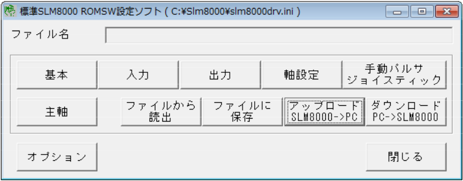

> **図の内容**
>
> ウィンドウ「標準SLM8000 ROMSW設定ソフト（C:¥Slm8000¥slm8000drv.ini）」。タイトルに、使っている ini ファイルのパスが表示される。
> 「ファイル名」の欄、ボタン: 基本、入力、出力、軸設定、手動パルサ ジョイスティック、主軸、ファイルから読出、ファイルに保存、アップロード SLM8000->PC、ダウンロード PC->SLM8000、オプション、閉じる。

※使用しているINIファイル名を表示します。

詳細は「SLM8000 ユーザーズマニュアル」<Ⅰ導入編>(TB00-1130A)を参照下さい。

基本入力出力軸設定の全てのユーザパラメータの設定が必要です。

又オプション設定によって手動パルサや主軸のユーザパラメータの設定が必要です。

オプションは、別途購入されたオプションの確認にご使用下さい。

あらかじめデフォルト設定してありますので、変更点のみ入力して下さい。

ファイル読出

あらかじめ保存しているファイル「*.ROM」を選択して読み出します。

ファイル保存

※ * はファイル名称、 .ROM はファイル名の拡張子

ROMSWファイルを名称をつけて保存します。

アップロード

SLM8000からROMSW情報を読み出します。

ダウンロード

SLM8000へROMSW情報(このソフトで設定・更新した情報)を書き込みます。

グループファイル読出グループファイルを読み出します。

グループシリアル(以降GS)管理の場合のみ、グループファイルが存在します。 GS管理については、

「SLM8000 ユーザーズマニュアル」

<Ⅰ導入編 2.初期導入作業【重要1】>(TB00-1130A) を参照下さい。

「ファイル読出」で読み出したファイル名、又は「ファイル保存」で保存したファイル名が表示されます。

ファイル名

## 6.各画面とROMSW パラメータの内容

### 6-1.基本パラメータ

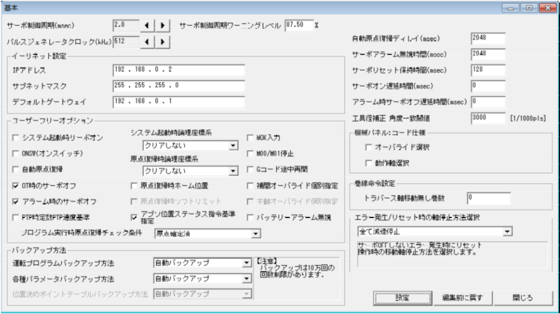

> **図の内容**
>
> 「基本」画面。
> - サーボ制御周期(msec) 2.0、サーボ制御周期ワーニングレベル 87.50 %、パルスジェネレータクロック(kHz) 512
> - イーサネット設定: IPアドレス 192.168.0.2、サブネットマスク 255.255.255.0、デフォルトゲートウェイ 192.168.0.1
> - 自動原点復帰ディレイ(msec) 2048、サーボアラーム無視時間(msec) 2048、サーボリセット保持時間(msec) 128、サーボオン遅延時間(msec) 0、アラーム時サーボオフ遅延時間(msec) 0、工具径補正 角度一致閾値 3000 [1/1000pls]
> - ユーザーフリーオプション（チェックあり: OT時のサーボオフ、アラーム時のサーボオフ、アブソ位置ステータス指令基準指定）。システム起動時論理座標系「クリアしない」、原点復帰時論理座標系「クリアしない」、プログラム実行時原点復帰チェック条件「原点確定済」。ほかに システム起動時サーボオン、ONSW(オンスイッチ)、自動原点復帰、PTP時定数PTP速度基準、原点復帰時ホーム位置、原点復帰時ソフトリミット（灰色）、MOK入力、M00/M01停止、Gコード途中再開、補間オーバライド個別指定、主軸オーバライド個別指定（灰色）、バッテリーアラーム無視
> - バックアップ方法: 運転プログラム・各種パラメータとも「自動バックアップ」（位置決めポイントテーブルは灰色）。【注意】バックアップは10万回の回数制限があります。
> - 機械パネル:コード仕様（オーバライド選択、動作軸選択）、巻線命令設定（トラバース軸移動無し巻数 0）、エラー発生/リセット時の軸停止方法選択「全て減速停止」
> - ボタン: 設定、編集前に戻す、閉じる

※【】の数字はデフォルト値

#### 6-1-1. サーボ制御周期

- ① サーボ制御周期(msec) 【2.0】

サーボ制御周期を設定します。

- ② サーボ制御周期ワーニングレベル(%) 【87.5】

サーボ制御周期毎に実行するソフト処理時間が、設定された「サーボ制御周期」の一定時間比率を超えたときに、ソフト処理が間に合わなくなりそうだという警告を出します。このときの時間比率を任意に設定することができます。

③ パルスジェネレータクロック【512】

パルス制御軸の最大PPSを設定します。使用するサーボアンプやパルスモータドライバの電気的仕様に応じて設定します。

| 制御周期 (RTC周期)   | パルスジェネレータクロック(MAX PPS) - 4M   | パルスジェネレータクロック(MAX PPS) - 2M   | パルスジェネレータクロック(MAX PPS) - 1M   | パルスジェネレータクロック(MAX PPS) - 512K   | パルスジェネレータクロック(MAX PPS) - 256K   | パルスジェネレータクロック(MAX PPS) - 128K   |
|----------------|-------------------------------|-------------------------------|-------------------------------|---------------------------------|---------------------------------|---------------------------------|
| 0.5 msec       | ○                             | ○                             | ○                             | 不可                              | 不可                              | 不可                              |
| 1 msec         | ○                             | ○                             | ○                             | ○                               | 不可                              | 不可                              |
| 2 msec         | ○                             | ○                             | ○                             | ○                               | ○                               | 不可                              |
| 4 msec         | 不可                            | ○                             | ○                             | ○                               | ○                               | ○                               |
| 8 msec         | 不可                            | 不可                            | ○                             | ○                               | ○                               | ○                               |

パルス出力の電気的仕様(タイミング)については

「SLM8000 ユーザーズマニュアル」

<Ⅱハードウェア編 3-4-2.パルス出力タイミング仕様>(TB00-1130C) を参照下さい。

又、ドライバの仕様に対してパルス幅が短い場合は、軸設定画面にてパルス出力幅を広げる（1～3倍）ことでも対応できます。

#### 6-1-2. イーサネット設定

イーサネットで接続するときは各SLM8000毎に固有のIPアドレスを設定します。詳細は、

「SLM8000 ユーザーズマニュアル」<Ⅰ導入編 4-1.通信設定>(TB00-1130A) を参照して下さい。

- ① IPアドレス
- ② サブネットマスク

【 192.168. 0. 2 】

【 255.255.255. 0 】

- ③ デフォルトゲートウェイ【 192.168. 0. 1 】

#### 6-1-3. ユーザーフリーオプション

使用する機能を選択します。

- [x] ：デフォルトで有効

- [ ] ：デフォルトで無効

※ 無償オプションです。

※ デフォルト：出荷時設定

システム起動時サーボオン SLM8000の電源ONから128msec後に自動的にサーボオンさせます

- [ ] ON SW(オンスイッチ)

- 自動原点復帰
- OT時のサーボオフ

ONSW有効の場合は、ONSW入力=ONでサーボオンさせます。本機能は入力信号"ONSW"を使用します。この信号を入力ピンに割り当てて下さい。

詳細は、<6-1-14.サーボON動作の補足説明>や

「SLM8000 ユーザーズマニュアル」

<Ⅲ機能編 2-1-1.一般入力>(TB00-1130D)

を参照して下さい。

システム起動時サーボオン、又はONSW機能でサーボON時に自動的に全軸原点復帰を行います。

OTエラー時に、自動的にサーボオフします。

OT時の動作については、

「SLM8000 ユーザーズマニュアル」

<Ⅲ機能編 4-14.ストロークリミット>(TB00-1130E)

を参照して下さい。

アラーム時のサーボオフ以下のOT以外のサーボオフエラー時に自動的にサーボオフします。

- サーボアラーム
- 偏差過大
- 主軸アラーム
- 非常停止
- 外部アラームA

チェック無し:100kPPSに到達するまでの時間

チェック有り:PTP速度に到達するまでの時間

詳細は

「SLM8000 ユーザーズマニュアル」

<Ⅲ機能編 8-1.送り速度、加減速などのパラメータ>(TB00-1130G) を参照下さい。

- [ ] PTP時定数PTP速度基準

- [ ] 原点復帰時ホーム位置

全軸/各軸自動原点復帰完了後にセッティングPCのサーボパラメータで設定したホームポジション距離に自動的に位置決めします。

原点復帰時ソフトリミット全軸原点復帰時に、ソフトリミットチェックを有効にします。

- [ ] [開発中]

アブソ位置ステータス指令セッティングPCのアブソ位置表示を「指令した位置」で行います。基準指定チェック無しの場合は、「エンコーダFB位置」で表示します。又、ステータスデータ読み出し（通信コマンド）により取得するステータスデータのアブソ位置（STATUS.ax[n].AbsReg）も本設定で変わります。

- [ ] MOK入力

- [ ] M00/M01停止

- [ ] Gコード途中再開

Mコードシーケンス実行にて、MFIN入力ON時にMOK入力をチェックします。

MFIN入力ON時、MOK入力OFFの場合、Mコード実行エラーとしてプログラムを強制停止します。

本機能は入力信号"MOK"を使用します。この信号を入力ピンに割り当てて下さい。

M00/M01停止機能を有効にします。

M00指令時･･･プログラム実行を停止します。

M01指令時･･･オプショナルスットプ入力(T□MOPT)ONの時プログラムを実行停止します。

M00/M01共にMコード出力は行いません。

M01停止を行う場合は、"T□MOPT"を使用します。この信号を入力ピンに割り当てて下さい。

Gコードプログラム途中再開機能を有効にします。本機能を有効にすると、Gコードプログラムの実行をリセットやアラームで中断した後の再開時、最後に実行したシーケンス番号から実行を再開します。

ただし、電源断した後は最初から実行します。

補間オーバライド個別指定補間指令のみに反映される補間オーバライドを有効にします。本機能が無効の時は、通常のオーバライドが補間指令に反映されます。

主軸オーバライド個別指定 S指令、SPIN命令に反映される主軸オーバライドを有効にします。本機能が無効の時は、通常のオーバライドがS指令/SPIN命令に反映されます。

この設定によらず、

<6-6.主軸設定 (4)アナログ指令設定 ⑤主軸オーバライド>

がオフの場合は、主軸回転に対しオーバライドは反映されません。

バッテリーアラーム無視バッテリー電圧低下アラームと、バッテリーバックアップの情報が消失した場合のバックアップエラーを無視します。バッテリーを使用しない場合にチェックしてください。

① システム起動時論理座標系【クリアしない】

システム起動時の論理座標系の設定方法。

クリアする : 機械原点を論理原点とします。

クリアしない : 原点復帰前の機械原点～論理原点のオフセットを保持します。

座標設定する : 機械原点～論理原点のオフセットをセッティングPCのサーボパラメータで設定した"原点復帰時論理座標"で設定します。

- ② 原点復帰時論理座標系【クリアしない】

全軸/各軸自動原点復帰完了時の論理座標系の設定方法。

クリアする : 機械原点を論理原点とします。

クリアしない : 原点復帰前の機械原点～論理原点のオフセットを保持します。

座標設定する : 機械原点～論理原点のオフセットをセッティングPCのサーボパラメータで設定した"原点復帰時論理座標"で設定します。

- ③ プログラム実行時原点復帰チェック条件【原点確定済】

自動運転開始時の原点復帰状態の条件

チェック無し: 原点復帰の状態に関係なく自動運転を実行できます。

原点確定済 : 原点が確定していれば自動運転を実行できます。

原点復帰済 : 原点復帰動作を終了しないと自動運転を実行できません。

#### 6-1-4. バックアップ方法

- ① 運転プログラムバックアップ方法【自動バックアップ】
- ■自動バックアップ

運転プログラムを自動的にバックアップします。

運転プログラム書き込み、運転プログラムの移動・コピー・削除時にバックアップを行います。一度、運転プログラムを書き込めば、電源投入毎に書き込む必要はありません。

■手動バックアップ

運転プログラムの自動バックアップは行いません。

バックアップする場合は、セッティングPCの"バックアップデータ初期化"画面内、 "運転プログラムバックアップ"を押して、手動で運転プログラムをバックアップして下さい。 (動作要求コマンドの"FLASHROM反映コマンド"でも、バックアップします。) バックアップしない場合は、電源投入毎に必要に応じて書き込む必要が有ります。

■バックアップ無し

運転プログラムをバックアップしません。

電源投入毎に必要に応じて書き込む必要が有ります。

- (注意) SLM8000の運転プログラムのバックアップは、FLASHROMに書込みます。

FLAHSROMには、10万回の書き込み制限があります。

例 50回(1日あたり)×200日×10年=100000回

■バックアップ方式の比較(ご参考)

| 方式        | メリット                                                  | デメリット                                                                        |
|-----------|-------------------------------------------------------|------------------------------------------------------------------------------|
| 自動バックアップ | 電源投入毎に運転プログラムを書き込む必要が無い。                             | 運転プログラムの書込み※1の実行時間が長くなる。バックアップ処理時、他タスクへの影響(動作がもたつく等)が発生する場合がある。10万回の回数制限。 |
| 手動バックアップ | 運転プログラムの書込み※1の実行時間が短い。必要なときに、バックアップが可能。回数制限に到達しにくい。 | バックアップしていない運転プログラムは、再起動後、実行前に再書き込みが必要。                                     |
| バックアップなし | 運転プログラムの書込み※1の実行時間が短い。回数制限の問題無し。                     | 毎起動後、運転プログラム実行前に再書き込みが必要。                                                   |

※1 運転プログラムの書込み:移動・コピー・削除なども含みます。

② 各種パラメータバックアップ方式【自動バックアップ】

- ■自動バックアップ

パラメータを自動的にバックアップします。パラメータ書き込み、パラメータのコピー・削除時にバックアップを行います。一度、パラメータ書き込めば、電源投入毎に書き込む必要はありません。

■新規バックアップ無し

自動的なバックアップは行いません。保存が必要なときはファイルに保存の操作で保存して下さい。

③ 位置決めポイントテーブルバックアップ方式【自動バックアップ】

- ■自動バックアップ

位置決めポイントテーブルを自動的にバックアップします。位置決めポイントテーブルダウンロード時にバックアップを行います。

- 一度、位置決めポイントテーブルを書き込めば、電源投入毎に書き込む必要はありません。

■手動バックアップ

位置決めポイントテーブルの自動バックアップは行いません。

バックアップする場合は、セッティングPCの"バックアップデータ初期化"画面内、

"位置決めポイントテーブルバックアップ"を押して、手動で位置決めポイントテーブルをバックアップして下さい。

(動作要求コマンドの"Flashメモリへポイントデータ反映指令"でも、バックアップします。) バックアップしない場合は、電源投入毎に必要に応じて書き込む必要が有ります。

■バックアップ無し

位置決めポイントテーブルをバックアップしません。

電源投入毎に必要に応じて書き込む必要が有ります。

※その他、注意事項等は「①運転プログラムバックアップ方法」と同様です。

#### 6-1-5. 自動原点復帰ディレイ(msec) 【2048】

<6-1-3.ユーザーフリーオプション>の「自動原点復帰」有効時は、サーボ主電源(SVM)をONしてから、この時間後に全軸原点復帰を開始します。

#### 6-1-6. サーボアラーム無視時間(msec) 【2048】

サーボ主電源(SVM出力)をONしてから、この時間内はサーボアラームを無視します。

#### 6-1-7. サーボリセット保持時間(msec) 【128】

サーボアンプに入力するアラームリセットパルスの時間幅です。

#### 6-1-8. サーボオン遅延時間(msec) 【0】

サーボ主電源(SVM出力)をONしてから、サーボON出力をONするまでの時間を設定します。

#### 6-1-9. アラーム時サーボオフ遅延時間(msec) 【0】

外部非常停止出力(EMO出力)をONしてから、サーボON出力をOFFするまでの時間を設定します。

#### 6-1-10. 工具径補正角度一致閾値 (1/1000pls) 【3000】

角度一致閾値を1/1000パルス単位で設定します。(1000で1パルスです。)

- ※ 工具径補正では、補正後の軌跡を求めるために、径補正後の交点を使用します。円弧指令を使用していると、交点が2つ出来てしまうため、使用する交点を判別する必要があります。この際、演算誤差による誤判別を避けるため、角度一致の閾値を設定できるようにしています。デフォルト値(0:3000)で交点を誤判別するようでしたら調整して下さい。

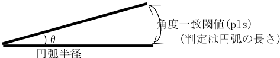

> **図の内容**
>
> 2 本の直線のなす角 θ と「円弧半径」。開きの大きさが「角度一致閾値(pls)（判定は円弧の長さ）」。

円弧半径と角度一致閾値(pls)から角度θを求め、θを交点判別時の許容誤差にします。

尚、主な演算誤差の原因は以下の通りです。

- 運転プログラム作成時の離散誤差(パルス単位で指令するための切り捨て/切り上げ)
- 浮動小数点演算による演算誤差

#### 6-1-11. 機械パネル:コード仕様

使用する機能を選択します。

オーバライド選択チェック無し: 8点の入力信号に対し25%間隔で25%～200%の選択ができます。

チェック有り: 8ビットのコード化信号で1%単位で選択することができます。

- 動作軸選択

チェック無し: 4点の入力信号でＸ軸からＡ軸までを信号対応で選択できます。

チェック有り: 4ビットのコード化信号でＸ軸からＴ軸までの選択ができます。

詳細は

「SLM8000 ユーザーズマニュアル」<Ⅲ機能編 7.機械操作パネル>(TB00-1130G) を参照下さい。

#### 6-1-12. 巻線命令設定

本設定は巻線オプションが設定されているときのみ有効になります。

- ① トラバース軸移動無し巻数【0】

巻き終わり処理指定がされているとき、残り巻数と移動有り/無しを指定するパラメータです。 0～100の範囲で設定します。

※ 巻線機能の詳細は、

「SLM8000 ユーザーズマニュアル」<Ⅲ機能編 4-16-11.巻線指令>(TB00-1130E) を参照して下さい。

#### 6-1-13. エラー発生/リセット時の軸停止方法選択

エラー発生時及びリセット時は移動中の全軸を停止しますが、停止のやり方の選択ができます。

- ■補間命令は減速停止、それ以外は即停止

補間軸に関しては軌跡ずれが少なくなるように考慮し、独立で動いている軸は即時に停止します。

- ■全て減速停止

衝撃が少ないように全ての動作軸を減速して停止します。

- ■全て即停止

できるだけ早く停止するため全軸即時停止します。

#### 6-1-14. サーボON動作の補足説明

サーボON動作は以下の通りです。

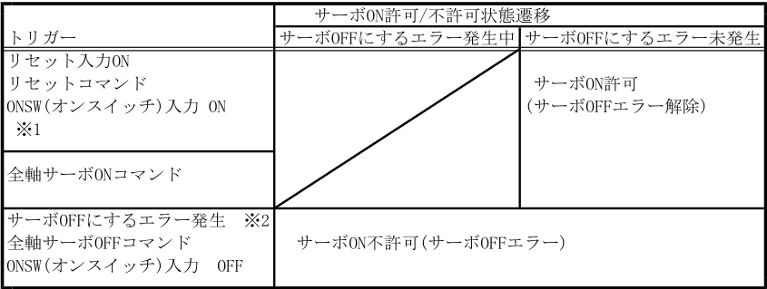

> **図の内容**
>
> 見出しは「サーボON許可/不許可状態遷移」。
>
> | トリガー | サーボOFFにするエラー発生中 | サーボOFFにするエラー未発生 |
> |---|---|---|
> | リセット入力ON、リセットコマンド、ONSW(オンスイッチ)入力 ON ※1 | （斜線） | サーボON許可（サーボOFFエラー解除） |
> | 全軸サーボONコマンド | （斜線） | （上の行と同じ欄） |
> | サーボOFFにするエラー発生 ※2、全軸サーボOFFコマンド、ONSW(オンスイッチ)入力 OFF | サーボON不許可（サーボOFFエラー） | サーボON不許可（サーボOFFエラー） |

| 状態      | SVM信号状態   | 各軸サーボON信号状態   | 各軸サーボON信号状態   |
|----------|-----------|---------------|---------------|
| 状態      | SVM信号状態   | 各軸サーボON指定 ※3  | 各軸サーボOFF指定 ※3 |
| サーボON許可  | ON        | ON            | OFF           |
| サーボON不許可 | OFF       | OFF           | OFF           |

※1 エラー解除含む

- ※2 サーボOFFにするエラーはROMSWによって変わります。 (非常停止、サーボアラーム、偏差過大、±OT)
- ※3 セッティングPCソフト軸設定画面、または各軸サーボON/OFFコマンドで変更します。

### 6-2.入力信号の設定

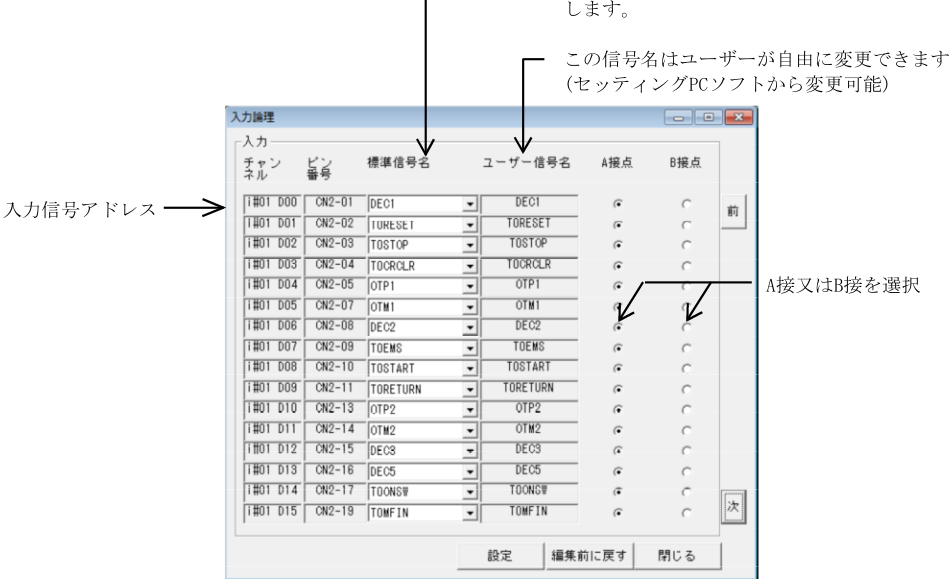

> **図の内容**
>
> 「入力論理」画面。矢印の説明:
> - 「入力信号アドレス」（左の列）
> - 標準信号名の欄（上の矢印。本文の一部「…します。」）
> - 「この信号名はユーザーが自由に変更できます（セッティングPCソフトから変更可能）」（ユーザー信号名の欄）
> - 「A接点はB接点を選択」（右の列）
> 表示されている信号は TB00-1130D 2-3 の画面と同じ（DEC1、T0RESET、T0STOP、T0CRCLR、OTP1、OTM1 …）。細部は小さくて判読できず。

入力ピンに割り当てる入力信号はこの信号名で選択します。

各入力ピンへの入力信号（標準信号名）の割当てと論理(A接/B接)を各々設定できます。

標準信号名

SLM8000の入出力機能として定義されています。入力信号の詳細については「SLM8000 ユーザーズマニュアル」 <Ⅲ機能編 2-1.入力信号の名称と機能>(TB00-1130D) を参照してください。

ユーザー信号名ユーザー信号名は、「SLM8000drv.ini」ファイルで定義されています。

また、その編集は「セッティングPCソフト」で行います。

特に必要がなければ、デフォルト設定で使用されることをおすすめします。

A接 ON アクティブ

一般の信号はOFF → ONで動作します。例外的にはOFF → ON → OFFで動作するものがあります。 (スタート入力/原点復帰)

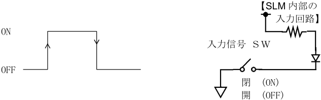

> **図の内容**
>
> 「入力信号 SW」が閉（ON）、開（OFF）になると、「SLM内部の入力回路」の信号が ON、OFF になる波形。

B接 OFF アクティブ (A接の逆です) ノーマル閉(ON) 開(OFF)で動作

一般に±OT□や非常停止は、B接にします。(フェイルセーフのため)

注記 SW回路（0Vコモン）やオープンコレクタ出力の回路では、通常は、「OFF：High レベル/ON：Low レベル」です。

以降の表は、デフォルト(出荷時)設定の入力信号チャンネル割り当てです。信号名は、標準信号名です。画面表示名称はユーザが変更できます。

各信号の機能については、

「SLM8000 ユーザーズマニュアル」<2-1.入力信号の名称と機能>(TB00-1130D) を参照ください。

表示名称の変更や、操作方法については、「SLM8000 セッティングPCマニュアル」(TB00-1131)

<4-2-3-1.汎用入出力画面>

<4-4-3.入出力表示設定画面>

を参照下さい。

入力信号チャンネル表(デフォルト設定)

| チャンネル   | Bit     | コネクタ名   |   ピンNO. | 信号名    | 入力論理   |
|---------|---------|---------|---------|----------|--------|
| I#0000  | D00     |         |      10 | SALM1    | A      |
| I#0000  | D01     | AS710   |      22 | SALM2    | A      |
| I#0000  | D02     | CN1     |      34 | SALM3    | A      |
| I#0000  | D03     |         |      46 | SALM4    | A      |
| I#0000  | D04     |         |      60 | SALM5    | A      |
| I#0000  | D05     |         |      72 | SALM6    | A      |
| I#0000  | D06     |         |      84 | SALM7    | A      |
| I#0000  | D07     |         |      96 | SALM8    | A      |
| I#0000  | D08 D09 |         |         |          |        |
| I#0000  | D10     |         |         |          |        |
| I#0000  | D11     |         |         |          |        |
| I#0000  | D12     |         |         |          |        |
| I#0000  | D13     |         |         |          |        |
| I#0000  | D14     |         |         |          |        |
| I#0000  | D15     |         |         |          |        |
| I#0001  | D00     |         |       1 | DEC1     | A      |
| I#0001  | D01     | AS710   |       2 | T0RESET  | A      |
| I#0001  | D02     | CN2     |       3 | T0STOP   | A      |
| I#0001  | D03     |         |       4 | T0CRCLR  | A      |
| I#0001  | D04     |         |       5 | OTP1     | A      |
| I#0001  | D05     |         |       7 | OTM1     | A      |
| I#0001  | D06     |         |       8 | DEC2     | A      |
| I#0001  | D07     |         |       9 | T0EMS    | A      |
| I#0001  | D08     |         |      10 | T0START  | A      |
| I#0001  | D09     |         |      11 | T0RETURN | A      |
| I#0001  | D10     |         |      13 | OTP2     | A      |
| I#0001  | D11     |         |      14 | OTM2     | A      |
| I#0001  | D12     |         |      15 | DEC3     | A      |
| I#0001  | D13     |         |      16 | DEC5     | A      |
| I#0001  | D14     |         |      17 | T0ONSW   | A      |
| I#0001  | D15     |         |      19 | T0MFIN   | A      |

入力論理 A＝A接点： "CLOSE"＝入力論理ON、"ノーマル OPEN "＝入力論理OFF B＝B接点： "OPEN "＝入力論理ON、"ノーマル CLOSE"＝入力論理OFF

| チャンネル   | Bit   | コネクタ名     |   ピンNO. | 信号名   | 入力論理   |
|---------|-------|-----------|---------|---------|--------|
| I#0002  | D00   | AS710 CN2 |      20 | OTP3    | A      |
| I#0002  | D01   | AS710 CN2 |      21 | OTM3    | A      |
| I#0002  | D02   | AS710 CN2 |      22 | DEC4    | A      |
| I#0002  | D03   | AS710 CN2 |      23 | RI08    | A      |
| I#0002  | D04   | AS710 CN2 |      25 | RI09    | A      |
| I#0002  | D05   | AS710 CN2 |      26 | RI10    | A      |
| I#0002  | D06   | AS710 CN2 |      27 | OTP5    | A      |
| I#0002  | D07   | AS710 CN2 |      28 | OTM5    | A      |
| I#0002  | D08   | AS710 CN2 |      29 | RI00    | A      |
| I#0002  | D09   | AS710 CN2 |      31 | RI01    | A      |
| I#0002  | D10   | AS710 CN2 |      32 | RI02    | A      |
| I#0002  | D11   | AS710 CN2 |      33 | RI03    | A      |
| I#0002  | D12   | AS710 CN2 |      34 | RI04    | A      |
| I#0002  | D13   | AS710 CN2 |      35 | RI05    | A      |
| I#0002  | D14   | AS710 CN2 |      37 | RI06    | A      |
| I#0002  | D15   | AS710 CN2 |      38 | RI07    | A      |
| I#0003  | D00   | AS710 CN2 |      39 | OTP4    | A      |
| I#0003  | D01   | AS710 CN2 |      40 | OTM4    | A      |
| I#0003  | D02   | AS710 CN2 |      60 | DEC6    | A      |
| I#0003  | D03   | AS710 CN2 |      61 | OTP6    | A      |
| I#0003  | D04   | AS710 CN2 |      62 | OTM6    | A      |
| I#0003  | D05   | AS710 CN2 |      63 | DEC7    | A      |
| I#0003  | D06   | AS710 CN2 |      65 | OTP7    | A      |
| I#0003  | D07   | AS710 CN2 |      66 | OTM7    | A      |
| I#0003  | D08   | AS710 CN2 |      67 | DEC8    | A      |
| I#0003  | D09   | AS710 CN2 |      78 | OTP8    | A      |
| I#0003  | D10   | AS710 CN2 |      79 | OTM8    | A      |
| I#0003  | D11   | AS710 CN2 |      80 |         |        |
| I#0003  | D12   |           |         | SENSE   | A      |
| I#0003  | D13   |           |         |         |        |
| I#0003  | D14   |           |         |         |        |
| I#0003  | D15   |           |         |         |        |

※ センサーラッチ信号(SENSE)はコネクタCN2の80番ピンに固定です。

### 6-3.出力信号の設定

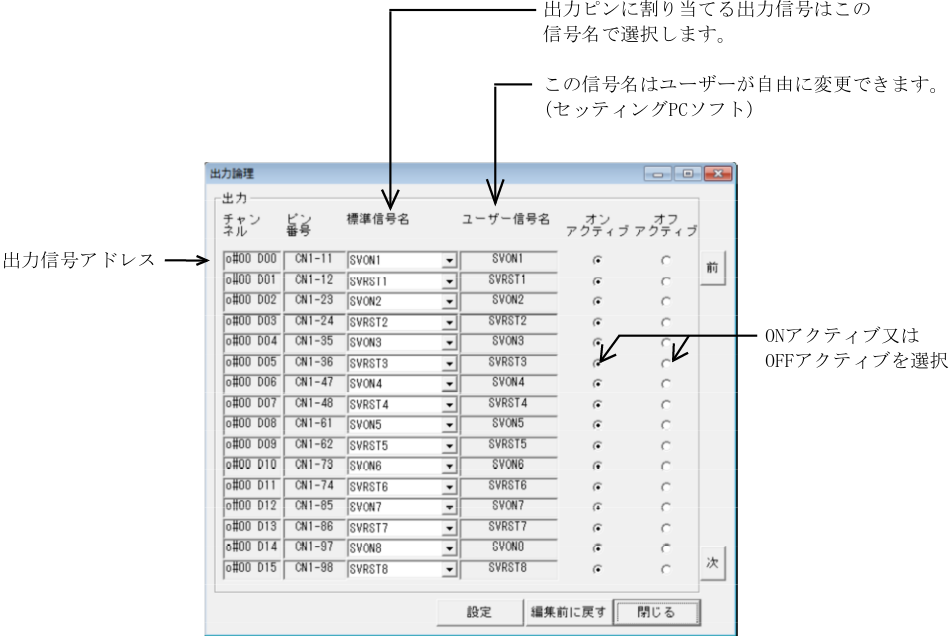

> **図の内容**
>
> 「出力論理」画面。矢印の説明:
> - 「出力信号アドレス」（左の列）
> - 「出力ピンに割り当てる出力信号はこの信号名で選択します。」（標準信号名の欄）
> - 「この信号名はユーザーが自由に変更できます。（セッティングPCソフト）」（ユーザー信号名の欄）
> - 「ONアクティブ又はOFFアクティブを選択」（右の列）
> 表示されている信号は SVON1、SVRST1、SVON2、SVRST2 …。細部は小さくて判読できず。

出力ピンに割り当てる出力信号（標準信号名）とそのONアクティブ/OFFアクティブを選択できます。

一般にはONアクティブで使用します。

また、電源投入時/CPUリセット時は、出力OFFになります。

標準信号名 SLMの入出力機能として定義されています。出力信号の詳細については、「SLM8000 ユーザーズマニュアル」 <Ⅲ機能編 2-2.出力信号の名称と機能>(TB00-1130D) を参照してください。

ユーザー信号名ユーザー信号名は、「Slm8000drv.ini」ファイルで定義されています。また、その編集は「セッティングPCソフト」で行います。

【SLM内部】

【外部回路】

READY 出力

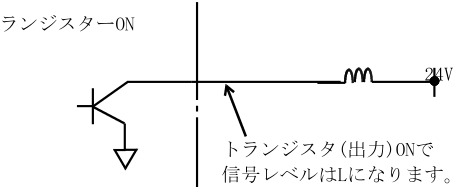

> **図の内容**
>
> トランジスタの出力が負荷（コイル）を経て 24V につながる回路。「トランジスタ(出力)ONで信号レベルはLになります。」（左上に本文の一部「…ランジスターON」）

コントローラレディー → 出力ON → Low レベル「正常」の時【ONアクティブ】

以降の表は、デフォルト(出荷時)設定の出力信号チャンネル割り当てです。信号名は、標準信号名です。画面表示名称はユーザが変更できます。

各信号の機能については、

「SLM8000 ユーザーズマニュアル」<2-2.出力信号の名称と機能>(TB00-1130D) を参照ください。

表示名称の変更や、操作方法については、「SLM8000 セッティングPCマニュアル」(TB00-1131)

<4-2-3-1.汎用入出力画面>

<4-4-3.入出力表示設定画面>

を参照下さい。

出力信号チャンネル表(デフォルト設定)

| チャンネル   | Bit   | コネクタ名     |   ピンNO. | 信号名   | 出力論理   | 初期状態   |
|---------|-------|-----------|---------|---------|--------|--------|
| O#0000  | D00   | AS700 CN1 |      11 | SVON1   | ON     | OFF    |
| O#0000  | D01   | AS700 CN1 |      12 | SVRST1  | ON     | OFF    |
| O#0000  | D02   | AS700 CN1 |      23 | SVON2   | ON     | OFF    |
| O#0000  | D03   | AS700 CN1 |      24 | SVRST2  | ON     | OFF    |
| O#0000  | D04   | AS700 CN1 |      35 | SVON3   | ON     | OFF    |
| O#0000  | D05   | AS700 CN1 |      36 | SVRST3  | ON     | OFF    |
| O#0000  | D06   | AS700 CN1 |      47 | SVON4   | ON     | OFF    |
| O#0000  | D07   | AS700 CN1 |      48 | SVRST4  | ON     | OFF    |
| O#0000  | D08   | AS700 CN1 |      61 | SVON5   | ON     | OFF    |
| O#0000  | D09   | AS700 CN1 |      62 | SVRST5  | ON     | OFF    |
| O#0000  | D10   | AS700 CN1 |      73 | SVON6   | ON     | OFF    |
| O#0000  | D11   | AS700 CN1 |      74 | SVRST6  | ON     | OFF    |
| O#0000  | D12   | AS700 CN1 |      85 | SVON7   | ON     | OFF    |
| O#0000  | D13   | AS700 CN1 |      86 | SVRST7  | ON     | OFF    |
| O#0000  | D14   | AS700 CN1 |      97 | SVON8   | ON     | OFF    |
| O#0000  | D15   | AS700 CN1 |      98 | SVRST8  | ON     | OFF    |
| O#0001  | D00   | AS700 CN2 |      41 | T0SVM   | ON     | OFF    |
| O#0001  | D01   | AS700 CN2 |      42 | T0READY | ON     | OFF    |
| O#0001  | D02   | AS700 CN2 |      43 | T0RUN   | ON     | OFF    |
| O#0001  | D03   | AS700 CN2 |      44 | T0ALARM | ON     | OFF    |
| O#0001  | D04   | AS700 CN2 |      45 | T0INPOS | ON     | OFF    |
| O#0001  | D05   | AS700 CN2 |      47 | T0PRDY  | ON     | OFF    |
| O#0001  | D06   | AS700 CN2 |      48 | T0PAUSE | ON     | OFF    |
| O#0001  | D07   | AS700 CN2 |      49 | T0M0    | ON     | OFF    |
| O#0001  | D08   | AS700 CN2 |      50 | T0M1    | ON     | OFF    |
| O#0001  | D09   | AS700 CN2 |      51 | T0M2    | ON     | OFF    |
| O#0001  | D10   | AS700 CN2 |      53 | T0M3    | ON     | OFF    |
| O#0001  | D11   | AS700 CN2 |      54 | T0MSTRB | ON     | OFF    |
| O#0001  | D12   | AS700 CN2 |      55 | T0M4    | ON     | OFF    |
| O#0001  | D13   | AS700 CN2 |      56 | T0M5    | ON     | OFF    |
| O#0001  | D14   | AS700 CN2 |      57 | T0M6    | ON     | OFF    |
| O#0001  | D15   | AS700 CN2 |      59 | T0M7    | ON     | OFF    |

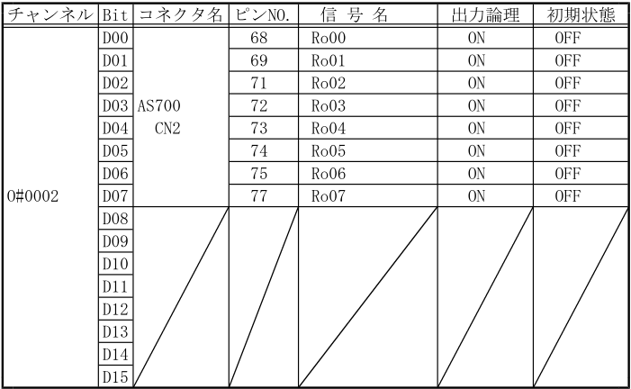

> **図の内容**
>
> | チャンネル | Bit | コネクタ名 | ピンNO. | 信号名 | 出力論理 | 初期状態 |
> |---|---|---|---|---|---|---|
> | 0#0002 | D00 | AS700 CN2 | 68 | Ro00 | ON | OFF |
> | 0#0002 | D01 | AS700 CN2 | 69 | Ro01 | ON | OFF |
> | 0#0002 | D02 | AS700 CN2 | 71 | Ro02 | ON | OFF |
> | 0#0002 | D03 | AS700 CN2 | 72 | Ro03 | ON | OFF |
> | 0#0002 | D04 | AS700 CN2 | 73 | Ro04 | ON | OFF |
> | 0#0002 | D05 | AS700 CN2 | 74 | Ro05 | ON | OFF |
> | 0#0002 | D06 | AS700 CN2 | 75 | Ro06 | ON | OFF |
> | 0#0002 | D07 | AS700 CN2 | 77 | Ro07 | ON | OFF |
> | 0#0002 | D08～D15 | （斜線） | （斜線） | （斜線） | （斜線） | （斜線） |

出力論理 ON 出力論理ONの時、出力トランジスタがON （信号Lレベル） OFF 出力論理ONの時、出力トランジスタがOFF（信号Hレベル）初期状態 ON 初期状態にて出力トランジスタ ON OFF 初期状態にて出力トランジスタ OFF

| チャンネル   | Bit                         | コネクタ名   |   ピンNO. | 信号名   | 出力論理   | 初期状態   |
|---------|-----------------------------|---------|---------|---------|--------|--------|
| O#0002  | D00                         |         |      68 | Ro00    | ON     | OFF    |
| O#0002  | D01                         |         |      69 | Ro01    | ON     | OFF    |
| O#0002  | D02                         |         |      71 | Ro02    | ON     | OFF    |
| O#0002  | D03                         | AS700   |      72 | Ro03    | ON     | OFF    |
| O#0002  | D04                         | CN2     |      73 | Ro04    | ON     | OFF    |
| O#0002  | D05                         |         |      74 | Ro05    | ON     | OFF    |
| O#0002  | D06                         |         |      75 | Ro06    | ON     | OFF    |
| O#0002  | D07                         |         |      77 | Ro07    | ON     | OFF    |
| O#0002  | D08 D09 D10 D11 D12 D13 D14 | D15     |         |         |        |        |

### 6-4.軸設定

使用する軸に対して、各々設定して下さい。

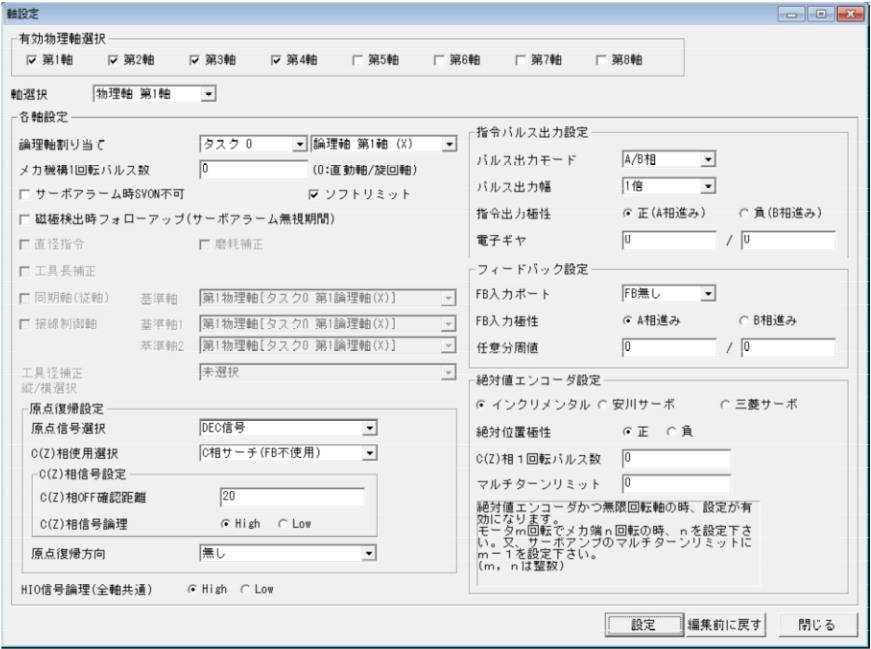

> **図の内容**
>
> 「軸設定」画面。有効物理軸選択（第1軸～第8軸のチェック）、軸選択、各軸設定（論理軸割り当て、メカ機構1回転パルス数、指令パルス出力設定、フィードバック設定、絶対値エンコーダ設定、原点復帰設定など）。
> 値は小さくて判読できず。

※ 以下、【】はデフォルト値です。

- (1) 有効物理軸選択（第1軸～第8軸）使用する軸を選択して下さい。
- (2) 設定軸選択（物理軸第1軸～第8軸）

"(3)各軸設定"をどの軸に対して行うか、このドロップダウンリストで選択します。

- (3) 各軸設定(物理軸毎に指定)
2. ① 軸割り当てタスク0～7:その物理軸を使用するタスク
3. ② メカ機構1回転パルス数【0】

論理軸第1(X)～第9(T):タスク内の論理軸設定

無限回転をおこなう軸のみ設定します。この値で座標系をラウンドアップします。直動や有限回転をおこなう軸では、0を設定下さい。

- ③.サーボアラーム時SVON不可【無効】
- ④ ソフトリミット【有効】

有効：サーボアラームの状態では、サーボONを出力しない。(特殊)

無効：サーボアラームとは無関係にサーボONを出力する。(一般)

ソフトリミット機能を有効にします。

- ⑤.磁極検出時(サーボアラーム無視期間)フォローアップ【無効】

有効：サーボON時のサーボアラーム無視期間中フォローアップを行います。

サーボOFF時に外力で動く軸（重力落下など）で、FB有効としているときに使用。

無効：サーボON時のサーボアラーム無視期間中フォローアップを行いません。

⑥ 直径指令【無効】

有効:旋盤のワーク径方向をイメージして、指令値を直径として与えることができます。動作プログラム内の数値だけが直径指令(実移動量の2倍)として扱われます。ワンショットPTPやサーボパラメータは半径値(実移動量)として扱われます。また、現在位置表示画面の指令位置は直径指令値として表示され。アブソ位置、機械位置、偏差量は半径指令値として表示されます。

無効:通常軸です。

例:X軸を直径指令とし、動作プログラム中で下記の記述をした命令を実行した場合 PTP X100;

指令位置には100と表示され、アブソ位置、機械位置には50と表示されます。偏差量も半径指令単位で表示します。(移動が無いときの偏差量50)

1ショット位置決めではPTPでも補間でも、X軸に100と命令したときは、指令位置には 200と表示され、アブソ位置、機械位置、(偏差量)には100と表示されます。

⑦ 摩耗補正 <開発中>

⑧ 工具長補正【無効】

工具長補正を有効にします。

複数の軸を有効にしないで下さい。同じ補正パラメータが、有効軸全てに反映されてしまいます。詳細は、

「SLM8000 ユーザーズマニュアル」<Ⅲ機能編 4-18-2.工具長補正及び摩耗補正機能>(TB00-1130E) を参照下さい。

⑨ 同期軸【無効】

チェックを入れると現在選択中の軸が同一指令2軸(同期軸)のスレーブ軸となります。基準軸:同機能のマスター軸を選択します。

各タスクで複数組の同期軸(マスター/スレーブ)が設定可能です。詳細は、

「SLM8000 ユーザーズマニュアル」<Ⅲ機能編 4-16-4.同一指令2軸制御>(TB00-1130E) を参照下さい。

⑩ 接線制御軸【無効】

チェックを入れると現在選択中の軸が接線制御の回転軸の選択となります。

基準軸1:同機能の軌跡評価の1軸目を選択します。

基準軸2:同機能の軌跡評価の2軸目を選択します。

各タスクで1組の接線制御(基準軸1/基準軸2/接線制御軸)が設定可能です。詳細は、

「SLM8000 ユーザーズマニュアル」<Ⅲ機能編 4-16-6.接線制御機能>(TB00-1130E) を参照下さい。

⑪ 工具径補正横/縦軸選択【未選択】

径補正を反映させる1軸目(例:X軸)と2軸目(例:Y軸)を選択します。詳細は、

「SLM8000 ユーザーズマニュアル」<Ⅲ機能編 4-18-3.工具径補正機能>(TB00-1130E) を参照下さい。

※ 現在は、各タスクで以下の設定のみ対応しています。

径補正横軸:論理軸第1軸

径補正縦軸:論理軸第2軸

⑫ 原点復帰設定

- (A)原点信号選択【DEC信号】

原点復帰時に使用する原点信号を選択します。

(B)C(Z)相使用選択【C相サーチ(FB不使用)】

原点復帰時にC(Z)相を使用する方法を選択します。

(C)C(Z)相OFF確認距離【20】

C(Z)相サーチ原点復帰時にC(Z)相のONエッジから、反転のための減速を開始するまでの距離を設定します。設定する距離は指令単位です。

振動ぎみの軸で、C(Z)相を誤認識する(原点復帰が正常に終了しない)場合は、値を大きくして下さい。

(D)C(Z)相信号論理【High】

High： C(Z)相信号が High（信号開）の時アクティブ（安川Σ、三菱J2など）

Low ： C(Z)相信号が Low （信号閉）の時アクティブ

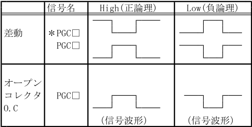

> **図の内容**
>
> | 方式 | 信号名 | High(正論理) | Low(負論理) |
> |---|---|---|---|
> | 差動 | ＊PGC□、PGC□ | 信号波形（2 本が逆向き） | 信号波形（2 本が逆向き、極性が逆） |
> | オープンコレクタ O.C | PGC□ | （信号波形） | （信号波形） |

(E)原点復帰方向【無し】

原点復帰方向を選択します。

"無し"の場合原点復帰を実行しません。

詳細は、

「SLM8000 ユーザーズマニュアル」<Ⅲ機能編 8-4.原点復帰の動作>(TB00-1130G) を参照下さい。

⑬.HI0信号論理【High】

High： HI0信号が High（信号開）の時アクティブ

Low ： HI0信号が Low （信号閉）の時アクティブ

HI0信号は、センサーラッチ入力です。

HI0信号論理は、便宜上この画面にあります。

この入力は１本ですので、いずれかの軸の「軸設定画面」で論理選択してください。

⑭ 指令パルス出力設定

- (A)パルス出力モード(各軸)【A/B相】

<7-1.パルス出力波形>の表のパルス出力形態から１つ選択下さい。

(B)パルス出力幅【１倍】

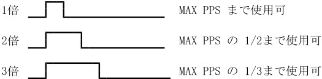

> **図の内容**
>
> - 1倍: MAX PPS まで使用可
> - 2倍: MAX PPS の 1/2まで使用可
> - 3倍: MAX PPS の 1/3まで使用可
> （倍率が大きいほどパルスの幅が広い）

パルスモータアンプの入力パルス幅(最小値)に合わせて設定します。「SLM8000 ユーザーズマニュアル」

<Ⅱハードウェア編 3-4-2.パルス出力タイミング仕様>(TB00-1130C)

を参照ください。

その図のTHのみ変化し、TL､t1､t2 は固定です。また、A/B相方式では無意味です。

(C)指令出力極性【正】

パルス指令軸の移動方向とパルス出力波形の関係を設定します。

詳細は<7-1.パルス出力波形>、<7-2.指令/FBの設定>を参照下さい。

(D)電子ギヤ【0/0】

SLM8000からモータに対してパルス指令を出力する際に、電子ギヤをかけることが出来ます。分子と分母のどちらかに0が設定されているときは、1/1が設定されたものとして動作します。

詳細は<7-2. 指令/FBの設定>を参照下さい。

⑮ フィードバック設定

(A)FB入力ポート【FB無し】

FBカウント処理を行う場合に、使用するFBポートを選択します。SLM8000が持っているFB入力ポートは10ポートです。

有効：「機械位置」、「アブソ位置」、「偏差量」をエンコーダFBパルスから作成します。

尚、インポジションチェックや偏差過大チェックが有効になります。

無効：「機械位置」、「アブソ位置」、「偏差量」を指令量から直接作成します。

尚、インポジションチェックや偏差過大チェックは無効になります。

詳細は<7-2. 指令/FBの設定>を参照下さい。

(B)FB入力極性【正】

FB入力波形とFB位置の方向の関係を設定します。

詳細は<7-1. パルス出力波形>、<7-2. 指令/FBの設定>を参照下さい。

(C)任意分周値【0/0】

エンコーダフィードバックパルスを分周する値を分子と分母の値で設定します。

分子と分母のどちらかに0が設定されているときは、1/1が設定されたものとして動作します。

詳細は<7-2. 指令/FBの設定>を参照下さい。

⑯ 絶対値エンコーダ設定

- (A)エンコーダ選択【インクリメンタル】インクリメンタル安川サーボ

三菱サーボ

(B)絶対位置極性【正】

読み込んだ絶対位置をFB位置の方向の関係を設定します。

- (C)C(Z)相1回転パルス数【0】
- (D)マルチターンリミット【0】

絶対値エンコーダかつ無限回転軸の時、設定が有効になります。

モータm回転でメカ端 n 回転のとき、n を設定下さい。又、サーボアンプのマルチターンリミットに m-1 を設定下さい(m , n は整数)。

### 6-5.手動パルサ/ジョイスティック設定<オプション>

手動パルサ/ジョイスティックを使用する場合は、設定して下さい。

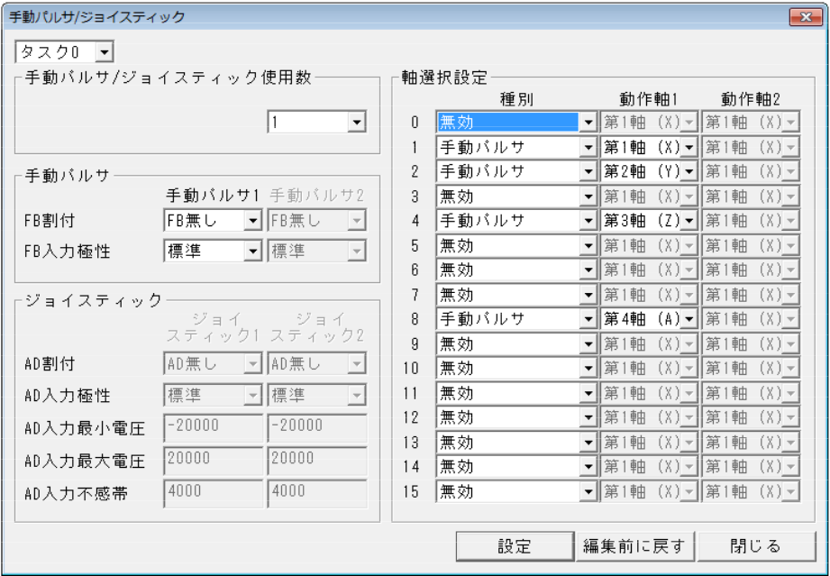

> **図の内容**
>
> 「手動パルサ/ジョイスティック」画面（タスク0）。
> - 手動パルサ/ジョイスティック使用数 1
> - 手動パルサ: FB割付 FB無し、FB入力極性 標準
> - ジョイスティック: AD割付 AD無し、AD入力極性 標準、AD入力最小電圧 -20000、AD入力最大電圧 20000、AD入力不感帯 4000
> - 軸選択設定（0～15）: 1 手動パルサ 第1軸(X)、2 手動パルサ 第2軸(Y)、4 手動パルサ 第3軸(Z)、8 手動パルサ 第4軸(A)、ほかは無効
> - ボタン: 設定、編集前に戻す、閉じる

(1) タスク選択

以下の項目を設定するタスクを選択します。

- (2) 手動パルサ/ジョイスティック使用数【1】

手パ使用数を設定します。タスク毎に最大2台まで使用することができます。

- (3) 手動パルサ

① FB割付【FB無し】

各ハンドルのFB入力チャンネルを選択します。

② FB入力極性【標準】

各ハンドルのFB入力の極性を設定します。

標準:+カウントで+方向へ進みます。

反転:+カウントで-方向へ進みます。

- (4) ジョイスティック設定<開発中>
2. ① AD入力極性【標準】
3. ② AD入力極性【標準】

各AD入力の極性を設定します。

標準:基準値より大きい値で+方向へ進みます。

反転:基準値より大きい値で-方向へ進みます。

- ③ AD入力最小値【-20000】

AD入力の最小値を設定します。ラダーからのデータです。特別な単位はありません。

- ④ AD入力最大値【20000】

AD入力の最大値を設定します。

⑤AD入力不感帯【4000】

AD入力の基準値を中心とした不感帯を設定します。4000は、±2000の事です。

ジョイスティックの電圧と速度の関係

(5) 軸選択設定

機械操作パネルの手パ軸選択入力の入力パターン(0～15:0000～1111)に対して手パ/ジョイスティックの有効/無効、及び動作する軸を選択します。

① 種別

手パ/ジョイスティックを使用するかどうかを選択します。無効を指定するとこの入力パターンは無効となります。

② 動作軸1/2

手パ/ジョイスティックにて動作する軸を選択します。手パ使用数が1の場合、動作軸2は無効となります。動作軸1/2の対応は以下の通りです。

ハンドル1

動作軸1

ハンドル2

動作軸2

上の画面例では以下のようになっています。

| 軸選択入力   | 軸選択入力   | 軸選択入力   | 軸選択入力   | 第1手パ /ジョイスティック   | 第2手パ      |
|-------------|-------------|-------------|-------------|------------------|-----------|
| HAX3        | HAX2        | HAX1        | HAX0        | 第1手パ /ジョイスティック   | /ジョイスティック |
| 0           | 0           | 0           | 0           | 無効               | 無効        |
| 0           | 0           | 0           | 1           | 第1軸(手パ)          | 無効        |
| 0           | 0           | 1           | 0           | 第2軸(手パ)          | 無効        |
| 0           | 0           | 1           | 1           | 無効               | 無効        |
| 0           | 1           | 0           | 0           | 第3軸(手パ)          | 無効        |
| 0           | 1           | 0           | 1           | 無効               | 無効        |
| 0           | 1           | 1           | 0           | 無効               | 無効        |
| 0           | 1           | 1           | 1           | 無効               | 無効        |
| 1           | 0           | 0           | 0           | 第4軸(手パ)          | 無効        |
| 1           | 0           | 0           | 1           | 無効               | 無効        |
| 1           | 0           | 1           | 0           | 無効               | 無効        |
| 1           | 0           | 1           | 1           | 無効               | 無効        |
| 1           | 1           | 0           | 0           | 無効               | 無効        |
| 1           | 1           | 0           | 1           | 無効               | 無効        |
| 1           | 1           | 1           | 0           | 無効               | 無効        |
| 1           | 1           | 1           | 1           | 無効               | 無効        |

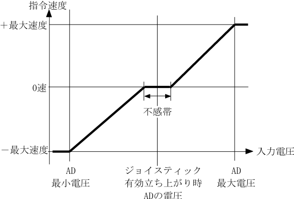

> **図の内容**
>
> 横軸「入力電圧」、縦軸「指令速度」。「AD最小電圧」以下では「－最大速度」、「AD最大電圧」以上では「＋最大速度」。中央の「0速」の区間が「不感帯」。「ジョイスティック有効立ち上がり時ADの電圧」が中央。

### 6-6.主軸設定<オプション>

タスク毎に、主軸の設定をします。

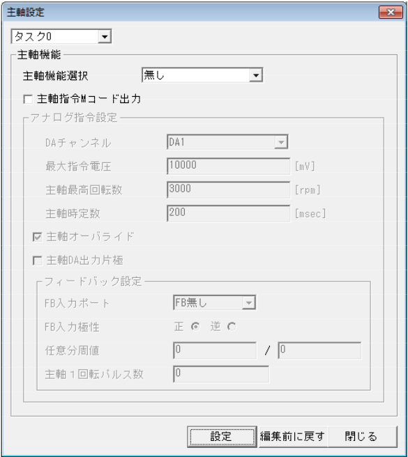

> **図の内容**
>
> 「主軸設定」画面（タスク0）。主軸機能選択「無し」、主軸指令Mコード出力。アナログ指令設定（DAチャンネル DA1、最大指令電圧 10000 [mV]、主軸最高回転数 3000 [rpm]、主軸時定数 200 [msec]）、主軸オーバライド、主軸DA出力片極、フィードバック設定（FBポート FB無し、FB入力極性、任意分周値、主軸１回転パルス数）。多くの項目は灰色。

(1) タスク選択

以下の項目を設定するタスクを選択します。

(2) 主軸機能選択【無し】

主軸機能を選択します。購入したオプションのみ選択可能です。

アナログ指令：S指令で主軸の回転速度を指令し、別売のDAボードユニット製品DA-001U(2ch)の

電圧出力-10～+10Vの範囲で主軸速度を制御します。

ON/OFF(信号出力)：2点の出力信号(SOUT0,SOUT1)で3段階の主軸速度を制御します。

主軸機能の詳細は、

「SLM8000 ユーザーズマニュアル」<Ⅲ機能編 4-17.主軸機能>(TB00-1130E) を参照下さい。

(3) 主軸指令Ｍコード出力【無効】

有効にすると、主軸回転指令（M03～M05）が指令されたときにMコードを出力します。

(4) アナログ指令設定

(2)主軸機能選択で"アナログ指令"を選択すると以下の項目が設定できます。

- ① DAチャンネル【無し】

出力するDAチャンネルを選択します。

- ② 最大指令電圧【10000】

最大電圧を0～10000mVの範囲で設定します。

- ③ 主軸最高回転数【3000】

②最大指令電圧の時の主軸最高回転数を0～100000rpmの範囲で設定します。

- ④ 主軸時定数【200】

主軸停止時から③主軸最高回転数まで加速する時間を0～6400msecの範囲で設定します。

- ⑤ 主軸オーバーライド【無効】

有効にすると主軸にオーバーライドを効かせることが出来ます。

⑥ 主軸DA出力片極【無効】

有効にするとプラスの電圧しか出力しないようにします。

マイナス値を指令してもプラスに変換し出力します。

⑦ フィードバック設定

以下は、主軸のエンコーダのFBから主軸の回転数を求めるための設定です。

(A)FB入力ポート【FB無し】

主軸エンコーダのFB入力チャンネルを選択します。

(B)FB入力極性【正】

主軸エンコーダのFB入力の極性を設定します。

標準:+カウントで+方向へ進みます。

反転:+カウントで-方向へ進みます。

(C)任意分周値【0/0】

エンコーダフィードバックパルスを分周する値を分子と分母の値で設定します。

分子と分母のどちらかに0が設定されているときは、1/1が設定されたものとして動作します。

(D)主軸1回転パルス数【0】

エンコーダのフィードバックカウントからrpm単位に速度を換算するため、指令単位での主軸1回転パルス数を設定します。

### 6-7.オプション

御購入いただいたオプション機能の有無を確認することができます。

- ※ 本画面はご注文頂いたオーダオプションを元に弊社にて設定をします。お客様が変更する事はできません。

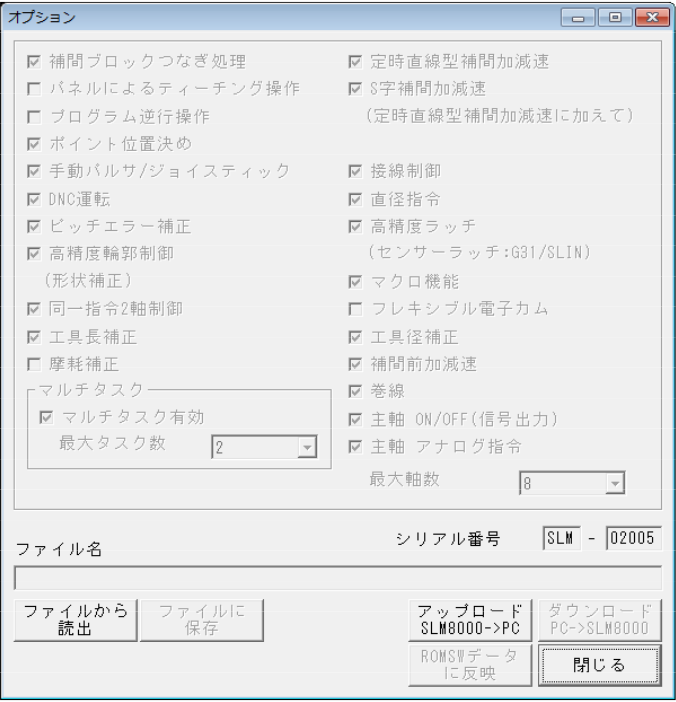

> **図の内容**
>
> 「オプション」画面。オプションのチェック欄（表示のみ）: 補間ブロックつなぎ処理、パネルによるティーチング操作、プログラム逆行操作、ポイント位置決め、手動パルサ/ジョイスティック、DNC運転、ピッチエラー補正、高精度輪郭制御(形状補正)、同一指令2軸制御、工具長補正、摩耗補正、マルチタスク（マルチタスク有効、最大タスク数）、定時直線型補間加減速、S字補間加減速、接線制御、直径指令、高精度ラッチ（センサーラッチ:G31/SLIN）、マクロ機能、フレキシブル電子カム、工具径補正、補間前加減速、巻線、主軸 ON/OFF(信号出力)、主軸 アナログ指令、最大軸数。
> 「ファイル名」、「シリアル番号 SLM - 02005」。ボタン: ファイルから読出、ファイルに保存、アップロード SLM8000->PC、ダウンロード PC->SLM8000（灰色）、ROMSWデータに反映（灰色）、閉じる。
> どれにチェックが入っているかは小さくて判読できず。

## 7.補足説明

### 7-1.パルス出力波形

| ROMSW設定 - パルス出力形態       | ROMSW設定 - 指令出力極性   | 信号名           | パルス出力波形 +指令[-指令] -指令[+指令]   | 備考   |
|--------------------------|---------------------|---------------|-----------------------------|------|
| PLS/DIR パルス列方向（差動）     | 正［逆］               | POUT□+ POUT□- | H L H L                     | PLS  |
| PLS/DIR パルス列方向（差動）     | 正［逆］               | PDIR□+ PDIR□- | H L H L                     | DIR  |
| CW/CCW CWパルス CCWパルス（差動） | 正［逆］               | POUT□+ POUT□- | H L H L                     | CW   |
| CW/CCW CWパルス CCWパルス（差動） | 正［逆］               | PDIR□+ PDIR□- | H L H L                     | CCW  |
| A/B相 90°位相差 2相パルス（差動）   | 正［逆］               | POUT□+ POUT□- | H L H L                     | A相   |
| A/B相 90°位相差 2相パルス（差動）   | 正［逆］               | PDIR□+ PDIR□- | H L H L                     | B相   |

- ※ パルス出力の電気的仕様(タイミング)については

「SLM8000 ユーザーズマニュアル」<Ⅱハードウェア編 3-4-2.パルス出力タイミング仕様>(TB00-1130C) を参照下さい。

### 7-2.指令/FBの設定

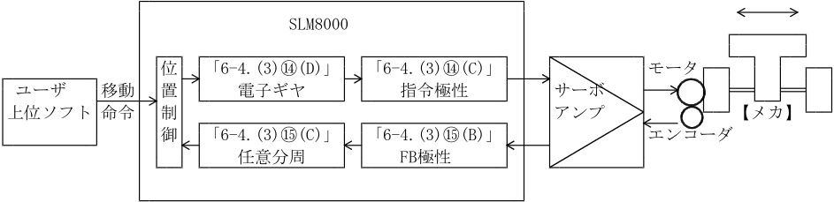

> **図の内容**
>
> 「ユーザ上位ソフト」から「移動命令」が SLM8000 の「位置制御」へ。位置制御から「6-4.(3)⑧(D) 電子ギヤ」→「6-4.(3)⑧(C) 指令極性」→「サーボアンプ」→ モータ → 【メカ】。
> モータのエンコーダから「6-4.(3)⑤(B) FB極性」→「6-4.(3)⑤(C) 任意分周」→ 位置制御へ戻る。

#### 7-2-1. 指令極性/FB極性の設定

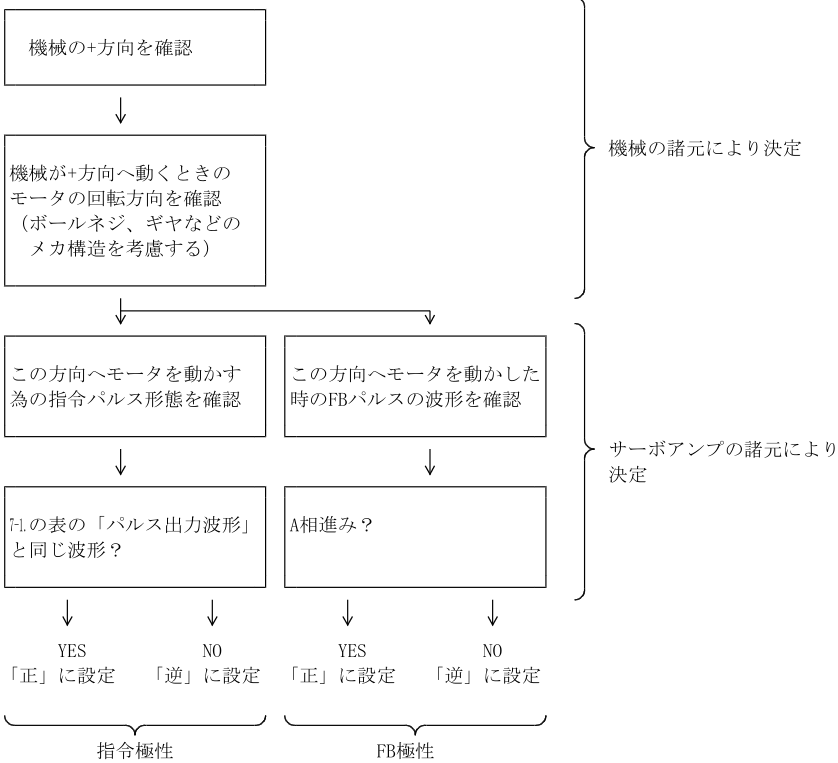

> **図の内容**
>
> 機械の諸元により決定:
> 1. 機械の＋方向を確認
> 2. 機械が＋方向へ動くときのモータの回転方向を確認（ボールネジ、ギヤなどのメカ構造を考慮する）
>
> サーボアンプの諸元により決定（左右 2 系統）:
> - 左: 「この方向へモータを動かす為の指令パルス形態を確認」→「1)の表の「パルス出力波形」と同じ波形？」→ YES なら「正」に設定、NO なら「逆」に設定（指令極性）
> - 右: 「この方向へモータを動かした時のFBパルスの波形を確認」→「A相進み？」→ YES なら「正」に設定、NO なら「逆」に設定（FB極性）

#### 7-2-2. 波形が確認できないとき（現物合わせ）

波形が確認できないときは、以下の手順で確認してください。

①指令極性の確認

セッティングPCソフトで仮に+側へ手動送り（ジョグ、インチング）

メカが+側に移動 → 指令極性は、OK

メカが-側に移動 → 指令極性を逆にする。

- ②電子ギヤの確認

セッティングPCソフトで仮に10mm相当のパルス量をインチング送りメカの移動が正確に10mm → 電子ギヤは、OK

メカの移動が10mmでない → 電子ギヤを再計算。

- ※ 10mmである必要は、ありません。わかりやすい移動量を指定してください。設定ミスにより、1パルスの移動量が桁違いなどで大きく異なっている場合、予想の10倍以上の距離を動くこともあります。OT動作の確認、移動量を極端に小さくする、送り速度を低速にする

など安全に配慮しておこなってください。

- ③FB極性の確認
- +指令でメカも+に動いたとき

機械位置、アブソ位置が+に変化（偏差がたまらない） → 極性は、正常

機械位置、アブソ位置が-に変化（偏差が大きくなる） → 極性は、逆

- ※ その軸のROMSWでFB入力ポートを選択し、CNEXTへの配線が必要。
- ④任意分周の確認

③と同じ動作で、指令位置、機械位置、アブソ位置が同じ値変化し、偏差がたまらない。

- そうでないときは、軸諸元から分周値を再計算してください。

#### 7-2-3. 電子ギヤ/任意分周値の設定の意味

電子ギヤを設定することにより、1パルスあたりの実移動量を変更する事ができます。これにより、ボールネジや位置検出器（エンコーダ）のパルス数などによって、検出パルス単位が中途半端でも、切りの良い指令単位と合わせることができます。

その逆に、FBカウントが有効な軸では、任意分周値を適切な値（1パルスの重みが同じ）に設定して、

指令単位と検出単位を合わせます。これを合わせないと、「偏差過大エラー」になり、正常に運転できませんので、ご注意下さい。

指令単位運転プログラム、画面表示、内部データ（例：マクロ変数）などで取り扱う

1パルス単位の重みです。例：1p＝1μm 1p＝0.001°

検出単位実際の位置検出器の1パルス単位。機構や位置検出器の仕様で端数になる場合も

あります。また、ACサーボアンプでは、位置検出器からの信号を一端受けて、アンプからFB信号を出力する場合もあります。この場合、サーボのFB分周値などの

パラメータも関係しますので、ご注意ください。

#### 7-2-4. 設定例

機械諸元

+方向のモータ回転： CCW

ボールネジピッチ

： 5mm

増減速比

： 2/5

1パルスの移動量

： 1μm

サーボアンプ諸元モータ1回転パルス数： 2048パルス

パルス指令入力

： PLS/DIR(DIR信号がLOWレベルでCW回転)

エンコーダFBパルス数： 1024パルス × 4逓倍

エンコーダFB出力

： CCW回転でA相進み

指令極性：逆

FB極性：正

電子ギヤ： 128/125 ※１

任意分周： 125/256 ※２

ROMSW設定

※１電子ギヤの計算例

2 5000[μm(パルス)] × × 電子ギヤ＝ 2048[パルス] 5 モータ1回転あたりのモータ1回転あたりの

論理的な指令パルス数実際のサーボアンプへの指令パルス数

2048 × 5 128 電子ギヤ＝＝ → 分子＝ 128 、分母＝ 125 5000 × 2 125

※２任意分周の計算例

2 1024[パルス] × 4[逓倍] × 分周値＝ 5000[μｍ(パルス)] × 5 モータ1回転あたりのモータ1回転あたりの実際のFBパルス数論理的なFBパルス数 5000 × 2 125

分周値＝＝ → 分子＝ 125 、分母＝ 256 1024 × 4 × 5 256
