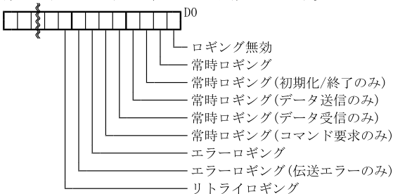
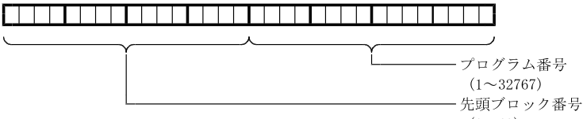
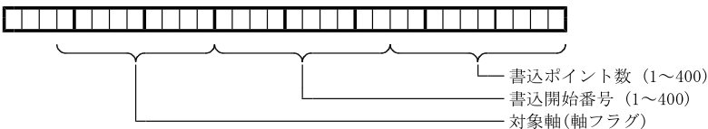
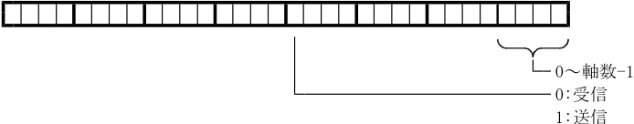
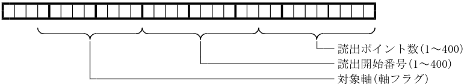

# 標準ワンボードモーションコントローラ[SLM8000]

通信ライブラリリファレンスマニュアル

Ver1.1 2019.3.1

－目次－

- 1. 形式
- 2. 製品構成
- 3. 概要
- 4. 関連資料
- 5. 使用環境
- 6. インストール
- 7. ライブラリ使用上の注意事項
- 8. 関数使用例
  - 8-1. MS-VC以外のC言語処理系での利用方法
  - 8-2. 関数呼び出し時の戻り値
- 9.関数仕様
  - 9-1. 通信
    - InitCommProc
    - QuitCommProc
    - SendData
    - ReceiveData
    - SendCommand
    - SetErrlog
  - 9-2. タイマー
    - SetTimeOut
    - CheckTimeOut

## 1. 形式

SLM8000COM-NT

## 2. 製品構成

| SLM8000COMNT            | .DLL                    | ････････   | 32bit Windows用   | ダイナミックリンクライブラリ              |
|-------------------------|-------------------------|------------|------------------|-----------------------------|
| SLM8000COMNT            | .LIB                    | ････････   | 32bit Windows用   | インポートライブラリ                  |
| SLM8000COMNT64          | .DLL                    | ････････   | 64bit Windows用   | ダイナミックリンクライブラリ              |
| SLM8000COMNT64          | .LIB                    | ････････   | 64bit Windows用   | インポートライブラリ                  |
| SLM8000COMNT            | .H                      | ････････   | 32/64bit         | Windows共用インクルードファイル(関数定義)  |
| SLM8000DATA             | .H                      | ････････   | 32/64bit         | Windows共用インクルードファイル(構造体定義) |
| SYNCDEF                 | .H                      | ････････   | 32/64bit         | Windows共用インクルードファイル(マクロ定義) |
| SLM8000COMAPI           | .BAS                    | ････････   | VisualBasic用     | 関数定義                        |
| SLM8000DATA             | .BAS                    | ････････   | VisualBasic用     | 構造体定義                       |
| SYNCDEF                 | .BAS                    | ････････   | VisualBasic用     | 定数定義                        |
| SLM8000COMAPIVCNET      | .H                      | ････････   | VC.NET 32bit     | 用関数定義                      |
| SLM8000COM64APIVCNET.H  | SLM8000COM64APIVCNET.H  | ････････   | VC.NET 64bit     | 用関数定義                      |
| SLM8000DATAVCNET        | .H                      | ････････   | VC.NET 32/64bit  | 共用構造体定義                    |
| SYNCDEFVCNET            | .H                      | ････････   | VC.NET 32/64bit  | 共用マクロ定義                    |
| SLM8000COMAPIVBNET      | .VB                     | ････････   | VB.NET 32bit 用   | 関数定義                        |
| SLM8000COM64APIVBNET.VB | SLM8000COM64APIVBNET.VB | ････････   | VB.NET 64bit     | 用関数定義                      |
| SLM8000DATAVBNET        | .VB                     | ････････   | VB.NET 32/64bit  | 共用構造体定義                    |
| SYNCDEFVBNET            | .VB                     | ････････   | VB.NET 32/64bit  | 共用定数定義                     |
| SLM8000COMAPICSNET      | .CS                     | ････････   | C#.NET 32bit     | 用関数定義                      |
| SLM8000COM64APICSNET.CS | SLM8000COM64APICSNET.CS | ････････   | C#.NET 64bit     | 用関数定義                      |
| SLM8000DATACSNET        | .CS                     | ････････   | C#.NET 32/64bit  | 共用構造体定義                    |
| SYNCDEFCSNET            | .CS                     | ････････   | C#.NET 32/64bit  | 共用定数定義                     |

## 3. 概要

本ライブラリ(SLM8000 通信ライブラリ)は、パソコンとSLM8000コントローラの通信を行うための処理をライブラリ化したものです。本ライブラリの機能は、C言語の関数形式で呼び出して、利用できます。

本ライブラリを利用して以下のような処理が行えます。

- データ送信
- データ受信
- 動作指示

各データの詳細は送受信データ説明書を参照下さい。

## 4. 関連資料

| 「SLM8000 ユーザーズマニュアル」             | (TB00-1130)   |
|----------------------------------|---------------|
| 「SLM8000 セッティングPCマニュアル」          | (TB00-1131)   |
| 「SLM8000 ROMSW設定ソフトマニュアル」        | (TB00-1132)   |
| 「SLM8000 通信ライブラリリファレンスマニュアル」     | (TB00-1133) ※ |
| 「SLM8000 送受信データマニュアル」            | (TB00-1134)   |
| 「SLM8000 Tコード変換ライブラリリファレンスマニュアル」 | (TB00-1135)   |
| 「SLM8000 Gコード変換ライブラリリファレンスマニュアル」 | (TB00-1136)   |

※ 本書

## 5. 使用環境

本ライブラリが対応するパソコン及び、開発環境は以下の通りです。

対応パソコン・・・ Windows 7 / 10 が動作するx86CPU搭載機

対応開発環境・・・ Visual C++ Ver6.0

Visual Basic Ver6.0

Visual Studio2005

Visual Studio2008 ※64bitの場合は2008以降

## 6. インストール

DLLファイルをプログラム検索パスの通っているディレクトリ(フォルダ)に格納して下さい。

## 7. ライブラリ使用上の注意事項

SLM8000用通信ライブラリを使用して、アプリケーションを作成するときは、以下の事を注意して下さい。

- プログラムデータの作成には、弊社プログラム処理ライブラリが必要です。
- 複数のアプリケーションで通信を利用する場合、以下に注意する必要があります。

＜RS232C通信＞

- 1)1つのCOMポ－トに対しては、1つのアプリケーションしかアクセスすることはできません。
- 2)1台のSLM8000に対して、最大2つのCOMポ－トから同時にアクセスできます。
- 但しこの場合、別途RS232C通信用基板/ケーブル（AS232/CB-C-012）をご購入いただく必要があります。

＜イーサネット通信＞

1)SLM8000のイーサネットに対しては、最大8個のアプリケーションから同時にアクセスすることができます。

＜共通＞

1)1つのアプリケーションから最大4つの通信を行うことができます。

例1）通信1：RS232C(COM1) - SLM8000_1

通信2：RS232C(COM2) - SLM8000_2

通信3：RS232C(COM3) - SLM8000_3

通信4：RS232C(COM4) - SLM8000_4

例2) 通信1：イーサネット - SLM8000_1

通信2：RS232C(COM1) - SLM8000_1

通信3：イーサネット - SLM8000_2

通信4：RS232C(COM2) - SLM8000_2

- 2)複数のアプリケーションから、複数の通信形態を併用して1台のSLM8000にアクセスすることが可能です。
- 3)1台のSLM8000に対して、複数の通信を利用してデータ書き込みや動作指示を行う場合、それぞれのデータ書き込みや動作指示が干渉することがありますので、運用で干渉を回避する必要があります。

例)アプリケーション1：RS232C(COM1) - SLM8000_1

アプリケーション2：RS232C(COM2) - SLM8000_1

アプリケーション3：イーサネット - SLM8000_1

## 8. 関数使用例

本ライブラリの使用法は、以下の2通りがあります。

- インポートライブラリを使用して関数をインポートする。

ライブラリに付属のインポートライブラリをアプリケーションの作成時にリンクします。

- DLLロード関数を使用して関数をインポートする。 DLLロード関数を使用してDLLをメモリにロードし、関数アドレスを取得して関数を呼び出します。この方法は、ウィンドウズ上で動作する言語処理系全てで有効です。詳細は次項を参照して下さい。

### 8-1. MS-VC以外のC言語処理系での利用方法

MS-VC以外のC言語処理系でDLLを使用する場合は、以下の手順で行います。

```c
    1. DLLのロード
    2. DLL内の任意の関数のアドレス取得
```

:

- : DLL内の関数の利用

:

3. DLLのアンロード
2. ※ 32Bit版Windowsにおいて、関数アドレス取得時に指定する関数名は、本説明書(ヘッダーファイル)の関数名と異なります。(64Bit版Windowsは、関数名をそのまま指定できます。) アドレス取得時の関数名のフォーマットは、ヘッダーファイルの関数名の前に"_"(アンダーバー)を付け、関数名の後に@、その後に引数の数×4を付けます。具体的には以下の通りとなります。

_関数名@引数の数×4

- 例 InitCommProc(PSXDEF psxdef, int *phCom)の場合

関数名･････ _InitCommProc@8

これらの定義がSlm8000comnt.h内にあるので、独自の処理を作成する場合は参考にして下さい。

関数アドレス取得時に指定する関数名／関数ポインタのデータ型は､Slm8000comnt.h内で定義しています。 Slm8000comnt.h をインクルードする前に LOADLIBRARY_MCDLL を定義(define)することによってこれらの定義を使用できるようになります。

（LOADLIBRARY_MCDLLを定義しなかった場合はインポートライブラリを使用する設定になります。）

以下の例は、通信ライブラリの関数取得例を示します。

```c
#define LOADLIBRARY_MCDLL // テクノ製ライブラリ明示的リンク指定
#include "Slm8000comnt.h" // 通信ライブラリ宣言
    // グローバルデータ定義
    HINSTANCE hComInst;      /* 通信ライブラリハンドル */
    INITPROC *InitCommProc;  /* 通信初期化関数へのポインタ */
    QUITPROC *QuitCommProc;  /* 通信終了処理関数へのポインタ */
    // 通信ライブラリ関数ロード処理
    int LoadPlmComm(void)
    {
    // DLLのロード
    if(NULL == (hComInst = LoadLibrary(LNCOMDLL))){
    return 0;
}
    // DLLが正常にロードできた場合
    // DLL関数ポインタの取得
    InitCommProc = (INITPROC *)GetProcAddress(hComInst, FNINITPROC);
    QuitCommProc = (QUITPROC *)GetProcAddress(hComInst, FNQUITPROC);
    if((NULL == InitCommProc) || (NULL == QuitCommProc)){
    // 関数アドレス取得が失敗した場合
    // DLLの解放
    FreeLibrary(hComInst);
    return 0;
}
    return 1;
}
```

### 8-2. 関数呼び出し時の戻り値

| E$OK          | :( 0)   | 正常終了             |
|---------------|---------|------------------|
| E$DEVNRDY     | :( 1)   | デバイス未初期化         |
| E$PARAM       | :( 2)   | 通信パラメータ設定異常      |
| E$TIME        | :( 3)   | タイムアウト発生         |
| E$RTRY        | :( 4)   | リトライオーバー発生       |
| E$MLTRTRY     | :( 5)   | 多重リトライ発生         |
| E$HARDER      | :( 6)   | 通信ハードウェアエラー      |
| E$NEXIST      | :( 7)   | 要求データが存在しない      |
| E$PROTECT     | :( 8)   | 送信データ書込不可        |
| E$SEQ         | :( 9)   | 通信データフォーマットエラー   |
| E$PRGTERM     | :(10)   | プログラム書込中断        |
| E$PRGBUFF     | :(11)   | プログラムバッファオーバーフロー |
| E$CMDNOT      | :(12)   | コマンド実行不可         |
| E$EMPTYHANDLE | :(13)   | 空き通信ハンドル無し       |
| E$NOHANDLE    | :(14)   | 無効ハンドル           |
| E$BUSY        | :(15)   | 通信ビジー            |
| E$PRMWRITE    | :(16)   | パラメータ書き込みエラー     |
| E$ERR         | :(-1)   | 不明エラー            |

## 9.関数仕様

### 9-1. 通信

#### InitCommProc

**機能**

通信インタフェースの初期化及び、通信処理の組み込みを実行します。

**プロトタイプ**

```c
#include "Slm8000comnt.h" 関数宣言に必要な
    int WINAPI InitCommProc(PSXDEF psxdef, int *phCom);
    PSXDEF psxdef 通信定義構造体
```

関数宣言に必要なインクルードファイル

通信定義構造体

通信処理の各種定義を行います。

```c
typedef struct {
    long nSize; // 通信初期化構造体サイズ
    long fComType; // 通信種別フラグ
    long fShare; // 共有フラグ
    long fSxType; // コントローラ種別
    long fLogging; // 通信ロギングフラグ
#ifdef _WIN64
    long alignment0;
#endif
    char *pLogFile; // 通信ロギングファイル名
    // Rs232c
    int nComPort; // RS232C通信ポート番号
    // Ether
    unsigned char nIpAddr[4]; // IPアドレス
} SXDEF, *PSXDEF;
```

各変数の内容は以下の通りです。

nSize 構造体サイズ

本構造体（通信定義構造体）のサイズを設定して下さい。 sizeof():VC++/ LenB():VB 関数でサイズを取得できます。

| fComType   | 通信種別フラグ 0：RS232C通信 1：イーサネット通信   | 【0～1】   |
|------------|---------------------------------|---------|
| fShare     | 共有フラグ 1を指定して下さい。                | 【1】     |

```c
    RS232C通信時
    int *phCom 通信ハンドル
```

fSxType コントローラ種別フラグ

0x40：SLM8000

fLogging 通信ロギングフラグ

通信ロギングの設定を行います。内容は下記の通りです。上位の未定義ビットは全て0にして下さい。

尚、全ビットを0にすると、ロギング無効になります。



> **図の内容**
>
> | ビット | 内容 |
> |---|---|
> | D0 | ロギング無効 |
> | D1 | 常時ロギング |
> | D2 | 常時ロギング（初期化/終了のみ） |
> | D3 | 常時ロギング（データ送信のみ） |
> | D4 | 常時ロギング（データ受信のみ） |
> | D5 | 常時ロギング（コマンド要求のみ） |
> | D6 | エラーロギング |
> | D7 | エラーロギング（伝送エラーのみ） |
> | D8 | リトライロギング |
>
> パッケージのヘッダー（`Slm8000comnt.h` の `COML_*`）の値と一致する。

pLogFile 通信ロギングファイル名

SLM8000との通信のログを保存するファイル

名を指定します。

NULLを指定するとロギングが無効になります。

ファイル名を指定＆通信ロギングフラグ指定でログを有効にした場合、実行ファイルと同じディレクトリに以下のファイルが作成されます。

- 1.「通信ロギングファイル名」で指定したファイル
- 2.「通信ロギングファイル名」で指定したファイルのベースファイル名の最後に1～5の数字を付加したファイル
3. RS232C通信の場合

Slm8000Com*.tmp シリアルポート番号

イーサネット通信の場合

Slm8000Eth********.tmp

IPアドレス(Hex)

ログファイル(1のファイル)が512Kバイトをこえると現ログファイルはリネームされて、履歴ファイルとなります。その後、新しいログファイルを作成してロギングを継続します。履歴ファイル名は、指定されたログファイル名のベースに履歴番号として1~5を付加した名前です。(最大5世代)

例)ログファイル名として"TMP.LOG"を指定すると、

履歴ファイルとしてTMP1.LOG～TMP5.LOGが作成されます。

nComPort シリアル通信ポート番号【1～256】

RS232C通信に使用するシリアルポート番号を指定します。

nIpAddr イーサネット通信時の接続先IPアドレス ROMSW設定ソフトで設定したアドレス

例)192.168.0.2を設定する場合

nIpAddr[0]=192、nIpAddr[1]=168、

nIpAddr[2]=0、 nIpAddr[3]=2

通信の種別により、以下の項目の設定の必要はありません。

イーサネット通信時：nComPort

：nIpAddr

*phCom 通信ハンドル

初期化が正常に終了した場合に、ハンドルを格納するデータのポインタを指定します。

通信処理実行ステータスとして以下の値を返します。

E$OK

：正常終了

E$EMPTYHANDLE ：ハンドル取得不可

E$PARAM ：パラメータ設定異常

E$ERR

：異常終了

正常に初期化が終了した場合、接続されたSLM8000コントローラを識別するためのハンドルをphCom の指し示すアドレスへ格納します。

【参考】

VB6.0使用時のログファイル名指定方法

〔方法1〕

SXDEFの初期化で

sdf.pLogFile = StrPtr(StrConv("test.log", vbFromUnicode)) '通信ロギングファイル名と指定。〔方法2〕

Slm8000comapi.basのSXDEF構造体にあるpLogFileを

pLogFile As String

と変更し

SXDEFの初期化で

sdf.pLigFile = "test.log"

'通信ロギングファイル名と指定。

と指定。

#### QuitCommProc

**機能**

関数InitCommProcの実行によって組み込まれた通信処理を切り放し、組み込み前の状態に戻します。

**プロトタイプ**

```c
#include "Slm8000comnt.h" 関数宣言に必要なインクルードファイル
    int WINAPI QuitCommProc(int hCom);
```

int hCom

通信ハンドル

通信初期化処理で取得したハンドルを指定します。

**戻り値**

ステータスとして以下の値を返します。

E$OK

：正常終了

E$NOHANDLE ：無効ハンドル

E$ERR

：異常終了

#### SendData

**機能**

SLM8000コントローラに対して、各種データ設定を行います。

**プロトタイプ**

```c
#include "Slm8000comnt.h" 関数宣言に必要なインクルードファイル
    int WINAPI SendData(int hCom, short type, short task, long prm, DWORD size, LPVOID data);
```

関数宣言に必要なインクルードファイル

int hCom

通信ハンドル

short type

通信初期化処理で取得したハンドルを指定します。

データタイプ

short task DAT_PARAMETER等、送信するデータのタイプを指定します。

タスク番号

long prm

設定対象のタスク番号(0～7)を指定します。

タスク指定が関係ない設定の場合は0を指定して下さい。

付加パラメータ

データタイプによって、指定する値が異なります。送受信データ説明書の各データタイプの説明を参照して設定下さい。（《パラメータ》の説明に応じて設定して下さい。ただし、本項に「なし」と記載されている場合は0を設定して下さい。）

例）

・DAT_PROGRAM :プログラム番号(D0～D15)、先頭ブロック番号(D16～D31)

MSB

LSB



> **図の内容**
>
> 32 ビット。
> | ビット | 内容 |
> |---|---|
> | D0～D15 | プログラム番号（1～32767） |
> | D16～D31 | 先頭ブロック番号 |

(0～63)

- DAT_DNCDATA ：先頭／継続フラグ 0：先頭時、1：継続時
- DAT_MCRREG ：マクロ変数番号
- DAT_ACOPARAM ：0:1タスク分の受信、1:全タスク分の受信

・DAT_POINTTABLE：書込ポイント数(D0～D9)､書込開始番号(D10～D19)

軸フラグ(D20～D28)

MSB

LSB



> **図の内容**
>
> 32 ビット。
> | ビット | 内容 |
> |---|---|
> | D0～D9 | 書込ポイント数（1～400） |
> | D10～D19 | 書込開始番号（1～400） |
> | D20～D28 | 対象軸（軸フラグ） |

DWORD

size

送信データサイズ

LPVOID

0～65535バイト

data 送信データ格納バッファへのポインタ

本関数のデータタイプに指定できるデータについては、「標準SLM8000対応送受信データマニュアル」の"データ送受信機能"を参照して下さい。

通信処理実行ステータスとして以下の値を返します。

E$OK

：正常終了

E$DEVNRDY ：デバイス未初期化

E$PARAM ：通信パラメータ設定異常

E$TIME ：タイムアウト発生

E$RTRY ：リトライオーバー発生

E$MLTRTRY ：多重リトライ発生

E$HARDER ：通信ハードウェアエラー

E$PROTECT ：送信データ書込不可

E$SEQ

：通信データフォーマットエラー

E$PRGTERM ：プログラム書込中断

E$PRGBUFF ：プログラムバッファオーバーフロー

E$NOHANDLE ：無効ハンドル

#### ReceiveData

**機能**

SLM8000コントローラ内部の、各種データ読出を行います。

**プロトタイプ**

```c
#include "Slm8000comnt.h" 関数宣言に必要なインクルードファイル
    int WINAPI ReceiveData(int hCom, short type, long task, short prm, LPDWORD size, LPVOID data);
```

関数宣言に必要なインクルードファイル

int hCom

通信ハンドル

short type

通信初期化処理で取得したハンドルを指定します。

データタイプ

short task DAT_PARAMETER等、受信するデータのタイプを指定します。

タスク番号

long prm

読出対象のタスク番号(0～7)を指定します。

タスク指定が関係ない読出の場合は0を指定して下さい。

付加パラメータ

MSB

データタイプによって、指定する値が異なります。送受信データ説明書の各データタイプの説明を参照の上設定して下さい。（《パラメータ》の説明に応じて設定して下さい。ただし、本項に「なし」と記載されている場合は0を設定して下さい。）

例）

・DAT_PROGRAM : プログラム番号 1～32767

・DAT_ONEBLOCK : ステップ番号 0～32767

- DAT_MCRREG

: マクロ変数番号

・DAT_TPCDATA : 読み出しデータサイズ 0～65535

LSB



> **図の内容**
>
> 32 ビット。
> | ビット | 内容 |
> |---|---|
> | D0～D3 | 0～軸数-1 |
> | D15 | 0:受信、1:送信 |
>
> どのデータタイプの例かは、図だけでは分からない（本文の例の並びの中にある）。

- DAT_ACOPARAM
- DAT_POINTTABLE

: 0:1タスク分の受信、1:全タスク分の受信

: 書込ポイント数(D0～D9)､書込開始番号(D10～D19) 軸フラグ(D20～D28)

MSB

LSB



> **図の内容**
>
> 32 ビット。
> | ビット | 内容 |
> |---|---|
> | D0～D9 | 読出ポイント数（1～400） |
> | D10～D19 | 読出開始番号（1～400） |
> | D20～D28 | 対象軸（軸フラグ） |

```c
    LPDWORD size
    LPVOID data
```

受信データサイズ格納変数へのポインタ

受信データ格納バッファへのポインタ

本関数のデータタイプに指定できるデータについては、「標準SLM8000対応送受信データマニュアル」の"データ送受信機能"を参照して下さい。

**戻り値**

通信処理実行ステータスとして以下の値を返します。

E$OK

：正常終了

E$DEVNRDY ：デバイス未初期化

E$PARAM ：通信パラメータ設定異常

E$TIME ：タイムアウト発生

E$RTRY ：リトライオーバー発生

E$MLTRTRY ：多重リトライ発生

E$HARDER ：通信ハードウェアエラー

E$NEXIST ：要求データが存在しない

E$SEQ

：通信データフォーマットエラー

E$NEXIST ：要求データが存在しない

E$NOHANDLE ：無効ハンドル

#### SendCommand

**機能**

SLM8000コントローラに対して、各種動作指示を行います。

**プロトタイプ**

```c
#include "Slm8000comnt.h" 関数宣言に必要なインクルードファイル
    int WINAPL SendCommand(int hCom, short cmnd, short task, LPVOID data);
```

int hCom

通信ハンドル

short cmnd

通信初期化処理で取得したハンドルを指定します。

動作指示コード

short task REQ_RESET等、動作指示のタイプを指定します。

タスク番号

LPVOID

data

動作指示対象のタスク番号(0～7)を指定します。

タスク指定が関係ない動作指示の場合は0を指定して下さい。

動作パラメータ格納バッファへのポインタ

本関数の動作指示コードに指定できるデータについては､「標準SLM8000対応送受信データマニュアル」の"動作コマンド付加データ詳細"を参照して下さい。

**戻り値**

通信処理実行ステータスとして以下の値を返します。

E$OK

：正常終了

E$DEVNRDY ：デバイス未初期化

E$PARAM ：通信パラメータ設定異常

E$TIME ：タイムアウト発生

E$RTRY ：リトライオーバー発生

E$MLTRTRY ：多重リトライ発生

E$HARDER ：通信ハードウェアエラー

E$SEQ

：通信データフォーマットエラー

E$CMDNOT ：コマンド実行不可

E$NOHANDLE ：無効ハンドル

#### SetErrlog

**機能**

SLM8000コントローラに対して、通信エラーログファイル名を指定します。

通信初期化処理で設定した項目と同じです。この関数によっても、エラーログファイルを指定できます。エラーログファイル名やフラグのみを変更する場合に使用します。

**プロトタイプ**

```c
#include "Slm8000comnt.h" 関数宣言に必要なインクルードファイル
    int WINAPI SetErrLog(int hCom, char *fname, short flg);
```

int hCom

通信ハンドル

char

通信初期化処理で取得したハンドルを指定します。

*fname 通信ロギングファイル名

short flg InitComProcのpLogFileの項をご参照下さい。

通信ロギングフラグ

InitComProcのfLoggingの項をご参照下さい。

**戻り値**

通信処理実行ステータスとして以下の値を返します。

E$OK

：正常終了

E$DEVNRDY ：デバイス未初期化

E$PARAM ：通信パラメータ設定異常

E$NOHANDLE ：無効ハンドル

E$ERR

：初期化処理異常終了

### 9-2. タイマー

Windowsが持つ､1msec間隔のインターバルタイマーをもとに､タイマーによる処理のディレイや同期､またタイムアウト処理などが可能となります。

「タイマーチェック起点関数」及び「タイムアウトチェック関数」によりアプリケーションにて通信処理以外の目的で､タイマー処理を行うことができます。

#### SetTimeOut

**機能**

タイムアウトチェックの起点設定を行います。

**プロトタイプ**

```c
#include "Slm8000comnt.h" 関数
    void WINAPI SetTimeOut(PDWORD origin);
    PDWORD origin タイム
```

関数宣言に必要なインクルードファイル

origin タイムアウトチェック起点時間格納ポインタ

#### CheckTimeOut

**機能**

タイムアウトの判定を行います。

**プロトタイプ**

```c
#include "Slm8000comnt.h" 関数宣言に必要なイン
    BOOl WINAPI CheckTimeOut(DWORD origin, DWORD limit);
    DWORD origin 関数SetTimeOut()で取得した
    DWORD limit タイムリミット値(単位:1ms
```

関数宣言に必要なインクルードファイル

origin 関数SetTimeOut()で取得したタイムアウトチェック起点時間

limit タイムリミット値(単位:1msec)

**戻り値**

FALSE:タイムアウトしていない

TRUE :タイムアウトしている

```c
#include <conio.h>
#include "Slm8000comnt.h"
    main()
    {
    int ch;
    DWORD StartTime;
    ch＝getch();                          /*キー入力 */
    SetTimeOut(&StartTime);               /*タイマーチェック起点設定 */
    While(!CheckTimeOut(StartTime,1100L));  /*1.1秒待ち */
    putch(ch);                            /*入力キーコード表示 */
}
```

このプログラムは､キー入力があってから1.1秒後に､入力キーを表示します。
