# 標準ワンボードモーションコントローラ[SLM8000]

送受信データマニュアル

Ver1.1 2020.2.26

－目次－

- 1.概要
- 2.関連資料
- 3.表記
- 4.通信データ詳細説明
  - 4-1.データ送受信機能詳細
    - 4-1-1.サーボパラメータ書込/読出 [DAT_PARAMETER(0x00)]
    - 4-1-2.運転プログラム書込/読出 [DAT_PROGRAM(0x01)]
    - 4-1-3.ピッチエラー補正用パラメータ書込/読出 [DAT_PITCHERR(0x10)] <オプション>
    - 4-1-4.工具長補正データ書込/読出 [DAT_TOOLHOFS(0x12)] <オプション>
    - 4-1-5.工具径補正データ書込/読出 [DAT_TOOLDIA(0x1A)] <オプション>
    - 4-1-6.補間前加減速(自動ｺｰﾅｵｰﾊﾞｰﾗｲﾄﾞ)パラメータ書込/読出 [DAT_ACOPARAM(0x37)] <オプション>
    - 4-1-7.ステータスデータ読出 [DAT_STATUS(0x02)]
    - 4-1-8.軸割り当て情報読出 [DAT_ASSAXISTBL(0x3C)]
    - 4-1-9.入出力状態データ読出 [DAT_IODATA(0x03)]
    - 4-1-10.強制入出力状態データ読出 [DAT_FORCEIO(0x13)]
    - 4-1-11.機械操作パネルSW情報読出 [DAT_MPDATA(0x26)]
    - 4-1-12.機械操作パネル強制入力状態データ読出 [DAT_FORCEMPI(0x14)]
    - 4-1-13.軸ネグレクト設定データ読出 [DAT_AXNEGLECT(0x28)]
    - 4-1-14.軸インタロック設定データ読出 [DAT_AXINTLOCK(0x29)]
    - 4-1-15.各軸サーボON/OFF設定データ読出 [DAT_AXSVONEN(0x31)]
    - 4-1-16.プログラムブロック情報読出 [DAT_PRGBLKINFO(0x1B)]
    - 4-1-17.プログラム1ステップデータ読出 [DAT_ONEBLOCK(0x30)]
    - 4-1-18.ティーチング情報読出 [DAT_TEACHSTS(0x18)] <開発中>
    - 4-1-19.DNCデータ書込 [DAT_DNCDATA(0x0E)] <オプション>
    - 4-1-20.DNCバッファ情報データ読出 [DAT_DNCBUFI(0x0F)] <オプション>
    - 4-1-21.マクロ変数(一般レジスタ)書込/読出 [DAT_VARIABLE(0x19)] <オプション>
    - 4-1-22.マクロ変数書込/読出 [DAT_MCRREG(0x33)] <オプション>
    - 4-1-23.主軸回転数読出 [DAT_SPREV(0x41)] <オプション>
    - 4-1-24.TPCロギングデータ読出 [DAT_TPCDATA(0x25)]
    - 4-1-25.64チャンネルTPCロギングデータ読出 [DAT_TPCDATA_64(0x2b)]
    - 4-1-26.TPCロギング情報読出 [DAT_TPCINFO(0x24)]
    - 4-1-27.TPCロギング拡張情報読出 [DAT_TPCINFO_EX(0x2A)]
    - 4-1-28.手動パルサー設定情報読出 [DAT_HANDLESTS(0x32)] <オプション>
    - 4-1-29.センサーラッチ位置データ読出 [DAT_SENSEPOS(0x11)] <オプション>
    - 4-1-30.フィードバックカウンタ積算値読出 [DAT_FBCOUNT(0x50)]
    - 4-1-31.工具長補正設定情報読出 [DAT_TOOLHSTS(0x39)] <オプション>
    - 4-1-32.工具径補正設定情報読出 [DAT_TOOLDSTS(0x3A)] <オプション>
    - 4-1-33.工具径補正エラー情報読出[DAT_TOOLDERR(0x3D)] <オプション>
    - 4-1-34.ポイントテーブル書込/読出 [DAT_POINTTABLE(0x3B)] <オプション>
    - 4-1-35.制御周期内処理時間計測データ読出 [DAT_RTC(0x21)]
    - 4-1-36.フォアグランド周期計測データ読出[DAT_FORGROUND(0x90)]
    - 4-1-37.ROMバージョン情報読出 [DAT_VERSION(0x27)]
    - 4-1-38.動作モードデータ読出 [DAT_MODE(0x04)]
    - 4-1-39.指令位置データ読出 [DAT_COMREG(0x05)]
    - 4-1-40.ビット情報ステータスデータ読出 [DAT_STATUS_BIT(0x06)]
    - 4-1-41.ビット情報アラームデータ読出 [DAT_ALMRM_BIT(0x07)]
    - 4-1-42.オーバーライド設定データ読出 [DAT_OVERRIDE(0x08)]
    - 4-1-43.プログラム実行情報データ読出 [DAT_PRGSTS(0x0C)]
    - 4-1-44.オーバーライド%設定データ読出 [DAT_OVERRIDEP(0x15)]
    - 4-1-45.絶対値エンコーダオフセット書込/読出 [DAT_ABSENCOFS(0x1c)]
  - 4-2.動作要求コマンド詳細
    - 4-2-1.バックアップメモリ初期化コマンド [REQ_GENE(0x14)]
    - 4-2-2.アブソ座標設定コマンド [REQ_MABSCOORDSET(0x90)]
    - 4-2-3.Flashメモリへのプログラム反映コマンド [REQ_REFMEM(0x6E)]
    - 4-2-4.Flashメモリへのポイントデータ反映コマンド [REQ_REFPOINT(0x6F)]
    - 4-2-5.動作モード変更コマンド [REQ_MODECHG(0x10)]
    - 4-2-6.軸移動停止コマンド [REQ_STOP(0x13)]
    - 4-2-7.リセットコマンド [REQ_RESET(0x1A)]
    - 4-2-8.軸移動再開コマンド [REQ_RESTART(0x1B)]
    - 4-2-9.プログラム実行開始コマンド [REQ_PROGSTRT(0x20)]
    - 4-2-10.プログラム実行停止コマンド [REQ_PROGSTOP(0x21)]
    - 4-2-11.実行プログラム選択コマンド [REQ_PROGSLCT(0x22)]
    - 4-2-12.マルチタスクプログラム開始コマンド [REQ_TASKSTART(0x80)] <オプション>
    - 4-2-13.マルチタスクプログラム停止コマンド [REQ_TASKSTOP(0x81)] <オプション>
    - 4-2-14.マルチタスクプログラムリセットコマンド [REQ_TASKRESET(0x82)] <オプション>
    - 4-2-15.JOG移動コマンド [REQ_JOGSTART(0x11)]
    - 4-2-16.インクレPTP位置決めコマンド [REQ_PTPSTART(0x15)]
    - 4-2-17.アブソPTP位置決めコマンド [REQ_PTPASTART(0x16)､REQ_PTPBSTART(0x34)]
    - 4-2-18.同期軸無視インクレPTP位置決めコマンド [REQ_SYNEGPTPSTART(0x49)]
    - 4-2-19.同期軸無視アブソPTP位置決めコマンド
    - 4-2-20.インクレ直線補間位置決めコマンド [REQ_LINSTART(0x17)]
    - 4-2-21.アブソ直線補間位置決めコマンド [REQ_LINASTART(0x18)､REQ_LINBSTART(0x35)]
    - 4-2-22.回転軸回転動作コマンド [REQ_SPINAX(0x52)]
    - 4-2-23.高速センサーラッチインクレ補間位置決めコマンド [REQ_SLINSTART(0x28)] <オプション>
    - 4-2-24.高速センサーラッチアブソ補間位置決めコマンド [REQ_SLINASTART(0x29)] <オプション>
    - 4-2-25.送りオーバーライド%変更コマンド
    - 4-2-26.Z軸接線制御ON/OFFコマンド [REQ_TLINE(0x54)] <オプション>
    - 4-2-27.Mコード出力コマンド [REQ_MCDOUT(0x3D)]
    - 4-2-28.各軸原点復帰コマンド [REQ_ZRNSTART(0x12)､REQ_AXAUTOZRN(0x33)]
    - 4-2-29.全軸原点復帰開始コマンド [REQ_ALLZRN(0x24)]
    - 4-2-30.原点設定コマンド [REQ_ORGSET(0x19)]
    - 4-2-31.論理原点シフトコマンド [REQ_ZRNSHIFT(0x30)]
    - 4-2-32.座標系設定コマンド [REQ_COORDSET(0x37)]
    - 4-2-33.ホームポジション位置決めコマンド [REQ_HOME(0x83)]
    - 4-2-34.汎用出力直接制御コマンド [REQ_OUTPUT(0x1D)]
    - 4-2-35.汎用入力強制制御コマンド [REQ_COMPINPUT(0x2A)]
    - 4-2-36.汎用出力強制制御コマンド [REQ_COMPOUTPUT(0x2B)]
    - 4-2-37.汎用入出力ビット強制制御コマンド、汎用出力ビット直接制御コマンド [REQ_COMPIOBIT(0x2C)､REQ_OUTPUTBIT(0x44)]
    - 4-2-38.軸ネグレクト設定コマンド [REQ_AXISNEG(0x39)]
    - 4-2-39.軸インタロック設定コマンド [REQ_AXISINTLK(0x38)]
    - 4-2-40.各軸サーボON/OFFコマンド [REQ_SVONOFF(0x3A)]
    - 4-2-41.サーボ電源ONコマンド [REQ_SERVOON(0x1E)] <開発中>
    - 4-2-42.サーボ電源OFFコマンド [REQ_SERVOOFF(0x1F)] <開発中>
    - 4-2-43.プログラムブロック移動コマンド [REQ_PRGBLKMV(0x6B)]
    - 4-2-44.プログラムブロックコピーコマンド [REQ_PRGBLKCPY(0x6C)]
    - 4-2-45.プログラムブロック削除コマンド [REQ_PRGBLKDEL(0x6D)]
    - 4-2-46.シングルステップモード設定コマンド [REQ_SINGLE(0x60)]
    - 4-2-47.サイクル運転モード設定コマンド [REQ_CYCLE(0x36)]
    - 4-2-48.ティーチング設定コマンド [REQ_TEACH(0x61)] <開発中>
    - 4-2-49.プログラムステップ挿入コマンド [REQ_PRGINS(0x62)] <開発中>
    - 4-2-50.プログラムステップ置換コマンド [REQ_PRGALT(0x63)] <開発中>
    - 4-2-51.プログラムステップ削除コマンド [REQ_PRGDEL(0x64)] <開発中>
    - 4-2-52.プログラムステップ逆行コマンド [REQ_PRGREV(0x65)] <開発中>
    - 4-2-53.プログラムステップ変更コマンド [REQ_STEPCHG(0x66)] <開発中>
    - 4-2-54.プログラムステップスキップコマンド [REQ_STEPSKIP(0x67)] <開発中>
    - 4-2-55.マクロ変数書込コマンド [REQ_MCRREG(0x84)] <オプション>
    - 4-2-56.主軸回転ON/OFFコマンド [REQ_SPCMND(0x50)] <オプション>
    - 4-2-57.主軸回転数設定コマンド [REQ_SPREVSET(0x51)] <オプション>
    - 4-2-58.TPCデータ選択コマンド [REQ_TPCSEL(0x31)]
    - 4-2-59.TPCデータ選択拡張コマンド [REQ_TPCSEL_EX(0x3E)]
    - 4-2-60.TPCロギング開始コマンド [REQ_TPCLOG(0x32)]
    - 4-2-61.手動パルサーモードON/OFF設定コマンド [REQ_HANDLE(0x5C)] <オプション>
    - 4-2-62.手動パルサー倍率設定コマンド [REQ_HANDLEKP(0x5D)] <オプション>
    - 4-2-63.手動パルサー有効軸設定コマンド
    - 4-2-64.フィードバックカウンタ積算値セットアップコマンド [REQ_FBSETUP(0x78)]
    - 4-2-65.周期計測値クリアコマンド [REQ_TIMERRESET(0x42)]

## 1.概要

標準SLM8000コントローラ(以下SLM)は、PCソフト(通信ライブラリを利用)より、各種データの送受信・各種動作コマンドの実行を行う事ができます。

本説明書ではデータ・動作コマンドの詳細を説明します。

通信ライブラリの詳細については、「SLM8000 通信ライブラリリファレンスマニュアル」(TB00-1133)を参照下さい。

関数と本説明書の項番号の関係は以下の通りです。

- SendData(...) : データ送信関数 <4-1.データ送受信機能詳細>に記述しているデータの内、～書込となっているデータを送信する事が出来ます。
- ReceiveData(...) : データ受信関数 <4-1.データ送受信機能詳細>に記述しているデータの内、～読込となっているデータを受信する事が出来ます。

SendCommand(...) : 動作要求コマンド送信関数

<4-2.動作要求コマンド詳細>に記述しているコマンドを送信する事ができます。

本説明書中に記載されているデータ構造体/データタイプは、通信ライブラリに付属のC言語ヘッダーファイル"Slm8000data.H"/"Syncdef.H"にて、定義されています。

## 2.関連資料

| 「SLM8000   | ユーザーズマニュアル」             | (TB00-1130)   |
|------------|-------------------------|---------------|
| 「SLM8000   | セッティングPCマニュアル」          | (TB00-1131)   |
| 「SLM8000   | ROMSW設定ソフトマニュアル」        | (TB00-1132)   |
| 「SLM8000   | 通信ライブラリリファレンスマニュアル」     | (TB00-1133)   |
| 「SLM8000   | 送受信データマニュアル」            | (TB00-1134) ※ |
| 「SLM8000   | Tコード変換ライブラリリファレンスマニュアル」 | (TB00-1135)   |
| 「SLM8000   | Gコード変換ライブラリリファレンスマニュアル」 | (TB00-1136)   |

※ 本書

## 3.表記

本書ではSLM8000とPCアプリケーションの通信を説明致します。

以下の説明は「SLM8000 通信ライブラリリファレンスマニュアル」(TB00-1133)と共にお読み下さい。

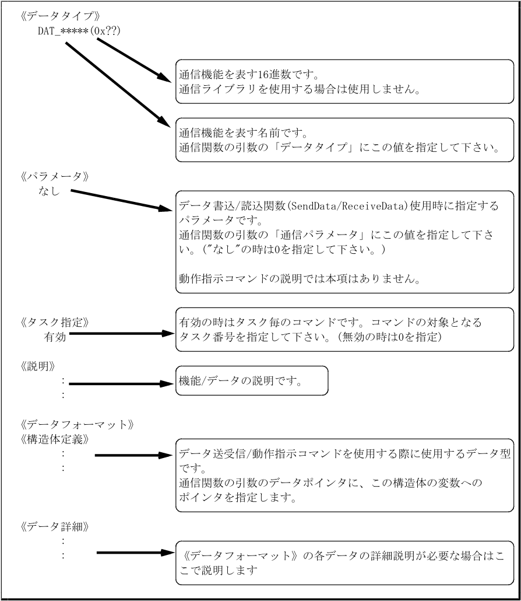

> **図の内容**
>
> 各コマンドの説明の読み方。
> - 《データタイプ》`DAT_*****(0x??)`
>   - `0x??`: 通信機能を表す16進数です。通信ライブラリを使用する場合は使用しません。
>   - `DAT_*****`: 通信機能を表す名前です。通信関数の引数の「データタイプ」にこの値を指定して下さい。
> - 《パラメータ》: データ書込/読込関数(SendData/ReceiveData)使用時に指定するパラメータです。通信関数の引数の「通信パラメータ」にこの値を指定して下さい。("なし"の時は0を指定して下さい。) 動作指示コマンドの説明では本項はありません。
> - 《タスク指定》: 有効の時はタスク毎のコマンドです。コマンドの対象となるタスク番号を指定して下さい。(無効の時は0を指定)
> - 《説明》: 機能/データの説明です。
> - 《データフォーマット》《構造体定義》: データ送受信/動作指示コマンドを使用する際に使用するデータ型です。通信関数の引数のデータポインタに、この構造体の変数へのポインタを指定します。
> - 《データ詳細》: 《データフォーマット》の各データの詳細説明が必要な場合はここで説明します

## 4.通信データ詳細説明

### 4-1.データ送受信機能詳細

データ送受信機能は、パソコンよりSLM8000に各種データの設定等を行う機能です。通信ライブラリのSendData()/ReceiveData()関数を使用して、SLM8000へ送信(書込)/受信(読出)を行うことが出来ます。

#### 4-1-1.サーボパラメータ書込/読出 [DAT_PARAMETER(0x00)]

- 《データタイプ》 DAT_PARAMETER(0x00)

**《パラメータ》**

なし

**《タスク指定》**

無効

- 《説明》 SLM8000にサーボパラメータを書込/読出を行います。

**《書き込み実行条件》**

- 全タスクセッティングモード
- 《読み込み実行条件》常時実行可能です。
- 《データフォーマット》

データサイズ:1280Byte

|   オフセット [Byte] | データ名称   |   データ長 [Byte] | データ範囲 [単位]   |
|----------------|-------------|---------------|--------------|
|              0 | 第1軸サーボパラメータ |           140 | -            |
|            140 | 第2軸サーボパラメータ |           140 | -            |
|            280 | 第3軸サーボパラメータ |           140 | -            |
|            420 | 第4軸サーボパラメータ |           140 | -            |
|            560 | 第5軸サーボパラメータ |           140 | -            |
|            700 | 第6軸サーボパラメータ |           140 | -            |
|            840 | 第7軸サーボパラメータ |           140 | -            |
|            980 | 第8軸サーボパラメータ |           140 | -            |
|           1120 | 予備          |           160 | -            |

各軸のサーボパラメータのフォーマットは以下の通りです。

| オフセット [Byte] | データ名称 | データ長 [Byte] | データ範囲 [単位] |
|---|---|---|---|
| 0+140*N | D/A出力（予備） | 4 | 0 |
| 4+140*N | INPOS量 | 4 | 0 ～ 1000000000 [pulse] |
| 8+140*N | 偏差上限値 | 4 | 1 ～ 1000000000 [pulse] |
| 12+140*N | ERサチレーション（予備） | 4 | 0 |
| 16+140*N | MPOS偏差上限値（予備） | 4 | 0 |
| 20+140*N | 補間時定数 | 4 | 指数: 0 ～ 1000 [msec]、直線: -1 ～ -2000×RTC周期 [msec] |
| 24+140*N | S字加減速時定数 | 4 | 0 ～ 1000×RTC周期 [msec] |
| 28+140*N | PTP時定数 | 4 | 0 ～ 32767 [msec] |
| 32+140*N | PTP速度 | 4 | 1000÷RTC周期 ～ 1000000000 [pulse/sec] |
| 36+140*N | JOG送り速度 | 4 | 1000÷RTC周期 ～ 1000000000 [pulse/sec] |
| 40+140*N | +側ソフトリミット | 4 | 1 ～ 1000000000 [pulse] |
| 44+140*N | -側ソフトリミット | 4 | 1 ～ 1000000000 [pulse] |
| 48+140*N | 原点復帰有効 | 4 | 0:無効, 1:有効 |
| 52+140*N | 原点距離 | 4 | -1000000000 ～ 1000000000 [pulse] |
| 56+140*N | 原点復帰逃げ量 | 4 | 無効: 0、有効: 1000 ～ 1000000000 [pulse] |
| 60+140*N | 原点復帰早送り速度 | 4 | 1000÷RTC周期 ～ 1000000000 [pulse/sec] |
| 64+140*N | 原点復帰アプローチ速度 | 4 | 1000÷RTC周期 ～ 1000000000 [pulse/sec] |
| 68+140*N | 原点復帰最終サーチ速度 | 4 | 1000÷RTC周期 ～ 1000000000 [pulse/sec] |
| 72+140*N | 原点復帰順位 | 4 | 0 ～ 軸数-1 |
| 76+140*N | ホームポジション位置 | 4 | -1000000000 ～ 1000000000 [pulse] |
| 80+140*N | ホームポジション順位 | 4 | 0 ～ 軸数-1 |
| 84+140*N | バックラッシュ補正量 | 4 | 0 ～ 30000 [pulse] |
| 88+140*N | 形状補正係数 | 4 | 0 ～ 30000 [pulse] |
| 92+140*N | 原点復帰時論理座標 | 4 | -1000000000 ～ 1000000000 [pulse] |
| 96+140*N | ジョイスティック/ハンドル最大送り速度 | 4 | 0 ～ 4000000 [pulse/sec] |
| 100+140*N | ジョイスティック/ハンドル加減速時定数 | 4 | 0 ～ 1000 [msec] |
| 104+140*N | 接線制御軸上限速度 | 4 | 1000÷RTC周期 ～ 1000000000 [pulse/sec] |
| 108+140*N | 接線制御軸基準位置オフセット | 4 | 0 ～ メカ機構1回転パルス数 [pulse] |
| 112+140*N | 予備 | 28 | － |

※1 Nは(軸番号-1)です。(第1軸:N=0 ～第8軸:N=7)

**《構造体定義》**

```c
/************************************************************************/
/* パラメータデータ構造体（1280Byte固定長） */
/************************************************************************/
typedef struct {                  /* 各軸独立パラメータ構造体（140Byte固定長） */
    long Gain;                    /* DA出力ゲイン (予備) */
    long InPos;                   /* INPOS量 [pls] */
    long ErMax;                   /* 偏差上限値 [pls] */
    long ErSat;                   /* ERサチレーション (予備) */
    long MPosErMax;               /* MPOS偏差上限値 [pls] (予備) */
    long Ka;                      /* 補間時定数 [msec] */
    long SKa;                     /* S字補間時定数 [msec] */
    long Dx;                      /* PTP時定数 [msec] */
    long PtpFeed;                 /* PTP速度 [pls/sec] */
    long JogFeed;                 /* JOG送り速度 [pls/sec] */
    long SoftLimP;                /* ソフトリミット+側 [pls] */
    long SoftLimM;                /* ソフトリミット-側 [pls] */
    long OrgEn;                   /* 原点復帰有効 */
    long OrgOfs;                  /* 原点距離 [pls] */
    long OrgPos;                  /* 原点復帰逃げ位置 [pls] */
    long OrgFeed;                 /* 原点復帰早送り速度 [pls/sec] */
    long AprFeed;                 /* 原点復帰アプローチ速度 [pls/sec] */
    long SrchFeed;                /* 原点復帰最終サーチ速度 [pls/sec] */
    long OrgPri;                  /* 原点復帰順位 */
    long Homepos;                 /* ホームポジション位置 [pls] */
    long Homepri;                 /* ホームポジション順位 */
    long BackL;                   /* バックラッシュ補正量 [pls] */
    long Revise;                  /* 形状補正係数 */
    long OrgCsetOfs;              /* 原点復帰時論理座標 */
    long HandleMax;               /* ジョイスティック/ハンドル最大送り速度*/
    long HandleKa;                /* ジョイスティック/ハンドル加減速時定数*/
    long TangFeedMax;             /* 接線制御軸上限速度 */
    long TangPosOfs;              /* 接線制御軸基準位置オフセット */
    unsigned char Reserved[28];   /* 未使用 */
} AXIS_PARAMETER;
typedef struct {                  /* 特殊パラメータ共用体（160Byte） */
    unsigned char Reserved[160];  /* 特殊パラメータ未定義 */
} ADD_PARAMETER;
typedef struct {                  /* （1280Byte） */
    AXIS_PARAMETER AxisParam[8];  /* 各軸パラメータ */
    ADD_PARAMETER adp;            /* 特殊パラメータ */
} PARAMETER_DATA;
```

- 同期軸制御オプションありの場合、同期軸のパラメータ設定については、「②同期軸パラメータ」を参照して下さい。

① 位置制御軸パラメータ

- (1) D/A出力ゲイン

※ 将来用です。現在使用していません。

- (2) INPOS量

インポジションの範囲を、パルス単位の絶対値量で指定します。

- (3) 偏差上限値

偏差の絶対量の上限値を指定します。

エラーパルスレジスタ(ER)が本設定値を越えた場合、偏差過大アラームになります。

- (4) ERサチレーション

※ 将来用です。現在使用していません。

- (5) MPOS偏差上限値

※ 将来用です。現在使用していません。

- (6) 補間時定数

補間移動時の指数型加減速の時定数を指定します。

直線加減速オプション有りの時、マイナスの値を入れることで、直線加減速時定数を指定します。

- (7) S字加減速時定数 <オプション>

S字加減速の時定数を設定します。

S字加減速の詳細については

「SLM8000 ユーザーズマニュアル」<Ⅲ機能編 4-3.補間加減速>(TB00-1130E) を参照下さい。

(8) PTP時定数

PTP移動時、及びJOG移動時の直線加減速の時定数を指定します。

移動速度 100Kpps に達するまでの時間、又は後述のPTP速度(PARAMETER_DATA.AxisParam[n].PtpFeed)でに達するまでの時間で設定します。(※ 単位の"pps"は"パルス/秒"です)

100Kpps に達するまでの時間かPTP速度に達するまでの時間のどちらの意味なのかは、ROMSWで設定します。（ROMSW設定ソフトの基本画面の「PTP時定数PTP速度基準」にて設定して下さい。）

- (9) PTP速度

PTP移動時の速度を指定します。

- (10) JOG速度

JOG移動時の速度を指定します。

- (11) ±ソフトリミット

ソフトウェアストロークリミットを、各方向(+/-)別に指定します。

ポジション値が本設定値を越えた場合、ソフトリミットアラームになります。

- (12) 原点復帰有効

原点復帰動作の有無を指定します。

- (13) 原点距離

C(Z)相パルス発生位置から機械固有原点までのオフセット量を指定します。

- (14) 原点復帰逃げ量

全軸原点復帰時の、機械原点位置からの逃げ量を指定します。

- (15) 原点復帰早送り速度

原点復帰処理にて、原点LSまでの速度を指定します。

- (16) 原点復帰アプローチ速度

原点復帰処理にて、原点LSを通過して、原点へアプローチを行う際の速度を指定します。

- (17) 原点復帰最終サーチ速度

原点復帰処理にて、原点LSを確認を終え、原点信号を探す際の速度を指定します。

- (18) 原点復帰順位

原点復帰入力にて、全軸原点復帰を行う際の原点復帰順位を指定します。

- (19) ホームポジション位置

ホームポジションを指定します。(機械座標系の位置で指定して下さい。)

- (20) ホームポジション順位

ホームポジション位置決めする順番を0からの連番で設定します。

- (21) バックラッシュ補正量

モータ回転方向変化時の、バックラッシュの補正量を指定します。

- (22) 形状補正係数 <オプション>

形状補正(サーボアンプの遅れの補正)のゲインを設定します。

詳細は

「SLM8000 ユーザーズマニュアル」<Ⅲ機能編 5-17-5.形状補正(高精度輪郭制御)>(TB00-1130D) を参照ください。

- (23) 原点復帰時論理座標

原点復帰完了時に設定する論理座標を指定します。

- (24) ジョイスティック/ハンドル最大送り速度<オプション> 手動パルス送り時の最大速度を指定します。
- (25) ジョイスティック/ハンドル加減速時定数<オプション> 手動パルス送り時の加速/減速の時定数を指定します。
- (26) 接線制御軸上限速度<オプション>

接線制御軸の接線速度上限速度を指定します。

- (27) 接線制御軸基準位置オフセット<オプション> 接線制御軸の接線制御基準位置を指定します。

設定値は、0～メカ機構1回転パルス数[パルス]です。

② 同期軸パラメータ <オプション>

パラメータの意味は、「①位置制御軸パラメータ」と同じです。

ただし、同期軸従軸は「INPOS量」「±ソフトリミット」「原点距離」「バックラッシュ補正量」のパラメータ設定だけ反映されて、それ以外のパラメータは基準軸のパラメータを使用します。

※ 使用されないパラメータに関しても範囲チェックを行いますので、基準軸と同じ値を設定するようにして下さい。

尚、「原点距離」は原点復帰完了時に基準軸と従軸が同じ場所に来るように調整して下さい。

#### 4-1-2.運転プログラム書込/読出 [DAT_PROGRAM(0x01)]

**《データタイプ》**

DAT_PROGRAM(0x01)

**《パラメータ》**

読み出し時はプログラム番号を指定します。

（プログラム番号：1～32767）

書き込み時はプログラム番号と書き込む先頭ブロック番号を指定します。

（先頭ブロック番号：0～63、プログラム番号：1～32767）

MSB

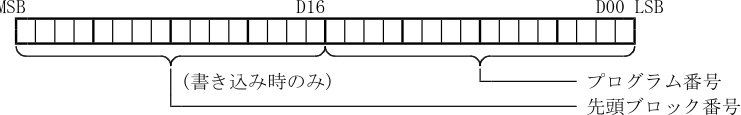

> **図の内容**
>
> パラメータ(32bit):
>
> | ビット | 内容 |
> |---|---|
> | D00～D15 | プログラム番号 |
> | D16～D31 | 先頭ブロック番号（書き込み時のみ） |

**《タスク指定》**

有効

**《説明》**

運転プログラムを、SLM8000のプログラムメモリに書き込み/読み出します。

書込/読出する運転プログラムは、テクノ独自フォーマットのバイナリデータです。

お客様が使用するテキストプログラム <-> バイナリデータ間の変換には、プログラム変換ライブラリを使用する必要があります。

- プログラム書き込み時
- [テキストプログラム] → プログラム変換ライブラリ → [バイナリデータ]
- → 通信ライブラリ(運転プログラム書込コマンド) → SLM8000
- プログラム読み出し時 SLM8000 → 通信ライブラリ(運転プログラム読出コマンド) → [バイナリデータ]
- → プログラム変換ライブラリ → [テキストプログラム]

尚、プログラム書き込み時は上記《パラメータ》にて先頭ブロック番号を指定する必要があります。先頭ブロック番号、プログラムメモリの容量や番号管理については、

「SLM8000 ユーザーズマニュアル」<Ⅲ機能編 6-1.運転プログラムの保存の仕組み>(TB00-1130F) をご参照下さい。

**《書き込み実行条件》**

- 指定したプログラム番号が未実行
- 《読み込み実行条件》

常時実行可能です。

- 《データフォーマット》

データサイズ:最大 196608 Byte

|   オフセット [Byte] | データ名称    | データ長 [Byte]   | データ範囲 [単位]   |
|----------------|--------------|---------------|--------------|
|              0 | バイナリデータバッファ | 最大 196608     | -            |

**《構造体定義》**

構造体定義はありません。

**《データ詳細》**

- (1) 運転プログラムバイナリデータバッファバイナリデータサイズはプログラムステップ数により変わりますが、最大容量分確保して下さい。

#### 4-1-3.ピッチエラー補正用パラメータ書込/読出 [DAT_PITCHERR(0x10)] <オプション>

**《データタイプ》**

DAT_PITCHERR(0x10)

**《パラメータ》**

なし

**《タスク指定》**

無効

**《説明》**

SLM8000にピッチエラー補正用データの書込/読出を行います。

ピッチエラー補正用パラメータ書込/読出コマンドの実行には、SLM8000にピッチエラー補正オプションが必要です。

**《書き込み実行条件》**

- 全タスクセッティングモード

**《読み込み実行条件》**

常時実行可能です。

**《データフォーマット》**

データサイズ: 4320 Byte

|   オフセット [Byte] | データ名称    |   データ長 [Byte] | データ範囲 [単位]   |
|----------------|--------------|---------------|--------------|
|              0 | 第 1軸補正用パラメータ |            20 | -            |
|             20 | 第 2軸補正用パラメータ |            20 | -            |
|             40 | 第 3軸補正用パラメータ |            20 | -            |
|             60 | 第 4軸補正用パラメータ |            20 | -            |
|             80 | 第 5軸補正用パラメータ |            20 | -            |
|            100 | 第 6軸補正用パラメータ |            20 | -            |
|            120 | 第 7軸補正用パラメータ |            20 | -            |
|            140 | 第 8軸補正用パラメータ |            20 | -            |
|            160 | 補正用データ       |          4160 | -            |

各軸補正用パラメータのフォーマットは以下の通りです。

※1 Nは(軸番号-1)です。第1軸:N=0 ～第8軸:N=7

| オフセット [Byte]   | データ名称   |   データ長 [Byte] | データ範囲 [単位]          |
|----------------|-------------|---------------|---------------------|
| 0+20*N         | 補正倍率        |             4 | 0～10                |
| 4+20*N         | 補正間隔        |             4 | 1000～1000000[pulse] |
| 8+20*N         | 補正データ先頭番号   |             4 | 0～999               |
| 12+20*N        | -側補正区間数     |             4 | 0～1000              |
| 16+20*N        | +側補正区間数     |             4 | 0～1000              |

補正用データのフォーマットは以下の通りです。

| オフセット [Byte]   | データ名称   | データ長 [Byte]   | データ範囲 [単位]   |
|----------------|-------------|---------------|--------------|
| 160            | 補正データ1      | 1             | -127～127     |
| 161            | 補正データ2      | 1             | -127～127     |
| ～              | ～           | ～             | ～            |
| 4318           | 補正データ4159   | 1             | -127～127     |
| 4319           | 補正データ4160   | 1             | -127～127     |

```c
/************************************************************************/
/* ピッチエラー補正用パラメータ情報構造体（4320Byte固定長） */
/************************************************************************/
typedef struct {               /* 各軸補正用パラメータ（20Byte） */
    unsigned long RevMagnify;  /* 補正倍率 */
    unsigned long RevSpace;    /* 補正間隔 */
    unsigned long RevTopNo;    /* 補正データ先頭番号 */
    unsigned long RevMCnt;     /* -側補正区間数 */
    unsigned long RevPCnt;     /* +側補正区間数 */
} REV_AX;
typedef struct {               /* ピッチエラー補正用パラメータ */
    REV_AX RevAx[8];           /* 各軸補正用パラメータ */
    char RevDt[4160];          /* 補正データ */
} PITCH_ERR_REV;
```

#### 4-1-4.工具長補正データ書込/読出 [DAT_TOOLHOFS(0x12)] <オプション>

**《データタイプ》**

DAT_TOOLHOFS(0x12)

**《パラメータ》**

0 ：《タスク指定》で指定された1タスク分のみ書込/読出

1 ：全タスク（8タスク）分書込/読出

**《タスク指定》**

1 タスク分書込/読出時：有効

全タスク分書込/読出時：無効

**《説明》**

SLM8000に工具長補正データの書込/読出を行います。

工具長補正データ書込/読出コマンドの実行には、SLM8000に工具長補正オプションが必要です。

**《書き込み実行条件》**

・セッティングモード（全タスク分書込時は全タスク）

**《読み込み実行条件》**

常時実行可能です。

**《データフォーマット》**

データサイズ:80Byte（1タスク分）

| オフセット [Byte]   | データ名称   | データ長 [Byte]   | データ範囲 [単位]                     |
|----------------|-------------|---------------|--------------------------------|
| 0              | 補正用データ0     | 4             | -1000000000～1000000000 [pulse] |
| 4              | 補正用データ1     | 4             | -1000000000～1000000000 [pulse] |
| ：              | ：           | ：             | ：                              |
| 72             | ：補正用データ18  | 4             | -1000000000～1000000000 [pulse] |
| 76             | 補正用データ19    | 4             | -1000000000～1000000000 [pulse] |

データサイズ:640Byte（全タスク分）

|   オフセット [Byte] | デー   | タ名称   |   データ長 [Byte] | データ範囲 [単位]   |
|----------------|-------|---------|---------------|--------------|
|              0 | タスク0用 | 補正データ   |            80 | －            |
|             80 | タスク1用 | 補正データ   |            80 | －            |
|            160 | タスク2用 | 補正データ   |            80 | －            |
|            240 | タスク3用 | 補正データ   |            80 | －            |
|            320 | タスク4用 | 補正データ   |            80 | －            |
|            400 | タスク5用 | 補正データ   |            80 | －            |
|            480 | タスク6用 | 補正データ   |            80 | －            |
|            560 | タスク7用 | 補正データ   |            80 | －            |

**《構造体定義》**

```c
/************************************************************************/
/* ツール長補正用パラメータ情報構造体 */
/************************************************************************/
typedef struct {  /* （80Byte） */
    long h[20];   /* ツール長補正データ */
} TOOL_H;
```

※ 全タスク分の時は、TOOL_H の要素数8の配列で定義して下さい。

#### 4-1-5.工具径補正データ書込/読出 [DAT_TOOLDIA(0x1A)] <オプション>

**《データタイプ》**

DAT_TOOLDIA(0x1A)

**《パラメータ》**

0 ：《タスク指定》で指定された1タスク分のみ書込/読出

1 ：全タスク（8タスク）分書込/読出

**《タスク指定》**

1タスク分書込/読出時：有効

全タスク分書込/読出時：無効

**《説明》**

SLM8000に工具径補正用データの書込/読出を行います。

工具径補正データ書込/読出コマンドの実行には、工具径補正オプションが必要です。

**《書き込み実行条件》**

・セッティングモード（全タスク分書込時は全タスク）

**《読み込み実行条件》**

常時実行可能です。

**《データフォーマット》**

データサイズ:80Byte

| オフセット [Byte]   | データ名   |   称データ長 [Byte] | データ範囲 [単位]             |
|----------------|-----------|-----------------|------------------------|
| 0              | 補正用データ0   |               4 | -1000000000～1000000000 |
| 4              | 補正用データ1   |               4 | -1000000000～1000000000 |
| ：：            | ：：       |                 |                        |
| 72             | 補正用データ18  |               4 | -1000000000～1000000000 |
| 76             | 補正用データ19  |               4 | -1000000000～1000000000 |

データサイズ:640Byte（全タスク分）

|   オフセット [Byte] | デー   | タ名称   |   データ長 [Byte] | データ範囲 [単位]   |
|----------------|-------|---------|---------------|--------------|
|              0 | タスク0用 | 補正データ   |            80 | －            |
|             80 | タスク1用 | 補正データ   |            80 | －            |
|            160 | タスク2用 | 補正データ   |            80 | －            |
|            240 | タスク3用 | 補正データ   |            80 | －            |
|            320 | タスク4用 | 補正データ   |            80 | －            |
|            400 | タスク5用 | 補正データ   |            80 | －            |
|            480 | タスク6用 | 補正データ   |            80 | －            |
|            560 | タスク7用 | 補正データ   |            80 | －            |

**《構造体定義》**

```c
/************************************************************************/
/* ツール径補正用パラメータ情報構造体 */
/************************************************************************/
typedef struct {
    long d[20];  /* ツール径補正データ */
} TOOL_D;
```

※ 全タスク分の時は、TOOL_D の要素数8の配列で定義して下さい。

#### 4-1-6.補間前加減速(自動ｺｰﾅｵｰﾊﾞｰﾗｲﾄﾞ)パラメータ書込/読出 [DAT_ACOPARAM(0x37)] <オプション>

**《データタイプ》**

DAT_ACOPARAM(0x37)

**《パラメータ》**

0 ：《タスク指定》で指定された1タスク分のみ書込/読出

1 ：全タスク（8タスク）分書込/読出

**《タスク指定》**

1タスク分書込/読出時：有効

全タスク分書込/読出時：無効

**《説明》**

補間前加減速のパラメータの書込/読出を行います。

**《読み込み実行条件》**

- 指定したタスクの軸が移動中でない

**《データフォーマット》**

データサイズ:48Byte(1タスク分)

|   オフセット [Byte] | データ名称                       |   データ長 [Byte] | データ範囲 [単位]                |
|----------------|-----------------------------|---------------|---------------------------|
|              0 | 補間前加減速(自動コーナオーバライド)時定数     |             4 | 0～16384 [msec]            |
|              4 | 補間前加減速(自動コーナオーバライド)切換加速度1  |             4 | 0～2000000000 [pulse/sec2] |
|                | ：                           |               |                           |
|             28 | 補間前加減速(自動コーナオーバライド)切換加速度7  |             4 | 0～2000000000 [pulse/sec2] |
|             32 | 補間前加減速(自動コーナオーバライド)オーバライド1 |             2 | 0～100 [%]                 |
|                | :                           |               |                           |
|             44 | 補間前加減速(自動コーナオーバライド)オーバライド7 |             2 | 0～100 [%]                 |
|             46 | 予約                          |             2 | -                         |

データサイズ:384Byte（全タスク分）

|   オフセット [Byte] | デー   | タ名称       |   データ長 [Byte] | データ範囲 [単位]   |
|----------------|-------|-------------|---------------|--------------|
|              0 | タスク0用 | 補間前加減速パラメータ |            48 | －            |
|             48 | タスク1用 | 補間前加減速パラメータ |            48 | －            |
|             96 | タスク2用 | 補間前加減速パラメータ |            48 | －            |
|            144 | タスク3用 | 補間前加減速パラメータ |            48 | －            |
|            192 | タスク4用 | 補間前加減速パラメータ |            48 | －            |
|            240 | タスク5用 | 補間前加減速パラメータ |            48 | －            |
|            288 | タスク6用 | 補間前加減速パラメータ |            48 | －            |
|            336 | タスク7用 | 補間前加減速パラメータ |            48 | －            |

**《構造体定義》**

```c
/************************************************************************/
/* 補間前加減速用パラメータ情報構造体 */
/************************************************************************/
typedef struct {              /* （48Byte） */
    long aco_acot;            /* 補間前加減速時定数 [msec] */
    long aco_accdat[7];       /* 補間前加減速切換加速度 [pls/sec2] */
    short aco_ovrdat[7];      /* 補間前加減速オーバライドデータ [%] */
    unsigned short Reserved;  /* 未使用 */
} ACO_PRM;
```

- ※ 全タスク分の時は、ACO_PRM の要素数8の配列で定義して下さい。

**《データ詳細》**

- (1) 補間前加減速(自動コーナオーバライド)時定数現状の速度から仮に速度0まで減速する時間[msec]を設定します。（速度0から指定の速度まで加速するまでの時間と同じです）
- (2) 補間前加減速(自動コーナオーバライド)切換加速度、補間前加減速オーバライド以下の各加減速範囲における最小オーバライドを設定します。

```c
    補間前加減速の切換加速度1～補間前加減速の切換加速度2 => 補間前加減速のオーバライド2
    補間前加減速の切換加速度2～補間前加減速の切換加速度3 => 補間前加減速のオーバライド3
    補間前加減速の切換加速度3～補間前加減速の切換加速度4 => 補間前加減速のオーバライド4
    補間前加減速の切換加速度4～補間前加減速の切換加速度2 => 補間前加減速のオーバライド5
    補間前加減速の切換加速度5～補間前加減速の切換加速度2 => 補間前加減速のオーバライド6
    補間前加減速の切換加速度6～補間前加減速の切換加速度7 => 補間前加減速のオーバライド7
    ※補間前加減速のオーバライド1は使用しません。100を設定して下さい。
```

#### 4-1-7.ステータスデータ読出 [DAT_STATUS(0x02)]

**《データタイプ》**

DAT_STATUS(0x02)

**《パラメータ》**

なし

**《説明》**

SLM8000の動作状態(アラーム状態を含む)や各軸の現在値などのデータを読出します。

有効軸以外の各軸のデータや、有効タスク以外のタスクのデータは、無効データです。

- 《読み込み実行条件》

常時実行可能です。

**《データフォーマット》**

データサイズ:656Byte

|   オフセット [Byte] | データ名称   |   データ長 [Byte] | データ範囲 [単位]   |
|----------------|-------------|---------------|--------------|
|              0 | 全体情報        |            16 | -            |
|             16 | 第 1物理軸情報    |            48 | -            |
|             64 | 第 2物理軸情報    |            48 | -            |
|            112 | 第 3物理軸情報    |            48 | -            |
|            160 | 第 4物理軸情報    |            48 | -            |
|            208 | 第 5物理軸情報    |            48 | -            |
|            256 | 第 6物理軸情報    |            48 | -            |
|            304 | 第 7物理軸情報    |            48 | -            |
|            352 | 第 8物理軸情報    |            48 | -            |
|            400 | タスク0情報      |            32 | -            |
|            432 | タスク1情報      |            32 | -            |
|            464 | タスク2情報      |            32 | -            |
|            496 | タスク3情報      |            32 | -            |
|            528 | タスク4情報      |            32 | -            |
|            560 | タスク5情報      |            32 | -            |
|            592 | タスク6情報      |            32 | -            |
|            624 | タスク7情報      |            32 | -            |

全体情報のフォーマットは以下の通りです。

|   オフセット [Byte] | データ名称   |   データ長 [Byte] | データ範囲 [単位]   |
|----------------|-------------|---------------|--------------|
|              0 | 全体ステータス     |             4 | -            |
|              4 | 全体アラーム      |             4 | -            |
|              8 | 予約          |             8 | -            |

物理第(N+1)軸情報のフォーマットは以下の通りです。

| オフセット [Byte]   | データ名称   | データ長 [Byte]   | データ範囲 [単位]                    |
|----------------|-------------|---------------|-------------------------------|
| 0+48*N+16      | 軸ステータス      | 4             | -                             |
| 4+48*N+16      | 軸アラーム       | 4             | -                             |
| 8+48*N+16      | 指令位置        | 4             | -1000000000～1000000000[pulse] |
| 12+48*N+16     | 機械位置        | 4             | -1000000000～1000000000[pulse] |
| 16+48*N+16     | 偏差量         | 4             | -1000000000～1000000000[pulse] |
| 20+48*N+16     | 最新ブロック払出量   | ※1 4          | -1000000000～1000000000[pulse] |
| 24+48*N+16     | 絶対位置        | ※2 4          | -1000000000～1000000000[pulse] |
| 28+48*N+16     | 予約          | 20            | -                             |

Nは軸番号-1です。(第1軸:0 ～第8軸:7)

- ※1 原点復帰完了時には、「原点ドグ」と「C(Z)相位置」との距離(パルス)が返ります。
- ※2 ROMSW設定によりモータへの指令座標を格納するのか、モータからのFB座標を格納するのか選択します。

タスクN情報のフォーマットは以下の通りです。

| オフセット [Byte]   | データ名称     |   データ長 [Byte] | データ範囲 [単位]   |
|----------------|---------------|---------------|--------------|
| 0+32*N+400     | タスクステータス      |             4 | -            |
| 4+32*N+400     | タスクアラーム       |             4 | -            |
| 8+32*N+400     | 送りオーバーライド     |             2 | 0～200[%]     |
| 10+32*N+400    | 補間オーバーライド     |             2 | 0～200[%]     |
| 12+32*N+400    | 主軸オーバーライド     |             2 | 0～200[%]     |
| 14+32*N+400    | 実行プログラム番号     |             2 | 1～32767[-]   |
| 16+32*N+400    | 実行プログラムステップ番号 |             4 | 1～3300[-]    |
| 20+32*N+400    | 予約            |            12 | -            |

Nはタスク番号です。(タスク0 ～タスク7)

```c
/************************************************************************/
/* アンサーステータス情報構造体（656Byte） */
/************************************************************************/
typedef struct {           /* 全体情報構造体 16Byte */
    long Status;           /* 全体ステータス */
    long Alarm;            /* 全体アラーム */
    char Reserved[8];      /* 予約 */
} MCSTATUS;
typedef struct {           /* 各軸情報構造体 48Byte */
    long AxStatus;         /* 軸ステータス */
    long AxAlarm;          /* 軸アラーム */
    long ComReg;           /* 指令位置 */
    long PosReg;           /* 機械位置 */
    long ErrReg;           /* 偏差量 */
    long BlockSeg;         /* 最新ブロック払い出し量 */
    long AbsReg;           /* 絶対位置 */
    char Reserved[20];     /* 予約 */
} AXSTATUS;
typedef struct {           /* タスク情報構造体 32Byte */
    long TaskStatus;       /* タスクステータス */
    long TaskAlarm;        /* タスクアラーム */
    short Override;        /* 送りオーバーライド設定 */
    short COverride;       /* 補間オーバーライド設定 */
    short SOverride;       /* 主軸オーバーライド設定 */
    short ProgramNo;       /* 選択・実行プログラム番号 */
    unsigned long StepNo;  /* 実行ステップ番号 */
    char Reserved[12];     /* 予約 */
} TASKSTATUS;
typedef struct {           /* アンサーステータス情報構造体 */
    MCSTATUS mc;           /* 全体情報 */
    AXSTATUS ax[8];        /* 各軸情報 */
    TASKSTATUS task[8];    /* タスク情報 */
} STATUS;
```

**《データ詳細》**

- (1) 全体情報 ① 全体ステータス

MSB

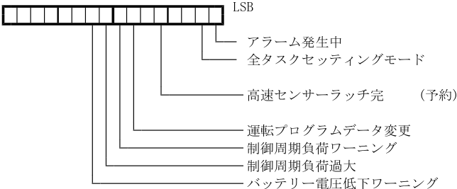

> **図の内容**
>
> | ビット | 内容 |
> |---|---|
> | D0 | アラーム発生中 |
> | D1 | 全タスクセッティングモード |
> | D4 | 高速センサーラッチ完（予約） |
> | D6 | 運転プログラムデータ変更 |
> | D7 | 制御周期負荷ワーニング |
> | D8 | 制御周期負荷過大 |
> | D9 | バッテリー電圧低下ワーニング |
>
> 上記以外のビットは未使用。

**《全体ステータス詳細》**

- アラーム発生中全タスク＆全軸のアラームのOR情報です。（何らかのアラームが1つでも発生しているとONします。）
- 全タスクセッティングモード全タスクがセッティングモードになっているとONします。
- 高速センサーラッチ完 (予約) 旧システムで使用していた情報です。本システムでは対応していません。

本システムでは後述のタスクステータスの高速センサーラッチ完(D24)を使用して下さい。

- 運転プログラムデータ変更

運転プログラムが更新（ダウンロード/移動/削除/ティーチング）されるとON→OFFします。（更新された直後のステータスデータ読出実行時のみONします。一度ステータスデータ読出を行うと、自動的にOFFします。）

**○ 制御周期負荷ワーニング**

制御周期の処理時間がROMSW設定（基本画面の「サーボ制御周期ワーニングレベル(%)」で設定）で設定された時間を超えるとONします。

後述の「制御周期負荷過大」とは異なり、制御周期を超えた訳ではないので、正常に動作しています。

ただし、制御周期の処理時間(負荷)は処理内容やタイミングにより増減しますので、余裕が少ないと制御周期に間に合わなくなってしまう可能性があります。

本ワーニングが発生したら制御周期を見直す（大きくする）事をお勧め致します。

- 制御周期負荷過大

制御周期の処理時間が制御周期を超えるとONします。

本ビットがONしたら制御周期を見直し（大きくする）して下さい。

- バッテリー電圧低下ワーニング
- バッテリーが消耗し、電圧が低下しています。ワーニングの時点では、SRAM(バッテリーバックアップ)の情報は保持されています。完全にバッテリーが消耗し、SRAMの情報が破損すると、同時にバックアップエラーが発生します。バックアップエラーが発生する前にバッテリーを交換してください。

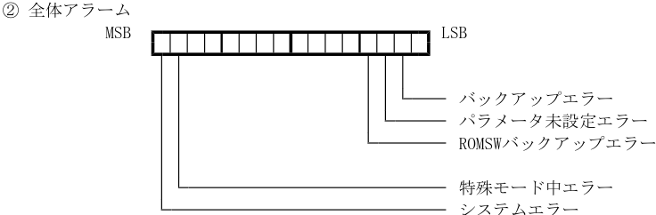

> **図の内容**
>
> | ビット | 内容 |
> |---|---|
> | D1 | バックアップエラー |
> | D2 | パラメータ未設定エラー |
> | D3 | ROMSWバックアップエラー |
> | D14 | 特殊モード中エラー |
> | D15 | システムエラー |
>
> 上記以外のビットは未使用。

**《全体アラーム詳細》**

- バックアップエラーバックアップデータ（ROMSW設定以外の各種パラメータ/運転プログラム/各軸の原点の絶対値エンコーダ座標）が消えてしまった場合に発生するエラーです。
- パラメータ未設定エラーパラメータ初期化を行うと発生します。（SLM8000ご購入時も発生しています。）
- ROMSWバックアップエラー

ROMSW設定が消えてしまった場合に発生します。

- 特殊モード中エラー

IPアドレスを初期化するため、DIPスイッチを変更している時に発生します。 IPアドレスを復旧後、DIPスイッチを元に戻してください。

- システムエラー通常は発生しないエラーです。このエラーが発生した時はテクノまでご連絡下さい。

(2) 各軸情報

① 軸ステータス

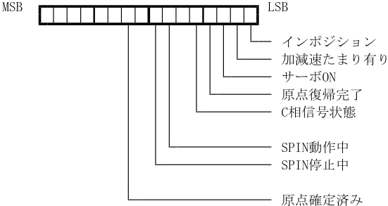

> **図の内容**
>
> | ビット | 内容 |
> |---|---|
> | D0 | インポジション |
> | D1 | 加減速たまり有り |
> | D2 | サーボON |
> | D3 | 原点復帰完了 |
> | D4 | C相信号状態 |
> | D6 | SPIN動作中 |
> | D7 | SPIN停止中 |
> | D9 | 原点確定済み |
>
> 上記以外のビットは未使用。

**《軸ステータス詳細》**

- インポジション

軌跡発生完了/停止かつ偏差（指令位置－機械位置）がサーボパラメータの「INPOS量」以下になった場合にONします。

詳細は後述の＜FG(軌跡関数発生)ステータスタイミングチャート＞を参照下さい。

※ INPOS量が0の場合はインポジションチェック無効を表し、軌跡発生完了/停止と同時にON します。

- 加減速たまり有り補間加減速の加減速たまり（残移動量）があるとONします。

詳細は後述の＜FG(軌跡関数発生)ステータスタイミングチャート＞を参照下さい。

- サーボON サーボON状態でONします。

- 原点復帰完了

サーボON後、原点復帰が完了するとONします。

サーボOFF 又は原点復帰開始時にOFFします。

(原点復帰無効時は常時ONしています。)

- ※ 原点復帰が完了したかどうかの履歴です。原点位置である事を示す訳ではありません。

ONした後は、どこへ移動してもONしたままです。

- C相信号状態過去1制御周期以内にC相信号がONしている場合にONします。
- SPIN動作中

SPIN移動中（回転速度指令中）にONします。

- SPIN動作中 SPIN停止中（回転速度指令停止中）にONします。（移動完了/中断時はONしません。）
- 原点確定済み

起動後、一度でも原点復帰が完了するとONします。

(原点復帰無効時は常時ONしています。)

- ※ 原点復帰が完了したかどうかの履歴です。原点位置である事を示す訳ではありません。

ONした後は、どこへ移動してもONしたままです。

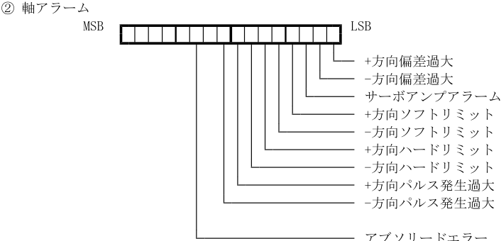

> **図の内容**
>
> | ビット | 内容 |
> |---|---|
> | D0 | +方向偏差過大 |
> | D1 | -方向偏差過大 |
> | D2 | サーボアンプアラーム |
> | D3 | +方向ソフトリミット |
> | D4 | -方向ソフトリミット |
> | D5 | +方向ハードリミット |
> | D6 | -方向ハードリミット |
> | D7 | +方向パルス発生過大 |
> | D8 | -方向パルス発生過大 |
> | D10 | アブソリュードエラー（原文の表記のまま） |
>
> 上記以外のビットは未使用。

**《軸アラーム詳細》**

- +方向偏差過大/-方向偏差過大偏差（指令位置－機械位置）がサーボパラメータの「偏差上限値」を超えると発生します。
- サーボアンプアラームサーボアンプのアラーム入力がONすると発生します。アラームの内容/原因/対策はサーボアンプのマニュアルをご参照下さい。
- +方向ソフトリミット/-方向ソフトリミット

機械座標系の指令位置がサーボパラメータの「ソフトリミット」を超えると発生します。

ただし、以下の何れかの条件に当てはまる場合はチェックしません。（OR条件）

- ソフトリミットチェック無効（ROMSW設定の軸設定画面の「ソフトリミット」設定）
- 主軸
- 原点復帰中のタスクに割り当てられている軸
- 原点復帰有効軸で原点未確定（前述の軸ステータスの原点確定済みフラグOFF）
- +方向ハードリミット/-方向ハードリミット

SLM8000のハードリミット(OTP/OTM：オーバートラベル)入力がONすると発生します。

アブソリードエラー

- +方向パルス発生過大/-方向パルス発生過大

指令速度が速すぎて、パルスジェネレータクロックのクロック数を超えると発生します。

- アブソリードエラー

起動時に絶対値エンコーダを読出す処理でエラーが発生した時に発生します。

③ 物理第1軸～第8軸指令位置

論理座標系(※)における、SLM8000から出力した指令位置です。

④ 物理第1軸～第8軸機械位置

論理座標系(※)における、エンコーダFBを積算した位置情報です。

- (※) 論理座標系は、原点設定コマンドにより、原点セットされます。
- ⑤ 物理第1軸～第8軸偏差量

指令位置と機械位置の差分です。

- ⑥ 物理第1軸～第8軸最新ステップ払出量

最新の移動指令で出力した移動量です。

※ 原点復帰完了時には、「原点ドグ」と「C(Z)相位置」との距離(パルス)が返ります。

原点ドグ位置の調整に使用します。

試運転・調整マニュアルを参照して下さい。

⑦ 物理第1軸～第8軸絶対位置

機械座標系(機械原点を0点とした座標系)における、「指令した位置」又は「エンコーダFB位置」です。

指令した位置かエンコーダFB位置なのかは、ROMSW設定（基本画面の「アブソ位置ステータス指令基準」設定）により選択します。

(3) タスク情報

① タスクステータス

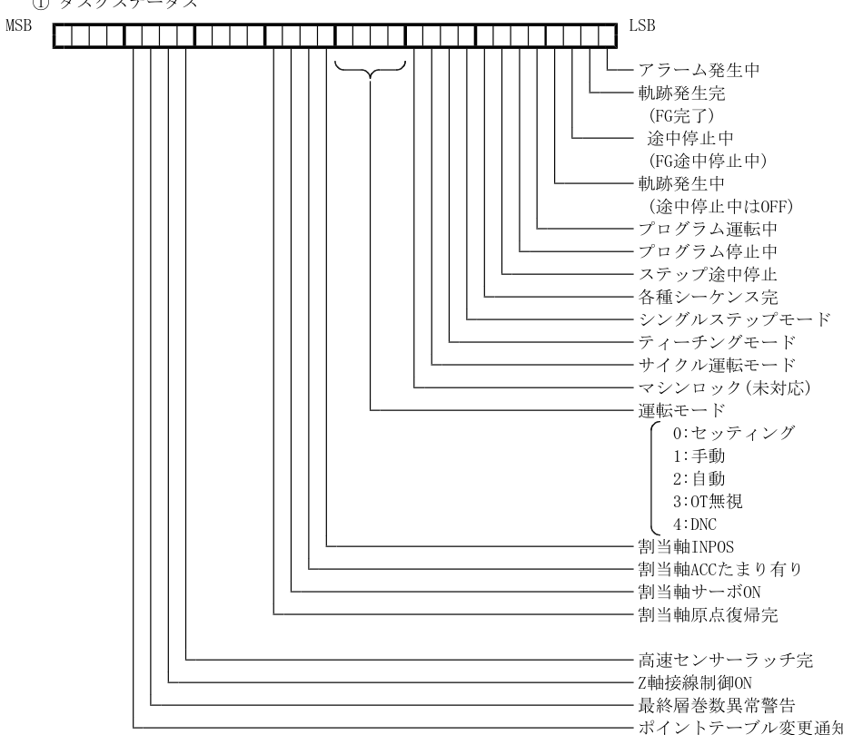

> **図の内容**
>
> 32 ビット。
>
> | ビット | 内容 |
> |---|---|
> | D0 | アラーム発生中 |
> | D1 | 軌跡発生完（FG完了） |
> | D2 | 途中停止中（FG途中停止中） |
> | D3 | 軌跡発生中（途中停止中はOFF） |
> | D4 | プログラム運転中 |
> | D5 | プログラム停止中 |
> | D6 | ステップ途中停止 |
> | D7 | 各種シーケンス完 |
> | D8 | シングルステップモード |
> | D9 | ティーチングモード |
> | D10 | サイクル運転モード |
> | D11 | マシンロック（未対応） |
> | D12～D15 | 運転モード（0:セッティング、1:手動、2:自動、3:OT無視、4:DNC） |
> | D16 | 割当軸INPOS |
> | D17 | 割当軸ACCたまり有り |
> | D18 | 割当軸サーボON |
> | D19 | 割当軸原点復帰完 |
> | D24 | 高速センサーラッチ完 |
> | D25 | Z軸接線制御ON |
> | D26 | 最終層巻数異常警告 |
> | D27 | ポイントテーブル変更通知 |
>
> 上記以外のビットは未使用。

**《タスクステータス詳細》**

**○ アラーム発生中**

- タスク内でアラームが発生しているとONします。（タスクに割り当てられている軸がエラーになっている場合も含みます。）

**○ 軌跡発生完（FG完了）**

PTP/LIN/CIR等の軌跡発生処理を行っていない（完了している）時にONします。

※ 途中停止中はOFFのままです。

又、軌跡発生完了後の補間加減速による減速中はONします。

詳細は後述の＜FG(軌跡関数発生)ステータスタイミングチャート＞を参照下さい。

**○ 途中停止中（FG途中停止中）**

PTP/LIN/CIR等の軌跡発生処理を一時停止している時にONします。

※ 一時停止要求による停止中の時のみONします。

目標位置到達による移動終了/リセットやエラー発生による移動中断ではONしません。詳細は後述の＜FG(軌跡関数発生)ステータスタイミングチャート＞を参照下さい。

**○ 軌跡発生中（FG移動中）**

PTP/LIN/CIR等の軌跡発生処理中にONします。

※ 途中停止中はOFFします。

詳細は後述の＜FG(軌跡関数発生)ステータスタイミングチャート＞を参照下さい。

- プログラム運転中運転プログラム実行中にONします。
- プログラム停止中

運転プログラム一時停止中にONします。

- ※ 一時停止要求や汎用入力待ち/停止命令（WRxx/WNRxx/SRxx/SNRxx）による停止中の時のみ ONします。

運転プログラムを最後まで実行した事による終了/リセットやエラー発生による中断では ONしません。

- ※ ＰＣソフトからの一時停止要求がなくても、動作プログラムの汎用入力待ち/停止命令（WRxx/WNRxx/SRxx/SNRxx）による入力待ちでも本フラグがONしますのでご注意下さい。
- ステップ途中停止

運転プログラム一時停止中で、かつプログラムのステップの途中（移動途中等）で停止している時にONします。

- ※ 動作プログラムの汎用入力待ち/停止命令（WRxx/WNRxx/SRxx/SNRxx）による入力待ちでも本フラグがONします

**○ 各種シーケンス完**

原点復帰等の各種シーケンス処理が実行されていないときにONします。

以下の条件が成立しているときにONします。(AND条件)

- FG完
- Mコード出力シーケンス未実行
- 原点復帰未実行
- ホーム位置決め未実行
- シングルステップモードシングルステップモード中にONします。
- ティーチングモードティーチングモード中にONします。
- サイクル運転モード

サイクル運転モード中にONします。

- マシンロック（未対応）

予約です。本システムではONしません。

- モード情報

SLM8000の動作モードを4bitバイナリデータで示します。

|   D15 |   D14 |   D13 |   D12 |   値 | 動作モード     |
|-------|-------|-------|-------|-----|-----------|
|     0 |     0 |     0 |     0 |   0 | セッティングモード |
|     0 |     0 |     0 |     1 |   1 | 手動モード     |
|     0 |     0 |     1 |     0 |   2 | 自動モード     |
|     0 |     0 |     1 |     1 |   3 | OT無視モード   |
|     0 |     1 |     0 |     0 |   4 | DNCモード    |

- 割り当て軸インポジション

タスクに割り当てられている全ての軸がインポジション状態の時にONします。(AND条件)

- 割り当て軸加減速たまり有り

タスクに割り当てられている軸の内、1軸でも加減速たまり状態の時にONします。(OR条件)

- 割り当て軸サーボON

タスクに割り当てられている全ての軸がサーボON状態の時にONします。(AND条件)

- 割り当て軸原点復帰完了

タスクに割り当てられている全ての軸が原点復帰完了状態の時にONします。(AND条件)

- 高速センサーラッチ完 <オプション> 高速センサーラッチ(SLIN)移動で、センサーラッチが完了したらONします。本フラグは次の高速センサーラッチ(SLIN)移動を開始するときにOFFします。 ※ センサーラッチ入力がONせずに移動が完了した場合はOFFのままです。
- Ｚ軸接線制御ON <オプション>

Ｚ軸接線制御モードのときにONします。

- 最終層巻数異常警告(巻線) <オプション> 巻線命令にて、巻き終わり時のピッチ調整でトラバース軸の移動量が多すぎて動けなかった時に ONします。

本フラグは運転プログラム開始/巻線命令開始/リセット時にOFFします。

- ポイントテーブル変更ポイントテーブルが更新（ダウンロード/初期化）されるとON→OFFします。（更新された直後のSTATUSデータ読み出しのみONします。一度STATUSデータ読み出しを行うと、自動的にOFFします。）
- ＜FG(軌跡関数発生)ステータスタイミングチャート＞

*：サーボパラメータのINPOS量に応じてONするタイミングが変わります。

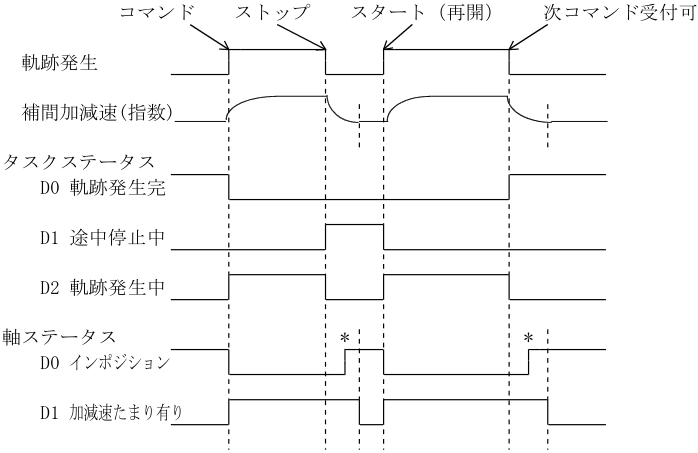

> **図の内容**
>
> イベント: 「コマンド」→「ストップ」→「スタート（再開）」→「次コマンド受付可」。
> - 軌跡発生: コマンドで ON、ストップで OFF、スタート（再開）で ON、次コマンド受付可で OFF
> - 補間加減速(指数): 軌跡発生に合わせて指数関数的に上がり下がりする
> - タスクステータス「D0 軌跡発生完」: コマンドで OFF、次コマンド受付可で ON
> - タスクステータス「D1 途中停止中」: ストップからスタート（再開）までの間 ON
> - タスクステータス「D2 軌跡発生中」: 軌跡発生と同じ（ストップの間は OFF）
> - 軸ステータス「D0 インポジション」: 軌跡発生中は OFF。ストップのあと（* の時点）と、次コマンド受付可のあと（* の時点）に ON
> - 軸ステータス「D1 加減速たまり有り」: 軌跡発生中は ON。ストップの少しあとと、次コマンド受付可の少しあとに OFF
> - 注記の「*」は本文の「*：サーボパラメータのINPOS量に応じ…」を指す
>
> この図のタスクステータスのビット番号（D0 軌跡発生完、D1 途中停止中、D2 軌跡発生中）は、ビット割り当ての図（D1 軌跡発生完、D2 途中停止中、D3 軌跡発生中）と 1 つずれている。原文のまま写した。

※ SPIN回転/主軸回転による移動は軌跡発生処理による移動には含まれません。これらの移動を行っていても、軌跡発生関連のフラグ（軌跡発生完/途中停止中/軌跡発生中）には反映されません。

- ※ 加減速たまりはLIN/CIR移動等の補間移動の時の補間加減速によるたまり(遅れ)がある時にON します。

PTP/JOG/原点復帰移動等、位置決め移動ではONしません。

尚、これらの位置決め移動では独自の加減速を行っています。上記タイミングチャートとは異なり減速完了まで軌跡発生完了になりません。

＜移動完了の確認条件＞

移動完了を確認する場合は、以下の条件を全て満たしているか確認してください。

必須条件

| 状態        | 条件             |
|------------|-----------------|
| 運転プログラム未実行 | タスクステータスのD4がOFF |
| 軌跡発生完了     | タスクステータスのD1がON  |
| 各種シーケンス完了  | タスクステータスのD7がON  |

目的に応じてチェックする条件

| 状態       | 条件           |      |
|-----------|---------------|------|
| インポジション   | 軸ステータスのD0がON  | (軸毎) |
| 補間加減速完了   | 軸ステータスのD1がOFF | (軸毎) |
| SPIN動作中＊ | 軸ステータスのD6がON  | (軸毎) |

＊：動作中でも軌跡発生完了/各種シーケンス完了ステータスはOFFしません。

これらはPTP移動/LIN移動等の軌跡発生とは別処理で、並列動作が可能です。

- ※ 移動途中のリセット操作やエラー発生により、移動完了状態でも目標位置に達していない場合があります。

必要に応じて、移動完了後に目標位置と現在位置を比較して、目標位置に達しているか判別して下さい。

② タスクアラーム

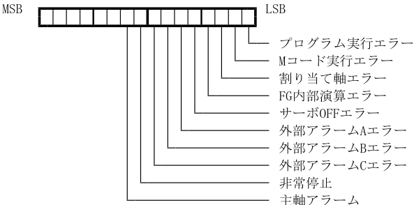

> **図の内容**
>
> | ビット | 内容 |
> |---|---|
> | D0 | プログラム実行エラー |
> | D1 | Mコード実行エラー |
> | D2 | 割り当て軸エラー |
> | D3 | FG内部演算エラー |
> | D4 | サーボOFFエラー |
> | D5 | 外部アラームAエラー |
> | D6 | 外部アラームBエラー |
> | D7 | 外部アラームCエラー |
> | D8 | 非常停止 |
> | D9 | 主軸アラーム |
>
> 上記以外のビットは未使用。

**《タスクアラーム詳細》**

- プログラム実行エラー

運転プログラムで不正な命令を実行した時に発生するエラーです。

詳細は、

「SLM8000 ユーザーズマニュアル」

<Ⅲ機能編 6-4.運転プログラムフォーマットエラー/実行エラー>(TB00-1130F) を参照下さい。

- 例）円弧命令で中心指定が中心でない場合や、マクロ変数指定で存在しないマクロ変数番号を指定された時などに発生します。
- Ｍコード実行エラー

MOK入力を有効（ROMSW設定ソフトの基本画面の「MOK入力」で設定）にした状態でMコード出力を行った時に、MFIN入力ON時にMOK入力がONしていなかった場合に発生するエラーです。詳細は、

「SLM8000ユーザーズマニュアル」

<Ⅲ機能編 6-1-10-1.MOUT : Mコード出力>(TB00-1130F)

<Ⅲ機能編 6-2-5-1.M : Mコード出力>(TB00-1130F)

を参照下さい。

- 割り当て軸エラー

タスクに割り当てられている軸の内、何れかの軸でエラーが発生していると発生するエラーです。

- FG内部演算エラー

本システムでは発生しないエラーです。

- サーボOFFエラー

電源投入時/重大エラー発生時等、サーボONしていない時に発生するエラーです。

- ※ 電源投入時サーボON設定（ROMSW設定ソフトの基本画面の「システム起動時サーボON」で設定）でない場合は、他にエラーが発生していない状態でも本エラーが発生しています。（エラー状態で起動します。）
- ※ 本書の<4-2-40.各軸サーボON/OFFコマンド>により、タスクに割り当てられている全軸をサーボOFFしても本エラーは発生しません。

外部アラームA入力(T□EXTALMA)/外部アラームB入力(T□EXTALMB)/外部アラームC入力(T□EX TALMC）がONした時に発生するエラーです。

- 外部アラームAエラー/外部アラームBエラー/外部アラームCエラー詳細は、

「SLM8000 ユーザーズマニュアル」<Ⅲ機能編 2-1.入力信号の名称と機能>(TB00-1130D) を参照下さい。

- 非常停止中

非常停止入力(EMS入力)がONすると発生するエラーです。

- 主軸アラーム

主軸アラーム入力(T□SPALM)がONした時に発生するエラーです。

- ③ 送りオーバーライド現在のPTP/JOG移動のオーバーライドの%値(指定された速度に対する実速度の割り合い)です。
- ④ 補間オーバーライド

現在の補間移動のオーバーライドの%値(指定された速度に対する実速度の割り合い)です。

- ⑤ 主軸オーバーライド

現在の主軸のオーバーライドの%値(指定された速度に対する実速度の割り合い)です。

⑥ 選択・実行プログラム番号ステータスがプログラム実行中でない場合 → 選択プログラム番号ステータスがプログラム実行中の場合 → 実行プログラム番号

- ⑦ 待機・実行ステップ番号

ステップ実行中でない場合

ステップ実行中の場合

- → 待機ステップ番号
- → 実行ステップ番号

#### 4-1-8.軸割り当て情報読出 [DAT_ASSAXISTBL(0x3C)]

**《データタイプ》**

DAT_ASSAXISTBL(0x3C)

**《パラメータ》**

なし

- 《タスク指定》

無効

- 《説明》

現在の各軸タスク割り付け情報を読出します。

- 《読み込み実行条件》常時実行可能です。

**《データフォーマット》**

データサイズ:20Byte

|   オフセット [Byte] | データ名称       |   データ長 [Byte] | データ範囲 [単位]   |
|----------------|-------------|---------------|--------------|
|              0 | 有効軸フラグ      |             2 | －            |
|              2 | 第1軸割り当てテーブル |             2 | －            |
|                | ：           |               |              |
|             18 | 第9軸割り当てテーブル |             2 | －            |

**《構造体定義》**

```c
/************************************************************************/
/* 軸割り当て情報構造体 */
/************************************************************************/
typedef struct {           /* 軸割り当てテーブル構造体 */
    char tsk;              /* タスク番号 */
    char axn;              /* 論理軸番号 */
} ASS_AXIS;
typedef struct {
    short axis_en;         /* 有効軸フラグ */
    ASS_AXIS ass_axis[9];  /* 軸割り当てテーブル */
} ASSAXISTBL;
```

**《データ詳細》**

- (1) 有効軸フラグどの物理軸が有効かを示します。

有効軸に対応するビットに1が設定されます。

MSB

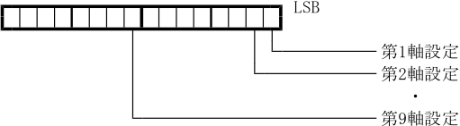

> **図の内容**
>
> D0 が第1軸設定、D1 が第2軸設定、…、D8 が第9軸設定。

- (2) 第ｎ軸割り当てテーブル

物理軸第n軸が割り付けたタスクとそのタスクでの論理軸番号を示します。

- タスク番号:0～7
- 論理軸番号:0～8

#### 4-1-9.入出力状態データ読出 [DAT_IODATA(0x03)]

**《データタイプ》**

DAT_IODATA(0x03)

**《パラメータ》**

なし

**《タスク指定》**

無効

**《説明》**

SLM8000の汎用入出力の状態を読出します。

**《読み込み実行条件》**

常時実行可能です。

**《データフォーマット》**

データサイズ:14Byte

|   オフセット [Byte] | データ名   | 称データ長データ範囲 [単位] [Byte]   |
|----------------|-----------|----------------------------|
|              0 | 入力1パターン   | (i#00) 2                   |
|              2 | 入力2パターン   | (i#01) 2                   |
|              4 | 入力3パターン   | (i#02) 2                   |
|              6 | 入力4パターン   | (i#03) 2                   |
|              8 | 出力1パターン   | (o#00) 2                   |
|             10 | 出力2パターン   | (o#01) 2                   |
|             12 | 出力3パターン   | (o#02) 2                   |

**《構造体定義》**

```c
/************************************************************************/
/* 汎用入出力情報構造体 */
/************************************************************************/
typedef struct {
    unsigned short Input[4];   /* 汎用入力 */
    unsigned short Output[3];  /* 汎用出力 */
} IODATA;
```

**《データ詳細》**

- (1) 各入出力のデータは下記の通りになっています。

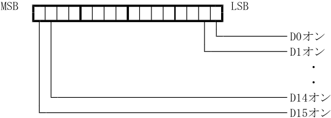

> **図の内容**
>
> 16 ビット。D0 が「D0オン」、D1 が「D1オン」、…、D14 が「D14オン」、D15 が「D15オン」（各ビットが入出力 1 点の状態）。

※各入出力の割付については、

「SLM8000 ユーザーズマニュアル」<Ⅱハードウェア編 3-2.標準入出力チャンネル表>(TB00-1130C) を参照して下さい。

#### 4-1-10.強制入出力状態データ読出 [DAT_FORCEIO(0x13)]

**《データタイプ》**

DAT_FORCEIO(0x13)

**《パラメータ》**

なし

**《タスク指定》**

無効

**《説明》**

通信コマンド等で設定したSLM8000の強制入出力の状態を読出します。

**《読み込み実行条件》**

常時実行可能です。

**《データフォーマット》**

データサイズ:14Byte

|   オフセット [Byte] | データ名   | 称データ長データ範囲 [単位] [Byte]   |
|----------------|-----------|----------------------------|
|              0 | 入力1パターン   | (i#00) 2                   |
|              2 | 入力2パターン   | (i#01) 2                   |
|              4 | 入力3パターン   | (i#02) 2                   |
|              6 | 入力4パターン   | (i#03) 2                   |
|              8 | 出力1パターン   | (o#00) 2                   |
|             10 | 出力2パターン   | (o#01) 2                   |
|             12 | 出力3パターン   | (o#02) 2                   |

**《構造体定義》**

```c
/************************************************************************/
/* 汎用入出力情報構造体 */
/************************************************************************/
typedef struct {
    unsigned short Input[4];   /* 汎用入力 */
    unsigned short Output[3];  /* 汎用出力 */
} IODATA;
```

**《データ詳細》**

- (1) 各入出力のデータは下記の通りになっています。

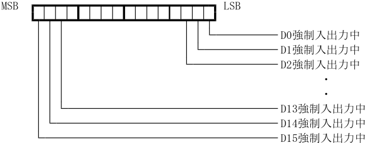

> **図の内容**
>
> 16 ビット。D0 が「D0強制入出力中」、D1 が「D1強制入出力中」、D2 が「D2強制入出力中」、…、D13～D15 が「D13強制入出力中」～「D15強制入出力中」。

※各入出力の割付については、

「SLM8000 ユーザーズマニュアル」<Ⅱハードウェア編 3-2.標準入出力チャンネル表>(TB00-1130C) を参照して下さい。

#### 4-1-11.機械操作パネルSW情報読出 [DAT_MPDATA(0x26)]

- 《データタイプ》

DAT_MPDATA(0x26)

**《パラメータ》**

なし

**《タスク指定》**

有効

**《説明》**

機械操作パネルの入力チャンネルの状態を読出します。機械操作パネルの詳細については、

「SLM8000 ユーザーズマニュアル」<Ⅲ機能編 7.機械操作パネル>(TB00-1130G) を参照下さい。

- 《読み込み実行条件》

常時実行可能です。

- 《データフォーマット》データサイズ:8Byte

|   オフセット [Byte] | データ名称      |   データ長 [Byte] | データ範囲 [単位]   |
|----------------|------------|---------------|--------------|
|              0 | 機械パネル入力CH1 |             1 | －            |
|              1 | 機械パネル入力CH2 |             1 | －            |
|              2 | 機械パネル入力CH3 |             1 | －            |
|              3 | 機械パネル入力CH4 |             1 | －            |
|              4 | 機械パネル入力CH5 |             1 | －            |
|              5 | 機械パネル入力CH6 |             1 | －            |
|              6 | 機械パネル入力CH7 |             1 | －            |
|              7 | 機械パネル入力CH8 |             1 | －            |

**《構造体定義》**

```c
/************************************************************************/
/* 機械パネルSW情報構造体 */
/************************************************************************/
typedef struct {
    unsigned char PnlSw[8];  /* 機械パネル入力1～8 */
} MPDATA;
```

**《データ詳細》**

- (1) 機械パネル入力CH1～7

各CHの入力データは以下のように割付いています。


> **図の内容**
>
> 8 ビット。D0 が「D0指定」、D1 が「D1指定」、…、D7 が「D7指定」。

#### 4-1-12.機械操作パネル強制入力状態データ読出 [DAT_FORCEMPI(0x14)]

**《データタイプ》**

DAT_FORCEMPI(0x14)

**《パラメータ》**

なし

**《タスク指定》**

有効

**《説明》**

機械操作パネルの入力チャンネルの強制入力状態を読出します。

機械操作パネルの詳細については、

「SLM8000 ユーザーズマニュアル」<Ⅲ機能編 7.機械操作パネル>(TB00-1130G) を参照下さい。

- 《読み込み実行条件》

常時実行可能です。

**《データフォーマット》**

データサイズ:8Byte

|   オフセット [Byte] | データ名称      |   データ長 [Byte] | データ範囲 [単位]   |
|----------------|------------|---------------|--------------|
|              0 | 機械パネル入力CH1 |             1 | －            |
|              1 | 機械パネル入力CH2 |             1 | －            |
|              2 | 機械パネル入力CH3 |             1 | －            |
|              3 | 機械パネル入力CH4 |             1 | －            |
|              4 | 機械パネル入力CH5 |             1 | －            |
|              5 | 機械パネル入力CH6 |             1 | －            |
|              6 | 機械パネル入力CH7 |             1 | －            |
|              7 | 機械パネル入力CH8 |             1 | －            |

**《構造体定義》**

```c
/************************************************************************/
/* 機械パネルSW情報構造体 */
/************************************************************************/
typedef struct {
    unsigned char PnlSw[8];  /* 機械パネル入力1～8 */
} MPDATA;
```

**《データ詳細》**

- (1) 機械パネル入力CH1～7

各CHの入力データは以下のように割付いています。

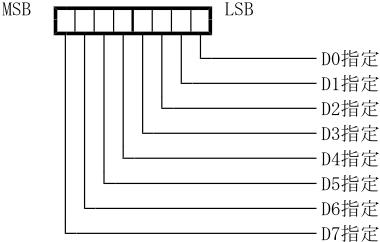

> **図の内容**
>
> 8 ビット。D0 が「D0指定」、D1 が「D1指定」、…、D7 が「D7指定」。

#### 4-1-13.軸ネグレクト設定データ読出 [DAT_AXNEGLECT(0x28)]

**《データタイプ》**

DAT_AXNEGLECT(0x28)

**《パラメータ》**

なし

**《タスク指定》**

有効

- 《説明》

各軸の軸指令の有効/無効状態を読出します。

- 《読み込み実行条件》常時実行可能です。
- 《関連項目》

<4-2-38.軸ネグレクト設定コマンド>

- 《データフォーマット》

データサイズ:4Byte

|   オフセット [Byte] | データ名称   |   データ長 [Byte] | データ範囲 [単位]   |
|----------------|-------------|---------------|--------------|
|              0 | ネグレクト軸フラグ   |             4 | －            |

**《構造体定義》**

構造体定義はありません。

longデータとして定義して下さい。

**《データ詳細》**

- (1) ネグレクト軸フラグ各軸のネグレクト設定を示します。ネグレクト設定の軸に対応するビットに1が設定されます。

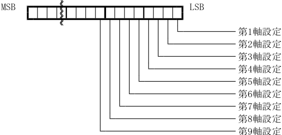

> **図の内容**
>
> D0 が第1軸設定、D1 が第2軸設定、…、D8 が第9軸設定。

#### 4-1-14.軸インタロック設定データ読出 [DAT_AXINTLOCK(0x29)]

**《データタイプ》**

DAT_AXINTLOCK(0x29)

**《パラメータ》**

なし

**《タスク指定》**

有効

**《説明》**

各軸のインタロックの有効/無効状態を読出します。

**《読み込み実行条件》**

常時実行可能です。

- 《関連項目》

<4-2-39.軸インタロック設定コマンド>

- 《データフォーマット》

データサイズ:4Byte

|   オフセット [Byte] | データ名称   |   データ長 [Byte] | データ範囲 [単位]   |
|----------------|-------------|---------------|--------------|
|              0 | インタロック軸フラグ  |             4 | －            |

**《構造体定義》**

構造体定義はありません。

longデータとして定義して下さい。

**《データ詳細》**

- (1) インタロック軸フラグ各軸のインタロック設定を示します。インタロック設定の軸に対応するビットに1が設定されます。


> **図の内容**
>
> D0 が第1軸設定、D1 が第2軸設定、…、D8 が第9軸設定。

#### 4-1-15.各軸サーボON/OFF設定データ読出 [DAT_AXSVONEN(0x31)]

**《データタイプ》**

DAT_AXSVONEN(0x31)

**《パラメータ》**

なし

**《タスク指定》**

有効

- 《説明》各軸のサーボON/OFF設定状態を読出します。
- 《読み込み実行条件》常時実行可能です。
- 《関連項目》

<4-2-40.各軸サーボON/OFFコマンド>

- 《データフォーマット》

データサイズ:4Byte

|   オフセット [Byte] | データ名称   |   データ長 [Byte] | データ範囲 [単位]   |
|----------------|-------------|---------------|--------------|
|              0 | サーボON軸フラグ   |             4 | -            |

**《構造体定義》**

構造体定義はありません。

longデータとして定義して下さい。

**《データ詳細》**

- (1) サーボON軸フラグ各軸のサーボON設定を示します。サーボON設定の軸に対応するビットに1が設定されます。


> **図の内容**
>
> D0 が第1軸設定、D1 が第2軸設定、…、D8 が第9軸設定。

#### 4-1-16.プログラムブロック情報読出 [DAT_PRGBLKINFO(0x1B)]

**《データタイプ》**

DAT_PRGBLKINFO(0x1B)

**《パラメータ》**

なし

**《タスク指定》**

無効

- 《説明》

現在の各プログラムブロック情報を読出します。

**《読み込み実行条件》**

常時実行可能です。

**《データフォーマット》**

データサイズ:256Byte

|   オフセット [Byte] | データ名称     |   データ長 [Byte] | データ範囲 [単位]   |
|----------------|-----------|---------------|--------------|
|              0 | 第1ブロック情報  |             4 | -            |
|                | :         |               |              |
|            252 | 第64ブロック情報 |             4 | -            |

各ブロック情報

|   オフセット [Byte] | データ名称   |   データ長 [Byte] | データ範囲 [単位]   |
|----------------|---------|---------------|--------------|
|              0 | プログラム番号 |             2 | 1～32767      |
|              2 | タスク番号   |             2 | 0～7          |

**《構造体定義》**

```c
/************************************************************************/
/* プログラムブロック情報構造体 */
/************************************************************************/
typedef struct {   /* （256Byte） */
struct{
    short PrgNo;   /* プログラム番号 */
    short TaskNo;  /* タスク番号 */
} inf[64];
} PRGBLK_INF;
```

#### 4-1-17.プログラム1ステップデータ読出 [DAT_ONEBLOCK(0x30)]

**《データタイプ》**

DAT_ONEBLOCK(0x30)

**《パラメータ》**

ステップ番号(0～最大ステップ番号)

※ 0指定は、現在の実行ステップ番号指定です。

**《タスク指定》**

有効

**《説明》**

現在選択されているプログラム番号の任意のステップの運転プログラムを読出します。

運転プログラムのバイナリフォーマットは非公開です。読み出したデータは、ヘッダ情報(プログラムボリュームラベル構造体)の後に付加して、プログラム変換ライブラリにて、テキスト形式のデータへ変換して下さい。

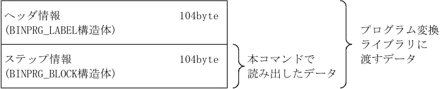

> **図の内容**
>
> - 「ヘッダ情報（BINPRG_LABEL構造体）」104byte
> - 「ステップ情報（BINPRG_BLOCK構造体）」104byte
>
> ステップ情報が「本コマンドで読み出したデータ」。ヘッダ情報とステップ情報を合わせたものが「プログラム変換ライブラリに渡すデータ」。

※プログラム変換ライブラリを呼び出す前に、ヘッダ情報を下記の通り初期化してください。

- BlockNumber メンバに "1" を設定
- ProgramType メンバに受信したステップ情報のPrgTypeメンバの値をコピー
- 他のメンバは全て "0" を設定

尚、テクノコード/Gコードのどちらの変換ライブラリを呼び出すかは、受信したステップ情報の PrgTypeメンバの値によって選択してください。

**《読み込み実行条件》**

- 選択されているプログラム番号に運転プログラムダウンロード済み

**《データフォーマット》**

データサイズ:104Byte

|   オフセット [Byte] | データ名   |   称データ長 [Byte] | データ範囲 [単位]   |
|----------------|-----------|-----------------|--------------|
|              0 | 予約        |             104 | －            |

**《構造体定義》**

```c
/************************************************************************/
/* プログラムボリュームラベル構造体（104Byte固定長） */
/************************************************************************/
typedef struct {
    unsigned char Reserved1[2];    /* 予約 */
    unsigned short BlockNumber;    /* 有効ブロック長 */
    unsigned char Reserved2[22];   /* 予約 */
    unsigned short ProgramType;    /* プログラムコードタイプ(0:T､ 1:G) */
    unsigned char Reserved3[76];   /* 予約 */
} BINPRG_LABEL;
/************************************************************************/
/* プログラム1ブロックデータ構造体（104Byte固定長） */
/************************************************************************/
typedef struct {
    unsigned char Reserved1[101];  /* 予約 */
    unsigned char PrgType;         /* プログラムコードタイプ(0:T､ 1:G) */
    unsigned char Reserved2[2];    /* 未使用 */
} BINPRG_BLOCK;
```

**《データ詳細》**

予約領域を 0 フィルした後、有効ブロック長に 1、プログラムコードタイプに読み出したデータのプロ

- (1) 運転プログラムヘッダデータグラムコードタイプをコピーしてください。
- (2) 運転プログラム 1 ステップバイナリデータ

プログラム1ステップデータ読出コマンドで、SLM8000から読出したデータです。

#### 4-1-18.ティーチング情報読出 [DAT_TEACHSTS(0x18)] <開発中>

**《データタイプ》**

DAT_TEACHSTS(0x18)

**《パラメータ》**

なし

**《タスク指定》**

有効

- 《説明》 SLM8000のティーチングの状態を読出します。
- 《読み込み実行条件》常時実行可能です。

**《データフォーマット》**

データサイズ:16Byte

|   オフセット [Byte] | データ名称    |   データ長 [Byte] | データ範囲 [単位]   |
|----------------|--------------|---------------|--------------|
|              0 | ティーチングステータス  |             4 | -            |
|              4 | 実行ステップ番号     |             4 | -            |
|              8 | ティーチングステップ番号 |             4 | -            |
|             12 | 未使用          |             4 | -            |

**《構造体定義》**

```c
/************************************************************************/
/* ティーチング情報用パラメータ情報構造体 */
/************************************************************************/
typedef struct {
    unsigned long Status;     /* ティーチングステータス */
    unsigned long StepNo;     /* 実行ステップ番号 */
    unsigned long TchStepNo;  /* ティーチングステップ番号 */
    unsigned long Reserved;   /* 未使用 */
} TEACHSTS;
```

**《データ詳細》**

- (1) ティーチングステータス

MSB


> **図の内容**
>
> | ビット | 内容 |
> |---|---|
> | D0 | ティーチングモード |
> | D1 | ティーチング開始ステップ |
> | D2 | ティーチング可能ステップ |
> | D3 | ティーチング開始の前ステップ |

- (2) 実行ステップ番号現在のステップ番号です。
- (3) ティーチングステップ番号

ティーチングを開始したステップ番号です。

#### 4-1-19.DNCデータ書込 [DAT_DNCDATA(0x0E)] <オプション>

**《データタイプ》**

DAT_DNCDATA(0x0E)

**《パラメータ》**

先頭/継続フラグ(0:先頭、1:継続)

**《タスク指定》**

有効

**《説明》**

DNC運転プログラムを、SLM8000のプログラムメモリに書き込みます。 DNCデータ書込コマンドの実行には、SLM8000にDNC運転オプションが必要です。 DNCデータ書込コマンドで書き込む運転プログラムは、テクノ独自フォーマットのバイナリデータです。テキストフォーマットの運転プログラムは「テクノコード変換ライブラリ」か「Gコード変換ライブラリ」のプログラム変換ライブラリを利用して、テキスト運転プログラムからテクノ独自フォーマットのバイナリデータにして下さい。

**《書き込み実行条件》**

- DNC運転モード
- データサイズがDNCバッファ空き容量以下

**《読み込み実行条件》**

読み込み不可

**《データフォーマット》**

<4-1-2. 運転プログラム書込/読出>と同様です。

#### 4-1-20.DNCバッファ情報データ読出 [DAT_DNCBUFI(0x0F)] <オプション>

**《データタイプ》**

DAT_DNCBUFI(0x0F)

**《パラメータ》**

なし

**《タスク指定》**

有効

**《説明》**

現在のDNCバッファの状態を読出します。

**《読み込み実行条件》**

常時実行可能です。

**《データフォーマット》**

データサイズ:8Byte

|   オフセット [Byte] | データ名称   |   データ長 [Byte] | 設定値   |
|----------------|-------------|---------------|---------|
|              0 | バッファ使用容量    |             4 |         |
|              4 | バッファ空き容量    |             4 |         |

**《構造体定義》**

```c
/************************************************************************/
/* DNCバッファ情報構造体 */
/************************************************************************/
typedef struct {
    long Size;  /* バッファ使用容量（Byte） */
    long Free;  /* バッファ空き容量（Byte） */
} DNCBUFI;
```

#### 4-1-21.マクロ変数(一般レジスタ)書込/読出 [DAT_VARIABLE(0x19)] <オプション>

**《データタイプ》**

DAT_VARIABLE(0x19)

**《パラメータ》**

```c
    D31
    MSB
```

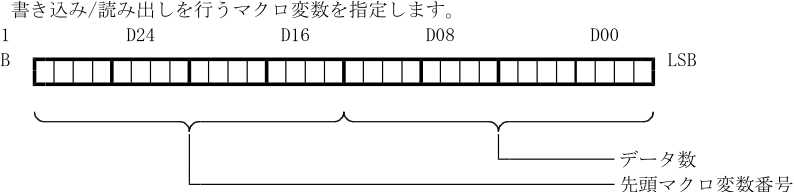

> **図の内容**
>
> 「書き込み/読み出しを行うマクロ変数を指定します。」パラメータ(32bit):
>
> | ビット | 内容 |
> |---|---|
> | D00～D15 | データ数 |
> | D16～D31 | 先頭マクロ変数番号 |

- ① 先頭マクロ変数番号書き込み/読み出しを行う先頭マクロ変数を指定します。

② データ数

書き込み/読み出しを行うデータ数を指定します。

**《タスク指定》**

有効/無効（ローカルマクロ変数指定時のみ有効）

**《関連項目》**

- <4-1-22.マクロ変数書込/読出>
- <4-2-55.マクロ変数書込コマンド>

**《説明》**

SLM8000の一般レジスタの値の書込/読出を行います。

マクロ変数詳細については、

「SLM8000ユーザーズマニュアル」<Ⅲ機能編 6-3.マクロ機能>(TB00-1130F) を参照下さい。

パラメータ指定により、書込/読出を行う先頭マクロ変数番号とデータ数を指定します。パラメータに0を指定した時は、先頭マクロ変数番号に1000/データ数に200を指定したものとして動作し

ます。

書込/読出を行うデータ数は、パラメータ指定により可変長になります。

通信処理(PCアプリでのSendData()/ReceiveData()呼び出し)を行う際は御注意下さい。

特に、書き込み時のデータサイズ指定は、実際に書き込むデータサイズ(Byte)を指定する必要があります。データサイズがパラメータのデータ数指定と食い違っていると通信エラｰになります。

先頭マクロ変数番号とデータ数に指定できる値は以下の通りです。

| マクロ変数範囲     |   最大データ数 | 単位    | 説明         |
|-------------|----------|-------|------------|
| #1000～#1199 |      200 | 4Byte | グローバルマクロ変数 |
| #6500～#6699 |      200 |       | ローカルマクロ変数  |

書き込み/読み出しの際のデータバッファの割り当ては、先頭アドレスから4Byteが先頭マクロ変数で指定したマクロのデータになり、以後4Byte毎に順番に格納されています。

オフセット[Byte] 書き込み/読み出しデータバッファ

0

4

8

:

:

データ数-2 × 4 先頭マクロ変数番号 + データ数-2 のデータ

データ数-1 × 4 先頭マクロ変数番号 + データ数-1 のデータ

| 先頭マクロ変数番号            | のデータ   |
|----------------------|--------|
| 先頭マクロ変数番号+1          | のデータ   |
| 先頭マクロ変数番号+2 :        | のデータ   |
| : 先頭マクロ変数番号 + データ数-2 | のデータ   |
| 先頭マクロ変数番号 + データ数-1   | のデータ   |

- 《書き込み実行条件》常時実行可能です。
- 《読み込み実行条件》常時実行可能です。
- 《データフォーマット》

データサイズ:最大800Byte(可変長)

| オフセット [Byte]   | データ名称   | データ長 [Byte]   | データ範囲 [単位]   |
|----------------|-------------|---------------|--------------|
| 0              | 1 番目のデータ    | 4             | －            |
| 4              | 2 番目のデータ    | 4             | －            |
| ：：            | ：：         | ：：           | ：：          |
| 792            | 199 番目のデータ  | 4             | －            |
| 796            | 200 番目のデータ  | 4             | －            |

**《構造体定義》**

```c
/************************************************************************/
/* マクロ変数データ */
/************************************************************************/
typedef long VARIABLE[200];
```

#### 4-1-22.マクロ変数書込/読出 [DAT_MCRREG(0x33)] <オプション>

**《データタイプ》**

DAT_MCRREG(0x33)

**《パラメータ》**

マクロ変数番号

**《タスク指定》**

有効

**《説明》**

パラメータで指定された番号のマクロ変数に対する書込/読出を行います。

書き込み不可のマクロ変数に対する書き込み、読出し不可のマクロ変数に対する読み出しを行うことはできません。

マクロ変数詳細については、

「SLM8000ユーザーズマニュアル」<Ⅲ機能編 6-3.マクロ機能>(TB00-1130F) を参照下さい。

**《書き込み実行条件》**

常時実行可能です。

**《読み込み実行条件》**

常時実行可能です。

**《関連項目》**

<4-1-21.マクロ変数(一般レジスタ)書込/読出>

<4-2-55.マクロ変数書込コマンド>

**《データフォーマット》**

データサイズ:4Byte

|   オフセット [Byte] | データ名   |   称データ長 [Byte] | データ範囲 [単位]                   |
|----------------|-----------|-----------------|------------------------------|
|              0 | マクロ変数値    |               4 | -2147483647 ～ 2147483647 [-] |

**《構造体定義》**

```c
/************************************************************************/
/* マクロ変数データ構造体 */
/************************************************************************/
typedef struct {
    long Val;  /* マクロ変数値 */
} MCRREG;
```

#### 4-1-23.主軸回転数読出 [DAT_SPREV(0x41)] <オプション>

**《データタイプ》**

DAT_SPREV(0x41)

**《パラメータ》**

なし

**《タスク指定》**

有効

- 《説明》

現在の主軸回転数を読出します。

- 《読み込み実行条件》常時実行可能です。

**《データフォーマット》**

データサイズ:8Byte

|   オフセット [Byte] | データ名称   |   データ長 [Byte] | データ範囲 [単位]               |
|----------------|---------|---------------|--------------------------|
|              0 | 主軸指令回転数 |             4 | -2147483647 ～ 2147483647 |
|              4 | 主軸実回転数  |             4 | -2147483647 ～ 2147483647 |

**《構造体定義》**

```c
/************************************************************************/
/* 主軸回転数情報構造体 */
/************************************************************************/
typedef struct {
    long ComSpRevo;  /* 主軸指令回転数 */
    long ActSpRevo;  /* 主軸実回転数 */
} SPREVDAT;
```

#### 4-1-24.TPCロギングデータ読出 [DAT_TPCDATA(0x25)]

**《データタイプ》**

DAT_TPCDATA(0x25)

**《パラメータ》**

読み出しデータバイト数

※必ずTPCデータ1点分のサイズ(後述)の整数倍で指定してください。但し、"0" を指定するとロギング内の全データ(最大65536バイト)を読み出します。

**《タスク指定》**

無効

**《説明》**

SLM8000でロギングしたTPCデータを読出します。

本機能はロギング実行中でも可能です。

本機能によりTPCデータを読み出すと、読み出した分のロギングバッファを解放します。

常時TPCデータを読み出すことにより、ロギングバッファのサイズ以上にロギングすることが可能です。

TPCデータの読み出しが間に合わずにロギングバッファが一杯になるとロギングが停止します。

読み出したデータを以下の形式にテキストファイル(.CSV)で保存することにより、弊社「TPC EXCEL」によって解析することが可能です。

1点目の第1軸座標

2点目の第1軸座標

1点目の第2軸座標

2点目の第2軸座標

:

:

n点目の第1軸座標

n点目の第21軸座標

尚、パラメータの読み出しデータバイト数指定が、ロギングバッファに格納済みのデータ数より大きい場合は、格納済みのデータのみ読み出します。

※64チャンネルTPCロギングは<4-1-25.64チャンネルTPCロギングデータ読出>を使用して下さい。

**《読み込み実行条件》**

- ロギングデータあり

**《関連項目》**

- <4-1-26.TPCロギング情報読出>
- <4-1-27.TPCロギング拡張情報読出>
- <4-2-58.TPCデータ選択コマンド>
- <4-2-59.TPCデータ選択拡張コマンド>
- <4-2-60.TPCロギング開始コマンド>

**《データフォーマット》**

データサイズ:16Byte

| オフセット [Byte]   | データ名称   |   データ長 [Byte] | データ範囲 [単位]                    |
|----------------|---------|---------------|-------------------------------|
| 0/1            | 第1軸機械位置 |             4 | -1000000000～1000000000[pulse] |
| 2              | 汎用入力1状態 |             2 | －                             |
| 3              | 汎用出力1状態 |             2 | －                             |
| 4/5            | 第2軸機械位置 |             4 | -1000000000～1000000000[pulse] |
| 6              | 汎用入力2状態 |             2 | －                             |
| 7              | 汎用出力2状態 |             2 | －                             |

**《構造体定義》**

```c
/************************************************************************/
/* TPCデータ構造体 */
/************************************************************************/
    //----------
    // TPCH_LOG_POS用
typedef struct {
    long pr1;            /* 第1軸機械位置 */
    unsigned short hi1;  /* 汎用入力1状態 */
    unsigned short ho1;  /* 汎用出力1状態 */
    long pr2;            /* 第2軸機械位置 */
    unsigned short hi2;  /* 汎用入力2状態 */
    unsigned short ho2;  /* 汎用出力2状態 */
} TPCDAT_POS;
typedef TPCDAT_POS TPC;
```

#### 4-1-25.64チャンネルTPCロギングデータ読出 [DAT_TPCDATA_64(0x2b)]

**《データタイプ》**

DAT_TPCDATA_64(0x2b)

**《パラメータ》**

読み出しデータバイト数

※必ずTPCデータ1点分のサイズ(後述)の整数倍で指定してください。但し、"0" を指定するとロギング内の全データ(最大65536バイト)を読み出します。

**《タスク指定》**

無効

**《説明》**

SLM8000で64チャンネルTPCロギングしたTPCデータを読出します。

本機能はロギング実行中でも可能です。

本機能によりTPCデータを読み出すと、読み出した分のロギングバッファを解放します。

常時TPCデータを読み出すことにより、ロギングバッファのサイズ以上にロギングすることが可能です。

TPCデータの読み出しが間に合わずにロギングバッファが一杯になるとロギングが停止します。

読み出したデータを以下の形式にテキストファイル(.CSV)で保存することにより、弊社「TPC EXCEL」によって解析することが可能です。

尚、パラメータの読み出しデータバイト数指定が、ロギングバッファに格納済みのデータ数より大きい場合は、格納済みのデータのみ読み出します。

**《読み込み実行条件》**

- ロギングデータあり

**《関連項目》**

- <4-1-27.TPCロギング拡張情報読出>
- <4-2-59.TPCデータ選択拡張コマンド>
- <4-2-60.TPCロギング開始コマンド>

**《データフォーマット》**

データサイズ: 4Byte × [チャンネル数]の可変長

**《構造体定義》**

なし

#### 4-1-26.TPCロギング情報読出 [DAT_TPCINFO(0x24)]

**《データタイプ》**

DAT_TPCINFO(0x24)

**《パラメータ》**

なし

**《タスク指定》**

無効

**《説明》**

SLM8000の現在のTPCデータのロギング情報を読出します。

**《読み込み実行条件》**

常時実行可能です。

**《関連項目》**

- <4-1-24.TPCロギングデータ読出>
- <4-1-27.TPCロギング拡張情報読出>
- <4-2-58.TPCデータ選択コマンド>
- <4-2-59.TPCデータ選択拡張コマンド>
- <4-2-60.TPCロギング開始コマンド>

**《データフォーマット》**

データサイズ:4Byte

|   オフセット [Byte] | データ名称           |   データ長 [Byte] | データ範囲 [単位]   |
|----------------|-----------------|---------------|--------------|
|              0 | TPCデータロギングフラグ   |             2 | 0:未実行、1:実行中  |
|              2 | TPCデータロギングポイント数 |             2 | 0～4095       |

**《構造体定義》**

```c
/************************************************************************/
/* TPCロギング情報構造体 */
/************************************************************************/
typedef struct {
    short Log;  /* TPCデータロギングフラグ */
    short Num;  /* TPCデータロギングポイント数 */
} TPCINFO;
```

#### 4-1-27.TPCロギング拡張情報読出 [DAT_TPCINFO_EX(0x2A)]

**《データタイプ》**

DAT_TPCINFO_EX(0x2A)

**《パラメータ》**

なし

**《タスク指定》**

無効

**《説明》**

SLM8000の現在のTPCデータのロギング情報を読出します。

**《読み込み実行条件》**

常時実行可能です。

**《関連項目》**

- <4-1-24.TPCロギングデータ読出>
- <4-1-25.64チャンネルTPCロギングデータ読出>
- <4-1-26.TPCロギング情報読出>
- <4-2-58.TPCデータ選択コマンド>
- <4-2-59.TPCデータ選択拡張コマンド>
- <4-2-60.TPCロギング開始コマンド>

**《データフォーマット》**

データサイズ:12Byte

|   オフセット [Byte] | データ名称         |   データ長 [Byte] | データ範囲 [単位]   |
|----------------|---------------|---------------|--------------|
|              0 | TPCデータロギングフラグ |             2 | 0:未実行、 1:実行中 |
|              2 | 予約            |             2 | 0            |
|              4 | バッファ使用容量(バイト) |             4 | 0～65536      |
|              8 | バッファ空き容量(バイト) |             4 | 0～65536      |

**《構造体定義》**

```c
/************************************************************************/
/************************************************************************/
typedef struct {
    short Log;       /* ロギング中フラグﾞ */
    short Reserved;  /* 予約 */
    long Size;       /* バッファ使用容量（Byte） */
    long Free;       /* バッファ空き容量（Byte） */
} TPCINFOEX;
```

#### 4-1-28.手動パルサー設定情報読出 [DAT_HANDLESTS(0x32)] <オプション>

**《データタイプ》**

DAT_HANDLESTS(0x32)

**《パラメータ》**

なし

**《タスク指定》**

有効

**《説明》**

手動パルサーの設定状態を読出します。

- 《読み込み実行条件》常時実行可能です。

**《関連項目》**

<4-2-61.手動パルサーモードON/OFF設定コマンド>

<4-2-62.手動パルサー倍率設定コマンド>

<4-2-63.手動パルサー有効軸設定コマンド>

**《データフォーマット》**

データサイズ:8Byte

|   オフセット [Byte] | データ名称       |   データ長 [Byte] | データ範囲 [単位]    |
|----------------|-------------|---------------|---------------|
|              0 | 手動パルサー有効フラグ |             2 | 0:無効、 1:有効    |
|              2 | 手動パルサー倍率    |             2 | 1,10,100,1000 |
|              4 | 手動パルサー第1軸   |             2 | 軸番号(0～軸数)     |
|              6 | 手動パルサー第2軸   |             2 | 軸番号(0～軸数)     |

**《構造体定義》**

```c
/************************************************************************/
/* 手パ操作情報構造体 */
/************************************************************************/
typedef struct {
    short handle_mode;  /* 手パ有効フラグ */
    short kp;           /* 手パ設定倍率 */
    short ax1;          /* 手パ第1軸 */
    short ax2;          /* 手パ第2軸 */
} HANDLESTS;
```

**《データ詳細》**

- (1) 手動パルサー有効フラグ

手動パルサーの有効/無効状態を示します。

- (2) 手動パルサー倍率手動パルサーの倍率(手動パルサー1パルスあたりの軸移動量)を示します。
- (3) 手動パルサー第1軸

手動パルサー第1軸にて、移動を行わせる軸を示します。

- (4) 手動パルサー第2軸

手動パルサー第2軸にて、移動を行わせる軸を示します。

#### 4-1-29.センサーラッチ位置データ読出 [DAT_SENSEPOS(0x11)] <オプション>

**《データタイプ》**

DAT_SENSEPOS(0x11)

**《パラメータ》**

なし

**《タスク指定》**

有効

**《説明》**

センサーラッチ入力があった時の各軸の位置情報を読出します。有効軸以外の各軸のデータは、無効データです。

**《読み込み実行条件》**

常時実行可能です。

**《データフォーマット》**

データサイズ:72Byte

|   オフセット [Byte] | データ名   |   称データ長 [Byte] | データ範囲 [単位]                    |
|----------------|-----------|-----------------|-------------------------------|
|              0 | 第1軸論理座標   |               4 | -1000000000～1000000000[pulse] |
|              4 | 第2軸論理座標   |               4 | -1000000000～1000000000[pulse] |
|              8 | 第3軸論理座標   |               4 | -1000000000～1000000000[pulse] |
|             12 | 第4軸論理座標   |               4 | -1000000000～1000000000[pulse] |
|             16 | 第5軸論理座標   |               4 | -1000000000～1000000000[pulse] |
|             20 | 第6軸論理座標   |               4 | -1000000000～1000000000[pulse] |
|             24 | 第7軸論理座標   |               4 | -1000000000～1000000000[pulse] |
|             28 | 第8軸論理座標   |               4 | -1000000000～1000000000[pulse] |
|             32 | 第9軸論理座標   |               4 | -1000000000～1000000000[pulse] |
|             36 | 第1軸アブソ座標  |               4 | -1000000000～1000000000[pulse] |
|             40 | 第2軸アブソ座標  |               4 | -1000000000～1000000000[pulse] |
|             44 | 第3軸アブソ座標  |               4 | -1000000000～1000000000[pulse] |
|             48 | 第4軸アブソ座標  |               4 | -1000000000～1000000000[pulse] |
|             52 | 第5軸アブソ座標  |               4 | -1000000000～1000000000[pulse] |
|             56 | 第6軸アブソ座標  |               4 | -1000000000～1000000000[pulse] |
|             60 | 第7軸アブソ座標  |               4 | -1000000000～1000000000[pulse] |
|             64 | 第8軸アブソ座標  |               4 | -1000000000～1000000000[pulse] |
|             68 | 第9軸アブソ座標  |               4 | -1000000000～1000000000[pulse] |

**《構造体定義》**

```c
/************************************************************************/
/* センサーラッチ位置情報構造体 */
/************************************************************************/
typedef struct {
    long SenPos[9];   /* センサーラッチポジション（論理座標系） */
    long SenPosA[9];  /* センサーラッチポジション（アブソ座標系） */
} SENSEPOS;
```

#### 4-1-30.フィードバックカウンタ積算値読出 [DAT_FBCOUNT(0x50)]

**《データタイプ》**

DAT_FBCOUNT(0x50)

**《パラメータ》**

なし

**《タスク指定》**

無効

**《説明》**

FBカウンタ1～10の積算値を読出します。

フィードバックカウンタ積算値は、軸の割り当てや設定に関わらず、FB入力(CNEXT)に入力されたパルスをそのまま積算します。

（A相進みで+カウント、電源投入時は0）

FB1～10を軸に割り当てていても、フィードバックカウンタ積算値には、割り当てた軸の任意分周や FB入力極性は反映されません。

動作モードや軸動作に関わらず、FB入力に入力されたパルスをそのまま積算したデータです。

**《読み込み実行条件》**

常時実行可能です。

**《関連項目》**

<4-2-64.フィードバックカウンタ積算値セットアップコマンド>

**《データフォーマット》**

データサイズ:40Byte

|   オフセット [Byte] | データ名称       |   データ長 [Byte] | データ範囲 [単位]               |
|----------------|-------------|---------------|--------------------------|
|              0 | FB1カウンタ積算値  |             4 | -2147483647 ～ 2147483647 |
|              4 | FB2カウンタ積算値  |             4 | -2147483647 ～ 2147483647 |
|              8 | FB3カウンタ積算値  |             4 | -2147483647 ～ 2147483647 |
|             12 | FB4カウンタ積算値  |             4 | -2147483647 ～ 2147483647 |
|             16 | FB5カウンタ積算値  |             4 | -2147483647 ～ 2147483647 |
|             20 | FB6カウンタ積算値  |             4 | -2147483647 ～ 2147483647 |
|             24 | FB7カウンタ積算値  |             4 | -2147483647 ～ 2147483647 |
|             28 | FB8カウンタ積算値  |             4 | -2147483647 ～ 2147483647 |
|             32 | FB9カウンタ積算値  |             4 | -2147483647 ～ 2147483647 |
|             36 | FB10カウンタ積算値 |             4 | -2147483647 ～ 2147483647 |

**《構造体定義》**

```c
/************************************************************************/
/* フィードバックカウンタデータ構造体（40Byte固定長） */
/************************************************************************/
typedef struct {
    long cntr[10];  /* FB1～10積算値 */
} FBCOUNT;
```

#### 4-1-31.工具長補正設定情報読出 [DAT_TOOLHSTS(0x39)] <オプション>

**《データタイプ》**

DAT_TOOLHSTS(0x39)

**《パラメータ》**

なし

**《タスク指定》**

有効

- 《説明》

現在の工具長補正情報を読出します。

- 《読み込み実行条件》常時実行可能です。

**《データフォーマット》**

データサイズ:4Byte

|   オフセット [Byte] | データ名称   |   データ長 [Byte] | データ範囲 [単位]      |
|----------------|---------|---------------|-----------------|
|              0 | 補正有効フラグ |             2 | 0:長補正未実行、1:長補正中 |
|              2 | 選択中補正No |             2 | 0～19            |

**《構造体定義》**

```c
/************************************************************************/
/* 工具長補正情報構造体 */
/************************************************************************/
typedef struct {
    short toolh_en;  /* 補正有効フラグ */
    short toolh_no;  /* 選択中補正No */
} TOOLHSTS;
```

#### 4-1-32.工具径補正設定情報読出 [DAT_TOOLDSTS(0x3A)] <オプション>

**《データタイプ》**

DAT_TOODHSTS(0x3A)

**《パラメータ》**

なし

**《タスク指定》**

有効

- 《説明》

現在の工具径補正情報を読出します。

- 《読み込み実行条件》常時実行可能です。

**《データフォーマット》**

データサイズ:4Byte

|   オフセット [Byte] | データ名称   |   データ長 [Byte] | データ範囲 [単位]      |
|----------------|---------|---------------|-----------------|
|              0 | 補正有効フラグ |             2 | 0:径補正未実行、1:径補正中 |
|              2 | 選択中補正No |             2 | 0～19            |

**《構造体定義》**

```c
/************************************************************************/
/* 工具径補正情報構造体 */
/************************************************************************/
typedef struct {
    short toold_en;  /* 補正有効フラグ */
    short toold_no;  /* 選択中補正No */
} TOOLDSTS;
```

#### 4-1-33.工具径補正エラー情報読出[DAT_TOOLDERR(0x3D)] <オプション>

**《データタイプ》**

DAT_TOOLDER(0x3D)

**《パラメータ》**

なし

**《タスク指定》**

有効

**《説明》**

工具径補正のエラー情報を読出します。

- 《読み込み実行条件》常時実行可能です。

**《データフォーマット》**

データサイズ:16Byte

|   オフセット [Byte] | データ名称   |   データ長 [Byte] | データ範囲 [単位]   |
|----------------|-------------|---------------|--------------|
|              0 | エラー発生ステップ番号 |             4 | 1～2147483647 |
|              4 | エラーコード      |             4 | 1～8191       |
|              8 | 予約          |             8 | －            |

**《構造体定義》**

```c
/************************************************************************/
/* 工具径補正エラー情報構造体 */
/************************************************************************/
typedef struct {
    unsigned long StepNo;       /* エラー発生ステップ番号 */
    long ErrCode;               /* エラーコード */
    unsigned char Reserved[8];  /* 未使用 */
} TOOLDERR;
```

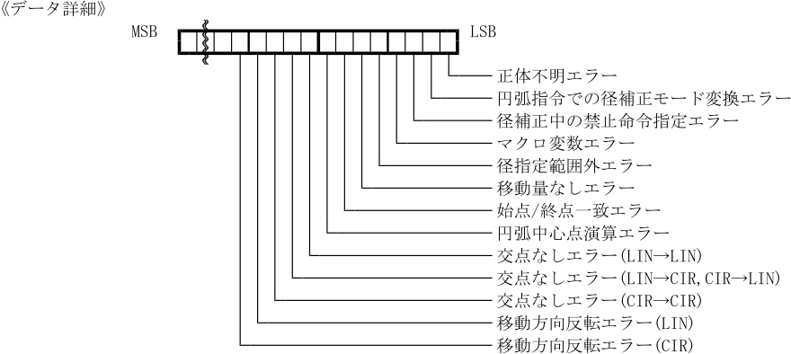

> **図の内容**
>
> | ビット | 内容 |
> |---|---|
> | D0 | 正体不明エラー |
> | D1 | 円弧指令での径補正モード変換エラー |
> | D2 | 径補正中の禁止命令指定エラー |
> | D3 | マクロ変数エラー |
> | D4 | 径指定範囲外エラー |
> | D5 | 移動量なしエラー |
> | D6 | 始点/終点一致エラー |
> | D7 | 円弧中心点演算エラー |
> | D8 | 交点なしエラー（LIN→LIN） |
> | D9 | 交点なしエラー（LIN→CIR, CIR→LIN） |
> | D10 | 交点なしエラー（CIR→CIR） |
> | D11 | 移動方向反転エラー（LIN） |
> | D12 | 移動方向反転エラー（CIR） |
>
> 上記以外のビットは未使用。

#### 4-1-34.ポイントテーブル書込/読出 [DAT_POINTTABLE(0x3B)] <オプション>

**《データタイプ》**

DAT_POINTTABLE(0x3B)

**《パラメータ》**

軸指定、書込/読出開始ポイント番号指定、書込/読出ポイント数を指定します。 D20 D10 D00

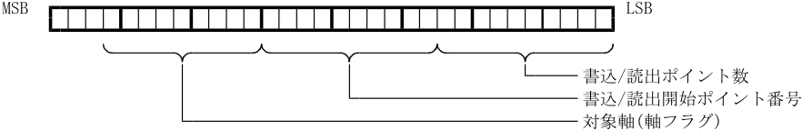

> **図の内容**
>
> パラメータ(32bit):
>
> | ビット | 内容 |
> |---|---|
> | D00～D09 | 書込/読出ポイント数 |
> | D10～D19 | 書込/読出開始ポイント番号 |
> | D20～D28 | 対象軸（軸フラグ） |

① 対象軸(軸フラグ)

ダウンロード/アップロード対象の軸を指定します。

1を設定した軸に対してダウンロード/アップロードを行います。

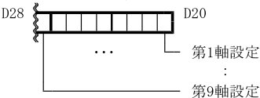

> **図の内容**
>
> D20 が第1軸設定、…、D28 が第9軸設定。

② 書込/読出開始ポイント番号

ダウンロード/アップロードを行うポイント番号の開始値を指定します。 1～400の間で指定して下さい。

③ 書込/読出ポイント数

ダウンロード/アップロードを行うポイント数を指定します。 1～400の間で指定して下さい。

**《タスク指定》**

- 有効

**《書き込み実行条件》**

- 対象タスクがプログラム未実行

**《読み込み実行条件》**

- 常時実行可能です。

**《説明》**

- ポイント位置決め用のポイントテーブルを書込/読出を行います。
- ポイントテーブルはバックアップしていません。電源投入時の初期値は、全ポイント/全軸無効状態です。この状態でポイント位置決めを行うと、何もしません。

電源投入時は毎回ポイントテーブルのダウンロードを行って下さい。

- パラメータの「開始ポイント番号&ポイント数」指定は、以下の範囲で指定して下さい。範囲外の時は、通信パラメータエラー(E$PARAM)になります。

1 ≦開始ポイント番号

開始ポイント番号+ポイント数 ≦ 400

- ポイントテーブルのデータは、軸指定で有効な軸のみを前詰めで設定します。
- タスクで有効な軸に対して、軸指定で指定しなかった場合は、その軸は移動しません。タスクで無効な軸に対して、軸指定で指定した場合は、その軸は無視されます。(移動しません) 軸指定で指定した軸の位置指定に無効データ(0x80000000)を設定した場合、そのポイントへの位置決め時は移動しません。

**《データフォーマット》**

データサイズ:「書込/読出ポイント数」* 36Byte

|   オフセット [Byte] | データ名称   |   データ長 [Byte] | データ範囲 [単位]                    |
|----------------|-------------|---------------|-------------------------------|
|              0 | 第1軸論理座標     |             4 | -1000000000～1000000000[pulse] |
|              4 | 第2軸論理座標     |             4 | -1000000000～1000000000[pulse] |
|              8 | 第3軸論理座標     |             4 | -1000000000～1000000000[pulse] |
|             12 | 第4軸論理座標     |             4 | -1000000000～1000000000[pulse] |
|             16 | 第5軸論理座標     |             4 | -1000000000～1000000000[pulse] |
|             20 | 第6軸論理座標     |             4 | -1000000000～1000000000[pulse] |
|             24 | 第7軸論理座標     |             4 | -1000000000～1000000000[pulse] |
|             28 | 第8軸論理座標     |             4 | -1000000000～1000000000[pulse] |
|             32 | 第9軸論理座標     |             4 | -1000000000～1000000000[pulse] |

**《構造体定義》**

```c
/************************************************************************/
/* 位置決めポイントテーブルデータ構造体（36Byte固定長） */
/************************************************************************/
typedef struct {      /* ポイントデータ構造体（36Byte固定長） */
    long AxisPos[9];  /* 各軸アブソ位置 */
} AXIS_POINT;
```

※ 書込/読出ポイント数分の、AXIS_POINTの配列で定義して下さい。

**《データ設定/動作例》**

- 対象タスクの割り当て軸:0x17(X/Y/Z/B)
- ダウンロード時のパラメータ指定:0x01b4b003

※ 対象軸=0x01b(X/Y/A/B)、

開始ポイント=0x12c(300)、

ポイント数=0x003(3)

- → 特殊な動作例としてタスクの割り当て軸と対象軸を変えてあります。通常は同じ設定でご使用下さい。
- 運転プログラム & 動作説明

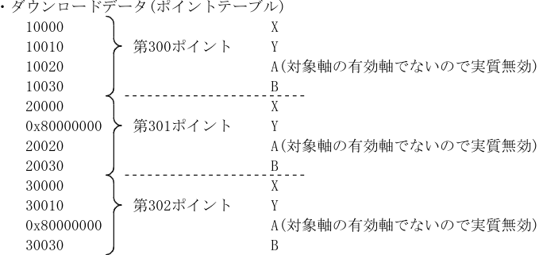

> **図の内容**
>
> ・ダウンロードデータ（ポイントテーブル）
>
> | ポイント | X | Y | A（対象軸の有効軸でないので実質無効） | B |
> |---|---|---|---|---|
> | 第300ポイント | 10000 | 10010 | 10020 | 10030 |
> | 第301ポイント | 20000 | 0x80000000 | 20020 | 20030 |
> | 第302ポイント | 30000 | 30010 | 0x80000000 | 30030 |
>
> データは X、Y、A、B の順に並ぶ。

```c
    運転ラ動作説明
    PTMA P1;    /*→ポイントテーブルをダウンロードしていないので */
/* 無効データになっているため何もしません。 */
    PTMA P300;  /*→X10000、Y10010、B10030 へ移動します。 */
/* Z軸は目標位置をダウンロードしていないので移動しません。 */
/* A軸はタスクに割り当てられていないので移動しません。 */
    PTMA P301;  /*→X20000、B20030 へ移動します。 */
/* Y軸は目標位置に無効値を設定しているので移動しません。 */
/* Z軸は目標位置をダウンロードしていないので移動しません。 */
/* A軸はタスクに割り当てられていないので移動しません。 */
    PTMA P302;  /*→X30000、Y30010、B30030 へ移動します。 */
/* Z軸は目標位置をダウンロードしていないので移動しません。 */
/* A軸はタスクに割り当てられていないので移動しません。 */
/* (目標位置に無効値を設定していますが、元々割り当てられて */
/* いない軸なので特に意味はありません。) */
    END;
```

#### 4-1-35.制御周期内処理時間計測データ読出 [DAT_RTC(0x21)]

**《データタイプ》**

DAT_RTC(0x21)

**《パラメータ》**

なし

**《タスク指定》**

無効

**《説明》**

SLM8000内部にて実測した制御周期毎の内部処理時間を読出します。

読み出した値は、処理時間カウントクロック(TIMERCLOCK)で計測した値です。

**《読み込み実行条件》**

常時実行可能です。

**《データフォーマット》**

データサイズ:8Byte

|   オフセット [Byte] | データ名称   |   データ長 [Byte] | データ範囲 [単位]   |
|----------------|---------|---------------|--------------|
|              0 | 最大処理時間  |             4 | 0～4294967295 |
|              4 | 現在処理時間  |             4 | 0～4294967295 |

**《構造体定義》**

```c
/************************************************************************/
/* RTC処理時間格納構造体 */
/************************************************************************/
typedef struct {
    unsigned long RtcMax;  /* 最大処理時間[us] */
    unsigned long RtcNow;  /* 現在処理時間[us] */
} RTCTIME;
#define TIMERCLOCK 11.11   /* 処理時間カウントクロック(MHx)*/
```

※処理時間カウントクロックで割ることにより、時間単位[μsec]になります。

max[μsec] = (DWORD)(RtcMax / TIMERCLOCK);

now[μsec] = (DWORD)(RtcNow / TIMERCLOCK);

#### 4-1-36.フォアグランド周期計測データ読出[DAT_FORGROUND(0x90)]

**《データタイプ》**

DAT_FORGROUND(0x90)

**《パラメータ》**

なし

**《タスク指定》**

無効

**《説明》**

SLM8000内部で実測した、フォアグランドループの処理時間を読出します。

読み出した値は、処理時間カウントクロック(TIMERCLOCK)で計測した値です。

**《読み込み実行条件》**

常時実行可能です。

**《データフォーマット》**

データサイズ:8Byte

|   オフセット [Byte] | データ名称   |   データ長 [Byte] | データ範囲 [単位]   |
|----------------|---------|---------------|--------------|
|              0 | 最大処理時間  |             4 | 0～4294967295 |
|              4 | 現在処理時間  |             4 | 0～4294967295 |

**《構造体定義》**

```c
/************************************************************************/
/* フォアグランド処理時間格納構造体 */
/************************************************************************/
typedef struct {
    unsigned long ForMax;  /* 最大処理時間[us] */
    unsigned long ForNow;  /* 現在処理時間[us] */
} FORTIME;
```

※処理時間カウントクロックで割ることにより、時間単位[μsec]になります。

max[μsec] = (DWORD)(FORMax / TIMERCLOCK);

now[μsec] = (DWORD)(FORNow / TIMERCLOCK);

#### 4-1-37.ROMバージョン情報読出 [DAT_VERSION(0x27)]

**《データタイプ》**

DAT_VERSION(0x27)

**《パラメータ》**

なし

**《タスク指定》**

無効

**《説明》**

SLM8000のシステムのバージョン情報を読出します。

**《読み込み実行条件》**

常時実行可能です。

**《データフォーマット》**

データサイズ:64Byte

|   オフセット [Byte] | データ名称       |   データ長 [Byte] | データ範囲 [単位]   |
|----------------|-----------------|---------------|--------------|
|              0 | バージョン文字列        |            16 | －            |
|             16 | PROM SUM (EVEN) |             2 | －            |
|             18 | PROM SUM (ODD)  |             2 | －            |
|             20 | FLASH SUM       |             2 | －            |
|             22 | FLASH使用フラグ      |             2 | 0:未使用、1:使用   |
|             24 | 機種ID            |             4 | －            |
|             28 | シリアルID          |             4 | －            |
|             32 | プロダクトID         |             4 | －            |
|             36 | MACアドレス         |             6 |              |
|             42 | IPアドレス          |             4 |              |
|             46 | 予約              |            18 | －            |

**《構造体定義》**

```c
/************************************************************************/
/* ROMバージョン情報構造体 */
/************************************************************************/
typedef struct {
    char Version[16];            /* バージョン文字列 */
    unsigned short EvenSum;      /* SUM:even (rom) */
    unsigned short OddSum;       /* SUM:odd (rom) */
    unsigned short FlashSum;     /* SUM:SH内部FLASH */
    short FlashFlg;              /* SH内部FLASH使用フラグ */
    unsigned long KindID;        /* 機種ID */
    unsigned long SerialID;      /* シリアルID */
    unsigned long ProductID;     /* プロダクトID */
    char MacAddr[6];             /* MACアドレス */
    unsigned char IPAddress[4];  /* IPアドレス */
    char Reserved[18];           /* 予約 */
} ROMVERSION;
```

#### 4-1-38.動作モードデータ読出 [DAT_MODE(0x04)]

**《データタイプ》**

DAT_MODE(0x04)

**《パラメータ》**

なし

**《タスク指定》**

有効

**《説明》**

SLM8000の指定したタスクの動作モードを読出します。

**《読み込み実行条件》**

常時実行可能です。

**《データフォーマット》**

データサイズ:2Byte

|   オフセット [Byte] | データ名   |   称データ長 [Byte] | データ範囲 [単位]   |
|----------------|-----------|-----------------|--------------|
|              0 | 動作モード     |               2 | 0 ～ 4        |

**《モードデータ》**

|   設定値 | モード       |
|-------|-----------|
|     0 | セッティングモード |
|     1 | 手動運転モード   |
|     2 | 自動運転モード   |
|     3 | OT無視モード   |
|     4 | DNC運転モード  |

**《構造体定義》**

```c
/************************************************************************/
/* 動作モードデータ構造体 */
/************************************************************************/
typedef struct {
    short mode;  /* 動作モード */
} STMODE;
```

※DNCオプション有りの時

#### 4-1-39.指令位置データ読出 [DAT_COMREG(0x05)]

**《データタイプ》**

DAT_COMREG(0x05)

**《パラメータ》**

なし

**《タスク指定》**

無効

- 《説明》

SLM8000の各軸の指令位置を読出します。

有効軸以外の各軸のデータは、無効データです。

**《読み込み実行条件》**

常時実行可能です。

**《データフォーマット》**

データサイズ:32Byte

|   オフセット [Byte] | データ名称   |   データ長 [Byte] | データ範囲 [単位]                      |
|----------------|-------------|---------------|---------------------------------|
|              0 | 第1物理軸指令位置   |             4 | -1000000000 ～ 1000000000[pulse] |
|              4 | 第2物理軸指令位置   |             4 | -1000000000 ～ 1000000000[pulse] |
|              8 | 第3物理軸指令位置   |             4 | -1000000000 ～ 1000000000[pulse] |
|             12 | 第4物理軸指令位置   |             4 | -1000000000 ～ 1000000000[pulse] |
|             16 | 第5物理軸指令位置   |             4 | -1000000000 ～ 1000000000[pulse] |
|             20 | 第6物理軸指令位置   |             4 | -1000000000 ～ 1000000000[pulse] |
|             24 | 第7物理軸指令位置   |             4 | -1000000000 ～ 1000000000[pulse] |
|             28 | 第8物理軸指令位置   |             4 | -1000000000 ～ 1000000000[pulse] |

**《構造体定義》**

```c
/************************************************************************/
/* 指令位置情報構造体 */
/************************************************************************/
typedef struct {
    long Pos[8];  /* 第1～8物理軸指令位置 */
} STCOMREG;
```

#### 4-1-40.ビット情報ステータスデータ読出 [DAT_STATUS_BIT(0x06)]

**《データタイプ》**

DAT_STATUS_BIT(0x06)

**《パラメータ》**

なし

**《タスク指定》**

無効

**《説明》**

SLM8000の現在の動作状態を読出します。

有効軸以外の各軸のデータや、有効タスク以外の各タスクデータは、無効データです。

**《読み込み実行条件》**

常時実行可能です。

**《関連項目》**

<4-1-7.ステータスデータ読出>

**《データフォーマット》**

データサイズ:68Byte

|   オフセット [Byte] | データ名称   |   データ長 [Byte] | データ範囲 [単位]   |
|----------------|-------------|---------------|--------------|
|              0 | 全体ステータス     |             4 | －            |
|              4 | 第1物理軸ステータス  |             4 | －            |
|              8 | 第2物理軸ステータス  |             4 | －            |
|             12 | 第3物理軸ステータス  |             4 | －            |
|             16 | 第4物理軸ステータス  |             4 | －            |
|             20 | 第5物理軸ステータス  |             4 | －            |
|             24 | 第6物理軸ステータス  |             4 | －            |
|             28 | 第7物理軸ステータス  |             4 | －            |
|             32 | 第8物理軸ステータス  |             4 | －            |
|             36 | タスク0ステータス   |             4 | －            |
|             40 | タスク1ステータス   |             4 | －            |
|             44 | タスク2ステータス   |             4 | －            |
|             48 | タスク3ステータス   |             4 | －            |
|             52 | タスク4ステータス   |             4 | －            |
|             56 | タスク5ステータス   |             4 | －            |
|             60 | タスク6ステータス   |             4 | －            |
|             64 | タスク7ステータス   |             4 | －            |

**《構造体定義》**

```c
/************************************************************************/
/* ビット情報ステータス構造体 */
/************************************************************************/
typedef struct {
    long Status;      /* 各種状態情報 */
    long AxisSts[8];  /* 各軸ステータス情報 */
    long TaskSts[8];  /* 各タスクステータス情報 */
} STSBIT;
```

**《データ詳細》**

- (1) 全体ステータス詳細は、<4-1-7.ステータスデータ読出>の「(1)全体情報」を参照ください。
- (2) 軸ステータス詳細は、<4-1-7.ステータスデータ読出>の「(2)各軸情報」を参照ください。
- (3) タスクステータス

詳細は、<4-1-7.ステータスデータ読出>の「(3)タスク情報」を参照ください。

#### 4-1-41.ビット情報アラームデータ読出 [DAT_ALMRM_BIT(0x07)]

**《データタイプ》**

DAT_ALARM_BIT(0x07)

**《パラメータ》**

なし

**《タスク指定》**

無効

**《説明》**

SLM8000の現在のアラーム状態を読出します。

有効軸以外の各軸のデータや、有効タスク以外の各タスクデータは、無効データです。

**《読み込み実行条件》**

常時実行可能です。

**《関連項目》**

<4-1-7.ステータスデータ読出>

**《データフォーマット》**

データサイズ:68Byte

|   オフセット [Byte] | データ名称   |   データ長 [Byte] | データ範囲 [単位]   |
|----------------|-------------|---------------|--------------|
|              0 | 全体アラーム      |             4 | －            |
|              4 | 第1物理軸アラーム   |             4 | －            |
|              8 | 第2物理軸アラーム   |             4 | －            |
|             12 | 第3物理軸アラーム   |             4 | －            |
|             16 | 第4物理軸アラーム   |             4 | －            |
|             20 | 第5物理軸アラーム   |             4 | －            |
|             24 | 第6物理軸アラーム   |             4 | －            |
|             28 | 第7物理軸アラーム   |             4 | －            |
|             32 | 第8物理軸アラーム   |             4 | －            |
|             36 | タスク0アラーム    |             4 | －            |
|             40 | タスク1アラーム    |             4 | －            |
|             44 | タスク2アラーム    |             4 | －            |
|             48 | タスク3アラーム    |             4 | －            |
|             52 | タスク4アラーム    |             4 | －            |
|             56 | タスク5アラーム    |             4 | －            |
|             60 | タスク6アラーム    |             4 | －            |
|             64 | タスク7アラーム    |             4 | －            |

**《構造体定義》**

```c
/************************************************************************/
/* ビット情報アラーム構造体 */
/************************************************************************/
typedef struct {
    long Alarm;       /* アラーム情報 */
    long AxisAlm[8];  /* 各軸アラーム情報 */
    long TaskAlm[8];  /* 各タスクアラーム情報 */
} ALMBIT;
```

**《データ詳細》**

- (1) 全体アラーム詳細は、<4-1-7.ステータスデータ読出>の「(1)全体情報」を参照ください。
- (2) 軸アラーム詳細は、<4-1-7.ステータスデータ読出>の「(2)各軸情報」を参照ください。
- (3) タスクアラーム

詳細は、<4-1-7.ステータスデータ読出>の「(3)タスク情報」を参照ください。

#### 4-1-42.オーバーライド設定データ読出 [DAT_OVERRIDE(0x08)]

**《データタイプ》**

DAT_OVERRIDE(0x08)

**《パラメータ》**

なし

**《タスク指定》**

有効

**《説明》**

SLM8000のオーバーライド設定を読出します。

**《読み込み実行条件》**

常時実行可能です。

**《データフォーマット》**

データサイズ:6Byte

|   オフセット [Byte] | データ名称   |   データ長 [Byte] | データ範囲 [単位]   |
|----------------|-------------|---------------|--------------|
|              0 | 送りオーバーライド設定 |             2 | 0 ～ 7        |
|              2 | 補間オーバーライド設定 |             2 | 0 ～ 7        |
|              4 | 主軸オーバーライド設定 |             2 | 0 ～ 7        |

設定値とオーバーライドの関係は下表の通りです。

|   設定値 | オーバーライド   |
|-------|-----------|
|     0 | 25%       |
|     1 | 50%       |
|     2 | 75%       |
|     3 | 100%      |
|     4 | 125%      |
|     5 | 150%      |
|     6 | 175%      |
|     7 | 200%      |

**《構造体定義》**

```c
/************************************************************************/
/* 送りオーバーライドデータ構造体 */
/************************************************************************/
typedef struct {
    short Override;   /* 送りオーバーライド設定 */
    short COverride;  /* 補間オーバーライド設定 */
    short SOverride;  /* 主軸オーバーライド設定 */
} STOVERRIDE;
```

#### 4-1-43.プログラム実行情報データ読出 [DAT_PRGSTS(0x0C)]

**《データタイプ》**

DAT_PRGSTS(0x0C)

**《パラメータ》**

なし

**《タスク指定》**

有効

**《説明》**

SLM8000のプログラム実行情報を読出します。

**《読み込み実行条件》**

常時実行可能です。

**《関連項目》**

<4-1-7.ステータスデータ読出>

**《データフォーマット》**

データサイズ:12Byte

|   オフセット [Byte] | データ名称    |   データ長 [Byte] | データ範囲 [単位]     |
|----------------|--------------|---------------|----------------|
|              0 | プログラム実行ステータス |             4 | －              |
|              4 | 選択・実行プログラム番号 |             2 | 0 ～ 32767      |
|              6 | 未使用          |             2 | －              |
|              8 | 実行ステップ番号     |             4 | 0 ～ 4294967295 |

**《構造体定義》**

```c
/************************************************************************/
/* プログラム情報データ構造体 */
/************************************************************************/
typedef struct {
    unsigned long PrgExecSts;  /* プログラム実行ステータス */
    short ProgramNo;           /* 選択・実行プログラム番号 */
    short Reserved;            /* 未使用 */
    unsigned long StepNo;      /* 実行ステップ番号 */
} STPRGSTS;
```

**《データ詳細》**

(1) プログラム実行ステータス

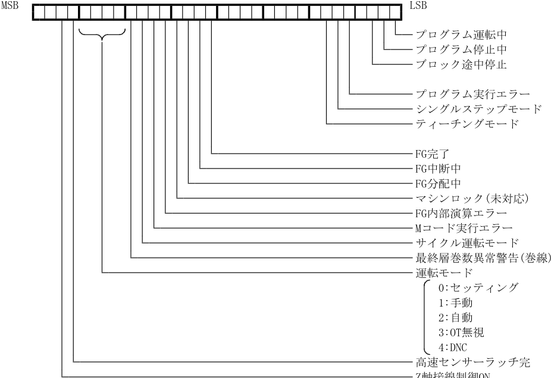

> **図の内容**
>
> 32 ビット。
>
> | ビット | 内容 |
> |---|---|
> | D0 | プログラム運転中 |
> | D1 | プログラム停止中 |
> | D2 | ブロック途中停止 |
> | D4 | プログラム実行エラー |
> | D5 | シングルステップモード |
> | D6 | ティーチングモード |
> | D16 | FG完了 |
> | D17 | FG中断中 |
> | D18 | FG分配中 |
> | D19 | マシンロック（未対応） |
> | D20 | FG内部演算エラー |
> | D21 | Mコード実行エラー |
> | D22 | サイクル運転モード |
> | D23 | 最終層巻数異常警告(巻線) |
> | D24～D27 | 運転モード（0:セッティング、1:手動、2:自動、3:OT無視、4:DNC） |
> | D28 | 高速センサーラッチ完 |
> | D29 | Z軸接線制御ON |
>
> 上記以外のビットは未使用。

Z軸接線制御ON

- (2) 選択・実行プログラム番号詳細は、<4-1-7.ステータスデータ読出>の「(3)タスク情報」を参照ください。
- (3) 実行ステップ番号詳細は、<4-1-7.ステータスデータ読出>の「(3)タスク情報」を参照ください。

#### 4-1-44.オーバーライド%設定データ読出 [DAT_OVERRIDEP(0x15)]

**《データタイプ》**

DAT_OVERRIDEP(0x15)

**《パラメータ》**

なし

**《タスク指定》**

有効

**《説明》**

SLM8000のオーバーライド設定を1%刻みで読出します。

**《読み込み実行条件》**

常時実行可能です。

**《データフォーマット》**

データサイズ:6Byte

|   オフセット [Byte] | データ名称   |   データ長 [Byte] | データ範囲 [単位]   |
|----------------|-------------|---------------|--------------|
|              0 | 送りオーバーライド設定 |             2 | 0 ～ 200      |
|              2 | 補間オーバーライド設定 |             2 | 0 ～ 200      |
|              4 | 主軸オーバーライド設定 |             2 | 0 ～ 200      |

**《構造体定義》**

```c
/************************************************************************/
/* 送りオーバーライドデータ構造体 */
/************************************************************************/
typedef struct {
    short Override;   /* 送りオーバーライド設定 */
    short COverride;  /* 補間オーバーライド設定 */
    short SOverride;  /* 主軸オーバーライド設定 */
} STOVERRIDE;
```

#### 4-1-45.絶対値エンコーダオフセット書込/読出 [DAT_ABSENCOFS(0x1c)]

**《データタイプ》**

DAT_ABSENCOFS(0x1c)

**《パラメータ》**

なし

**《タスク指定》**

無効

**《説明》**

SLM8000に絶対値エンコーダオフセットの書込/読出を行います。

**《書き込み実行条件》**

- 全タスクセッティングモード

**《読み込み実行条件》**

常時実行可能です。

**《データフォーマット》**

データサイズ: 32 Byte

|   オフセット [Byte] | データ名称          |   データ長 [Byte] | データ範囲 [単位]                  |
|----------------|--------------------|---------------|-----------------------------|
|              0 | 第1物理軸絶対値エンコーダオフセット |             4 | -2147483648～2147483647[pls] |
|              4 | 第2物理軸絶対値エンコーダオフセット |             4 | -2147483648～2147483647[pls] |
|              8 | 第3物理軸絶対値エンコーダオフセット |             4 | -2147483648～2147483647[pls] |
|             12 | 第4物理軸絶対値エンコーダオフセット |             4 | -2147483648～2147483647[pls] |
|             16 | 第5物理軸絶対値エンコーダオフセット |             4 | -2147483648～2147483647[pls] |
|             20 | 第6物理軸絶対値エンコーダオフセット |             4 | -2147483648～2147483647[pls] |
|             24 | 第7物理軸絶対値エンコーダオフセット |             4 | -2147483648～2147483647[pls] |
|             28 | 第8物理軸絶対値エンコーダオフセット |             4 | -2147483648～2147483647[pls] |

**《構造体定義》**

```c
/************************************************************************/
/* 絶対値エンコーダオフセット構造体 */
/************************************************************************/
typedef struct{
    long ofs[8];
} ABSENCOFS;
```

### 4-2.動作要求コマンド詳細

動作要求コマンドは、パソコンよりSLM8000に各種動作の指示を行う機能です。

通信ライブラリのSendCommand()関数を使用して、SLM8000へ動作要求を行うことが出来ます。

#### 4-2-1.バックアップメモリ初期化コマンド [REQ_GENE(0x14)]

**《データタイプ》**

REQ_GENE(0x14)

**《タスク指定》**

無効

**《説明》**

SLM8000のバックアップメモリのデータを初期化します。バックアップされているデータは以下です。

- パラメータ・・・ <4-1-1.サーボパラメータデータ>

<4-1-3.ピッチエラー補正パラメータ>

- <4-1-4.工具長補正データ>
- <4-1-5.工具径補正データ>
- <4-1-6.補間前加減速パラメータ>
- 運転プログラム・・・ <4-1-2.プログラムデータ>
- アブソポジション・・・ <4-1-45.絶対値エンコーダオフセット>
- マクロ変数・・・一般レジスタ(#1000-#1199,#6500-#6699)を記憶
- ポイントテーブル・・・ <4-1-34.ポイントテーブル>
- 論理座標オフセット・・・機械座標系と論理座標系のオフセットを記憶

パラメータを初期化すると、SLM8000はパラメータ未設定エラーになります。パラメータ未設定エラーは、各パラメータを再設定する事により解除できます。

(無効のオプションに対する設定は不要です。)

**《コマンド実行条件》**

全タスクセッティングモード

**《データフォーマット》**

データサイズ:2Byte

|   オフセット [Byte] | データ名称   |   データ長 [Byte] | データ範囲 [単位]   |
|----------------|-------------|---------------|--------------|
|              0 | 初期化データ選択フラグ |             2 |              |

**《構造体定義》**

```c
/************************************************************************/
/* バックアップメモリ初期化コマンドパラメータ構造体 */
/************************************************************************/
typedef struct {
    unsigned short InitCmnd;  /* 初期化データ選択フラグ */
} GENERATION;
```

**《データ詳細》**

- (1) 初期化データ選択フラグ初期化を行うデータの種別を指定します。種別に対応するビットに1を設定するとそのデータが初期化されます。

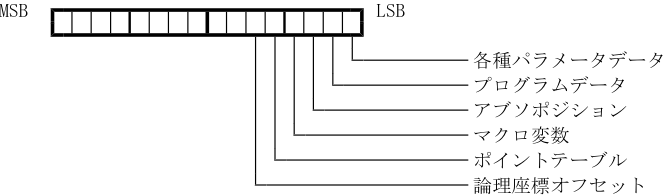

> **図の内容**
>
> | ビット | 内容 |
> |---|---|
> | D0 | 各種パラメータデータ |
> | D1 | プログラムデータ |
> | D2 | アブソポジション |
> | D3 | マクロ変数 |
> | D4 | ポイントテーブル |
> | D5 | 論理座標オフセット |

#### 4-2-2.アブソ座標設定コマンド [REQ_MABSCOORDSET(0x90)]

**《データタイプ》**

REQ_MABSCOORDSET(0x90)

**《タスク指定》**

有効

**《説明》**

各軸のアブソポジション(機械座標系)を指定値に設定します。

**《コマンド実行条件》**

対象のタスクがセッティングモードの時に実行可能です。

**《データフォーマット》**

データサイズ:40Byte

|   オフセット [Byte] | データ名称   |   データ長 [Byte] | データ範囲 [単位]                    |
|----------------|-------------|---------------|-------------------------------|
|              0 | 設定軸選択フラグ    |             4 | －                             |
|              4 | 第1軸機械座標値    |             4 | -1000000000～1000000000[pulse] |
|              8 | 第2軸機械座標値    |             4 | -1000000000～1000000000[pulse] |
|             12 | 第3軸機械座標値    |             4 | -1000000000～1000000000[pulse] |
|             16 | 第4軸機械座標値    |             4 | -1000000000～1000000000[pulse] |
|             20 | 第5軸機械座標値    |             4 | -1000000000～1000000000[pulse] |
|             24 | 第6軸機械座標値    |             4 | -1000000000～1000000000[pulse] |
|             28 | 第7軸機械座標値    |             4 | -1000000000～1000000000[pulse] |
|             32 | 第8軸機械座標値    |             4 | -1000000000～1000000000[pulse] |
|             36 | 第9軸機械座標値    |             4 | -1000000000～1000000000[pulse] |

**《構造体定義》**

※<4-2-32.座標系設定コマンド[REQ_COORDSET(0x37)]>と同じ構造体です。

```c
/************************************************************************/
/* 座標系設定コマンドパラメータ構造体 */
/************************************************************************/
typedef struct {
    unsigned long AxisFlag;  /* 設定軸選択フラグ */
    long PosAxis[9];         /* 第1～第9軸設定座標 */
} COORDSET;
```

**《データ詳細》**

- (1) 設定軸選択フラグ論理座標値を設定する軸を指定します。設定を行う軸に対応するビットに1を設定します。

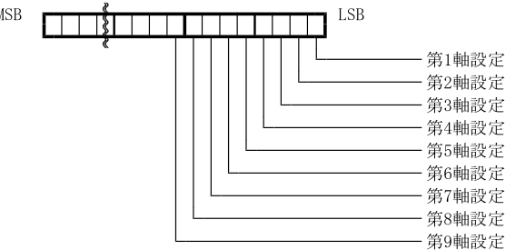

> **図の内容**
>
> D0 が第1軸設定、D1 が第2軸設定、…、D8 が第9軸設定。

#### 4-2-3.Flashメモリへのプログラム反映コマンド [REQ_REFMEM(0x6E)]

**《データタイプ》**

REQ_REFMEM(0x6E)

**《タスク指定》**

無効

**《説明》**

ダウンロード済みの全プログラムデータを保存領域に保存します。

ROMSWのユーザフリーオプションにて"運転プログラムバックアップ方法"を"手動バックアップ"に設定した場合に限りFlashメモリへのプログラム反映コマンドは有効です。

("自動バックアップ"の場合：処理をせずにOKを返します。

"バックアップ無し"の場合：通信エラー(E$CMDNOT)を返します。)

**《コマンド実行条件》**

- ROMSWの"運転プログラムバックアップ方法"が"バックアップ無し"ではない
- プログラム書き込み中でない

**《データフォーマット》**

コマンド付加データは有りません。

#### 4-2-4.Flashメモリへのポイントデータ反映コマンド [REQ_REFPOINT(0x6F)]

**《データタイプ》**

REQ_REFPOINT(0x6F)

**《タスク指定》**

無効

**《説明》**

ダウンロード済みの全ポイントデータを保存領域に保存します。

ROMSWのユーザフリーオプションにて"位置決めポイントテーブルバックアップ方法"を

"手動バックアップ"に設定した場合に限りFlashメモリへのプログラム反映コマンドは有効です。

("自動バックアップ"の場合：処理をせずにOKを返します。

"バックアップ無し"の場合：通信エラー(E$CMDNOT)を返します。)

**《コマンド実行条件》**

- ROMSWの"位置決めポイントテーブルバックアップ方法"が"バックアップ無し"ではない
- プログラム書き込み中でない

**《データフォーマット》**

コマンド付加データは有りません。

#### 4-2-5.動作モード変更コマンド [REQ_MODECHG(0x10)]

**《データタイプ》**

REQ_MODECHG(0x10)

**《タスク指定》**

有効

**《説明》**

- SLM8000の動作モードを設定します。
- SLM8000はスタンドアロン状態では動作モードの変更はできません。

SLM8000の電源投入後のデフォルト動作モードは、自動運転モードです。

**《コマンド実行条件》**

動作モード設定は、プログラム実行中または軸移動中は実行できません。

- プログラム実行中でない
- 移動中の軸がない

**《データフォーマット》**

データサイズ:2Byte

|   オフセット [Byte] | データ名称   |   データ長 [Byte] | データ範囲 [単位]   |
|----------------|-------------|---------------|--------------|
|              0 | 動作モード       |             2 | 0～4          |

**《構造体定義》**

```c
/************************************************************************/
/* 動作モードデータ変更コマンド付加データ構造体 */
/************************************************************************/
typedef struct {
    short mode;  /* 動作モード */
} MODECHG;
```

**《データ詳細》**

- (1) 動作モード

設定する動作モードを指定します。

※DNC運転オプション有りの時

|   設定値 | モード       |
|-------|-----------|
|     0 | セッティングモード |
|     1 | 手動運転モード   |
|     2 | 自動運転モード   |
|     3 | OT無視モード   |
|     4 | DNC運転モード  |

#### 4-2-6.軸移動停止コマンド [REQ_STOP(0x13)]

**《データタイプ》**

REQ_STOP(0x13)

**《タスク指定》**

有効

**《説明》**

プログラム実行や移動コマンド発行等によって移動中の軸を停止します。軸移動停止は、SLM8000の動作モードや動作状態に関わらず実行可能です。

**《コマンド実行条件》**

・サーボON状態

**《データフォーマット》**

コマンド付加データは有りません。

#### 4-2-7.リセットコマンド [REQ_RESET(0x1A)]

**《データタイプ》**

REQ_RESET(0x1A)

**《タスク指定》**

有効

**《説明》**

SLM8000のリセットを行います。

- SLM8000は、リセット処理にて以下の動作を行います。

**○リセット動作**

- プログラム実行中の場合は、プログラム実行を終了させる。
- 移動中の軸がある場合は、移動を終了させる。
- アラーム発生中の場合は、アラーム解除/サーボONを行う。 (但し、アラーム要因が解除されていない場合、再びアラームになります。)

**《コマンド実行条件》**

SLM8000の動作モードや動作状態に関わらず常時実行可能です。

**《データフォーマット》**

コマンド付加データは有りません。

#### 4-2-8.軸移動再開コマンド [REQ_RESTART(0x1B)]

**《データタイプ》**

REQ_RESTART(0x1B)

**《タスク指定》**

有効

**《説明》**

軸移動停止コマンドにて、停止中の軸の移動を再開します。

軸移動再開は、以下のような移動を軸移動停止コマンドにて停止させた場合に実行可能です。

**《コマンド実行条件》**

- インクレPTP位置決めコマンドによる軸移動が停止中
- アブソPTP位置決めコマンドによる軸移動が停止中
- インクレ補間位置決めコマンドによる軸移動が停止中
- アブソ補間位置決めコマンドによる軸移動が停止中

※このコマンドは使用条件が複雑です。このコマンドをお使いになる場合はテクノに問い合わせてください。

**《データフォーマット》**

コマンド付加データは有りません。

#### 4-2-9.プログラム実行開始コマンド [REQ_PROGSTRT(0x20)]

**《データタイプ》**

REQ_PROGSTRT(0x20)

**《タスク指定》**

有効

**《説明》**

SLM8000に対して、プログラム実行の開始/再開を行います。

**《コマンド実行条件》**

- サーボON状態
- アラーム未発生
- 動作モードが自動運転モードかDNC運転モード (自動運転モードなら、現在のプログラム番号に運転プログラムダウンロード済み)
- 運転プログラム未実行(開始時) 又は停止中(再開時)
- 移動中の軸がない
- 手動パルサー選択無効
- 原点復帰無効の軸を除く、全ての軸が原点復帰済み

**《データフォーマット》**

コマンド付加データは有りません。

#### 4-2-10.プログラム実行停止コマンド [REQ_PROGSTOP(0x21)]

**《データタイプ》**

REQ_PROGSTOP(0x21)

**《タスク指定》**

有効

**《説明》**

SLM8000に対して、プログラム実行/軸移動の一時停止を行います。

プログラム実行停止コマンドにて、一時停止したプログラム実行は、プログラム実行開始コマンドにて再開できます。

プログラム未実行で軸移動中だった場合は、軸移動再開コマンドにて再開できます。

**《コマンド実行条件》**

常時実行可能です。ただし、プログラム実行中/軸移動中でないときはなにもしません。

**《データフォーマット》**

コマンド付加データは有りません。

#### 4-2-11.実行プログラム選択コマンド [REQ_PROGSLCT(0x22)]

**《データタイプ》**

REQ_PROGSLCT(0x22)

**《タスク指定》**

有効

**《説明》**

SLM8000に対して、実行するプログラムを指定します。プログラム選択コマンドは、動作モード・状態に関わらず実行可能です。

**《コマンド実行条件》**

常時実行可能です。

ただし、プログラム実行中又は機械パネルにてプログラム番号選択中は、ステータスデータの現在プログラム選択番号に反映されません。

プログラム未実行かつ機械パネルのプログラム番号選択無効の時に設定した番号が反映されます。

**《データフォーマット》**

データサイズ:2Byte

|   オフセット [Byte] | データ名称   |   データ長 [Byte] | データ範囲 [単位]   |
|----------------|-------------|---------------|--------------|
|              0 | 選択プログラム番号   |             2 |              |

**《構造体定義》**

```c
/************************************************************************/
/* プログラム選択コマンドパラメータ構造体 */
/************************************************************************/
typedef struct {
    unsigned short ProgSel;  /* 選択プログラム番号 */
} PROGSEL;
```

**《データ詳細》**

- (1) 選択プログラム番号 P番号

実行するプログラムを番号で指定します。

#### 4-2-12.マルチタスクプログラム開始コマンド [REQ_TASKSTART(0x80)] <オプション>

**《データタイプ》**

REQ_TASKSTART(0x80)

**《タスク指定》**

有効

**《説明》**

指定したタスクの運転プログラムの開始を行います。

**《コマンド実行条件》**

常時実行可能です。

**《データフォーマット》**

データサイズ:4Byte

|   オフセット [Byte] | データ名称   |   データ長 [Byte] | データ範囲 [単位]   |
|----------------|---------|---------------|--------------|
|              0 | タスク番号   |             4 | 0～7          |

**《構造体定義》**

```c
typedef int PRGTASK;
```

#### 4-2-13.マルチタスクプログラム停止コマンド [REQ_TASKSTOP(0x81)] <オプション>

**《データタイプ》**

REQ_TASKSTOP(0x81)

**《タスク指定》**

有効

**《説明》**

指定したタスクの運転プログラムの停止を行います。

- 《コマンド実行条件》常時実行可能です。

**《データフォーマット》**

<4-2-12.マルチタスクプログラム開始コマンド>と同様です。

#### 4-2-14.マルチタスクプログラムリセットコマンド [REQ_TASKRESET(0x82)] <オプション>

**《データタイプ》**

REQ_TASKRESET(0x82)

**《タスク指定》**

有効

**《説明》**

指定したタスクのリセットを行います。

**《コマンド実行条件》**

常時実行可能です。

**《データフォーマット》**

<4-2-12.マルチタスクプログラム開始コマンド>と同様です。

#### 4-2-15.JOG移動コマンド [REQ_JOGSTART(0x11)]

**《データタイプ》**

REQ_JOGSTART(0x11)

**《タスク指定》**

有効

**《説明》**

任意の論理軸のJOG移動を開始します。

有効軸以外の軸指定は、無効です。

JOGで移動中の軸が有る場合は、新たに他の軸へのJOG動作を実行できません。

JOG移動は、以下の条件が満たされているときに実行可能です。

※ <4-2-6.軸移動停止コマンド[REQ_STOP(0x13)]>でJOG動作を中断します。

**《コマンド実行条件》**

- サーボON状態
- 動作モードが手動運転モードか自動運転モードかOT無視モード
- 運転プログラム未実行又はティーチング中又は "M0" 停止中
- 移動中の軸がない
- 原点復帰中でない
- ホーム戻り中でない
- 手動パルサー選択無効

**《データフォーマット》**

データサイズ:4Byte

|   オフセット [Byte] | データ名称   |   データ長 [Byte] | データ範囲 [単位]   |
|----------------|-------------|---------------|--------------|
|              0 | 移動軸選択フラグ    |             2 |              |
|              2 | 軸移動方向フラグ    |             2 |              |

**《構造体定義》**

```c
/************************************************************************/
/* JOG移動開始コマンドパラメータ構造体 */
/************************************************************************/
typedef struct {
    unsigned short AxisFlag;  /* 移動軸選択フラグ */
    unsigned short JogVect;   /* 軸移動方向フラグ */
} JOGSTART;
```

**《データ詳細》**

- (1) 移動軸選択フラグ

JOG移動コマンドにて、移動を行わせる軸を指定します。各軸に対応するビットに1を設定するとその軸が移動を行います。

MSB

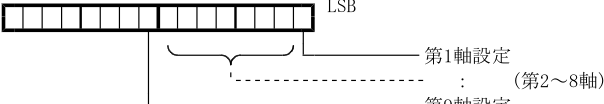

> **図の内容**
>
> D0 が第1軸設定、D1～D7 が第2～8軸、D8 が第9軸設定。

(2) 軸移動方向フラグ

JOG移動コマンドにて、各軸の移動方向を指定します。

各軸に対応するビットに、1を設定するとその軸が-方向へ、0を設定すると+方向へ移動を行います。

MSB

LSB

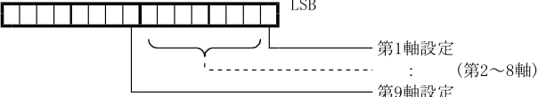

> **図の内容**
>
> D0 が第1軸設定、D1～D7 が第2～8軸、D8 が第9軸設定。

第9軸設定

第9軸設定

#### 4-2-16.インクレPTP位置決めコマンド [REQ_PTPSTART(0x15)]

**《データタイプ》**

REQ_PTPSTART(0x15)

**《タスク指定》**

有効

**《説明》**

インクレモードのPTP位置決めを実行します。有効軸以外の軸指定は、無効です。

**《コマンド実行条件》**

- サーボON状態
- 動作モードが手動運転モードか自動運転モード
- 運転プログラム未実行又はティーチング中
- 移動中の軸がない
- 手動パルサー選択無効
- 指定軸が回転速度指令中(SPIN中)でない

**《データフォーマット》**

データサイズ:40Byte

|   オフセット [Byte] | データ名称     |   データ長 [Byte] | データ範囲 [単位]                    |
|----------------|---------------|---------------|-------------------------------|
|              0 | 移動軸選択フラグ      |             4 |                               |
|              4 | 第1軸インクリメント移動量 |             4 | -1000000000～1000000000[pulse] |
|              8 | 第2軸インクリメント移動量 |             4 | -1000000000～1000000000[pulse] |
|             12 | 第3軸インクリメント移動量 |             4 | -1000000000～1000000000[pulse] |
|             16 | 第4軸インクリメント移動量 |             4 | -1000000000～1000000000[pulse] |
|             20 | 第5軸インクリメント移動量 |             4 | -1000000000～1000000000[pulse] |
|             24 | 第6軸インクリメント移動量 |             4 | -1000000000～1000000000[pulse] |
|             28 | 第7軸インクリメント移動量 |             4 | -1000000000～1000000000[pulse] |
|             32 | 第8軸インクリメント移動量 |             4 | -1000000000～1000000000[pulse] |
|             36 | 第9軸インクリメント移動量 |             4 | -1000000000～1000000000[pulse] |

**《構造体定義》**

```c
/************************************************************************/
/* PTP移動開始コマンドパラメータ構造体 */
/************************************************************************/
typedef struct {
    unsigned long AxisFlag;  /* 移動軸選択フラグ */
    long IncAxis[9];         /* 各軸インクリメント移動量 */
} PTPSTART;
```

**《データ詳細》**

- (1) 移動軸選択フラグ移動コマンドにて、移動を行わせる論理軸を指定します。

各軸に対応するビットに1を設定するとその軸が移動を行います。

MSB

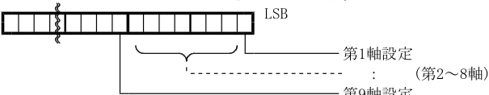

> **図の内容**
>
> D0 が第1軸設定、D1～D7 が第2～8軸、D8 が第9軸設定。

第9軸設定

- (2) 第1軸～第9軸インクリメント移動量各軸の現在位置からの移動量を指定します。設定単位は[pulse]です。

#### 4-2-17.アブソPTP位置決めコマンド [REQ_PTPASTART(0x16)､REQ_PTPBSTART(0x34)]

**《データタイプ》**

REQ_PTPASTART(0x16)

REQ_PTPBSTART(0x34)

**《タスク指定》**

有効

**《説明》**

アブソモードのPTP位置決めを実行します。

REQ_PTPASTART:論理座標系アブソ指定 REQ_PTPBSTART:機械座標系アブソ指定有効軸以外の軸指定は、無効です。

**《コマンド実行条件》**

- サーボON状態
- 動作モードが手動運転モードか自動運転モード
- 運転プログラム未実行又はティーチング中
- 移動中の軸がない
- 手動パルサー選択無効
- 指定軸が回転速度指令中(SPIN中)でない

**《データフォーマット》**

データサイズ:40Byte

|   オフセット [Byte] | データ名称   |   データ長 [Byte] | データ範囲 [単位]                    |
|----------------|-------------|---------------|-------------------------------|
|              0 | 移動軸選択フラグ    |             4 |                               |
|              4 | 第1軸目標位置     |             4 | -1000000000～1000000000[pulse] |
|              8 | 第2軸目標位置     |             4 | -1000000000～1000000000[pulse] |
|             12 | 第3軸目標位置     |             4 | -1000000000～1000000000[pulse] |
|             16 | 第4軸目標位置     |             4 | -1000000000～1000000000[pulse] |
|             20 | 第5軸目標位置     |             4 | -1000000000～1000000000[pulse] |
|             24 | 第6軸目標位置     |             4 | -1000000000～1000000000[pulse] |
|             28 | 第7軸目標位置     |             4 | -1000000000～1000000000[pulse] |
|             32 | 第8軸目標位置     |             4 | -1000000000～1000000000[pulse] |
|             36 | 第9軸目標位置     |             4 | -1000000000～1000000000[pulse] |

**《構造体定義》**

```c
/************************************************************************/
/* PTP移動開始コマンドパラメータ構造体(ABSO) */
/************************************************************************/
typedef struct {
    unsigned long AxisFlag;  /* 移動軸選択フラグ */
    long PosAxis[9];         /* 各軸位置決めポジション */
} PTPASTART;
```

**《データ詳細》**

- (1) 移動軸選択フラグ

移動コマンドにて、移動を行わせる論理軸を指定します。

各軸に対応するビットに1を設定するとその軸が移動を行います。

MSB

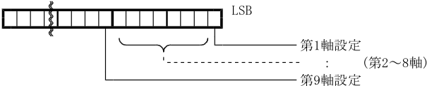

> **図の内容**
>
> D0 が第1軸設定、D1～D7 が第2～8軸、D8 が第9軸設定。

- (2) 第1軸～第9軸目標位置

各軸の位置決め目標位置を指定します。設定単位は[pulse]です。

#### 4-2-18.同期軸無視インクレPTP位置決めコマンド [REQ_SYNEGPTPSTART(0x49)]

**《データタイプ》**

REQ_SYNEGPTPSTART(0x49)

**《タスク指定》**

有効

**《説明》**

同一指令2軸制御の同期軸で、基準軸または従属軸を同期軸指定を無視して、独立にインクレモードの PTP位置決めを行います。有効軸以外の軸指定は無効です。

**《コマンド実行条件》**

- サーボON状態
- 動作モードが手動運転モードか自動運転モード
- プログラム運転未実行またはティーチング中
- 移動中の軸がない
- 原点復帰中でない
- ホーム戻り中でない
- 手動パルサー選択無効
- 指定軸が回転速度指令中(SPIN中)でない

**《データフォーマット》**

データサイズ:40byte

|   オフセット [Byte] | データ名称     |   データ長 [Byte] | データ範囲 [単位]                    |
|----------------|---------------|---------------|-------------------------------|
|              0 | 移動軸選択フラグ      |             4 |                               |
|              4 | 第1軸インクリメント移動量 |             4 | -1000000000～1000000000[pulse] |
|              8 | 第2軸インクリメント移動量 |             4 | -1000000000～1000000000[pulse] |
|             12 | 第3軸インクリメント移動量 |             4 | -1000000000～1000000000[pulse] |
|             16 | 第4軸インクリメント移動量 |             4 | -1000000000～1000000000[pulse] |
|             20 | 第5軸インクリメント移動量 |             4 | -1000000000～1000000000[pulse] |
|             24 | 第6軸インクリメント移動量 |             4 | -1000000000～1000000000[pulse] |
|             28 | 第7軸インクリメント移動量 |             4 | -1000000000～1000000000[pulse] |
|             32 | 第8軸インクリメント移動量 |             4 | -1000000000～1000000000[pulse] |
|             36 | 第9軸インクリメント移動量 |             4 | -1000000000～1000000000[pulse] |

**《構造体定義》**

```c
/************************************************************************/
/* PTP移動開始コマンドパラメータ構造体 */
/************************************************************************/
typedef struct {
    unsigned long AxisFlag;  /* 移動軸選択フラグ */
    long IncAxis[9];         /* 各軸インクリメント移動量 */
} PTPSTART;
```

**《データ詳細》**

- (1) 移動軸選択フラグ移動コマンドで動かす軸を指定します。

各軸に対応するビットに"1"を設定するとその軸が移動を行います。

MSB

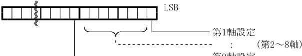

> **図の内容**
>
> D0 が第1軸設定、D1～D7 が第2～8軸、D8 が第9軸設定。

- (2) 第1軸～第9軸インクリメント移動量

各軸の現在位置からの移動量を指定します。設定単位は[pulse]です。

第9軸設定

#### 4-2-19.同期軸無視アブソPTP位置決めコマンド

[REQ_SYNEGPTPASTART(0x4A)､ REQ_SYNEGPTPBSTART(0x4B)]

**《データタイプ》**

REQ_SYNEGPTPASTART(0x4a)

REQ_SYNEGPTPBSTART(0x4b)

**《タスク指定》**

有効

**《説明》**

REQ_SYNEGPTPASTART:論理座標系アブソ指定

REQ_SYNEGPTPBSTART:機械座標系アブソ指定

同一指令2軸制御の同期軸で、基準軸または従属軸を同期軸指定を無視して、独立にアブソモードのPTP位置決めを行います。有効軸以外の軸指定は無効です。

**《コマンド実行条件》**

- サーボON状態
- 動作モードが手動運転モードか自動運転モード
- プログラム運転未実行またはティーチング中
- 移動中の軸がない
- 原点復帰中でない
- ホーム戻り中でない
- 手動パルサー選択無効
- 指定軸が回転速度指令中(SPIN中)でない

**《データフォーマット》**

データサイズ:40byte

|   オフセット [Byte] | データ名称   |   データ長 [Byte] | データ範囲 [単位]                    |
|----------------|-------------|---------------|-------------------------------|
|              0 | 移動軸選択フラグ    |             4 |                               |
|              4 | 第1軸目標位置     |             4 | -1000000000～1000000000[pulse] |
|              8 | 第2軸目標位置     |             4 | -1000000000～1000000000[pulse] |
|             12 | 第3軸目標位置     |             4 | -1000000000～1000000000[pulse] |
|             16 | 第4軸目標位置     |             4 | -1000000000～1000000000[pulse] |
|             20 | 第5軸目標位置     |             4 | -1000000000～1000000000[pulse] |
|             24 | 第6軸目標位置     |             4 | -1000000000～1000000000[pulse] |
|             28 | 第7軸目標位置     |             4 | -1000000000～1000000000[pulse] |
|             32 | 第8軸目標位置     |             4 | -1000000000～1000000000[pulse] |
|             36 | 第9軸目標位置     |             4 | -1000000000～1000000000[pulse] |

**《構造体定義》**

```c
/************************************************************************/
/* PTP移動開始コマンドパラメータ構造体(ABSO) */
/************************************************************************/
typedef struct {
    unsigned long AxisFlag;  /* 移動軸選択フラグ */
    long PosAxis[9];         /* 各軸位置決めポジション */
} PTPASTART;
```

**《データ詳細》**

(1) 移動軸選択フラグ

移動コマンドで動かす軸を指定します。

各軸に対応するビットに"1"を設定するとその軸が移動を行います。

第9軸設定

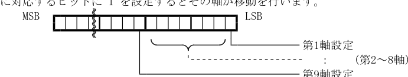

> **図の内容**
>
> 各軸に対応するビットに 1 を設定するとその軸が移動を行います。D0 が第1軸設定、D1～D7 が第2～8軸、D8 が第9軸設定。

(2) 第1軸～第9軸目標位置

各軸の位置決め目標位置を指定します。設定単位は[pulse]です。

#### 4-2-20.インクレ直線補間位置決めコマンド [REQ_LINSTART(0x17)]

**《データタイプ》**

REQ_LINSTART(0x17)

**《タスク指定》**

有効

**《説明》**

インクレモードの直線補間位置決めを実行します。有効軸以外の軸指定は無効です。

**《コマンド実行条件》**

- サーボON状態
- 動作モードが手動運転モードか自動運転モード
- 運転プログラム未実行又はティーチング中
- 移動中の軸がない
- 手動パルサー選択無効
- 指定軸が回転速度指令中(SPIN中)でない

**《データフォーマット》**

データサイズ:44Byte

|   オフセット [Byte] | データ名称     |   データ長 [Byte] | データ範囲 [単位]                    |
|----------------|---------------|---------------|-------------------------------|
|              0 | 移動軸選択フラグ      |             4 |                               |
|              4 | 第1軸インクリメント移動量 |             4 | -1000000000～1000000000[pulse] |
|              8 | 第2軸インクリメント移動量 |             4 | -1000000000～1000000000[pulse] |
|             12 | 第3軸インクリメント移動量 |             4 | -1000000000～1000000000[pulse] |
|             16 | 第4軸インクリメント移動量 |             4 | -1000000000～1000000000[pulse] |
|             20 | 第5軸インクリメント移動量 |             4 | -1000000000～1000000000[pulse] |
|             24 | 第6軸インクリメント移動量 |             4 | -1000000000～1000000000[pulse] |
|             28 | 第7軸インクリメント移動量 |             4 | -1000000000～1000000000[pulse] |
|             32 | 第8軸インクリメント移動量 |             4 | -1000000000～1000000000[pulse] |
|             36 | 第9軸インクリメント移動量 |             4 | -1000000000～1000000000[pulse] |
|             40 | 補間送り速度        |             4 | 1～1000000000[pulse/sec]       |

**《構造体定義》**

```c
/************************************************************************/
/* 補間移動開始コマンドパラメータ構造体 */
/************************************************************************/
typedef struct {
    unsigned long AxisFlag;  /* 移動軸選択フラグ */
    long IncAxis[9];         /* 各軸インクリメント移動量 */
    long Feed;               /* 補間送り速度 [pls/sec] */
} LINSTART;
```

**《データ詳細》**

- (1) 移動軸選択フラグ移動コマンドにて、移動を行わせる軸を指定します。各軸に対応するビットに1を設定するとその軸が移動を行います。
- (2) 第1軸～第9軸インクリメント移動量各軸の現在位置からの移動量を指定します。設定単位は[pulse]です。
- (3) 補間送り速度

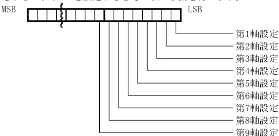

> **図の内容**
>
> D0 が第1軸設定、D1 が第2軸設定、…、D8 が第9軸設定。

補間送り速度を指定します。設定単位は[pps](パルス/秒)です。

【例:2軸移動の場合】


> **図の内容**
>
> 横軸「第1軸移動」、縦軸「第2軸移動」。原点から「(第1軸, 第2軸)位置決め座標」へ向かう直線。「この軌跡上の速度を指定する。」

#### 4-2-21.アブソ直線補間位置決めコマンド [REQ_LINASTART(0x18)､REQ_LINBSTART(0x35)]

**《データタイプ》**

REQ_LINASTART(0x18)

REQ_LINBSTART(0x35)

**《タスク指定》**

有効

**《説明》**

アブソモードの直線補間位置決めを実行します。

REQ_LINASTART:論理座標系アブソ指定

REQ_LINBSTART:機械座標系アブソ指定

有効軸以外の軸指定は、無効です。

**《コマンド実行条件》**

- サーボON状態
- 動作モードが手動運転モードか自動運転モード
- 運転プログラム未実行又はティーチング中
- 移動中の軸がない
- 手動パルサー選択無効
- 指定軸が回転速度指令中(SPIN中)でない

**《データフォーマット》**

データサイズ:44Byte

|   オフセット [Byte] | データ名称   |   データ長 [Byte] | データ範囲 [単位]                    |
|----------------|-------------|---------------|-------------------------------|
|              0 | 移動軸選択フラグ    |             4 |                               |
|              4 | 第1軸目標位置     |             4 | -1000000000～1000000000[pulse] |
|              8 | 第2軸目標位置     |             4 | -1000000000～1000000000[pulse] |
|             12 | 第3軸目標位置     |             4 | -1000000000～1000000000[pulse] |
|             16 | 第4軸目標位置     |             4 | -1000000000～1000000000[pulse] |
|             20 | 第5軸目標位置     |             4 | -1000000000～1000000000[pulse] |
|             24 | 第6軸目標位置     |             4 | -1000000000～1000000000[pulse] |
|             28 | 第7軸目標位置     |             4 | -1000000000～1000000000[pulse] |
|             32 | 第8軸目標位置     |             4 | -1000000000～1000000000[pulse] |
|             36 | 第9軸目標位置     |             4 | -1000000000～1000000000[pulse] |
|             40 | 補間送り速度      |             4 | 1～1000000000[pulse/sec]       |

**《構造体定義》**

```c
/************************************************************************/
/* 補間移動開始コマンドパラメータ構造体（ABSO） */
/************************************************************************/
typedef struct {
    unsigned long AxisFlag;  /* 移動軸選択フラグ */
    long PosAxis[9];         /* 各軸位置決めポジション */
    long Feed;               /* 補間送り速度 [pls/sec] */
} LINASTART;
```

**《データ詳細》**

(1) 移動軸選択フラグ

移動コマンドにて、移動を行わせる軸を指定します。

各軸に対応するビットに1を設定するとその軸が移動を行います。


> **図の内容**
>
> D0 が第1軸設定、D1 が第2軸設定、…、D8 が第9軸設定。

- (2) 第1軸～第9軸目標位置各軸の位置決め目標位置を指定します。設定単位は[pulse]です。

(3) 補間送り速度

補間送り速度を指定します。設定単位は［pps］(パルス/秒)です。

【例:2軸移動の場合】

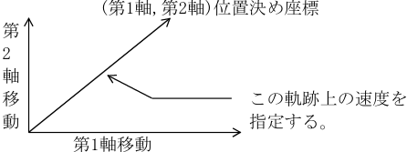

> **図の内容**
>
> 横軸「第1軸移動」、縦軸「第2軸移動」。原点から「(第1軸, 第2軸)位置決め座標」へ向かう直線。「この軌跡上の速度を指定する。」

#### 4-2-22.回転軸回転動作コマンド [REQ_SPINAX(0x52)]

**《データタイプ》**

REQ_SPINAX(0x52)

**《タスク指定》**

有効

**《説明》**

任意の無限回転軸を定速回転運動の開始及び停止を行います。

回転動作の実行中に再度回転指令を行う事により、停止することなく回転速度の変更が行えます。尚、回転動作中の軸に対して、他の移動命令(位置決め等)を行うことは出来ません。無限回転軸の詳細は、

「SLM8000 ユーザーズマニュアル」<Ⅲ機能編 4-16-1.周回処理>(TB00-1130E) を参照下さい。

**《コマンド実行条件》**

- サーボON状態
- アラーム未発生
- 動作モードが手動運転モード/自動運転モード/DNC運転モード
- 指定した軸が移動中の軸でない
- 指定した軸が無限回転軸

**《データフォーマット》**

データサイズ:40Byte

|   オフセット [Byte] | データ名称     |   データ長 [Byte] | データ範囲 [単位]             |
|----------------|-----------|---------------|------------------------|
|              0 | オーバライドフラグ |             2 | 0：無効、1：有効              |
|              2 | 移動軸選択フラグ  |             2 | －                      |
|              4 | 第1軸回転数    |             4 | 0～(MAXpps*600/1回転パルス数) |
|              8 | 第2軸回転数    |             4 | 0～(MAXpps*600/1回転パルス数) |
|             12 | 第3軸回転数    |             4 | 0～(MAXpps*600/1回転パルス数) |
|             16 | 第4軸回転数    |             4 | 0～(MAXpps*600/1回転パルス数) |
|             20 | 第5軸回転数    |             4 | 0～(MAXpps*600/1回転パルス数) |
|             24 | 第6軸回転数    |             4 | 0～(MAXpps*600/1回転パルス数) |
|             28 | 第7軸回転数    |             4 | 0～(MAXpps*600/1回転パルス数) |
|             32 | 第8軸回転数    |             4 | 0～(MAXpps*600/1回転パルス数) |
|             36 | 第9軸回転数    |             4 | 0～(MAXpps*600/1回転パルス数) |

**《構造体定義》**

```c
/************************************************************************/
/* 回転軸回転動作コマンドパラメータ構造体 */
/************************************************************************/
typedef struct {
    short OverFlag;           /* オーバーライドフラグ */
    unsigned short AxisFlag;  /* 移動軸選択フラグ */
    long RevAx[9];            /* 第1軸～第9軸回転数 */
} SPINAX;
```

※1

**《データ詳細》**

- (1) オーバーライド有効フラグオーバーライドの変更に伴い、回転速度を変更するかどうかを指定します。

(2) 移動軸選択フラグ

移動コマンドにて、移動を行わせる軸を指定します。

各軸に対応するビットに1を設定するとその軸が移動を行います。

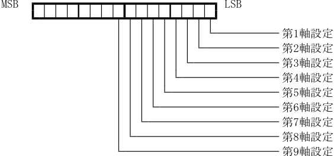

> **図の内容**
>
> D0 が第1軸設定、D1 が第2軸設定、…、D8 が第9軸設定。

(3) 各軸回転数

- 0.1rpm単位で指定します。

尚、回転数に0を指定した場合、回転動作を終了します。

#### 4-2-23.高速センサーラッチインクレ補間位置決めコマンド [REQ_SLINSTART(0x28)] <オプション>

**《データタイプ》**

REQ_SLINSTART(0x28)

**《タスク指定》**

有効

**《説明》**

高速センサーラッチインクレ補間位置決め動作を実行します。有効軸以外の軸指定は、無効です。

**《コマンド実行条件》**

- サーボON状態
- 動作モードが手動運転モード/自動運転モード/DNC運転モード
- 運転プログラム未実行又はティーチング中
- 移動中の軸がない
- 手動パルサー選択無効

**《データフォーマット》**

データサイズ:48Byte

|   オフセット [Byte] | データ名称     |   データ長 [Byte] | データ範囲 [単位]                    |
|----------------|---------------|---------------|-------------------------------|
|              0 | 移動軸選択フラグ      |             4 |                               |
|              4 | 第1軸インクリメント移動量 |             4 | -1000000000～1000000000[pulse] |
|              8 | 第2軸インクリメント移動量 |             4 | -1000000000～1000000000[pulse] |
|             12 | 第3軸インクリメント移動量 |             4 | -1000000000～1000000000[pulse] |
|             16 | 第4軸インクリメント移動量 |             4 | -1000000000～1000000000[pulse] |
|             20 | 第5軸インクリメント移動量 |             4 | -1000000000～1000000000[pulse] |
|             24 | 第6軸インクリメント移動量 |             4 | -1000000000～1000000000[pulse] |
|             28 | 第7軸インクリメント移動量 |             4 | -1000000000～1000000000[pulse] |
|             32 | 第8軸インクリメント移動量 |             4 | -1000000000～1000000000[pulse] |
|             36 | 第9軸インクリメント移動量 |             4 | -1000000000～1000000000[pulse] |
|             40 | 補間送り速度        |             4 | 1～1000000000[pulse/sec]       |
|             44 | スキップ抑制フラグ     |             2 | 0：スキップ、1：継続                   |
|             46 | 予約            |             2 |                               |

**《構造体定義》**

```c
/************************************************************************/
/* 高速センサーラッチ補間移動開始コマンドパラメータ構造体 */
/************************************************************************/
typedef struct {
    unsigned long AxisFlag;  /* 移動軸選択フラグ */
    long IncAxis[9];         /* 各軸インクリメント移動量 */
    long Feed;               /* 補間送り速度 [pls/sec] */
    short NoSkipF;           /* スキップ抑制フラグ */
    short Reserve;
} SLINSTART;
```

**《データ詳細》**

- (1) 移動軸選択フラグ
2. 移動コマンドにて、移動を行わせる軸を指定します。各軸に対応するビットに1を設定するとその軸が移動を行います。

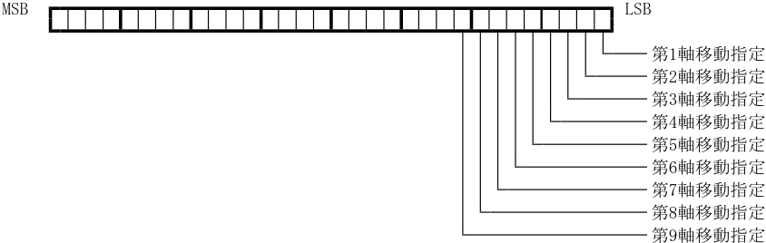

> **図の内容**
>
> 32 ビット。D0 が第1軸移動指定、D1 が第2軸移動指定、…、D8 が第9軸移動指定。

- (2) 第1軸～第9軸インクリメント移動量

各軸の現在位置からの移動量を指定します。設定単位は[pulse]です。

- (3) 補間送り速度補間送り速度を指定します。設定単位は[pps](パルス/秒)です。

【例:2軸移動の場合】


> **図の内容**
>
> 横軸「第1軸移動」、縦軸「第2軸移動」。原点から「(第1軸, 第2軸)位置決め座標」へ向かう直線。「この軌跡上の速度を指定する。」

- (4) スキップ抑制フラグ

軸移動中にセンサーラッチ入力が入った時に、移動をキャンセルするかどうかを指定します。

#### 4-2-24.高速センサーラッチアブソ補間位置決めコマンド [REQ_SLINASTART(0x29)] <オプション>

**《データタイプ》**

REQ_SLINASTART(0x29)

**《タスク指定》**

有効

**《説明》**

高速センサーラッチアブソ補間位置決め動作を実行します。有効軸以外の軸指定は、無効です。

**《コマンド実行条件》**

- サーボON状態
- 動作モードが手動運転モード/自動運転モード/DNC運転モード
- 運転プログラム未実行又はティーチング中
- 移動中の軸がない
- 手動パルサー選択無効

**《データフォーマット》**

データサイズ:48Byte

|   オフセット [Byte] | データ名称   |   データ長 [Byte] | データ範囲 [単位]                    |
|----------------|-------------|---------------|-------------------------------|
|              0 | 移動軸選択フラグ    |             4 |                               |
|              4 | 第1軸目標位置     |             4 | -1000000000～1000000000[pulse] |
|              8 | 第2軸目標位置     |             4 | -1000000000～1000000000[pulse] |
|             12 | 第3軸目標位置     |             4 | -1000000000～1000000000[pulse] |
|             16 | 第4軸目標位置     |             4 | -1000000000～1000000000[pulse] |
|             20 | 第5軸目標位置     |             4 | -1000000000～1000000000[pulse] |
|             24 | 第6軸目標位置     |             4 | -1000000000～1000000000[pulse] |
|             28 | 第7軸目標位置     |             4 | -1000000000～1000000000[pulse] |
|             32 | 第8軸目標位置     |             4 | -1000000000～1000000000[pulse] |
|             36 | 第9軸目標位置     |             4 | -1000000000～1000000000[pulse] |
|             40 | 補間送り速度      |             4 | 1～1000000000[pulse/sec]       |
|             44 | スキップ抑制フラグ   |             2 | 0：スキップ、1：継続                   |
|             46 | 予約          |             2 |                               |

**《構造体定義》**

```c
/************************************************************************/
/* 高速センサーラッチ補間移動開始コマンドパラメータ構造体（ABSO） */
/************************************************************************/
typedef struct {
    unsigned long AxisFlag;  /* 移動軸選択フラグ */
    long PosAxis[9];         /* 各軸位置決めポジション */
    long Feed;               /* 補間送り速度 [pls/sec] */
    short NoSkipF;           /* スキップ抑制フラグ */
    short Reserve;
} SLINASTART;
```

**《データ詳細》**

- (1) 移動軸選択フラグ移動コマンドにて、移動を行わせる軸を指定します。

各軸に対応するビットに1を設定するとその軸が移動を行います。


> **図の内容**
>
> 32 ビット。D0 が第1軸移動指定、D1 が第2軸移動指定、…、D8 が第9軸移動指定。

- (2) 第1軸～第9軸目標位置各軸の位置決め目標位置を指定します。設定単位は[pulse]です。
- (3) 補間送り速度

補間送り速度を指定します。設定単位は[pps](パルス/秒)です。

【例:2軸移動の場合】

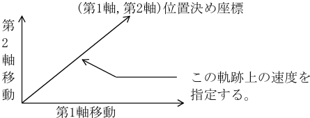

> **図の内容**
>
> 横軸「第1軸移動」、縦軸「第2軸移動」。原点から「(第1軸, 第2軸)位置決め座標」へ向かう直線。「この軌跡上の速度を指定する。」

(4) スキップ抑制フラグ

軸移動中にセンサーラッチ入力が入った時に、移動をキャンセルするかどうかを指定します。

#### 4-2-25.送りオーバーライド%変更コマンド

[REQ_OVRDCHGP(0x2D)、REQ_COVRDCHGP(0x85)、REQ_SOVRDCHGP(0x86)]

**《データタイプ》**

REQ_OVRDCHGP (0x2D) :全体オーバーライド%変更コマンド

REQ_COVRDCHGP(0x85) :補間オーバーライド%変更コマンド

REQ_SOVRDCHGP(0x86) :主軸オーバーライド%変更コマンド

**《タスク指定》**

有効

**《説明》**

送りオーバーライドを0%～200%の範囲で1%刻みで設定します。

補間オーバーライド: 直線補間/円弧補間動作のオーバーライドです。

ROMSW設定で補間オーバーライドを無効にした場合は、通信エラーになります。主軸オーバーライド: 主軸/SPIN動作時のオーバーライドです。

ROMSW設定で主軸オーバーライドを無効にした場合は、通信エラーになります。

**《コマンド実行条件》**

- 機械パネルのオーバーライド選択が無効

**《データフォーマット》**

データサイズ:2Byte

|   オフセット [Byte] | データ名称   |   データ長 [Byte] | データ範囲 [単位]   |
|----------------|-------------|---------------|--------------|
|              0 | オーバーライド設定値  |             2 | 0～200        |

**《構造体定義》**

```c
/************************************************************************/
/* 軸速度オーバーライド変更コマンドパラメータ構造体 */
/************************************************************************/
typedef struct {
    unsigned short Override;  /* オーバーライド設定値 */
} OVERCHG;
```

#### 4-2-26.Z軸接線制御ON/OFFコマンド [REQ_TLINE(0x54)] <オプション>

**《データタイプ》**

REQ_TLINE(0x54)

**《タスク指定》**

有効

**《説明》**

無限回転軸である接線制御軸を第1軸と第2軸の合成移動方向に、自動的に回転します。

**《コマンド実行条件》**

- アラーム未発生
- 運転プログラム未実行又は停止中
- 移動中の軸がない

**《データフォーマット》**

データサイズ:2Byte

|   オフセット [Byte] | データ名称    |   データ長 [Byte] | データ範囲 [単位]   |
|----------------|--------------|---------------|--------------|
|              0 | Z軸接線制御機能スイッチ |             2 | 0:OFF、1:ON   |

**《構造体定義》**

```c
/************************************************************************/
/* Z軸接線制御ON/OFFコマンドパラメータ構造体 */
/************************************************************************/
typedef struct {
    unsigned short tlinesw;  /* Z軸接線制御機能スイッチ */
} TLINESW;
```

#### 4-2-27.Mコード出力コマンド [REQ_MCDOUT(0x3D)]

**《データタイプ》**

REQ_MCDOUT(0x3D)

**《タスク指定》**

無効

**《説明》**

指定したMコードを出力するように指令します。

Mコード出力コマンドでは、M03(主軸正転)のような内部Mコード処理は行いません。

**《コマンド実行条件》**

- サーボON状態
- 動作モードが手動運転モード/自動運転モード/DNC運転モード
- 運転プログラム未実行又はティーチング中
- 移動中の軸がない
- 手動パルサー選択無効

**《データフォーマット》**

データサイズ:2Byte

|   オフセット [Byte] | データ名称    |   データ長 [Byte] | データ範囲 [単位]   |
|----------------|----------|---------------|--------------|
|              0 | 出力Mコード番号 |             2 | 0～255        |

**《構造体定義》**

```c
/************************************************************************/
/* Mコード出力コマンドパラメータ構造体 */
/************************************************************************/
typedef struct {
    unsigned short mcd;  /* 出力Mコード */
} OUTMCD;
```

#### 4-2-28.各軸原点復帰コマンド [REQ_ZRNSTART(0x12)､REQ_AXAUTOZRN(0x33)]

**《データタイプ》**

REQ_ZRNSTART (0x12)

REQ_AXAUTOZRN(0x33)

**《タスク指定》**

有効

**《説明》**

任意の論理軸の原点復帰を開始します。

REQ_ZRNSTART :各軸手動原点復帰指定(逃げ動作を行いません)

REQ_AXAUTOZRN:各軸自動原点復帰指定(逃げ動作を行います)

有効軸以外の軸指定は、無効です。

原点復帰は、以下の条件が満たされているときに実行可能です。

**《コマンド実行条件》**

- サーボON状態
- 動作モードが手動運転モードか自動運転モード
- 運転プログラム未実行
- 移動中の軸がない
- 手動パルサー選択無効
- 指定軸が回転速度指令中(SPIN中)でない

**《関連項目》**

<4-2-29.全軸原点復帰開始コマンド>

**《データフォーマット》**

データサイズ:2Byte

|   オフセット [Byte] | データ名称   |   データ長 [Byte] | データ範囲 [単位]   |
|----------------|-------------|---------------|--------------|
|              0 | 原点復帰軸選択フラグ  |             2 |              |

**《構造体定義》**

```c
/************************************************************************/
/* 原点復帰移動開始コマンドパラメータ構造体 */
/************************************************************************/
typedef struct {
    unsigned short AxisFlag;  /* 移動軸選択フラグ */
} ZRNSTART;
```

**《データ詳細》**

- (1) 原点復帰軸選択フラグ原点復帰コマンドにて、原点復帰を行わせる論理軸を指定します。

各論理軸に対応するビットに1を設定するとその軸が原点復帰を行います。

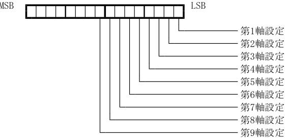

> **図の内容**
>
> D0 が第1軸設定、D1 が第2軸設定、…、D8 が第9軸設定。

#### 4-2-29.全軸原点復帰開始コマンド [REQ_ALLZRN(0x24)]

**《データタイプ》**

REQ_ALLZRN(0x24)

**《タスク指定》**

有効

**《説明》**

全軸の原点復帰を行います。

全軸原点復帰開始コマンドにて、SLM8000が実行する全軸原点復帰処理は、原点復帰入力による全軸原点復帰処理と同じです。

原点復帰は、以下の条件が満たされているときに実行可能です。

**《コマンド実行条件》**

- サーボON状態
- 動作モードが手動運転モード/自動運転モード/DNC運転モード
- 運転プログラム未実行又はティーチング中
- 移動中の軸がない
- 手動パルサー選択無効
- 指定軸が回転速度指令中(SPIN中)でない

**《関連項目》**

<4-2-28.各軸原点復帰コマンド>

**《データフォーマット》**

コマンド付加データは有りません。

#### 4-2-30.原点設定コマンド [REQ_ORGSET(0x19)]

**《データタイプ》**

REQ_ORGSET(0x19)

**《タスク指定》**

有効

**《説明》**

現在の軸指令位置を指令座標の原点として設定します。

原点設定は、全ての軸が停止しているときのみ実行可能です。

**《コマンド実行条件》**

- サーボON状態
- 動作モードが手動運転モードか自動運転モード
- 運転プログラム未実行又はティーチング中
- 移動中の軸がない
- 手動パルサー選択無効
- 指定軸が回転速度指令中(SPIN中)でない

**《データフォーマット》**

コマンド付加データは有りません。

#### 4-2-31.論理原点シフトコマンド [REQ_ZRNSHIFT(0x30)]

**《データタイプ》**

REQ_ZRNSHIFT(0x30)

**《タスク指定》**

有効

**《説明》**

ティーチングで移動した量だけ、論理原点をシフトします。

**《コマンド実行条件》**

- ティーチング中

**《データフォーマット》**

コマンド付加データは有りません。

#### 4-2-32.座標系設定コマンド [REQ_COORDSET(0x37)]

**《データタイプ》**

REQ_COORDSET(0x37)

**《タスク指定》**

有効

**《説明》**

各軸の現在位置を指定の論理座標値に設定します。

**《コマンド実行条件》**

- サーボON状態
- 動作モードが手動運転モード/自動運転モード/DNC運転モード
- 運転プログラム未実行又はティーチング中
- 移動中の軸がない
- 手動パルサー選択無効

**《データフォーマット》**

データサイズ:40Byte

|   オフセット [Byte] | データ名称   |   データ長 [Byte] | データ範囲 [単位]                    |
|----------------|-------------|---------------|-------------------------------|
|              0 | 設定軸選択フラグ    |             4 | －                             |
|              4 | 第1軸論理座標値    |             4 | -1000000000～1000000000[pulse] |
|              8 | 第2軸論理座標値    |             4 | -1000000000～1000000000[pulse] |
|             12 | 第3軸論理座標値    |             4 | -1000000000～1000000000[pulse] |
|             16 | 第4軸論理座標値    |             4 | -1000000000～1000000000[pulse] |
|             20 | 第5軸論理座標値    |             4 | -1000000000～1000000000[pulse] |
|             24 | 第6軸論理座標値    |             4 | -1000000000～1000000000[pulse] |
|             28 | 第7軸論理座標値    |             4 | -1000000000～1000000000[pulse] |
|             32 | 第8軸論理座標値    |             4 | -1000000000～1000000000[pulse] |
|             36 | 第9軸論理座標値    |             4 | -1000000000～1000000000[pulse] |

**《構造体定義》**

```c
/************************************************************************/
/* 座標系設定コマンドパラメータ構造体 */
/************************************************************************/
typedef struct {
    unsigned long AxisFlag;  /* 設定軸選択フラグ */
    long PosAxis[9];         /* 第1～第9軸設定座標 */
} COORDSET;
```

**《データ詳細》**

- (1) 設定軸選択フラグ論理座標値を設定する軸を指定します。

設定を行う軸に対応するビットに1を設定します。

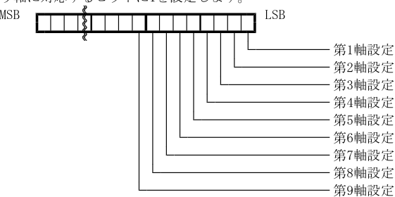

> **図の内容**
>
> D0 が第1軸設定、D1 が第2軸設定、…、D8 が第9軸設定。

#### 4-2-33.ホームポジション位置決めコマンド [REQ_HOME(0x83)]

**《データタイプ》**

REQ_HOME(0x83)

**《タスク指定》**

有効

**《説明》**

設定されたホーム位置へ移動します。

**《コマンド実行条件》**

- サーボON状態
- アラーム未発生
- 動作モードが手動運転モード/自動運転モード/DNC運転モード
- 運転プログラム未実行又はティーチング中
- 移動中の軸がない
- 手動パルサー選択無効
- 回転速度指令中(SPIN中)の軸がない

**《データフォーマット》**

コマンド付加データは有りません。

#### 4-2-34.汎用出力直接制御コマンド [REQ_OUTPUT(0x1D)]

**《データタイプ》**

REQ_OUTPUT(0x1D)

**《タスク指定》**

無効

**《説明》**

SLM8000の汎用出力を直接ON/OFFします。変更出来る出力は汎用出力(Ro00～Ro30)です。但し、運転プログラムにて出力命令を実行すると変更されます。

(後に指定された方が有効になります。)

**《コマンド実行条件》**

常時実行可能です。

**《関連項目》**

- <4-2-35.汎用入力強制制御コマンド>
- <4-2-36.汎用出力強制制御コマンド>

<4-2-37.汎用入出力ビット強制制御コマンド、汎用出力ビット直接制御コマンド>

**《データフォーマット》**

データサイズ:6Byte

|   オフセット [Byte] | データ名称       |   データ長 [Byte] | データ範囲 [単位]   |
|----------------|-----------------|---------------|--------------|
|              0 | 出力 1パターン (o#00) |             2 |              |
|              2 | 出力 2パターン (o#01) |             2 |              |
|              4 | 出力 3パターン (o#02) |             2 |              |

**《構造体定義》**

```c
/************************************************************************/
/* 汎用出力直接制御コマンドパラメータ構造体 */
/************************************************************************/
typedef struct {
    unsigned short OutputPat[3];  /* 汎用出力 */
} OUTPUTPAT;
```

**《データ詳細》**

(1) 出力パターン

各ビットに1を設定した場合、そのビットに対応する出力がONになります。 0を設定した場合、OFFになります。

MSB

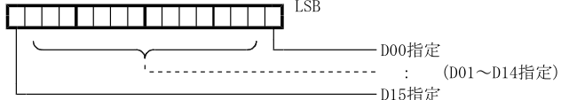

> **図の内容**
>
> 16 ビット。D00 が「D00指定」、D01～D14 が「D01～D14指定」、D15 が「D15指定」。

- ※ 汎用出力直接制御コマンドは全てのチャンネルの汎用出力を制御します。運転プログラムで使用している汎用出力指令と干渉しないように注意が必要です。なるべく任意の信号のみを制御できる

<4-2-37.汎用入出力ビット強制制御コマンド、汎用出力ビット直接制御コマンド> をご使用ください。

#### 4-2-35.汎用入力強制制御コマンド [REQ_COMPINPUT(0x2A)]

**《データタイプ》**

REQ_COMPINPUT(0x2A)

**《タスク指定》**

無効

- 《説明》

任意の入力の強制的なON/OFFを一括して指定します。

**《コマンド実行条件》**

常時実行可能です。

**《関連項目》**

- <4-2-34.汎用出力直接制御コマンド>
- <4-2-36.汎用出力強制制御コマンド>
- <4-2-37.汎用入出力ビット強制制御コマンド、汎用出力ビット直接制御コマンド>

**《データフォーマット》**

データサイズ:64Byte

|   オフセット [Byte] | データ名称      |   データ長 [Byte] | データ範囲 [単位]   |
|----------------|----------------|---------------|--------------|
|              0 | 入力1コマンド (i#00) |            16 | －            |
|             16 | 入力2コマンド (i#01) |            16 | －            |
|             32 | 入力3コマンド (i#02) |            16 | －            |
|             48 | 入力4コマンド (i#03) |            16 | －            |

各入力コマンドのフォーマットは以下の通りです。

| オフセット [Byte]   | データ名称    | データ長 [Byte]   | データ範囲 [単位]   |
|----------------|--------------|---------------|--------------|
| 0+16*N         | D00ビット変更コマンド | 1バイト          | 0～3          |
| 1+16*N         | D01ビット変更コマンド | 1バイト          | 0～3          |
| 2+16*N         | D02ビット変更コマンド | 1バイト          | 0～3          |
| 3+16*N         | D03ビット変更コマンド | 1バイト          | 0～3          |
| 4+16*N         | D04ビット変更コマンド | 1バイト          | 0～3          |
| 5+16*N         | D05ビット変更コマンド | 1バイト          | 0～3          |
| 6+16*N         | D06ビット変更コマンド | 1バイト          | 0～3          |
| 7+16*N         | D07ビット変更コマンド | 1バイト          | 0～3          |
| 8+16*N         | D08ビット変更コマンド | 1バイト          | 0～3          |
| 9+16*N         | D09ビット変更コマンド | 1バイト          | 0～3          |
| 10+16*N        | D10ビット変更コマンド | 1バイト          | 0～3          |
| 11+16*N        | D11ビット変更コマンド | 1バイト          | 0～3          |
| 12+16*N        | D12ビット変更コマンド | 1バイト          | 0～3          |
| 13+16*N        | D13ビット変更コマンド | 1バイト          | 0～3          |
| 14+16*N        | D14ビット変更コマンド | 1バイト          | 0～3          |
| 15+16*N        | D15ビット変更コマンド | 1バイト          | 0～3          |

- ※ Nはアドレス(i#00:0 ～ i#03:3)を表します。

**《構造体定義》**

```c
/************************************************************************/
/* 汎用入力/出力強制制御コマンドパラメータサブ構造体 */
/************************************************************************/
typedef struct {
    unsigned char IoBit[0];   /* 汎用入出力D00ビット変更コマンド */
    unsigned char IoBit[1];   /* 汎用入出力D01ビット変更コマンド */
    unsigned char IoBit[2];   /* 汎用入出力D02ビット変更コマンド */
    unsigned char IoBit[3];   /* 汎用入出力D03ビット変更コマンド */
    unsigned char IoBit[4];   /* 汎用入出力D04ビット変更コマンド */
    unsigned char IoBit[5];   /* 汎用入出力D05ビット変更コマンド */
    unsigned char IoBit[6];   /* 汎用入出力D06ビット変更コマンド */
    unsigned char IoBit[7];   /* 汎用入出力D07ビット変更コマンド */
    unsigned char IoBit[8];   /* 汎用入出力D08ビット変更コマンド */
    unsigned char IoBit[9];   /* 汎用入出力D09ビット変更コマンド */
    unsigned char IoBit[10];  /* 汎用入出力D10ビット変更コマンド */
    unsigned char IoBit[11];  /* 汎用入出力D11ビット変更コマンド */
    unsigned char IoBit[12];  /* 汎用入出力D12ビット変更コマンド */
    unsigned char IoBit[13];  /* 汎用入出力D13ビット変更コマンド */
    unsigned char IoBit[14];  /* 汎用入出力D14ビット変更コマンド */
    unsigned char IoBit[15];  /* 汎用入出力D15ビット変更コマンド */
} IO_CMD;
/************************************************************************/
/* 汎用入力強制制御コマンドパラメータ構造体 */
/************************************************************************/
typedef struct {
    IO_CMD InCmd[4];
} COMPINPUT;
```

《データ詳細》

(1) ビット変更コマンド

0:無変更

1:強制ON指定

2:強制OFF指定

3:強制制御解除

#### 4-2-36.汎用出力強制制御コマンド [REQ_COMPOUTPUT(0x2B)]

**《データタイプ》**

REQ_COMPOUTPUT(0x2B)

**《タスク指定》**

無効

- 《説明》

任意の出力の強制的なON/OFFを一括して指定します。

**《コマンド実行条件》**

常時実行可能です。

**《関連項目》**

- <4-2-34.汎用出力直接制御コマンド>
- <4-2-35.汎用入力強制制御コマンド>
- <4-2-37.汎用入出力ビット強制制御コマンド、汎用出力ビット直接制御コマンド>

**《データフォーマット》**

データサイズ:48Byte

|   オフセット [Byte] | データ名称      |   データ長 [Byte] | データ範囲 [単位]   |
|----------------|----------------|---------------|--------------|
|              0 | 出力1コマンド (o#00) |            16 | －            |
|             16 | 出力2コマンド (o#01) |            16 | －            |
|             32 | 出力3コマンド (o#02) |            16 | －            |

各入力コマンドのフォーマットは以下の通りです。

| オフセット [Byte]   | データ名称    | データ長 [Byte]   | データ範囲 [単位]   |
|----------------|--------------|---------------|--------------|
| 0+16*N         | D00ビット変更コマンド | 1バイト          | 0～3          |
| 1+16*N         | D01ビット変更コマンド | 1バイト          | 0～3          |
| 2+16*N         | D02ビット変更コマンド | 1バイト          | 0～3          |
| 3+16*N         | D03ビット変更コマンド | 1バイト          | 0～3          |
| 4+16*N         | D04ビット変更コマンド | 1バイト          | 0～3          |
| 5+16*N         | D05ビット変更コマンド | 1バイト          | 0～3          |
| 6+16*N         | D06ビット変更コマンド | 1バイト          | 0～3          |
| 7+16*N         | D07ビット変更コマンド | 1バイト          | 0～3          |
| 8+16*N         | D08ビット変更コマンド | 1バイト          | 0～3          |
| 9+16*N         | D09ビット変更コマンド | 1バイト          | 0～3          |
| 10+16*N        | D10ビット変更コマンド | 1バイト          | 0～3          |
| 11+16*N        | D11ビット変更コマンド | 1バイト          | 0～3          |
| 12+16*N        | D12ビット変更コマンド | 1バイト          | 0～3          |
| 13+16*N        | D13ビット変更コマンド | 1バイト          | 0～3          |
| 14+16*N        | D14ビット変更コマンド | 1バイト          | 0～3          |
| 15+16*N        | D15ビット変更コマンド | 1バイト          | 0～3          |

※ Nはアドレス(o#00:0 ～ o#02:2)を表します。

**《構造体定義》**

```c
/************************************************************************/
/* 汎用入力/出力強制制御コマンドパラメータサブ構造体 */
/************************************************************************/
typedef struct {
    unsigned char IoBit[16];  /* 汎用入出力D0～15ビット変更コマンド */
} IO_CMD;
    ※ (<4-2-35.汎用入力強制制御コマンド>と同じ構造体です。
/************************************************************************/
/* 汎用出力強制制御コマンドパラメータ構造体 */
/************************************************************************/
typedef struct {
    IO_CMD OutCmd[3];
} COMPOUTPUT;
```

《データ詳細》

(1) ビット変更コマンド

0:無変更

1:強制ON指定

2:強制OFF指定

3:強制制御解除

#### 4-2-37.汎用入出力ビット強制制御コマンド、汎用出力ビット直接制御コマンド [REQ_COMPIOBIT(0x2C)､REQ_OUTPUTBIT(0x44)]

**《データタイプ》**

REQ_COMPIOBIT(0x2C):汎用入出力ビット強制制御コマンド

REQ_OUTPUTBIT(0x44):汎用出力ビット直接制御コマンド

**《タスク指定》**

無効

**《説明》**

汎用入出力ビット強制制御コマンド

SLM8000に対して任意の入出力の強制的なON/OFFを指定します。

汎用出力ビット直接制御コマンド

SLM8000に対して任意の汎用出力(Ro□□)のON/OFFを指定します。 (汎用出力以外の出力への設定は無視されます)

**《コマンド実行条件》**

常時実行可能です。

**《関連項目》**

<4-2-34.汎用出力直接制御コマンド>

<4-2-35.汎用入力強制制御コマンド>

<4-2-36.汎用出力強制制御コマンド>

**《データフォーマット》**

データサイズ:6Byte

|   オフセット [Byte] | データ名称   |   データ長 [Byte] | データ範囲 [単位]   |
|----------------|-------------|---------------|--------------|
|              0 | 入出力ポート番号    |             2 | 0～3          |
|              2 | 制御ビット番号     |             2 | 0～15         |
|              4 | 制御フラグ       |             2 |              |

**《構造体定義》**

```c
/************************************************************************/
/* 汎用入出力強制制御コマンドパラメータ構造体 */
/************************************************************************/
typedef struct {
    unsigned short Pno;  /* 入出力ポート番号 */
    unsigned short Bno;  /* 制御ビット番号 */
    unsigned short Flg;  /* 制御フラグ */
} COMPIOBIT;
```

**《データ詳細》**

- (1) 入出力ポート番号

MSB

(2) 制御ビット番号

制御対象のビット(D00～D15)を指定します。


> **図の内容**
>
> | ビット | 内容 |
> |---|---|
> | D0～D4 | 入出力ポート番号 |
> | D15 | 入出力指定フラグ（0:入力ポート、1:出力ポート） |
>
> 汎用出力ビット直接制御コマンドでは「入出力指定フラグ」は無視する。RTMC64（TB00-1044）では入出力ポート番号が D0～D6 で、幅が違う。

LSB

0:入力ポート

1:出力ポート

(汎用出力ビット直接制御コマンドでは"入出力指定フラグ"は無視します)

(3) 制御フラグ

MSB

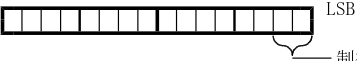

> **図の内容**
>
> 16 ビット。D0～D1 が制御コマンド（0: 無変更、1: 強制指定解除、2: 強制ON指定、3: 強制OFF指定）。

制御コマンド

0 : 無変更

1 : 強制指定解除

2 : 強制ON指定

3 : 強制OFF指定

(汎用出力ビット直接制御コマンドでは"強制指定解除"は無視します)

#### 4-2-38.軸ネグレクト設定コマンド [REQ_AXISNEG(0x39)]

**《データタイプ》**

REQ_AXISNEG(0x39)

**《タスク指定》**

有効

**《説明》**

各軸の軸指令の有効無効を設定します。

軸指令を無効にした軸に対する指令は無視します。

**《コマンド実行条件》**

- 移動中の軸がない
- ACCたまりなし
- 指定軸が回転速度指令中(SPIN中)でない

**《関連項目》**

<4-1-13.軸ネグレクト設定データ読出>

**《データフォーマット》**

データサイズ:18Byte

|   オフセット [Byte] | データ名称      |   データ長 [Byte] | データ範囲 [単位]   | データ範囲 [単位]   | データ範囲 [単位]   |
|----------------|------------|---------------|--------------|--------------|--------------|
|              0 | 第1軸ネグレクト指定 |             2 | 0:無変更,       | 1:無効,        | 2:有効         |
|              2 | 第2軸ネグレクト指定 |             2 | 0:無変更,       | 1:無効,        | 2:有効         |
|              4 | 第3軸ネグレクト指定 |             2 | 0:無変更,       | 1:無効,        | 2:有効         |
|              6 | 第4軸ネグレクト指定 |             2 | 0:無変更,       | 1:無効,        | 2:有効         |
|              8 | 第5軸ネグレクト指定 |             2 | 0:無変更,       | 1:無効,        | 2:有効         |
|             10 | 第6軸ネグレクト指定 |             2 | 0:無変更,       | 1:無効,        | 2:有効         |
|             12 | 第7軸ネグレクト指定 |             2 | 0:無変更,       | 1:無効,        | 2:有効         |
|             14 | 第8軸ネグレクト指定 |             2 | 0:無変更,       | 1:無効,        | 2:有効         |
|             16 | 第9軸ネグレクト指定 |             2 | 0:無変更,       | 1:無効,        | 2:有効         |

**《構造体定義》**

```c
/************************************************************************/
/* 軸ネグレクト設定コマンドパラメータ構造体 */
/************************************************************************/
typedef struct {
    unsigned short NeglectSw[9];  /* 軸ネグレクト指定スイッチ */
} AXNGLCT;
```

#### 4-2-39.軸インタロック設定コマンド [REQ_AXISINTLK(0x38)]

**《データタイプ》**

REQ_AXISINTLK(0x38)

**《タスク指定》**

有効

**《説明》**

各軸のインタロックの有効無効を設定します。

インタロック有効軸に対して指令を行うと、エラーになります。

**《コマンド実行条件》**

- 移動中の軸がない
- ACCたまりなし
- 指定軸が回転速度指令中(SPIN中)でない

**《関連項目》**

<4-1-14.軸インタロック設定データ読出>

**《データフォーマット》**

データサイズ:18Byte

|   オフセット [Byte] | データ名称       |   データ長 [Byte] | データ範囲 [単位]   | データ範囲 [単位]   | データ範囲 [単位]   |
|----------------|-------------|---------------|--------------|--------------|--------------|
|              0 | 第1軸インタロック指定 |             2 | 0:無変更,       | 1:無効,        | 2:有効         |
|              2 | 第2軸インタロック指定 |             2 | 0:無変更,       | 1:無効,        | 2:有効         |
|              4 | 第3軸インタロック指定 |             2 | 0:無変更,       | 1:無効,        | 2:有効         |
|              6 | 第4軸インタロック指定 |             2 | 0:無変更,       | 1:無効,        | 2:有効         |
|              8 | 第5軸インタロック指定 |             2 | 0:無変更,       | 1:無効,        | 2:有効         |
|             10 | 第6軸インタロック指定 |             2 | 0:無変更,       | 1:無効,        | 2:有効         |
|             12 | 第7軸インタロック指定 |             2 | 0:無変更,       | 1:無効,        | 2:有効         |
|             14 | 第8軸インタロック指定 |             2 | 0:無変更,       | 1:無効,        | 2:有効         |
|             16 | 第9軸インタロック指定 |             2 | 0:無変更,       | 1:無効,        | 2:有効         |

**《構造体定義》**

```c
/************************************************************************/
/* 軸インタロック設定コマンドパラメータ構造体 */
/************************************************************************/
typedef struct {
    unsigned short IntlkSw[9];  /* 軸インタロック指定スイッチ */
} AXINTLK;
```

#### 4-2-40.各軸サーボON/OFFコマンド [REQ_SVONOFF(0x3A)]

**《データタイプ》**

REQ_SVONOFF(0x3A)

**《タスク指定》**

有効

**《説明》**

各軸のサーボON/OFFを設定します。

各軸サーボON/OFFコマンドはサーボON状態の時に強制的にサーボOFFするためのコマンドです。エラーが発生しているときなど、サーボONできない状態の時にはサーボON出来ません。

サーボOFF指定を解除してもインターロック設定は解除されませんので、必要に応じてインターロック設

又、サーボOFF指定を行うと、対象軸に対してインターロックが設定されます。定も解除して下さい。

**《コマンド実行条件》**

- 移動中の軸がない
- ACCたまりなし
- 指定軸が回転速度指令中(SPIN中)でない

**《関連項目》**

- <4-1-14.軸インタロック設定データ読出>
- <4-1-15.各軸サーボON/OFF設定データ読出>
- <4-2-39.軸インターロック設定コマンド>

**《データフォーマット》**

データサイズ:18Byte

|   オフセット [Byte] | データ名称          |   データ長 [Byte] | データ範囲 [単位]             |
|----------------|----------------|---------------|------------------------|
|              0 | 第1軸サーボON/OFF設定 |             2 | 0:無変更,1:サーボON,2:サーボOFF |
|              2 | 第2軸サーボON/OFF設定 |             2 | 0:無変更,1:サーボON,2:サーボOFF |
|              4 | 第3軸サーボON/OFF設定 |             2 | 0:無変更,1:サーボON,2:サーボOFF |
|              6 | 第4軸サーボON/OFF設定 |             2 | 0:無変更,1:サーボON,2:サーボOFF |
|              8 | 第5軸サーボON/OFF設定 |             2 | 0:無変更,1:サーボON,2:サーボOFF |
|             10 | 第6軸サーボON/OFF設定 |             2 | 0:無変更,1:サーボON,2:サーボOFF |
|             12 | 第7軸サーボON/OFF設定 |             2 | 0:無変更,1:サーボON,2:サーボOFF |
|             14 | 第8軸サーボON/OFF設定 |             2 | 0:無変更,1:サーボON,2:サーボOFF |
|             16 | 第9軸サーボON/OFF設定 |             2 | 0:無変更,1:サーボON,2:サーボOFF |

**《構造体定義》**

```c
/************************************************************************/
/* 各軸サーボON/OFFコマンドパラメータ構造体 */
/************************************************************************/
typedef struct {
    unsigned short SvONSw[9];  /* サーボON/OFF指定スイッチ */
} SVONOFFCHG;
```

#### 4-2-41.サーボ電源ONコマンド [REQ_SERVOON(0x1E)] <開発中>

**《データタイプ》**

REQ_SERVOON(0x1E)

**《タスク指定》**

無効

**《説明》**

SLM8000に対して、サーボ電源ONを行います。

サーボ電源ONコマンドは、サーボ電源OFF状態の時のみ実行可能です。

**《データフォーマット》**

コマンド付加データは有りません。

#### 4-2-42.サーボ電源OFFコマンド [REQ_SERVOOFF(0x1F)] <開発中>

**《データタイプ》**

REQ_SERVOOFF(0x1F)

**《タスク指定》**

無効

**《説明》**

SLM8000に対して、サーボ電源OFFを行います。

サーボ電源OFFコマンドは、サーボ電源ON状態の時のみ実行可能です。

**《データフォーマット》**

コマンド付加データは有りません。

#### 4-2-43.プログラムブロック移動コマンド [REQ_PRGBLKMV(0x6B)]

**《データタイプ》**

REQ_PRGBLKMV(0x6B)

**《タスク指定》**

有効

**《説明》**

既にダウンロード済みのプログラムブロックを別ブロックに移動します。

**《コマンド実行条件》**

- 移動するプログラム番号が使用中でない場合。
- 移動先に既にプログラムが設定されている場合は、そのブロックが使用中でない場合。 (移動先にあるプログラムは消去しますので、ご注意下さい。)

**《データフォーマット》**

データサイズ:4Byte

|   オフセット [Byte] | データ名称        |   データ長 [Byte] | データ範囲 [単位]   |
|----------------|--------------|---------------|--------------|
|              0 | 移動対象P番号      |             2 | 1～32767      |
|              2 | 移動先先頭BLOCK番号 |             2 | 0～63         |

**《構造体定義》**

```c
/************************************************************************/
/* プログラムブロック 移動コマンドパラメータ構造体 */
/************************************************************************/
typedef struct {
    short SrcPno;  /* 移動対象P番号(1～32767) */
    short DstBlk;  /* 移動先先頭BLOCK番号(0～63) */
} BLKMVDATA;
```

#### 4-2-44.プログラムブロックコピーコマンド [REQ_PRGBLKCPY(0x6C)]

**《データタイプ》**

REQ_PRGBLKCPY(0x6C)

**《タスク指定》**

有効

**《説明》**

既にダウンロード済みのプログラムを指定し、別ブロックにコピーします。

別ブロックにコピーしたプログラムには、プログラム番号とタスクを設定可能です。

**《コマンド実行条件》**

- コピー元とコピー先が重ならない場合。
- コピーする際に、プログラムブロック領域外にならない場合。
- コピーするプログラム番号が使用中でない場合。
- コピー先に既にプログラムが設定されている場合は、そのブロックが使用中でない場合。

(コピー先にあるプログラムは消去しますので、ご注意下さい。)

**《データフォーマット》**

データサイズ:8Byte

|   オフセット [Byte] | データ名称         |   データ長 [Byte] | データ範囲 [単位]   |
|----------------|---------------|---------------|--------------|
|              0 | コピー元P番号       |             2 | 1～32767      |
|              2 | コピー先先頭BLOCK番号 |             2 | 0～63         |
|              4 | コピー後P番号       |             2 | 1～32767      |
|              6 | コピー後タスク番号     |             2 | 0～7          |

**《構造体定義》**

```c
/************************************************************************/
/* プログラムブロック コピーコマンドパラメータ構造体 */
/************************************************************************/
typedef struct {
    short SrcPno;   /* コピー元P番号(1～32767) */
    short DstBlk;   /* コピー先先頭BLOCK番号(0～63) */
    short DstPno;   /* コピー後P番号(1～32767) */
    short DstTask;  /* コピー後タスク番号(0～7) */
} BLKCPYDATA;
```

#### 4-2-45.プログラムブロック削除コマンド [REQ_PRGBLKDEL(0x6D)]

**《データタイプ》**

REQ_PRGBLKDEL(0x6D)

**《タスク指定》**

有効

**《説明》**

既にダウンロード済みのプログラムを指定し、そのプログラムが格納されているブロックを削除します。

**《コマンド実行条件》**

- 削除するプログラム番号が使用中でない場合。

**《データフォーマット》**

データサイズ:2Byte

|   オフセット [Byte] | データ名称    |   データ長 [Byte] | データ範囲 [単位]   |
|----------------|----------|---------------|--------------|
|              0 | 削除対象のP番号 |             2 | 1～32767      |

**《構造体定義》**

```c
/************************************************************************/
/* プログラムブロック 削除コマンドパラメータ構造体 */
/************************************************************************/
typedef struct {
    short Pno;  /* 削除対象のP番号(1-32767) */
} BLKDLDATA;
```

#### 4-2-46.シングルステップモード設定コマンド [REQ_SINGLE(0x60)]

**《データタイプ》**

REQ_SINGLE(0x60)

**《タスク指定》**

有効

**《説明》**

シングルステップモードへの移行と解除をトグルで行います。

シングルステップモードに移行すると、<4-1-7.ステータスデータ読出>の《データ詳細》(3)タスク情報 ①タスクステータスに"シングルステップモード"ビットが立ちます。

**《コマンド実行条件》**

- 機械パネルのモード選択無効
- 動作モードが自動運転モード

**《データフォーマット》**

コマンド付加データは有りません。

#### 4-2-47.サイクル運転モード設定コマンド [REQ_CYCLE(0x36)]

**《データタイプ》**

REQ_CYCLE(0x36)

**《タスク指定》**

有効

**《説明》**

- サイクル運転モードの有効/無効を選択します。
- サイクル運転モードに移行すると、<4-1-7.ステータスデータ読出>の《データ詳細》(3)タスク情報 ①タスクステータスに"サイクル運転モード"ビットが立ちます。
- サイクル運転については

「SLM8000 ユーザーズマニュアル」<Ⅲ機能編 4-12.サイクル運転>(TB00-1130E) を参照下さい。

**《コマンド実行条件》**

常時実行可能です。

**《データフォーマット》**

データサイズ:2Byte

|   オフセット [Byte] | データ名称       |   データ長 [Byte] | データ範囲 [単位]   |
|----------------|-------------|---------------|--------------|
|              0 | サイクル運転有効フラグ |             2 | 0:無効、1:有効    |

**《構造体定義》**

```c
/************************************************************************/
/* サイクル運転モード変更コマンドパラメータ構造体 */
/************************************************************************/
typedef struct {
    short cycle;  /* サイクル運転有効フラグ */
} CYCLECHG;
```

#### 4-2-48.ティーチング設定コマンド [REQ_TEACH(0x61)] <開発中>

**《データタイプ》**

REQ_TEACH(0x61)

**《タスク指定》**

有効

**《説明》**

ティーチングモードへの移行と解除をトグルで行います。

ティーチングモードに移行すると、<4-1-7.ステータスデータ読出>の《データ詳細》(3)タスク情報 ①タスクステータスに"ティーチングモード"ビットが立ちます。

※ティーチングモードの解除時に移動軸が存在した時は、ティーチングモードを解除出来ません。

**《コマンド実行条件》**

(ティーチング有効)

- 機械パネルのティーチングモード選択無効
- SLM8000の動作モードが自動運転モード
- シングルステップモードでのプログラム実行中
- ステップ間停止中(ステップ途中停止中は不可)

**《コマンド実行条件》**

(ティーチング解除)

- 機械パネルのティーチングモード選択無効
- ティーチングで軸を移動した後、元の位置へ戻していない。(挿入・置換をした場合は不要)

**《データフォーマット》**

コマンド付加データは有りません。

#### 4-2-49.プログラムステップ挿入コマンド [REQ_PRGINS(0x62)] <開発中>

**《データタイプ》**

REQ_PRGINS(0x62)

**《タスク指定》**

有効

**《説明》**

現在ステップへの移動命令の挿入を行います。

ティーチングモードへ移行してからの各軸の移動量をPTP(テクノコード)/G00(Gコード)命令で挿入します。

ステップ挿入の結果、現在ステップ以降のステップは、1つずつ後ろへずれます。

プログラムステップ挿入コマンドが、正常に終了すると、ティーチングモードを自動的に解除します。

**《コマンド実行条件》**

- プログラム実行状態が、ティーチングモード
- ステップ挿入の結果が最大ステップ数を越えない
- ステップ挿入可能ステップ

**《データフォーマット》**

コマンド付加データは有りません。

#### 4-2-50.プログラムステップ置換コマンド [REQ_PRGALT(0x63)] <開発中>

**《データタイプ》**

REQ_PRGALT(0x63)

**《タスク指定》**

有効

**《説明》**

現在ステップへの移動命令の置換を行います。

プログラムステップ置換コマンドが、正常に終了すると、ティーチングモードを自動的に解除します。

**《コマンド実行条件》**

- プログラム実行状態が、ティーチングモード
- ステップ置換可能ステップ

**《データフォーマット》**

コマンド付加データは有りません。

#### 4-2-51.プログラムステップ削除コマンド [REQ_PRGDEL(0x64)] <開発中>

**《データタイプ》**

REQ_PRGDEL(0x64)

**《タスク指定》**

有効

**《説明》**

現在ステップの削除を行います。

**《コマンド実行条件》**

- 動作モードが自動運転モード
- シングルステップモードでステップ間停止中(ステップ途中停止中は不可)
- プログラム実行状態が、ティーチングモードでない

**《データフォーマット》**

コマンド付加データは有りません。

#### 4-2-52.プログラムステップ逆行コマンド [REQ_PRGREV(0x65)] <開発中>

**《データタイプ》**

REQ_PRGREV(0x65)

**《タスク指定》**

有効

- 《説明》ティーチング開始位置への復帰又は実行ステップの逆行を行います。

**《コマンド実行条件》**

1. ティーチング中

ティーチング開始位置への復帰

2. シングルステップモードでステップ間停止中(ステップ途中停止中は不可)<オプション>
2. 前回ステップを逆行します。（インクレ移動命令のみ逆行可能です。）

**《データフォーマット》**

コマンド付加データは有りません。

#### 4-2-53.プログラムステップ変更コマンド [REQ_STEPCHG(0x66)] <開発中>

**《データタイプ》**

REQ_STEPCHG(0x66)

**《タスク指定》**

有効

- 《説明》

ティーチング対象のステップの変更を行います。

**《コマンド実行条件》**

- ティーチングモード
- ティーチングの移動をしていない

**《データフォーマット》**

データサイズ:4Byte

|   オフセット [Byte] | データ名称    |   データ長 [Byte] | データ範囲 [単位]   |
|----------------|----------|---------------|--------------|
|              0 | ステップナンバー |             4 | 1～1890       |

**《構造体定義》**

```c
/************************************************************************/
/* ティーチングステップ変更コマンドパラメータ構造体 */
/************************************************************************/
typedef struct {
    unsigned long StepNo;
} STEPCHG;
```

#### 4-2-54.プログラムステップスキップコマンド [REQ_STEPSKIP(0x67)] <開発中>

**《データタイプ》**

REQ_STEPSKIP(0x67)

**《タスク指定》**

有効

- 《説明》

実行中ステップのスキップを行います。

**《コマンド実行条件》**

- ステップ間停止中
- ティーチングモード無効

**《データフォーマット》**

コマンド付加データは有りません。

#### 4-2-55.マクロ変数書込コマンド [REQ_MCRREG(0x84)] <オプション>

**《データタイプ》**

REQ_MCRREG(0x84)

**《タスク指定》**

有効

**《関連項目》**

- <4-1-21.マクロ変数(一般レジスタ)書込/読出>
- <4-1-22.マクロ変数書込/読出>

**《説明》**

任意の番号のマクロ変数にデータを設定します。

書き込み可能な全てのマクロ変数に対して書き込む事が出来ます。

(ただし、指定したマクロ変数の範囲外のデータを書き込む事はできません。) マクロ変数詳細については、

「SLM8000 ユーザーズマニュアル」<Ⅲ機能編 6-3.マクロ機能>(TB00-1130F) を参照下さい。

**《コマンド実行条件》**

常時実行可能です。

**《データフォーマット》**

データサイズ:8Byte

|   オフセット [Byte] | データ名称   |   データ長 [Byte] | データ範囲 [単位]                 |
|----------------|---------|---------------|----------------------------|
|              0 | マクロ変数番号 |             4 | 1000～ 9999 [-]             |
|              4 | マクロ変数値  |             4 | -2147483647～2147483647 [-] |

**《構造体定義》**

```c
/************************************************************************/
/* マクロ変数書込コマンドパラメータ構造体 */
/************************************************************************/
typedef struct {
    long RegNo;  /* マクロ変数番号 */
    long Val;    /* マクロ変数値 */
} MCRVALSET;
```

**《データ詳細》**

- (1) マクロ変数番号データを書き込む対象のマクロ変数の番号を指定します。

(2) マクロ変数値

指定したマクロ変数に書き込む値を指定します。

#### 4-2-56.主軸回転ON/OFFコマンド [REQ_SPCMND(0x50)] <オプション>

**《データタイプ》**

REQ_SPCMND(0x50)

**《タスク指定》**

有効

**《説明》**

- 主軸回転のON/OFFを切換えます。
- 主軸回転ONを指令する場合、回転方向は正転のみ指定できます。
- 主軸回転ON/OFFコマンドの実行には、SLM8000に主軸オプションが必要です。
- 主軸回転は、以下の条件が満たされているときに実行可能です。

**《コマンド実行条件》**

- サーボON状態
- アラーム未発生
- 動作モードが手動運転モード/自動運転モード/DNC運転モード
- 移動中の軸がない
- Mコード出力中でない

**《データフォーマット》**

データサイズ:2Byte

|   オフセット [Byte] | データ名称   |   データ長 [Byte] | データ範囲 [単位]     |
|----------------|-------------|---------------|----------------|
|              0 | 主軸指令フラグ     |             2 | 0:停止、1:正転、2:逆転 |

**《構造体定義》**

```c
/************************************************************************/
/* 主軸ON/OFFコマンドパラメータ構造体 */
/************************************************************************/
typedef struct {
    short SpOut;  /* 主軸指令フラグ */
} SPCMND;
```

**《データ詳細》**

- (1) 主軸指令フラグ
2. 主軸の動作を番号で指定します。
3. 番号と主軸動作の関係は下表の通りです。

|   番号 | 主軸動作   |
|------|--------|
|    0 | 主軸停止   |
|    1 | 主軸正転   |
|    2 | 主軸逆転   |

#### 4-2-57.主軸回転数設定コマンド [REQ_SPREVSET(0x51)] <オプション>

**《データタイプ》**

REQ_SPREVSET(0x51)

**《タスク指定》**

有効

**《説明》**

- 主軸の回転数を指定します。

主軸回転中に主軸回転数設定コマンドにて主軸回転を変更した場合は、直ちに指定された回転数に変わります。

- 《コマンド実行条件》

常時実行可能です。

**《データフォーマット》**

データサイズ:4Byte

|   オフセット [Byte] | データ名称   |   データ長 [Byte] | データ範囲 [単位]       |
|----------------|-------------|---------------|------------------|
|              0 | 主軸回転数       |             4 | 0～最高主軸回転数(パラメータ) |

**《構造体定義》**

```c
/************************************************************************/
/* 主軸回転数変更コマンドパラメータ構造体 */
/************************************************************************/
typedef struct {
    unsigned long SpRevo;  /* 主軸回転数 */
} SPREVSET;
```

**《データ詳細》**

- (1) 主軸回転数
2. 主軸回転数を指定します。

指定できる最大回転数は、ROMSW設定で指定します。

#### 4-2-58.TPCデータ選択コマンド [REQ_TPCSEL(0x31)]

**《データタイプ》**

REQ_TPCSEL(0x31)

**《タスク指定》**

有効

- 《説明》 TPCデータのロギングを実行する軸と入出力の設定をします。

**《コマンド実行条件》**

- TPCロギング未実行

**《関連項目》**

- <4-1-24.TPCロギングデータ読出>
- <4-1-26.TPCロギング情報読出>
- <4-1-27.TPCロギング拡張情報読出>
- <4-2-59.TPCデータ選択拡張コマンド>
- <4-2-60.TPCロギング開始コマンド>

**《データフォーマット》**

データサイズ:12Byte

|   オフセット [Byte] | データ名称     |   データ長 [Byte] | データ範囲 [単位]   |
|----------------|-----------|---------------|--------------|
|              0 | 第1ポジション番号 |             2 | 0～17         |
|              2 | 第1入力信号番号  |             2 | 0～5          |
|              4 | 第1出力信号番号  |             2 | 0～5          |
|              6 | 第2ポジション番号 |             2 | 0～17         |
|              8 | 第2入力信号番号  |             2 | 0～5          |
|             10 | 第2出力信号番号  |             2 | 0～5          |

**《構造体定義》**

```c
/************************************************************************/
/* TPCデータ選択コマンドパラメータ構造体 */
/************************************************************************/
typedef struct {
    short ax1;  /* 第1ポジション番号 */
    short hi1;  /* 第1入力信号番号 */
    short ho1;  /* 第1出力信号番号 */
    short ax2;  /* 第2ポジション番号 */
    short hi2;  /* 第2入力信号番号 */
    short ho2;  /* 第2出力信号番号 */
} TPCSEL;
```

**《データ詳細》**

- (1) 各設定内容は下図の通りです。
- (2) コマンド発行前のデフォルト設定は、表、部が
3. それぞれ第1データ、第2データとなっています。
- (3) ポジションデータとしては通常、機械位置を使用します。

|   ポジション番号 (ax1,ax2) - 設定値 | ポジション番号 (ax1,ax2) - 指定内容   | 入力信号番号 (hi1,hi2) - 設定値   | 入力信号番号 (hi1,hi2) - 指定内容   | 出力信号番号 (ho1,ho2) - 設定値   | 出力信号番号 (ho1,ho2) - 指定内容   |
|---------------------------|----------------------------|--------------------------|---------------------------|--------------------------|---------------------------|
|                         0 | 第1軸指令位置                    | 0                        | #000                      | 0                        | #000                      |
|                         1 | 第2軸指令位置                    | 1                        | #001                      | 1                        | #001                      |
|                         2 | 第3軸指令位置                    | 2                        | #002                      | 2                        | #002                      |
|                         3 | 第4軸指令位置                    | 3                        | #003                      | 3                        | #003                      |
|                         4 | 第5軸指令位置                    | 4                        | #004                      | 4                        | #004                      |
|                         5 | 第6軸指令位置                    | 5                        | #005                      | 5                        | #005                      |
|                         6 | 第7軸指令位置                    | -                        | -                         | -                        | -                         |
|                         7 | 第8軸指令位置                    | -                        | -                         | -                        | -                         |
|                         8 | 第9軸指令位置                    | -                        | -                         | -                        | -                         |
|                         9 | 第1軸機械位置                    | -                        | -                         | -                        | -                         |
|                        10 | 第2軸機械位置                    | -                        | -                         | -                        | -                         |
|                        11 | 第3軸機械位置                    | -                        | -                         | -                        | -                         |
|                        12 | 第4軸機械位置                    | -                        | -                         | -                        | -                         |
|                        13 | 第5軸機械位置                    | -                        | -                         | -                        | -                         |
|                        14 | 第6軸機械位置                    | -                        | -                         | -                        | -                         |
|                        15 | 第7軸機械位置                    | -                        | -                         | -                        | -                         |
|                        16 | 第8軸機械位置                    | -                        | -                         | -                        | -                         |
|                        17 | 第9軸機械位置                    | -                        | -                         | -                        | -                         |

#### 4-2-59.TPCデータ選択拡張コマンド [REQ_TPCSEL_EX(0x3E)]

**《データタイプ》**

REQ_TPCSEL_EX(0x3E)

**《タスク指定》**

有効

**《説明》**

TPCデータのロギングの設定をします。

**《コマンド実行条件》**

- TPCロギング未実行

**《関連項目》**

- <4-1-24.TPCロギングデータ読出>
- <4-1-25.64チャンネルTPCロギングデータ読出>
- <4-1-26.TPCロギング情報読出>
- <4-1-27.TPCロギング拡張情報読出>
- <4-2-58.TPCデータ選択コマンド>
- <4-2-60.TPCロギング開始コマンド>

**《データフォーマット》**

○ポジション・入出力ロギング要求（旧TPCデータ）

データサイズ:20Byte

|   オフセット [Byte] | データ名称   |   データ長 [Byte] | データ範囲 [単位]   |
|----------------|---------|---------------|--------------|
|              0 | ヘッダ情報   |             8 | -            |
|              8 | ロギング選択  |            12 | -            |

ヘッダ情報詳細

|   オフセット [Byte] | データ名称    |   データ長 [Byte] | データ範囲 [単位]            |
|----------------|----------|---------------|-----------------------|
|              0 | ロギング種別選択 |             2 | 0:ポジション・入出力 1:64チャンネル |
|              2 | トリガ選択    |             2 | 0固定                   |
|              4 | ロギング周期   |             2 | 0～32767               |
|              6 | 予約       |             2 | 0固定                   |

ロギング選択詳細

|   オフセット [Byte] | データ名称     |   データ長 [Byte] | データ範囲 [単位]   |
|----------------|-----------|---------------|--------------|
|              8 | 第1ポジション番号 |             2 | 0～17         |
|             10 | 第1入力信号番号  |             2 | 0～5          |
|             12 | 第1出力信号番号  |             2 | 0～5          |
|             14 | 第2ポジション番号 |             2 | 0～17         |
|             16 | 第2入力信号番号  |             2 | 0～5          |
|             18 | 第2出力信号番号  |             2 | 0～5          |

- ※ ロギング選択の詳細については、<4-2-58.TPCデータ選択コマンド>を参照下さい。

**○64CHロギング要求**

データサイズ:2568Byte

| オフセット [Byte]   | データ名称       | データ長 [Byte]   | データ範囲 [単位]   |
|----------------|-------------|---------------|--------------|
| 0              | ヘッダ情報       | 8             | -            |
| 8              | ロギングチャンネル0  | 40            | -            |
| 48             | ロギングチャンネル1  | 40            | -            |
| ・              | ・           | ・             | ・            |
| ・              | ・           | ・             | ・            |
| 2528           | ロギングチャンネル63 | 40            | -            |

ヘッダ情報詳細

|   オフセット [Byte] | データ名称    |   データ長 [Byte] | データ範囲 [単位]            |
|----------------|----------|---------------|-----------------------|
|              0 | ロギング種別選択 |             2 | 0:ポジション・入出力 1:64チャンネル |
|              2 | トリガ選択    |             2 | 0固定                   |
|              4 | ロギング周期   |             2 | 0～32767               |
|              6 | 予約       |             2 | 0固定                   |

ロギング選択詳細

| オフセット [Byte]   | データ名称     |   データ長 [Byte] | データ範囲 [単位]   |
|----------------|-----------|---------------|--------------|
| 8+40*N         | ロギング項目    |             2 | 0～15         |
| 10+40*N        | 予約        |             6 | -            |
| 16+40*N        | ロギング項目属性0 |             8 | -            |
| 24+40*N        | ロギング項目属性1 |             8 | -            |
| 32+40*N        | ロギング項目属性2 |             8 | -            |
| 40+40*N        | ロギング項目属性3 |             8 | -            |

※ Nはチャンネル(0 ～ 63)を表します。

属性情報

| オフセット [Byte]   | データ名称   |   データ長 [Byte] | データ範囲 [単位]   |
|----------------|---------|---------------|--------------|
| 16+40*N+8*M    | 属性項目    |             4 | 0～3          |
| 20+40*N+8*M    | 属性値     |             4 | 0～9999       |

※ Mはロギング項目属性(0 ～ 3)を表します。

```c
/************************************************************************/
/* TPCデータ選択コマンドパラメータ構造体 */
/************************************************************************/
typedef struct {               /* ヘッダ情報 */
    short LogSel;              /* ロギング種別選択 */
    short TrigSel;             /* トリガ選択 */
    short Interval;            /* ロギング周期[msec] */
    short Reserved;            /* 予約 */
} TPCSEL_HEADER;
    ○ポジション・入出力ロギング要求（旧TPCデータ）
typedef struct {
    short ax1;                 /* 第1ポジション番号 */
    short hi1;                 /* 第1入力信号番号 */
    short ho1;                 /* 第1出力信号番号 */
    short ax2;                 /* 第2ポジション番号 */
    short hi2;                 /* 第2入力信号番号 */
    short ho2;                 /* 第2出力信号番号 */
} TPCSEL;
typedef struct {               /* ポジション・入出力ロギング要求 */
    TPCSEL_HEADER h;
    TPCSEL sel;
} TPCSEL_POS;
    ○64CHロギング要求
typedef struct {
    long item;                 /* 属性項目 */
    long val;                  /* 属性値 */
} TPCSEL_ATTR;
typedef struct {
    short log_item;            /* ロギング項目 */
    char Reserved[6];
    TPCSEL_ATTR attribute[4];  /* ロギング項目属性 */
} TPCSEL_CH;
typedef struct {
    TPCSEL_HEADER h;           /* ヘッダ情報 */
    TPCSEL_CH ch[64];          /* ロギングチャンネル */
} TPCSEL_64CH;
```

**《データ詳細》**

- (1) ロギング種別選択

0：ポジション・入出力ロギング要求

1：64CHロギング要求

(2) ロギング周期[msec]

0:制御周期

1～32767：ロギング周期[msec]

※但し、制御周期単位に丸められます。

- 例) 制御周期：2[msec]

ロギング周期：5[msec]

実際のロギング周期は4[msec]です。

○ポジション・入出力ロギング要求（旧TPCデータ）

※ データの詳細については、<4-2-58.TPCデータ選択コマンド>を参照下さい。

**○64CHロギング要求**

(1) 属性項目

0：タスク番号

1：軸番号

2：マクロ変数番号

3：IO信号番号

(2) 属性値

属性項目により範囲が異なります。

- タスク番号(0) ：0～7
- 軸番号(1)

：0～8

- マクロ変数番号(2) ：1000～9999

・IO信号番号(3) ：0～798(信号番号最大値)

(3) ロギング項目

以下の16項目から選択します。

ロギング項目によって要求される属性値が異なります。

|   値 | 項目          | 属性項目      |
|-----|-------------|-----------|
|   0 | 指令位置        | タスク番号、軸番号 |
|   1 | 機械位置        | タスク番号、軸番号 |
|   2 | 偏差量         | タスク番号、軸番号 |
|   3 | 最新ブロック払い出し量 | タスク番号、軸番号 |
|   4 | 絶対指令位置      | タスク番号、軸番号 |
|   5 | 絶対機械位置      | タスク番号、軸番号 |
|   6 | 仮想指令位置      | タスク番号、軸番号 |
|   7 | 全体ステータス     | 無し        |
|   8 | 全体アラーム      | 無し        |
|   9 | 軸ステータス      | タスク番号、軸番号 |
|  10 | 軸アラーム       | タスク番号、軸番号 |
|  11 | タスクステータス    | タスク番号     |
|  12 | タスクアラーム     | タスク番号     |
|  13 | マクロ変数       | マクロ変数番号   |
|  14 | 入力信号        | IO信号番号    |
|  15 | 出力信号        | IO信号番号    |

#### 4-2-60.TPCロギング開始コマンド [REQ_TPCLOG(0x32)]

**《データタイプ》**

REQ_TPCLOG(0x32)

**《タスク指定》**

無効

**《説明》**

TPCロギングの開始/停止/再開を指定します。

**《コマンド実行条件》**

- TPCロギング未実行又は停止中

**《関連項目》**

- <4-1-24.TPCロギングデータ読出>
- <4-1-25.64チャンネルTPCロギングデータ読出>
- <4-1-26.TPCロギング情報読出>
- <4-1-27.TPCロギング拡張情報読出>
- <4-2-58.TPCデータ選択コマンド>
- <4-2-59.TPCデータ選択拡張コマンド>

**《データフォーマット》**

データサイズ:2Byte

|   オフセット [Byte] | データ名称      |   データ長 [Byte] | データ範囲 [単位]       |
|----------------|------------|---------------|------------------|
|              0 | TPCロギングフラグ |             2 | 0:停止、 1:開始、 2:再開 |

**《構造体定義》**

構造体定義はありません。

shortのデータとして定義して下さい。

#### 4-2-61.手動パルサーモードON/OFF設定コマンド [REQ_HANDLE(0x5C)] <オプション>

**《データタイプ》**

REQ_HANDLE(0x5C)

**《タスク指定》**

有効

**《説明》**

手動パルサーの有効/無効を指定します。

**《コマンド実行条件》**

- 機械パネルの手パ軸選択無効
- サーボON状態
- 動作モードが手動運転モード/自動運転モード/DNC運転モード/OT無視モード
- 運転プログラム未実行又はティーチング中
- 移動中の軸がない

**《関連項目》**

- <4-1-28.手動パルサー設定情報読出>
- <4-2-62.手動パルサー倍率設定コマンド>
- <4-2-63.手動パルサー有効軸設定コマンド>

**《データフォーマット》**

データサイズ:2Byte

|   オフセット [Byte] | データ名称         |   データ長 [Byte] | データ範囲 [単位]   |
|----------------|---------------|---------------|--------------|
|              0 | 手動パルサー有効/無効設定 |             2 | 0：無効、 1：有効   |

**《構造体定義》**

```c
/************************************************************************/
/* 手パモード構造体 */
/************************************************************************/
typedef struct {
    short mode;  /* 手パモード */
} HANDLEMODE;
```

#### 4-2-62.手動パルサー倍率設定コマンド [REQ_HANDLEKP(0x5D)] <オプション>

**《データタイプ》**

REQ_HANDLEKP(0x5D)

**《タスク指定》**

有効

**《説明》**

手動パルサーの倍率(手動パルサー1パルス毎に動く量)を指定します。

- 1,10,100,1000の内から任意の倍率を指定します。

**《コマンド実行条件》**

- 機械パネルの手パ軸選択無効

**《関連項目》**

- <4-1-28.手動パルサー設定情報読出>
- <4-2-61.手動パルサーモードON/OFF設定コマンド>
- <4-2-63.手動パルサー有効軸設定コマンド>

**《データフォーマット》**

データサイズ:4Byte

|   オフセット [Byte] | データ名称      |   データ長 [Byte] | データ範囲 [単位]    |
|----------------|------------|---------------|---------------|
|              0 | 手動パルサー設定倍率 |             4 | 1,10,100,1000 |

**《構造体定義》**

```c
/************************************************************************/
/* 手パ倍率パラメータ構造体 */
/************************************************************************/
typedef struct {
    long kp;  /* 手パ倍率 */
} HANDLEKP;
```

#### 4-2-63.手動パルサー有効軸設定コマンド

[REQ_HANDLEAXIS1(0x5E)､REQ_HANDLEAXIS2(0x5F)] <オプション>

**《データタイプ》**

REQ_HANDLEAXIS1(0x5E)

REQ_HANDLEAXIS2(0x5F)

**《タスク指定》**

有効

**《説明》**

手動パルサーにて、移動を行わせる第1軸、第2軸を指定します。

**《コマンド実行条件》**

- 機械パネルの手パ軸選択無効

**《関連項目》**

- <4-1-28.手動パルサー設定情報読出>
- <4-2-61.手動パルサーモードON/OFF設定コマンド>
- <4-2-62.手動パルサー倍率設定コマンド>

**《データフォーマット》**

データサイズ:4Byte

|   オフセット [Byte] | データ名称     |   データ長 [Byte] | データ範囲 [単位]   |
|----------------|-----------|---------------|--------------|
|              0 | 手動パルサー有効軸 |             4 | 0～軸数-1       |

**《構造体定義》**

```c
/************************************************************************/
/* 手パ軸パラメータ構造体 */
/************************************************************************/
typedef struct {
    long axis;  /* 手パ有効軸 */
} HANDLEAXIS;
```

#### 4-2-64.フィードバックカウンタ積算値セットアップコマンド [REQ_FBSETUP(0x78)]

**《データタイプ》**

REQ_FBSETUP(0x78)

**《説明》**

FBカウンタ積算値を変更します。

FBを軸に割り当てていた場合でも、フィードバックカウンタ積算値セットアップコマンドでFBカウンタ積算値を変更する事ができます。

（FBを割り当てている軸の座標には影響しません。）

**《コマンド実行条件》**

常時実行可能です。

**《関連項目》**

<4-1-30.フィードバックカウンタ積算値読出>

**《データフォーマット》**

データサイズ:44Byte

|   オフセット [Byte] | データ名称       |   データ長 [Byte] | データ範囲 [単位]                  |
|----------------|-------------|---------------|-----------------------------|
|              0 | FB1カウンタ設定値  |             4 | -2147483647～2147483647[pls] |
|              4 | FB2カウンタ設定値  |             4 | -2147483647～2147483647[pls] |
|              8 | FB3カウンタ設定値  |             4 | -2147483647～2147483647[pls] |
|             12 | FB4カウンタ設定値  |             4 | -2147483647～2147483647[pls] |
|             16 | FB5カウンタ設定値  |             4 | -2147483647～2147483647[pls] |
|             20 | FB6カウンタ設定値  |             4 | -2147483647～2147483647[pls] |
|             24 | FB7カウンタ設定値  |             4 | -2147483647～2147483647[pls] |
|             28 | FB8カウンタ設定値  |             4 | -2147483647～2147483647[pls] |
|             32 | FB9カウンタ設定値  |             4 | -2147483647～2147483647[pls] |
|             36 | FB10カウンタ設定値 |             4 | -2147483647～2147483647[pls] |
|             40 | 設定選択フラグ     |             2 | 0x01 ～ 0x03 [-]             |
|             42 | 予約          |             2 | -                           |

**《構造体定義》**

```c
/************************************************************************/
/* フィードバックカウンタクリアコマンドパラメータ構造体 */
/************************************************************************/
typedef struct {
    long cntr[10];  /* FB1-FB10設定値 */
    short set;      /* FB1-FB10設定フラグ */
    short Reserve;
} FBSETUP;
```

**《データ詳細》**

- (1) FB1-FB10設定値

設定するカウンタ値を指定します。

(2) 設定選択フラグ

設定を行うカウンタを指定します。

各カウンタに対応するビットに1を設定するとそのカウンタの値を変更します。

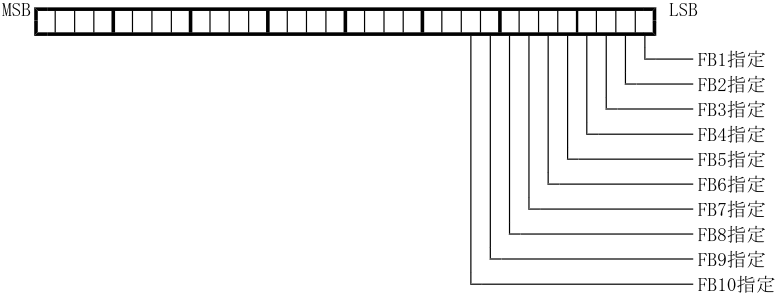

> **図の内容**
>
> 32 ビット。D0 が FB1指定、D1 が FB2指定、…、D9 が FB10指定。

#### 4-2-65.周期計測値クリアコマンド [REQ_TIMERRESET(0x42)]

**《データタイプ》**

REQ_TIMERRESET(0x42)

**《タスク指定》**

無効

**《説明》**

制御周期内処理時間最大値とフォアグランド周期計測最大値をクリアします。制御周期内処理時間については、<4-1-35.制御周期内処理時間計測データ読出>、

フォアグランド周期については、<4-1-36.フォアグランド周期計測データ読出>を参照して下さい。

**《関連項目》**

- <4-1-35.制御周期内処理時間計測データ読出>
- <4-1-36.フォアグランド周期計測データ読出>

**《コマンド実行条件》**

常時実行可能です。

- 《データフォーマット》

コマンド付加データは有りません。
