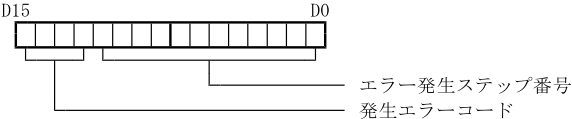
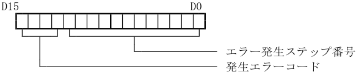
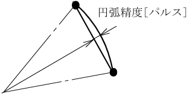

# 標準ワンボードモーションコントローラ[SLM8000]

テクノコード変換ライブラリリファレンスマニュアル

Ver1.1 2019.3.1

－目次－

- 1. 形式
- 2. 製品構成
- 3. 概要
- 4. 関連資料
- 5. 使用環境
- 6. インストール
- 7. ライブラリ使用上の注意事項
- 8. 関数使用例
  - ８-１．MS-VC以外のC言語処理系での利用方法
- 9. 関数仕様
  - MemProgramConv
  - MemTaskProgramConv
  - MemTaskProgramConvS
  - MemProgramRConv
  - MemProgramRConvS
  - FileProgramConv
  - FileTaskProgramConv
  - FileTaskProgramConvS
  - FileProgramRConv
  - FileProgramRConvS
  - DncProgramConv
  - DncProgramConvS
  - TcdCircleSet
  - TcdFeedUnitSet
  - TcdSTSelect
  - TcdPaccTimeSet
  - TcdPositionUnitSet
  - TcdCircleMode
  - TcdDiametralAxis
  - TcdSetMultiplier
  - TcdGetErrLine
  - TcdSetZXPlane

## 1. 形式

SLM8000-PRGCNV

## 2. 製品構成

- SLM8000TCNV .DLL ････････ 32bit Windows用ダイナミックリンクライブラリ
- SLM8000TCNV .LIB ････････ 32bit Windows用インポートライブラリ
- SLM8000TCNV64 .DLL ････････ 64bit Windows用ダイナミックリンクライブラリ
- SLM8000TCNV64 .LIB ････････ 64bit Windows用インポートライブラリ
- SLM8000TCNV .H ････････ 32/64bit Windows共用インクルードファイル(データ型・関数定義)
- SLM8000TCDAPI .BAS ････････ VisualBasic用データ型・関数定義
- SLM8000TCDAPIVCNET .H ････････ VC.NET 32bit 用データ型・関数定義
- SLM8000TCD64APIVCNET.H ････････ VC.NET 64bit 用データ型・関数定義
- SLM8000TCDAPIVBNET .VB ････････ VB.NET 32bit 用データ型・関数定義
- SLM8000TCD64APIVBNET.VB ････････ VB.NET 64bit 用データ型・関数定義
- SLM8000TCDAPICSNET .CS ････････ C#.NET 32bit 用データ型・関数定義
- SLM8000TCD64APICSNET.CS ････････ C#.NET 64bit 用データ型・関数定義

## 3. 概要

プログラム変換ライブラリは、テキストファイル形式のテクノコードプログラム解析し、バイナリ形式のプログラムに変換するものです。

作成したバイナリ形式のプログラムを通信ライブラリにてSLM8000へ送信して下さい。本ライブラリの入出力は、以下の2通りがあります。

```c
    テキスト入力 バイナリ出力
    メモリ(メモリアドレス指定) → メモリ
```

ファイル(ファイル名指定) → メモリ

**《テキストプログラム例》**

PTPA X0 Y0 Z0 A0 TIM0.5 ENR1 ONR0;

CALL SUBPROC L10;

TIM1.0 ONR1;

PTPA X100 Y100 Z100 A100 TIM0.5 OFR1;

CALL SUBPROC L5;

TIM1.0;

CIRR X400 Y0 Z100 I200 J0 F1000;

END;

:SUBPROC

PTP X100 Y-100 Z100 A-100;

PTP X-100 Y100 Z-100 A100 TIM0.5;

LIN X1500 Y2000 Z2500 A3000 F1000 OFR0;

END;

## 4. 関連資料

| 「SLM8000 ユーザーズマニュアル」             | (TB00-1130)   |
|----------------------------------|---------------|
| 「SLM8000 セッティングPCマニュアル」          | (TB00-1131)   |
| 「SLM8000 ROMSW設定ソフトマニュアル」        | (TB00-1132)   |
| 「SLM8000 通信ライブラリリファレンスマニュアル」     | (TB00-1133)   |
| 「SLM8000 送受信データマニュアル」            | (TB00-1134)   |
| 「SLM8000 Tコード変換ライブラリリファレンスマニュアル」 | (TB00-1135) ※ |
| 「SLM8000 Gコード変換ライブラリリファレンスマニュアル」 | (TB00-1136)   |

## 5. 使用環境

本ライブラリが対応するパソコン及び、開発環境は以下の通りです。

対応パソコン・・・ Windows 7 / 10 が動作するx86CPU搭載機

対応開発環境・・・ Visual C++ Ver6.0

Visual Basic Ver6.0

Visual Studio2005

Visual Studio2008 ※64bitの場合は2008以降

## 6. インストール

DLLファイルをプログラム検索パスの通っているディレクトリ(フォルダ)に格納して下さい。

## 7. ライブラリ使用上の注意事項

- 円弧補間指令をプリ解析指定で変換する場合、複数の微小直線補間指令ステップに分解されます。プリ解析にて円弧ステップが何ステップに分解されるかは、

｢SLM8000 ユーザーズマニュアル」

<Ⅲ機能編補足資料1. 円弧プリ解析処理(ステップ数/処理時間)>(TB00-1130F)

を参照して下さい。

円弧補間指令を含むプログラムの場合、分解後のステップ数が最大ステップ数をこえないようにして下さい。

- 位置決めポイントデータとプログラムステップは共通のバッファを使用しています。
- このため、位置決めポイントデータを指定すると最大プログラムステップ数は、関数"SetProgMemSize" にて設定したステップ数以下になります。

プログラムステップと位置決めポイントデータ数の関係についてはユーザーズマニュアルを参照下さい。

- PositionUnitSet関数は全ての軸指定の小数点位置を変更します。従って、PositionUnitSet関数をSetMultiplier関数の後で呼び出すと、SetMultiplier関数で設定した軸毎の小数点位置がPositionUnitSet関数で指定した小数点位置に置き換わってしまいます。 SetMultiplier関数は、必ずPositionUnitSet関数の後で呼び出すようにしてください。
- メインプログラムは必ず先頭に記述してください。
- テキストプログラムの詳細な説明については、「SLM8000 ユーザーズマニュアル」<Ⅲ機能編 6. 運転プログラム詳細>(TB00-1130F)

を参照してください。

※ 本書

## 8. 関数使用例

本ライブラリの使用法は、以下の2通りがあります。

- インポートライブラリを使用して関数をインポートする。

ライブラリに付属のインポートライブラリをアプリケーションの作成時にリンクします。

DLLロード関数を使用してDLLをメモリにロードし、関数アドレスを取得して関数を呼び出します。

- DLLロード関数を使用して関数をインポートする。この方法は、Windows上で動作する言語処理系全てで有効です。詳細は次項を参照して下さい。

### ８-１．MS-VC以外のC言語処理系での利用方法

MS-VC以外のC言語処理系でDLLを使用する場合は、以下の手順で行います。

- 1.DLLのロード
- 2.DLL内の任意の関数のアドレス取得

:

- : DLL内の関数の利用

:

- 3.DLLのアンロード
- ※ 32Bit版Windowsにおいて、関数アドレス取得時に指定する関数名は、本説明書(ヘッダーファイル)の関数名と異なります。(64Bit版Windowsは、関数名をそのまま指定できます。) アドレス取得時の関数名のフォーマットは、ヘッダーファイルの関数名の前に_(アンダーバー)を付け、関数名の後に@、その後に引数の数 × 4 を付けます。具体的には以下の通りとなります。

_関数名@引数の数×4

- 例 MemProgramConv(LPBYTE text, LPDWORD size, LPVOID bin)の場合

関数名･････ _MemProgramConv@12

これらの定義がSlm8000tcnv.h内にあるので、独自の処理を作成する場合は参考にして下さい。

関数アドレス取得時に指定する関数名/関数ポインタのデータ型は、Slm8000tcnv.h内で定義しています。 Slm8000tcnv.h をインクルードする前に LOADLIBRARY_MCDLL を定義(define)することによってこれらの定義を使用できるようになります。

(LOADLIBRARY_MCDLLを定義しなかった場合はインポートライブラリを使用する設定になります。)

以下の例は、プログラム変換ライブラリの関数取得例を示します。

```c
#define LOADLIBRARY_MCDLL // テクノ製ライブラリ明示的リンク指定
#include "Slm8000tcnv.h" // Tコード変換ライブラリ宣言
    // グローバルデータ定義
    HINSTANCE hTcdInst;           /* プログラム変換ライブラリハンドル */
    MEMPRGCNV *MemProgramConv;    /* Tコードテキスト → バイナリ変換関数へのポインタ */
    MEMPRGRCNV *MemProgramRConv;  /* バイナリ → Tコードテキスト変換関数へのポインタ */
    // テクノコードプログラム変換ライブラリ関数ロード処理
    int LoadTcdcnv(void)
    {
    // DLLのロード
    if(NULL == (hTcdInst = LoadLibrary(TLNCNVDLL))){
    return 0;
}
    // DLLが正常にロードできた場合
    // DLL関数ポインタの取得
    MemProgramConv = (MEMPRGCNV *)GetProcAddress(hTcdInst, TFNMEMPRGCNV);
    MemProgramRConv = (MEMPRGRCNV *)GetProcAddress(hTcdInst, TFNMEMPRGRCNV);
    if((NULL == MemProgramConv) || (NULL == MemProgramRConv)){
    // 関数アドレス取得が失敗した場合
    // DLLの解放
    FreeLibrary(hTcdInst);
    return 0;
}
    return 1;
}
```

## 9. 関数仕様

### MemProgramConv

### MemTaskProgramConv

### MemTaskProgramConvS

**機能**

**プロトタイプ**

```c
#include "Slm8000tcnv.h" 関数宣言に必要なインクルードファイル
    ASISSAPI short MemProgramConv(LPBYTE text, LPDWORD size, LPVOID bin, short *pno);
    ASISSAPI short MemTaskProgramConv(LPBYTE text, LPDWORD size, LPVOID bin, WORD task, short *pno);
    ASISSAPI short MemTaskProgramConvS(LPBYTE text, DWORD bufsize, LPDWORD cnvsize, LPVOID bin, WORD task
    , short *pno);
    LPBYTE text テキストプログラム格納バッファポインタ
    DWORD bufsize バイナリプログラム格納バッファサイズ
    LPDWORD size,cnvsize バイナリプログラムサイズ格納ポインタ
    LPVOID bin バイナリプログラム格納バッファポインタ
```

"Slm8000tcnv.h" 関数宣言に必要なインクルードファイル

テキストプログラム格納バッファポインタ

バイナリプログラム格納バッファサイズ

size,cnvsize バイナリプログラムサイズ格納ポインタ

WORD

task

short

*pno

バイナリプログラム格納バッファポインタ (192kバイト以上のバッファが必要です。)

プログラムタスク指定番号シングルタスクの場合は0を指定してください。タスク指定番号については「SLM8000 送受信データマニュアル」 <4-1-2.運転プログラム書込/読出>(TB00-1134) を参照下さい。

プログラム番号格納ポインタ

**戻り値**

変換処理実行ステータスとして以下の値を返します。


> **図の内容**
>
> 16 ビット（D15～D0）。ビットの範囲は図の括弧の位置から求めた（RTMC64 の TB00-1045・1046 と同じ構成）。
> - D15～D12: 発生エラーコード
> - D11～D0: エラー発生ステップ番号

エラーコード =2 : プログラムバッファオーバーフロー

=3 : テキストプログラムフォーマットエラー

=4 : プログラム変換演算エラー

=5 : 作業メモリオーバーフロー

上記ステータスが全て0の場合、正常終了

テキスト形式プログラムをバイナリ形式プログラムに変換します。プログラムを変換する場合は、原則、MemTaskProgramConvS()を使用下さい。 MemTaskProgramConvS()は、MemTaskProgramConv()の安全性強化版APIです。

バイナリ変換中に、格納バッファサイズ(bufsize)を超える時、作業メモリオーバーフローを発生し安全に処理を停止します。

### MemProgramRConv

### MemProgramRConvS

**機能**

**プロトタイプ**

```c
#include "Slm8000tcnv.h" 関数宣言に必要なインクルードファイル
    ASISSAPI short MemProgramRConv(LPVOID bin, LPDWORD size, LPBYTE text);
    ASISSAPI short MemProgramRConvS(LPVOID bin, DWORD bufsize, LPDWORD cnvsize, LPBYTE text);
    LPVOID bin バイナリプログラム格納バッファポインタ
    DWORD bufsize テキストプログラム格納バッファサイズ
    LPDWORD size,cnvsize バイナリプログラムサイズ格納ポインタ
    LPBYTE text テキストプログラム格納バッファポインタ
```

バイナリプログラム格納バッファポインタ

テキストプログラム格納バッファサイズ

size,cnvsize バイナリプログラムサイズ格納ポインタ

テキストプログラム格納バッファポインタ (512kバイト以上のバッファが必要です。)

**戻り値**

変換処理実行ステータスとして以下の値を返します。


> **図の内容**
>
> 16 ビット（D15～D0）。ビットの範囲は図の括弧の位置から求めた（RTMC64 の TB00-1045・1046 と同じ構成）。
> - D15～D12: 発生エラーコード
> - D11～D0: エラー発生ステップ番号

エラーコード =2 : プログラムバッファオーバーフロー

=5 : 作業メモリオーバーフロー

上記ステータスが全て0の場合、正常終了

バイナリ形式プログラムをテキスト形式プログラムに変換します。バイナリ変換する場合は、原則、MemProgramRConvS()を使用下さい。 MemProgramRConvS()は、MemProgramRConv()の安全性強化版APIです。

テキスト変換中に、格納バッファサイズ(bufsize)を超える時、作業メモリオーバーフローを発生し安全に処理を停止します。

### FileProgramConv

### FileTaskProgramConv

### FileTaskProgramConvS

**機能**

**プロトタイプ**

```c
#include "Slm8000tcnv.h" 関数宣言に必要なインクルードファイル
    ASISSAPI short FileProgramConv(LPBYTE fname, LPDWORD size, LPVOID bin, short *pno);
    ASISSAPI short FileTaskProgramConv(LPBYTE fname, LPDWORD size, LPVOID bin, WORD task, short *pno);
    ASISSAPI short FileTaskProgramConvS(LPBYTE fname, DWORD bufsize, LPDWORD cnvsize, LPVOID bin, WORD task
    , short *pno);
    LPBYTE fname テキストプログラム格納ファイル名
    DWORD bufsize バイナリプログラム格納バッファサイズ
    LPDWORD size,cnvsize バイナリプログラムサイズ格納ポインタ
    LPVOID bin バイナリプログラム格納バッファポインタ
```

"Slm8000tcnv.h" 関数宣言に必要なインクルードファイル

テキストプログラム格納ファイル名

バイナリプログラム格納バッファサイズ

size,cnvsize バイナリプログラムサイズ格納ポインタ

WORD

task

バイナリプログラム格納バッファポインタ (192kバイト以上のバッファが必要です。)

プログラムタスク指定番号

short

*pno

シングルタスクの場合は0を指定してください。タスク指定番号については「SLM8000 送受信データマニュアル」 <4-1-2.運転プログラム書込/読出>(TB00-1134) を参照下さい。

プログラム番号格納ポインタ

**戻り値**

変換処理実行ステータスとして以下の値を返します。



> **図の内容**
>
> 16 ビット（D15～D0）。ビットの範囲は図の括弧の位置から求めた（RTMC64 の TB00-1045・1046 と同じ構成）。
> - D15～D12: 発生エラーコード
> - D11～D0: エラー発生ステップ番号

エラーコード =1 : テキストプログラムファイルエラー

=2 : プログラムバッファオーバーフロー

=3 : テキストプログラムフォーマットエラー

=4 : プログラム変換演算エラー

=5 : 作業メモリオーバーフロー

上記ステータスが全て0の場合、正常終了

テキスト形式プログラムをバイナリ形式プログラムに変換します。プログラムを変換する場合は、原則、FileTaskProgramConvS()を使用下さい。 FileTaskProgramConvS()は、FileTaskProgramConv()の安全性強化版APIです。安全に処理を停止します。

バイナリ変換中に、格納バッファサイズ(bufsize)を超える時、作業メモリオーバーフローを発生し

### FileProgramRConv

### FileProgramRConvS

**機能**

**プロトタイプ**

```c
#include "Slm8000tcnv.h" 関数宣言に必要なインクルードファイル
    ASISSAPI short FileProgramRConv(LPBYTE fname, LPDWORD size, LPVOID text);
    ASISSAPI short FileProgramRConvS(LPBYTE fname, DWORD bufsize, LPDWORD cnvsize, LPVOID text);
    LPBYTE fname バイナリプログラム格納ファイル名
    DWORD bufsize テキストプログラム格納バッファサイズ
    LPDWORD size,cnvsize テキストプログラムサイズ格納ポインタ
    LPVOID text テキストプログラム格納バッファポインタ
```

バイナリプログラム格納ファイル名

テキストプログラム格納バッファサイズ

size,cnvsize テキストプログラムサイズ格納ポインタ

テキストプログラム格納バッファポインタ (512kバイト以上のバッファが必要です。)

**戻り値**

変換処理実行ステータスとして以下の値を返します。


> **図の内容**
>
> 16 ビット（D15～D0）。ビットの範囲は図の括弧の位置から求めた（RTMC64 の TB00-1045・1046 と同じ構成）。
> - D15～D12: 発生エラーコード
> - D11～D0: エラー発生ステップ番号

エラーコード =1 : バイナリプログラムファイルエラー

=2 : プログラムバッファオーバーフロー

=5 : 作業メモリオーバーフロー

上記ステータスが全て0の場合、正常終了

バイナリ形式プログラムをテキスト形式プログラムに変換します。バイナリ変換する場合は、原則、FileProgramRConvS()を使用下さい。 FileProgramRConvS()は、FileProgramRConv()の安全性強化版APIです。

テキスト変換中に、格納バッファサイズ(bufsize)を超える時、作業メモリオーバーフローを発生し安全に処理を停止します。

### DncProgramConv

### DncProgramConvS

**機能**

テキスト形式プログラムをDNC運転用バイナリ形式プログラムに変換します。

DNCプログラムを変換する場合は、原則、DncProgramConvS()を使用下さい。

DncProgramConvS()は、DncProgramConv()の安全性強化版APIです。

バイナリ変換中に、格納バッファサイズ(bufsize)を超える時、作業メモリオーバーフローを発生し安全に処理を停止します。

**プロトタイプ**

```c
#include "Slm8000tcnv.h" 関数宣言に必要なインクルードファイル
    ASISSAPI short DncProgramConv(LPBYTE *text, LPDWORD size, LPVOID bin，short cont);
    ASISSAPI short DncProgramConvS(LPBYTE *text, DWORD bufsize, LPDWORD cnvsize, LPVOID bin，short cont);
    LPBYTE *text テクノコードプログラム格納バッファポインタ
    DWORD bufsize バイナリプログラム格納バッファサイズ
    LPDWORD size,cnvsize バイナリプログラムサイズ格納ポインタ
    LPVOID bin バイナリプログラム格納バッファポインタ
```

*text

テクノコードプログラム格納バッファポインタ

バイナリプログラム格納バッファサイズ

size,cnvsize バイナリプログラムサイズ格納ポインタ

short cont

バイナリプログラム格納バッファポインタ (192kバイト以上のバッファが必要です。)

先頭／継続指定フラグ

**戻り値**

変換処理実行ステータスとして以下の値を返します。

概要

注意事項



> **図の内容**
>
> 16 ビット（D15～D0）。ビットの範囲は図の括弧の位置から求めた（RTMC64 の TB00-1045・1046 と同じ構成）。
> - D15～D12: 発生エラーコード
> - D11～D0: エラー発生ステップ番号

エラーコード =2 : プログラムバッファオーバーフロー

=3 : テキストプログラムフォーマットエラー

=4 : プログラム変換演算エラー

=5 : 作業メモリオーバーフロー

上記ステータスが全て0の場合、正常終了

textが示すバッファに格納された、テクノコードプログラム文字列を、null文字が見つかるまで DNCバイナリデータに変換します。

変換後のデータはbinが示すバッファに格納され、この時の総バイト数がsize,cnvsizeに返されます。また、一連のDNC運転プログラムにおける先頭部分の変換である時cont = 0を、続きのデータである場合cont = 1を指定します。

サポートしているテクノコード機能中、下記のコードについてはDNC運転では使用できませんので注意して下さい。

```c
    PRG
    CALL
```

: スレーブプログラム起動

: サブプログラム呼出

### TcdCircleSet

**機能**

円弧補間計算精度を設定します。(デフォルト値は10パルス)

**プロトタイプ**

```c
#include "Slm8000tcnv.h" 関数宣言
    ASISSAPI short TcdCircleSet(short size);
```

"Slm8000tcnv.h" 関数宣言に必要なインクルードファイル

short size

円弧補間計算精度 1～1000(パルス)

※ プリ解円弧の軌跡計算をする際の理想円と実際の指令位置との最大のずれ量です。(図参照) 本ライブラリでは、円弧形状を微小直線の集合に変換する事により実現しています。円弧精度[パルス]

円弧補間計算精度を高くする（= 本設定値を小さくする）と微小直線の数が増えるため、変換後のデータ量が大きくなります。

円弧補間計算精度を低くする（= 本設定値を大きくする）と、変換のデータ量を小さく押さえる事ができます。



> **図の内容**
>
> 円弧の両端の点を結ぶ弦と、円弧との最大のずれが「円弧精度[パルス]」。中心から両端へ半径の線が引かれている。

プリ解円弧と内部円弧の違いについてはユーザーズマニュアルを参照下さい。

**戻り値**

正常終了の場合、戻り値として0を返します。

### TcdFeedUnitSet

**機能**

円弧精度の指定値が設定範囲外の場合、-1を返します。

補間移動時のF指定の単位を設定します。(デフォルトは[pps(パルス/秒)])

**プロトタイプ**

```c
#include "Slm8000tcnv.h" 関数宣言に必要なインクルードファイル
    ASISSAPI short TcdFeedUnitSet(long pulse, short timef);
```

long pulse 単位時間あたりの移動量 1～200000パルス

short timef 単位時間フラグ

**戻り値**

SEC_UNIT ・・・秒

MIN_UNIT ・・・分

正常終了の場合、戻り値として0を返します。

送り速度単位の指定値が設定範囲外の場合、-1を返します。

### TcdSTSelect

**機能**

プリ解加減速機能時に用いる、SLM8000の制御周期を設定します。

**プロトタイプ**

```c
#include "Slm8000tcnv.h" 関数宣言
    ASISSAPI short TcdSTSelect(short type);
```

"Slm8000tcnv.h" 関数宣言に必要なインクルードファイル

short type SLM8000の制御周期をμsecで指定します。(500～4000) SLM8000の制御周期はROMSW設定ソフトで御確認下さい。

**戻り値**

### TcdPaccTimeSet

**機能**

正常終了の場合、戻り値として0を返します。指定値が設定範囲外の場合、-1を返します。

プリ解加減速機能の加減速時間を指定します。

**プロトタイプ**

```c
#include "Slm8000tcnv.h" 関数宣言に必要なインクルードファイル
    ASISSAPI short TcdPaccTimeSet(short Time);
```

short Time プリ解加減速時間 50msec～500msec

**戻り値**

正常終了の場合、戻り値として0を返します。指定値が設定範囲外の場合、-1を返します。

### TcdPositionUnitSet

**機能**

**プロトタイプ**

```c
#include "Slm8000tcnv.h" 関数宣言に必要なインクルードファイル
    ASISSAPI short TcdPositionUnitSet(short flag);
```

short flag

座標/移動量単位フラグ

**戻り値**

0:1 [パルス]

1:10

2:100

3:1000

4:10000

5:100000

正常終了の場合、戻り値として0を返します。座標/移動量単位フラグが設定範囲外の場合、-1を返します。

### TcdCircleMode

**機能**

円弧補間解析モード設定を指定します。

**プロトタイプ**

```c
#include "Slm8000tcnv.h" 関数宣言
    ASISSAPI short TcdCircleMode(short md);
```

"Slm8000tcnv.h" 関数宣言に必要なインクルードファイル

short md

円弧補間解析処理モード 0:プリ解､ 1:コントローラ内部解析

**戻り値**

正常終了の場合、戻り値として0を返します。円弧補間解析処理モードが設定範囲外の場合、-1を返します。

全軸の座標/移動量指定、円弧半径指定の小数点単位を指定します。 ("X1." や "R1."と記述時の倍率指定)

PositionUnitSet関数は全ての軸指定の小数点位置を変更します。

従って、PositionUnitSet関数をSetMultiplier関数の後で呼び出すと、SetMultiplier関数で設定した軸毎の小数点位置がPositionUnitSet関数で指定した小数点位置に置き換わってしまいます。 SetMultiplier関数は、必ずPositionUnitSet関数の後で呼び出すようにしてください。

### TcdDiametralAxis

**機能**

直径指令軸設定処理を指定します。

**プロトタイプ**

```c
#include "Slm8000tcnv.h" 関数宣言に必
    ASISSAPI short TcdDiametralAxis(short ax);
```

"Slm8000tcnv.h" 関数宣言に必要なインクルードファイル

short ax

直径指令軸フラグ

**戻り値**

直径指令命令が有効軸に出されていれば、戻り値として0を返します。無効軸に出されていると、-1を返します。

### TcdSetMultiplier

**機能**

各軸の小数点位置を指定します。本関数では、円弧半径指定には影響しません。本関数と、PositionUnitSet関数を同時に使用するときは注意が必要です。

(PositionUnitSet関数の説明を参照して下さい。)

**プロトタイプ**

```c
#include "Slm8000tcnv.h" 関数宣言に必要なインクルードファイル
    ASISSAPI short TcdSetMultiplier(long (*tbl)[9]);
    long (*tbl)[9] 各軸小数点位置の配列へのポインタ
```

(*tbl)[9] 各軸小数点位置の配列へのポインタ 1～100000[パルス] 必ず10 の値を設定してください。 N

**戻り値**

常に0(正常終了)を返します。

本機能はオプションです。

### TcdGetErrLine

**機能**

プログラムエラー行数を取得します。

**プロトタイプ**

```c
#include "Slm8000tcnv.h" 関数
    ASISSAPI long TcdGetErrLine(void);
```

"Slm8000tcnv.h" 関数宣言に必要なインクルードファイル

**戻り値**

### TcdSetZXPlane

**機能**

フォーマットエラーが発生した行数を返します。エラー行がないときは最終行が返ります。

X軸/Z軸円弧を行う際の平面の選択を行います。

**プロトタイプ**

```c
#include "Slm8000tcnv.h" 関数宣言に必
    ASISSAPI long TcdSetZXPlane(short zx_flg);
```

"Slm8000tcnv.h" 関数宣言に必要なインクルードファイル

short zx_flg ZX平面指定フラグ 0:XZ平面、1:ZX平面

**戻り値**

正常終了の場合、戻り値として0を返します。 ZX平面指定フラグの値が不正の場合は-1を返します。
