# お願い

このマニュアルの記載内容について、まちがいや不明な点がありましたら、お手数ですがFAXまたはメールにてテクノへお知らせ下さい。今後さらに改善していきます。

株式会社テクノ〒358-0011 埼玉県入間市下藤沢1304-5 TEL 04-2964-3677 FAX 04-2964-3322 E-mail mail@open-mc.com

標準ワンボードモーションコントローラ[SLM8000]

テキストコマンド通信仕様

Ver1.0 2020.2.26

－目次－

- 1.概要
- 2.RS232C通信仕様
- 3.送受信データ
  - 3-1．数値データ
  - 3-2．コマンドデータ
  - 3-3．応答データ
  - 3-4．異常発生時の応答データ
- 4.送受信データの作成について
  - 4-1．送受信データ説明書とデータ作成について
  - 4-2．コマンドデータと応答データの例
- 5.データタイプ一覧
  - 5-1．受信要求コマンド
  - 5-2．動作要求コマンド
- 6.プロトコル
  - 6-1．正常処理
  - 6-2．異常処理
  - 6-3．修復不能な通信障害
  - 6-4．RS/CSフロー信号を使わない場合の注意点

## 1.概要

SLM8000テキストコマンドは、RS232Cインタフェースを介して、テキストデータ形式のコマンドを送ることにより、 SLM8000に対する動作指示／データ受信を行うものです。

本マニュアルでは、通信の形式のみを説明します。

各コマンドの詳細については、

「SLM8000 送受信データ説明書」(TB00-1134) を参照して下さい。

## 2.RS232C通信仕様

以下の通信設定にて固定となっています。

| 速度      | 19200 bps   |
|---------|-------------|
| データ長    | 8 ビット       |
| パリティ    | EVEN        |
| ストップビット | 1 ビット       |
| フロー制御   | RS/CS制御     |

※ RS/CS信号を使わないときは、

<6-4．RS/CSフロー信号を使わない場合の注意点> を参照して下さい。

## 3.送受信データ

### 3-1．数値データ

全ての数値データは、設定値を16進数のリーディングゼロ付き2～8桁で表した、HEX文字列でセットします。（英字は大文字のみ有効）尚、第1文字目が上位桁となります。

【例】

|   設定値 | 2桁表記   | 4桁表記   | 8桁表記       |
|-------|--------|--------|------------|
|     1 | "０１"   | "０００１" | "０００００００１" |
|    -1 | "ＦＦ"   | "ＦＦＦＦ" | "ＦＦＦＦＦＦＦＦ" |

### 3-2．コマンドデータ

1) REQ・RCVタグフォーマット

≪フォーマット≫

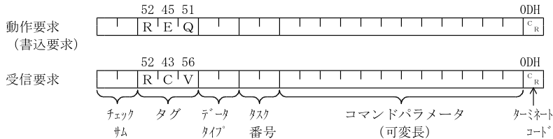

> **図の内容**
>
> - 動作要求（書込要求）: チェックサム（2 文字）、タグ「REQ」（52 45 51）、データタイプ、タスク番号、コマンドパラメータ（可変長）、ターミネートコード（CR、0DH）
> - 受信要求: チェックサム、タグ「RCV」（52 43 56）、データタイプ、タスク番号、コマンドパラメータ（可変長）、ターミネートコード（CR、0DH）

a. チェックサム

チェックサムは、コマンド文字列のタグの先頭文字から、ターミネートコードまでを、HEX文字列として全て加算して16進数で表した時の、下2桁をHEX文字列で表したものです。（ターミネートコードもチェックサムに含みます。）

【例】モード変更コマンド（自動運転モードへの変更）の場合、

"□ □ ＲＥＱ１００００００２ＣＲ"

52h+45h+51h+31h+30h+30h+30h+30h+30h+30h+32h+0Dh = 278h

ですので、チェックサムは"７８"となります。本コマンドの正式な形は、

"７８ＲＥＱ１００００００２ＣＲ"となります。

b. タグ（※）

通信処理種別を、HEX文字列でセットします。

c. データタイプ（※）

1バイトコードを2バイトのHEX文字列に変換したものです。

設定可能なデータタイプについては <5.データタイプ一覧> を参照してください。

【例】データタイプコードが、９０ｈの場合、"９０"（39h,30h）を設定してください。

d. コマンドパラメータ（※）

各コマンドでSLM8000に渡すパラメータをセットします。パラメータは、

「SLM8000 送受信データ説明書」(TB00-1134)

の各コマンドの《データフォーマット》に基づき設定します。

この時、各パラメータは《データフォーマット》にある"データサイズ"の長さに合わせて文字列変換し、設定してください。

詳細は、<4.送受信データの作成について> を参照してください。

e. ターミネータコード

テキストデータの終端を表します。

※ タグ、データタイプ、コマンドパラメータの内容については

<4.送受信データの作成について>

「SLM8000 送受信データ説明書」(TB00-1134)

を参照して下さい。

### 3-3．応答データ

1) ACKコード（06H）

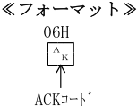

> **図の内容**
>
> ≪フォーマット≫ 1 文字の「ACK」（06H）。「ACKｺｰﾄﾞ」。

≪概要≫

動作要求受信時に、データを正常に受け付けた事を示す応答データです。

2) DATタグフォーマット

≪フォーマット≫

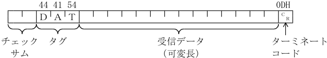

> **図の内容**
>
> チェックサム、タグ「DAT」（44 41 54）、受信データ（可変長）、ターミネートコード（CR、0DH）。

≪概要≫

外部機器からSLM8000へ送った受信要求データ(タグが"ＲＣＶ")を正常に受け付けた場合に、SLM8000から返されるデータです。

※ 受信データの内容については

<4.送受信データの作成について> を参照して下さい。

3) ANSタグフォーマット

≪フォーマット≫

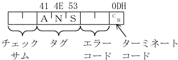

> **図の内容**
>
> チェックサム、タグ「ANS」（41 4E 53）、エラーコード、ターミネートコード（CR、0DH）。

≪概要≫

外部機器からSLM8000へ送った動作要求(タグが"ＲＥＱ")に問題があった場合に、SLM8000から返されるデータです。

エラーコードの意味は、以下の通りです。

| ANSエラーコード   | 意味         |
|-------------|-------------|
| "０２"        | パラメータエラー    |
| "０７"        | 要求データが存在しない |
| "０９"        | シーケンスエラー    |
| "０Ｃ"        | コマンド実行不可    |
| "ＦＦ"        | 原因不明エラー     |

### 3-4．異常発生時の応答データ

以下はコマンドが正常に受け付けられなかったときの応答データです。

1) RTYタグフォーマット

≪フォーマット≫

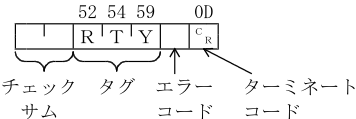

> **図の内容**
>
> チェックサム、タグ「RTY」（52 54 59）、エラーコード、ターミネートコード（CR、0DH）。

≪概要≫

コマンドをSLM8000が正常に認識できなかった時に返されるデータです。このデータを受け取ったら、直前に送ったデータを再送します。エラーコードが示す意味は、以下の通りです。

≪参考≫

| RTYエラーコード   | 意味               |
|-------------|-------------------|
| "１"         | サムチェックエラー         |
| "２"         | 8251(OR,FE,PE)エラー |
| "３"         | データ長6バイト未満        |
| "４"         | タグ不明エラー           |
| "５"         | データ長132バイト超過      |
| "７"         | 受信タイムアウト          |

<6-2．異常処理>

## 4.送受信データの作成について

### 4-1．送受信データ説明書とデータ作成について

- 1) 動作要求（書込要求）

a.データタイプ

<5.データタイプ一覧> を参照下さい。

b.タスク番号

タスク番号の 1バイトバイナリを2バイトHEX文字列に変換してデータタイプの次の文字に指定します。

c.コマンドパラメータ

「SLM8000 送受信データ説明書」(TB00-1134)

の動作要求コマンド詳細にある、各コマンドの"データフォーマット"を参照し、コマンドパラメータを作成します。"データフォーマット"の表に出てくる順番で、各値をHEX文字列に変換した物を最上位桁が文字列の先頭になるように指定します。

各値は、"データ長"に応じて

1バイトバイナリ → 2バイトHEX文字列

2バイトバイナリ → 4バイトHEX文字列

4バイトバイナリ → 8バイトHEX文字列

にそれぞれ変換します。

※バイナリからHEX文字列への変換例

20000を2バイトバイナリ(= 4E20h)として

4バイトHEX文字列にすると"４Ｅ２０"になります。

-10000を2バイトバイナリ(= D8F0h)として

4バイトHEX文字列にすると"Ｄ８Ｆ０"になります。

10000を4バイトバイナリ(= 00002710h)として

8バイトHEX文字列にすると"００００２７１０"になります。

-20000を4バイトバイナリ(= FFFFB1E0h)として

8バイトHEX文字列にすると"ＦＦＦＦＢ１Ｅ０"になります。

d.応答データ

正常に動作要求（書込要求）が受け取られた場合は、ACKコード(06h)が返ります。

2) 受信要求

- a. データタイプ

<5.データタイプ一覧> を参照下さい。

b.タスク番号

タスク番号の 1バイトバイナリを2バイトHEX文字列に変換してデータタイプの次の文字に指定します。

c. コマンドパラメータ

データタイプがDAT_MCRREGの場合のみ、マクロ番号を設定します。

上記以外のデータタイプでは設定不要です。

設定値は4バイトバイナリを8バイトHEX文字列として設定します。

d. 応答データ

正常に受信要求コマンドが受け付けられると"DAT"タグデータが返ります。

この時に返されるデータは

「SLM8000 送受信データ説明書」(TB00-1134)

のデータ送受信機能詳細にある、各コマンドの"データフォーマット"の構造になっています。

各データは"データフォーマット"に記されている"データ長"のデータをHEX文字列にしたもので、

各データ文字列の先頭がそのデータの最上位桁になっています。

### 4-2．コマンドデータと応答データの例

下記にコマンドとそれに対する応答データを例として挙げます。他のコマンドについては「SLM8000 送受信データ説明書」(TB00-1134) を参照してください。

1) マクロ変数書込コマンド(REQ_MCRREG)の発行 ≪概要≫

以下の例ではマクロ変数#1000へ－2000を書き込んでいます。

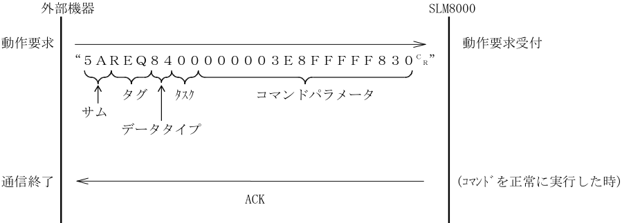

> **図の内容**
>
> 外部機器から SLM8000 へ「動作要求」:
> `"5AREQ84000000003E8FFFFF830CR"`（CR はターミネートコード）
> - サム「5A」、タグ「REQ」、データタイプ（矢印）、タスク、コマンドパラメータ。本文: マクロ変数#1000へ－2000を書き込む例
> - SLM8000: 「動作要求受付」。コマンドを正常に実行した時は「ACK」を返し、外部機器は「通信終了」

※コマンドパラメータの作成

「SLM8000 送受信データ説明書」(TB00-1134)<4-2-55.マクロ変数書込コマンド [REQ_MCRREG(0x84)]> を参照すると、"データフォーマット"は以下の様になっています。

**《データフォーマット》**

データサイズ:8Byte

|   オフセット [Byte] | データ名称   |   データ長 [Byte] | データ範囲 [単位]                 |
|----------------|---------|---------------|----------------------------|
|              0 | マクロ変数番号 |             4 | 1000～ 9999 [-]             |
|              4 | マクロ変数値  |             4 | -2147483647～2147483647 [-] |

コマンドパラメータに、書込を行う変数の番号と書き込む値（変数値）をセットします。マクロ変数#1000(０００００３Ｅ８ｈ)へ－2000(ＦＦＦＦＦ８３０ｈ)を書き込むので、コマンドパラメータとして設定する文字列は"０００００３Ｅ８ＦＦＦＦＦ８３０"になります。

2) プログラム実行情報データ読出コマンド(DAT_PRGSTS)の発行 ≪概要≫

以下の例ではSLM8000からタスク0のプログラム実行情報を取得しています。

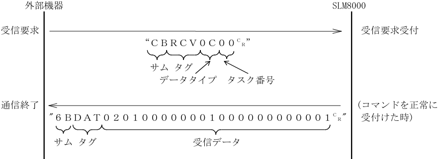

> **図の内容**
>
> 外部機器から SLM8000 へ「受信要求」: `"CBRCV0C00CR"`（サム「CB」、タグ「RCV」、データタイプ、タスク番号）。SLM8000: 「受信要求受付」。
> コマンドを正常に受付けた時、SLM8000 から: `"6BDAT0201000000001000000000001CR"`（サム「6B」、タグ「DAT」、受信データ）。外部機器は「通信終了」。

※受信要求コマンドパラメータの作成

データタイプDAT_PRGSTSなので、コマンドパラメータにタスク番号を指定します。上記例ではタスク0のプログラム実行情報を取得するので、0(タスク番号)の 1バイトバイナリ値を2バイトHEX文字列とした"００"を設定します。

※受信データの解読

「SLM8000 送受信データ説明書」(TB00-1134)

<4-1-43.プログラム実行情報データ読出[DAT_PRGSTS(0x0C)]> を参照すると、

"データフォーマット"は以下の様になっています。

**《データフォーマット》**

データサイズ:12Byte

|   オフセット [Byte] | データ名称    |   データ長 [Byte] | データ範囲 [単位]     |
|----------------|--------------|---------------|----------------|
|              0 | プログラム実行ステータス |             4 | －              |
|              4 | 選択・実行プログラム番号 |             2 | 0 ～ 32767      |
|              6 | 未使用          |             2 | －              |
|              8 | 実行ステップ番号     |             4 | 0 ～ 4294967295 |

受信データが"０２０１０００００００１０００００００００００１"の場合は、

０２０１０００００００１０００００００００００１

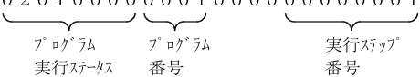

> **図の内容**
>
> 受信データ「0201000000001000000000001」（図の上端は一部切れている）を区切ったもの:
> - プログラム実行ステータス
> - プログラム番号
> - 実行ステップ番号
> 本文: プログラム実行ステータスが 02010000h、選択されたプログラム番号が 1、実行ステップ番号 1。

となり、プログラム実行ステータスが02010000ｈ、選択されたプログラム番号が1、実行ステップ番号1であることを示しています。

## 5.データタイプ一覧

以下は、各コマンド(受信要求コマンド、動作要求コマンド)に設定可能なデータタイプになります。

### 5-1．受信要求コマンド

受信要求コマンド(タグが"ＲＣＶ")には以下のデータタイプが設定できます。

※「SLM8000 送受信データ説明書」(TB00-1134)<4-1.データ送受信機能詳細>

で説明している全てのデータ受信を行えるわけではありませんのでご注意下さい。

又、データ送信はできません。(DAT_～のデータタイプでデータ送信を行うことはできません。)

| DAT_IODATA     | //   | I/O信号状態            | (0x03)   |    |
|----------------|------|--------------------|----------|----|
| DAT_MODE       | //   | 動作モード              | (0x04)   |    |
| DAT_COMREG     | //   | 各軸現在位置             | (0x05)   |    |
| DAT_STATUS_BIT | //   | ビット情報ステータス         | (0x06)   |    |
| DAT_ALARM_BIT  | //   | ビット情報アラーム          | (0x07)   |    |
| DAT_OVERRIDE   | //   | 送りオーバーライド設定(25%刻み) | (0x08)   |    |
| DAT_PRGSTS     | //   | プログラム実行情報          | (0x0c)   |    |
| DAT_DNCBUFI    | //   | DNCバッファ情報          | (0x0f)   |    |
| DAT_SENSEPOS   | //   | センサーラッチ位置情報        | (0x11)   |    |
| DAT_FORCEIO    | //   | 強制入出力bitデータ        | (0x13)   |    |
| DAT_FORCEMPI   | //   | 機械パネル強制入力bitデータ    | (0x14)   |    |
| DAT_OVERRIDEP  | //   | 送りオーバーライド設定 (1%刻み) | (0x15)   |    |
| DAT_TPCINFO    | //   | TPCロギング情報          | (0x24)   |    |
| DAT_MPDATA     | //   | 機械パネルSW情報          | (0x26)   |    |
| DAT_VERSION    | //   | ROMバージョン情報         | (0x27)   |    |
| DAT_AXNEGLECT  | //   | 軸無効設定情報            | (0x28)   |    |
| DAT_AXINTLOCK  | //   | 軸インタロック設定情報        | (0x29)   |    |
| DAT_TPCINFO_EX | //   | TPCロギング情報          | (0x2a)   |    |
| DAT_AXSVONEN   | //   | 軸サーボON有効設定情報       | (0x31)   |    |
| DAT_HANDLESTS  | //   | 手パモード設定情報          | (0x32)   |    |
| DAT_MCRREG     | //   | マクロ変数読出/書込         | (0x33)   | ※  |
| DAT_TOOLHSTS   | //   | 工具長補正設定情報          | (0x39)   |    |
| DAT_TOOLDSTS   | //   | 工具径補正設定情報          | (0x3a)   |    |
| DAT_ASSAXISTBL | //   | 軸割り当て情報読出          | (0x3c)   |    |
| DAT_TOOLDERR   | //   | 工具径補正エラー情報         | (0x3d)   |    |
| DAT_SPREV      | //   | 主軸回転数読出            | (0x41)   |    |
| DAT_FBCOUNT    | //   | FBカウンタ積算値          | (0x50)   |    |

※DAT_MCRREGのみ受信要求コマンドに"付加パラメータ"を追加する必要があります。

### 5-2．動作要求コマンド

動作要求コマンド(タグが"ＲＥＱ")には、

「SLM8000 送受信データ説明書」(TB00-1134)<4-2.動作要求コマンド詳細> で説明している全てのコマンドを指定する事ができます。

| 例）   | REQ_MODECHG   | //               | ﾓｰﾄﾞ変更 (0x10)   |
|------|---------------|------------------|-----------------|
|      | REQ_JOGSTART  | // ＪＯＧ移動開始       | (0x11)          |
|      | REQ_ZRNSTART  | // 原点復帰開始        | (0x12)          |
|      | REQ_STOP      | // 移動停止          | (0x13)          |
|      | REQ_GENE      | // ｼﾞｪﾈﾚｰｼｮﾝ     | (0x14)          |
|      | REQ_PTPSTART  | // ＰＴＰ移動開始       | (0x15)          |
|      | REQ_PTPASTART | // ＰＴＰ移動開始（ABSO） | (0x16)          |
|      | REQ_LINSTART  | // 補間移動開始        | (0x17)          |
|      | REQ_LINASTART | // 補間移動開始（ABSO）  | (0x18)          |
|      | REQ_ORGSET    | // 原点設定          | (0x19)          |
|      | REQ_RESET     | // ﾘｾｯﾄ          | (0x1a)          |

：

## 6.プロトコル

### 6-1．正常処理

正常パターンのプロトコルは以下のようになります。

1) 動作要求コマンド

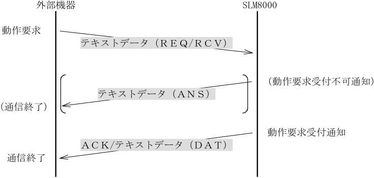

> **図の内容**
>
> 1) 動作要求コマンド: 外部機器 → SLM8000「テキストデータ（REQ/RCV）」。
> - 動作要求受付不可の場合: SLM8000 → 外部機器「テキストデータ（ANS）」（動作要求受付不可通知）で通信終了
> - 受付けた場合: SLM8000 → 外部機器「ACK/テキストデータ（DAT）」（動作要求受付通知）で通信終了

- ① 外部機器はコマンドデータ（ＲＥＱ/ＲＣＶ）をSLM8000に送ります。
- ② SLM8000はコマンドデータ自体及び、データ受付可能であるかをチェックし、OKであれば ACKコードタグ/DATタグデータデータを返します。

コマンドデータは正常であるが、データ受付不可の場合は受付不可通知（ANS）を返します。

＜ANSが返される例＞

- マクロ変数書込にて、"読み出しのみ可"の変数が指定されたとき
- マクロ変数読出・書込にて、存在しない変数が指定されたとき

### 6-2．異常処理

1) リトライ処理

フォーマットに合わないデータ、通信プロトコルに合わないデータを受け取ったときには、通信相手にリトライ処理（直前のデータの再送信）を要求します。

確実にリトライを行うため、リトライ送信だけでなく受信可能信号（RS信号）の制御を行います。

＜リトライ＞

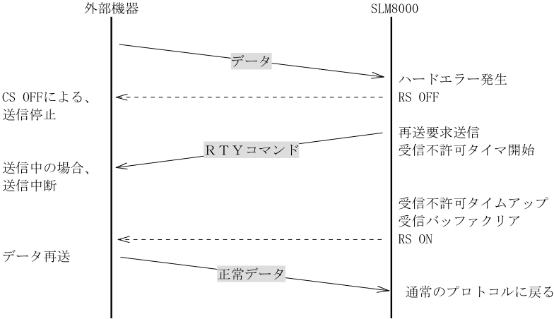

> **図の内容**
>
> 外部機器 → SLM8000「データ」の送信中に、SLM8000 で「ハードエラー発生 RS OFF」。外部機器は「CS OFFによる、送信停止」。
> SLM8000 は「再送要求送信 受信不許可タイマ開始」で「RTYコマンド」を送る。外部機器は「送信中の場合、送信中断」。
> SLM8000 は「受信不許可タイムアップ 受信バッファクリア RS ON」。外部機器は「データ再送」で「正常データ」を送り、「通常のプロトコルに戻る」。

尚、RTY要求に対してRTY要求が返された場合(マルチリトライ)と、RTYコマンドに対して返されたデータが不正データだった事が3回続いた場合(リトライオーバー)は、通信処理を終了します。

＜マルチリトライ＞

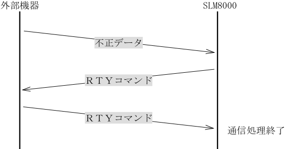

> **図の内容**
>
> 外部機器 → SLM8000「不正データ」、SLM8000 → 外部機器「RTYコマンド」、外部機器 → SLM8000「RTYコマンド」。SLM8000 は「通信処理終了」。

＜リトライオーバー＞

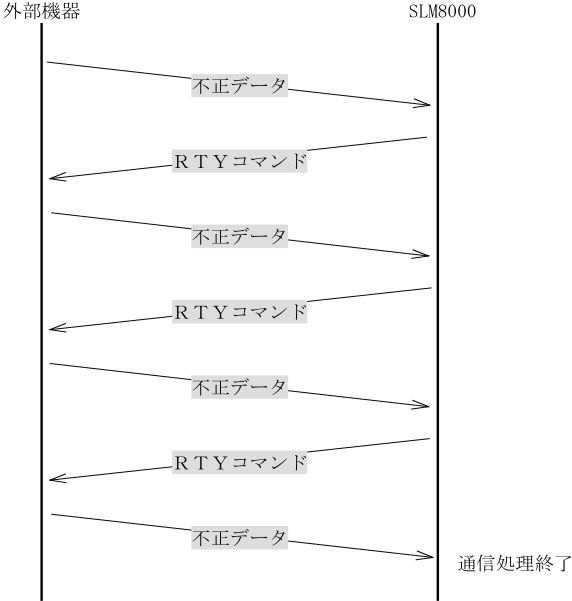

> **図の内容**
>
> 外部機器 → SLM8000「不正データ」と、SLM8000 → 外部機器「RTYコマンド」を 3 回くり返し、4 回目の「不正データ」で「通信処理終了」。

2) タイムアウト処理

＜送信タイムアウト＞

データ送信開始から、通信相手からのデータ受信開始までの時間が3秒以上の場合、データが届かずにタイムアウトしたものとして、データの再送を行います。

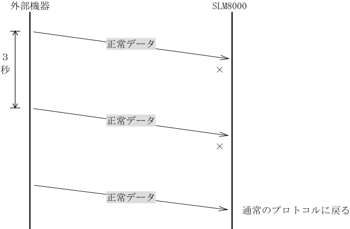

> **図の内容**
>
> 外部機器 → SLM8000「正常データ」が届かない（×）まま「3秒」たつと、もう一度「正常データ」を送る。2 回目も届かず（×）、3 回目の「正常データ」で「通常のプロトコルに戻る」。

＜受信タイムアウト＞

通信相手からのデータ受信開始から、受信完了までの時間が1.5秒以上の場合、受信タイムアウトとして、再送要求を送信します。再送要求のシーケンスはリトライと同様です。

3) 通信異常

受信中のハードエラー（オーバーラン、パリティエラー、フレーミングエラー）発生時、無応答時には、通信相手にリトライ処理（直前のデータの再送信）を要求します。

この場合、通信相手の状態が送信中か受信中か判断できないため、リトライ送信だけでなく受信可能信号（RS信号）の制御を行います。

＜ハードエラーのリトライ＞

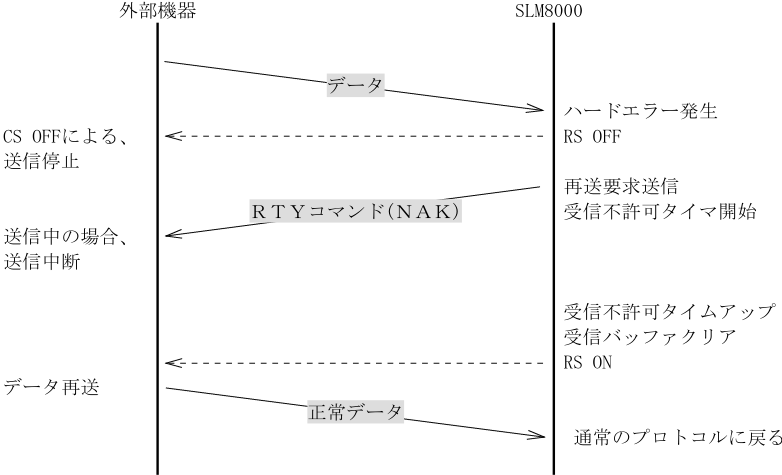

> **図の内容**
>
> ＜リトライ＞と同じ流れで、SLM8000 が送るのが「RTYコマンド(NAK)」。ハードエラー発生 RS OFF → CS OFFによる送信停止 → 再送要求送信 受信不許可タイマ開始 → 送信中の場合、送信中断 → 受信不許可タイムアップ 受信バッファクリア RS ON → データ再送「正常データ」→ 通常のプロトコルに戻る。

4) シーケンスエラー

正常に受信したデータがプロトコル上矛盾する場合、通信シーケンスエラーとして通信を終了します。受信側の待ち状態と有効な受信データの関係は以下の通りです。

| 受信待ちｺｰﾄﾞ/ｺﾏﾝﾄﾞ/ﾃﾞｰﾀ    | 有効ｺｰﾄﾞ/ｺﾏﾝﾄﾞ/ﾃﾞｰﾀ                    |
|------------------------|--------------------------------------|
| 通信コマンド待ち受け状態 ※1        | "ＲＣＶ"コマンド、"ＲＥＱ"コマンド、 "ＲＴＹ"コマンド ※2    |
| ACKコード待ち（テキストコマンドモード） | ACKコード、 NAKコード、 "ＡＮＳ"コマンド、"ＲＴＹ"コマンド |

- ※1 この状態になるのはSLM8000のみです。
- この状態の場合、有効コマンド以外は全て無視します。

エラーにはなりません。

※2 前回送信データがANSコマンドまたは、ACKコードの時のみ有効です。

### 6-3．修復不能な通信障害

通信処理では、通信障害に対して、データの再送や再送要求にて出来る限りの修復を試みますが、以下の場合、修復できないことがわかっています。

1) 再送要求の文字化け

再送要求に文字化けが発生すると、文字化けした再送要求を受信した側は、再送要求に対して再送要求を出してしまいます。

そのため、再送要求が文字化けするとマルチリトライエラーが発生します。

2) パソコンが送信した最終ACKコードの文字化け

パソコンが送信した最終ACKコードが文字化けすると、SLM8000はリトライを行いますが、この時パソコンが既に通信処理を終了しているため、このリトライを処理できません。

但し、リトライ要求データの受信は行っているため、次の通信処理でデータ履歴無しのリトライと見なされ、直ちにエラー終了してしまいます。

3) エラー発生間隔が非常に短い場合

エラー発生間隔が短いと1)と同様、再送データまたは、再送要求データの送受信が正常に出来なくなるため、マルチリトライ、タイムアウトなどのエラーが発生します。

### 6-4．RS/CSフロー信号を使わない場合の注意点

RS/CS信号を使わない場合は、必ずRS信号（SLM8000にとってのCS信号）を常時ONするように配線して下さい。尚、RS/CSのフロー制御を行わない場合、以下の問題が発生します。これらの問題があることを前提としてご使用下さい。

1) データの異常や通信の異常による、リトライシーケンスが失敗する可能性が高くなります。

SLM8000がデータや通信の異常を検出したときに、相手機器がまだ送信中だった場合、リトライの送信中に、相手機器のデータが届いて正常にリトライが送れなくなります。

- 2) 1)のエラー発生の後、次の通信の回復が遅れる場合があります。

1)のとき通信シーケンスが乱れるため、次の回の通信にて、マルチリトライや無応答エラーが発生する可能性があります。

1)や2)の問題が頻発して実用に耐えられない場合は、別途、通信プロトコルの専用化等で対応する必要があります。
