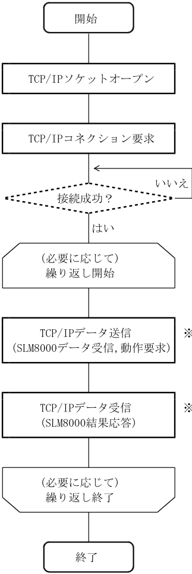
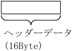
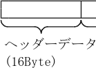
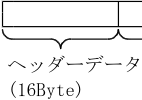
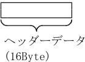

# お願い

このマニュアルの記載内容について、まちがいや不明な点がありましたら、お手数ですがFAXまたはメールにてテクノへお知らせ下さい。今後さらに改善していきます。

株式会社テクノ〒358-0011 埼玉県入間市下藤沢1304-5 TEL 04-2964-3677 FAX 04-2964-3322 E-mail mail@open-mc.com

標準ワンボードモーションコントローラ[SLM8000] イーサネット通信仕様

Ver1.0 2020.10.26

5-2．動作要求コマンド

－目次－

- 1.概要
- 2.イーサネット通信仕様
- 3.TCP/IP通信手順
- 4.送受信データ
  - 4-1．受信要求コマンド
  - 4-2．動作要求コマンド
- 5.データタイプ一覧
  - 5-1．受信要求コマンド
  - 5-2．動作要求コマンド

## 1.概要

SLM8000イーサネット通信は、TCP/IPソケットでコネクションを確立して、バイナリ形式のデータでコマンドを送ることにより、SLM8000に対する動作指示／データ受信を行うものです。

本マニュアルでは、通信プロトコルのみ説明します。

各コマンドの詳細については、

「SLM8000 送受信データ説明書」(TB00-1134) を参照して下さい。

## 2.イーサネット通信仕様

SLM8000は電源投入後、サーバーとして以下の通信設定にて通信確立を待機しています。

| プロトコル                     | TCP/IP     |
|---------------------------|------------|
| ポート番号                     | 20000      |
| IPアドレス                    | ROMSW設定    |
| MSS(Maximum Segment Size) | 1460[Byte] |

ユーザアプリケーションはクライアントとして、上記設定にてTCP/IPソケットをオープンし、コネクションを確立してください。

## 3.TCP/IP通信手順

TCP/IPソケット通信では、SLM8000がサーバとして接続要求を待機していますので、ユーザアプリケーションは、クライアントとしてコネクションを確立します。

コネクション確立後は、１パケットのコマンドを送信し、１パケットの応答を受信する処理を繰り返します。 Ethernet上でIPフラグメンテーションを発生させないため、MTU(Maximum Transmission Unit)サイズ以内のパケット送受信となるようにします。

よって、MSS(Maximum Segment Size)1460[Byte]以内のコマンド送受信を行います。

<TCP/IPクライアントになる場合の処理の流れ>

- ※断線やノイズ等の異常時を考慮し、 (SLM8000データ受信,動作要求) タイムアウトを設定してください。 (目安：3秒程度)
- ※断線やノイズ等の異常時を考慮し、タイムアウトを設定してください。 (目安：3秒程度)

> **図の内容**
>
> 1. 開始
> 2. TCP/IPソケットオープン
> 3. TCP/IPコネクション要求
> 4. 接続成功？ いいえ → 3 に戻る。はい → 次へ
> 5. （必要に応じて）繰り返し開始
> 6. TCP/IPデータ送信（SLM8000データ受信、動作要求）※
> 7. TCP/IPデータ受信（SLM8000結果応答）※
> 8. （必要に応じて）繰り返し終了
> 9. 終了

## 4.送受信データ

イーサネット通信で直接TCP/IPソケットを用いて通信する場合、

- 受信要求コマンド(該当するもののみ)
- 動作要求コマンド

のみ可能です。（データ送信はできません。）

### 4-1．受信要求コマンド

≪TCP/IPデータフォーマット≫

①SLM8000受信要求：TCP/IP送信データ

受信要求

> **図の内容**
>
> 先頭の「ヘッダーデータ（16Byte）」だけで構成される。

②SLM8000受信データ：TCP/IP受信データ

受信データ

> **図の内容**
>
> 先頭の「ヘッダーデータ（16Byte）」のあとに、データが続く。

受信データ

(可変長 : 1444Byte以内)

≪ヘッダーデータ詳細≫

データサイズ:16Byte

|   オフセット [Byte] | データ名称   |   データ長 [Byte] | データ範囲 [単位]          |
|----------------|-------------|---------------|---------------------|
|              0 | コマンド種別      |             2 | 0x02,0x03           |
|              2 | データタイプ      |             2 |                     |
|              4 | タスク番号       |             2 | -1 ～ 7 ※データタイプによる   |
|              6 | エンディアン種別    |             2 | 0,1,2               |
|              8 | パラメータ       |             4 | ※データタイプによる          |
|             12 | データ長        |             4 | 0 ～ 1444 ※データタイプによる |

①SLM8000受信要求：TCP/IP送信データ

コマンド種別

データタイプ

タスク番号

： "0x02" (受信要求) ：データタイプの数値例)ステータスデータ読出の場合 DAT_STATUS(0x02)の数値"0x02"

： ※データタイプによる例)ステータスデータ読出の場合タスク指定の必要が無いため"0"

エンディアン種別：アプリケーションが動作するCPUのエンディアンを選択

"0x0000"(ビッグエンディアン)

"0x0001"(リトルエンディアン)

※Windows、三菱Qシリーズ等

"0x0002"(2Byte境界ビッグエンディアン)

※横河電機FA-M3シリーズ、オムロンCJシリーズ等

： ※データタイプによる例)ステータスデータ読出の場合パラメータ指定の必要が無いため"0"

パラメータ

データ長： 0

②SLM8000受信データ：TCP/IP受信データ

コマンド種別

データタイプ

：送信データと同じ値

：送信データと同じ値

タスク番号

：送信データと同じ値

エンディアン種別：送信データと同じ値

パラメータ

：受信結果の意味は、以下の通りです。

| 結果コード   | 意味         |
|---------|-------------|
| 0x00    | 正常受信        |
| 0x02    | パラメータエラー    |
| 0x07    | 要求データが存在しない |
| 0x09    | シーケンスエラー    |
| 0x0C    | コマンド実行不可    |
| 0xFF    | 原因不明エラー     |

データ長

：正常受信できた時のみ値が返却されます ※値はデータタイプによる例)ステータスデータ読出の場合

656[Byte]

≪受信データ≫

正常受信できた時のみ受信バッファにデータが設定されます。

データ長はヘッダーデータのデータ長です。

ヘッダーを含めたMSSが1460[Byte]以内となるように、データ長は最大1444[Byte]です。

※各コマンド(データタイプ)の詳細については、

「SLM8000 送受信データ説明書」(TB00-1134)

を参照して下さい。

### 4-2．動作要求コマンド

≪TCP/IPデータフォーマット≫

①SLM8000動作要求：TCP/IP送信データ

動作要求

> **図の内容**
>
> 先頭の「ヘッダーデータ（16Byte）」のあとに、データが続く。

②SLM8000動作結果：TCP/IP受信データ

動作結果

≪ヘッダーデータ詳細≫

> **図の内容**
>
> 先頭の「ヘッダーデータ（16Byte）」だけで構成される。

データサイズ:16Byte

|   オフセット [Byte] | データ名称   |   データ長 [Byte] | データ範囲 [単位]          |
|----------------|-------------|---------------|---------------------|
|              0 | コマンド種別      |             2 | 0x02,0x03           |
|              2 | データタイプ      |             2 |                     |
|              4 | タスク番号       |             2 | -1 ～ 7 ※データタイプによる   |
|              6 | エンディアン種別    |             2 | 0,1,2               |
|              8 | パラメータ       |             4 | ※データタイプによる          |
|             12 | データ長        |             4 | 0 ～ 1444 ※データタイプによる |

①SLM8000動作要求：TCP/IP送信データ

コマンド種別

： "0x03" (動作要求)

データタイプ

タスク番号

：データタイプの数値例)インクレ直線補間位置決めコマンドの場合 REQ_LINSTART(0x17)の数値"0x17"

： ※データタイプによる

例)インクレ直線補間位置決めコマンドの場合指令するタスク番号を指定 "0"～"7"

エンディアン種別：アプリケーションが動作するCPUのエンディアンを選択

"0x0000"(ビッグエンディアン)

"0x0001"(リトルエンディアン)

※Windows、三菱Qシリーズ等 "0x0002"(2Byte境界ビッグエンディアン) ※横河電機FA-M3シリーズ、オムロンCJシリーズ等

パラメータ

：使用しません

データ長

パラメータ指定の必要が無いため"0"

： ※データタイプによる

例)インクレ直線補間位置決めコマンドの場合 "44"Byte

送信コマンドパラメータ

(可変長 : 1444Byte以内)

②SLM8000受信データ：TCP/IP受信データ

コマンド種別

：送信データと同じ値

データタイプ

：送信データと同じ値

タスク番号

：送信データと同じ値

エンディアン種別：送信データと同じ値

パラメータ

：受信結果の意味は、以下の通りです。

| 結果コード   | 意味         |
|---------|-------------|
| 0x00    | 正常受信        |
| 0x02    | パラメータエラー    |
| 0x07    | 要求データが存在しない |
| 0x09    | シーケンスエラー    |
| 0x0C    | コマンド実行不可    |
| 0xFF    | 原因不明エラー     |

データ長

：使用しません

データ返却の必要が無いため"0"

≪送信コマンドパラメータ≫

指令時に送信バッファにデータを設定します。

ヘッダーデータのデータ長にパラメータサイズを設定します。

ヘッダーを含めたMSSが1460[Byte]以内となるように、データ長は最大1444[Byte]です。

※各コマンド(データタイプ)の詳細については、

「SLM8000 送受信データ説明書」(TB00-1134)

を参照して下さい。

## 5.データタイプ一覧

以下は、各コマンド(受信要求コマンド、動作要求コマンド)に設定可能なデータタイプになります。

### 5-1．受信要求コマンド

受信要求コマンドには以下のデータタイプが設定できます。

※「SLM8000 送受信データ説明書」(TB00-1134)<4-1.データ送受信機能詳細>

で説明している全てのデータ受信を行えるわけではありませんのでご注意下さい。

又、データ送信はできません。(DAT_～のデータタイプでデータ送信を行うことはできません。)

| DAT_STATUS     | //   | ステータスデータ           | (0x02)   |
|----------------|------|--------------------|----------|
| DAT_IODATA     | //   | I/O信号状態            | (0x03)   |
| DAT_MODE       | //   | 動作モード              | (0x04)   |
| DAT_COMREG     | //   | 各軸現在位置             | (0x05)   |
| DAT_STATUS_BIT | //   | ビット情報ステータス         | (0x06)   |
| DAT_ALARM_BIT  | //   | ビット情報アラーム          | (0x07)   |
| DAT_OVERRIDE   | //   | 送りオーバーライド設定(25%刻み) | (0x08)   |
| DAT_PRGSTS     | //   | プログラム実行情報          | (0x0c)   |
| DAT_DNCBUFI    | //   | DNCバッファ情報          | (0x0f)   |
| DAT_SENSEPOS   | //   | センサーラッチ位置情報        | (0x11)   |
| DAT_FORCEIO    | //   | 強制入出力bitデータ        | (0x13)   |
| DAT_FORCEMPI   | //   | 機械パネル強制入力bitデータ    | (0x14)   |
| DAT_OVERRIDEP  | //   | 送りオーバーライド設定 (1%刻み) | (0x15)   |
| DAT_VARIABLE   | //   | マクロ変数データ           | (0x19)   |
| DAT_TPCINFO    | //   | TPCロギング情報          | (0x24)   |
| DAT_MPDATA     | //   | 機械パネルSW情報          | (0x26)   |
| DAT_VERSION    | //   | ROMバージョン情報         | (0x27)   |
| DAT_AXNEGLECT  | //   | 軸無効設定情報            | (0x28)   |
| DAT_AXINTLOCK  | //   | 軸インタロック設定情報        | (0x29)   |
| DAT_TPCINFO_EX | //   | TPCロギング情報          | (0x2a)   |
| DAT_AXSVONEN   | //   | 軸サーボON有効設定情報       | (0x31)   |
| DAT_HANDLESTS  | //   | 手パモード設定情報          | (0x32)   |
| DAT_MCRREG     | //   | マクロ変数読出/書込         | (0x33)   |
| DAT_TOOLHSTS   | //   | 工具長補正設定情報          | (0x39)   |
| DAT_TOOLDSTS   | //   | 工具径補正設定情報          | (0x3a)   |
| DAT_ASSAXISTBL | //   | 軸割り当て情報読出          | (0x3c)   |
| DAT_TOOLDERR   | //   | 工具径補正エラー情報         | (0x3d)   |
| DAT_SPREV      | //   | 主軸回転数読出            | (0x41)   |
| DAT_FBCOUNT    | //   | FBカウンタ積算値          | (0x50)   |

### 5-2．動作要求コマンド

動作要求コマンドは、

「SLM8000 送受信データ説明書」(TB00-1134)<4-2.動作要求コマンド詳細> で説明している全てのコマンドを指定する事ができます。

| 例）   | REQ_MODECHG   | //               | ﾓｰﾄﾞ変更 (0x10)   |
|------|---------------|------------------|-----------------|
|      | REQ_JOGSTART  | // ＪＯＧ移動開始       | (0x11)          |
|      | REQ_ZRNSTART  | // 原点復帰開始        | (0x12)          |
|      | REQ_STOP      | // 移動停止          | (0x13)          |
|      | REQ_GENE      | // ｼﾞｪﾈﾚｰｼｮﾝ     | (0x14)          |
|      | REQ_PTPSTART  | // ＰＴＰ移動開始       | (0x15)          |
|      | REQ_PTPASTART | // ＰＴＰ移動開始（ABSO） | (0x16)          |
|      | REQ_LINSTART  | // 補間移動開始        | (0x17)          |
|      | REQ_LINASTART | // 補間移動開始（ABSO）  | (0x18)          |
|      | REQ_ORGSET    | // 原点設定          | (0x19)          |

：
