# モーションアナライザＴＰＣ-Ｅxcel説明書

（株）テクノＶｅｒ１．１

2011.9.29

はじめに１．

オープンの「ＴＰＣ(ツールパスチェッカー)ロギング機能」と「ＴＰＣＥｘｃｅｌ」 MC - ( ソフト)によって、軸の挙動を定量的に確認することができます。 Excel ＴＰＣロギング機能(以下、ロギング)は、フィードバックパルスや指令パルスをロギング TPC する機能です。このロギングしたデータをＴＰＣＥｘｃｅｌにて解析することにより、単軸 - だけでなく合成軌跡精度、サーボのダイナミクス、微少動作の解析などができます。

ここではＴＰＣロギング機能とＴＰＣＥｘｃｅｌの機能と操作を説明します。 -

TPC-Excelの概要２．TPCロギングと

２－１．システム構成

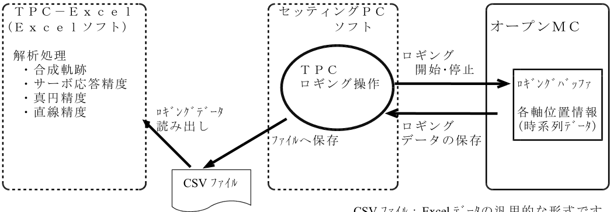

> **図の内容**
>
> 3 つの箱と CSV ファイルからなる構成図。
> - **ＴＰＣ－Ｅｘｃｅｌ（Ｅｘｃｅｌソフト）**: 解析処理（・合成軌跡 ・サーボ応答精度 ・真円精度 ・直線精度）
> - **セッティングＰＣソフト**: 「ＴＰＣ ロギング操作」
> - **オープンＭＣ**: 「ﾛｷﾞﾝｸﾞﾊﾞｯﾌｧ」（各軸位置情報（時系列ﾃﾞｰﾀ））
>
> つながり:
> - セッティングＰＣソフト → オープンＭＣ: 「ロギング 開始・停止」
> - オープンＭＣ → セッティングＰＣソフト: 「ロギング データの保存」
> - セッティングＰＣソフト → CSV ﾌｧｲﾙ: 「ﾌｧｲﾙへ保存」
> - CSV ﾌｧｲﾙ → ＴＰＣ－Ｅｘｃｅｌ: 「ﾛｷﾞﾝｸﾞﾃﾞｰﾀ 読み出し」
>
> 図の下の注記: 「CSV ﾌｧｲﾙ：Excel ﾃﾞｰﾀの汎用的な形式です」

２－２．特徴

■ ポータビリティ

特別なハードウェアなしに現場でも簡単に解析評価ができます。

■ 汎用性

汎用のＰＣやで解析・評価が可能です。 Excel

さらに、結果のデータを有効利用することができます。

■ 測定対象への負担ゼロ

測定対象への影響はありません。

２－３．応用

★サーボ調整

サーボ系の調整結果を簡単に定量的に判定できます。

★サーボ系の調査

★開発支援

★不具合の解析

- ★
- 機械の出荷試験

メカのガタやロストモーション、スティックモーションなどを計測できます。

新規マシンの制御や新しい制御方式の動作確認、

パラメータの最適調整に対し定量的な判断ができます。

機械の動作異常、精度不良に対し、定量的に解析することで、原因の調査及び対策が最短時間で最適に行えます。

実動作(組立、加工)させることなく充分な精度確認が行えます。

。 CSV Excel ﾌｧｲﾙ：ﾃﾞｰﾀの汎用的な形式です

## ３．用語説明

- 指令位置
- 機械位置

：各軸への指令値から算出した各軸座標です。

：各軸へのエンコーダ (スケール )から算出した各軸座標です。 F.B. F.B.

・ロギングデータ：制御周期毎の位置ﾃﾞｰﾀ(各軸座標)が形式になっています。 CSV

グラフ化するだけで軌跡を見ることができます。

。。・セッティングＰＣ：テクノ標準運転ソフトです詳細はユーザーズマニュアルを参照下さい ( ＝フィードバック) F.B.

## ４．ＰＣ環境

対応パソコン：

対応ＯＳ：

ＸＰ／Ｖｉｓｔａ／７が動作するパソコン Windows ＣＰＵ８０３８６以降のＸ８６プロセッサ画面解像度１０２４×７６８以上要マウス

ＸＰ／Ｖｉｓｔａ／７ Windows

対応Ｅｘｃｅｌ：

Microsoft Excel2000/2003 for Windows

## ５．ＴＰＣロギングの機能

- ５－１．ＴＰＣロギングの原理

全軸の指令位置と機械位置から２つの位置データを選択し、制御クロックに完全に同期してサンプリングします。

全ての解析はこの位置データを基に行います。

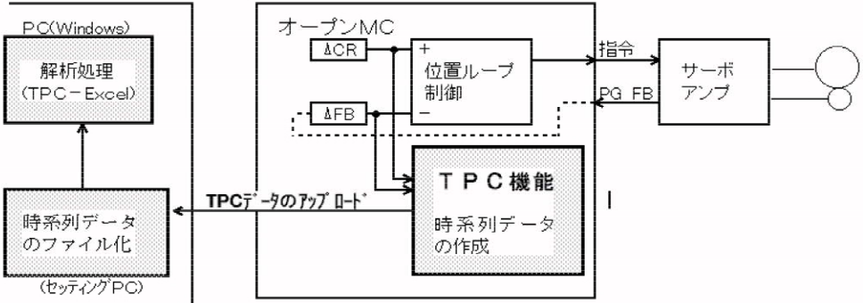

> **図の内容**
>
> オープンＭＣの中の TPC 機能が、位置ループ制御の入力をそのまま時系列データにする様子を示す図。
> - オープンＭＣ内: 「ΔCR」（指令）が位置ループ制御の ＋ 入力へ、「ΔFB」（フィードバック）が － 入力へ入る。位置ループ制御の出力が「指令」としてサーボアンプへ行く
> - サーボアンプからモータ・エンコーダを経て「PG FB」が戻り、ΔFB になる（破線）
> - ΔCR と ΔFB は分岐して「ＴＰＣ機能（時系列データの作成）」にも入る
> - ＴＰＣ機能 → PC（Windows）の「時系列データのファイル化（ｾｯﾃｨﾝｸﾞPC）」: 「TPCﾃﾞｰﾀのｱｯﾌﾟﾛｰﾄﾞ」
> - 時系列データのファイル化 → 「解析処理（TPC－Excel）」

５－２．ＴＰＣロギングの基本仕様

| 位置データの選択   | 全ての軸の指令位置と機械位置から２つの位置データを選択                                                                                                                                    |
|------------|----------------------------------------------------------------------------------------------------------------------------------------------------------------|
| ロギングバッファ数  | ４０９５ポイント。ファイル保存方法で「常時」を選択すると無制限（ＰＣでの保存）になります。                                                                                                                 |
| サンプリング周期   | オープンのサーボ制御周期の整数倍 MC                                                                                                                                           |
| ロギングの開始／終了 | 開始はセッティングＰＣ上のﾀﾞｲｱﾛｸﾞの「開始」で行います。停止はダイアログの「停止」またはバッファ満杯です。                                                                                                      |
| ファイル保存方法   | 「手動」選択時はバッファが満杯になると自動的にロギングを停止し保存指示を待ちます。「ロギング停止時」選択時はバッファが満杯になるとロギング。を停止し選択させている保存ファイルに自動的に転送します「常時」選択時はバッファの満杯を待たずに次々にＰＣの保存ファイルに保管しますので、記録容量は無制限になります。 |
| 保存データ形式    | 形式で保存します。 *.csv                                                                                                                                                |

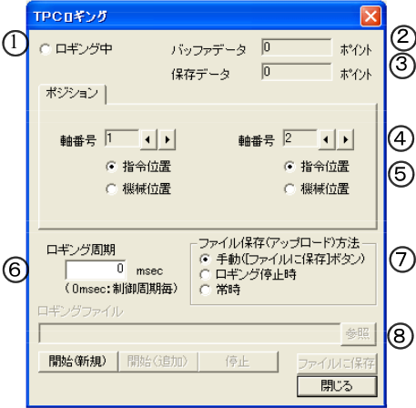

> **図の内容**
>
> ダイアログ「TPCﾛｷﾞﾝｸﾞ」。丸数字は本文の ①～⑧ の説明に対応する。
> - ①「ロギング中」ラジオボタン
> - ②「バッファデータ [0] ﾎﾟｲﾝﾄ」
> - ③「保存データ [0] ﾎﾟｲﾝﾄ」
> - タブ「ポジション」の中に左右 2 組:
>   - ④「軸番号」（左 1、右 2。◀ ▶ ボタンで変える）
>   - ⑤「指令位置」「機械位置」のラジオボタン（左右とも指令位置が選ばれている）
> - ⑥「ロギング周期 [0] msec」「（0msec：制御周期毎）」
> - ⑦「ファイル保存(アップロード)方法」: 「手動([ファイルに保存]ボタン)」（選択中）、「ロギング停止時」、「常時」
> - ⑧「ロギングファイル」の入力欄と「参照」ボタン（手動のときは灰色）
> - 下のボタン: 「開始(新規)」「開始(追加)」「停止」「ファイルに保存」「閉じる」

- ①：ロギング状態を示すラジオボタンです。ロギング中はＯＮ、停止するとＯＦＦになります。
- ②：現在ロギングバッファに入力されたデータ数です。ロギング開始すると増加し、になると停止します。 4095
- ③：ＰＣの保存バッファに格納したデータ数です。
- ④：ボタンによりロギングしたい軸番号を選択できます。
- ⑤：選択した軸の指令位置、または機械位置の選択ができます。
- ⑥：ＴＰＣロギング周期を単位で設定し msec ます。( ～ ) "０"またはロギング 1 32767 周期以下の設定のときは制御周期毎にロギングします。
- ⑦：手動「ロギング停止時「常時」の選択「」」ができます。（ファイル保存方法参照）
- ⑧：保存用ファイルを指定してください。

「開始(新規)」ボタン：ロギングバッファのデータをクリア後にロギングを開始します。

「開始(追加)」ボタン：ロギングバッファのデータをクリアしないでロギングを開始します。

ロギングデータは現在のロギングバッファの終端へ付加されていきます。

「停止」ボタン：ロギングを停止します。

(ロギングポイントがポイントになった場合もロギングは停止し 4095 ます。)

「ﾌｧｲﾙに保存」ボタン：ロギングバッファ内のデータを上にアップロードします。ファイル PC セーブダイアログが表示され任意のファイル名をつけて保存できます。保存ファイルは形式です。 csv

ファイル保存方法（⑦）詳細

手動

：ファイルに保存ボタンの操作でアップロードします。

ロギング停止時：ロギング停止時（停止ボタン又はバッファ満杯の時）に自動的にアップロードします。

常時

：バッファにたまったデータを常時アップロードします。

但し、ロギング周期が短い場合、アップロードが間に合わず途中でロギングが停止してしまう可能性があります。必要に応じてロギング周期を長く（制御周期の整数倍）してください（一般的な軌道精度の解析は４msec 。

程度でも充分です）。

- ※ ＳＬＭ４０００では、⑥ロギング周期の設定、⑦ファイル保存（アップロード）方法の選択はできません。

ロギング周期に"０（制御周期毎、ファイル保存方法に"手動"を選択したのと同 " ）じ動きになります。

５－４．ＣＳＶデータ形式

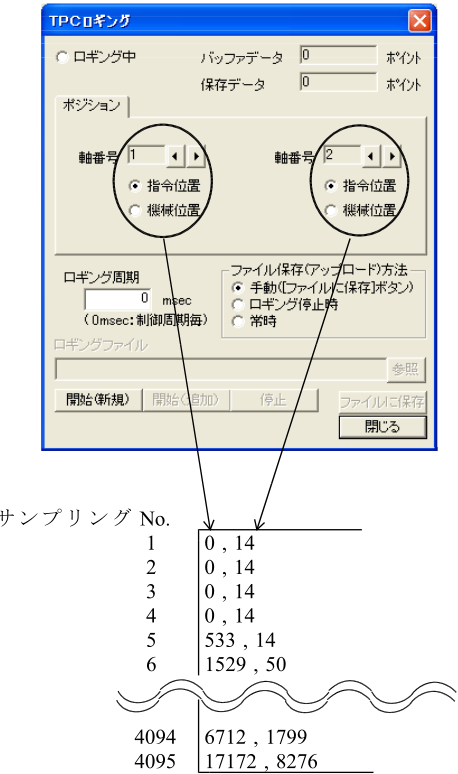

> **図の内容**
>
> TPC ロギングダイアログの左側（軸番号 1・指令位置）と右側（軸番号 2・指令位置）の選択が、
> 矢印で CSV の 1 列目と 2 列目に対応づけられている。CSV の例:
>
> | サンプリング No. | 1 列目 , 2 列目 |
> |---|---|
> | 1 | 0 , 14 |
> | 2 | 0 , 14 |
> | 3 | 0 , 14 |
> | 4 | 0 , 14 |
> | 5 | 533 , 14 |
> | 6 | 1529 , 50 |
> | （中略） | |
> | 4094 | 6712 , 1799 |
> | 4095 | 17172 , 8276 |
>
> サンプリング No. はファイルの列ではなく、行の順番を示している。

ＴＰＣロギング画面の左側で選択した項目がの列目に、右側の項目が列目に CSV 1 2 時系列で並びます。

## ６．ＴＰＣ－Ｅｘｃｅｌの機能

- ※ ＴＰＣロギングの「常時」保存で収集できるデータポイント数は無限大ですが、データの解析機能ＴＰＣ－Ｅｘｃｅｌに取り込めるデータポイント数は最大３２０００ポイントです。

ロギングデータの第列データを横軸、第列データを縦軸として合成軌跡を表示します。 1 2

- ６－１．合成軌跡評価するロギングデータの確認や、軌跡形状の評価を行えます。

２軸で円を描いた場合は、中心位置や半径などが確認できます。

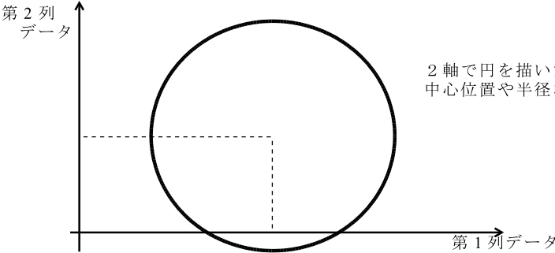

> **図の内容**
>
> 横軸「第１列データ」、縦軸「第２列データ」の座標に円が描かれ、円の中心から両軸へ破線が引かれている。
> 吹き出し（一部が切れている）: 「２軸で円を描いた場合は、中心位置や半径などが確認できます。」

- ６－２．サーボ応答精度解析各軸の指令から速度応答を評価します。 /FB

追従性、オーバシュート、定常速度、速度リップルなどを定量的に確認できます。

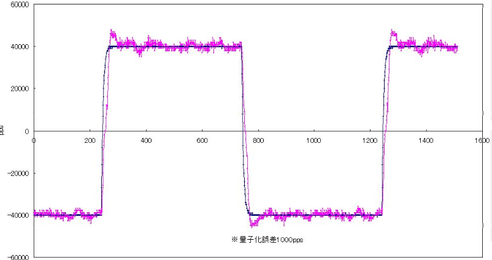

> **図の内容**
>
> 速度の時間変化のグラフ。縦軸 pps（-60000～60000）、横軸 0～1600。
> - 紺の線（指令）は -40000 と 40000 の間を台形状に行き来する（およそ 250、750、1250 で切り替わる）
> - ピンクの線（FB）は紺の線に少し遅れて追従し、切り替わりの直後にオーバーシュート（約 47000）があり、定常部分にも細かい揺れがある
> - 注記: 「※量子化誤差1000pps」

指令位置と機械位置をサンプリングした場合、

完全同期でサンプリングしているので、サーボの挙動が一目で確認できます。

- ６－３．真円精度解析

理想円を想定し、その円とのズレ分を誤差として解析します。

この解析により

- ２軸のゲインバランス
- 象限切り替わり時の突起性の誤差
- 摩擦によるスティックモーション
- 低速送り時の速度ムラによる軌跡誤差

を確認･評価できます。

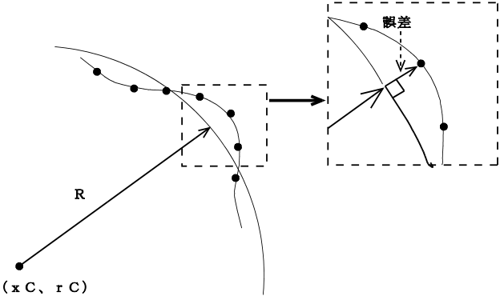

> **図の内容**
>
> 中心 (ｘC、ｒC) から半径 R の理想円の弧と、黒点（サンプルデータ）を結んだ実際の軌跡が描かれている。
> 一部を拡大した図では、中心から伸ばした半径の方向に、理想円から実際の点までの距離が「誤差」として示されている（理想円の法線方向の誤差）。
> 図中の中心の表記は「(ｘC、ｒC)」と書かれている（yC の誤記とみられる）。

６－４．直線精度解析

理想直線を想定し、その直線とのズレ分を誤差として解析します。

この解析により

- ２軸のゲインバランス
- 摩擦によるスティックモーション
- 低速送り時の速度ムラによる軌跡誤差

を確認･評価できます。

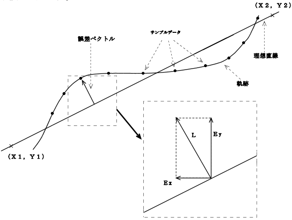

> **図の内容**
>
> (Ｘ1，Ｙ1) と (Ｘ2，Ｙ2) を結ぶ「理想直線」と、黒点の「サンプルデータ」を結んだ「軌跡」が描かれている。
> - 「誤差ベクトル」は、理想直線からサンプルデータへ、理想直線に垂直に引いた矢印
> - 拡大図: 誤差ベクトル「L」を、X 方向の成分「Ex」と Y 方向の成分「Ey」に分けている

## ７．セッティングＰＣの操作(ﾛｷﾞﾝｸﾞとﾛｷﾞﾝｸﾞﾃﾞｰﾀの保存)

７－１．ロギング機能選択

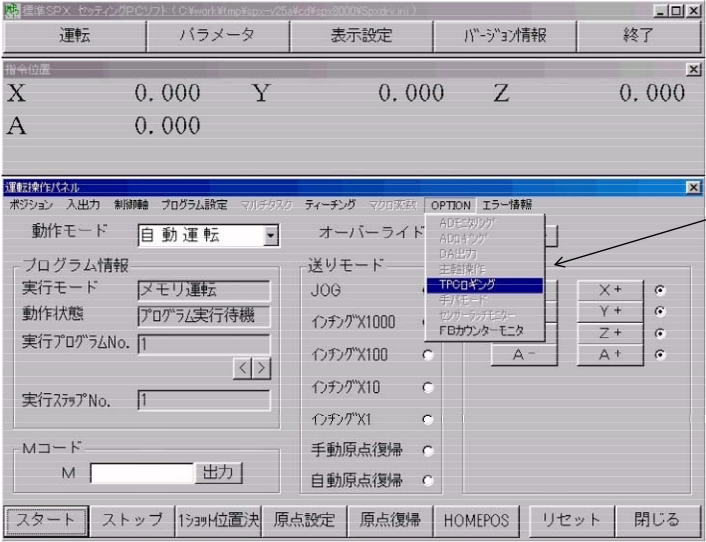

> **図の内容**
>
> セッティング PC ソフト（標準SPX）の運転操作パネル。メニュー「OPTION」を開き、「TPCﾛｷﾞﾝｸﾞ」を選んでいる。
> OPTION メニューの項目: ADモニタリング、ADﾛｸﾞｷﾞﾝｸﾞ、DA出力、主軸操作、TPCﾛｷﾞﾝｸﾞ、手ﾊﾟﾙﾓｰﾄﾞ、センサーラッチモニター、FBカウンターモニタ（TPCﾛｷﾞﾝｸﾞ と FBカウンターモニタ以外は灰色）

７－２．ロギング機能選択

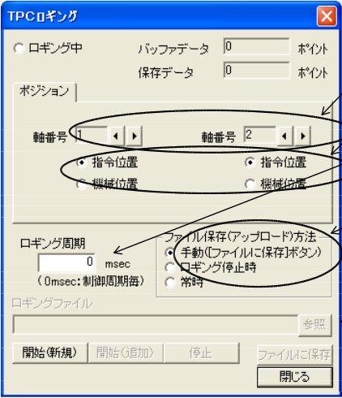

> **図の内容**
>
> TPC ロギングダイアログ。本文の ①～④ の手順で設定する箇所が丸で囲まれ、矢印が出ている:
> 「軸番号」（左右）、「指令位置」「機械位置」の選択（左右）、「ロギング周期」、「ファイル保存(アップロード)方法」（手動を選択）。

※以後の手順説明では、ファイル保存方法に「手動」を選択した場合の手順で説明しています。

- ①ﾒﾆｭｰから－ﾛｷﾞﾝｸﾞ OPTION TPC を選択
- ① ボタンにより、ロギングしたい軸番号を選択してください。
- ② ﾛｷﾞﾝｸﾞしたい項目に合わせて選択した軸の指令位置または機械位置を選択してください。
- ③ 確認したい状態とバッファ容量を考慮してロギング周期を設定してください。
- ④ 必要データの長さに応じてファイル保存方法を選択します「５３．セッテ。 - ィングＰＣのＴＰＣロギングダイアログ」のファイル保存方法詳細を参照ください。
- ⑤ ④で「ロギング停止時」又は「常時」を選択したときは、保存ファイルを指定してください。「参照」を押すとファイルセーブダアログが開きますので保存するファイルを設定してください。「７４．ロギングデータをファイルに -

保存」を参照ください。

７－３．ロギング開始・停止・保存

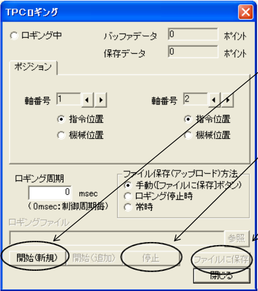

> **図の内容**
>
> TPC ロギングダイアログ。本文の ①～③ に対応して、「開始(新規)」「停止」「ファイルに保存」の各ボタンが丸で囲まれている。

７－４．ロギングデータをファイル保存

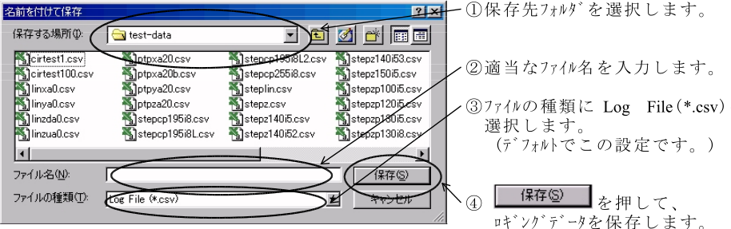

> **図の内容**
>
> 「名前を付けて保存」ダイアログ（保存する場所 test-data）。手順:
> 1. 保存先ﾌｫﾙﾀﾞを選択します。
> 2. 適当なﾌｧｲﾙ名を入力します。
> 3. ﾌｧｲﾙの種類に Log File (*.csv) 選択します。（ﾃﾞﾌｫﾙﾄでこの設定です。）
> 4. 「保存(S)」を押して、ﾛｷﾞﾝｸﾞﾃﾞｰﾀを保存します。

ここまでの手順でﾛｷﾞﾝｸﾞﾃﾞｰﾀを形式でﾌｧｲﾙ保存できました。 CSV ここからはＴＰＣ－Ｅｘｃｅｌを使ってデータの解析を行います。

- ① を押してﾛｷﾞﾝｸﾞを開始します。 (ﾎﾟｲﾝﾄ数表示が増えます。)
- ② を押してﾛｷﾞﾝｸﾞを停止します。
- ③ ファイル保存方法で「手動」選択したときはロギング停止後、を押します。ファイルセーブダイアログが開き、ファイル名を付けて保存してください「７－４．ロギングデータ。をファイル保存」を参照ください。

※注ﾛｷﾞﾝｸﾞの開始停止はﾌﾟﾛｸﾞﾗﾑ 1 /

- の動作等とは無関係です。開始停止は各ﾎﾞﾀﾝが押された / タイミングで行います。

※注ﾛｷﾞﾝｸﾞﾊﾞｯﾌｧがﾎﾟｲﾝﾄに達す 2 4095 。ると自動的にﾛｷﾞﾝｸﾞ停止します

## ８．ＴＰＣ－Ｅｘｃｅｌの操作(解析前の準備)

８－１．ＴＰＣ－Ｅｘｃｅｌの起動エクスプローラ等を使ってファイルを起動します。 TPC-Excel.XLT

８－２．マクロの許可

起動時に以下の様なダイアログが表示されます。

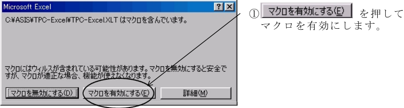

> **図の内容**
>
> Excel のダイアログ「C:\ASIS\TPC-Excel\TPC-Excel.XLT はマクロを含んでいます。」
> ボタン: 「マクロを無効にする(D)」「マクロを有効にする(E)」「詳細(M)」。
> 吹き出し: 「① マクロを有効にする(E) を押してマクロを有効にします。」

８－３．解析方法の選択ﾀﾞｲｱﾛｸﾞの表示

マクロの許可が終わると以下のシートが表示されます。

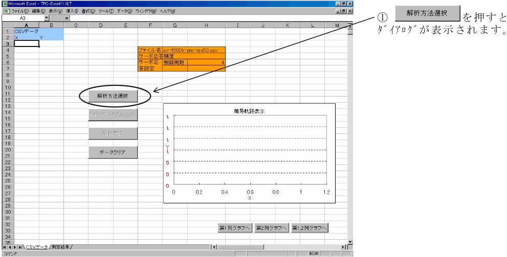

> **図の内容**
>
> TPC-Excel11.XLT を開いた直後のシート「CSVデータ」。
> - A1「CSVデータ」、A2「X」、B2「Y」（データはまだない）
> - F4～H7 の設定欄: 「ファイル名」、「サーボ応答精度」、「サーボ応答設定」「制御周期」「4」
> - ボタン: 「解析方法選択」（丸で囲み）、「ﾛｷﾞﾝｸﾞﾃﾞｰﾀ読み込み」「解析実行」（灰色）、「データクリア」
> - グラフ「簡易軌跡表示」（空）
> - 下のボタン: 「第1列グラフへ」「第2列グラフへ」「第1,2列グラフへ」
> - シートのタブ: CSVデータ、測定結果
> 吹き出し: 「① 解析方法選択 を押すとﾀﾞｲｱﾛｸﾞが表示されます。」

８－４．解析方法の選択

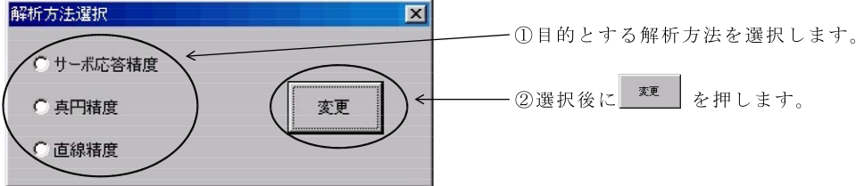

> **図の内容**
>
> ダイアログ「解析方法選択」。ラジオボタン「サーボ応答精度」「真円精度」「直線精度」と「変更」ボタン。
> 1. 目的とする解析方法を選択します。
> 2. 選択後に「変更」を押します。

解析方法選択後、ﾛｷﾞﾝｸﾞﾃﾞｰﾀを選択します。

ここまでの作業は共通です。その後の手順については

サーボ応答精度解析は９の手順で解析を行います。．サーボ応答精度解析

真円精度解析は１０の手順で解析を行います。．真円精度解析

直線誤差精度は１１の手順で解析を行います。．直線精度解析

。

８－５．ﾛｷﾞﾝｸﾞﾃﾞｰﾀﾌｧｲﾙの読み込み

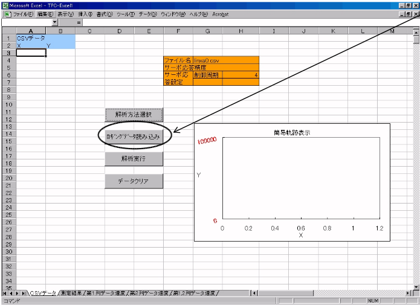

> **図の内容**
>
> 解析方法を選んだあとのシート「CSVデータ」。「ﾛｷﾞﾝｸﾞﾃﾞｰﾀ読み込み」ボタンが丸で囲まれている（本文の ①）。
> 設定欄はファイル名「linxa0.csv」、サーボ応答設定の制御周期「4」。
> シートのタブ: CSVデータ、測定結果、第1列データ速度、第2列データ速度、第1,2列データ速度。

- ① を押すと、ﾛｷﾞﾝｸﾞﾃﾞｰﾀ選択ﾀﾞｲｱﾛｸﾞが表示されます。 (→ ８－６)

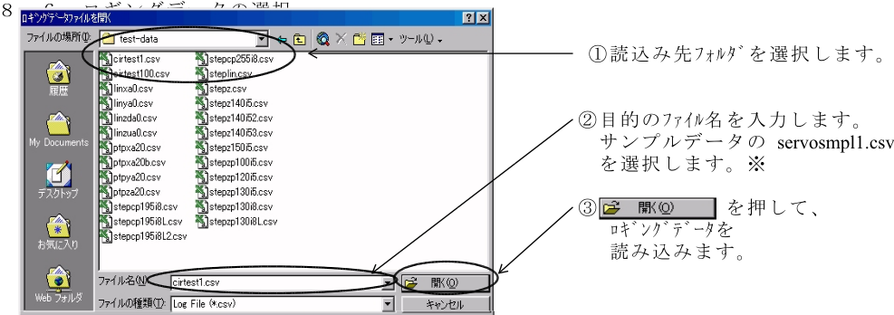

> **図の内容**
>
> ダイアログ「ﾛｷﾞﾝｸﾞﾃﾞｰﾀﾌｧｲﾙを開く」（ファイルの場所 test-data、ファイルの種類 Log File (*.csv)）。
> 1. 読込み先ﾌｫﾙﾀﾞを選択します。
> 2. 目的のﾌｧｲﾙ名を入力します。サンプルデータの servosmpl1.csv を選択します。※
> 3. 「開く(O)」を押して、ﾛｷﾞﾝｸﾞﾃﾞｰﾀを読み込みます。

この後の手順は、選択した解析方法により異なります。

> **図の内容**
>
> - サーボ応答精度解析 → ９．サーボ応答精度解析
> - 真円精度解析 → １０．真円精度解析
> - 直線誤差精度 → １１．直線精度解析

※サーボ応答精度解析用ｻﾝﾌﾟﾙﾃﾞｰﾀ

servosmpl1.csv servosmpl2.csv servosmpl3.csv 、、

真円精度解析用ｻﾝﾌﾟﾙﾃﾞｰﾀ

cirsmpl1.csv cirsmpl2.csv 、

各ﾃﾞｰﾀの簡単な説明は１２にあります。．サンプルデータの紹介

## ９．サーボ応答精度解析

- ９－１．設定項目の入力と解析の実行

ﾛｷﾞﾝｸﾞﾃﾞｰﾀを読み込むと列にﾃﾞｰﾀが表示され簡易軌跡が表示されます。 A,B

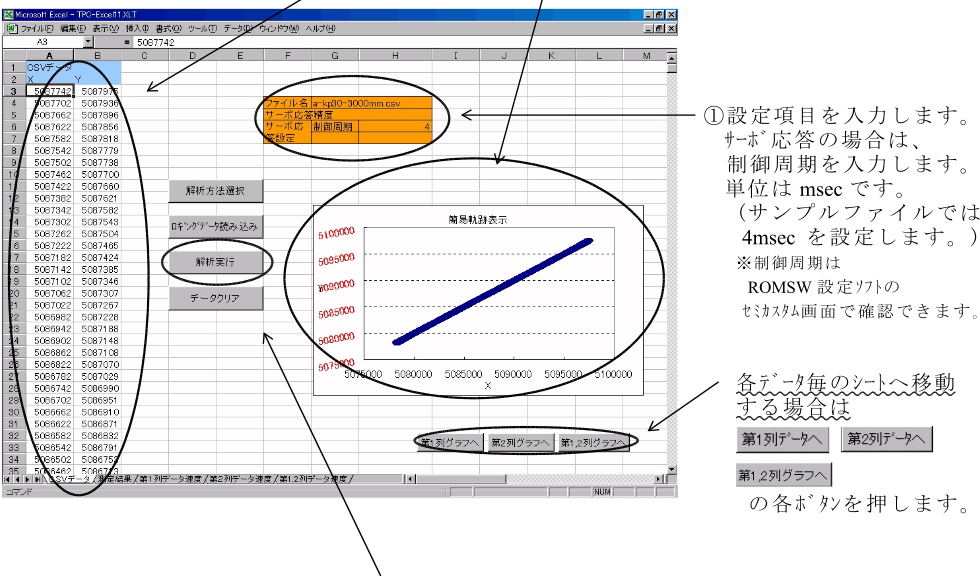

> **図の内容**
>
> ロギングデータ（a-kp30-3000mm.csv）を読み込んだシート「CSVデータ」。
> - A 列「X」、B 列「Y」にデータ（例: 5087742, 5087975 …）が入る（本文: 「ﾛｷﾞﾝｸﾞﾃﾞｰﾀを読み込むと A,B 列にﾃﾞｰﾀが表示され簡易軌跡が表示されます。」）
> - 設定欄: ファイル名「a-kp30-3000mm.csv」、サーボ応答精度、サーボ応答設定「制御周期」「4」
> - グラフ「簡易軌跡表示」に X-Y の軌跡（右上がりの直線）
> - シートのタブ: CSVデータ、測定結果、第1列データ速度、第2列データ速度、第1,2列データ速度
>
> 吹き出し（PDF 11 ページ）:
> - ①設定項目を入力します。ｻｰﾎﾞ応答の場合は、制御周期を入力します。単位は msec です。（サンプルファイルでは 4msec を設定します。）※制御周期は ROMSW 設定ｿﾌﾄのｾﾐｶｽﾀﾑ画面で確認できます。
> - ②設定項目の入力が完了したら、「解析実行」を押します。解析処理が実行されます。設定項目に不足がある場合はﾒｯｾｰｼﾞが表示されます。
> - 各ﾃﾞｰﾀ毎のｼｰﾄへ移動する場合は「第1列ﾃﾞｰﾀへ」「第2列ﾃﾞｰﾀへ」「第1,2列グラフへ」の各ﾎﾞﾀﾝを押します。

- 、。 ②設定項目の入力が完了したらを押します解析処理が実行されます。設定項目に不足がある場合はﾒｯｾｰｼﾞが表示されます。
- ９－２．解析結果の表示

第１列データと第２列データの速度カーブを表示します。

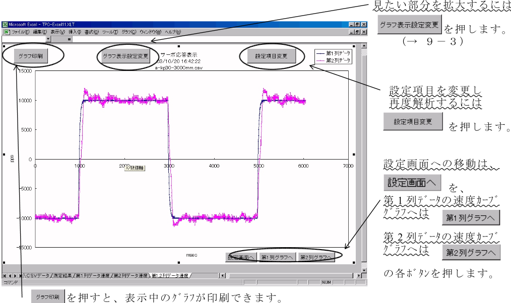

> **図の内容**
>
> シート「第1,2列データ速度」のグラフ「サーボ応答表示」（03/10/20 16:42:22、a-kp30-3000mm.csv）。
> - 縦軸 pps（-15000～15000）、横軸 msec（0～7000）
> - 凡例: 第1列ﾃﾞｰﾀ（紺）、第2列ﾃﾞｰﾀ（ピンク）。-10000 と 10000 の間を台形状に行き来し、ピンクは切り替わり直後にオーバーシュートがある
> - ボタン: 「グラフ印刷」「グラフ表示設定変更」「設定項目変更」、右下に「設定画面へ」「第1列グラフへ」「第2列グラフへ」
>
> 吹き出し:
> - 見たい部分を拡大するには「グラフ表示設定変更」を押します。（→ ９－３）
> - 設定項目を変更し再度解析するには「設定項目変更」を押します。
> - 設定画面への移動は「設定画面へ」を、第１列ﾃﾞｰﾀの速度ｶｰﾌﾞｸﾞﾗﾌへは「第1列グラフへ」、第２列ﾃﾞｰﾀの速度ｶｰﾌﾞｸﾞﾗﾌへは「第2列グラフへ」の各ﾎﾞﾀﾝを押します。
> - 「グラフ印刷」を押すと、表示中のｸﾞﾗﾌが印刷できます。

。

９－３．ｸﾞﾗﾌ表示設定変更

ｸﾞﾗﾌの横軸表示範囲を設定できます。

ｸﾞﾗﾌの縦軸表示範囲を設定できます。

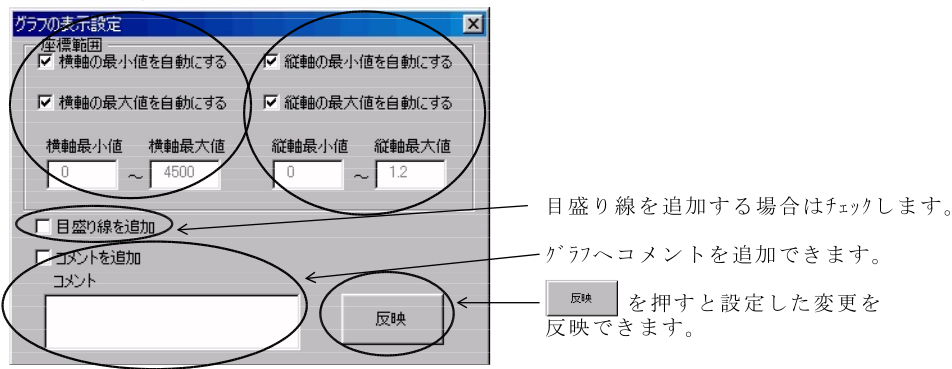

> **図の内容**
>
> ダイアログ「グラフの表示設定」。
> - 座標範囲: 「横軸の最小値を自動にする」「横軸の最大値を自動にする」（チェックあり）、横軸最小値 0 ～ 横軸最大値 4500
> - 「縦軸の最小値を自動にする」「縦軸の最大値を自動にする」（チェックあり）、縦軸最小値 0 ～ 縦軸最大値 1.2
> - 「目盛り線を追加」: 目盛り線を追加する場合はﾁｪｯｸします。
> - 「コメントを追加」とコメント欄: ｸﾞﾗﾌへコメントを追加できます。
> - 「反映」: 押すと設定した変更を反映できます。

９－４．設定項目変更(サーボ応答精度)

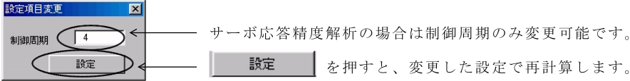

> **図の内容**
>
> ダイアログ「設定項目変更」。「制御周期 [4]」と「設定」ボタン。
> - サーボ応答精度解析の場合は制御周期のみ変更可能です。
> - 「設定」を押すと、変更した設定で再計算します。

- ９－５．第列データ速度 1 を押すと１列目データの速度カーブのみが表示されます。

ボタンの操作等は９－２と同様です。

- ９－６．第２列データ速度

を押すと２列目データの速度カーブのみが表示されます。ボタンの操作等は９－２と同様です。

## １０．真円精度解析

１０－１．設定項目の入力と解析の実行

ﾛｷﾞﾝｸﾞﾃﾞｰﾀを読み込むと列にﾃﾞｰﾀが表示され簡易軌跡が表示されます。 A,B

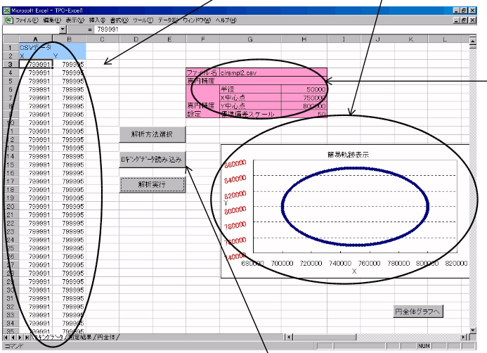

> **図の内容**
>
> ロギングデータ（cirsmpl2.csv）を読み込んだシート。
> - A 列「X」、B 列「Y」にデータ（例: 799991, 799995 …）
> - 設定欄（真円精度設定）: ファイル名「cirsmpl2.csv」、半径「50000」、X中心点「750000」、Y中心点「800000」、標準偏差スケール「50」
> - グラフ「簡易軌跡表示」に円の軌跡（縦横の目盛りの違いで楕円に見える）
> - ボタン「円全体グラフへ」。シートのタブ: ﾛｷﾞﾝｸﾞﾃﾞｰﾀ、測定結果、円全体
>
> 吹き出し（PDF 13 ページ）:
> - ①設定項目を入力します。真円精度解析の場合は、半径、X 中心点、Y 中心点、標準偏差スケールの 4 項目を設定します。サンプルデータでは 半径 50000、X 中心点 750000、Y 中心点 800000、標準偏差ｽｹｰﾙ 50 を設定します。※標準偏差スケールについては１０－３を参照
> - ②設定項目の入力が完了したら、「解析実行」を押します。解析処理が実行されます。設定項目に不足がある場合はﾒｯｾｰｼﾞが表示されます。

- ①設定項目を入力します。真円精度解析の場合は、半径､中心点､Ｙ中心点 X 標準偏差スケールの項目を設定します。 4 サンプルデータでは 50000 半径 750000 Ｘ中心点 800000 Ｙ中心点 50 標準偏差ｽｹｰﾙを設定します。 ※標準偏差スケールについては１０－３を参照
- 、 ②設定項目の入力が完了したら

を押します

。

解析処理が実行されます。設定項目に不足がある場合はﾒｯｾｰｼﾞが表示されます。

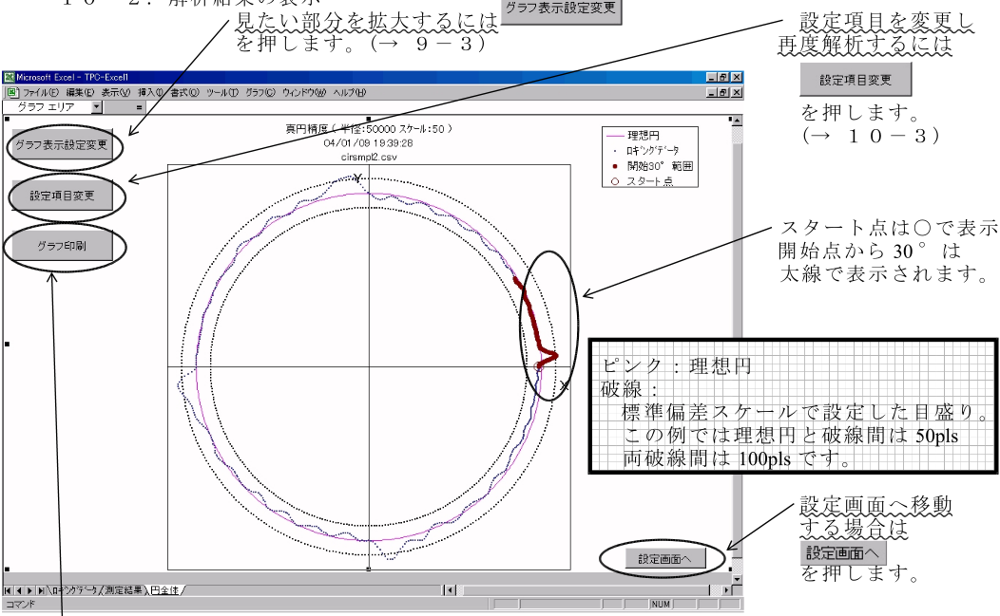

> **図の内容**
>
> シート「円全体」のグラフ「真円精度（半径:50000 スケール:50）」（04/01/09 19:39:28、cirsmpl2.csv）。
> - 凡例: 理想円（ピンクの線）、ﾛｷﾞﾝｸﾞﾃﾞｰﾀ（点）、開始30°範囲（赤茶の太い点）、スタート点（○）
> - 理想円の内側と外側に、点線の円が 1 本ずつある
> - ボタン: 「グラフ表示設定変更」「設定項目変更」「グラフ印刷」「設定画面へ」
>
> 吹き出し:
> - 見たい部分を拡大するには「グラフ表示設定変更」を押します。（→ ９－３）
> - 設定項目を変更し再度解析するには「設定項目変更」を押します。（→ １０－３）
> - スタート点は○で表示、開始点から 30°は太線で表示されます。
> - ピンク：理想円。破線：標準偏差スケールで設定した目盛り。この例では理想円と破線間は 50pls、両破線間は 100pls です。
> - 設定画面へ移動する場合は「設定画面へ」を押します。
> - 「グラフ印刷」を押すと、表示中のｸﾞﾗﾌが印刷できます。

１０－２．解析結果の表示

を押すと、表示中のｸﾞﾗﾌが印刷できます。

１０－３．設定項目変更(真円精度)

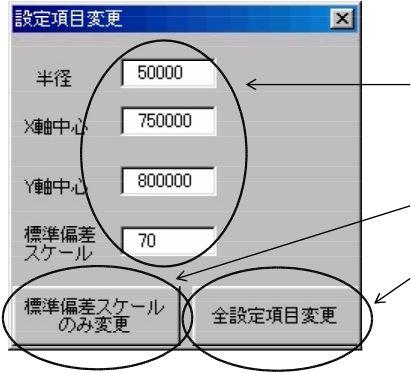

> **図の内容**
>
> ダイアログ「設定項目変更」: 半径 [50000]、X軸中心 [750000]、Y軸中心 [800000]、標準偏差スケール [70]、ボタン「標準偏差スケールのみ変更」「全設定項目変更」。
> - 真円精度解析の場合は半径、X 軸中心、Y 軸中心、偏差スケールが変更可能です。
> - 標準偏差スケールのみの変更であれば「標準偏差スケールのみ変更」を押します。
> - 標準偏差スケール以外も変更する場合は、「全設定項目変更」を押します。

真円精度解析の場合は半径、Ｘ軸中心、Ｙ軸中心、偏差スケールが変更可能です。

標準偏差スケールのみの変更であればこのボタンを押します。

、標準偏差スケール以外も変更する場合はこのボタンを押します。

※標準偏差スケール：真円精度の解析結果グラフの目盛りです。真円精度では理想円から誤差を拡大表示しています。この幅から大きく外れると正常な形に表示できません。設定する値は最初大きめの値を設定し、

解析結果を判断しながら標準偏差スケールを小さくしていく方法が使いやすいです。

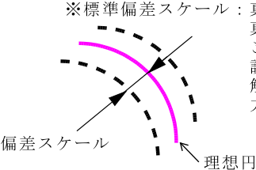

> **図の内容**
>
> ピンクの弧（理想円）の内側と外側に、破線の弧が 1 本ずつある。理想円から破線までの幅が「偏差スケール」。
> 本文の説明: 標準偏差スケールは真円精度の解析結果グラフの目盛りで、理想円からの誤差を拡大表示している。

## １１．直線精度解析

１１－１．設定項目の入力と解析の実行ﾛｷﾞﾝｸﾞﾃﾞｰﾀを読み込むと列にﾃﾞｰﾀが表示され簡易軌跡が表示されます。 A,B

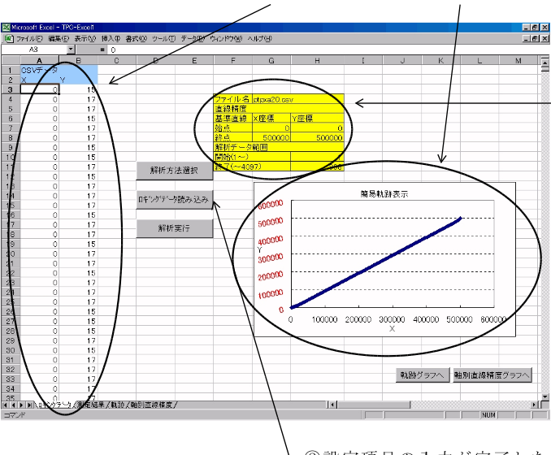

> **図の内容**
>
> ロギングデータ（ptpxa20.csv）を読み込んだシート。
> - A 列「X」、B 列「Y」にデータ（例: 0, 15 / 0, 17 …）
> - 設定欄（直線精度）: ファイル名「ptpxa20.csv」、基準直線 始点 X座標 0・Y座標 0、終点 X座標 500000・Y座標 500000、解析データ範囲 開始(1～)、終了(～4097)（値は判読できず）
> - グラフ「簡易軌跡表示」に右上がりの直線（0～500000）
> - ボタン: 「軌跡グラフへ」「軸別直線精度グラフへ」。シートのタブ: ﾛｷﾞﾝｸﾞﾃﾞｰﾀ、測定結果、軌跡、軸別直線精度
>
> 吹き出し（PDF 14 ページ）:
> - ①設定項目を入力します。直線精度解析の設定項目（→ １１－２）
> - ②設定項目の入力が完了したら、「解析実行」を押します。解析処理が実行されます。設定項目に不足がある場合はﾒｯｾｰｼﾞが表示されます。

- ①設定項目を入力します。直線精度解析の設定項目 (→ １１－２)
- 、。 ②設定項目の入力が完了したらを押します解析処理が実行されます。設定項目に不足がある場合はﾒｯｾｰｼﾞが表示されます。

> **図の内容**
>
> 「解析実行」ボタンの画像（本文中のボタン名の代わり）。

１１－２．設定項目

基準直線：基準直線の始点と終点の座標です。

開始：何番目のデータから解析に使用するかを指定します。

終了：何番目のデータで解析を終了するかを指定します。

上の例では最初のデータから１４１５個目までのデータを解析します。

比較する基準直線は(００)－(７９９９９７８０００００)を結んだ直線です。 , ,

１１－３．解析結果の表示

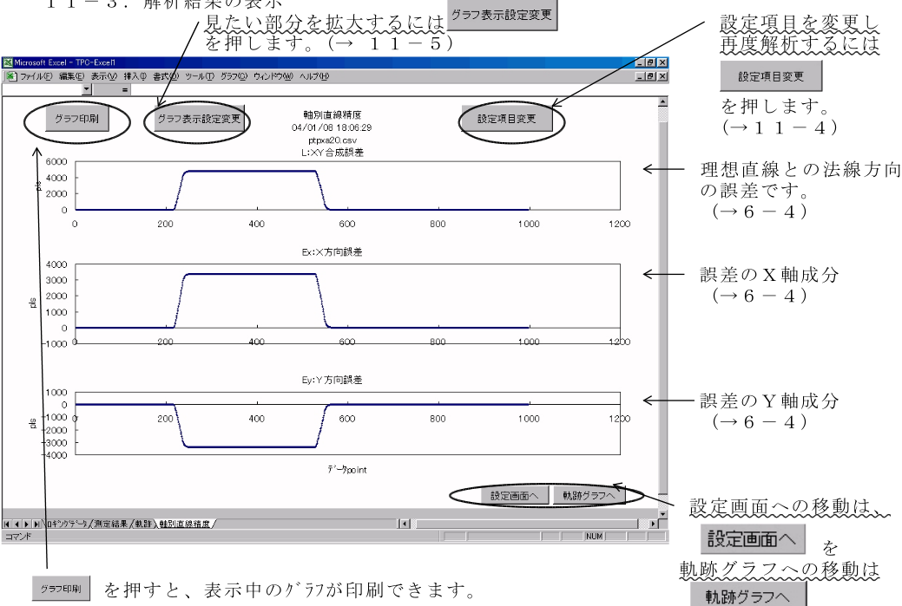

> **図の内容**
>
> シート「軸別直線精度」（04/01/08 18:06:29、ptpxa20.csv）。グラフが縦に 3 つ並ぶ。横軸はどれも ﾃﾞｰﾀpoint（0～1200）、縦軸は pls。
> - 「L:XY合成誤差」（0～6000。約 220～550 で約 4800 まで上がる）: 理想直線との法線方向の誤差です。（→ ６－４）
> - 「Ex:X方向誤差」（-1000～4000。同じ区間で約 3400）: 誤差の X 軸成分（→ ６－４）
> - 「Ey:Y方向誤差」（-4000～1000。同じ区間で約 -3400）: 誤差の Y 軸成分（→ ６－４）
> - ボタン: 「グラフ印刷」「グラフ表示設定変更」「設定項目変更」「設定画面へ」「軌跡グラフへ」
>
> 吹き出し:
> - 見たい部分を拡大するには「グラフ表示設定変更」を押します。（→ １１－５）
> - 設定項目を変更し再度解析するには「設定項目変更」を押します。（→ １１－４）
> - 設定画面への移動は「設定画面へ」を、軌跡グラフへの移動は「軌跡グラフへ」を押します。
> - 「グラフ印刷」を押すと、表示中のｸﾞﾗﾌが印刷できます。

の各ﾎﾞﾀﾝを押します。

１１－４．設定項目変更(直線精度)

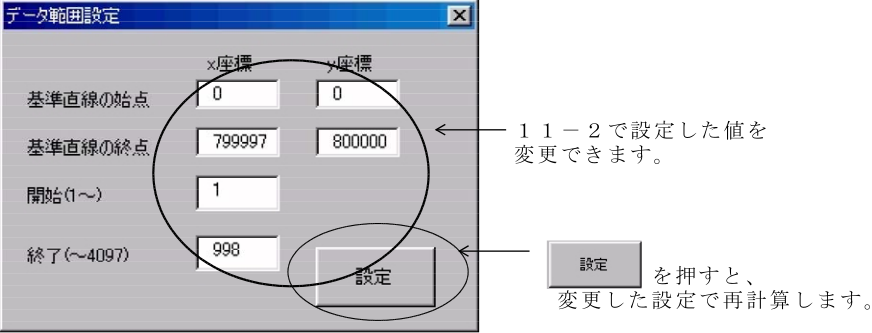

> **図の内容**
>
> ダイアログ「データ範囲設定」:
> | 項目 | x座標 | y座標 |
> |---|---|---|
> | 基準直線の始点 | 0 | 0 |
> | 基準直線の終点 | 799997 | 800000 |
> | 開始(1～) | 1 | |
> | 終了(～4097) | 998 | |
>
> - １１－２で設定した値を変更できます。
> - 「設定」を押すと、変更した設定で再計算します。

１１－５「軸別直線誤差」グラフの表示設定．

横軸の表示範囲を変更できます。変更すると３つのグラフすべてに反映されます。 (横軸は共通です。)

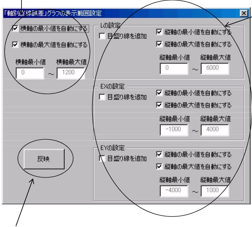

> **図の内容**
>
> ダイアログ「「軸別直線誤差」グラフの表示範囲設定」。
> - 横軸（3 つのグラフで共通）: 「横軸の最小値を自動にする」「横軸の最大値を自動にする」（チェックあり）、横軸最小値 0 ～ 横軸最大値 1200
> - 「Lの設定」「EXの設定」「EYの設定」の 3 組。それぞれに「目盛り線を追加」「縦軸の最小値を自動にする」「縦軸の最大値を自動にする」と、縦軸最小値～縦軸最大値（L: 0～6000、EX: -1000～4000、EY: -4000～1000）
> - 「反映」ボタン

を押すと設定した変更を反映できます。

合成・Ｘ軸・Ｙ軸の各誤差グラフ毎に縦軸の最大、最小値目盛り線の有無を設定できます。最大値や最小値を自動にすると、データの最大最小値が設定されます。 /

- １１－６「軌跡」グラフ．

サンプリングしたデータと理想直線を表示します。

見たい部分を拡大するには

を押します。(→ ９－３)

設定項目を変更し再度解析するには

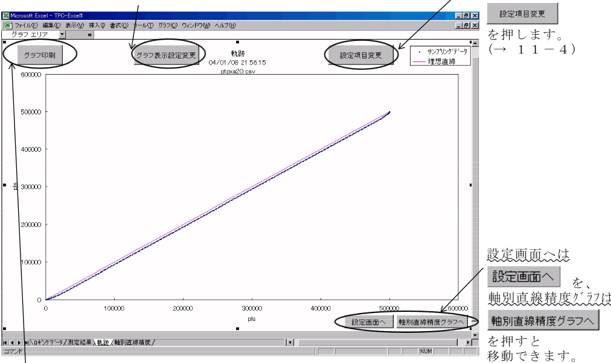

> **図の内容**
>
> シート「軌跡」のグラフ（04/01/08 21:56:15、ptpxa20.csv）。縦軸・横軸とも pls（0～600000）。
> - 凡例: ｻﾝﾌﾟﾘﾝｸﾞﾃﾞｰﾀ（点）、理想直線（ピンクの線）。(0,0) から約 (500000, 500000) までの直線で、サンプリングデータは理想直線のわずかに下を通る
> - ボタン: 「グラフ印刷」「グラフ表示設定変更」「設定項目変更」「設定画面へ」「軸別直線精度グラフへ」
>
> 吹き出し:
> - 設定項目を変更し再度解析するには「設定項目変更」を押します。（→ １１－４）
> - 設定画面へは「設定画面へ」を、軸別直線精度ｸﾞﾗﾌは「軸別直線精度グラフへ」を押すと移動できます。
> - 「グラフ印刷」を押すと、表示中のｸﾞﾗﾌが印刷できます。

を押すと、表示中のｸﾞﾗﾌが印刷できます。

## １２．サンプルデータの紹介

１２－１．サーボ応答精度解析用ファイル servosmpl1.csv

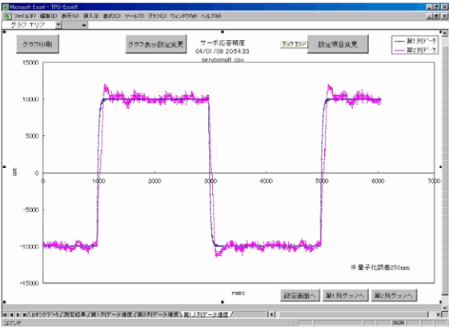

> **図の内容**
>
> グラフ「サーボ応答精度」（04/01/09 20:54:33、servosmpl1.csv）。縦軸 pps（-15000～15000）、横軸 msec（0～7000）。
> 第1列ﾃﾞｰﾀ（紺）は -10000 と 10000 の間を台形状に行き来し、第2列ﾃﾞｰﾀ（ピンク）は切り替わり直後に約 12000 までのオーバーシュートがある。
> 注記: 「※量子化誤差250pps」。本文: ゲインが高すぎてｵｰﾊﾞｼｭｰﾄ、ｱﾝﾀﾞｰｼｭｰﾄが発生しています。

ゲインが高すぎてｵｰﾊﾞｼｭｰﾄｱﾝﾀﾞｰｼｭｰﾄが発生しています。

- １２－２．サーボ応答精度解析用ファイル servosmpl2.csv
- １２－３．サーボ応答精度解析用ファイル servosmpl3.csv

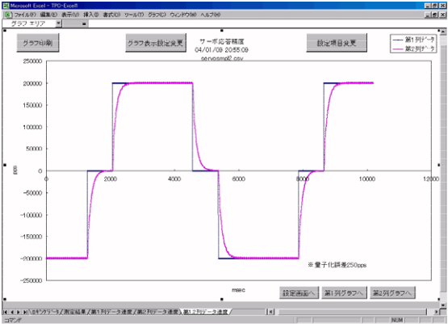

> **図の内容**
>
> グラフ「サーボ応答精度」（04/01/09 20:55:09、servosmpl2.csv）。縦軸 pps（-250000～250000）、横軸 msec（0～12000）。
> 第1列ﾃﾞｰﾀ（紺）は -200000、0、200000 の間をほぼ垂直に切り替わり、第2列ﾃﾞｰﾀ（ピンク）は指数関数的にゆっくり追いつく。
> 注記: 「※量子化誤差250pps」。本文: 位置ループゲインが低いのでサーボの応答がゆるやかです。

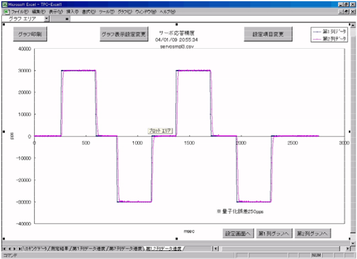

> **図の内容**
>
> グラフ「サーボ応答精度」（04/01/09 20:55:34、servosmpl3.csv）。縦軸 pps（-40000～40000）、横軸 msec（0～3000）。
> 0、30000、0、-30000 をくり返す台形の速度で、第1列ﾃﾞｰﾀ（紺）と第2列ﾃﾞｰﾀ（ピンク）がほぼ重なっている。
> 注記: 「※量子化誤差250pps」。本文: ゲインを最適に調整することで応答性を上げます。

位置ループゲインが低いのでサーボの応答がゆるやかです。

ゲインを最適に調整することで応答性を上げます。

- １２－４．真円精度解析用ファイル cirsmpl1.csv
- １２－５．真円精度解析用ファイル cirsmpl2.csv

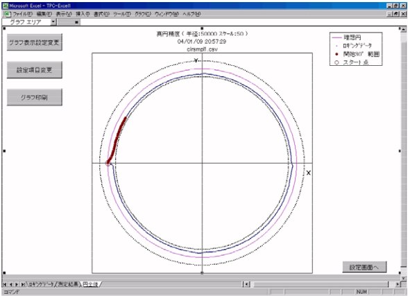

> **図の内容**
>
> グラフ「真円精度（半径:50000 スケール:50）」（04/01/09 20:57:29、cirsmpl1.csv）。
> ロギングデータの円は、理想円（ピンク）の内側にほぼ一様にずれている（円弧縮み）。左側（X の負の側）に、開始 30°範囲（赤茶の太線）とスタート点がある。
> 本文: サーボの遅れによる円弧縮みは発生していますが、２軸のゲインバランスは良好です。

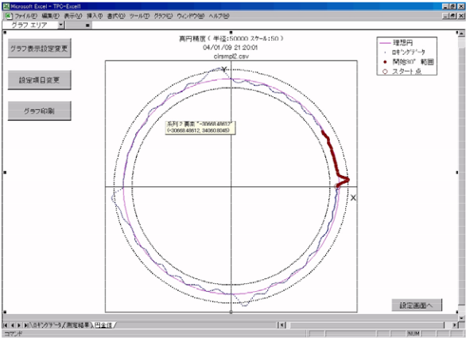

> **図の内容**
>
> グラフ「真円精度（半径:50000 スケール:50）」（04/01/09 21:20:01、cirsmpl2.csv）。
> ロギングデータは理想円（ピンク）の周りで細かくうねり、上下左右の象限の切り替わりで外へ突き出ている。右側（X の正の側）に、開始 30°範囲（赤茶の太線）とスタート点がある。
> グラフ上にデータ点のツールチップ（系列 2 要素 "-30668.48612" (-30668.48612, 34060.8045)）が表示されている。
> 本文: ２軸のゲインバランスは良好です。象限切り換わり時に突起性の誤差（約 50 パルス＝5μm）、モータ回転周期に同期した周期性の軌跡誤差（1μm 程度のうねり）が見られる。※1p＝0.1μm のシステムです。

サーボの遅れによる円弧縮みは発生していますが、２軸のゲインバランスは良好です。

- 軸のゲインバランスは 2 良好です。
- 象限切り換わり時に突起性の誤差(約５０パルス５μｍ) =
- モータ回転周期に同期した周期性の軌跡誤差 ( μｍ程度のうねり) 1 が見られる。

※ ｐ μｍのシステムです。 1 =0.1
